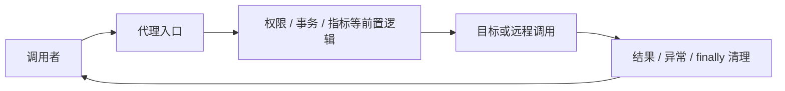
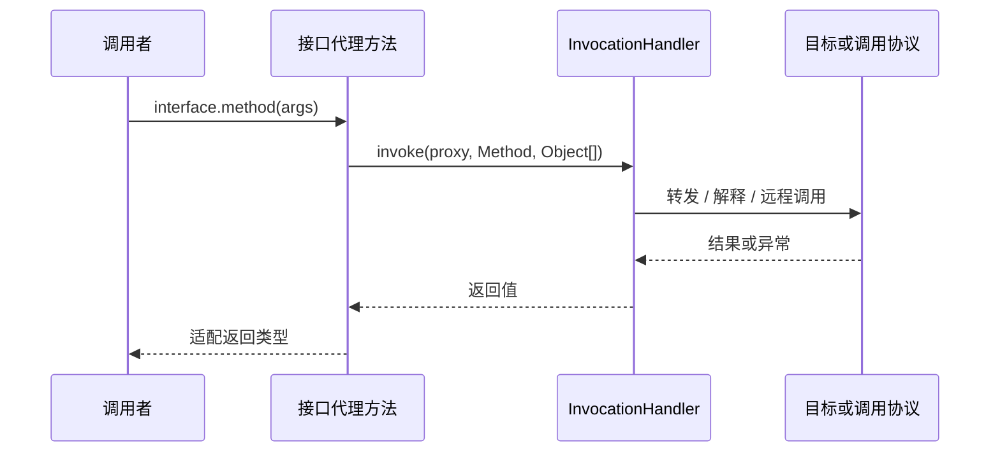
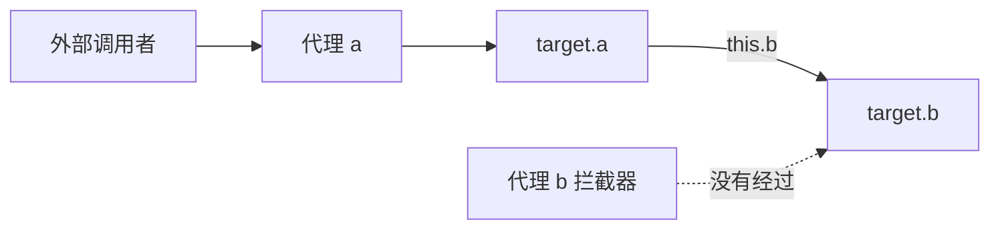
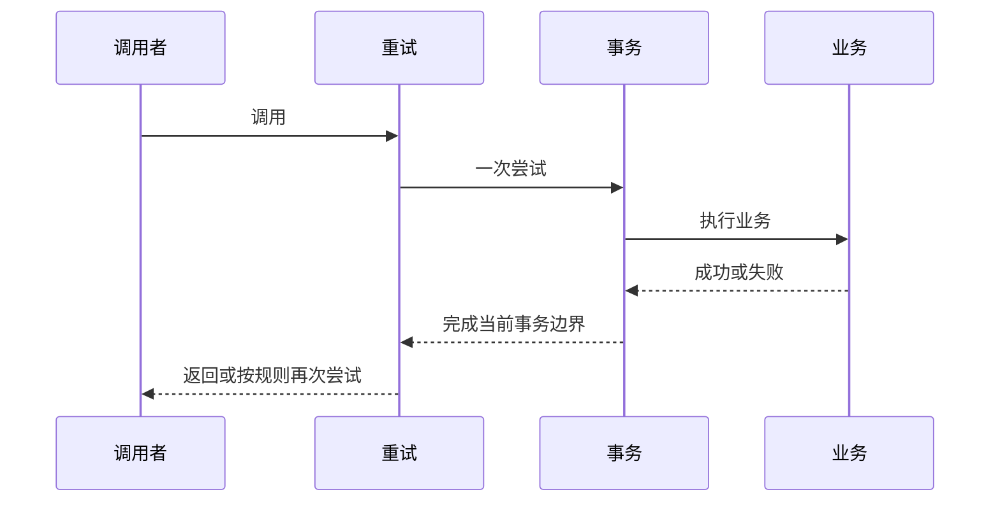
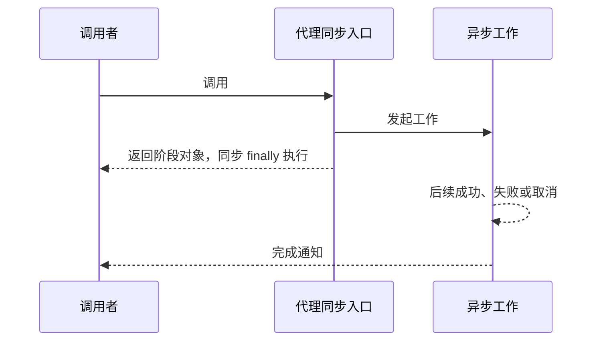

# 动态代理原理：从接口转发、子类拦截到调用链与框架失效边界

> **阅读目标**：沿“问题 → 可选方案 → 实现机制 → 代价与边界”理解设计，能用具体交错、调用链或资源生命周期解释结果。配套 [动态代理面试](动态代理面试.md)。

> **版本口径**：语言与接口契约优先；JDK（Java Development Kit，Java 开发工具包）8、17、21、25 是本文的对照节点，25 为本篇参考版本，并非“最新版本”声明。实现细节不自动成为跨版本保证。

[返回 Java 知识体系导读](../学习路线.md)

## 阅读路线

| 章节 | 核心问题 |
|---|---|
| [1. 代理、装饰与拦截入口](#p-01) | 代理将一次调用转成可组合的策略链，只有经过该入口的调用才受它控制。 |
| [2. JDK 接口代理的生成与分派](#p-02) | JDK Proxy 生成实现指定接口的类，方法入口把调用交给 InvocationHandler。 |
| [3. 一个可运行的转发代理](#p-03) | 正确转发至少要处理目标异常、Object 方法与 finally 清理。 |
| [4. 异常、默认方法与重复签名](#p-04) | 接口代理必须遵守接口调用契约，不能把任意 Throwable 原样塞给调用者。 |
| [5. 子类代理、CGLIB 与 Byte Buddy](#p-05) | 子类代理依赖可继承、可覆写的方法入口，final/private/static 不能按普通覆写模型拦截。 |
| [6. 自调用与对象身份](#p-06) | 代理外部调用成功，不代表目标内部 this 调用也会绕回代理。 |
| [7. 拦截器顺序、异步与上下文](#p-07) | 多个增强组合时，进入顺序与退出顺序共同决定事务、重试和观测语义。 |
| [8. 加载器、缓存与访问约束](#p-08) | 生成类必须在其加载域看见接口和相关签名，缓存还要尊重类型生命周期。 |
| [9. 工程选型与验证](#p-09) | 优先围绕调用契约设计，生成技术只是完成契约的工具。 |
| [10. 可运行拦截链：重试与事务边界如何由嵌套决定](#p-10) | 拦截链是嵌套调用，外层控制是否重入内层，顺序会改变每次尝试的资源与失败范围。 |
| [11. 重复接口异常与异步完成：代理契约的两类隐藏边界](#p-11) | 多接口重叠方法受联合异常约束，返回异步结果又把方法退出与业务结束分成两个时刻。 |
| [12. 默认方法调用与透明性边界：代理不是原对象的完全替身](#p-12) | 逐步推导与反例验证 |

<a id="p-01"></a>
## 1. 代理、装饰与拦截入口

> 🎯 **核心结论**：代理将一次调用转成可组合的策略链，只有经过该入口的调用才受它控制。

静态代理手写实现同一接口并转发，编译期清晰但接口多时重复。动态代理在运行期生成或取得代理类，把方法选择与调用逻辑统一交给处理器；子类代理通过覆写可拦截方法完成类似目标。两者都不是“给目标对象贴一个标签后所有调用自动拦截”。



**读图**：目标可以是普通对象，也可以完全不存在本地实现，例如 RPC（Remote Procedure Call，远程过程调用）客户端与 MyBatis Mapper。InvocationHandler 可以解释方法并发送请求，不必总是 method.invoke(target)。

装饰器强调组合并增加功能，代理强调访问间接层与控制；实现常有重叠。是否动态生成类，不决定设计模式的业务含义。

<a id="p-02"></a>
## 2. JDK 接口代理的生成与分派

> 🎯 **核心结论**：JDK Proxy 生成实现指定接口的类，方法入口把调用交给 InvocationHandler。

newProxyInstance 接收加载器、接口列表和处理器。代理类继承 Proxy 并实现接口，因此不能用这个机制直接代理一个没有合适接口的具体类；代理对象也不是目标具体类实例。接口顺序、可见性、返回类型冲突等会影响生成，非 public 接口与模块还有额外约束。



**读图**：处理器参数 proxy 是代理本身，不是 target。无参方法的 args 可能为 null；基本类型参数会涉及装箱，返回 null 给基本类型结果可能导致拆箱失败，返回错误类型可能强转失败。

<a id="p-03"></a>
## 3. 一个可运行的转发代理

> 🎯 **核心结论**：正确转发至少要处理目标异常、Object 方法与 finally 清理。

以下示例使用接口代理，直接保存为 ProxyDemo.java 可运行；计时只是机制示范，不是基准测试。

```java
import java.lang.reflect.*;
public class ProxyDemo {
    public interface Service { String hello(String name); }
    public static class Impl implements Service {
        public String hello(String name) { return "hello " + name; }
    }
    static Service wrap(Service target) {
        return (Service) Proxy.newProxyInstance(
            Service.class.getClassLoader(), new Class<?>[]{Service.class},
            (proxy, method, args) -> {
                if (method.getDeclaringClass() == Object.class) {
                    return switch (method.getName()) {
                        case "equals" -> proxy == args[0];
                        case "hashCode" -> System.identityHashCode(proxy);
                        case "toString" -> "ServiceProxy";
                        default -> throw new AssertionError(method);
                    };
                }
                long start = System.nanoTime();
                try {
                    return method.invoke(target, args);
                } catch (InvocationTargetException ex) {
                    throw ex.getCause();
                } finally {
                    System.out.println("ns=" + (System.nanoTime() - start));
                }
            });
    }
    public static void main(String[] args) {
        Service p = wrap(new Impl());
        System.out.println(p.hello("Java"));
        System.out.println(p.equals(p));
    }
}
```

**设计选择**：本例选代理引用身份的 equals/hashCode，而非透明委托到目标；这是一种明确策略，并非所有框架必须如此。若委托 target.equals(proxy)，可能破坏对称性或使代理与目标混用为 Map 键时行为异常。

<a id="p-04"></a>
## 4. 异常、默认方法与重复签名

> 🎯 **核心结论**：接口代理必须遵守接口调用契约，不能把任意 Throwable 原样塞给调用者。

处理器抛 RuntimeException/Error 通常直接传播；受检异常需符合被调用接口方法的声明，否则可被包装为 UndeclaredThrowableException。若反射转发忘记解包 InvocationTargetException，本来允许的业务异常也可能因多包一层而改变表现。

接口 default 方法也会到达处理器，不保证自动执行默认实现。JDK 16 起 InvocationHandler.invokeDefault 可按规则显式调用默认方法，涉及默认方法来源和继承覆盖限制。直接 method.invoke(proxy,args) 通常重新走代理，再次进入 handler 而递归。

多个接口声明相同名称与参数时，处理器获得的 Method 受接口列表和重复规则影响；不能根据调用方静态接口类型期待总能区分来源。受检异常还要满足有关声明的兼容限制。框架注册阶段应校验冲突，别到生产调用才发现。

<a id="p-05"></a>
## 5. 子类代理、CGLIB 与 Byte Buddy

> 🎯 **核心结论**：子类代理依赖可继承、可覆写的方法入口，final/private/static 不能按普通覆写模型拦截。

CGLIB（Code Generation Library，代码生成库）与 Byte Buddy 是常见字节码生成工具，具体框架选择与版本有关。子类覆写可用回调拦截，随后调用父实现或转发独立目标；“一定通过反射调用目标”不是所有实现的共同规则。

| 维度 | JDK 接口代理 | 子类代理 |
|---|---|---|
| 对外类型 | 指定接口 | 目标类子类型 |
| final 类 | 目标实现可为 final，只要通过接口代理 | 不能普通继承生成 |
| final 方法 | 接口入口仍可先拦截再委托目标 | 不能通过覆写拦截该方法 |
| private / static | 不是接口实例代理入口 | 不参与普通虚方法覆写 |
| 构造过程 | 代理类自己的构造 | 受生成与实例化策略影响 |

部分框架用绕过常规构造的实例化工具避免双重构造副作用，但这不代表 Java 子类不再有构造约束。对象布局、模块开放和工具支持都需核对。

**性能**：JIT（Just-In-Time Compilation，即时编译）优化、生成代码、适配与拦截器工作量都会影响结果，不能按“CGLIB 一定快、JDK 一定慢”的旧结论选择。

<a id="p-06"></a>
## 6. 自调用与对象身份

> 🎯 **核心结论**：代理外部调用成功，不代表目标内部 this 调用也会绕回代理。

常见 Spring 委托模型中，调用者进入代理后再到独立 target，target 的 a() 调 this.b() 仍在目标对象内部，绕过外部代理的 b 拦截。换成子类代理也不能据此普遍宣称自调用问题自动解决，须看实际目标和回调模型。



**读图**：图描绘常见的代理→独立目标委托。纯子类对象内部虚调用与框架委托不是一回事，讨论时应先说明模型。

更清晰的改法是把需独立边界的方法拆到协作组件，让调用自然跨代理。自注入或显式取得当前代理会增加容器耦合与循环依赖风险；字节码织入则是另一条实现路线，成本与作用范围不同。

<a id="p-07"></a>
## 7. 拦截器顺序、异步与上下文

> 🎯 **核心结论**：多个增强组合时，进入顺序与退出顺序共同决定事务、重试和观测语义。

若链为 重试→事务→目标，每次重试可能获得独立事务；事务→重试→目标 则可能在已失败的事务状态内重复尝试。事务边界还取决于框架传播与异常规则，不能只看注解排列顺序。



**读图**：每一层都要以 finally 处理自己的清理。代理返回 CompletableFuture 或流时，方法返回未必代表异步业务完成；指标、事务与资源关闭不能无条件在返回瞬间结束或延长到未知线程。线程上下文也不会因为经过代理就自动传播。

<a id="p-08"></a>
## 8. 加载器、缓存与访问约束

> 🎯 **核心结论**：生成类必须在其加载域看见接口和相关签名，缓存还要尊重类型生命周期。

相同接口名不代表相同 Class。生成代理所用加载器必须看见指定接口的正确身份，非 public 接口的包与模块限制更严格。JPMS（Java Platform Module System，Java 平台模块系统）会影响生成类位置与成员访问；不要硬编码 $Proxy 的具体名称或包。

JDK 的代理机制有自己的缓存设计，框架自行永久缓存 handler、目标、Method 或生成类则仍可能保留插件加载器。缓存键按名字拼接不足以区分同名类型，也不应任意排序接口列表后认为语义不变。

| 失败 | 检查方向 |
|---|---|
| cannot cast proxy to Impl | 代理实现接口，不是 Impl 子类 |
| 递归 / StackOverflowError | handler 是否调用 proxy 方法或打印 proxy |
| 权限 / 模块失败 | 接口可见性、加载器身份、包开放 |
| 注解查不到 | 当前 Method 是接口、桥接、代理还是目标方法 |
| 内存增长 | 缓存、注册表和任务是否保留目标与加载器 |

<a id="p-09"></a>
## 9. 工程选型与验证

> 🎯 **核心结论**：优先围绕调用契约设计，生成技术只是完成契约的工具。

少量稳定接口可用静态包装，动态横切可用接口代理，确需目标类类型且允许覆写时再考虑子类方案。编译生成适合闭世界和静态校验，织入适合需要改变对象内部调用路径的特定场景；每种都增加不同维护成本。

**验证集**：覆盖正常返回、void、基本类型、受检异常、运行异常、equals/hashCode/toString、默认方法、多接口重复签名、自调用、异步返回与模块访问。代理日志里不要拼接 proxy.toString；应输出稳定标识与方法签名。

RPC、Mapper 与事务代理的共同点是把方法调用转换成协议；差别在协议内容、资源边界和失败恢复。框架知识应能解释“究竟谁执行了接口方法”和“失败在哪一层转义”，而非只背生成类名字。

<a id="p-10"></a>
## 10. 可运行拦截链：重试与事务边界如何由嵌套决定

> 🎯 **核心结论**：拦截链是嵌套调用，外层控制是否重入内层，顺序会改变每次尝试的资源与失败范围。

### 10.1 用普通函数看清代理背后的链
代理负责把接口调用送进入口，链的语义则可用普通 Java 演示。以下 ChainDemo.java 记录重试与“模拟事务”顺序；没有连接数据库，日志仅表达边界。

```java
import java.util.*;
public class ChainDemo {
    @FunctionalInterface interface Next { Object call() throws Throwable; }
    @FunctionalInterface interface Advice { Object around(Next next) throws Throwable; }
    static Object invoke(List<Advice> chain, Next target) throws Throwable {
        Next next = target;
        for (int i = chain.size() - 1; i >= 0; i--) {
            Advice advice = chain.get(i);
            Next inner = next;
            next = () -> advice.around(inner);
        }
        return next.call();
    }
    public static void main(String[] args) throws Throwable {
        List<String> events = new ArrayList<>();
        Advice retry = next -> {
            for (int attempt = 1; ; attempt++) {
                try { return next.call(); }
                catch (IllegalStateException ex) {
                    if (attempt == 2) throw ex;
                    events.add("retry");
                }
            }
        };
        Advice tx = next -> {
            events.add("begin");
            try {
                Object result = next.call();
                events.add("commit");
                return result;
            } catch (Throwable ex) {
                events.add("rollback");
                throw ex;
            } finally { events.add("close"); }
        };
        int[] attempts = {0};
        Object result = invoke(List.of(retry, tx), () -> {
            events.add("work");
            if (++attempts[0] == 1) throw new IllegalStateException("transient");
            return "ok";
        });
        System.out.println(result);
        System.out.println(events);
    }
}
```

预期顺序为 `begin, work, rollback, close, retry, begin, work, commit, close`。重试在外层，所以重新进入完整事务层；若改为 `List.of(tx,retry)`，日志变为一个 begin 内发生两次 work，随后一次 commit。这不是任一真实数据库的自动成功保证，真实事务在第一次失败后可能已标记不可继续。

### 10.2 proceed 为什么不能随意共享
本例每次沿已构造的嵌套函数重新调用下一层，不使用一个全局可变“当前拦截器下标”。某些框架的调用对象带可变游标，重试若复用已推进到末尾的对象，可能跳过本应重新执行的拦截器；需遵守框架的克隆、重入或重建契约。

| 组合 | 需要明确的语义 |
|---|---|
| 重试 → 事务 | 是否每次获得独立事务与清理 |
| 缓存 → 权限 | 命中缓存是否仍执行权限检查 |
| 指标 → 重试 | 记录整次请求，还是每个尝试 |
| 异步调度 → 上下文 | 上下文在哪个线程安装和恢复 |

**边界**：本例重试只演示指定异常与有限次数，真实策略还要错误分类、期限与幂等；不能把所有业务失败都当瞬时故障。单次 Next 是否允许多次执行也须约定，目标包含流消费或不可重放数据时不一定可重试。

<a id="p-11"></a>
## 11. 重复接口异常与异步完成：代理契约的两类隐藏边界

> 🎯 **核心结论**：多接口重叠方法受联合异常约束，返回异步结果又把方法退出与业务结束分成两个时刻。

### 11.1 Method 声明允许，不等于代理可以抛
接口 A 的 `call()` 声明 IOException，接口 B 的同签名方法声明 SQLException。代理同时实现 A、B 时，生成的方法必须对这些接口契约都合法；handler 不能仅看到某个 Method 的 throws 列表就抛出任意该列表内受检异常。

```java
public interface A { void call() throws java.io.IOException; }
public interface B { void call() throws java.sql.SQLException; }
```

这是放在外层类中的接口片段。代理接口顺序可能影响 handler 收到的 Method 来源，却不能让不满足其他重叠声明的 IOException 突然合法；该受检异常可能被包装为 UndeclaredThrowableException。只测试单接口正常路径会漏掉这个边界。

| 维度 | 要分别判断 |
|---|---|
| Method 来自哪里 | 接口列表与重叠规则 |
| 可以正常返回什么 | 多个返回类型是否兼容 |
| 可以直接抛什么 | 所有相关方法声明的兼容约束 |

### 11.2 异步方法何时结束资源作用域
一个被代理方法返回 CompletionStage，handler 的 finally 只覆盖“取得结果句柄”的同步调用区间。如果把计时放这里，统计的是提交/构造阶段；若要统计真正完成，要挂到结果完成阶段，还应单独记录取消与异常。



**读图**：异步回调可能在别的线程。不能在入口开一个线程绑定的 JDBC 事务，再在任意回调线程提交，就声称保持了原事务管理语义。流式返回同样涉及延迟消费，方法返回时资源可能仍被下游需要。

### 11.3 完成观察器也属于调用链
`observed = original.whenComplete(...)` 创建的返回阶段与 original 是不同观察对象：观察器自身失败可能影响 observed，但不会回头把 original 已完成结果改写。框架要决定向用户返回哪个阶段，清理失败如何报告，不能悄悄丢掉新阶段上的错误。

指标回调不要无意吞掉业务异常，日志失败也不应随意替换原业务含义。资源归还要确保一次且绑定真实所有者；取消回调和正常完成回调竞争时应由明确终态协议防重复释放。

参考：[Proxy 重复方法契约](https://docs.oracle.com/en/java/javase/25/docs/api/java.base/java/lang/reflect/Proxy.html)、[CompletableFuture 完成语义](https://docs.oracle.com/en/java/javase/25/docs/api/java.base/java/util/concurrent/CompletableFuture.html)。

<a id="p-12"></a>
## 12. 默认方法调用与透明性边界：代理不是原对象的完全替身

> 🎯 **核心问题**：接口已有 default 实现，为何还会进入处理器？代理外观相同，哪些行为仍不能透明？

### 一、默认方法有实现，但入口仍是代理
JDK 接口代理把相关调用交给 InvocationHandler。handler 可以选择远端协议、本地目标转发或显式执行默认方法；不能只看 Method.isDefault 就假定 JVM 已替它调用完成。

```java
import java.lang.reflect.*;
public class DefaultProxyDemo {
    public interface Greeting {
        default String prefix() { return "hello"; }
        String name();
    }
    public static void main(String[] args) {
        Greeting proxy = (Greeting) Proxy.newProxyInstance(
            Greeting.class.getClassLoader(), new Class<?>[]{Greeting.class},
            (p, method, values) -> {
                if (method.isDefault())
                    return InvocationHandler.invokeDefault(p, method, values);
                if (method.getName().equals("name")) return "Java";
                throw new UnsupportedOperationException(method.toString());
            });
        System.out.println(proxy.prefix() + " " + proxy.name());
    }
}
```

这是 JDK 16+ 的最小分派示例，故意未实现 Object 方法的通用策略，不是完整业务代理模板。对默认方法直接 method.invoke(proxy,values) 会重新回到相同代理入口，可能递归；invokeDefault 表达的是特定默认实现的特殊调用。

### 二、默认实现内部调用会经过谁
若默认方法内部再调用同一代理上的抽象接口方法，接收者仍是代理，可再次进入 handler。它与“代理转发到独立目标后，target.this 内部调用”不同。讨论自调用不能忽略接收者身份，也不能只按接口代理/子类代理名称猜结果。

### 三、接口演进可能改变默认来源
父接口原有默认方法，子接口后来覆写或重新抽象声明，旧的默认 Method 未必仍可按相同规则 invokeDefault。缓存调用计划需要考虑接口实际层次和版本，而不是永久记住某个祖先 Method 就认为总能调用。

### 四、代理的透明性分成多个层次
| 维度 | 可能与目标不同 |
|---|---|
| 类型 | 接口代理不能当目标实现类强转 |
| 身份 | proxy==target 通常不成立 |
| 相等与哈希 | 需策略维护对称、传递和一致 |
| 异常 | 反射包装与受检异常约束会改变外观 |
| 注解与泛型 | 代理方法不等于目标声明模型 |
| 线程与资源 | 异步、重试、缓存短路改变作用域 |

因此“透明代理”必须说明透明到哪一层。日志中打印代理可能触发 toString 再次进入 handler；把目标的 equals 直接委托过来，也可能让 target.equals(proxy) 和 proxy.equals(target) 不对称。

### 五、验证顺序
先验证普通方法与默认方法，再验证默认体内的再次调用；随后覆盖 Object 方法、重叠签名、异常和异步返回。最后检查缓存及目标生命周期。性能比较应包含真正增强逻辑，不能把一个空 handler 的微基准当事务框架的端到端成本。

参考：[InvocationHandler](https://docs.oracle.com/en/java/javase/25/docs/api/java.base/java/lang/reflect/InvocationHandler.html)、[Proxy](https://docs.oracle.com/en/java/javase/25/docs/api/java.base/java/lang/reflect/Proxy.html)。

<a id="p-versions"></a>
## 版本演进与学习边界

| 节点 | 变化 | 注意 |
|---|---|---|
| 早期 JDK | 接口代理机制长期存在 | 旧生成类命名不能当契约 |
| 8 | 接口默认方法增加调用情形 | 不能假设 handler 不会收到默认方法 |
| 9 / 17 | 模块和强封装影响生成与访问 | 内部 Lookup 构造技巧不可靠 |
| 16 | InvocationHandler.invokeDefault | 旧版本需另行选择兼容策略 |
| 18–25 | 反射实现变化及现代优化 | 旧 JDK/CGLIB 性能排名不可直接复用 |

框架默认选哪种代理还取决于 Spring / Spring Boot 等自身版本与配置，本文不给“所有场景固定默认”结论。

<a id="p-references"></a>
## 参考资料与源码入口

- [Proxy：生成、接口与重复方法规则](https://docs.oracle.com/en/java/javase/25/docs/api/java.base/java/lang/reflect/Proxy.html)
- [InvocationHandler：异常与默认方法](https://docs.oracle.com/en/java/javase/25/docs/api/java.base/java/lang/reflect/InvocationHandler.html)
- [Spring AOP 代理机制](https://docs.spring.io/spring-framework/reference/core/aop/proxying.html)
- [Byte Buddy 官方教程](https://bytebuddy.net/partial/tutorial.partial.html)
- [MyBatis MapperProxy 源码](https://github.com/mybatis/mybatis-3/blob/master/src/main/java/org/apache/ibatis/binding/MapperProxy.java)

<a id="p-glossary"></a>
## 附录：术语与缩写

| 术语 | 英文全称 | 中文含义 |
|---|---|---|
| JDK | Java Development Kit | Java 开发工具包 |
| JVM | Java Virtual Machine | Java 虚拟机 |
| API | Application Programming Interface | 应用程序编程接口 |
| RPC | Remote Procedure Call | 远程过程调用 |
| AOP | Aspect-Oriented Programming | 面向切面编程 |
| CGLIB | Code Generation Library | 代码生成库 |
| JIT | Just-In-Time Compilation | 即时编译 |
| JPMS | Java Platform Module System | Java 平台模块系统 |
| Handler | Invocation Handler | 调用处理器 |
