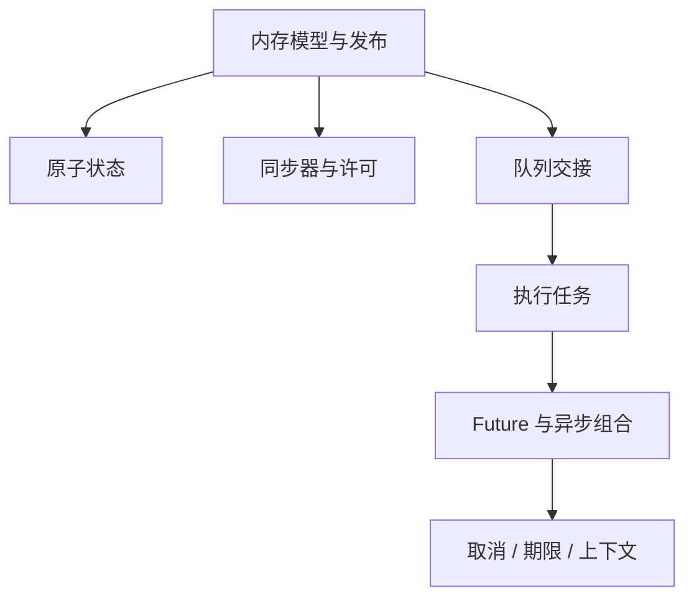
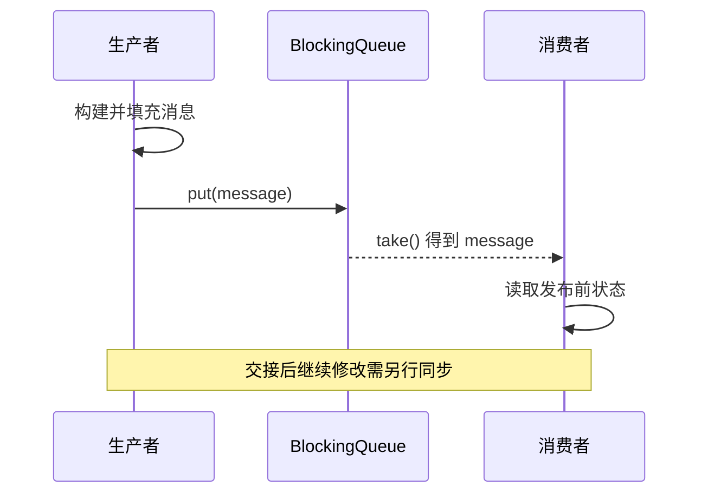
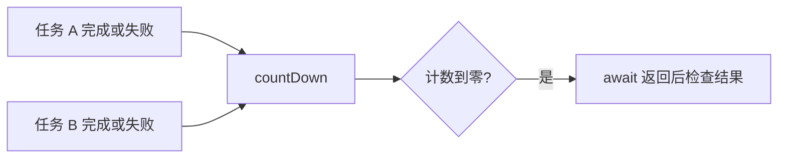
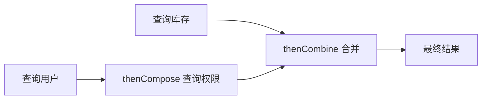
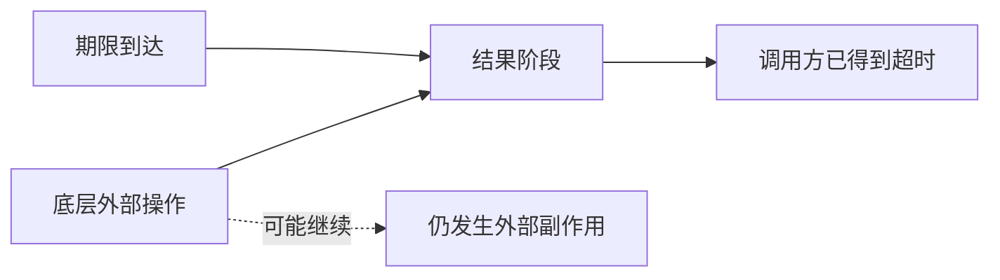
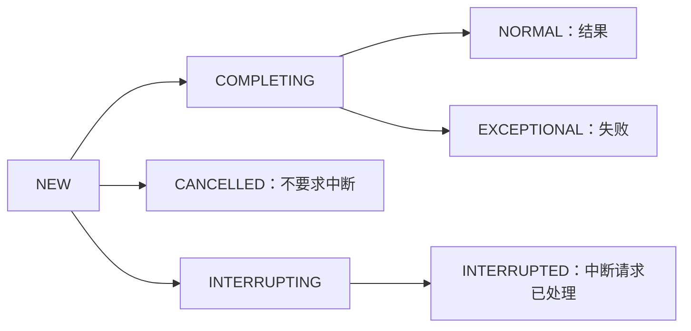
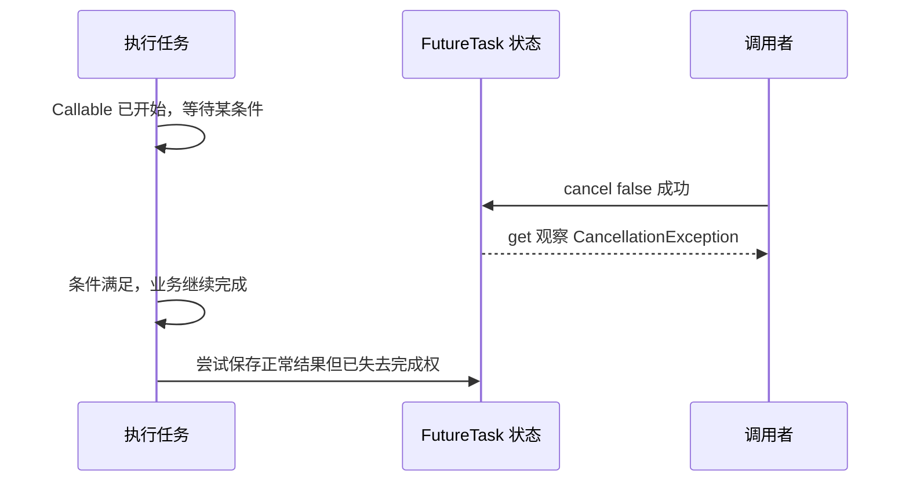
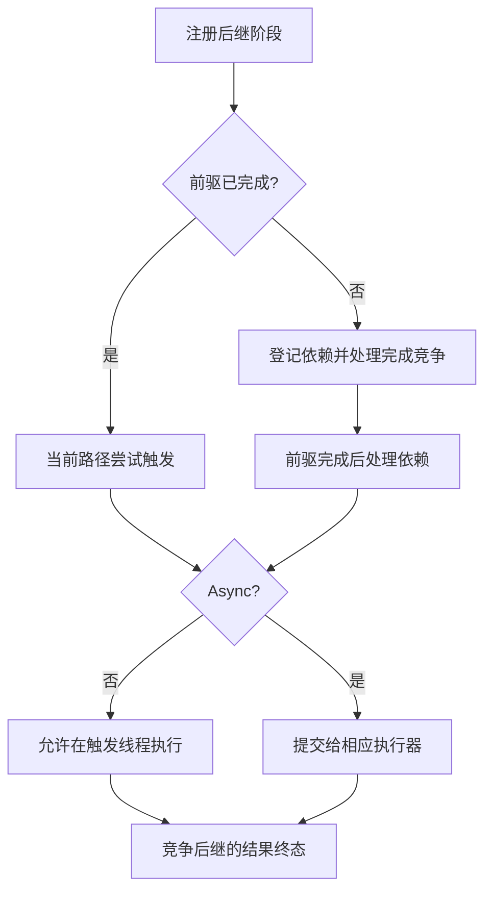

# JUC原理：从内存可见性、同步器到异步组合与上下文生命周期

> **阅读目标**：沿“问题 → 可选方案 → 实现机制 → 代价与边界”理解设计，能用具体交错、调用链或资源生命周期解释结果。配套 [JUC面试](JUC面试.md)。

> **版本口径**：语言与接口契约优先；JDK（Java Development Kit，Java 开发工具包）8、17、21、25 是本文的对照节点，25 为本篇参考版本，并非“最新版本”声明。实现细节不自动成为跨版本保证。

[返回 Java 知识体系导读](../README.md)

## 阅读路线

| 章节 | 核心问题 |
|---|---|
| [1. 工具地图与共同语义](#p-01) | JUC 是一组可组合的并发协议，不是一张“线程安全类”名单。 |
| [2. 发布链与复合操作](#p-02) | 可见性、原子性与顺序必须分别证明，再通过协议连起来。 |
| [3. 原子类、LongAdder 与内存模式](#p-03) | 原子类解决特定状态操作，扩展性与快照一致性存在权衡。 |
| [4. CountDownLatch、CyclicBarrier 与 Phaser](#p-04) | 闩锁等完成计数，屏障等参与者会合，Phaser 管动态多阶段协议。 |
| [5. Semaphore 与并发限流](#p-05) | 许可限制同时进入的数量，不直接限制每秒请求数，也不天然具有持有线程身份。 |
| [6. 阻塞队列、传递与背压](#p-06) | 队列既交接数据又协调等待，但容量与完成语义必须显式选择。 |
| [7. Future、FutureTask 与完成状态](#p-07) | 结果、失败与取消是终态，等待者必须能观察到一个明确结果。 |
| [8. CompletableFuture 的执行线程与组合](#p-08) | 组合描述依赖关系，Async 描述调度方式，二者都不自动提供业务资源隔离。 |
| [9. 异常恢复、超时与取消传播](#p-09) | 一个阶段的状态变化不等于整条任务树自动停止。 |
| [10. ThreadLocal、ScopedValue 与上下文](#p-10) | 上下文应有作用域与所有权，不能把线程当作请求的永久容器。 |
| [11. 中断、park 与协作退出](#p-11) | 中断状态、等待许可和业务状态是三个不同信号。 |
| [12. 阻塞队列为何有不同争用结构](#p-12) | 相同 put/take 契约可以由不同锁与存储设计实现，并发度收益与维护成本互换。 |
| [13. FutureTask 完成状态机：结果写入、取消和中断怎样竞争](#p-13) | 先争取完成权，再写结果并发布终态；结果取消与执行线程停止不在同一条状态线上。 |
| [14. CompletableFuture 依赖节点传播：完成竞争与线程归属](#p-14) | 前驱完成触发依赖节点，节点再竞争后继结果；完成传播不是为每条箭头都创建线程。 |

<a id="p-01"></a>
## 1. 工具地图与共同语义

> 🎯 **核心结论**：JUC 是一组可组合的并发协议，不是一张“线程安全类”名单。

JUC（java.util.concurrent，Java 并发工具包）包括原子变量、锁与同步器、并发集合、队列、执行器和异步结果。锁篇讲互斥与等待细节，集合篇讲结构与操作契约，线程池篇讲接纳和资源预算；本篇重点解释这些工具如何建立协作、完成与失败边界。



**读图**：正确性依赖工具之间连接的同步关系。线程安全队列交出了对象后，生产者若继续无同步修改该对象，队列不会替后续修改提供保护。

选型时依次问：谁拥有状态？谁可以修改？谁等待什么？怎样发布结果？谁处理异常？超时后谁负责退出？这六个问题比先挑工具更重要。

<a id="p-02"></a>
## 2. 发布链与复合操作

> 🎯 **核心结论**：可见性、原子性与顺序必须分别证明，再通过协议连起来。

JMM（Java Memory Model，Java 内存模型）允许以 happens-before（先行发生）证明发布。JUC 的提交、交接与完成接口有对应内存一致性条款，例如提交前动作发布给任务，任务结果可经 Future.get 传播给等待者，放入队列前动作可发布给取出该元素的消费者。



**读图**：保证覆盖“放入前”的动作，不是队列对该对象终身提供同步。优先使用不可变消息或明确转移所有权。

volatile 可发布标记，但不能使 count++ 或 check-then-act 原子化；多个 AtomicInteger 也不能自动组成一笔原子事务。跨字段不变量可用锁或单个不可变状态引用整体更新。

<a id="p-03"></a>
## 3. 原子类、LongAdder 与内存模式

> 🎯 **核心结论**：原子类解决特定状态操作，扩展性与快照一致性存在权衡。

CAS（Compare-And-Set，比较并设置）比较旧值并更新，失败后按算法重读；AtomicReference 可以保存不可变状态对象以原子替换多个相关字段。更新函数可能重试，必须避免不可重复的副作用。ABA（A→B→A，同值往返）若涉及代际则需要版本信息。

LongAdder 分散争用到多个累加单元，再汇总求和，适合高竞争统计。sum 在并发更新时不是对所有单元的原子快照，不适合当作“余额检查并扣减”或生成唯一连续序号。sumThenReset 在并发中也需按契约评估，不能随意当精确结算窗口。

| 需求 | 候选 | 边界 |
|---|---|---|
| 单值严格状态转换 | AtomicInteger/Long/Reference | CAS 重试和热点竞争 |
| 高频统计 | LongAdder | 并发汇总不是强快照 |
| 多字段事务 | 同一锁或单个状态对象 | 需覆盖全部读写路径 |
| 自定义底层访问 | VarHandle | plain/acquire/release/volatile 不等价 |

Atomic 的弱比较更新、延迟发布等入口有各自内存语义，不要只因为名字包含 Atomic 就忽略实际方法模式。

<a id="p-04"></a>
## 4. CountDownLatch、CyclicBarrier 与 Phaser

> 🎯 **核心结论**：闩锁等完成计数，屏障等参与者会合，Phaser 管动态多阶段协议。

| 工具 | 状态推进 | 复用 / 参与者 |
|---|---|---|
| CountDownLatch | countDown 到零释放 await | 一次性，不重置 |
| CyclicBarrier | 一轮达到 parties 后一起继续 | 可多轮，参与数固定 |
| Phaser | 登记者到达、阶段推进 | 动态登记与注销、多阶段 |
| Exchanger | 两个线程交换对象 | 双方交接，不是广播 |

CountDownLatch 不要求 countDown 的线程必须先 await，但要确保异常路径也报告完成，通常放 finally；同时单独记录失败，不然“计数到零”不代表工作全成功。

CyclicBarrier 某参与者中断或超时会使该轮屏障破损，其他等待者可得到 BrokenBarrierException；不能无条件吞异常继续认为所有人已经完成同一阶段。Phaser 参与者忘记注销会阻止推进，动态协议更灵活也更难审计。



**读图**：完成同步与业务结果是两条信息流，必须同时设计。

<a id="p-05"></a>
## 5. Semaphore 与并发限流

> 🎯 **核心结论**：许可限制同时进入的数量，不直接限制每秒请求数，也不天然具有持有线程身份。

acquire 获取许可，可中断等待；tryAcquire 可立即或有期限失败。成功获得后再进入 finally 释放，获取失败或中断前未获许可时不能无条件 release，否则总许可可能膨胀。Semaphore 允许由不同线程释放，所以这种错误不一定立即抛出“非持有者”异常。

并发限制约束在途数，速率限制约束单位时间请求量。一次调用从 10ms 变成 1s 时，相同并发上限对应吞吐会明显下降；这正说明二者不能互换。许可数还要与连接池和远端预算协调，避免多层大队列重复积压。

**公平边界**：公平模式影响等待准入，某些无超时 tryAcquire 入口仍可插队。许可不负责请求优先级、租户隔离和自动归还；服务关闭、异步完成与取消路径都必须有归还协议。

<a id="p-06"></a>
## 6. 阻塞队列、传递与背压

> 🎯 **核心结论**：队列既交接数据又协调等待，但容量与完成语义必须显式选择。

ArrayBlockingQueue 固定容量与数组存储；LinkedBlockingQueue 节点存储且可配置容量，默认上限极大；SynchronousQueue 不保存元素；TransferQueue 的 transfer 可等待消费者接受。PriorityBlockingQueue/DelayQueue 的线程安全不等于容量受控。

| 操作族 | 满 / 空时 | 典型用途 |
|---|---|---|
| add/remove | 抛异常 | 预期状态明确 |
| offer/poll | 返回失败或空 | 非等待尝试 |
| put/take | 阻塞等待 | 生产消费协调 |
| timed offer/poll | 有期限等待 | 端到端期限 |

**完成边界**：元素被取走不代表处理成功，也没有自动持久确认。关闭协议可用外部取消状态或明确结束消息；多消费者的结束消息数量、阻塞退出与生产者停止都要设计。别只给单消费者塞一个“毒丸”就宣称多消费者全部退出。

<a id="p-07"></a>
## 7. Future、FutureTask 与完成状态

> 🎯 **核心结论**：结果、失败与取消是终态，等待者必须能观察到一个明确结果。

FutureTask 把 Runnable/Callable 的执行与状态结合，正常结果或异常完成后唤醒等待者；多次竞争完成只有一个状态成为结果。get 可抛 ExecutionException 包装业务失败、CancellationException 表示取消，或 InterruptedException 表示等待者被中断。

get(timeout) 的 TimeoutException 只结束本次等待，不把 Future 自动改成取消。cancel(true) 也只是适用时尝试中断任务，不能保证外部请求中止。FutureTask 的取消行为与 CompletableFuture 的取消行为还不同，不能以接口同名推出底层线程都会被中断。

**反例**：拒绝策略静默丢弃 FutureTask，任务既不执行也不取消，get 可能永久等待。执行资源、接纳结果和结果状态必须作为同一协议检查。

<a id="p-08"></a>
## 8. CompletableFuture 的执行线程与组合

> 🎯 **核心结论**：组合描述依赖关系，Async 描述调度方式，二者都不自动提供业务资源隔离。

CompletableFuture 用完成节点传播结果。非 Async 回调可能由完成前驱的线程执行，若前驱已完成，也可能由注册回调的线程执行；不能假定总在线程池。未指定执行器的 Async 默认调度通常关联公共 ForkJoinPool；旧版在公共池并行度不足时存在逐任务线程回退，OpenJDK 25 参考实现已使用确保最低并行度的公共异步池路径。不要把旧版回退机制当成所有新版本保证；隔离重要阻塞业务应显式传执行器。

```java
java.util.concurrent.CompletableFuture<Integer> a =
    java.util.concurrent.CompletableFuture.completedFuture(3);
var nested = a.thenApply(v ->
    java.util.concurrent.CompletableFuture.completedFuture(v + 1));
var flat = a.thenCompose(v ->
    java.util.concurrent.CompletableFuture.completedFuture(v + 1));
// nested 为 Future<Future<Integer>> 的结构；flat 为 Future<Integer> 的结构
```

| 操作 | 关系 | 常见误解 |
|---|---|---|
| thenApply | 转换一个结果 | 返回 Future 时不会自动展平 |
| thenCompose | 串联下一异步阶段并展平 | 不等于强制切线程 |
| thenCombine | 合并两个阶段结果 | 不是顺序调用两个远端 |
| allOf | 所有输入终结后完成，结果 Void | 不自动汇总列表，也不保证失败即取消其他 |
| anyOf | 首个完成结果，可能异常 | 不等于首个成功 |



**读图**：依赖关系能减少占着工作线程 get 的死锁风险，实际调度与并发上限仍要由执行器和下游门控管理。

<a id="p-09"></a>
## 9. 异常恢复、超时与取消传播

> 🎯 **核心结论**：一个阶段的状态变化不等于整条任务树自动停止。

exceptionally 从失败恢复成值；handle 同时处理成功与失败并可转换；whenComplete 主要观察和清理，观察器自身抛错也可能改变后续结果。get 常经 ExecutionException，join 常经 CompletionException，二者对等待中断的表达不同。

orTimeout/completeOnTimeout 改变阶段的完成结果，但不会因此停止底层网络请求；CompletableFuture.cancel 的 mayInterruptIfRunning 参数不用于控制底层执行中断，不能照搬 FutureTask。依赖阶段取消也不普遍反向取消上游或所有兄弟任务。



**读图**：需要明确把截止时间和取消信号传进底层 API，并设计关闭资源、幂等与结果不确定性。默认异步组合不是一套结构化生命周期管理器。

<a id="p-10"></a>
## 10. ThreadLocal、ScopedValue 与上下文

> 🎯 **核心结论**：上下文应有作用域与所有权，不能把线程当作请求的永久容器。

ThreadLocal 是每线程映射，不是自动传播变量。池线程复用会残留数据，弱引用键也不保证值立即清理；finally.remove 或恢复原状态依赖明确作用域。InheritableThreadLocal 主要在线程创建时继承，不能替代每次任务传播。

ScopedValue（作用域值）在 JDK 25 正式提供，适合有边界的单向上下文绑定；它不是可变 ThreadLocal 的完全等价替代，也不保证随意提交给任意执行器自动继承。与结构化并发的绑定传播须按对应版本契约使用。

**比较**：显式参数最清晰但层层传递繁琐；ThreadLocal 支持既有同步框架却需清理；作用域绑定让生命周期更明确，但使用模型受限。敏感身份与租户信息不应因异步边界缺失而默认为上一个请求。

<a id="p-11"></a>
## 11. 中断、park 与协作退出

> 🎯 **核心结论**：中断状态、等待许可和业务状态是三个不同信号。

Thread.interrupted 查询并清除当前线程标志，isInterrupted 查询目标线程而不清除。InterruptedException 的阻塞方法通常清除状态，无法传播时应恢复后退出或交由上层策略处理，不能吞掉后无限重试。

LockSupport.park 基于至多一个许可，先 unpark 再 park 可消费许可，多次 unpark 不累计多个许可；park 也可因中断或无明显原因返回，因此必须循环检查业务谓词。它不会自动释放业务锁，不能拿来直接替代 Condition.await。

**验证**：用 CountDownLatch 等协调固定重现时序，而不是依赖 sleep；对异常、取消、超时、提前完成与拒绝路径逐个检查资源和结果终态。JUC 工具降低实现成本，但需要使用者定义协议。

<a id="p-12"></a>
## 12. 阻塞队列为何有不同争用结构

> 🎯 **核心结论**：相同 put/take 契约可以由不同锁与存储设计实现，并发度收益与维护成本互换。

以 OpenJDK 25 参考实现对比：ArrayBlockingQueue 用固定数组和一把主锁配合 notEmpty/notFull 条件，生产与消费的结构操作在同一互斥域内；LinkedBlockingQueue 通常以 putLock、takeLock 分离两端，借原子计数和跨端通知协调状态转换。


**读图**：图是 LinkedBlockingQueue 的概念结构。双锁允许某些生产与消费并行，但不是所有操作只持其中一把锁，清空、遍历或批量操作还需按实现协调，不能把示意图当完整源码。

| 设计点 | 数组有界队列 | 链式阻塞队列 |
|---|---|---|
| 存储 | 预分配数组，局部性较好 | 按节点分配，额外引用与分配 |
| 两端协调 | 单互斥域较直观 | 分锁增加并发，也增加计数与通知协调 |
| 容量 | 构造明确固定 | 可有界，但默认上限极大 |
| 性能判断 | 锁竞争与数组成本 | 两端并行与节点/原子计数热点 |

单锁不必然慢，双锁也不必然快；负载、批量大小、缓存与分配共同决定。源码阅读可从“空→非空谁通知消费者、满→非满谁通知生产者、取消后状态是否仍一致”开始。

参考：[ArrayBlockingQueue 源码](https://raw.githubusercontent.com/openjdk/jdk/jdk-25-ga/src/java.base/share/classes/java/util/concurrent/ArrayBlockingQueue.java)、[LinkedBlockingQueue 源码](https://raw.githubusercontent.com/openjdk/jdk/jdk-25-ga/src/java.base/share/classes/java/util/concurrent/LinkedBlockingQueue.java)。

<a id="p-13"></a>
## 13. FutureTask 完成状态机：结果写入、取消和中断怎样竞争

> 🎯 **核心结论**：先争取完成权，再写结果并发布终态；结果取消与执行线程停止不在同一条状态线上。

### 13.1 为什么需要中间态
OpenJDK 25 参考实现的 FutureTask 主要状态如下。NEW 也覆盖“任务正在运行但尚未完成”的阶段，不能把它只理解成未启动。



**读图**：这是指定实现的内部状态，不是公开 Future.State 枚举的同一套值。INTERRUPTED 不证明线程已经退出，更不证明外部副作用被撤销。

正常完成先 CAS 取得 NEW→COMPLETING 的完成权，再把结果写入 outcome，最后以发布语义设置 NORMAL。若直接先把“已完成”暴露给 get，再写 outcome，等待者可能被允许返回却拿不到结果。异常完成同理，只是 outcome 保存异常并进入 EXCEPTIONAL。

取消从 NEW 争夺另一个终结路径；一旦正常完成权已获，取消不能任意覆盖。运行体则另用 runner 身份协调，防止两个线程同时执行同一个任务。状态转换与执行者登记不是同一原子字段的全部职责。

### 13.2 cancel(false) 也可能取消正在执行的结果
若任务已进入 Callable 但尚未完成，cancel(false) 仍可能成功把结果置为取消，同时不发中断。Callable 可以继续运行，最后算出的值不会再覆盖已取消结果。cancel(true) 也只是尽力向运行线程发中断，不承诺立即停止。



**读图**：可用两把闩锁固定这个交错，验证“Future 已取消、任务仍运行”。不要靠长 sleep 猜时序。

### 13.3 等待者如何知道该醒
get 未见可返回终态时登记等待节点，重新检查状态后 park；完成清理流程解除等待并 unpark。入队与完成存在竞争，因此不能简化为“先检查一次，再永远睡”。超时和中断还需移除或清理等待节点，避免保留线程引用。

**与外部协议分工**：FutureTask 解决一次结果选择与等待发布，不解决重试幂等、连接取消、结果对账。`isDone()` 也不是执行线程已经物理退出的证据。

参考：[FutureTask 状态与完成源码](https://raw.githubusercontent.com/openjdk/jdk/jdk-25-ga/src/java.base/share/classes/java/util/concurrent/FutureTask.java)。

<a id="p-14"></a>
## 14. CompletableFuture 依赖节点传播：完成竞争与线程归属

> 🎯 **核心结论**：前驱完成触发依赖节点，节点再竞争后继结果；完成传播不是为每条箭头都创建线程。

### 14.1 已完成与未完成前驱的两条路径
给未完成前驱注册 thenApply，可登记一个依赖节点；前驱完成后，完成流程尝试触发它。若注册时前驱早已完成，当前注册线程可能直接处理转换。注册与完成并发时，实现要防止遗漏依赖，并用节点/后继状态协调重复触发。



**读图**：每个阶段可能有多个后继，参考实现组织的是依赖节点结构。图省略异常直传、双前驱和清理细节，不承诺所有回调固定按注册顺序执行。

### 14.2 一个慢回调怎样拖住完成线程
工作线程调用 complete 后，非 Async 后继可能就在此线程执行。如果其中做慢日志、网络调用或大量计算，它会拖慢当前完成路径，进而影响同线程负责的其他任务。显式 Async 可转移执行位置，但目标执行器若拥塞、拒绝或与依赖共享资源，问题仍在。

`thenCombine` 等双前驱节点要等所需结果具备再触发；allOf 是等待全部终结的组合，不自动构造业务结果列表，也不是异常即刻取消兄弟的任务组。多个线程 complete 同一结果时，只有一个赢得该结果，失败者的外部工作不会因此自动撤销。

### 14.3 外部完成与外部副作用不在同一原子操作
假设超时路径已 completeExceptionally，远端成功回调再 complete(value) 返回 false。这个 false 只说明结果未被接纳，不代表远端成功是假的。应区分“调用方选择了哪种结果”和“实际业务发生了什么”。

| 竞争 | 阶段结果 | 仍要处理 |
|---|---|---|
| 超时先赢，远端后成功 | 调用方观察超时 | 幂等确认、迟到结果与资源归还 |
| 成功先赢，取消后到 | 已完成结果保持 | 取消是否仍需传播到其他工作 |
| 多个后继都写外部系统 | 各自有执行路径 | 不可假设同一结果使副作用去重 |

**确定性验证**：使用未完成前驱先注册回调，再由命名线程 complete；与 completedFuture 上注册作对比，可观察非 Async 回调执行线程。测试只证明该构造的路径，不把一次线程名输出推广为所有竞争条件下的保证。

参考：[CompletableFuture 指定版本源码](https://raw.githubusercontent.com/openjdk/jdk/jdk-25-ga/src/java.base/share/classes/java/util/concurrent/CompletableFuture.java)。

<a id="p-versions"></a>
## 版本演进与学习边界

| 节点 | 变化 | 边界 |
|---|---|---|
| 5 | JUC 进入平台 | 发布、等待与完成各有契约 |
| 8 | CompletableFuture、LongAdder 等 | 组合不自动提供取消树 |
| 9 | 超时相关 CompletableFuture 入口等 | 超时不等于停止底层任务 |
| 21 | 虚拟线程正式提供；结构化并发等仍为预览 | 正式与预览不能混写 |
| 25 | ScopedValue 正式提供；StructuredTaskScope 仍为预览；默认异步调度实现也有演进 | 预览需启用且 API 可变化，旧线程回退实现不可机械套用 |

结构化并发的目标是让子任务生命周期随作用域组织，但具体失败策略、工厂和关闭接口需按目标 JDK 核对；本文不用跨版本伪通用代码掩盖这些变化。

<a id="p-references"></a>
## 参考资料与源码入口

- [JUC 包与内存一致性](https://docs.oracle.com/en/java/javase/25/docs/api/java.base/java/util/concurrent/package-summary.html)
- [原子包](https://docs.oracle.com/en/java/javase/25/docs/api/java.base/java/util/concurrent/atomic/package-summary.html)
- [Semaphore](https://docs.oracle.com/en/java/javase/25/docs/api/java.base/java/util/concurrent/Semaphore.html)、[Phaser](https://docs.oracle.com/en/java/javase/25/docs/api/java.base/java/util/concurrent/Phaser.html)
- [CompletableFuture](https://docs.oracle.com/en/java/javase/25/docs/api/java.base/java/util/concurrent/CompletableFuture.html)、[OpenJDK 25 参考实现](https://raw.githubusercontent.com/openjdk/jdk/jdk-25-ga/src/java.base/share/classes/java/util/concurrent/CompletableFuture.java)
- [ScopedValue](https://docs.oracle.com/en/java/javase/25/docs/api/java.base/java/lang/ScopedValue.html)、[StructuredTaskScope（预览）](https://docs.oracle.com/en/java/javase/25/docs/api/java.base/java/util/concurrent/StructuredTaskScope.html)
- [LockSupport](https://docs.oracle.com/en/java/javase/25/docs/api/java.base/java/util/concurrent/locks/LockSupport.html)

<a id="p-glossary"></a>
## 附录：术语与缩写

| 术语 | 英文全称 | 中文含义 |
|---|---|---|
| JDK | Java Development Kit | Java 开发工具包 |
| JVM | Java Virtual Machine | Java 虚拟机 |
| API | Application Programming Interface | 应用程序编程接口 |
| JUC | java.util.concurrent | Java 并发工具包简称 |
| JMM | Java Memory Model | Java 内存模型 |
| CAS | Compare-And-Set | 比较并设置 |
| ABA | A→B→A | 同值往返问题 |
| Scoped Value | Scoped Value | 作用域值 |
| Phaser | Phaser | 多阶段同步器 |
