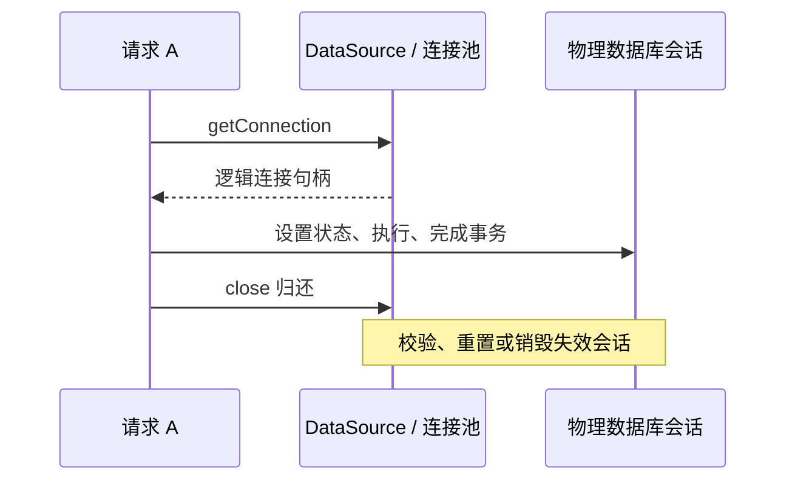
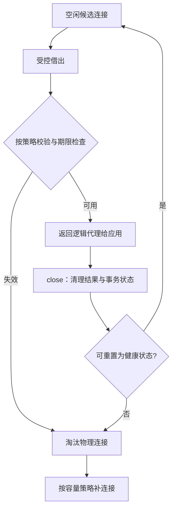
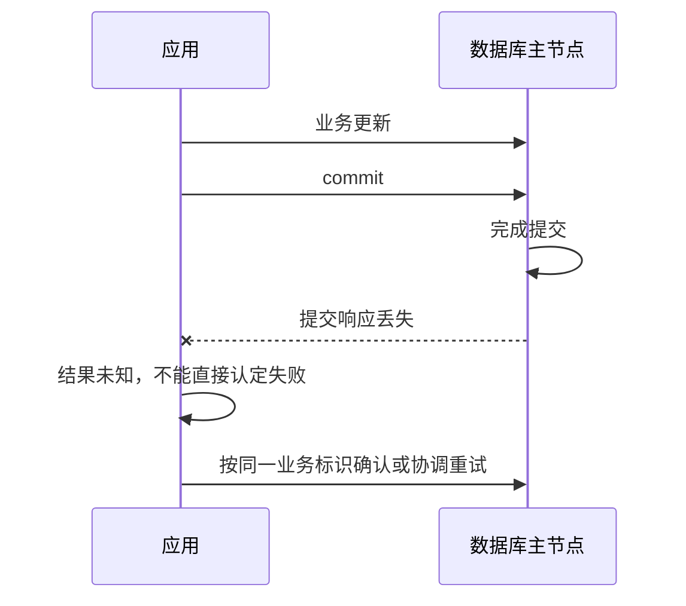

# JDBC原理：从驱动协议、连接所有权到事务、结果流与故障恢复

> **阅读目标**：沿“问题 → 可选方案 → 实现机制 → 代价与边界”理解设计，能用具体交错、调用链或资源生命周期解释结果。配套 [JDBC面试](JDBC面试.md)。

> **版本口径**：语言与接口契约优先；JDK（Java Development Kit，Java 开发工具包）8、17、21、25 是本文的对照节点，25 为本篇参考版本，并非“最新版本”声明。实现细节不自动成为跨版本保证。

[返回 Java 知识体系导读](../学习路线.md)

## 阅读路线

| 章节 | 核心问题 |
|---|---|
| [1. 分层与接口职责](#p-01) | JDBC 统一访问接口，数据库协议、SQL 语义与可选能力仍由驱动和服务端决定。 |
| [2. 连接、池化与会话状态](#p-02) | 逻辑 close 通常归还池，物理会话可继续存在，因此借用者必须有清楚的所有权和状态契约。 |
| [3. Statement 与 PreparedStatement](#p-03) | 参数绑定分离数据与语句结构，但不自动保证服务端计划复用或所有动态 SQL 都安全。 |
| [4. 事务、自动提交与隔离](#p-04) | 本地事务属于一个连接会话，原子性和隔离由数据库执行，JDBC 管理边界。 |
| [5. 完整事务示例：检查更新数与保留原始失败](#p-05) | 数据库原子条件更新配合事务，才能维护多步骤业务不变量。 |
| [6. ResultSet、null 与类型映射](#p-06) | 结果集是有生命周期和位置的读取协议，不是脱离连接自动存活的普通列表。 |
| [7. fetchSize、游标与流式读取](#p-07) | setFetchSize 通常是提示，不是通用的“启用流式结果”开关。 |
| [8. 批处理、生成键与部分失败](#p-08) | 批量减少往返，原子性仍取决于事务，批次执行也可能部分成功。 |
| [9. 超时、错误、重试与连接健康](#p-09) | 连接失败、事务冲突和业务约束错误不能用同一重试策略处理。 |
| [10. JDBC 与框架事务、版本及验证](#p-10) | 框架减少样板，但连接参与与失败语义仍落在 JDBC 与数据库上。 |
| [11. 连接池内部协议：借出、校验、归还与失效淘汰](#p-11) | 池管理物理会话和逻辑句柄的状态转换，健康探测只能缩小失败窗口，不能保证下一条 SQL 成功。 |
| [12. 事务重试与提交不确定性：从异常分类到幂等恢复](#p-12) | 已知回滚可按完整事务重试，未知提交结果先按同一业务标识协调确认，不能把网络异常等同回滚。 |
| [13. 语句执行与结果完成：多结果、游标和自动提交的真实边界](#p-13) | 逐步推导与反例验证 |

<a id="p-01"></a>
## 1. 分层与接口职责

> 🎯 **核心结论**：JDBC 统一访问接口，数据库协议、SQL 语义与可选能力仍由驱动和服务端决定。

JDBC（Java Database Connectivity，Java 数据库连接）不是 ORM（Object-Relational Mapping，对象关系映射），不自动把表关系映射成实体图，也不自动管理业务事务。Driver 接受特定连接地址并实现数据库协议，DriverManager 选择驱动，DataSource 抽象连接来源。


**读图**：接口层的统一不等于所有驱动行为相同。是否真正服务端预编译、游标如何读取、是否支持某隔离级别，都需核对驱动与数据库版本。

JDBC 4 起可通过服务提供者机制自动发现驱动，常规环境不再必须手写 Class.forName。应用服务器或插件加载器隔离下，类路径可见性仍会影响发现。DataSource 不天然等于连接池，也可以直接创建物理连接。

<a id="p-02"></a>
## 2. 连接、池化与会话状态

> 🎯 **核心结论**：逻辑 close 通常归还池，物理会话可继续存在，因此借用者必须有清楚的所有权和状态契约。

建立物理连接涉及网络、认证和会话初始化。连接池复用会话并限制在途数据库操作，降低重复成本；它不能让数据库无限并发。借用等待也是排队，池太大会把竞争转移到数据库，池太小则可能在获取阶段形成瓶颈。



**读图**：归还前后要处理 autoCommit、隔离级别、readOnly、catalog/schema 等；临时表、用户变量等会话状态未必被所有池完整恢复。连接不宜跨请求或跨线程共享，一个线程改 autoCommit 会改变同一会话中其他操作的事务语义。

框架事务中连接可能绑定当前事务，业务不能随意自行关闭或换连接。连接获取应使用框架提供的参与事务方式；直接新建另一个 Connection 通常不会加入原本的本地事务。

<a id="p-03"></a>
## 3. Statement 与 PreparedStatement

> 🎯 **核心结论**：参数绑定分离数据与语句结构，但不自动保证服务端计划复用或所有动态 SQL 都安全。

Statement 直接发送 SQL（Structured Query Language，结构化查询语言）文本；PreparedStatement 用占位符声明参数并通过 setXxx 绑定。绑定值不作为 SQL 语法解释，可避免此类位置的注入，也减少手工转义错误。

```java
String sql = "select id, name from account where id = ?";
try (var ps = connection.prepareStatement(sql)) {
    ps.setLong(1, accountId); // JDBC 参数下标从 1 开始
    try (var rs = ps.executeQuery()) {
        while (rs.next()) {
            System.out.println(rs.getString("name"));
        }
    }
}
```

上例需已有 connection、accountId 与匹配表结构。占位符通常用于值，不能直接绑定表名、列名、排序方向；动态标识符应由白名单映射生成。LIKE 参数中的 %/_ 仍有模式语义，绑定并不会自动把它们转成字面字符。

服务端预编译、客户端模拟和语句缓存是不同能力，受驱动参数、协议与版本影响；PreparedStatement 还可能产生参数敏感计划问题。**安全绑定成立不要求每次必然服务端预编译**，性能也不能只看 API 名称。

<a id="p-04"></a>
## 4. 事务、自动提交与隔离

> 🎯 **核心结论**：本地事务属于一个连接会话，原子性和隔离由数据库执行，JDBC 管理边界。

新建连接通常默认 autoCommit=true；每条语句的事务完成时间还涉及结果处理，不能把 execute 返回都等同“所有语句已经立刻完整提交”。关闭自动提交后显式 commit/rollback；切回 true 可能提交当前事务，不能把 setAutoCommit(true) 当成无害清理。

| 机制 | 意义 | 不能保证 |
|---|---|---|
| commit / rollback | 完成本地事务 | 网络异常时调用方一定知道最终结果 |
| 隔离级别 | 控制允许的并发可见行为 | 各数据库完全相同的锁与快照实现 |
| readOnly | 提供只读意图或驱动提示 | 通用安全授权或所有数据库严格禁止写 |
| Savepoint | 回退事务内一段操作 | 独立提交的嵌套事务 |

RC（Read Committed，读已提交）、RR（Repeatable Read，可重复读）等是隔离级别名称；实际快照、锁范围和幻读处理要结合数据库。事务开始后随意改变隔离可能被拒绝或产生实现相关行为，优先在开始前设置。

**失败推演**：commit 请求已到服务端并完成，但响应断线，应用得到异常却不能据此认定回滚。订单号、幂等键、查询确认和对账协议比“catch 后重试整笔”更可靠。

<a id="p-05"></a>
## 5. 完整事务示例：检查更新数与保留原始失败

> 🎯 **核心结论**：数据库原子条件更新配合事务，才能维护多步骤业务不变量。

以下示例展示同一连接上的转账边界，假设 account(id,balance) 和相应金额精度已定义；不含框架事务，不可直接混入已有托管事务。

```java
import java.math.BigDecimal;
import java.sql.*;
import javax.sql.DataSource;
public class JdbcTransfer {
    public static void transfer(DataSource ds, long from, long to,
                                BigDecimal amount) throws SQLException {
        if (from == to || amount.signum() <= 0)
            throw new IllegalArgumentException("invalid transfer");
        try (Connection c = ds.getConnection()) {
            c.setAutoCommit(false);
            try {
                try (PreparedStatement p = c.prepareStatement(
                        "update account set balance=balance-? " +
                        "where id=? and balance>=?")) {
                    p.setBigDecimal(1, amount);
                    p.setLong(2, from);
                    p.setBigDecimal(3, amount);
                    if (p.executeUpdate() != 1)
                        throw new SQLException("debit rejected");
                }
                try (PreparedStatement p = c.prepareStatement(
                        "update account set balance=balance+? where id=?")) {
                    p.setBigDecimal(1, amount);
                    p.setLong(2, to);
                    if (p.executeUpdate() != 1)
                        throw new SQLException("credit rejected");
                }
                c.commit();
            } catch (SQLException | RuntimeException ex) {
                try { c.rollback(); }
                catch (SQLException rollbackFailure) {
                    ex.addSuppressed(rollbackFailure);
                }
                throw ex;
            }
        }
    }
}
```

**为什么这样写**：扣款把余额检查与修改交给同一数据库操作，避免应用先查后改的竞争；检查影响行数避免目标不存在仍假成功；失败回滚并保留原始异常，回滚失败作为 suppressed 保留。try-with-resources 反序关闭资源，关闭失败不会无条件覆盖主异常。

**边界**：此例不提供幂等号、提交不确定性处理和死锁重试协议；对向转账还可能按数据库锁顺序死锁，需结合访问顺序与有限重试。池化状态重置应由已验证的 DataSource 契约负责，失效连接不能盲目当健康连接归还。活动事务下直接 close 的结果在接口层有实现相关性，因此应明确完成事务。

<a id="p-06"></a>
## 6. ResultSet、null 与类型映射

> 🎯 **核心结论**：结果集是有生命周期和位置的读取协议，不是脱离连接自动存活的普通列表。

游标初始在第一行之前，next 成功后才可读。默认常见前向只读结果，滚动、可更新与跨提交保留是可选能力，要看支持情况。Statement 关闭通常关闭其结果集，执行下一条语句也可能影响旧结果；不要把 ResultSet 直接从已关闭的 try 块返回。

getInt 遇 SQL NULL 返回 0，需要紧接 wasNull 区分真实零；合适驱动下 getObject(column,Integer.class) 可保留空值，仍需核对转换支持。金额用 BigDecimal 并明确精度与舍入；日期时间要区分本地日期、本地时间与瞬时时间，不把 java.sql.Timestamp 与时区转换混为一谈。

LOB（Large Object，大对象）的流或定位器可能依赖当前连接、事务与结果集，需要在生命周期内消费并按约定释放。重复列名应用别名，getXxx 的隐式转换可能失败、截断或受配置影响，显式模型更可预测。

<a id="p-07"></a>
## 7. fetchSize、游标与流式读取

> 🎯 **核心结论**：setFetchSize 通常是提示，不是通用的“启用流式结果”开关。

数据库、驱动与配置决定结果是一次读入客户端、分批抓取还是服务端游标。PostgreSQL 驱动的分批取数有事务、结果类型与 fetchSize 等前提；MySQL Connector/J 的流式和游标模式也有专属配置与约束。不能跨驱动复制一个值就声称内存恒定。


**读图**：分批只减少部分客户端缓存，长游标仍占连接和数据库资源，慢消费可延长事务快照、锁与版本保留。应用若又 collect 全部行，仍会把结果全部装进堆。

比较：分页适合分段处理，但 offset 大时成本高且并发变化可能重复漏项；键集分页依赖稳定排序键；游标适合连续遍历但生命周期长。选择需结合一致性、断点恢复与资源占用。

<a id="p-08"></a>
## 8. 批处理、生成键与部分失败

> 🎯 **核心结论**：批量减少往返，原子性仍取决于事务，批次执行也可能部分成功。

PreparedStatement 多次绑定后 addBatch，executeBatch 返回更新计数；SUCCESS_NO_INFO 表示成功但无精确行数，EXECUTE_FAILED 表示失败。BatchUpdateException 的计数与是否继续执行后续语句有关，不能一律假定“异常前全部失败”或“全批自动回滚”。

自动提交与驱动批量重写会影响事务边界、报错粒度和生成键表现。显式事务可定义整批回滚，但批次太大延长锁持有、增加日志与内存；应用批大小要按测量和失败恢复成本设计。

RETURN_GENERATED_KEYS 与 getGeneratedKeys 的支持、键列与顺序需核对驱动，不能默认每一输入项都严格一一返回。批量插入需要业务标识时，可优先使用可追踪的显式业务键，不能用“自增连续”猜测每条身份。

<a id="p-09"></a>
## 9. 超时、错误、重试与连接健康

> 🎯 **核心结论**：连接失败、事务冲突和业务约束错误不能用同一重试策略处理。

| 阶段 | 预算 / 证据 | 失败后重点 |
|---|---|---|
| 获取连接 | 池等待超时 | 是否已过载、持有时间过长 |
| 建连 | 连接与登录超时 | 网络、认证、可重试范围 |
| 执行 | 查询超时、网络超时 | cancel 是尽力操作，事务状态需核实 |
| 提交 | 提交响应与连接状态 | 结果可能不确定，避免盲重放 |

SQLException 包含 SQLState、厂商错误码、cause 和链式异常。SQLState 是标准化状态编码，不同驱动覆盖有差异；应结合具体数据库错误分类。死锁、序列化冲突通常要从完整事务边界有限重试，唯一键冲突可能是业务重复，认证/语法错误重试通常无益。

**池耗尽排查**：借出数、等待数、持有时间、慢 SQL、长事务、结果未消费、锁等待与真正泄漏一起看。泄漏检测告警常表示持有超阈值，不自动证明代码永远不归还。虚拟线程只让等待便宜，不增加数据库容量。

<a id="p-10"></a>
## 10. JDBC 与框架事务、版本及验证

> 🎯 **核心结论**：框架减少样板，但连接参与与失败语义仍落在 JDBC 与数据库上。

MyBatis/JdbcTemplate 会封装绑定、映射和资源管理；Spring 本地事务通常让同一数据源操作复用事务连接。自己 DriverManager.getConnection、异步换线程或另一个 DataSource 都可能离开原事务。事务传播是框架策略，Savepoint 是连接内回退点，二者不可混同。

JDBC 类型规范也不使不同数据库 SQL 自动可移植；分页语法、主键生成、JSON（JavaScript Object Notation，JavaScript 对象表示法）字段、时间与数组类型仍可能专有。驱动元数据可检查能力，但关键路径应在目标数据库做集成验证。

**验证集**：空值与零、金额精度、参数注入、更新零行、批次中间失败、回滚失败、提交断线、游标慢消费、连接归还状态、事务内异步调用。不能用内存模拟库的成功证明目标数据库所有隔离与协议行为相同。

<a id="p-11"></a>
## 11. 连接池内部协议：借出、校验、归还与失效淘汰

> 🎯 **核心结论**：池管理物理会话和逻辑句柄的状态转换，健康探测只能缩小失败窗口，不能保证下一条 SQL 成功。

### 11.1 一条连接的完整生命周期
池化连接可抽象为“空闲→借出→清理→空闲”循环，任一阶段发现失效则移除并关闭物理连接。逻辑 close 通常要防重复归还、关闭未释放的 Statement、处理未完成事务并重置追踪到的状态；异常路径还需决定连接是否可再用。



**读图**：这是连接池共同职责的抽象，不承诺所有实现每次借出都发验证 SQL。HikariCP 的指定版本可作为具体阅读对象，其借出、代理 close、状态重置和异常标记分布在不同类，不能只读 getConnection 就认为理解了全部生命周期。

### 11.2 校验、保活与最大寿命不是同一个超时
| 参数类别 | 控制对象 | 不应误认为 |
|---|---|---|
| 借用等待期限 | 等待池中可用连接 | SQL 执行期限 |
| 校验期限 | 检查候选连接可用性 | 未来一段时间绝不掉线 |
| 空闲回收 | 满足策略的空闲会话 | 正在使用的连接必被定时切断 |
| 最大寿命 | 物理会话的更新周期 | 同名业务事务期限 |
| 驱动网络 / 查询期限 | 具体网络与语句操作 | 池会自动撤销已提交业务 |

探测通过到业务 execute 之间仍可能断网，因此业务仍须处理执行与提交异常。池可能在归还时才处理已到退休条件的借出连接；具体策略按实现看，不把超时参数名机械翻译成强杀行为。

### 11.3 状态重置为何可能漏
通过 Connection.setReadOnly、setTransactionIsolation 等入口设置状态，池代理较容易跟踪；直接发送专有 SET SQL，池未必理解其副作用。临时表、会话变量和自定义角色切换也不一定被通用状态重置覆盖。

失效淘汰不应只看“出现 SQLException”：唯一键冲突通常不说明物理连接断了，协议错误或网络失效却可能需要销毁。HikariCP 参考实现会结合 SQLState、厂商码和异常链判断，应用自己吞掉或错误包装异常可能使诊断更难。

**排障反例**：长事务持有全部连接时，借用者超时并不证明连接泄漏；先区分真正未关闭、正常但过长持有、外部锁等待，以及关闭时重置失败。虚拟线程增加等待者数量，不能扩大数据库安全并发。

参考：[HikariCP 6.3.0 借还管理](https://raw.githubusercontent.com/brettwooldridge/HikariCP/HikariCP-6.3.0/src/main/java/com/zaxxer/hikari/pool/HikariPool.java)、[代理关闭与异常处理](https://raw.githubusercontent.com/brettwooldridge/HikariCP/HikariCP-6.3.0/src/main/java/com/zaxxer/hikari/pool/ProxyConnection.java)。

<a id="p-12"></a>
## 12. 事务重试与提交不确定性：从异常分类到幂等恢复

> 🎯 **核心结论**：已知回滚可按完整事务重试，未知提交结果先按同一业务标识协调确认，不能把网络异常等同回滚。

### 12.1 两种外表相同、恢复不同的失败
场景 A：数据库明确因死锁或序列化冲突中止事务。场景 B：commit 已送到服务器，服务器提交成功，但响应在网络中丢失。应用都可能收到异常，第一种有条件从完整事务重做，第二种则必须先解决“究竟提交了没有”。



**读图**：catch 里再调用 rollback 不会撤销已经成功的提交，也不能在连接已失效时提供可靠确认。查询只读副本可能因复制延迟看不到新结果，恢复应选择有相应一致性保证的权威路径。

### 12.2 数据库错误必须按语义分类
| 错误类别 | 恢复起点 | 关键边界 |
|---|---|---|
| 明确的死锁 / 序列化中止 | 清理后重做完整事务 | 重新执行读取和决策，不只重发最后 SQL |
| 锁等待超时 | 核实数据库回滚范围，再显式结束原事务 | 有些环境只回滚当前语句 |
| 唯一约束冲突 | 判断业务重复或幂等键碰撞 | 不作为通用瞬时错误盲重试 |
| 语法 / 权限错误 | 修复代码或授权 | 重试通常不产生进展 |
| 提交期连接异常 | 进入结果未知恢复 | 不能用是否抛错推断最终提交状态 |

例如 PostgreSQL 的序列化失败要求重试完整事务；MySQL InnoDB 对死锁与锁等待超时的默认处理范围有差别，后者还受配置影响。具体错误码应按部署的数据库和驱动版本核对，不把 SQLTransientException 当作所有场景安全重放的充分条件。

### 12.3 同库幂等记录怎样与业务原子完成
为请求选择稳定 request_id，并保存 payload_fingerprint（请求内容指纹）、处理状态与结果。**幂等记录与业务更新在同一数据库本地事务内提交**：

```text
begin
  尝试插入唯一 request_id 及内容指纹
  若为新请求：执行业务更新，保存最终结果
  若冲突：按明确事务规则退出冲突状态，再核对已有请求内容及结果
commit
```

未知提交结果后仍使用同一 request_id。若第一次已提交，重试受唯一约束协调并读取同一结果；若第一次回滚，后续才能获得新处理权。第一次尚未决议时，重复请求可能等待或冲突，不能把瞬时“查不到”视为它必然回滚。

| 必须继续回答的问题 | 原因 |
|---|---|
| 相同 request_id 但内容不同怎么办 | 防止误把不同业务当重复成功 |
| 结果记录保留多久 | 删除太早可能让迟到重试重新执行 |
| 首次事务还未完成怎么办 | 需要等待、查询或明确进行中响应 |
| 同时发了邮件或调用外部支付怎么办 | 本地事务不覆盖外部副作用 |

跨外部系统可考虑事务发件箱与下游去重等协议，但不能声称本地幂等表自动让外部调用恰好一次。重试预算应有限，并加入适当退避与抖动以减少同批冲突，且不能超过请求剩余总期限。

**验证场景**：事务写后失败、明确中止、提交请求前断线、提交后响应丢失、重复请求并发、同键不同内容与副本延迟。提交期真实断线需在目标数据库环境注入故障验证，单元模拟只能证明应用分支。

参考：[PostgreSQL 18 重试规则](https://www.postgresql.org/docs/18/mvcc-serialization-failure-handling.html)、[MySQL 8.4 InnoDB 错误处理](https://dev.mysql.com/doc/refman/8.4/en/innodb-error-handling.html)、[Connection 契约](https://docs.oracle.com/en/java/javase/25/docs/api/java.sql/java/sql/Connection.html)。

<a id="p-13"></a>
## 13. 语句执行与结果完成：多结果、游标和自动提交的真实边界

> 🎯 **核心问题**：execute 返回、ResultSet 读完、事务提交和连接归还为什么不是同一个事件？

### 一、驱动至少管理三种状态
连接有会话与事务状态；Statement 有参数、执行和当前结果状态；ResultSet 有行位置、缓冲、可选游标及关闭状态。它们有关联但不相同。关闭 Statement 通常影响其结果集，连接归还前也要清理未释放语句，不能只把局部变量置 null。

PreparedStatement 表达参数化执行接口，服务端是否预编译、计划缓存如何使用、参数如何传输与驱动配置有关。接口的绑定安全边界与具体执行计划性能是两类问题。重复 prepare 同文本也不保证所有环境都共享同一个服务器计划。

### 二、execute 的布尔值不是成功标志
execute 返回 true 表示第一个结果是 ResultSet，false 表示更新计数或没有结果，不表示 SQL 失败。多结果协议需要继续区分当前结果、更新计数和结束条件。

```text
hasResult = statement.execute(sql)
循环：
  若 hasResult：在作用域内消费并关闭当前 ResultSet
  否则：读取 updateCount；若为 -1 表示结果序列结束
  按 getMoreResults 的关闭策略移动到下一结果
```

这是多结果处理伪代码。具体驱动、存储过程和多语句能力需核对；不能为了演示而打开不需要的多语句配置。批量更新计数也不是这里同一概念，SUCCESS_NO_INFO 不能当作零行。

### 三、自动提交的“语句完成”包含结果生命周期
对返回结果的语句，完成时机涉及结果被处理等条件。不能以 executeQuery 已返回就推断所有资源、游标和事务效应都结束。长时间保留结果可能占着会话、快照或服务器资源，即使应用线程眼下没有继续发 SQL。

手动事务里 commit 后结果能否继续读取，还受 holdability、结果类型和驱动支持影响。可保留结果不等于所有结果均已脱离数据库，更不等于连接可以任意换给其他请求继续读原游标。

### 四、fetchSize 的收益和成本放在哪里
设客户端一次缓存 100 行，相比全量一百万行可降低部分客户端内存，但慢消费导致连接长期借出。数据库端可能仍持有游标、事务快照与相关资源；应用再 collect 全部实体又把内存成本搬回来。行数还不能直接代表字节数，大 LOB 或宽行会改变峰值。

| 读取模型 | 恢复与资源边界 |
|---|---|
| 全量读取 | 连接可早释放，但客户端峰值大 |
| 游标分批 | 降低部分缓冲，生命周期长 |
| offset 分页 | 易实现，深分页与并发变更有成本 |
| 稳定键集分页 | 可断点，但需定义排序唯一性与一致性 |

### 五、提前关闭和取消要验证协议恢复
不再需要剩余结果时，应按驱动契约关闭结果或取消语句，而不是直接把连接还回去。驱动可能需要丢弃剩余网络数据或关闭服务器游标；若协议无法恢复，连接可能需要淘汰。下一借用者能否安全执行，取决于清理是否真正完成。

**实验设计**：在目标数据库上同时记录借用时长、服务器会话状态、结果消费速率和堆占用，分别比较全量、分批、提前关闭、查询超时与提交断线。仅用模拟 Connection 验证 try/finally，不能证明真实驱动的游标行为。

参考：[Statement](https://docs.oracle.com/en/java/javase/25/docs/api/java.sql/java/sql/Statement.html)、[Connection](https://docs.oracle.com/en/java/javase/25/docs/api/java.sql/java/sql/Connection.html)、[ResultSet](https://docs.oracle.com/en/java/javase/25/docs/api/java.sql/java/sql/ResultSet.html)。

<a id="p-versions"></a>
## 版本演进与学习边界

| 版本 | 平台节点 | 代表能力与边界 |
|---|---|---|
| JDBC 4.0 | Java 6 | 服务发现等，不再普遍要求手动加载驱动 |
| JDBC 4.1 | Java 7 | 资源管理等增强，try-with-resources 常用 |
| JDBC 4.2 | Java 8 | 与现代时间类型等映射相关能力，仍看驱动支持 |
| JDBC 4.3 | Java 9 | 请求边界等扩展，接口演进不等于数据库统一 |
| JDK 17 / 21 / 25 | 本文常用现代运行时对照 | JDBC 主线仍需与具体驱动版本一起核验 |

javax.sql.DataSource 仍是 Java SE（Java Platform, Standard Edition，Java 平台标准版）接口；不要因为 Jakarta 迁移就机械把所有 javax 前缀改名。

<a id="p-references"></a>
## 参考资料与源码入口

- [JDBC 包与版本](https://docs.oracle.com/en/java/javase/25/docs/api/java.sql/java/sql/package-summary.html)
- [Connection](https://docs.oracle.com/en/java/javase/25/docs/api/java.sql/java/sql/Connection.html)、[PreparedStatement](https://docs.oracle.com/en/java/javase/25/docs/api/java.sql/java/sql/PreparedStatement.html)、[ResultSet](https://docs.oracle.com/en/java/javase/25/docs/api/java.sql/java/sql/ResultSet.html)
- [Connector/J 实现注意事项](https://dev.mysql.com/doc/connector-j/en/connector-j-reference-implementation-notes.html)
- [PostgreSQL JDBC 查询与游标](https://jdbc.postgresql.org/documentation/query/)
- [Spring JDBC 连接管理](https://docs.spring.io/spring-framework/reference/data-access/jdbc/connections.html)

<a id="p-glossary"></a>
## 附录：术语与缩写

| 术语 | 英文全称 | 中文含义 |
|---|---|---|
| JDK | Java Development Kit | Java 开发工具包 |
| JVM | Java Virtual Machine | Java 虚拟机 |
| API | Application Programming Interface | 应用程序编程接口 |
| JDBC | Java Database Connectivity | Java 数据库连接 |
| SQL | Structured Query Language | 结构化查询语言 |
| ORM | Object-Relational Mapping | 对象关系映射 |
| RC | Read Committed | 读已提交 |
| RR | Repeatable Read | 可重复读 |
| LOB | Large Object | 大对象 |
| JSON | JavaScript Object Notation | JavaScript 对象表示法 |
| SQLState | SQL State Code | SQL 状态编码 |
| Java SE | Java Platform, Standard Edition | Java 平台标准版 |
| Payload Fingerprint | Payload Fingerprint | 请求内容指纹，用于识别同键不同请求 |
