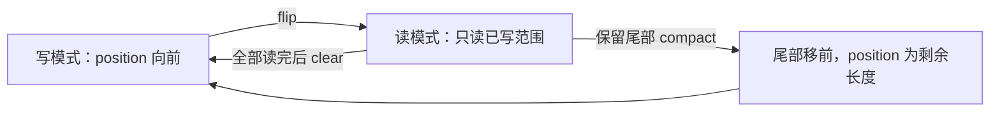
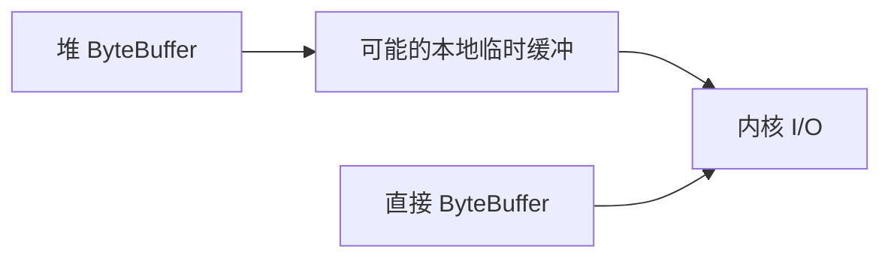
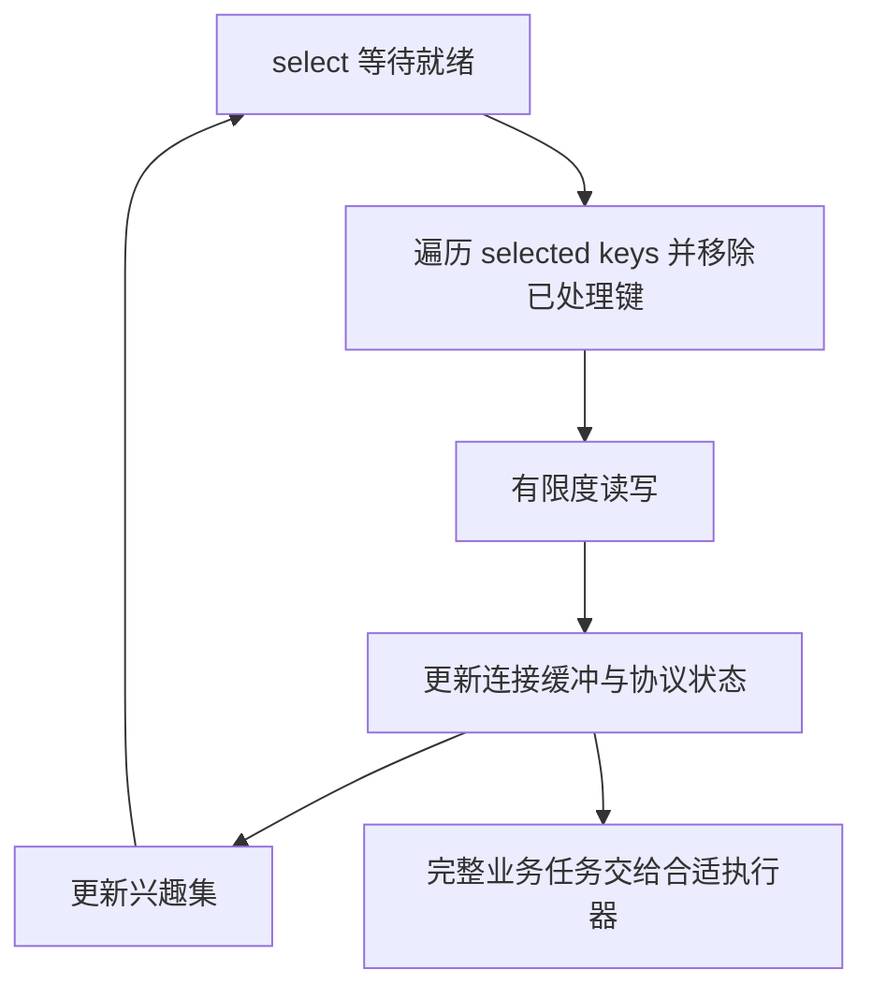
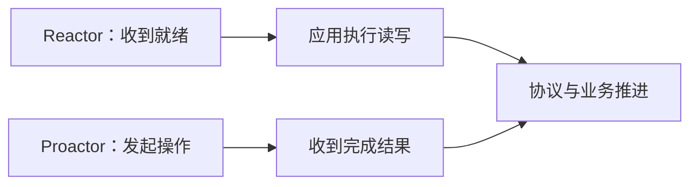
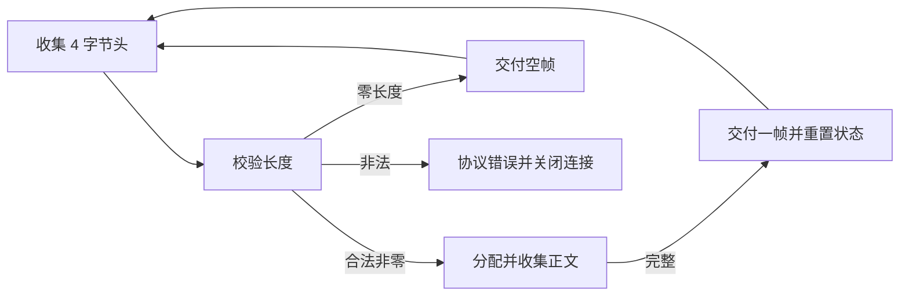
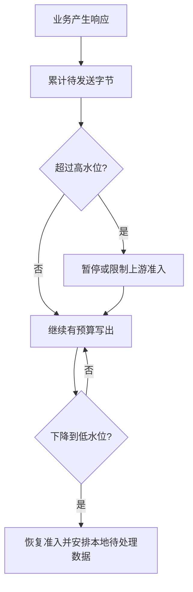

# IO原理：从字节、编码与缓冲到多路复用、零拷贝与持久化

> **阅读目标**：沿“问题 → 可选方案 → 实现机制 → 代价与边界”理解设计，能用具体交错、调用链或资源生命周期解释结果。配套 [IO面试](IO面试.md)。

> **版本口径**：语言与接口契约优先；JDK（Java Development Kit，Java 开发工具包）8、17、21、25 是本文的对照节点，25 为本篇参考版本，并非“最新版本”声明。实现细节不自动成为跨版本保证。

[返回 Java 知识体系导读](../学习路线.md)

## 阅读路线

| 章节 | 核心问题 |
|---|---|
| [1. 三个坐标：数据、等待与完成](#p-01) | 字节/字符、阻塞/非阻塞、同步/异步是不同维度，不能用一个 BIO/NIO 标签代替分析。 |
| [2. 字节流、字符流与编码](#p-02) | 文本是字节按字符集解码的结果，字符不等于字节，也不等于一个 char。 |
| [3. 缓冲、装饰与资源所有权](#p-03) | 缓冲减少小粒度调用，flush 与 close 各有作用，谁创建不等于谁都可关闭。 |
| [4. Channel 与 Buffer 状态机](#p-04) | Buffer 的 position/limit 描述读写窗口，flip、clear、compact 都主要改变状态而非清零数据。 |
| [5. 堆缓冲、直接缓冲与堆外生命周期](#p-05) | 直接缓冲可能减少部分本地交互复制，但不是“完全零拷贝”或没有内存上限。 |
| [6. Selector：就绪通知而不是完成通知](#p-06) | 多路复用让少量线程管理许多连接，应用仍负责读写、协议和公平调度。 |
| [7. TCP 字节流、拆包粘包与背压](#p-07) | 网络 read/write 的边界不是业务消息边界，协议必须定义可验证的帧。 |
| [8. 异步通道与线程模型](#p-08) | 异步接口把完成通知交给回调或 Future，不保证底层每一步都没有线程等待。 |
| [9. FileChannel、页缓存与持久化](#p-09) | 写入、刷新、强制落盘与原子替换提供不同保证。 |
| [10. mmap 与零拷贝](#p-10) | 映射和传输接口优化的是特定复制与访问路径，不代表没有缺页、内核工作或资源成本。 |
| [11. 序列化、现代 API 与故障诊断](#p-11) | 对象编码方案必须明确兼容、安全与大小限制，不能只追求读写方便。 |
| [12. select、poll、epoll 与 Reactor/Proactor](#p-12) | 多路复用的系统实现与应用架构分属不同层，epoll 的优势也有场景前提。 |
| [13. 完整长度前缀解码器：半个头、半个体与连续多帧](#p-13) | 每连接保留独立解析状态，先校验长度再分配正文，输入边界不决定消息边界。 |
| [14. 写侧背压与关闭状态机：慢客户端怎样拖垮服务](#p-14) | 限制的是累计待发送字节和在途资源，写完、发送完成、对端确认与连接关闭必须分别定义。 |
| [15. 增量字符解码状态机：从字节边界到字符边界](#p-15) | 逐步推导与反例验证 |

<a id="p-01"></a>
## 1. 三个坐标：数据、等待与完成

> 🎯 **核心结论**：字节/字符、阻塞/非阻塞、同步/异步是不同维度，不能用一个 BIO/NIO 标签代替分析。

I/O（Input/Output，输入/输出）在应用、运行时、操作系统和设备之间传递数据。BIO（Blocking I/O，阻塞式输入/输出）常指调用线程等待结果；NIO（New I/O，Java 新输入/输出库）包含 Buffer、Channel、Selector，并不意味着所有 Channel 都非阻塞；AIO（Asynchronous I/O，异步输入/输出）将完成通过回调或 Future 通知。

| 维度 | 问什么 | 典型区别 |
|---|---|---|
| 数据模型 | 处理原始字节还是文本字符 | InputStream / Reader |
| 等待方式 | 当前调用是否等待数据可用 | 阻塞 Socket / 非阻塞 SocketChannel |
| 通知语义 | 收到的是就绪还是操作完成 | Selector / 异步通道回调 |
| 执行模型 | 谁运行应用处理逻辑 | 平台线程 / 事件循环 / 虚拟线程 |


**读图**：每一层都有数据所有权、容量与失败边界；“写入成功”必须说明成功到哪一层。

<a id="p-02"></a>
## 2. 字节流、字符流与编码

> 🎯 **核心结论**：文本是字节按字符集解码的结果，字符不等于字节，也不等于一个 char。

InputStream/OutputStream 传字节，Reader/Writer 传字符，InputStreamReader/OutputStreamWriter 连接二者。UTF-8（Unicode Transformation Format, 8-bit，八位 Unicode 转换格式）对字符使用变长字节序列；Java char 是 UTF-16（Unicode Transformation Format, 16-bit，十六位 Unicode 转换格式）代码单元，部分字符需代理对。

```java
var bytes = "你好".getBytes(java.nio.charset.StandardCharsets.UTF_8);
String text = new String(bytes, java.nio.charset.StandardCharsets.UTF_8);
System.out.println(text);
```

网络每次 read 的边界可切开一个 UTF-8 序列，逐块 new String(chunk) 可能乱码或替换字符。Reader 或持续使用的 CharsetDecoder 能保留跨块状态；手工解码需区分 UNDERFLOW、OVERFLOW 和错误，并把未消费尾字节保留到下批。最后输入完成后还要按解码器状态机收尾。

**比较**：读完全部字节再解码简单，但大文件内存高；增量解码更节省内存，必须管理状态。JDK 18 起默认字符集统一为 UTF-8 的变化不能修复历史文件编码，跨系统协议仍应显式声明字符集与错误处理策略。

<a id="p-03"></a>
## 3. 缓冲、装饰与资源所有权

> 🎯 **核心结论**：缓冲减少小粒度调用，flush 与 close 各有作用，谁创建不等于谁都可关闭。

BufferedInputStream/BufferedReader 预读，BufferedOutputStream/BufferedWriter 聚合小写入。它们是装饰链，关闭外层通常向内关闭；对借入流、标准输入输出或框架响应流要遵守所有权约定，不能随意 try-with-resources 后把调用方流也关掉。

read(byte[]) 可少于数组长度，返回 -1 表示结束；copy 循环只写实际读取部分。available 表示可不阻塞读取的估计字节数，不是整个文件长度，也不能用来判断网络消息是否完整。

```java
static void copy(java.io.InputStream in, java.io.OutputStream out)
        throws java.io.IOException {
    byte[] buf = new byte[8192];
    int n;
    while ((n = in.read(buf)) != -1) out.write(buf, 0, n);
    // 本函数不关闭借入资源；flush 时机由协议与调用者决定。
}
```

flush 推送当前包装层缓冲到下游，不保证数据已持久写盘或对端已处理。close 释放资源且常包含 flush，但失败必须被观察；PrintWriter 等还会保存错误供检查，不能假定所有写失败都直接抛 IOException。

<a id="p-04"></a>
## 4. Channel 与 Buffer 状态机

> 🎯 **核心结论**：Buffer 的 position/limit 描述读写窗口，flip、clear、compact 都主要改变状态而非清零数据。

ByteBuffer 的 capacity 是容量，position 是下一读写位置，limit 是当前可访问边界。写入缓冲后 flip 令 limit=原 position、position=0，切换到读取已有数据；clear 令 position=0、limit=capacity，允许重新写满；compact 把未读数据移到前部并准备续写。



**读图**：半包场景应该保留未处理尾部再续读，盲目 clear 会丢弃逻辑上的未读数据；没 flip 则可能从错误位置读取。

```java
var b = java.nio.ByteBuffer.allocate(8);
b.putInt(7).putInt(9);
b.flip();
System.out.println(b.getInt()); // 7
b.compact();                    // 保留尚未读取的 9
b.putInt(11);
b.flip();
System.out.println(b.getInt()); // 9
System.out.println(b.getInt()); // 11
```

slice/duplicate 常共享底层字节但有独立位置状态，不能当作深复制。Buffer 通常不保证并发安全；多个视图操作同一字节也需同步。ByteOrder（字节序）应按协议明确，跨端默认值不能随意猜。

<a id="p-05"></a>
## 5. 堆缓冲、直接缓冲与堆外生命周期

> 🎯 **核心结论**：直接缓冲可能减少部分本地交互复制，但不是“完全零拷贝”或没有内存上限。

allocate 创建堆缓冲，allocateDirect 使用直接缓冲关联本地内存；操作系统 I/O 可能避免中间临时缓冲，但应用仍可能复制数据。直接分配与回收通常较贵，适合评估后复用，过量池化会长期保留峰值内存。



**读图**：图只说明一种常见复制差异，真实路径由运行时和平台决定，不能据此精确宣称所有调用少几次拷贝。堆内存稳定而进程常驻内存上涨时，还应看直接缓冲、映射、线程栈与本地库。

FFM（Foreign Function & Memory API，外部函数与内存接口）在 JDK 22 正式提供，可用 MemorySegment/Arena 表达某些本地内存的作用域生命周期；不等于所有 ByteBuffer 从此可直接 close，也不是通用网络性能开关。访问关闭的作用域和跨线程使用规则需遵守契约。

<a id="p-06"></a>
## 6. Selector：就绪通知而不是完成通知

> 🎯 **核心结论**：多路复用让少量线程管理许多连接，应用仍负责读写、协议和公平调度。

非阻塞 SocketChannel 注册 OP_READ/OP_WRITE 等兴趣事件，Selector 报告相应就绪键。就绪意味着可以尝试推进，不保证一次读出完整消息，也不保证写完全部缓冲；read 可返回 0、正数或 -1，write 也可只消费部分字节。



**读图**：事件循环不宜做慢数据库调用或长计算，否则一个连接拖住其他连接。业务结果返回时也要通过安全的队列/唤醒协调修改事件循环状态。

OP_WRITE 在可写时可能持续就绪，无待发数据仍一直关注它会导致空转。常用策略是有未写完数据才注册，写完后移除；新增待发送数据时注册并在需要时 wakeup。selected-key 集合需按循环语义处理，取消键和关闭连接也要清理附属缓冲。

<a id="p-07"></a>
## 7. TCP 字节流、拆包粘包与背压

> 🎯 **核心结论**：网络 read/write 的边界不是业务消息边界，协议必须定义可验证的帧。

TCP（Transmission Control Protocol，传输控制协议）提供有序字节流，不保留发送方每次 write 的边界。所谓粘包、半包主要是应用把字节流误当消息队列；可用定长、分隔符、长度前缀或自描述协议确定帧。

| 方案 | 优点 | 代价 |
|---|---|---|
| 定长 | 解析简单 | 空间浪费，消息尺寸受限 |
| 分隔符 | 文本可读 | 转义与扫描、最大长度 |
| 长度前缀 | 支持二进制与变长 | 半个头、非法长度与溢出检查 |

长度前缀解析要先攒齐头、校验最大长度、再等完整体；不要根据对方声明直接分配巨大数组。读到 -1 表示该方向输入结束，是否还能发送以及何时关闭要按半关闭与协议处理。

**背压**：若应用持续读入却处理很慢，缓冲仍可能无限增长；需限制每连接和全局待处理量，必要时暂停读兴趣。写侧同样限制排队字节，而非只限制消息条数，避免少量超大消息耗尽内存。

<a id="p-08"></a>
## 8. 异步通道与线程模型

> 🎯 **核心结论**：异步接口把完成通知交给回调或 Future，不保证底层每一步都没有线程等待。

AsynchronousSocketChannel 发起后经 CompletionHandler 或 Future 报告完成，应用要按契约维护缓冲的独占使用直到操作结束，处理部分完成和错误。通道组或提供者管理实际执行资源，具体机制依操作系统；异步文件操作也可能由线程池模拟，不能统一画成内核自动完成全部工作。

| 模型 | 应用写法 | 主要复杂度 |
|---|---|---|
| 平台线程阻塞 | 顺序代码 | 线程与栈成本、阻塞并发上限 |
| 事件循环 + 非阻塞 | 状态机推进 | 半包、回调、线程切换与背压 |
| 异步完成 API | 回调 / Future | 生命周期、错误传播、缓冲复用 |
| 虚拟线程阻塞 | 大量顺序任务 | 下游容量、总期限与本地调用限制 |

虚拟线程适合简化大量等待型代码，不会把文件、网络协议或数据库操作变成无限并行，也不会自动解决取消、消息边界和大缓冲保留。

<a id="p-09"></a>
## 9. FileChannel、页缓存与持久化

> 🎯 **核心结论**：写入、刷新、强制落盘与原子替换提供不同保证。

FileChannel 允许定位读写、transferTo/From、映射和 force。普通文件 I/O 常经操作系统页缓存，write 返回不一定意味着断电后仍存在。force 的保证还需看文件是否本地、元数据参数和平台契约，不能简单把 Java API 等同硬件全部故障模型。


**读图**：flush 不等同 force；持久性也不等同多文件事务。写配置文件可考虑临时文件、完成内容同步、同文件系统原子移动及必要的目录持久化协议，但跨平台支持和崩溃语义需分别验证，不能承诺一个 rename 解决所有断电问题。

文件锁通常协调进程间文件访问，语义依平台，不能拿来替代 JVM 内的线程互斥。相对路径依赖工作目录，符号链接与路径穿越还需按实际文件访问边界处理；字符串 normalize 不是完整访问授权。

<a id="p-10"></a>
## 10. mmap 与零拷贝

> 🎯 **核心结论**：映射和传输接口优化的是特定复制与访问路径，不代表没有缺页、内核工作或资源成本。

mmap（Memory Mapping，内存映射）把文件区域映射进地址空间，访问映射页可能触发缺页与存储读取。映射适合随机访问或共享视图，但大范围映射、频繁映射与生命周期都要管理；关闭 FileChannel 不等于所有已有映射立即解除。

transferTo 可在支持路径上减少用户态往返复制，仍可能短传输，需循环推进并处理零进展，不能把一次返回值当整文件必成功。映射、直接缓冲与 transferTo 是不同优化，不宜统称成同一种“零拷贝实现”。

| 方式 | 典型收益 | 边界 |
|---|---|---|
| 缓冲读写 | 通用、易控制 | 用户态复制与系统调用 |
| 内存映射 | 随机访问、页缓存利用 | 缺页、地址空间、解除映射 |
| 内核传输优化 | 文件向通道传输 | 平台、短传输、加密与目标类型 |

TLS（Transport Layer Security，传输层安全）加密路径、压缩和内容变换可能要求经过用户空间或不同内核能力；不能假定一个明文 sendfile 场景的收益直接适用于全部 HTTPS（Hypertext Transfer Protocol Secure，安全超文本传输协议）。

<a id="p-11"></a>
## 11. 序列化、现代 API 与故障诊断

> 🎯 **核心结论**：对象编码方案必须明确兼容、安全与大小限制，不能只追求读写方便。

Java 原生序列化可保存对象图但有版本耦合和反序列化攻击面。不要对不受信任输入直接使用 ObjectInputStream；ObjectInputFilter 可限制类、深度、引用数与数组规模，但过滤不等于完整业务验证。显式协议和数据模型常更适合跨服务长期演进。

Files.readString/readAllBytes 适合可控大小输入，大文件优先流式或分段；Files.lines/walk/list 返回的相关 Stream 持有资源，需按契约关闭。文件观察服务事件可能合并、丢失或溢出，需要重扫校准，不是可靠消息日志。

| 症状 | 先找证据 |
|---|---|
| 中文偶发乱码 | 字符集、跨块解码、是否重复转换 |
| 文件尾多旧字节 | 是否按 n 写出、position/limit 与截断策略 |
| 事件循环满核空转 | 无效 OP_WRITE、零进展循环、键处理 |
| 堆没涨但进程内存涨 | 直接内存、映射、本地库与线程栈 |
| 写入成功后断电丢失 | 成功层级、同步和恢复协议 |
| 客户端慢拖垮服务 | 出入缓冲上限、背压、期限与关闭 |

**验证集**：半个编码字符、半个帧头、非法大长度、短写/零读、对端关闭、取消、磁盘满与资源关闭失败。性能观察系统调用、复制、分配、尾延迟与资源峰值，不根据 BIO/NIO 名称直接宣布赢家。

<a id="p-12"></a>
## 12. select、poll、epoll 与 Reactor/Proactor

> 🎯 **核心结论**：多路复用的系统实现与应用架构分属不同层，epoll 的优势也有场景前提。

Linux 上常比较 select、poll、epoll；其他系统有不同机制，Java Selector 由提供者映射到平台能力，不承诺所有平台使用 epoll。

| 机制 | 关注集合和通知 | 收益 / 代价 |
|---|---|---|
| select | 传递描述符集合并检查结果，集合表示有约束 | 可用性广；大集合扫描和拷贝成本需考虑 |
| poll | 以描述符数组表达兴趣和结果 | 避开某些固定集合限制，仍通常扫描传入数组 |
| epoll | 注册持久兴趣集合，等待就绪结果 | 大量连接、少量活跃时常有优势；注册、唤醒和处理仍有成本 |

**不能简化成 epoll 永远 O(1)**：注册、维护、返回就绪项以及业务处理都有成本；当连接大多活跃、消息很小或处理逻辑占主导时，收益可能不同。Java 层也不能根据底层某个触发模式传闻，就忽略 SocketChannel 的部分读写和零进展语义。

Reactor（反应器模式）围绕就绪事件，由处理器实际读写并推进状态；Proactor（主动器模式）围绕异步操作完成，再处理结果。一个完成式 API 在某个平台仍可能由线程池或其他机制支撑，因此架构语义不能直接倒推出内核实现。



**读图**：两条路径都要处理部分完成、错误、期限、缓冲生命周期和背压。优秀实现的收益往往来自完整资源协议，而非仅选择一种更时髦的通知名称。

参考：[Linux epoll 手册](https://man7.org/linux/man-pages/man7/epoll.7.html)、[poll 手册](https://man7.org/linux/man-pages/man2/poll.2.html)、[select 手册](https://man7.org/linux/man-pages/man2/select.2.html)。

<a id="p-13"></a>
## 13. 完整长度前缀解码器：半个头、半个体与连续多帧

> 🎯 **核心结论**：每连接保留独立解析状态，先校验长度再分配正文，输入边界不决定消息边界。

### 13.1 定义协议与状态
协议为“大端 4 字节有符号长度 + 对应长度正文”，正文长度允许零，但不能为负或超过构造上限。选择有符号 int 是本例协议约定，不代表所有网络长度字段都相同。输入 ByteBuffer 已处于读模式，解析器推进其 position；每连接使用一个实例并由同一事件循环拥有。



**读图**：新一次 read 可以从图的任一未完成状态继续。一个输入缓冲也可包含多帧，frameBudget 限制一次交付数量，避免一个热连接无限占用事件循环。

### 13.2 可编译的解码器
```java
import java.io.*;
import java.net.ProtocolException;
import java.nio.*;
import java.util.function.Consumer;
public final class FrameDecoder {
    private final int maxFrame;
    private final ByteBuffer header = ByteBuffer.allocate(4)
                                                .order(ByteOrder.BIG_ENDIAN);
    private ByteBuffer body;
    public FrameDecoder(int maxFrame) {
        if (maxFrame < 0) throw new IllegalArgumentException("maxFrame");
        this.maxFrame = maxFrame;
    }
    public int feed(ByteBuffer input, int frameBudget,
                    Consumer<byte[]> sink) throws IOException {
        if (frameBudget <= 0) throw new IllegalArgumentException("budget");
        int completed = 0;
        while (input.hasRemaining() && completed < frameBudget) {
            if (body == null) {
                move(input, header);
                if (header.hasRemaining()) break;
                header.flip();
                int length = header.getInt();
                header.clear();
                if (length < 0 || length > maxFrame)
                    throw new ProtocolException("invalid frame length: " + length);
                body = ByteBuffer.allocate(length);
            }
            move(input, body);
            if (!body.hasRemaining()) {
                byte[] frame = body.array();
                body = null;
                completed++;
                sink.accept(frame);
            }
        }
        return completed;
    }
    private static void move(ByteBuffer from, ByteBuffer to) {
        int count = Math.min(from.remaining(), to.remaining());
        int oldLimit = from.limit();
        try {
            from.limit(from.position() + count);
            to.put(from);
        } finally { from.limit(oldLimit); }
    }
    public void endOfInput() throws EOFException {
        if (header.position() != 0 || body != null)
            throw new EOFException("truncated frame");
    }
}
```

### 13.3 按一个输入序列推演
一帧正文 abc 编码为 `[00 00 00 03 61 62 63]`。第一次输入只有头的前两个字节，header.position=2；第二次补完头并带 a，正文剩两个字节；第三次带 bc 和下一帧，先交付 abc，再继续解释下一帧的头。零长度帧在头读全后当次即可交付。

若达到 frameBudget 而 input 仍有数据，调用方必须保留并再次安排解析，**不能直接 clear 丢弃剩余输入，也不能只等下一次网络可读事件**；余下数据可能已经全部在应用缓冲里，网络未必再通知。这个“本地待处理任务”是事件循环调度的一部分。

### 13.4 代码保证与未覆盖边界
本例每次只交付完整 byte[]，支持半头、半体、多帧、空帧、非法长度及 EOF（End Of File，输入结束）截断检查。若传递 read-only 输入也只读取它，不能随意共享解析器跨线程。sink 若抛异常，上层应按连接失败策略处理，不能期望自动回放已交付帧。

每连接最大帧长只是第一道限制：许多连接各占一个未完成大帧仍可耗尽全局内存，需要全局字节预算和帧读取期限。生产实现还需控制每轮处理字节、业务队列和异常关闭；这个解析器故意不混入完整服务器部署样板。

参考：[ByteBuffer](https://docs.oracle.com/en/java/javase/25/docs/api/java.base/java/nio/ByteBuffer.html)、[SocketChannel 部分读写](https://docs.oracle.com/en/java/javase/25/docs/api/java.base/java/nio/channels/SocketChannel.html)。

<a id="p-14"></a>
## 14. 写侧背压与关闭状态机：慢客户端怎样拖垮服务

> 🎯 **核心结论**：限制的是累计待发送字节和在途资源，写完、发送完成、对端确认与连接关闭必须分别定义。

### 14.1 短写不是失败，也不是全部成功
非阻塞 write 返回后，ByteBuffer 可能仍有剩余；应保留 position 并等可写时续写。若返回零，不能在事件循环里无限重试，否则一个慢连接会抢占处理器。待发送队列应保存仍未消费的缓冲，不能把同一数组马上归还复用池。

```text
收到可写事件：
  在本轮字节预算内尝试发送队首缓冲
  若缓冲耗尽：移除，并按所有权协议归还资源
  若 write 返回 0：结束本轮，保留 OP_WRITE
  若队列已空：移除 OP_WRITE
  若出错：进入统一失败清理并使相关结果终结
```

这是事件循环算法，不是完整可运行代码。新的发送请求从其他线程到来时，先安全入队，再由拥有该连接状态的事件循环更新兴趣集；必要时 selector.wakeup。wakeup 是唤起选择循环，不会替代入队与内存发布，也不会自动执行用户任务。

### 14.2 高低水位与读暂停如何配合


**读图**：高低两个阈值形成滞回，避免在单阈值附近反复暂停恢复。它们是示例策略，不是所有协议都能直接关闭 OP_READ：双向协议可能还需读取响应或控制消息来解除写侧等待，盲目停读会形成协议死锁。

| 维度 | 需要限制的量 | 原因 |
|---|---|---|
| 单连接 | 待发送字节、帧大小、在途请求 | 防单个慢客户端占满资源 |
| 全局 | 所有连接缓冲与业务任务 | 单连接上限相乘仍可能过大 |
| 时间 | 空闲、半帧、写停滞与总期限 | 有限内存也可能被永久占用 |

恢复读时还要处理已解析或已在缓冲内的数据；新增网络事件不是唯一推进信号。读暂停只影响本地继续接收，已经在内核或网络中的数据不会神奇撤销。

### 14.3 把关闭当成可审计状态机
一个简化发送状态可有 OPEN→DRAINING→CLOSED：停止新发送，按期限排空已接纳数据，必要时半关闭输出，再按协议等待对方或关闭。发生错误则直接走失败清理；“写完应用缓冲”不证明对端业务处理完成，后者需要应用层确认。

清理应集中且可重复调用：取消键、关闭通道、释放未发送缓冲、使未完成结果失败或取消、撤销定时任务。不同触发源可能同时提出关闭，资源归还应确保一次，不能让取消与写完成双重释放同一缓冲。

**故障演练**：对端永不读、写到一半断线、任务队列满、取消恰好发生在写完成后、排空期限到达、线程间入队后忘记唤醒。验证看内存、进展与结果终态，而不只看连接数。

参考：[SelectionKey 兴趣集](https://docs.oracle.com/en/java/javase/25/docs/api/java.base/java/nio/channels/SelectionKey.html)、[Selector 唤醒](https://docs.oracle.com/en/java/javase/25/docs/api/java.base/java/nio/channels/Selector.html)。

<a id="p-15"></a>
## 15. 增量字符解码状态机：从字节边界到字符边界

> 🎯 **核心问题**：已经正确处理网络半包，为什么文本还是会乱码？因为业务帧边界、编码字符边界和每次 read 的边界是三种东西。

### 一、先明确解码器保存什么
UTF-8（Unicode Transformation Format, 8-bit，八位 Unicode 转换格式）的一个字符可跨多个字节。某次输入以不完整前缀结束时，解码器可能返回 UNDERFLOW，未消费字节需要由调用方保留。不能一看到 UNDERFLOW 就把输入 clear，丢掉下次解码需要的前缀。

输入 ByteBuffer 管未消费字节，输出 CharBuffer 管已生成但尚未消费的 UTF-16 代码单元。字符编码层只负责字符，不替应用判断完整 JSON、行或业务消息。

### 二、三个 CoderResult 分别意味着什么
| 结果 | 可能状态 | 下一步 |
|---|---|---|
| UNDERFLOW | 当前输入不足继续，可能留有不完整序列 | 非结束时保留尾部补输入；结束时按结束规则处理 |
| OVERFLOW | 输出装不下更多字符 | flip 输出、消费、clear，再继续解码 |
| 错误 | 非法或不可映射输入 | 按 REPORT/REPLACE/IGNORE 策略处理 |

不能把 UNDERFLOW 等同“输入全部消费成功”；也不能在 OVERFLOW 时丢弃输入剩余部分。输出消费同样可能受下游背压，不能无限缓存已解码字符串。

### 三、完整调用顺序
```text
为一个逻辑解码流创建或 reset 解码器
反复读入：
  compact 输入，保留未消费尾部，再追加新字节
  flip 输入
  decode(input, output, endOfInput=false)
  OVERFLOW 时消费输出并继续；UNDERFLOW 时等待更多输入
输入真正结束：
  decode(input, output, endOfInput=true)，处理剩余输出或错误
  持续 flush(output)，直到完成
最后消费输出并结束该解码流
```

这是增量解码算法，不是可直接复制运行的 Java 代码。实际实现应确保输入缓冲有空间容纳最大未完成序列，输出空间不足时能取得进展，并明确什么时候才是编码流结束。一个 Socket read 返回 0 不是流结束，-1 才表示该输入方向结束。

### 四、为什么必须有最后一次 true
不完整前缀在“还会有更多输入”时只是等待；在“输入已结束”时就可能是截断或非法编码。若永远不调用结束阶段，坏输入可能被静默遗忘。flush 还用于输出解码器内部可能保留的状态，不能把字节流 close 自动等价为应用正确跑完了解码状态机。

### 五、错误策略必须是协议决定
REPORT 让输入损坏成为显式错误；REPLACE 可能把非法字节变成替代字符；IGNORE 直接丢弃。用于日志展示与用于签名、账号、路由键的协议可能有完全不同要求。若两端采用不同替换或规范化策略，同一字节序列可能被解释为不同业务身份。

新 String 对非法输入的处理也不能代替严格解码校验。需要严格输入边界时，应显式配置 CharsetDecoder，并对大小、字符范围和业务语法继续验证。

### 六、从编码层回到 IO 资源
半字符与半帧应各有自己的状态所有者；若协议规定每帧独立文本，帧结束也可能就是该帧解码的结束，应校验不完整尾部，而不是把它错误拼到下一帧。若是持续文本流，则应跨读取保留解码状态。

测试至少覆盖每个字节切分位置、输出容量很小产生多次 OVERFLOW、非法续字节、输入末尾截断、空输入与多个逻辑流复用 reset。验证输出内容和错误时机，而不只看“中文大多数时候正常”。

参考：[CharsetDecoder 状态协议](https://docs.oracle.com/en/java/javase/25/docs/api/java.base/java/nio/charset/CharsetDecoder.html)。

<a id="p-versions"></a>
## 版本演进与学习边界

| 节点 | 变化 | 边界 |
|---|---|---|
| 1.4 | NIO 通道、缓冲和 Selector | NIO 不是全部非阻塞 |
| 7 | NIO.2、Path/Files、异步通道等 | 异步接口不保证所有平台同一实现 |
| 11 | readString/writeString 等便捷文件入口 | 不能无上限读取外部大文件 |
| 18 | 默认字符集转向 UTF-8 | 协议与历史文件仍要明确编码 |
| 21 | 虚拟线程正式提供 | 下游、缓冲和准入限制仍存在 |
| 22 / 25 | FFM 已正式提供并继续演进 | 本地内存作用域不等于所有旧缓冲都可 close |

网络传输路径、文件系统和内核版本常与 JDK 一样重要，涉及零拷贝和持久化的结论应同时限定平台。

<a id="p-references"></a>
## 参考资料与源码入口

- [ByteBuffer](https://docs.oracle.com/en/java/javase/25/docs/api/java.base/java/nio/ByteBuffer.html)、[CharsetDecoder](https://docs.oracle.com/en/java/javase/25/docs/api/java.base/java/nio/charset/CharsetDecoder.html)
- [Selector](https://docs.oracle.com/en/java/javase/25/docs/api/java.base/java/nio/channels/Selector.html)、[SocketChannel](https://docs.oracle.com/en/java/javase/25/docs/api/java.base/java/nio/channels/SocketChannel.html)
- [FileChannel](https://docs.oracle.com/en/java/javase/25/docs/api/java.base/java/nio/channels/FileChannel.html)、[异步通道组](https://docs.oracle.com/en/java/javase/25/docs/api/java.base/java/nio/channels/AsynchronousChannelGroup.html)
- [序列化过滤](https://docs.oracle.com/en/java/javase/25/core/serialization-filtering1.html)
- [JDK 18 默认 UTF-8 变化](https://docs.oracle.com/en/java/javase/18/migrate/significant-changes-jdk-release.html)
- [外部内存 API](https://docs.oracle.com/en/java/javase/25/docs/api/java.base/java/lang/foreign/package-summary.html)

<a id="p-glossary"></a>
## 附录：术语与缩写

| 术语 | 英文全称 | 中文含义 |
|---|---|---|
| JDK | Java Development Kit | Java 开发工具包 |
| JVM | Java Virtual Machine | Java 虚拟机 |
| API | Application Programming Interface | 应用程序编程接口 |
| I/O | Input/Output | 输入/输出 |
| BIO | Blocking I/O | 阻塞式输入/输出，常见社区称呼 |
| NIO | New I/O | Java 新输入/输出库，不等于全部非阻塞 |
| AIO | Asynchronous I/O | 异步输入/输出 |
| UTF-8 | Unicode Transformation Format, 8-bit | 八位 Unicode 转换格式 |
| UTF-16 | Unicode Transformation Format, 16-bit | 十六位 Unicode 转换格式 |
| TCP | Transmission Control Protocol | 传输控制协议 |
| TLS | Transport Layer Security | 传输层安全 |
| mmap | Memory Mapping | 内存映射，常用系统接口简称 |
| FFM | Foreign Function & Memory API | 外部函数与内存接口 |
| OOM | Out Of Memory | 内存耗尽 |
| EOF | End Of File | 文件或输入结束 |
| HTTPS | Hypertext Transfer Protocol Secure | 安全超文本传输协议 |
