# Java 集合框架原理：从操作契约到数据结构、视图与并发边界

> **阅读目标**：不只记住“数组快、链表改得快”，而是能按定位、移动、内存、顺序、对象身份和并发要求选择结构，并解释失败原因。
>
> **版本口径**：以现代 JDK（Java Development Kit，Java 开发工具包）常见机制为主，源码细节参考 OpenJDK 25 标签，单列 8、9、10、16、19、21 等节点。接口契约和某版实现必须分开。配套 [集合框架面试](集合框架面试.md)。
>
> **与其他主题分工**：本篇讲集合操作及复用边界；锁、内存模型、队列协调和任务执行会分别由锁机制、JUC（java.util.concurrent，Java 并发工具包）、线程池篇展开。代码用于机制验证，不代表生产容量或性能结论。

[返回 Java 知识体系导读](../README.md)

## 阅读路线

| 主线 | 章节 | 必须能解释 |
|---|---|---|
| 契约与成本 | [1](#c-01)、[2](#c-02) | 顺序、唯一、容量与复杂度分别指什么？ |
| 列表 | [3](#c-03)、[4](#c-04) | 插入成本是否包含定位，扩容复制了什么？ |
| 哈希结构 | [5](#c-05) → [6](#c-06) → [7](#c-07) | 键怎样找到桶，树化和扩容何时发生？ |
| 顺序与特殊模型 | [8](#c-08)、[9](#c-09)、[10](#c-10)、[11](#c-11) | 遍历顺序、排序与优先级是不是同一概念？ |
| 所有权与遍历 | [12](#c-12)、[13](#c-13) | 包装、视图、复制与不可变有什么区别？ |
| 并发选择 | [14](#c-14)、[15](#c-15)、[16](#c-16) | 方法线程安全为何仍不足以保证业务原子性？ |
| 工程与演进 | [17](#c-17)、[18](#c-18) | 怎样验证语义、容量、性能与版本差异？ |
| 深入机制 | [19. ConcurrentHashMap 协助扩容：迁移期间怎样读写](#c-19) | 转发标记连接新旧表，迁移者发布新桶后再封住旧桶，竞争线程按状态重试或参与迁移。 |
| 深入机制 | [20. 跳表与非阻塞队列：有序查找和原子交接的实现取舍](#c-20) | 跳表用分层索引缩短有序查找，链式并发队列用明确的原子生效点协调入队和出队。 |

<a id="c-01"></a>
## 1. 接口体系：集合抽象表达哪些不变量

> 🎯 **核心结论**：先确定是否允许重复、是否有键、什么顺序、是否需要等待，再选择实现；“Set 都无序、Queue 都先进先出”都过于绝对。

Collection 管一组元素，Map 管键值映射并不继承 Collection。Iterable 提供遍历契约，Collections 是工具类，不能把三个名字当作同一层对象。

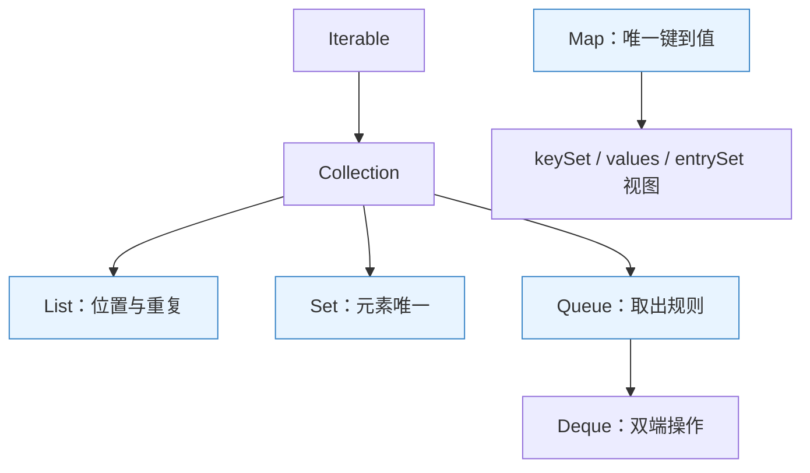

**读图**：图是经典主干，现代 Sequenced 系列还为部分结构补充遭遇顺序与两端操作。这里的箭头表示接口体系，不是对象包含关系。

| 维度 | 需要明确的问题 | 典型区别 |
|---|---|---|
| 唯一性 | 用 equals、比较结果还是引用判断？ | HashSet、TreeSet、IdentityHashMap 不相同 |
| 顺序 | 插入、访问、排序还是优先级？ | LinkedHashMap 与 TreeMap 维护不同顺序 |
| 操作 | 按下标、键、两端还是范围？ | List、Map、Deque、NavigableMap |
| 所有权 | 返回独立数据还是共享视图？ | copy 与 subList 不相同 |
| 并发 | 独占、快照、弱一致还是等待？ | ArrayList、写时复制集合、并发 Map、BlockingQueue |

“有序 List”主要表示位置/遭遇顺序，不等于元素自动排序；HashMap 未承诺顺序，也不代表每次迭代都随机。依赖偶然稳定顺序属于错误使用。

<a id="c-02"></a>
## 2. 复杂度与实际成本：O(1) 不代表没有代价

> 🎯 **核心结论**：复杂度描述增长趋势，平均、摊还、最坏有不同前提；节点分配、缓存局部性和扩容峰值也会影响实际表现。

### 2.1 必须说明操作对象

| 操作 | ArrayList | LinkedList | 常见误推 |
|---|---|---|---|
| 按下标读取 | O(1) | O(n) | 查询不等于所有 contains 都 O(1) |
| 尾部追加 | 摊还 O(1)，扩容时 O(n) | O(1) 链接与分配 | 均摊小不代表单次延迟没有峰值 |
| 已定位处插删 | 可能 O(n) 移动 | 局部链接可 O(1) | 链表先按下标定位仍 O(n) |
| 按值查找 | O(n) | O(n) | 还要计入 equals 的实际成本 |

数组中的连续引用更利于局部访问，链表每节点有对象头和前后引用等开销，也会增加间接寻址与回收压力。**ArrayList 的数组连续，不代表所有元素对象也连续排列**。

### 2.2 为什么不能靠“读多写少”一刀切

中间位置频繁插入，但每次都先随机 get 定位，LinkedList 可能没有优势；批量数组移动由优化后的底层操作完成，常数也不一定大。反过来，已经通过迭代器定位并连续局部编辑，链表的结构优势才更直接。

性能比较要保持同样数据、操作分布、容量和线程条件，纳入预热、分配和尾延迟。CPU（Central Processing Unit，中央处理器）缓存与 GC（Garbage Collection，垃圾回收）不是复杂度公式的一部分，却常决定真实成本。

<a id="c-03"></a>
## 3. ArrayList：动态数组怎样平衡追加与空间

> 🎯 **核心结论**：size 是有效元素数，capacity 是引用数组长度；扩容复制引用，末尾追加摊还成本低，但中间移动和内存峰值仍存在。

### 3.1 从空对象到第一次分配

现代 OpenJDK 的默认构造通常先引用共享空数组，首次需要存储时再按策略分配；所以“构造时立刻分配 10 个槽”不准确。显式容量 0 与默认空构造的内部状态也可能不同。

常见增长偏好约为旧容量的 1.5 倍，但还要满足最小需求、整数边界和数组限制，**不是接口承诺每次精确乘 1.5**。一次 addAll 的需求很大时，更不能机械推算。[ArrayList API](https://docs.oracle.com/en/java/javase/25/docs/api/java.base/java/util/ArrayList.html)

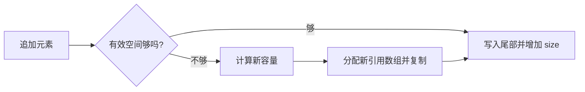

**读图**：复制的是元素引用，通常不克隆元素对象；扩容过程中旧新数组短期并存，不能只看最终容量估内存峰值。

### 3.2 删除与内存回收

中间删除把后续引用向前移动，再清空尾部无效槽，帮助释放元素引用。clear 清有效引用和 size，通常不会自动把大数组缩回默认大小；remove 也不等于自动缩容。

预估规模合理时可预分配或 ensureCapacity；长期保留曾经很大的列表要分析 trimToSize 或重建的收益。频繁缩到 size 后又追加，会反复分配，可能得不偿失。

### 3.3 两个重载的删除不是同一动作

对 `List<Integer>`，`remove(1)` 删除下标 1 的元素；`remove(Integer.valueOf(1))` 按值删除首次匹配。自动装箱并不取消重载解析，接口表达式类型也会影响选择。

<a id="c-04"></a>
## 4. LinkedList 与 Deque：O(1) 插删需要什么前提

> 🎯 **核心结论**：链表优势是已定位节点的局部链接和两端操作；Java 的 LinkedList 不会把内部节点直接交给普通调用者。

双向节点保存元素与前后引用，按下标通常从较近的一端遍历；即使减少一半距离，量级仍是 O(n)。使用 `for (i) get(i)` 遍历 LinkedList，可能形成 O(n²) 总成本。

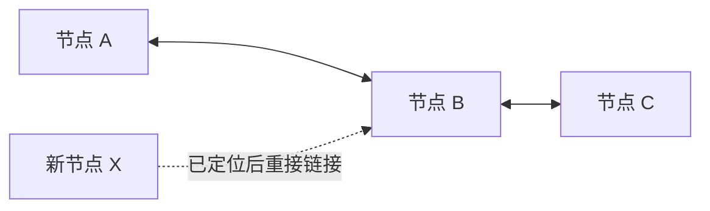

**读图**：图强调定位与链接是两笔成本。接口只给出下标或值时，不能把图中已经找到 B 的状态当成免费前提。

| 场景 | 选择判断 |
|---|---|
| 通用列表、随机访问与遍历 | ArrayList 常是合理起点 |
| 栈或双端队列 | 优先比较 ArrayDeque，避免因链表名就默认选 LinkedList |
| 已有 ListIterator 并连续局部编辑 | LinkedList 可减少部分数组移动，但仍有节点分配 |
| 需要 null 元素的链式双端结构 | 结合协议选择；null 也会与队列空结果产生歧义 |

Vector、Stack 是历史 API（Application Programming Interface，应用程序编程接口），方法同步不自动保证组合操作原子。它们不是任何场景必定慢，但新设计通常应从具体线程模型选择，而非沿用旧类名。

<a id="c-05"></a>
## 5. equals、hashCode 与键稳定性：数据结构依赖的协议

> 🎯 **核心结论**：相等对象必须有相同哈希值，不同对象可碰撞；键进入结构后，参与定位/比较的属性要保持稳定。

### 5.1 哈希与相等分工

hashCode 缩小候选范围，equals 判断业务相等。只重写 equals 不配合 hashCode，可能让相等对象进入不同位置，破坏 Map/Set 语义；哈希相同不表示键相等。

不可变键通常更容易保持契约，但只要作为键期间相关字段不变，可变类型也不被一概禁止。数组默认按引用相等，若用作内容键，应有明确内容比较/哈希包装。

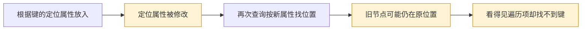

**读图**：错误不是垃圾回收把数据丢了，而是结构不再满足放入时的不变量。修改回旧属性可能让现象变化，也不应依赖这种修补。

### 5.2 排序相等可能不同于 equals

TreeMap/TreeSet 使用 compareTo 或 Comparator 的零结果识别同一个排序键。`BigDecimal("1.0")` 与 `BigDecimal("1.00")` 的 equals 不同，compareTo 却可为 0，因此 HashSet 与 TreeSet 的元素数可能不同。

比较器应满足一致与传递等约束；用减法比较整数可能溢出，宜使用合适比较方法。排序字段在入树后变化，也可能破坏查找与范围语义。

<a id="c-06"></a>
## 6. HashMap：从哈希扰动到桶内匹配

> 🎯 **核心结论**：哈希表把键映射到桶，再在桶内判断；均匀散列支撑平均性能，不能对所有输入承诺绝对 O(1)。

### 6.1 为什么桶容量常取 2 的幂

现代常见实现对 hashCode 做高位混合，再用 `(n - 1) & hash` 定位。容量为 2 的幂时，位与方便计算；高位扰动让部分高位信息也参与较小表的低位选择。

这并不会消除所有碰撞。实现可以把构造参数调整为内部容量，调用方不必只传 2 的幂，但要理解其容量含义和代价。

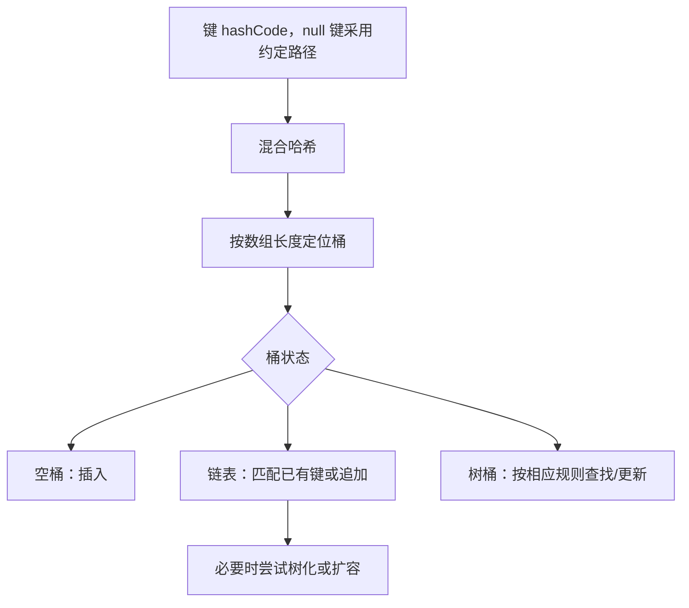

**读图**：相同键更新通常替换值，不增加映射数；键比较包含引用相同或满足 equals 的情况。读写无同步时，内部结构与可见性都不能靠这张单线程图保证。

### 6.2 size、capacity、threshold

默认负载因子常为 0.75，threshold 通常与容量乘负载因子相关，构建与扩容阶段还存在内部状态差异。桶多可减少碰撞，但增加空槽内存，遍历成本还与容量有关，并不是只与 size 成正比。

`new HashMap<>(1000)` 的参数不是“保证容纳 1000 个映射且绝不扩容”的直观计数。JDK 19 起 `HashMap.newHashMap(expectedMappings)` 专门表达期望映射数；旧版本手工估算还要考虑负载和取整。[HashMap API](https://docs.oracle.com/en/java/javase/25/docs/api/java.base/java/util/HashMap.html)

### 6.3 为什么查到 null 不能总判断键不存在

HashMap 允许 null 键和值，get 返回 null 可能表示没键，也可能是键映射到 null；需要 containsKey 或更明确业务协议。ConcurrentHashMap 不允许 null，为并发场景下的缺失表达等提供更清晰契约。

<a id="c-07"></a>
## 7. 扩容、树化与退化：不要只背 8、6、64

> 🎯 **核心结论**：这些常量服务于空间与碰撞成本的权衡，触发需要看容量、操作路径与具体版本；树化也不保证任意键的最坏查找都变成 O(log n)。

### 7.1 扩容为什么能按旧容量位拆分

当容量翻倍，旧桶中的键根据 hash 的 oldCapacity 位分成两组：留在原索引，或去原索引加 oldCapacity。常见 JDK 8+ 链表分裂保持各组相对顺序，不必对每个节点重新调用键的 hashCode。

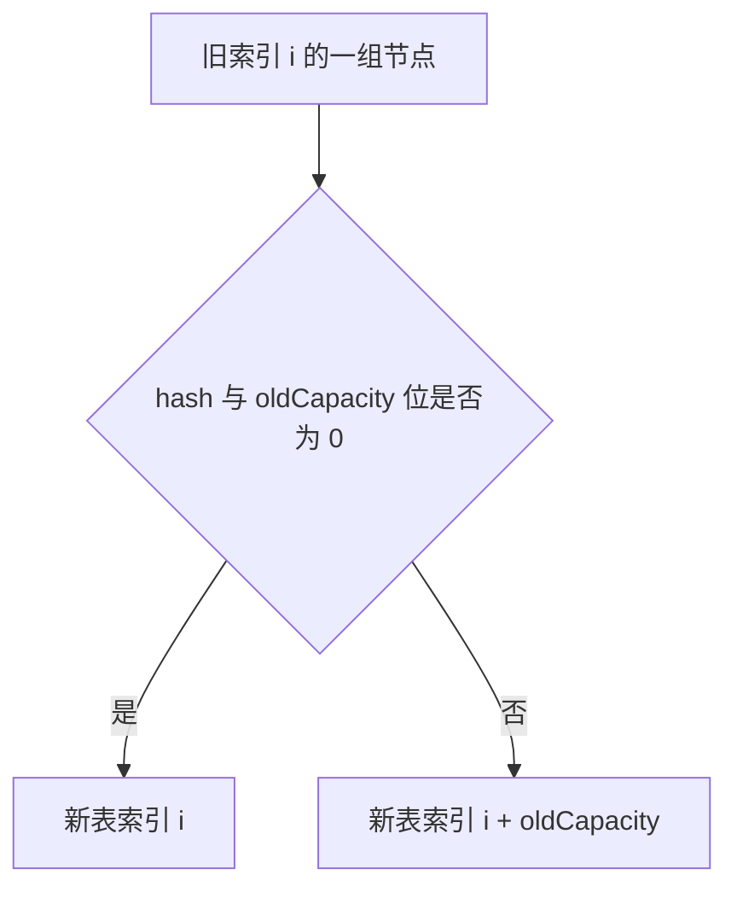

**读图**：这是容量翻倍下的实现技巧，不等于扩容无需遍历和复制，也不提供并发安全。旧版头插迁移与现代实现不能混讲成同一算法。

### 7.2 树化的完整条件

常见常量为 TREEIFY_THRESHOLD=8、UNTREEIFY_THRESHOLD=6、MIN_TREEIFY_CAPACITY=64。表容量不足时通常优先扩容，期望通过增加桶数分散节点，而非马上承担树节点成本。

在参考实现常规 put 的链表尾部新增路径中，计数方式使**向已有 8 个节点的桶插入新节点时**触发 treeifyBin 尝试；其他计算更新路径的计数细节不能直接套同一个口令。准确回答应带源码版本和路径，而不是“所有场景第 8 个必转”。

树桶在 resize 拆分等路径可按阈值退回链表；普通删除还有形状判断等细节，不能说任何删除只要剩 6 个才转回。不同阈值减少来回转换抖动。

### 7.3 为什么选择红黑树，而不是一开始全用树

数组/短链结构常数和节点成本较低，碰撞桶长时树有助改善多数查找。红黑树相比更严格平衡的树在维护与查找间取舍，但增加字段和旋转等成本。

若大量键哈希完全相同且没有可用的一致比较顺序，某些树查找仍可能需要搜索多个分支。**树化不是对恶劣哈希和任意 equals 成本的无条件复杂度豁免**。[参考 HashMap 源码](https://raw.githubusercontent.com/openjdk/jdk/jdk-25-ga/src/java.base/share/classes/java/util/HashMap.java)

### 7.4 并发错误的版本边界

JDK 7 的迁移环问题不能被当作所有新 JDK 同一原因，但新实现没有该具体路径也不让 HashMap 线程安全。丢更新、可见性、结构不一致等仍可能出现；只读共享还需正确发布且没有并发写入。

<a id="c-08"></a>
## 8. LinkedHashMap 与 LinkedHashSet：维护的是哪种顺序

> 🎯 **核心结论**：哈希定位与双向顺序链可共存；插入顺序、访问顺序和键排序是三个不同契约。

LinkedHashMap 在哈希节点体系上维持顺序链接，默认按插入遭遇顺序，更新已有键通常不会被当新插入移到尾部；访问顺序模式则会在相应访问时调整位置。

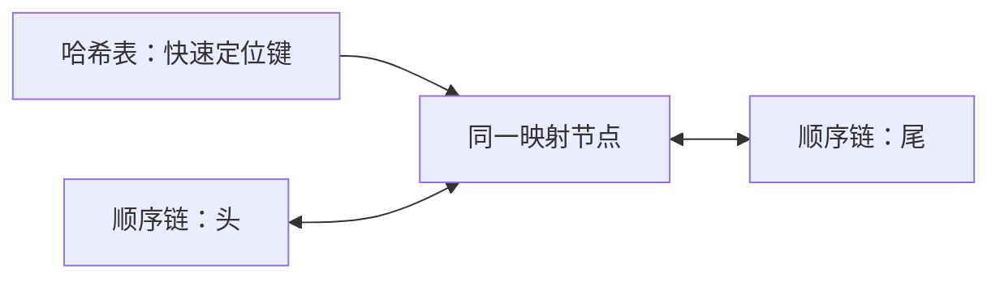

**读图**：并不是每个键保存两份业务值，而是结构提供两类导航。增加顺序字段消耗内存，换来按顺序遍历和快速调整。

### 8.1 访问顺序下 get 为什么也要注意同步

get 等操作可能改变链结构，触发结构修改语义；不能因为“只是读取值”就按无写共享访问。访问顺序有助实现 LRU（Least Recently Used，最近最少使用）淘汰，但 removeEldestEntry 等钩子不等于完整缓存系统。

简单 LRU 还缺少容量以外的权重、TTL（Time to Live，存活时间）、加载合并、失效、观测和并发策略。需要这些能力时应选择合适缓存设计，而不是只贴一个 LinkedHashMap 子类。

### 8.2 LinkedHashSet 不是访问缓存

它提供去重和插入顺序等能力，contains 不应被想当然理解为 LRU 访问移动。选择它是为了去重后稳定遭遇顺序，不是因为名字也有 Linked 就能满足任何淘汰策略。

<a id="c-09"></a>
## 9. TreeMap、TreeSet 与 Navigable：排序如何变成范围能力

> 🎯 **核心结论**：树结构维护比较器顺序，提供上下界和范围查询；排序键唯一性由比较结果决定。

| 需求 | 哈希结构 | 树结构 |
|---|---|---|
| 精确键查找 | 均匀散列下平均表现好 | 常见红黑树提供 O(log n) 比较级别 |
| 最小/最大、前驱/后继 | 常需遍历或额外索引 | Navigable 操作直接表达 |
| 范围视图 | 需筛选全部或另建结构 | subMap/headMap/tailMap 等 |
| 顺序来源 | 通常无保证或插入/访问顺序 | 自然顺序或显式 Comparator |

### 9.1 比较器、null 与业务相等

自然顺序通常不支持 null 键；自定义比较器可以定义 null 处理，因此“TreeMap/TreeSet 永远不能有 null”不准确。允许异类元素也需要一个真正能一致比较它们的规则，不能依赖某次碰巧未报错。

compare 为 0 会被当作同一排序键，即使 equals 不同。与 Map/Set 通用契约一致时应保持相容；有意采用不同等价关系则要明确对其他集合交互的后果。

### 9.2 范围查询是视图，不是自动复制

subMap 等通常关联原映射，修改可互相影响，范围外写入也可能被拒绝。降序视图改变访问方向，不改变对象所有权；并发访问仍取决于具体实现。

红黑树、AVL（Adelson-Velsky and Landis Tree，AVL 平衡树） 等平衡树是在查找/更新成本间取舍；B 树族更强调页与外存访问，不能因为数据库常用 B+ 树就认为内存 TreeMap 也应无条件替换。并发有序访问还可比较 ConcurrentSkipListMap，而非直接共享 TreeMap。

<a id="c-10"></a>
## 10. Set 与特殊 Map：唯一性也有不同实现成本

> 🎯 **核心结论**：通用哈希、枚举位图、引用身份和弱引用服务不同语义，不能只按“查找速度”互相替换。

### 10.1 HashSet 与 EnumSet

HashSet 常借助 HashMap 的键表达元素，值用内部标记；Set 的唯一性不等于物理对象只能有一个。LinkedHashSet 增加遭遇顺序，TreeSet 则由排序比较定义等价。

EnumSet 利用有限枚举域做位集合，适合权限、状态标记等组合；超过单个机器字可使用更多字存储，不是超过 64 个枚举就不能用。它不接受 null 元素，迭代通常按枚举声明顺序。EnumMap 也利用枚举域组织映射，适合固定键空间。

### 10.2 IdentityHashMap

按引用身份而非通常 equals 判断键，适合对象图处理、代理实例追踪等特殊场景。它有意采用不同于通用 Map 的相等模型，不是“更快的 HashMap”默认替代。

### 10.3 WeakHashMap

键以弱引用等机制管理，不再有相应强可达性时，条目可能随 GC 与内部清理消失；它不是按固定时间淘汰。值仍可能强引用，若直接或间接引用键，就可能维持键可达而阻止期望回收。

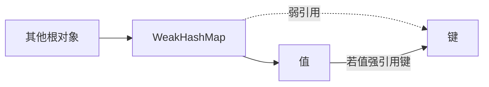

**读图**：弱键并不抵消另一路强引用。回收时机也不确定，不适合用作可靠容量/TTL协议。[WeakHashMap](https://docs.oracle.com/en/java/javase/25/docs/api/java.base/java/util/WeakHashMap.html)、[EnumSet](https://docs.oracle.com/en/java/javase/25/docs/api/java.base/java/util/EnumSet.html)

<a id="c-11"></a>
## 11. ArrayDeque 与 PriorityQueue：队列不只有 FIFO

> 🎯 **核心结论**：先确定取出规则。双端数组擅长两端操作，堆擅长持续取最优元素，二者并非完整排序集合。

### 11.1 ArrayDeque 为什么适合作栈和队列

它用可增长的环形数组组织两端，避免每次头部出队都搬动全部元素；扩容仍有复制成本，增长策略是实现细节。它不允许 null，用于把空队列返回与真实元素区分，且本身非线程安全。

FIFO（First In, First Out，先进先出）可用尾加头取，LIFO（Last In, First Out，后进先出）可用同端压入弹出。不能仅因两个结构都支持 add/remove 就认为语义一样。

### 11.2 堆维护了什么不变量

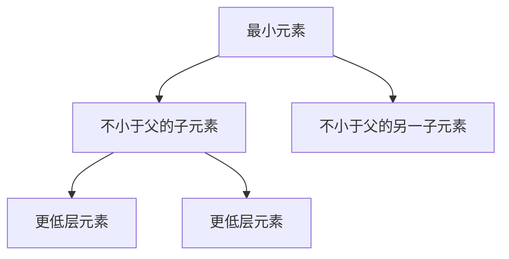

**读图**：父子之间有约束，两个兄弟乃至不同分支并无全局排序。PriorityQueue 的 iterator 不保证优先顺序，连续 poll 才按其规则取头。

常见二叉堆 offer/poll 为 O(log n)，peek O(1)，任意按值 contains/remove 往往需 O(n) 搜索。Top K 可用大小受控的堆，但要明确保留最大/最小方向和相同优先级策略。

### 11.3 可变优先级为什么会破坏队列

对象入堆后直接修改比较字段，不会触发自动重排。应按协议移除再插入，或设计带版本的任务记录等机制；“对象引用没变”不代表堆不变量仍成立。

PriorityQueue 常被称无界是逻辑容量策略，不是内存无限；同优先级没有默认稳定 FIFO 承诺。[ArrayDeque](https://docs.oracle.com/en/java/javase/25/docs/api/java.base/java/util/ArrayDeque.html)、[PriorityQueue](https://docs.oracle.com/en/java/javase/25/docs/api/java.base/java/util/PriorityQueue.html)

<a id="c-12"></a>
## 12. 视图、包装、复制和不可修改：数据所有权怎么表达

> 🎯 **核心结论**：禁止通过一个引用修改、与源脱钩、元素不可变和线程安全是四件不同的事。

### 12.1 常见方法的语义矩阵

| 方法/形式 | 结构修改 | 是否与源结构共享 | 元素是否深复制 |
|---|---|---|---|
| `Arrays.asList(array)` | 固定大小，通常可 set | 与原引用数组关联 | 否 |
| `list.subList(...)` | 按原列表能力与约束 | 通常为共享视图 | 否 |
| `Collections.unmodifiableList(list)` | 该入口不允许修改 | 源变化可反映到视图 | 否 |
| `new ArrayList<>(list)` | 独立列表可修改 | 通常与源结构脱钩 | 否 |
| `List.of(...)` / `List.copyOf(...)` | 不可修改结构 | copyOf 不受源后续结构修改影响，可复用合适实例 | 否 |

“不可修改”不等于深不可变。若元素有 setter，其他引用仍可能改变可见内容；安全发布、元素状态和并发协议还需单独设计。

```java
var source = new java.util.ArrayList<String>();
source.add("A");
var view = java.util.Collections.unmodifiableList(source);
var copy = java.util.List.copyOf(source);
source.add("B");
// view 看到 A、B；copy 仍只有 A。两者都不提供结构修改入口。
```

### 12.2 null 与重复策略

List.of/Set.of/Map.of 等有各自限制，不能从旧实现推导：这些工厂不接受 null；Set.of 拒绝重复元素，Map.of 拒绝重复键，List.of 允许重复元素。Set.copyOf 从集合复制时可合并重复，不应与 Set.of 的重复异常规则混为一谈。

`Arrays.asList(intArray)` 会把 primitive 数组本身当一个元素，而非自动装箱成整数列表；需要明确的转换。固定大小、只读包装和深不可变也不是同一个“不变”。

### 12.3 Map 的视图有什么后果

keySet、values、entrySet 通常是映射视图，移除可能反向修改原 Map，add 却不一定有合理支持。Map.Entry.setValue 也取决于具体实现与入口，不是所有返回 Entry 都能写回。

小 subList 长期保存还可能保留大底层数组的引用；若需要独立长期持有的数据，复制对应范围比只保存视图更清晰。

<a id="c-13"></a>
## 13. 迭代与 fail-fast：检测错误不等于提供同步

> 🎯 **核心结论**：fail-fast 是尽力发现结构变化的机制，不是线程安全保证，也不是每个违规都会抛异常的业务协议。

### 13.1 为什么同线程也会 ConcurrentModificationException

迭代器保存预期结构版本等状态，外部结构修改后再推进，可能检测到不匹配。没有多线程也能发生；反之，无同步并发修改也不保证每次都被检测。modCount 不是线程间可见性的万能屏障。

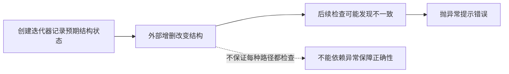

**读图**：不要通过“没抛异常”证明遍历修改合法，也不要把 CME（ConcurrentModificationException，并发修改异常）只理解成多个线程同时写。

### 13.2 合法修改入口与复杂度

支持时使用迭代器 remove、ListIterator 的相应方法，或适合的 removeIf 批处理。具体集合可能不支持某操作；COW 迭代器就不支持自身增删。

循环中反复 remove 再前移下标，可能漏元素或增加 O(n²) 移动。选择反向遍历、过滤新集合或批处理时，还要明确是否改变原数据与内存成本。

### 13.3 subList、reversed 与结构变化

对父列表做视图范围之外的结构修改，subList 的后续语义可能失效，不能通用依赖某种异常。reversed 在现代接口中通常是反向视图，不是已独立反转的数据副本。

新建 ArrayList 可以得到独立结构，但复制过程本身若与不安全源并发写入，也不能自动获得一致快照。要按源的同步或快照契约获取。

<a id="c-14"></a>
## 14. ConcurrentHashMap：细粒度协调不等于业务事务

> 🎯 **核心结论**：并发 Map 提供受支持操作的安全与每键原子方法，不保证整个表的任意组合操作、值对象修改或跨键事务。

### 14.1 从全局互斥到局部协调

旧 Hashtable 的粗粒度同步与现代 CHM（ConcurrentHashMap，并发哈希映射）设计不同；JDK 7 Segment 时代和 JDK 8+ 不能混为一谈。现代实现组合 CAS（Compare-And-Set，比较并设置）、桶相关同步、发布/可见性与协作扩容等机制。

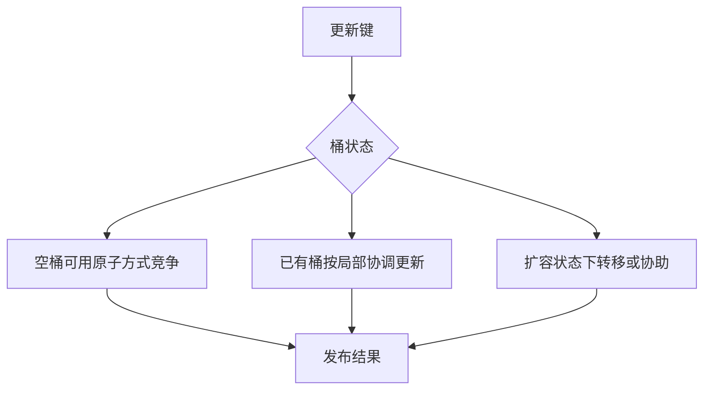

**读图**：图按职责简化，不能把它背成所有 put 都仅一次 CAS，或 get 永远无需任何实现协调。获取通常不阻塞，但仍需正确读取已经发布的状态。

### 14.2 check-then-act 为什么仍会竞态

`if (!map.containsKey(k)) map.put(k,v)` 的每一步安全，不等于整体只有一个线程胜出。应比较 putIfAbsent、compute、merge 等原子入口，并明确函数副作用与返回规则。

```java
var counts = new java.util.concurrent.ConcurrentHashMap<String,
        java.util.concurrent.atomic.LongAdder>();
counts.computeIfAbsent("order", key -> new java.util.concurrent.atomic.LongAdder())
      .increment();
```

**读代码**：这是频率统计模式，不提供“读取 sum 与移除键整体原子”的保证；移除后另一个线程仍可能持有旧计数对象。金额等强一致决策不应直接套用该统计模式。

### 14.3 computeIfAbsent 不代表永远只计算一次

相应调用按该方法契约原子处理，不代表同键在程序整个生命周期永远只求值一次：返回 null、异常、后续移除和后续调用都要分别考虑。默认 Map 方法也不能一概继承 CHM 的保证。

函数应短小，不能在其中任意递归更新本 Map；慢网络调用可能拖住相关更新，递归也可能被检测为非法或形成其他问题。缓存加载还需处理失败、取消、过期与并发合并。

### 14.4 遍历与聚合

迭代是弱一致语义，不要求固定全表快照，不因普通并发更新抛 CME。size、isEmpty 等聚合在并发变化下适合观测，不宜作为后续操作必然成立的控制条件。

Map 发布了引用，也不代表该引用指向的 ArrayList 或业务对象自动并发安全。跨键守恒条件需要更高层协议。[CHM API](https://docs.oracle.com/en/java/javase/25/docs/api/java.base/java/util/concurrent/ConcurrentHashMap.html)

<a id="c-15"></a>
## 15. 同步包装与 CopyOnWrite：一致性换在哪个时点

> 🎯 **核心结论**：同步包装通常以互斥保护访问；COW 用写入复制与快照遍历降低读协调，两者有不同成本和可见性。

COW（Copy-On-Write，写时复制）列表在修改时产生新底层数组并发布，迭代器持有创建时的数组版本。写入后的新元素不进入旧迭代快照；已有元素对象自身被修改，仍不等于做了深快照。

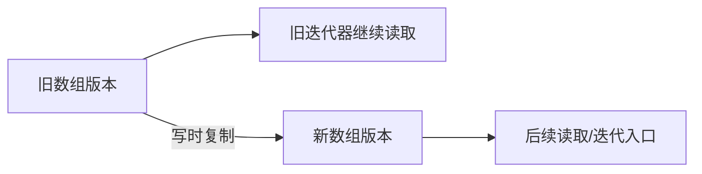

**读图**：长时间存活的迭代器可能保留旧数组及元素引用，内存峰值与回收延迟都是代价。读远多于写且允许相应快照语义时才更适合。

| 方式 | 遍历与修改 | 适合判断 |
|---|---|---|
| synchronized 包装 | 方法受保护，遍历/组合操作还需按文档使用同一同步协议 | 互斥能覆盖所需一致范围 |
| CopyOnWriteArrayList | 快照遍历，迭代器不支持增删等修改 | 写少、列表不太大、可接受旧视图 |
| 普通列表 + 外部协议 | 同步范围自定义 | 团队能统一所有访问路径 |

`contains + add` 在 COW 上也不是天然一个原子“只加一次”；可比较 addIfAbsent 或明确外部互斥。同步包装若底层引用又被绕过直接修改，也会破坏协议。[COW API](https://docs.oracle.com/en/java/javase/25/docs/api/java.base/java/util/concurrent/CopyOnWriteArrayList.html)

<a id="c-16"></a>
## 16. 并发队列与阻塞队列：排队也是资源与协议

> 🎯 **核心结论**：线程安全、等待、容量与排序是不同轴，队列选择直接影响背压、内存和任务延迟。

| 实现 | 主要形态 | 重要边界 |
|---|---|---|
| ConcurrentLinkedQueue | 常见链式非阻塞并发队列 | 不提供容量背压，非阻塞不等于没有竞争 |
| ArrayBlockingQueue | 有界数组阻塞队列 | 容量固定，相关互斥与条件等待 |
| LinkedBlockingQueue | 链式阻塞队列，put/take 协调分离 | 可设容量；默认巨大上界不代表安全可无限积压 |
| PriorityBlockingQueue | 并发阻塞优先队列 | 通常无普通有界满等待，不承诺同优先级 FIFO |
| DelayQueue | 到期元素可取 | 有元素不等于已有到期元素，逻辑容量也需约束 |
| SynchronousQueue | 直接交接 | 没有普通存储容量，size 不能代表等待交接压力 |

### 16.1 四组操作语义

add/remove/element 常以异常表达部分失败；offer/poll/peek 提供特殊返回值；put/take 等待条件；带超时方法限制等待预算。接口和实现支持范围要核对，不能任意交换而忽略错误处理。

有界队列可以把过量需求表现为等待、超时或拒绝；若生产速率长期大于消费速率，单纯加大队列只是延迟暴露瓶颈。积压对象、外部资源与截止时间都要预算。

### 16.2 集合语义不替代任务可靠性

队列取出成功不等于任务执行成功，进程退出还可能丢内存队列。中断、取消、完成确认与关闭协议由更高层任务/JUC设计负责，不能把线程安全队列当作持久消息系统。[BlockingQueue API](https://docs.oracle.com/en/java/javase/25/docs/api/java.base/java/util/concurrent/BlockingQueue.html)

<a id="c-17"></a>
## 17. 算法、Stream 与性能验证：工具调用要保留前提

> 🎯 **核心结论**：排序、二分、收集和并行都依赖输入契约；并行遍历一个普通共享容器不等于安全并行收集。

### 17.1 排序与搜索

二分搜索要求按对应比较规则已排序，否则结果不能按正常插入点/命中语义解释。List 排序具有稳定性要求，具体实现算法不是所有集合的永久承诺；比较器也要满足合同，不能访问不断变化的不一致状态。

### 17.2 Stream 的几个常见差异

`Collectors.toMap` 遇重复键常需显式合并策略，不能默认“后一个覆盖”；若需要保留顺序，还要选择正确 Map 供应器和流顺序。

`Collectors.toList()` 不在契约上承诺具体实现、可变性或线程安全。需要可变 ArrayList 时可显式 `toCollection(ArrayList::new)`；JDK 16 的 `Stream.toList()` 则返回不可修改列表。null 等约束还应按具体方法核对，不能从 List.of 一概类推。

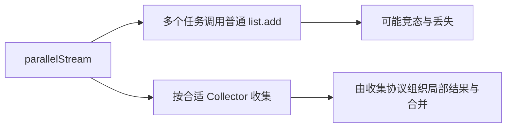

**读图**：共享外部副作用不是默认安全的收集器。并行还受拆分成本、合并、线程环境和任务粒度限制，不保证比顺序快。

### 17.3 容量、内存与基准

评估包含元素本身、引用槽、节点、临时复制和保留视图，不能只按 size 估内存。预估过大容量也浪费空间并可能增加 HashMap 迭代成本。

JMH（Java Microbenchmark Harness，Java 微基准测试工具）可帮助处理预热、测量与优化干扰，但仍需设计真实数据、消费结果，避免死代码消除和不公平输入。一次手写循环计时不应支持“链表永远更慢”等普遍结论。[JMH 官方项目](https://github.com/openjdk/jmh)

<a id="c-18"></a>
## 18. 版本演进、选型与排障：从术语记忆到证据

> 🎯 **核心结论**：新接口能统一表达顺序，旧实现参数也会演进；先按契约选，再查版本与源码，最后用真实负载验证。

### 18.1 关键版本节点

| 节点 | 代表变化 | 学习边界 |
|---|---|---|
| JDK 8 | HashMap 树桶、现代 CHM 等熟悉实现；Stream 与默认方法 | JDK 7 Segment/迁移路径不可混讲 |
| JDK 9 | List/Set/Map.of 工厂等 | 不可修改、null/重复约束需区分 |
| JDK 10 | copyOf 等入口 | 源后续结构变化不影响结果，不代表深复制 |
| JDK 16 | Stream.toList | 不要按 Collectors.toList 的偶然实现解释 |
| JDK 19 | HashMap.newHashMap 等容量意图入口 | 构造容量和期望映射数不同 |
| JDK 21 | SequencedCollection/Set/Map | 统一首尾、反向视图等遭遇顺序能力 |
| JDK 25 参考 | 本文参考的较新 API/实现标签 | 不是宣称所有细节是接口永久保证 |

Sequenced Collection 表达明确遭遇顺序，不把所有结构变成可任意两端插入：某些操作是可选的，排序集合也不能靠 addFirst 任意破坏排序。reversed 通常返回关联视图，而非新副本。[SequencedCollection](https://docs.oracle.com/en/java/javase/25/docs/api/java.base/java/util/SequencedCollection.html)

### 18.2 选型简表

| 需求 | 起点 | 继续确认 |
|---|---|---|
| 通用业务列表 | ArrayList | 容量、修改所有权、并发 |
| 单线程双端操作 | ArrayDeque | null、容量与取出规则 |
| 精确去重/映射 | HashSet/HashMap | equals/hashCode、键稳定与顺序 |
| 稳定遭遇顺序 | LinkedHashSet/LinkedHashMap | 插入还是访问顺序 |
| 范围与前后键 | TreeSet/TreeMap | 比较器一致性与视图 |
| 并发每键更新 | ConcurrentHashMap | 原子方法、值状态、跨键不变量 |
| 少写快照遍历 | CopyOnWriteArrayList | 复制成本、旧视图可接受性 |
| 有界生产消费 | 合适 BlockingQueue | 队列与任务完成协议分别设计 |

### 18.3 症状到原因

| 症状 | 第一组证据 |
|---|---|
| 遍历看得见却 get 不到 | 可变键、hashCode/equals/比较器是否改变 |
| Set 数量与另一个实现不同 | 等价模型是 equals 还是 compare 为 0 |
| 添加/删除报 UnsupportedOperationException | 固定大小、不可修改入口、视图与迭代器能力 |
| 单线程 CME | 是否绕过迭代器修改结构，是否访问顺序 Map 被调整 |
| COW 读不到新元素 | 是否持有旧快照迭代器 |
| 并发 Map 仍丢业务更新 | 多步组合、非安全值对象、跨键/移除协议 |
| 堆占用不降 | 大容量数组、视图、旧快照、键值引用链和无界积压 |
| 优先队列顺序看起来不对 | 是否误用 iterator，是否修改优先级或比较器 |

验证应包含碰撞、可变键、null、重复、视图回写与线程边界；并发时用明确协调构造场景，不通过长时间随机跑没失败来证明正确。

<a id="c-19"></a>
## 19. ConcurrentHashMap 协助扩容：迁移期间怎样读写

> 🎯 **核心结论**：转发标记连接新旧表，迁移者发布新桶后再封住旧桶，竞争线程按状态重试或参与迁移。

### 19.1 为什么不拿全局锁迁移
一把全局锁能让迁移最容易推理，却会把全部更新阻塞到扩容完成。ConcurrentHashMap 将旧桶拆分迁移，允许不同桶分工；代价是更新、读取和遍历都必须识别迁移状态。下面围绕 OpenJDK 25 的 `transfer`、`helpTransfer`、`ForwardingNode.find` 说明，不沿用 JDK 7 的 Segment 模型。

| 状态字段 / 节点 | 职责 | 易错理解 |
|---|---|---|
| table / nextTable | 当前表与迁移目的表 | 不代表所有线程同一时刻只看一张表 |
| transferIndex | 分配尚待迁移的索引区间 | 不是当前元素总数 |
| sizeCtl | 按阶段承担初始化、阈值与扩容协调 | 负值不能一律解释成同一状态 |
| ForwardingNode | 旧桶已迁走，保存新表入口 | 不是普通业务键值节点 |

### 19.2 一次桶迁移的关键顺序
假设旧容量为 8，桶索引是 3：节点按 `hash & 8` 分成两组，进入新表索引 3 或 11。哈希值不需要重新调用用户的 hashCode 来生成。常规链桶迁移会围绕桶首协调并复查它仍是当前首节点；否则此前读取的节点可能已经过时。树桶另有拆分规则，不能把链表示意照搬过去。

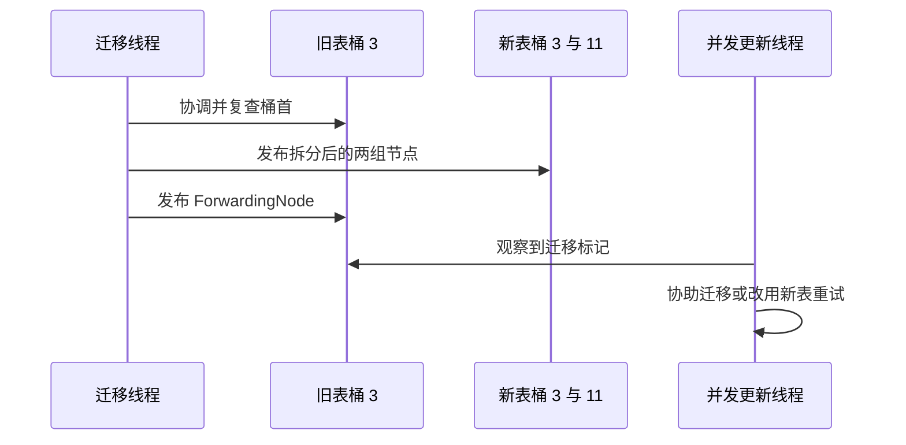

**读图**：先有可供转发的目的结构，再把旧入口变成转发标记，防止读者被引向尚未建立的桶。原子访问和内存发布规则支撑此顺序，不能只靠普通字段赋值模仿。

空桶可用原子操作放置转发标记。多个迁移线程通过领取区间减少重复工作，最终完成者检查并发布新表，清理迁移状态。看到迁移标记的更新线程不应继续按旧桶写入；在满足条件时可帮忙，否则跟随新表重试。**普通 get 并不因为碰见转发节点就必须加入迁移工作**，它可经节点的 find 路径继续查询。

### 19.3 对并发读取能承诺什么
迁移中旧链不能任意破坏到让正在读取的线程失去正确访问路径；参考实现对链节点复用和复制有专门安排。这不同于无保护地把原链全部原地断开重连。

每键操作的并发契约不等于全表事务快照。遍历可能遇见旧表及转发后的新表，需要保存遍历状态；size、多个 get 和遍历结果不构成同一时刻的原子整体。扩容解决存储容量，不解决“两个账户同时转账”的跨键不变量。

**源码追踪法**：先追一次正常 put，再追遇到 `MOVED` 的分支，最后追 `transfer` 的桶级完成顺序。验证应检查并发插入后最终键值完整性；单次运行没丢数据不能替代对发布与竞争路径的证明。

参考：[指定版本 CHM 源码](https://raw.githubusercontent.com/openjdk/jdk/jdk-25-ga/src/java.base/share/classes/java/util/concurrent/ConcurrentHashMap.java)。

<a id="c-20"></a>
## 20. 跳表与非阻塞队列：有序查找和原子交接的实现取舍

> 🎯 **核心结论**：跳表用分层索引缩短有序查找，链式并发队列用明确的原子生效点协调入队和出队。

### 20.1 跳表如何缩短路径
ConcurrentSkipListMap 的底层按键顺序连接数据节点，上层维护稀疏索引。从高层向右跳过一批较小键，不能再前进时下移，最后在底层定位。随机化索引降低维护严格平衡的复杂度，提供期望平均对数成本，**不是每次查询都严格最坏 O(log n)**。

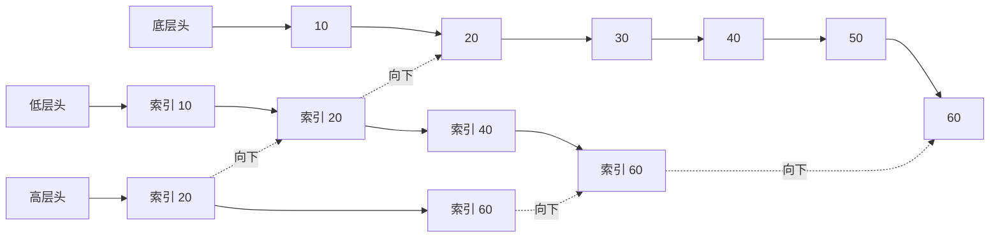

**读图**：查找 35 可先跳到 20，再逐层下降至底层，定位在 30 与 40 之间。图是索引思想，不承诺特定键一定建立这些层。

与红黑树相比，跳表避免通过树旋转维持全局平衡，可围绕链接做局部并发维护；代价是索引空间、指针访问与随机化分布。删除要区分业务上已不可见与物理链接清理，遍历仍是弱一致，而非锁住整个范围的快照。比较器等价规则、禁止 null 与范围视图契约也必须遵守。

### 20.2 队列的“成功时刻”在哪里
ConcurrentLinkedQueue 的常规 offer 沿尾部寻找 `next == null` 的节点，通过 CAS（Compare-And-Set，比较并设置）把新节点接上。**链接成功是入队的线性化点**，tail 随后追赶失败也不意味着入队失败。其他线程可以沿 next 找到真实尾端。

poll 查找仍有非空 item 的节点，用原子操作把 item 改为 null；成功者取走该元素，随后推进 head 或清理旧链接。逻辑删除和头指针追赶分开，避免为了维护提示指针而扩大关键原子动作。

| 两消费者竞争同一节点 | 结果 |
|---|---|
| 都先看到 item=X | 还不能证明都取到了 X |
| A 成功把 X 改成 null | A 完成该元素的出队 |
| B 的比较更新失败 | B 重读并找后续可用元素 |

**为什么禁止 null**：既要让 poll 的 null 表达暂无元素，内部也用空 item 表示已删除状态。非阻塞算法仍有重试、节点分配与垃圾回收成本；队列无界且不阻塞生产者，不代表自动背压。`size()` 遍历成本较高，并发时还不是容量准入的原子依据。

**对比选择**：需要消费者等待与有限积压，用合适的有界阻塞队列；需要非等待交接但能自行处理空队列与容量时，才考虑非阻塞队列。不要写 `while (poll()==null) {}` 就认为节省了线程资源。

参考：[跳表源码](https://raw.githubusercontent.com/openjdk/jdk/jdk-25-ga/src/java.base/share/classes/java/util/concurrent/ConcurrentSkipListMap.java)、[并发队列源码](https://raw.githubusercontent.com/openjdk/jdk/jdk-25-ga/src/java.base/share/classes/java/util/concurrent/ConcurrentLinkedQueue.java)。

<a id="c-references"></a>
## 参考资料与源码入口

- [集合框架概览](https://docs.oracle.com/en/java/javase/25/core/java-collections-framework.html)：接口与实现职责。
- [ArrayList](https://docs.oracle.com/en/java/javase/25/docs/api/java.base/java/util/ArrayList.html)、[参考实现](https://raw.githubusercontent.com/openjdk/jdk/jdk-25-ga/src/java.base/share/classes/java/util/ArrayList.java)：容量与契约分开。
- [HashMap](https://docs.oracle.com/en/java/javase/25/docs/api/java.base/java/util/HashMap.html)、[参考实现](https://raw.githubusercontent.com/openjdk/jdk/jdk-25-ga/src/java.base/share/classes/java/util/HashMap.java)：分桶、树化与拆分。
- [LinkedHashMap](https://docs.oracle.com/en/java/javase/25/docs/api/java.base/java/util/LinkedHashMap.html)、[TreeMap](https://docs.oracle.com/en/java/javase/25/docs/api/java.base/java/util/TreeMap.html)、[PriorityQueue](https://docs.oracle.com/en/java/javase/25/docs/api/java.base/java/util/PriorityQueue.html)：不同顺序。
- [List](https://docs.oracle.com/en/java/javase/25/docs/api/java.base/java/util/List.html)、[Collections](https://docs.oracle.com/en/java/javase/25/docs/api/java.base/java/util/Collections.html)：可选操作、包装与迭代。
- [ConcurrentHashMap](https://docs.oracle.com/en/java/javase/25/docs/api/java.base/java/util/concurrent/ConcurrentHashMap.html)、[参考实现](https://raw.githubusercontent.com/openjdk/jdk/jdk-25-ga/src/java.base/share/classes/java/util/concurrent/ConcurrentHashMap.java)、[COW](https://docs.oracle.com/en/java/javase/25/docs/api/java.base/java/util/concurrent/CopyOnWriteArrayList.html)：原子性与一致性边界。

<a id="c-glossary"></a>
## 附录：术语与缩写

| 术语 | 英文全称 | 中文含义 / 边界 |
|---|---|---|
| JDK | Java Development Kit | Java 开发工具包 |
| JVM | Java Virtual Machine | Java 虚拟机 |
| API | Application Programming Interface | 应用程序编程接口 |
| CPU | Central Processing Unit | 中央处理器 |
| GC | Garbage Collection | 垃圾回收 |
| CAS | Compare-And-Set | 比较并设置，原子协调的一种手段 |
| CHM | ConcurrentHashMap | 并发哈希映射 |
| COW | Copy-On-Write | 写时复制 |
| CME | ConcurrentModificationException | 并发修改异常，非同步机制 |
| FIFO | First In, First Out | 先进先出 |
| LIFO | Last In, First Out | 后进先出 |
| LRU | Least Recently Used | 最近最少使用 |
| TTL | Time to Live | 存活时间 |
| JMH | Java Microbenchmark Harness | Java 微基准测试工具 |
| JUC | java.util.concurrent | Java 并发工具包简称 |
| AVL | Adelson-Velsky and Landis Tree | 一类严格平衡的二叉搜索树 |
| Snapshot | Snapshot View | 快照视图，需区分结构与元素深状态 |
| Encounter Order | Encounter Order | 遭遇顺序，不等于排序 |
| Amortized Cost | Amortized Complexity | 摊还成本，不是每次操作成本 |
| Linearization Point | Linearization Point | 线性化点，并发操作可视为生效的瞬间 |
| CLQ | ConcurrentLinkedQueue | 并发链式队列 |
