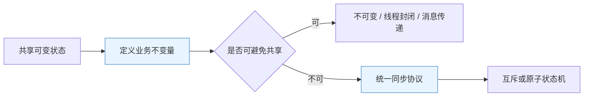
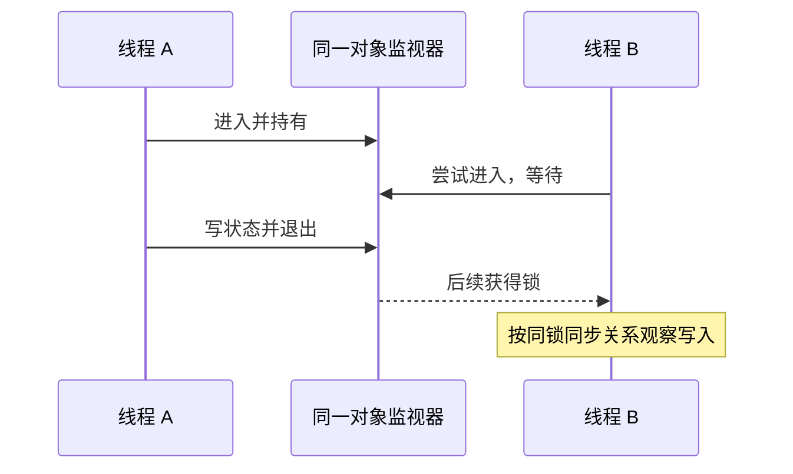
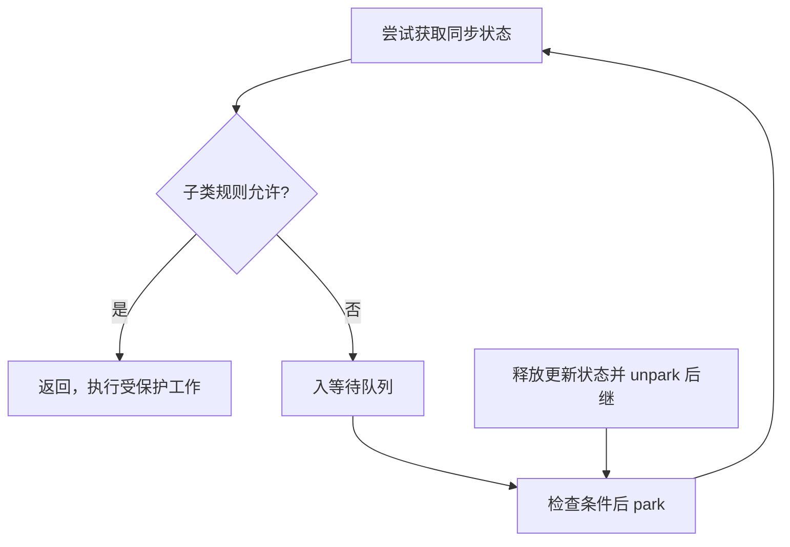
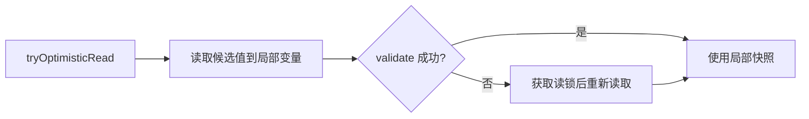
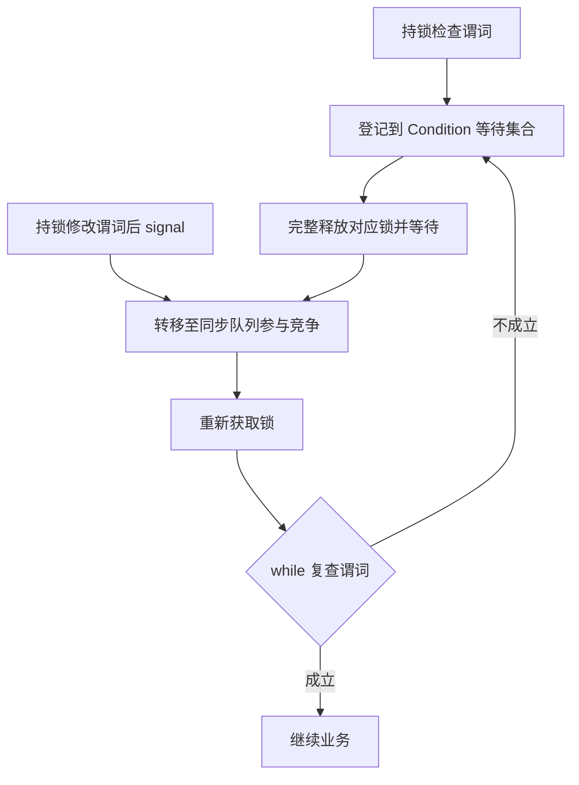

# 锁机制原理：从共享不变量、内存模型到互斥、乐观与等待协议

> **阅读目标**：沿“问题 → 可选方案 → 实现机制 → 代价与边界”理解设计，能用具体交错、调用链或资源生命周期解释结果。配套 [锁机制面试](锁机制面试.md)。

> **版本口径**：语言与接口契约优先；JDK（Java Development Kit，Java 开发工具包）8、17、21、25 是本文的对照节点，25 为本篇参考版本，并非“最新版本”声明。实现细节不自动成为跨版本保证。

[返回 Java 知识体系导读](../学习路线.md)

## 阅读路线

| 章节 | 核心问题 |
|---|---|
| [1. 共享状态与锁的职责](#p-01) | 锁保护的是共同遵守协议的不变量，不能凭“加了锁”三个字判断线程安全。 |
| [2. JMM 与 happens-before](#p-02) | 互斥控制谁能同时进入，可见性由明确的先行发生关系保证。 |
| [3. synchronized 与对象监视器](#p-03) | 同步块以对象身份互斥，同步方法锁的是接收者或声明类的 Class 对象。 |
| [4. HotSpot 锁实现与版本差异](#p-04) | 锁状态图是某版虚拟机的实现说明，不能当成 Java 的永久升级链。 |
| [5. ReentrantLock 与公平策略](#p-05) | 显式锁增加可中断、超时和多条件能力，同时要求显式释放。 |
| [6. AQS 与排队同步器](#p-06) | AQS 抽象原子状态、等待队列和阻塞唤醒，子类定义状态代表什么。 |
| [7. Condition、wait 与丢失通知](#p-07) | 条件等待必须在持锁状态下以 while 检查谓词，唤醒后重新获取锁并复查。 |
| [8. 原子变量、ABA 与乐观重试](#p-08) | 原子比较适合小状态转换，复杂不变量和高冲突下未必优于锁。 |
| [9. 读写锁与 StampedLock](#p-09) | 读多并不足以证明读写锁更快，乐观读必须允许失败重读。 |
| [10. 故障推演、虚拟线程与选择](#p-10) | 先缩短临界区和修复锁顺序，再根据证据选择实现。 |
| [11. 安全发布、双重检查与不可变状态](#p-11) | 锁只保护参与同一协议的访问，发布引用与保护后续状态需要分别处理。 |
| [12. 从消息发布推导重排、屏障与伪共享](#p-12) | 先用语言规则证明结果，再研究硬件与编译器怎样实现；缓存一致性不是复合操作的原子性。 |
| [13. Condition 双队列与取消竞争：通知为何不直接交棒](#p-13) | 条件队列等待谓词，同步队列等待锁，通知把等待者变为可竞争者而非立即执行者。 |
| [14. 从零构造 AQS 独占同步器：状态、不变量与失败路径](#p-14) | 逐步推导与反例验证 |

<a id="p-01"></a>
## 1. 共享状态与锁的职责

> 🎯 **核心结论**：锁保护的是共同遵守协议的不变量，不能凭“加了锁”三个字判断线程安全。

库存扣减要求“读取、判断、写回”作为整体不可被交错。即使单次 int 读写原子，也可能两线程都读到 1、都扣减成功。另一问题是写入何时对读线程可见；再一问题是编译器与处理器在规则内调整执行顺序。

| 问题 | 示例 | 仅用 volatile 是否足够 |
|---|---|---|
| 可见性 | 停止标记改变后工作线程应观察到 | 正确设计时可用 |
| 复合原子性 | count++、检查库存后扣减 | 不足够 |
| 多字段一致性 | 余额与流水共同更新 | 需要同一协议 |

**比较方案**：线程封闭让状态不共享；不可变对象降低更新协调；消息串行化把修改归属一个执行者；锁适合必须共享且要维护多个字段的不变量。无锁并不自动意味着不安全，有锁也不能覆盖绕过协议的访问。



**读图**：从不变量推导同步边界，避免按方法名随意加锁。两个方法若共同维护库存，都必须遵守同一锁或同一原子协议。

<a id="p-02"></a>
## 2. JMM 与 happens-before

> 🎯 **核心结论**：互斥控制谁能同时进入，可见性由明确的先行发生关系保证。

JMM（Java Memory Model，Java 内存模型）规定线程间允许观察到什么，不应把它简化为“变量都先从主存复制到工作内存”的物理流水图。happens-before（先行发生）是一种语义偏序：前一动作的效果必须对后一动作可见，传递性允许连接发布与读取链。

| 同步关系 | 能推导什么 | 不能推导什么 |
|---|---|---|
| 同一监视器解锁 → 后续加锁 | 临界区写入对后续持锁者可见 | 不同锁之间天然同步 |
| volatile 写 → 后续读该变量 | 经该发布链的可见性与排序 | 自增成为原子操作 |
| start 前动作 → 新线程动作 | 启动发布 | 任意存活线程自动看到修改 |
| 线程动作 → join 成功返回 | 等待完成后读取结果 | sleep 有同步效果 |

安全发布需同时关注对象构造与引用传播；把 this 在构造期间泄露，会破坏预期。final 字段有专门初始化语义，仍不能保护可变对象的后续写入。

**反例推演**：线程 A 在 synchronized(lockA) 中写，B 在 synchronized(lockB) 中读，不构成同一监视器的同步链。sleep 再久也不能补出这条关系。

<a id="p-03"></a>
## 3. synchronized 与对象监视器

> 🎯 **核心结论**：同步块以对象身份互斥，同步方法锁的是接收者或声明类的 Class 对象。

实例同步方法等价于围绕方法体持有 this 的监视器；静态同步方法持有对应 Class 对象。两个不同实例上的同步方法不会彼此互斥，实例同步与静态同步也不是同一把锁。同步块通常涉及 monitorenter/monitorexit，同步方法在字节码上用方法标志表达，不能要求二者字节码完全一样。

锁具有可重入性：同一线程重复进入要维护进入深度，退出对应次数才释放；异常离开受语言机制释放监视器。**锁对象应稳定且封闭**：不要锁可被外部共享的字符串常量、装箱缓存对象，也不要把锁字段换成新对象。



**读图**：可见性并非“等待了一段时间”的副作用，而是释放与后续获得同一把锁的语义。

<a id="p-04"></a>
## 4. HotSpot 锁实现与版本差异

> 🎯 **核心结论**：锁状态图是某版虚拟机的实现说明，不能当成 Java 的永久升级链。

历史 HotSpot 通过对象头标记、栈上锁记录、原子指令、自旋和监视器等降低低竞争成本；竞争严重时让线程等待，避免无限占用处理器。对象头具体布局还受平台、压缩配置和对象头方案影响。

**纠正常见背诵**：“无锁→偏向→轻量→重量且永不降级”不适合作为现代通用描述。偏向锁在 JDK 15 默认禁用，并在后续版本移除；现代轻量锁与旧栈锁实现不同，监视器也有消胀回收机制。对象头的历史位图要明确对应版本和参数。

| 手段 | 收益 | 代价 / 前提 |
|---|---|---|
| 无竞争快速路径 | 避免进入重型等待 | 依赖实现与对象状态 |
| 自旋 | 短等待可避免调度切换 | 长等待浪费处理器 |
| 阻塞等待 | 释放执行资源 | 挂起、唤醒与重新竞争有成本 |
| 锁消除 / 粗化 | 消除无共享锁或减少重复进入 | JIT 优化有证明条件，不是源码承诺 |

JIT（Just-In-Time Compilation，即时编译）可能优化锁，但不能用“不一定真的有锁”作为绕过同步语义的理由。性能判断先看争用、持有时间与临界区工作，再定位实现。

<a id="p-05"></a>
## 5. ReentrantLock 与公平策略

> 🎯 **核心结论**：显式锁增加可中断、超时和多条件能力，同时要求显式释放。

```java
var lock = new java.util.concurrent.locks.ReentrantLock();
lock.lock();
try {
    // 访问由此锁统一保护的状态
} finally {
    lock.unlock();
}
```

lock() 不因中断退出等待，lockInterruptibly() 响应中断，tryLock(timeout, unit) 支持有期限竞争。未成功获取时不能 unlock；用 tryLock 时把成功分支和 finally 关联起来。

公平锁倾向让等待更久的线程先获得，但**不保证操作系统调度公平，也不等于业务请求绝对按到达顺序完成**。ReentrantLock 无参 tryLock() 即使在公平模式也允许插队；追求公平要区分调用入口。

| 对比 | synchronized | ReentrantLock |
|---|---|---|
| 释放 | 结构化退出自动释放 | finally 显式释放 |
| 获取超时 / 中断 | 进入监视器不提供这些入口 | 提供对应方法 |
| 条件队列 | 对象 wait 集合 | 可建多个 Condition |
| 选型 | 简单结构化互斥 | 需要额外协调能力 |

不能再用“synchronized 必然重，显式锁必然快”作为选型依据；公平通常牺牲部分吞吐，收益是降低某些等待偏斜。

<a id="p-06"></a>
## 6. AQS 与排队同步器

> 🎯 **核心结论**：AQS 抽象原子状态、等待队列和阻塞唤醒，子类定义状态代表什么。

AQS（AbstractQueuedSynchronizer，抽象队列同步器）以 state、原子更新、排队和 park/unpark 组织竞争；ReentrantLock 的状态可表示持有深度，Semaphore 可表示许可，不应把 AQS 的 state 固定理解成“锁是否被占用”。独占与共享模式定义后继传播方式。



**读图**：唤醒只是提供重新竞争机会，不等于直接转移所有权。检查、入队、释放和唤醒间的竞争由同步器协议处理，不能照图手写几行 park 就声称实现了正确锁。

CAS（Compare-And-Set，比较并设置）可以原子检查旧值并更新。失败意味着需重新读取状态或排队；队列并非只靠一个 CAS 就完成所有可见性和取消管理。JDK 8 Node 字段名与后续实现有差异，学习应抓协议而非背固定字段布局。

<a id="p-07"></a>
## 7. Condition、wait 与丢失通知

> 🎯 **核心结论**：条件等待必须在持锁状态下以 while 检查谓词，唤醒后重新获取锁并复查。

```java
lock.lock();
try {
    while (!ready) {       // ready 也由同一把锁保护
        changed.await();
    }
    // 消费满足条件的状态
} finally {
    lock.unlock();
}
```

上例是嵌入式代码片段，lock、ready、changed 需属于同一状态对象。await 原子地参与释放锁并等待；返回前重新获取锁。signal 通常在修改条件后持同一锁调用，它不会立刻把锁交给等待者。

为什么不是 if：存在虚假唤醒，也可能别人先消费了条件。为什么不是先查再独立等待：检查与登记等待分离时，通知可能恰好落在中间，造成丢失通知。

| 手段 | 是否释放相关锁 | 协议重点 |
|---|---|---|
| Object.wait | 释放调用对象的监视器，不释放其他锁 | 必须持有该监视器 |
| Condition.await | 释放对应 Lock，并在返回前重获 | 多个条件可隔离不同等待者 |
| Thread.sleep | 不释放持有的锁 | 不作为条件通信机制 |
| LockSupport.park | 不自动释放业务锁 | 许可与状态检查协议要自行设计 |

生产者消费者常有 notEmpty、notFull 两类条件；多条件精确通知减少无效唤醒，但仍需完整处理关闭、中断与超时。

<a id="p-08"></a>
## 8. 原子变量、ABA 与乐观重试

> 🎯 **核心结论**：原子比较适合小状态转换，复杂不变量和高冲突下未必优于锁。

以余额为例，读 old，检查边界，CAS(old,new)，失败重试。比较与写回原子，但外部副作用不能放进可能重跑的纯计算逻辑中：发送扣款短信与数据库写入不会自动随 CAS 失败撤销。

ABA（A→B→A，同值往返问题）指值回到 A 后，单比较 A 看不出期间发生过变化。在只关心当前整数的计数器上未必有害；在复用节点、版本敏感状态机中可能错误。版本戳、不可变状态引用或带代际的句柄能增加变化信息，还要考虑版本回绕。

| 策略 | 擅长 | 风险 |
|---|---|---|
| CAS 重试 | 简单小状态、低中冲突 | 失败重试、活锁倾向、ABA |
| 锁 | 多字段不变量、较复杂临界区 | 阻塞、死锁、争用 |
| 分片累加 | 高频指标 | 汇总通常不是强原子快照 |

**“无锁”不等于每个线程都有有限等待保证**；lock-free 与 wait-free 是不同进度性质。比较算法前须定义成功、失败与进度标准。

<a id="p-09"></a>
## 9. 读写锁与 StampedLock

> 🎯 **核心结论**：读多并不足以证明读写锁更快，乐观读必须允许失败重读。

ReentrantReadWriteLock 允许多个读者并行、写者独占。读锁不能安全地直接升级为写锁：升级者可能自己就阻止写锁获得；常见做法释放读锁、获取写锁后重新检查。写锁持有者可按协议先持读锁再释放写锁实现降级。

StampedLock 不是可重入锁。乐观读拿到 stamp 后把字段先读进局部变量，再 validate；验证失败进入读锁重读。读途中可能看见不一致数据，因而不能在验证前用中间状态访问危险索引、执行外部副作用或认为对象图始终一致。



**读图**：validate 保护的是已读区间的判断，不会把未来读取都变成稳定快照。跨多个不相关对象还需额外协议。

<a id="p-10"></a>
## 10. 故障推演、虚拟线程与选择

> 🎯 **核心结论**：先缩短临界区和修复锁顺序，再根据证据选择实现。

死锁需要构造等待环；统一全局锁顺序、减少持多锁区间能破环。tryLock 超时是恢复工具，不能自动回滚已完成的业务副作用。活锁是大家不断行动却无进展，饥饿是某参与者长期无法成功；三者排查方式不同。

| 症状 | 先收集的证据 | 常见原因 |
|---|---|---|
| 吞吐随线程数增加反降 | 锁持有时间、竞争与处理器占用 | 粗锁、长临界区、过度自旋 |
| 请求一直等待 | 多次线程转储及持锁关系 | 死锁、外部慢调用、条件永不成立 |
| 时好时坏的数据错乱 | 每个字段的写读路径与同步链 | 锁对象不同、逃逸、复合操作遗漏 |
| 虚拟线程多但下游慢 | 并发量、连接数、请求期限 | 下游资源上限被突破 |

虚拟线程在 JDK 21 正式提供；JDK 21–23 的监视器相关固定载体线程问题，与 JDK 24 改进后不能混为一谈。JDK 24 消除了 synchronized 带来的主要固定问题，但本地调用等仍有特定约束。不要因为旧版告警就把所有 synchronized 机械改成 ReentrantLock，也不要理解成虚拟线程让锁竞争消失。

**验证路线**：用屏障或闩锁固定交错复现错误；检查同锁关系和中断/异常路径；性能再用真实竞争与临界区负载评估。线程数和 sleep 不能代替并发正确性证明。

<a id="p-11"></a>
## 11. 安全发布、双重检查与不可变状态

> 🎯 **核心结论**：锁只保护参与同一协议的访问，发布引用与保护后续状态需要分别处理。

双重检查锁定用于延迟初始化：第一次无锁读取避免已初始化后的锁开销，锁内第二次检查避免重复构建，volatile 引用负责正确发布。缺少第二次检查可能创建多份；缺少发布协议则不能凭“构造函数通常先执行完”证明读者观察完整状态。

```java
final class LazyService {
    private static volatile LazyService instance;
    private LazyService() { }
    static LazyService get() {
        LazyService local = instance;
        if (local == null) {
            synchronized (LazyService.class) {
                local = instance;
                if (local == null) instance = local = new LazyService();
            }
        }
        return local;
    }
}
```

**按读写路径证明**：构造完成后通过 volatile 写发布；快速路径经 volatile 读取观察该发布；竞争者在锁内复查。对象中后续若仍有可变字段，它们不因为 instance 是 volatile 就自动线程安全。构造器中若泄露 this，还需另行修复。

| 替代方式 | 优势 | 限制 |
|---|---|---|
| 静态直接初始化 | 简单，利用类初始化发布 | 不延迟或初始化时机受使用触发 |
| 静态持有者类 | 延迟且借类初始化协调 | 初始化失败与类生命周期绑定 |
| 枚举单例 | 适合固定实例、语言语义清晰 | 不能覆盖所有配置与测试替换需求 |
| 双重检查 | 可嵌入明确生命周期协议 | 容易遗漏发布、重置与失败规则 |

不要在需要热更新、重试或多租户实例时硬套单例模板。此时“不可变配置快照 + 原子发布新引用”常比原地修改多个配置字段更容易证明一致性。

<a id="p-12"></a>
## 12. 从消息发布推导重排、屏障与伪共享

> 🎯 **核心结论**：先用语言规则证明结果，再研究硬件与编译器怎样实现；缓存一致性不是复合操作的原子性。

### 12.1 一个发布协议与一个错误变体
```java
final class Publication {
    int payload;
    volatile boolean ready;
    void publish() { payload = 42; ready = true; }
    int read() { return ready ? payload : -1; }
}
```

假设只发布一次、构造时不逃逸且没有其他写入，读者观察到 ready 为 true 后，经 volatile 写读关系及先行发生的传递性，应看到先前的 payload=42。若去掉 volatile 又没有别的同步，即使反复实验“总是正常”，也不能由规范证明相同保证。若先读 payload 再读 ready，事后看到标记也不能修正已经读取的旧局部值。


**读图**：图建立的是动作间约束，不是在声称每个变量都有一份物理“工作内存缓存”。若发布者反复把 ready 改回 false 并修改 payload，原来的一次发布证明不再保证整段读取构成一致快照；应加入版本、锁或不可变状态替换。

### 12.2 屏障为什么不能背成固定汇编
Memory Barrier（内存屏障）约束某些访问重排与可见性，JIT（Just-In-Time Compilation，即时编译）和平台指令共同落实语义。Java 的 volatile、锁和 VarHandle 模式是程序可依赖的接口；一条 Java 语句并不永远对应固定数量、固定位置的机器屏障。

| 层次 | 负责什么 | 不能替代什么 |
|---|---|---|
| 缓存一致性协议 | 协调缓存行的副本和所有权 | Java 中多步业务操作的原子性 |
| 处理器内存顺序 | 约束机器层访问可观察顺序 | 编译器优化的全部语义 |
| Java 内存模型 | 定义语言允许的观察结果 | 自动修复不正确同步程序 |
| 同步算法 | 维护不变量与进度 | 靠 volatile 自动生成事务 |

不要把“某处理器通常按更强顺序执行”升级为 Java 代码跨平台保证。VarHandle 的 acquire/release 也不能随便等同全部 volatile 操作；关系应根据具体访问模式证明。

### 12.3 伪共享为什么不是数据竞争
False Sharing（伪共享）指不同线程修改逻辑上独立、物理上却可能处在同一缓存行附近的数据，导致缓存行所有权反复转移。程序结果可以完全正确，扩展性却很差；增加 volatile 不会消除这种争用，反而可能增加协调成本。

方案包括减少共享写、分片计数、批量汇总和评估布局隔离。手工加几个 long 字段不能跨布局与平台保证隔离；HotSpot 的内部布局注解也有参数和访问限制。验证需使用受控基准、足够负载与硬件证据，不能把任意吞吐下降都归因于伪共享。

参考：[JLS 内存模型](https://docs.oracle.com/javase/specs/jls/se25/html/jls-17.html)、[VarHandle 模式](https://docs.oracle.com/en/java/javase/25/docs/api/java.base/java/lang/invoke/VarHandle.html)。

<a id="p-13"></a>
## 13. Condition 双队列与取消竞争：通知为何不直接交棒

> 🎯 **核心结论**：条件队列等待谓词，同步队列等待锁，通知把等待者变为可竞争者而非立即执行者。

### 13.1 await 的完整路径
以 ReentrantLock 的 AQS（AbstractQueuedSynchronizer，抽象队列同步器）条件对象为例：持锁检查谓词，把当前线程登记到条件队列，记录并完整释放重入持有状态，然后等待。被通知或因其他原因退出等待后，还要在同步队列中重新获得锁，并恢复相应持有深度。



**读图**：条件队列与锁等待队列承担不同责任。为表达机制，图合并了竞争与取消细节；节点字段和取消标志需按源码版本看。只背“signal 把线程唤醒”会漏掉再次排队和持锁者尚未释放这两个等待阶段。

### 13.2 通知、中断与超时同时发生
假设线程 A 在 await，B 持锁设置 ready 后 signal，C 同时 interrupt(A)。实现必须决定谁先改变等待节点状态，并保证线程最终重新持锁后按规则返回或抛错。不能由用户观察到的日志顺序推出内部竞争必然获胜方。

Condition 对先发生的中断与已转移后的中断有不同处理：某些路径抛 InterruptedException，某些路径完成重获后恢复中断标记。高层代码应遵守中断和谓词协议，不去猜某次竞争必然选择哪条分支。定时等待也要按剩余总预算循环，不能每次虚假唤醒后重新等完整期限。

| 错误做法 | 后果 | 更清楚的规则 |
|---|---|---|
| signal 后立即认为对方执行完 | 状态推进尚未发生 | 明确完成标记或结果同步 |
| await 前用 if | 条件被其他消费者拿走时误继续 | while 重检 |
| 被中断就无条件释放业务资源 | 可能根本没获得对应资源 | 按资源取得状态清理 |
| 多种谓词共用 signal 且不分析 | 唤醒不合适者，合适者仍睡眠 | 分条件或审慎使用 signalAll |

### 13.3 检查与等待如何避免丢通知
关键不是“先调用了 await”，而是持同一锁维护谓词与等待登记。通知者必须先得到锁，无法在等待者持锁检查和正确登记释放的协议中间任意插入；释放后即使通知早于真正 park，底层状态与许可协议也应使它不永久错过进展。

因此不能手写“读 ready；unlock；park”，再靠多次 unpark 补救。要同时证明登记、发布、重检、取消和唤醒，常规业务应复用成熟同步器。

参考：[指定版本 AQS 条件实现](https://raw.githubusercontent.com/openjdk/jdk/jdk-25-ga/src/java.base/share/classes/java/util/concurrent/locks/AbstractQueuedSynchronizer.java)。

<a id="p-14"></a>
## 14. 从零构造 AQS 独占同步器：状态、不变量与失败路径

> 🎯 **本章要解决的问题**：AQS 已经提供排队与唤醒，为什么仍需要子类？怎样证明一个自定义同步器不会错误释放、重复进入或丢失可见性？

### 一、先把业务协议缩成状态机
这里实现一个教学用、不可重入的独占同步器：state=0 表示空闲，state=1 表示占用。获取必须以原子方式完成 0→1，释放只允许持有者完成 1→0。AQS（AbstractQueuedSynchronizer，抽象队列同步器）不理解“谁是业务持有者”，因此所有者校验由实现补齐。

```java
import java.util.concurrent.locks.AbstractQueuedSynchronizer;
public final class NonReentrantMutex {
    private final Sync sync = new Sync();
    private static final class Sync extends AbstractQueuedSynchronizer {
        protected boolean tryAcquire(int ignored) {
            if (getExclusiveOwnerThread() == Thread.currentThread())
                throw new IllegalStateException("non-reentrant");
            if (!compareAndSetState(0, 1)) return false;
            setExclusiveOwnerThread(Thread.currentThread());
            return true;
        }
        protected boolean tryRelease(int ignored) {
            if (getState() == 0 || getExclusiveOwnerThread() != Thread.currentThread())
                throw new IllegalMonitorStateException();
            setExclusiveOwnerThread(null);
            setState(0);
            return true;
        }
    }
    public void lockInterruptibly() throws InterruptedException {
        sync.acquireInterruptibly(1);
    }
    public void unlock() { sync.release(1); }
}
```

这是限定能力的教学类，不实现完整 Lock 接口，不提供 Condition、公平性或生产级监测。再次进入选择立即报错，避免同线程等待自己释放；与可重入锁“增加持有计数”的语义不同。

### 二、逐行解释成功与失败
CAS 成功者独占从空闲到占用的转换。另一个线程即使同时看到 0，也只能有一个成功。所有者字段是用于检查归属的记录，不能代替 state 的原子竞争和同步发布。获取失败返回 false，由 AQS 负责后续入队和等待，而不是在 tryAcquire 里自己 park。

释放先验证身份，再清空所有者，最后发布 state=0。若顺序反过来，另一个线程可能取得状态、设置自己为所有者后，又被旧释放者清空归属。发布 state 与后续获取的同步语义使临界区写入按协议可见，不是 owner 字段自己承担全部屏障。

### 三、为什么 release 返回 true 很重要
返回值告诉 AQS 此次释放是否允许推进后继。可重入同步器在计数仍大于零时不应当作完全释放；本例只有 0/1，所以一次合法释放就结束独占。若无条件 true，而实际仍占用状态，会产生无效唤醒甚至误导算法；若彻底释放却一直 false，等待者可能没有所需推进机会。

### 四、取消不是把队列节点删掉那么简单
等待者可能在入队前、刚链接、准备 park 或被唤醒后收到中断。AQS 需要同时维护前后链接、唤醒资格、取消状态与后继进展；因此不能把一个双向链表加上 park/unpark 就视为等价替代。子类应保持尝试操作短小，不在 tryAcquire 做数据库访问或长时间等待。

### 五、与 ReentrantLock 的区别及验证
| 检查项 | 本例 | ReentrantLock |
|---|---|---|
| 同线程重入 | 明确失败 | 增加持有深度 |
| 条件等待 | 未提供 | 有对应 Condition |
| 公平选择 | 未提供 | 可配置但入口有边界 |
| 非持有者释放 | 必须拒绝 | 必须拒绝 |

测试至少覆盖两线程争用、等待者中断、非持有者释放、重复释放，以及临界区写入被后续持有者读取。测试可以找错误，但最终仍要按状态转换证明互斥和可见性。

参考：[指定版本 AQS](https://raw.githubusercontent.com/openjdk/jdk/jdk-25-ga/src/java.base/share/classes/java/util/concurrent/locks/AbstractQueuedSynchronizer.java)。

<a id="p-versions"></a>
## 版本演进与学习边界

| 版本节点 | 变化 | 不应沿用的结论 |
|---|---|---|
| 8 时代实现 | 历史偏向锁、栈锁与 AQS 节点布局常见于教程 | 把对象头和节点字段当稳定接口 |
| 15 及后续 | 偏向锁先默认禁用，后续移除 | 所有对象必经偏向阶段 |
| 21 | 虚拟线程正式提供 | 线程更轻就不需要并发限制 |
| 24 | 改进 synchronized 与虚拟线程协作，消除主要监视器固定问题 | 持监视器一定固定载体线程 |
| 25 参考 | 核对当前接口与 HotSpot 实现 | 由单版源码推断全部 JVM |

**源码阅读顺序**：先 JLS 语义，再 Lock/Condition 契约，最后读指定标签的实现。

<a id="p-references"></a>
## 参考资料与源码入口

- [JLS（Java Language Specification，Java 语言规范） 17：线程与锁、内存模型](https://docs.oracle.com/javase/specs/jls/se25/html/jls-17.html)
- [AQS](https://docs.oracle.com/en/java/javase/25/docs/api/java.base/java/util/concurrent/locks/AbstractQueuedSynchronizer.html)、[ReentrantLock](https://docs.oracle.com/en/java/javase/25/docs/api/java.base/java/util/concurrent/locks/ReentrantLock.html)、[StampedLock](https://docs.oracle.com/en/java/javase/25/docs/api/java.base/java/util/concurrent/locks/StampedLock.html)
- [虚拟线程指南](https://docs.oracle.com/en/java/javase/25/core/virtual-threads.html)
- [HotSpot 25 同步实现](https://raw.githubusercontent.com/openjdk/jdk/jdk-25-ga/src/hotspot/share/runtime/synchronizer.cpp)

<a id="p-glossary"></a>
## 附录：术语与缩写

| 术语 | 英文全称 | 中文含义 |
|---|---|---|
| JDK | Java Development Kit | Java 开发工具包 |
| JVM | Java Virtual Machine | Java 虚拟机 |
| API | Application Programming Interface | 应用程序编程接口 |
| JMM | Java Memory Model | Java 内存模型 |
| AQS | AbstractQueuedSynchronizer | 抽象队列同步器 |
| CAS | Compare-And-Set | 比较并设置 |
| ABA | A→B→A | 同值往返问题，非普通英文缩写 |
| JIT | Just-In-Time Compilation | 即时编译 |
| happens-before | Happens-Before Relation | 先行发生关系 |
| Monitor | Monitor | 对象监视器 |
| JLS | Java Language Specification | Java 语言规范 |
| Memory Barrier | Memory Barrier | 内存屏障 |
| False Sharing | False Sharing | 伪共享，独立数据的缓存行争用 |
