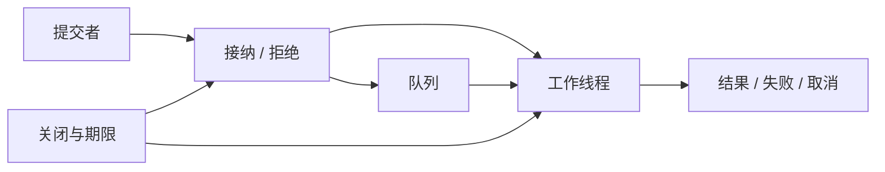
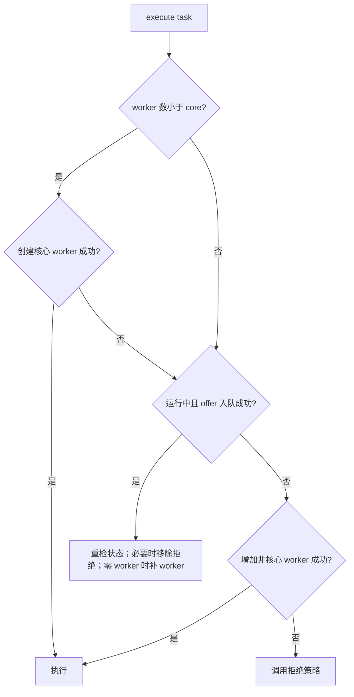
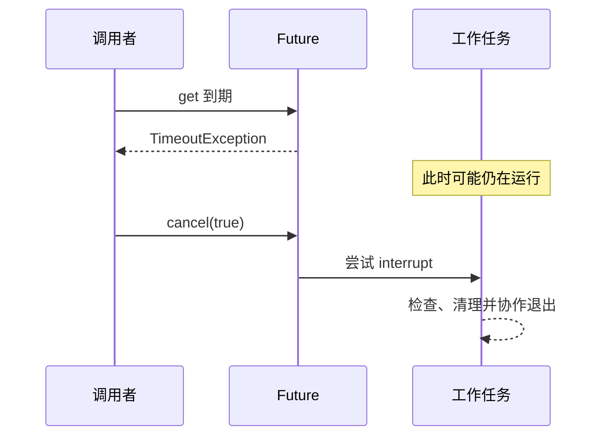
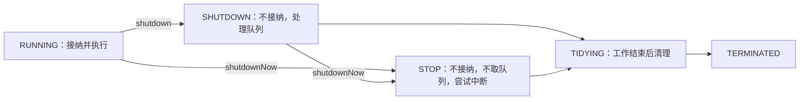
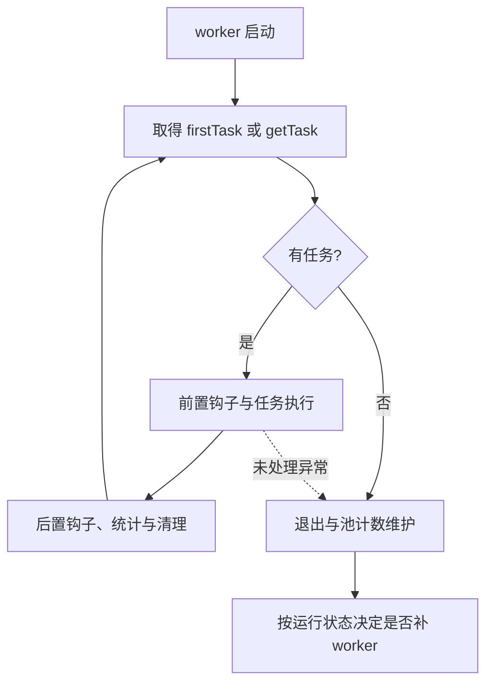
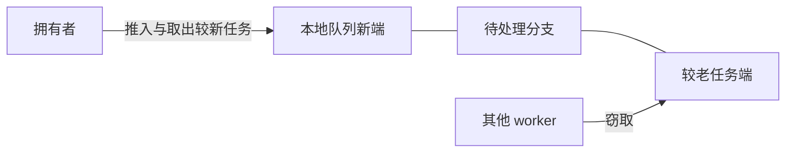
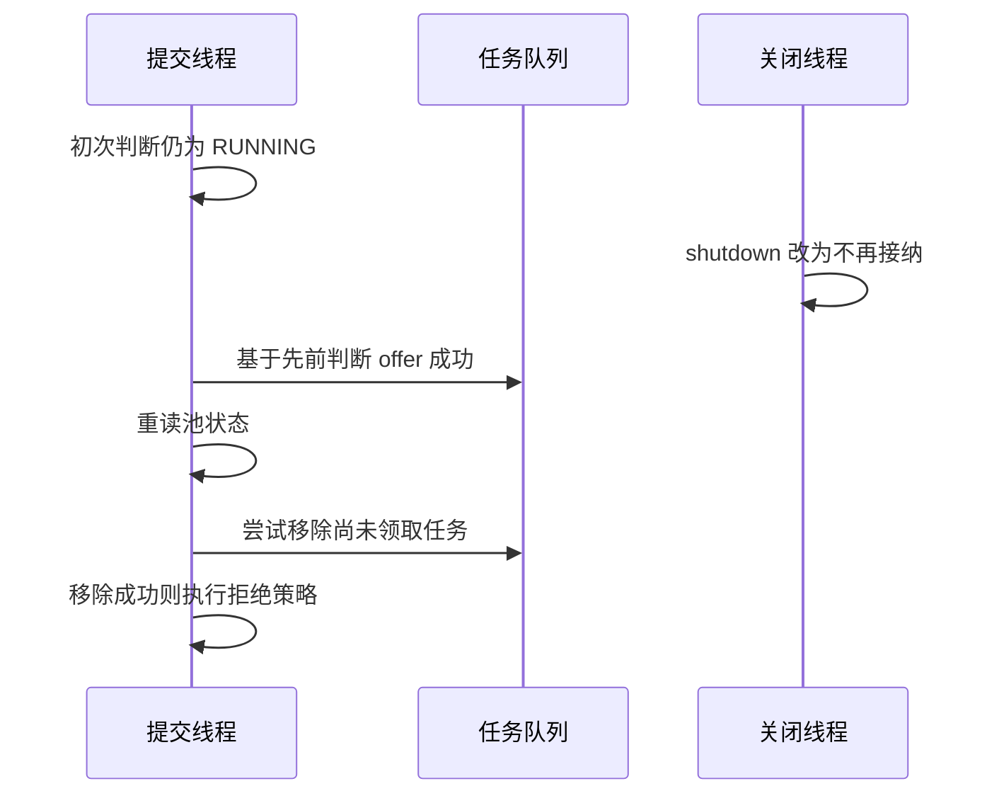

# 线程池原理：从任务接纳、排队与资源预算到取消、关闭和虚拟线程

> **阅读目标**：沿“问题 → 可选方案 → 实现机制 → 代价与边界”理解设计，能用具体交错、调用链或资源生命周期解释结果。配套 [线程池面试](线程池面试.md)。

> **版本口径**：语言与接口契约优先；JDK（Java Development Kit，Java 开发工具包）8、17、21、25 是本文的对照节点，25 为本篇参考版本，并非“最新版本”声明。实现细节不自动成为跨版本保证。

[返回 Java 知识体系导读](../学习路线.md)

## 阅读路线

| 章节 | 核心问题 |
|---|---|
| [1. 为什么池化，以及池化的边界](#p-01) | 线程池同时管理执行资源与任务生命周期，异步提交并不会消除工作量。 |
| [2. execute 的接纳算法](#p-02) | 先尝试核心线程，再入队，队列放不下才尝试扩到最大，最后拒绝。 |
| [3. 参数、队列与容量模型](#p-03) | 参数必须围绕处理器、下游并发、排队期限与内存共同设计。 |
| [4. 拒绝策略与任务终态](#p-04) | 拒绝策略必须让调用者知道任务有没有被接纳，并使结果进入可观察终态。 |
| [5. execute、submit、Future 与异常](#p-05) | 任务失败必须通过正确观察点收集，submit 会把异常保存在 Future 中。 |
| [6. 中断、取消与期限](#p-06) | 取消是协作协议，结果不再需要不代表外部操作已经停止。 |
| [7. 生命周期与优雅关闭](#p-07) | 先停止接纳，再有期限等待在途完成，必要时发出中断并处理未执行任务。 |
| [8. 定时与周期任务](#p-08) | 固定频率按计划时间推进，固定延迟从前一次完成后计时；同一周期任务不会并行重叠执行。 |
| [9. ForkJoin、依赖死锁与上下文](#p-09) | 线程池隔离执行者，不自动解除任务依赖和资源依赖。 |
| [10. 虚拟线程与工程选型](#p-10) | 虚拟线程降低阻塞线程成本，资源并发仍需限流，不能照搬平台线程池的池化目标。 |
| [11. Worker 为什么不等于一个任务线程](#p-11) | worker 运行循环不断取任务，回收和补充依赖池状态与任务退出方式。 |
| [12. 工作窃取：为什么本地后进先出、窃取较老任务](#p-12) | 默认计算型模式偏向本地深度推进与其他线程窃取分支，调度策略不构成业务先后顺序保证。 |
| [13. 总期限、取消与池隔离的故障演练](#p-13) | 任务从排队到远端返回共享总预算，隔离执行器后仍要检查连接、锁和结果终态。 |
| [14. execute 与 shutdown 的竞态：为什么入队后仍要重检](#p-14) | 逐步推导与反例验证 |

<a id="p-01"></a>
## 1. 为什么池化，以及池化的边界

> 🎯 **核心结论**：线程池同时管理执行资源与任务生命周期，异步提交并不会消除工作量。

逐请求创建平台线程会反复分配线程栈并产生调度成本。固定执行者复用线程，队列吸收短突发，拒绝策略暴露持续过载。但队列只是推迟执行，不会增加处理能力；当到达速率长期超过完成速率，积压必然增长。

Executor 只定义 execute，ExecutorService 增加结果、取消和关闭，ScheduledExecutorService 增加时间调度。提交者、任务、执行线程是三种身份：任务甚至可以由提交线程执行，不能默认“execute 一定另起线程”。



**读图**：资源限制应贯穿接纳到终态，不能只设置一个 maximumPoolSize 就认为系统有完整过载保护。

<a id="p-02"></a>
## 2. execute 的接纳算法

> 🎯 **核心结论**：先尝试核心线程，再入队，队列放不下才尝试扩到最大，最后拒绝。

ThreadPoolExecutor 的关键路径可简化为下图，但源码还要重新检查状态与工作线程数。



**读图**：入队后重检解决提交与 shutdown 的竞争；队列里有任务而没有工作者时，要确保有执行者。不是“core 满了就扩到 max，再排队”。

**推演例子**：core=2、max=4、队列容量=2，所有任务都阻塞且未结束，连续六次提交依次形成两运行、两排队、再两运行，第七个触发拒绝。后提交的第 5、6 个可能先于队列内任务完成，因此提交顺序不等于执行完成顺序。

<a id="p-03"></a>
## 3. 参数、队列与容量模型

> 🎯 **核心结论**：参数必须围绕处理器、下游并发、排队期限与内存共同设计。

corePoolSize 不是启动时立即创建数，可预启动；核心线程默认不超时，可显式允许。maximumPoolSize 受队列策略影响，无界队列通常让 max 很难发挥作用。keepAliveTime 默认影响超核心空闲线程，而不是任务执行超时。

| 队列 | 接纳效果 | 主要代价 |
|---|---|---|
| 有界数组 / 链表队列 | 先缓存有限任务，再扩线程或拒绝 | 排队占用期限与内存 |
| 无界 LinkedBlockingQueue | 基本持续入队 | max 通常不扩容，积压可能耗尽堆 |
| SynchronousQueue | 无存储，直接交接 | 易扩线程或拒绝，必须控制线程上限 |
| 优先队列 | 按优先级取队列中任务 | 通常无界、同优先级顺序与饥饿需设计 |

在稳定系统下 Little's Law（利特尔定律）用 L=λW 关联平均在途数、吞吐与停留时间；它不是峰值容量承诺。处理速率 200/s、允许平均排队 0.1s 时平均排队量约 20，只能作为起点，还需按突发和尾延迟压测。

CPU（Central Processing Unit，中央处理器）密集任务先看可用处理器和并行开销；I/O（Input/Output，输入/输出）等待型还看下游连接、限流和超时。“核数×2”不能覆盖所有场景。任务持有大对象时，队列容量还会改变 GC（Garbage Collection，垃圾回收）压力。

<a id="p-04"></a>
## 4. 拒绝策略与任务终态

> 🎯 **核心结论**：拒绝策略必须让调用者知道任务有没有被接纳，并使结果进入可观察终态。

| 策略 | 行为 | 隐含风险 |
|---|---|---|
| AbortPolicy | 抛 RejectedExecutionException | 上层要映射过载与重试策略 |
| CallerRunsPolicy | 未关闭时由提交线程执行 | 拉长请求线程或事件循环，改变上下文与延迟 |
| DiscardPolicy | 静默丢弃 | submit 返回的 Future 可能永不完成 |
| DiscardOldestPolicy | 丢队首后重试接纳 | 丢的未必“最不重要”；直接交接队列等组合危险 |

CallerRuns 在关闭后会丢弃而非继续执行，不能当作可靠兜底。自定义处理应抛出明确异常，或显式取消对应 Future，并记录有界指标；不要在拒绝回调里无期限 queue.put 把异步接口变成不可取消的等待，也不要在同池工作线程内这样做。

**背压与重试**：上游限速、短期限重试和降级需要完整设计；无节制重试会把过载放大。后台重要任务若要求宕机不丢，应考虑持久任务系统，而非仅依赖内存线程池。

<a id="p-05"></a>
## 5. execute、submit、Future 与异常

> 🎯 **核心结论**：任务失败必须通过正确观察点收集，submit 会把异常保存在 Future 中。

execute 直接运行 Runnable 时，未处理异常可终止该 worker 并到达未捕获异常处理器，池按状态可能补充 worker。submit 通常把任务包装成 FutureTask，异常被捕获并存入结果，get 时抛 ExecutionException；因此只依赖线程的异常处理器容易漏报。

```java
var pool = java.util.concurrent.Executors.newFixedThreadPool(2);
try {
    var result = pool.submit(() -> { throw new IllegalStateException("failed"); });
    try {
        result.get();
    } catch (java.util.concurrent.ExecutionException ex) {
        System.err.println(ex.getCause().getClass().getSimpleName());
    }
} finally {
    pool.shutdown();
}
```

beforeExecute/afterExecute 是观测入口；对 Future 包装任务，afterExecute 的 Throwable 可能为 null，要检查已完成 Future 的结果。钩子本身抛异常也能干扰执行，观测逻辑应可靠且轻量。

Future.get 建立相应的完成可见性，但 get(timeout) 超时仅代表等待超时，任务仍可能执行并写外部系统。

<a id="p-06"></a>
## 6. 中断、取消与期限

> 🎯 **核心结论**：取消是协作协议，结果不再需要不代表外部操作已经停止。

Future.cancel(true) 在适用时尝试中断执行线程；中断不是强杀，也不会撤销已经提交的事务或已经发出的网络请求。任务要检查中断、调用支持中断的阻塞方法，并在捕获 InterruptedException 后传播，或在不能传播时恢复标志再退出当前工作。



**读图**：超时、取消请求、底层停止和业务撤销是四个事件。把请求截止时间传递给排队、连接获取、远端调用和重试，各阶段消耗同一个总预算，才能避免调用者离开后仍持续制造负载。

<a id="p-07"></a>
## 7. 生命周期与优雅关闭

> 🎯 **核心结论**：先停止接纳，再有期限等待在途完成，必要时发出中断并处理未执行任务。

ThreadPoolExecutor 的控制状态与工作线程计数在参考实现中组合管理；理解下列生命周期即可，不需把位数布局当公共接口。



**读图**：shutdownNow 不承诺工作线程立即消失；返回的未执行列表需要调用者处理。对返回的 FutureTask，移出队列并不自动等同调用 cancel，等待者可能仍需通知。

常见顺序：shutdown → awaitTermination(预算) → 超时则 shutdownNow → 再等待并报告未结束任务；遇到当前线程中断也应触发清理并恢复中断状态。不要从该池任务中等待该池整体终止。

JDK 19 起 ExecutorService 可 AutoCloseable；close 会等待终止，适合有界作用域，但不能默认它是立即返回的“释放引用”。长寿命服务要由明确生命周期组件拥有池。

<a id="p-08"></a>
## 8. 定时与周期任务

> 🎯 **核心结论**：固定频率按计划时间推进，固定延迟从前一次完成后计时；同一周期任务不会并行重叠执行。

scheduleAtFixedRate 尽量维持节拍，执行慢时可能连续追赶；scheduleWithFixedDelay 在结束后等待指定延迟，更适合不希望追赶的轮询。调度不是实时系统，系统负载会导致实际启动晚于计划。

周期任务若抛未处理异常，后续执行会被抑制；ScheduledFuture 可观察异常，不能只看“线程还活着”。对预期业务失败可捕获记录并继续，对致命错误应按策略终止，不建议无差别吞掉 Throwable。

ScheduledThreadPoolExecutor 以延迟队列调度，核心线程数是重要并行度参数，增大 maximumPoolSize 通常无实际收益。被取消任务可能保留到到期，可评估 setRemoveOnCancelPolicy(true)。

**比较 Timer**：单线程定时器容易被慢任务串行拖延，调度池能配置多个执行者并提供 Future 生命周期；但同一个周期任务自身仍不会重叠。

<a id="p-09"></a>
## 9. ForkJoin、依赖死锁与上下文

> 🎯 **核心结论**：线程池隔离执行者，不自动解除任务依赖和资源依赖。

固定池所有 worker 都在等待同池子任务时，子任务即使在队列也无执行资源，形成线程饥饿死锁。解决可以扁平化任务依赖、异步组合或明确隔离执行资源，但“再开一个池”若仍共享耗尽的数据库连接，也可能无效。

ForkJoinPool 用工作窃取适配可拆分的计算任务；公共池可能同时被并行流和部分 CompletableFuture 异步操作使用。把长时间阻塞的远端调用混入公共池会影响其他调用方；ManagedBlocker 是特定补偿机制，不是下游容量控制。

MDC（Mapped Diagnostic Context，映射诊断上下文）常由 ThreadLocal 支持，线程复用会残留上下文。提交时捕获允许传播的上下文，执行前设置，finally 恢复或清理；不能只在提交线程 set 就假定池线程继承。InheritableThreadLocal 在创建子线程时继承，不等于每次任务提交时传播。

<a id="p-10"></a>
## 10. 虚拟线程与工程选型

> 🎯 **核心结论**：虚拟线程降低阻塞线程成本，资源并发仍需限流，不能照搬平台线程池的池化目标。

JDK 21 起可用 newVirtualThreadPerTaskExecutor：每任务一个虚拟线程，适合大量等待型任务，不是固定少量虚拟线程反复复用。它不会提高 CPU 计算并行上限，也不会让数据库连接、内存或外部服务无限扩容。

| 工作负载 | 起点 | 必须继续约束 |
|---|---|---|
| 处理器密集 | 有界计算并行度，必要时 ForkJoin | 可用核数、任务粒度 |
| 平台线程阻塞调用 | 有界专用池 | 排队预算、连接数、取消 |
| 大量独立阻塞任务 | 虚拟线程每任务执行 | 准入、Semaphore、下游期限 |
| 周期触发 | ScheduledExecutorService | 失败策略、重叠、关闭 |
| 宕机不丢任务 | 持久任务协议 | 幂等、确认、重投 |

**观测闭环**：记录接纳率、拒绝率、排队耗时、执行耗时、完成/失败/取消和活跃并发；queue.size 是瞬时近似，不是唯一负载信号。尤其关注 p95/p99（第 95/99 百分位）端到端延迟，避免“完成量正常但任务早已过期”。

<a id="p-11"></a>
## 11. Worker 为什么不等于一个任务线程

> 🎯 **核心结论**：worker 运行循环不断取任务，回收和补充依赖池状态与任务退出方式。

参考实现的 worker 可持有 firstTask，runWorker 先执行它，再反复通过 getTask 取队列任务。任务前后执行钩子、统计与中断处理围绕每次运行；空闲时通常阻塞于队列，而不是持续空转扫描。



**读图**：worker 可连续执行很多任务，任务失败与线程死亡不是同一个概念。submit 包装的异常通常已被 FutureTask 捕获，runWorker 看到的是正常返回；execute 的未捕获运行异常则可导致 worker 异常退出。

getTask 根据关闭状态、队列是否为空、线程数和是否允许超时决定继续等待或退出。“核心线程”主要是数量阈值概念，并非创建时给某几个 Thread 永久贴上不会回收的身份；允许核心超时、修改 core/max、关闭池都能改变回收行为。

shutdown 会推动空闲线程退出或取完剩余队列，shutdownNow 尝试中断包含运行任务的线程。任务若捕获中断后继续永久循环，池就无法按调用方期望终止，这不是再调用几次 shutdown 能解决的。

<a id="p-12"></a>
## 12. 工作窃取：为什么本地后进先出、窃取较老任务

> 🎯 **核心结论**：默认计算型模式偏向本地深度推进与其他线程窃取分支，调度策略不构成业务先后顺序保证。

### 12.1 与共享任务队列的区别
ThreadPoolExecutor 常围绕共享队列取独立任务；ForkJoinPool 则给工作者维护自己的任务双端队列，另有外部提交路径。默认模式下拥有者倾向从较新一端处理本地 fork 任务，其他工作者从较老一端窃取，减少总围绕同一端竞争，并让较早分出的分支被其他线程处理。



**读图**：是默认模式的概念示意；数组索引、竞争处理与 asyncMode 等差异需看版本和配置。窃取并非搬走整个线程栈，也不是每个任务都一定 fork 一个线程。

### 12.2 fork、compute、join 的安排
递归计算常用“fork 一支，当前线程 compute 另一支，最后 join”。它让当前执行者继续推进，又提供可被窃取的并行分支。任务太细时分配、入队与合并开销会吞掉并行收益，因此要设置顺序计算阈值。

```java
static final class SumTask extends java.util.concurrent.RecursiveTask<Long> {
    private final int[] values;
    private final int from, to;
    SumTask(int[] values, int from, int to) {
        this.values = values; this.from = from; this.to = to;
    }
    protected Long compute() {
        if (to - from <= 1024) {
            long sum = 0;
            for (int i = from; i < to; i++) sum += values[i];
            return sum;
        }
        int mid = (from + to) >>> 1;
        SumTask left = new SumTask(values, from, mid);
        SumTask right = new SumTask(values, mid, to);
        left.fork();
        long r = right.compute();
        return left.join() + r;
    }
}
```

该嵌套类需放进普通类中，再由明确拥有的 ForkJoinPool.invoke 发起；数组在计算期间不应无同步修改。1024 只是演示阈值，不是性能推荐。Long 包装结果也有成本，需在实际负载中衡量。

### 12.3 为什么 join 不等于随便阻塞
Fork/join 运行时对自己的任务依赖可实施帮助执行等策略，具体策略随版本演进；普通阻塞网络调用却未必有相同可见性。工作窃取能改善计算负载不均，不会消除连接池不足、锁环和外部慢调用。

ManagedBlocker 可声明特定阻塞以便池采取补偿，仍不能无限增加下游容量。公共池还可能承载并行流与异步阶段，重要业务应审慎决定资源隔离。任务开始和完成顺序均不能由默认本地栈式策略推出。

参考：[ForkJoinPool 源码](https://raw.githubusercontent.com/openjdk/jdk/jdk-25-ga/src/java.base/share/classes/java/util/concurrent/ForkJoinPool.java)、[ForkJoinTask](https://docs.oracle.com/en/java/javase/25/docs/api/java.base/java/util/concurrent/ForkJoinTask.html)。

<a id="p-13"></a>
## 13. 总期限、取消与池隔离的故障演练

> 🎯 **核心结论**：任务从排队到远端返回共享总预算，隔离执行器后仍要检查连接、锁和结果终态。

### 13.1 超时为什么经常越设越长
一次请求先在执行器排队 200ms，再等连接 300ms，再查远端 800ms；如果三个阶段都独立使用“1 秒超时”，总耗时可能远超用户的 1 秒期限。正确模型是记录截止时刻，每阶段消耗剩余预算，并在真正执行前再次检查任务是否已失去价值。


**读图**：总期限还需传给底层可取消操作。仅 get 超时后离开，不会让排队任务自动消失；仅 cancel 结果也不保证已开始的远端写入撤销。

### 13.2 同一故障的四个观察点
| 观察点 | 表面现象 | 实际应验证 |
|---|---|---|
| 调用线程 | get 已超时 | 是否发出取消、是否停止后续重试 |
| 执行器 | Future 已取消 | 队列中包装任务是否仍被保留，工作是否已退出 |
| 外部连接 | 本地任务不再需要结果 | 读写是否能取消，失效连接如何关闭 |
| 业务结果 | 请求返回失败 | 操作是否已提交，幂等标识与补偿归属 |

ThreadPoolExecutor 可用 remove/purge 等处理符合条件的取消任务保留问题，具体包装和执行器类型会影响移除方式。取消策略不应只追求 queue.size 变小，还要通知等待者并释放上下文。

### 13.3 隔离后仍会死锁的例子
池 A 的父任务持有全部数据库连接，提交池 B 的子任务后等待结果；B 任务要获取同一连接池才能执行。即使 A/B 的线程数都充足，等待图仍是“父持连接等子，子等父持连接”。根因是资源持有跨越了依赖等待。

解决先调整资源作用域、扁平化依赖或让事务在正确边界执行；盲目把连接数翻倍只可能把死锁推迟到更高并发。测试时用可控闩锁重现，不靠生产突发碰运气。

**观测建议**：把排队时间、运行时间、连接等待时间、超时后仍运行的任务量分开记录，才能判断扩线程究竟降低了等待，还是把等待搬到下一层。

<a id="p-14"></a>
## 14. execute 与 shutdown 的竞态：为什么入队后仍要重检

> 🎯 **本章要解决的问题**：队列已经接受了任务，为何线程池还可能拒绝它？为什么 worker 数、任务队列和运行状态必须组合推理？

### 一、提交不是一次原子大事务
execute 包含读取控制状态、尝试新增 worker、offer 队列、重新读取状态、必要时移除与拒绝等步骤。shutdown 也会并发改变接纳状态。把流程图中的箭头当成一个不可分割操作，会漏掉任务最容易悬空的窗口。



**读图**：重检防止用过时的运行状态把任务无条件留在队列。若任务已经被 worker 取走，移除失败并不等于任务丢失，要继续按实际领取与运行状态理解结果。

### 二、入队后为何还检查零 worker
队列可能有数据，但此前工作线程已因超时或异常退出。若提交者只 offer 后返回，可能形成“任务存在、无人消费”。因此参考路径在必要时尝试补充 worker。即使 corePoolSize=0，已接纳任务仍需要有执行者，这也是“core 为零就永远不执行”的误解来源。

### 三、addWorker 为什么要先预约再真正启动
工作者数量与池状态需要协调，先在控制状态中争取数量资格，再创建 Thread 和加入工作者集合，最后启动。线程工厂可能返回 null，创建或启动也可能失败；失败必须撤销数量资格并处理终止条件，否则计数会永久大于真实执行者。

| 时刻 | 已经有什么 | 还不能断言什么 |
|---|---|---|
| 数量预约成功 | 取得增加 worker 的资格 | 线程已成功创建 |
| Thread 对象创建 | 有线程对象 | 已开始运行 |
| 加入集合 | 管理结构能追踪 | start 一定成功 |
| start 成功 | 进入运行调度 | firstTask 已完成 |

### 四、为什么不能直接改 workQueue
调用方直接向 getQueue 返回的队列塞任务，绕过接纳、状态重检、必要 worker 创建和拒绝协议。它并非等价的“更快 execute”。对取消任务的清理可使用明确入口，但提交必须走执行器契约。

### 五、拒绝必须与结果终态连起来
submit 通常先产生 FutureTask，再交给 execute。若拒绝处理器静默丢弃且未取消，FutureTask 保持未完成，调用方 get 可能一直等待；关闭后的 CallerRuns 也不保证代为执行。真正可靠的策略必须明确同步抛错、显式完成失败或取消哪一个结果对象。

### 六、容量推导示例
4 个工作者、每任务平均占用 50ms，在没有其他瓶颈的理想条件下完成速率约 80/s。到达持续为 100/s，队列净增长约 20/s，容量 200 只能推迟约 10 秒暴露过载，并不会把稳定吞吐提高到 100/s。实际长尾、阻塞和下游限制会使情况更复杂。

因此调优先确认服务能力与过载策略，再讨论队列长度。将排队时间从执行时间中分离，并在任务开始时检查期限，才能避免服务忙着完成已无价值的请求。

参考：[ThreadPoolExecutor 接纳与 worker 管理](https://raw.githubusercontent.com/openjdk/jdk/jdk-25-ga/src/java.base/share/classes/java/util/concurrent/ThreadPoolExecutor.java)。

<a id="p-versions"></a>
## 版本演进与学习边界

| 节点 | 变化 | 学习边界 |
|---|---|---|
| 8 | 传统执行器与 CompletableFuture 广泛使用 | 不把异步组合等同于资源隔离 |
| 19 | ExecutorService 支持 AutoCloseable | close 可能等待终止 |
| 21 | 虚拟线程与每任务虚拟线程执行器正式可用 | 不按有限平台线程的方式池化虚拟线程 |
| 24–25 | 虚拟线程与监视器协作改进后 | 固定问题按版本判断，资源限制始终存在 |

结构化并发在不同版本的预览接口会变化，本篇不将其视为 JDK 21/25 的跨版本稳定替代接口。

<a id="p-references"></a>
## 参考资料与源码入口

- [ThreadPoolExecutor](https://docs.oracle.com/en/java/javase/25/docs/api/java.base/java/util/concurrent/ThreadPoolExecutor.html)
- [ExecutorService](https://docs.oracle.com/en/java/javase/25/docs/api/java.base/java/util/concurrent/ExecutorService.html)、[Future](https://docs.oracle.com/en/java/javase/25/docs/api/java.base/java/util/concurrent/Future.html)
- [ScheduledThreadPoolExecutor](https://docs.oracle.com/en/java/javase/25/docs/api/java.base/java/util/concurrent/ScheduledThreadPoolExecutor.html)
- [虚拟线程](https://docs.oracle.com/en/java/javase/25/core/virtual-threads.html)
- [OpenJDK 25 任务接纳源码](https://raw.githubusercontent.com/openjdk/jdk/jdk-25-ga/src/java.base/share/classes/java/util/concurrent/ThreadPoolExecutor.java)

<a id="p-glossary"></a>
## 附录：术语与缩写

| 术语 | 英文全称 | 中文含义 |
|---|---|---|
| JDK | Java Development Kit | Java 开发工具包 |
| JVM | Java Virtual Machine | Java 虚拟机 |
| API | Application Programming Interface | 应用程序编程接口 |
| CPU | Central Processing Unit | 中央处理器 |
| I/O | Input/Output | 输入/输出 |
| GC | Garbage Collection | 垃圾回收 |
| MDC | Mapped Diagnostic Context | 映射诊断上下文 |
| p95 / p99 | 95th / 99th Percentile | 第 95 / 99 百分位 |
| Future | Future Result | 异步结果与取消句柄 |
| Backpressure | Backpressure | 背压，向上游反馈负载 |
