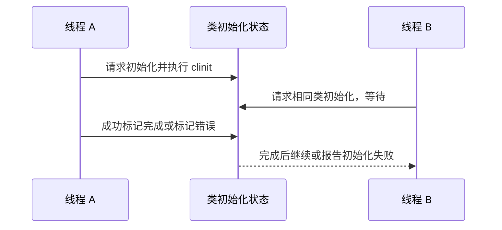
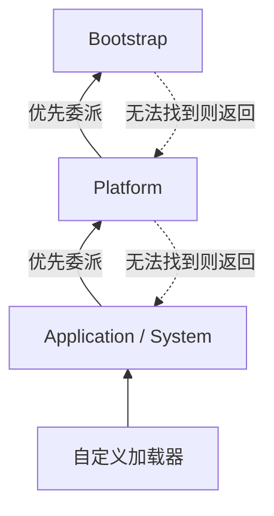

# 类加载机制原理：从字节码到运行时类型、初始化与隔离

> **阅读目标**：沿“问题 → 可选方案 → 实现机制 → 代价与边界”理解设计，能用具体交错、调用链或资源生命周期解释结果。配套 [类加载机制面试](类加载机制面试.md)。

> **版本口径**：语言与接口契约优先；JDK（Java Development Kit，Java 开发工具包）8、17、21、25 是本文的对照节点，25 为本篇参考版本，并非“最新版本”声明。实现细节不自动成为跨版本保证。

[返回 Java 知识体系导读](../README.md)

## 阅读路线

| 章节 | 核心问题 |
|---|---|
| [1. 生命周期：加载不是初始化](#p-01) | 拿到 Class 对象、分配静态字段与执行静态初始化是不同事件。 |
| [2. 准备、常量与初始化顺序](#p-02) | static final 是否触发初始化，取决于它是不是编译期常量及实际使用方式。 |
| [3. 触发规则与初始化锁](#p-03) | 初始化在每个运行时类身份上协调一次，失败和循环依赖有明确后果。 |
| [4. 加载器层次与双亲委派](#p-04) | 双亲委派是典型加载策略，核心目标是统一基础类型身份并控制命名空间。 |
| [5. 类型身份、隔离与加载约束](#p-05) | 同名 class 文件不等于同一运行时类型，定义加载器也是身份的一部分。 |
| [6. SPI、TCCL 与模块](#p-06) | 提供者发现需要跨越框架与应用可见性，线程上下文加载器是常用桥梁。 |
| [7. 热替换、卸载与元空间](#p-07) | 卸载的关键是加载器及其类型不再被可达对象保留，不是手动把一个 Class 置空。 |
| [8. 错误分类与证据链](#p-08) | 先确定失败发生在查找、链接、初始化还是访问阶段，再找根因。 |
| [9. 类文件、常量池与调用指令：解析与分派怎样衔接](#p-09) | 常量池先表达符号关系，解析建立运行时关联，虚调用仍需结合接收者选择实现。 |
| [10. 同名类型隔离的可运行实验与插件边界](#p-10) | 相同字节被不同定义加载器定义后仍是不同类型，共享边界必须共享真实 Class 身份。 |

<a id="p-01"></a>
## 1. 生命周期：加载不是初始化

> 🎯 **核心结论**：拿到 Class 对象、分配静态字段与执行静态初始化是不同事件。

JVM（Java Virtual Machine，Java 虚拟机）按需取得类定义字节，验证其结构与类型约束，建立运行时表示，必要时解析符号引用，首次满足触发条件时执行类初始化。验证、准备、解析合称链接；解析可以延迟，不应把图中的箭头读成“每个符号都先全部解析完”。


**读图**：初始化前必须完成所需验证与准备，解析可按规范时机进行。类文件未必来自磁盘，也可能由代理生成器、网络或字节数组产生。

| 事件 | 主要作用 | 常见误解 |
|---|---|---|
| 加载 | 形成 Class 与运行时类型身份 | 认为 static 块已执行 |
| 准备 | 静态字段存储及默认值，常量有特殊规则 | 认为所有 Java 赋值表达式均已执行 |
| 初始化 | 执行合并后的静态初始化逻辑 | 认为调用构造器才会触发 |

<a id="p-02"></a>
## 2. 准备、常量与初始化顺序

> 🎯 **核心结论**：static final 是否触发初始化，取决于它是不是编译期常量及实际使用方式。

普通静态字段在准备阶段得到零值，声明赋值与 static 块按源码顺序进入类初始化逻辑。常量变量如 static final int N=7 的值可被使用方编译进字节码，读取它未必触发声明类初始化；static final Integer BOX=7、由方法计算的值不属于同样的常量变量。

```java
class Parent {
    static final int CONST = 7;
    static int value = init();
    static int init() { System.out.println("Parent init"); return 9; }
}
class Child extends Parent {
    static { System.out.println("Child init"); }
}
```

读取 Child.CONST 可能直接使用内联常量；读取 Child.value 初始化真正声明 value 的 Parent，不能因此断言 Child 也初始化。new Child 则要求相应父类初始化先发生。接口初始化规则更细：类初始化并不一概初始化所有接口，但声明默认方法的相关超接口有特定要求；初始化接口也不一概初始化其全部父接口。

**工程边界**：库常量变化后，旧调用方可能仍持有旧内联值，通常需重新编译；把 final 理解为“运行时全从字段读取”会解释错版本不一致。

<a id="p-03"></a>
## 3. 触发规则与初始化锁

> 🎯 **核心结论**：初始化在每个运行时类身份上协调一次，失败和循环依赖有明确后果。

典型主动使用包括 new、调用声明的静态方法、访问或写入非编译期常量静态字段，以及某些反射调用。Class.forName(name) 默认初始化；带 initialize=false 的重载不初始化。ClassLoader.loadClass 通常只加载，不等同于 Class.forName 默认行为。创建某类型数组不会仅因此初始化其组件类。



**读图**：初始化存在协调与安全发布效果，不表示所有后续静态可变字段都自动线程安全。不同类初始化之间若互相等待可形成死锁；避免在 static 块里启动线程后等待它，而该线程又需使用当前初始化中的类。

初始化失败时，首次触发常见 ExceptionInInitializerError（错误类型还有包装规则），后续使用同一错误类常见 NoClassDefFoundError；通常不能在同一加载器中靠“再试一次”恢复。

<a id="p-04"></a>
## 4. 加载器层次与双亲委派

> 🎯 **核心结论**：双亲委派是典型加载策略，核心目标是统一基础类型身份并控制命名空间。

JDK 9 起常见内建层次是 Bootstrap、Platform、Application。Bootstrap 由虚拟机实现，Java 侧 getClassLoader() 常返回 null；null 不代表该类未加载。不要把旧 Extension ClassLoader 与现代 Platform ClassLoader 完全混用。



**读图**：父关系是委派关系，通常不是类继承关系。典型 loadClass 先查已加载，再委派父，最后调用 findClass；类定义由 defineClass 完成，不要把“找到资源”与“定义类型”混为一谈。

自定义加载器通常覆盖 findClass 即可。容器、插件需要局部优先时可调整策略，但要保护平台类型、共享接口并维护线程安全；并非“打破委派越彻底越灵活”。Java 规范对类型约束有要求，并不强制所有用户加载器照抄一种父优先算法。

<a id="p-05"></a>
## 5. 类型身份、隔离与加载约束

> 🎯 **核心结论**：同名 class 文件不等于同一运行时类型，定义加载器也是身份的一部分。

普通类身份可看作“二进制名称 + 定义它的加载器”。两个隔离加载器各自 define 同名类，它们的对象可能无法相互强转，即便源码和字节完全相同。发起加载器与定义加载器要区分：子加载器请求最终由父定义时，不会产生新的父类副本。

| 设计 | 收益 | 代价 |
|---|---|---|
| 全部父优先 | 共享类型一致 | 难以隔离冲突依赖 |
| 插件内部局部优先 | 插件可有不同依赖版本 | 同名类型跨边界可能不兼容 |
| 共享接口由公共父定义 | 可通过统一接口交互 | 接口签名中的 DTO 也须共享 |

DTO（Data Transfer Object，数据传输对象）若仍由插件各自定义，即使接口名一致也可能跨界失败。JVM 还有加载约束维护方法签名中类型的一致性，因此问题未必到强转才暴露，也可能在链接时失败。

数组类由运行时按组件类型建立；引用数组加载器关联组件类型，原始类型数组没有普通定义加载器。不能通过“数组是对象”就推导它由应用加载器读取某个数组 class 文件。

<a id="p-06"></a>
## 6. SPI、TCCL 与模块

> 🎯 **核心结论**：提供者发现需要跨越框架与应用可见性，线程上下文加载器是常用桥梁。

SPI（Service Provider Interface，服务提供者接口）让公共接口与具体实现分离。ServiceLoader 能按配置或模块声明发现提供者；父层框架定义接口，应用层提供实现，单纯从父加载器向上找无法看到子层实现。TCCL（Thread Context Class Loader，线程上下文类加载器）允许框架用调用方上下文发现提供者。


**读图**：这是一种可见性桥接，不代表所有加载动作都自动变成子优先。临时设置 TCCL 后应 finally 恢复；线程池长寿命线程持有插件加载器会妨碍卸载。

JPMS（Java Platform Module System，Java 平台模块系统）再增加模块读取、导出与开放规则；类能被找到，不代表调用或深反射一定获准。模块层、包访问与加载器身份是互有关联但不同的维度。

<a id="p-07"></a>
## 7. 热替换、卸载与元空间

> 🎯 **核心结论**：卸载的关键是加载器及其类型不再被可达对象保留，不是手动把一个 Class 置空。

Metaspace（元空间）保存类元数据，位于本地内存，不等于对象实例所在的 Java 堆。插件重载通常使用新加载器产生新的类型身份，旧对象不会自动变成新类；还需版本交接、停止旧任务与清理资源。


**读图**：只要存在从根到旧加载器的保留链，业务“关闭插件”不等于可卸载。GC（Garbage Collection，垃圾回收）和虚拟机策略决定何时回收，也不是在 close 后立即卸载。

URLClassLoader.close 主要释放打开的资源，不会让仍可达的类失效。静态缓存、注册表、定时任务、线程上下文、未退出线程和反射缓存都是泄漏线索。传统 Instrumentation 重定义也有结构限制，不能当作任意增删字段方法的通用热部署。

<a id="p-08"></a>
## 8. 错误分类与证据链

> 🎯 **核心结论**：先确定失败发生在查找、链接、初始化还是访问阶段，再找根因。

| 症状 | 主要定位方向 | 不应直接下的结论 |
|---|---|---|
| ClassNotFoundException | 显式查找未找到定义 | 一定是缺 jar，忽略错误加载器 |
| NoClassDefFoundError | 执行期定义不可用，也可为先前初始化失败 | 一定从未出现过这个类 |
| NoSuchMethodError | 编译与运行依赖不一致 | 代码没有这个方法所以重写业务 |
| ClassCastException 且名字相同 | 类型身份与定义加载器 | JVM 强转功能坏了 |
| UnsupportedClassVersionError | 字节码版本高于运行时支持 | 只换编译参数而不看 API 兼容性 |
| InaccessibleObjectException | 模块深反射边界 | 类找不到 |

排查记录二进制类名、定义加载器、模块、代码来源、实际运行依赖树和首次异常原因。JDK 9+ 可按环境用统一日志的类加载/卸载类别；生产注意输出量。对初始化失败尤其保留首次异常，后面的错误可能只报告“无法初始化”。

**验证点**：对比 loadClass、Class.forName(false/true)、常量读取与数组创建；用两个子加载器定义同名类观察身份；不要靠 static 打印缺失就推断类完全没加载。

<a id="p-09"></a>
## 9. 类文件、常量池与调用指令：解析与分派怎样衔接

> 🎯 **核心结论**：常量池先表达符号关系，解析建立运行时关联，虚调用仍需结合接收者选择实现。

### 9.1 class 文件如何描述依赖
类文件包含版本、常量池、访问标志、当前类与父类、接口、字段、方法及属性。方法的 Code 属性包含字节码、局部变量槽位需求、操作数栈需求与异常处理表等；抽象或本地方法没有普通 Java 方法体的同类 Code 内容。

常量池不仅有数字和字符串信息，还能表达类、字段、方法、名称与描述符、方法句柄和动态调用所需关系。例如 `service.run()` 的符号信息描述“在哪个类型、什么名字、什么参数与返回类型”，不是把另一个类在内存中的地址硬编码进文件。


**读图**：解析成功不代表每次调用都固定同一个具体覆写实现。相反，动态分派也不意味着每次都从磁盘重新查 class；运行时可缓存、内联或推测优化，但必须维护语义。

### 9.2 五种调用入口如何理解
| 指令 | 典型语义 | 常见误判 |
|---|---|---|
| invokestatic | 调用静态方法 | 把静态隐藏当实例覆写 |
| invokespecial | 构造器、显式父实现等特殊调用 | 认为名称叫 special 就能任意越权 |
| invokevirtual | 普通类虚方法调用 | 只按变量声明类型决定最终实现 |
| invokeinterface | 接口调用，结合实现对象 | 接口没有调用逻辑就不能运行 |
| invokedynamic | 经引导方法链接调用点 | 每次调用都重新解析全部目标 |

这是语义分类，某个 private、默认方法或编译器生成入口具体使用哪条指令，还需看语言与编译器版本，不用表替代真实反汇编。

方法描述符使用字节码类型表示参数和返回值；泛型 Signature 属性承担补充声明信息。方法改签名或运行期替换依赖时，编译通过的旧调用方仍可能在链接时出现 NoSuchMethodError、IncompatibleClassChangeError 等。编译兼容、二进制兼容与行为兼容并不相同。

### 9.3 Lambda 为什么不等于匿名内部类翻译
Lambda 常经 invokedynamic 与 LambdaMetafactory 建立函数式接口实例的工厂路径。链接调用点、捕获参数、具体实现句柄是三个角色：捕获实例可以在调用时传入，链接结构可以复用。无捕获 Lambda 是否复用同一对象、生成类叫什么，不是业务可依赖的身份保证。

Lambda 的词法 this 与匿名类的 this 不同；捕获引用的 effectively final 只限制局部引用重新赋值，**不让其指向对象自动不可变或线程安全**。把可变 List 捕获进并行任务仍需处理共享写入。

**动手验证**：编译一个包含静态方法、接口调用、覆写和 Lambda 的小类，用 javap -c -v 对照指令、常量池与 BootstrapMethods 属性。先把输出和源码位置连起来，再研究运行时优化，避免把源码形式与单一指令永远绑定。

参考：[JVMS 类文件](https://docs.oracle.com/javase/specs/jvms/se25/html/jvms-4.html)、[链接规则](https://docs.oracle.com/javase/specs/jvms/se25/html/jvms-5.html)、[指令集](https://docs.oracle.com/javase/specs/jvms/se25/html/jvms-6.html)、[LambdaMetafactory](https://docs.oracle.com/en/java/javase/25/docs/api/java.base/java/lang/invoke/LambdaMetafactory.html)。

<a id="p-10"></a>
## 10. 同名类型隔离的可运行实验与插件边界

> 🎯 **核心结论**：相同字节被不同定义加载器定义后仍是不同类型，共享边界必须共享真实 Class 身份。

### 10.1 直接观察身份差异
以下示例保存为 LoaderIdentityDemo.java。它不重写整套委派策略，而是显式用两个加载器定义同一份演示字节，隔离身份问题与资源查找问题。

```java
import java.io.*;
public class LoaderIdentityDemo {
    public static class Token { public Token() {} }
    static class Isolated extends ClassLoader {
        Class<?> defineCopy(byte[] bytes) {
            return defineClass(null, bytes, 0, bytes.length);
        }
    }
    public static void main(String[] args) throws Exception {
        byte[] bytes;
        try (InputStream in = LoaderIdentityDemo.class
                .getResourceAsStream("LoaderIdentityDemo$Token.class")) {
            if (in == null) throw new FileNotFoundException("Token bytes");
            bytes = in.readAllBytes();
        }
        Class<?> a = new Isolated().defineCopy(bytes);
        Class<?> b = new Isolated().defineCopy(bytes);
        Object object = a.getConstructor().newInstance();
        System.out.println(a.getName().equals(b.getName())); // true
        System.out.println(a == b);                         // false
        System.out.println(b.isInstance(object));           // false
        System.out.println(Token.class.isInstance(object)); // false
    }
}
```

**结果推导**：名字相同，只说明二进制名称相同；a、b 和应用正常加载的 Token 分属不同定义加载器。示例避免访问内部私有成员，不应扩展解读为任意带嵌套关系的类都可不考虑其宿主、包与加载约束随便复制。

### 10.2 插件协议的完整边界
公共父加载器定义 Plugin 接口、方法签名里的参数、返回值和共享异常类型；插件加载器隔离具体实现与内部依赖。若只共享 Plugin，却让签名中的 Message 在两边各定义一份，边界仍不一致。

缓存也要以类型身份或明确加载域为依据，不能只用字符串类名命中。热替换时停止旧任务、注销回调、清理上下文，再移除对旧加载器的保留链；新实例并不会修复还在运行的旧对象。

| 故障阶段 | 证据 | 恢复方向 |
|---|---|---|
| 查找失败 | 请求加载器与可见资源 | 调整正确发现路径 |
| 链接失败 | 方法描述符与依赖身份 | 统一共享边界与版本 |
| 强转失败 | 两端定义加载器 | 不靠同名强转，修类型归属 |
| 退出后不能卸载 | 从长寿命根到旧加载器引用链 | 清理任务、注册表与缓存 |

**与序列化对比**：跨加载域转为字节协议可解除直接类型身份耦合，但增加编码、兼容与校验成本。它不是免费修复，也不应未经校验反序列化成任意插件类。

<a id="p-versions"></a>
## 版本演进与学习边界

| 节点 | 变化 | 复习注意 |
|---|---|---|
| 8 | 常见 Bootstrap/Extension/Application 描述 | 不把扩展目录机制套到现代 JDK |
| 9 | 模块系统、Platform 加载器、统一日志 | 类型可找到与模块可访问分开 |
| 17 | 强封装环境更常见 | 不假定反射能随意穿透平台内部 |
| 21 / 25 | 继续按规范理解类型身份与初始化 | 部署打包形式变化不改基本身份规则 |

本文不把自定义加载器等同于字节码修改器，后者还涉及验证、代理生成与运行时重定义限制。

<a id="p-references"></a>
## 参考资料与源码入口

- [JLS 12：执行、初始化与卸载](https://docs.oracle.com/javase/specs/jls/se25/html/jls-12.html)
- [JVMS 5：加载、链接、初始化](https://docs.oracle.com/javase/specs/jvms/se25/html/jvms-5.html)
- [ClassLoader](https://docs.oracle.com/en/java/javase/25/docs/api/java.base/java/lang/ClassLoader.html)、[Class](https://docs.oracle.com/en/java/javase/25/docs/api/java.base/java/lang/Class.html)
- [ServiceLoader](https://docs.oracle.com/en/java/javase/25/docs/api/java.base/java/util/ServiceLoader.html)

<a id="p-glossary"></a>
## 附录：术语与缩写

| 术语 | 英文全称 | 中文含义 |
|---|---|---|
| JDK | Java Development Kit | Java 开发工具包 |
| JVM | Java Virtual Machine | Java 虚拟机 |
| API | Application Programming Interface | 应用程序编程接口 |
| JLS | Java Language Specification | Java 语言规范 |
| JVMS | Java Virtual Machine Specification | Java 虚拟机规范 |
| SPI | Service Provider Interface | 服务提供者接口 |
| TCCL | Thread Context Class Loader | 线程上下文类加载器 |
| JPMS | Java Platform Module System | Java 平台模块系统 |
| DTO | Data Transfer Object | 数据传输对象 |
| GC | Garbage Collection | 垃圾回收 |
| clinit | Class Initialization Method | 类初始化方法的字节码特殊名称 |
| BSM | Bootstrap Method | 引导方法，链接动态调用点 |
