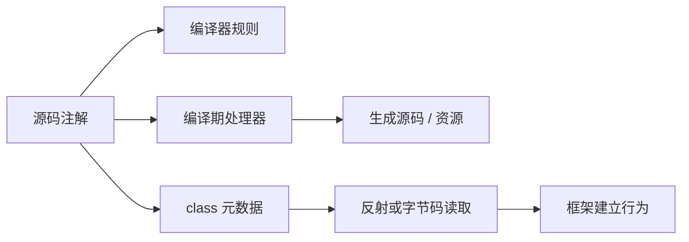
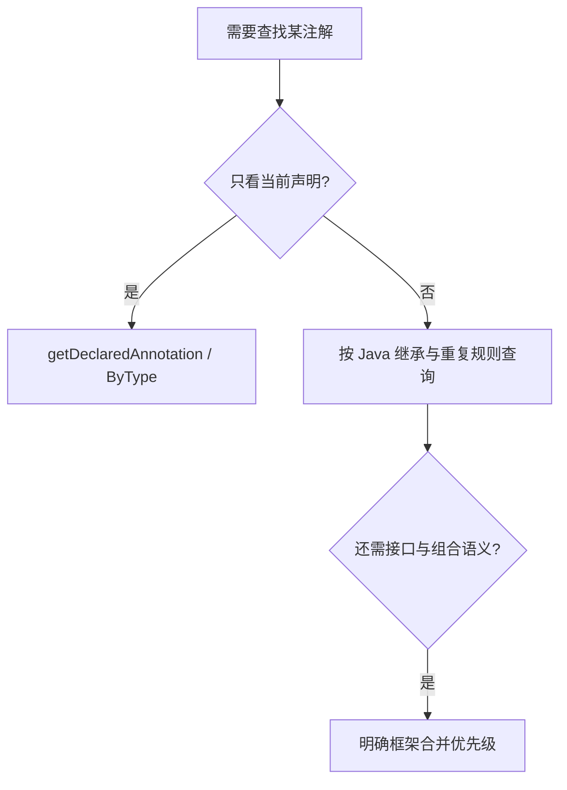
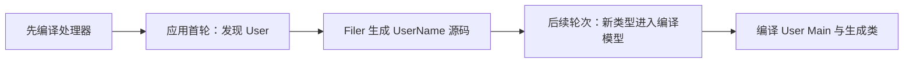
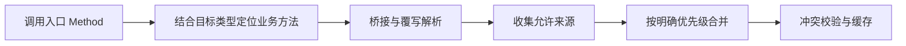

# 注解Annotation原理：从元数据、编译处理到运行时框架行为

> **阅读目标**：沿“问题 → 可选方案 → 实现机制 → 代价与边界”理解设计，能用具体交错、调用链或资源生命周期解释结果。配套 [注解Annotation面试](注解Annotation面试.md)。

> **版本口径**：语言与接口契约优先；JDK（Java Development Kit，Java 开发工具包）8、17、21、25 是本文的对照节点，25 为本篇参考版本，并非“最新版本”声明。实现细节不自动成为跨版本保证。

[返回 Java 知识体系导读](../学习路线.md)

## 阅读路线

| 章节 | 核心问题 |
|---|---|
| [1. 注解如何产生行为](#p-01) | 注解是结构化元数据，处理它的编译器、处理器或框架才执行行为。 |
| [2. 声明与元注解](#p-02) | 先定义允许位置、保留时间和元素类型，再设计消费者。 |
| [3. SOURCE、CLASS、RUNTIME 与读取路线](#p-03) | 默认保留策略是 CLASS，反射要看见通常需 RUNTIME，但字节码工具不受同样的反射入口限制。 |
| [4. 查询、继承与重复](#p-04) | Java 原生继承规则很窄，框架的合并查找通常是额外算法。 |
| [5. 声明注解与类型使用注解](#p-05) | 注解标在哪里，决定从哪个反射模型读取。 |
| [6. 编译期处理与生成](#p-06) | 标准注解处理以轮次生成新文件，不能与任意修改既有语法树混为一谈。 |
| [7. 运行时注解对象与兼容性](#p-07) | 运行期注解按值语义工作，不能将某种内部代理实现当公共修改接口。 |
| [8. 框架落地与失效推演](#p-08) | 把“发现声明→解析策略→建立执行入口”分开，才能解释有注解但不生效。 |
| [9. 完整注解处理器：从源码声明生成可调用类型](#p-09) | 标准处理器在编译轮次读取声明模型，生成新源码交回编译器，不需要运行期扫描。 |
| [10. 注解合并与方法解析：框架为什么不能只 getAnnotation](#p-10) | 框架必须规定搜索对象、优先级、组合规则和冲突处理，Java 原生查询不替它作业务决策。 |
| [11. 注解元数据的二进制演进：默认值、容器和类型变化](#p-11) | 逐步推导与反例验证 |

<a id="p-01"></a>
## 1. 注解如何产生行为

> 🎯 **核心结论**：注解是结构化元数据，处理它的编译器、处理器或框架才执行行为。

@Override 由编译器检查覆写，映射注解可由编译期生成器输出代码，事务注解常由运行期框架读取后建立代理。三者写法相似，生效阶段和成本完全不同。删除处理器或绕过代理时，注解还在但预期行为可能消失。



**读图**：先找消费者，再解释注解的效果；不能说“注解底层都是动态代理”，那只是部分运行时读取表示或框架实现。

| 路线 | 适合 | 主要代价 |
|---|---|---|
| 编译检查 | 覆写、废弃、语法与类型约束 | 不能替代运行期业务校验 |
| 编译生成 | 映射器、元模型、静态注册 | 构建配置与增量一致性 |
| 运行期读取 | 插件、注入、拦截配置 | 扫描、缓存、访问与代理边界 |

<a id="p-02"></a>
## 2. 声明与元注解

> 🎯 **核心结论**：先定义允许位置、保留时间和元素类型，再设计消费者。

```java
import java.lang.annotation.*;
@Retention(RetentionPolicy.RUNTIME)
@Target({ElementType.TYPE, ElementType.METHOD})
@interface Audited {
    String value() default "business";
    boolean enabled() default true;
}
```

元素是无参方法形式，可用基本类型、String、Class、枚举、注解及其一维数组；不能任意返回 List、Object 或泛型容器，也不能以 null 作为元素值。仅名为 value 的元素可使用相应简写。默认值属于注解类型定义，修改默认值可能影响运行时解释旧用法，需纳入兼容性判断。

@Retention 决定保留，@Target 决定合法位置，@Documented 影响文档展示，@Inherited 规定有限的类继承查询行为，@Repeatable 支持同类注解重复。**元注解并不自动实现框架业务**：@Target(METHOD) 不会让方法自动被拦截。

<a id="p-03"></a>
## 3. SOURCE、CLASS、RUNTIME 与读取路线

> 🎯 **核心结论**：默认保留策略是 CLASS，反射要看见通常需 RUNTIME，但字节码工具不受同样的反射入口限制。

| 策略 | 保留到哪里 | 常见消费者 |
|---|---|---|
| SOURCE | 源码阶段 | 编译器和源码处理器 |
| CLASS | 写进 class，但不供普通运行期注解反射读取 | 字节码分析与构建工具 |
| RUNTIME | 写进 class 且运行期可反射读取 | 运行期框架 |

保留时间更长不等于更高级。运行期无需使用的注解可避免运行期耦合；编译处理器也能处理 RUNTIME 注解，不能把处理方式与保留策略一对一绑定。

**排查例子**：getAnnotation 返回 null，先检查 retention、实际被查询的 Class/Method、继承规则和是否存在容器；再检查是否经过代码生成或字节码转换。不要直接改成“扫描全项目”掩盖规则问题。

<a id="p-04"></a>
## 4. 查询、继承与重复

> 🎯 **核心结论**：Java 原生继承规则很窄，框架的合并查找通常是额外算法。

@Inherited 只影响类层次上的某些注解查询，不把接口注解自动传给实现类，也不让父方法注解自动出现在覆写方法上。getDeclaredAnnotation 只看直接声明语义；getAnnotation 按相关存在规则查询，并不是“搜索所有父类、父接口、桥接方法”。

重复注解由 @Repeatable 指定容器，容器需满足元素与保留、目标等一致性约束。获取全部重复值应用 getAnnotationsByType/getDeclaredAnnotationsByType；只查单个注解可能忽略容器内值。



**读图**：框架查找应定义覆盖顺序、组合注解、别名冲突与方法解析；这不是 JDK getAnnotation 自动全部完成的能力。

<a id="p-05"></a>
## 5. 声明注解与类型使用注解

> 🎯 **核心结论**：注解标在哪里，决定从哪个反射模型读取。

`List<@NonNull String>` 中 @NonNull 标注类型参数位置，和标在字段声明上的注解含义不同。ElementType.TYPE_USE 允许类型使用位置；运行期查询这类信息需要 AnnotatedType 及其子模型，不能只查 Field.getAnnotations。

Record 组件还能涉及组件、字段、访问器、构造参数等多个位置，传播与适用目标有关；不能把所有注解视为无条件复制到全部生成成员。

**比较**：声明注解表达“此字段参与持久化”；类型注解表达“集合元素类型非空”。标准语法只承载元数据，非空分析器或校验框架才定义是否报错，JVM（Java Virtual Machine，Java 虚拟机）不会仅凭一个自定义 @NonNull 自动阻止 null。

<a id="p-06"></a>
## 6. 编译期处理与生成

> 🎯 **核心结论**：标准注解处理以轮次生成新文件，不能与任意修改既有语法树混为一谈。

JSR 269（Java Specification Request 269，Java 规范请求 269）标准化可插拔注解处理。Processor 获取 Element/TypeMirror 模型，由 Filer 创建源码、类文件或资源；新生成源码可参与后续轮次，最后轮次用于收尾。处理器应避免重复生成同名文件，注意处理声明与 claim 语义。


**读图**：处理器不是每个注解一个运行期拦截器，也不是无限循环生成。使用编译器内部语法树实现的方法改写，超出标准处理 API（Application Programming Interface，应用程序编程接口）保证，升级编译器时风险更高。

JDK 23 起 javac 不再默认仅凭普通类路径发现就执行处理器，构建需显式启用相应处理或配置处理器路径/名称。老项目升级后“生成类消失”要检查实际编译参数，而非把处理器普通依赖重复添加几次。

<a id="p-07"></a>
## 7. 运行时注解对象与兼容性

> 🎯 **核心结论**：运行期注解按值语义工作，不能将某种内部代理实现当公共修改接口。

注解实例提供 annotationType、元素方法、equals、hashCode 等契约；相同注解类型与元素值决定注解相等，数组元素采用相应内容语义。主流实现可用代理表示读取结果，但篡改内部 memberValues 不是稳定配置方式，强封装下还可能直接失败。

注解值引用不存在的类、枚举项变更、元素类型变化或新增必填元素，都可能导致 TypeNotPresentException、EnumConstantNotPresentException、AnnotationTypeMismatchException、IncompleteAnnotationException 等。错误可在访问具体元素时才出现，不能认为“成功扫到注解对象就验证完毕”。

**方案比较**：配置需要动态更新时使用显式配置对象与版本；注解适合靠近代码的稳定声明。将环境密码、动态路由或频繁变化策略写成注解元素，会增加编译发布与密钥管理负担。

<a id="p-08"></a>
## 8. 框架落地与失效推演

> 🎯 **核心结论**：把“发现声明→解析策略→建立执行入口”分开，才能解释有注解但不生效。

一个方法拦截框架通常需要：发现候选类，定位实际目标方法，合并声明，校验配置，建立代理或生成代码，在调用入口执行策略。桥接方法、接口方法、继承方法和代理方法可能不是同一个 Method，查错对象就会失效。

| 症状 | 首先验证 |
|---|---|
| 注解可见但无拦截 | 对象是否受容器管理、调用是否经过代理 |
| 子类查不到父方法注解 | 是否误用了 @Inherited 规则 |
| 重复配置只读到一项 | 是否使用 ByType 查询容器 |
| 升级后生成类不存在 | javac 处理启用、处理器路径、生成目录 |
| 扫描占用持续增长 | 缓存是否保留旧加载器与反射对象 |

**验证路线**：针对 retention、继承、重复、类型使用和处理轮次分别做小例子；框架验证还要覆盖内部调用绕过代理、覆写方法优先级与模块访问失败。注解单元测试不能替代真实执行入口验证。

<a id="p-09"></a>
## 9. 完整注解处理器：从源码声明生成可调用类型

> 🎯 **核心结论**：标准处理器在编译轮次读取声明模型，生成新源码交回编译器，不需要运行期扫描。

### 9.1 定义一个可验证目标
给顶层类加 `@GenerateName`，编译时生成同包的 `类名Name`，其 value 方法返回原类全限定名称。限制为顶层普通类，避免示例悄悄承诺支持所有嵌套、记录与泛型建模。以下文件按注释中的路径保存。

```java
// demo/GenerateName.java
package demo;
import java.lang.annotation.*;
@Retention(RetentionPolicy.SOURCE)
@Target(ElementType.TYPE)
public @interface GenerateName {}
```

```java
// demo/NameProcessor.java
package demo;
import java.io.*;
import java.util.*;
import javax.annotation.processing.*;
import javax.lang.model.SourceVersion;
import javax.lang.model.element.*;
import javax.tools.Diagnostic;
@SupportedAnnotationTypes("demo.GenerateName")
public class NameProcessor extends AbstractProcessor {
    private final Set<String> generated = new HashSet<>();
    @Override public SourceVersion getSupportedSourceVersion() {
        return SourceVersion.latestSupported();
    }
    @Override public boolean process(Set<? extends TypeElement> annotations,
                                      RoundEnvironment round) {
        if (round.processingOver()) return false;
        for (Element e : round.getElementsAnnotatedWith(GenerateName.class)) {
            if (!(e instanceof TypeElement type)
                    || type.getKind() != ElementKind.CLASS
                    || type.getNestingKind() != NestingKind.TOP_LEVEL) {
                processingEnv.getMessager().printMessage(
                    Diagnostic.Kind.ERROR, "requires a top-level class", e);
                continue;
            }
            String pkg = processingEnv.getElementUtils()
                                      .getPackageOf(type).getQualifiedName().toString();
            String simple = type.getSimpleName() + "Name";
            String qualified = pkg.isEmpty() ? simple : pkg + "." + simple;
            if (!generated.add(qualified)) continue;
            try (Writer w = processingEnv.getFiler()
                    .createSourceFile(qualified, type).openWriter()) {
                if (!pkg.isEmpty()) w.write("package " + pkg + ";\n");
                w.write("public final class " + simple + " {\n");
                w.write("  public static String value() { return \""
                        + type.getQualifiedName() + "\"; }\n}\n");
            } catch (IOException ex) {
                processingEnv.getMessager().printMessage(
                    Diagnostic.Kind.ERROR, "generation failed: " + ex, type);
            }
        }
        return true;
    }
}
```

```java
// demo/User.java
package demo;
@GenerateName public class User {}
```

```java
// demo/Main.java
package demo;
public class Main {
    public static void main(String[] args) {
        System.out.println(UserName.value()); // demo.User
    }
}
```

### 9.2 为什么分两次编译
先让处理器及注解成为可加载的工具，再编译使用它们的应用；不要期望尚未编译出来的处理器在同一次普通编译中自动加载自身。

```text
javac -d tool-out demo/GenerateName.java demo/NameProcessor.java
javac -cp tool-out -processorpath tool-out -processor demo.NameProcessor -s generated -d app-out demo/User.java demo/Main.java
java -cp app-out demo.Main
```

这组命令用于理解工具链，实际项目可通过构建工具管理独立处理器模块。显式指定处理器也符合现代 javac 的启用要求；不用把 SOURCE 注解改成 RUNTIME 才让生成生效。



**读图**：Main 在源码中引用尚未手写存在的 UserName，生成后可被编译器处理。处理器用 Element 与 TypeMirror 看声明，不通过 Class.forName 去初始化业务类。

### 9.3 示例之外必须处理的失败
同名手写类型与生成类型冲突时，Filer 会拒绝相应重复创建，应报告错误，不能覆盖源码。`generated` 防止同次处理的重复生成，不替代跨构建产物清理。传入 originating element 帮助工具追踪来源，但不自动使任意生成器都具备正确增量行为。

生成固定类名成本低；若生成内容依赖其他文件、全项目扫描或环境变量，增量编译需明确输入依赖。处理失败应让编译失败，不能静默漏生成后让应用到运行期再找不存在的类。

参考：[Processor 轮次](https://docs.oracle.com/en/java/javase/25/docs/api/java.compiler/javax/annotation/processing/Processor.html)、[Filer 文件协议](https://docs.oracle.com/en/java/javase/25/docs/api/java.compiler/javax/annotation/processing/Filer.html)。

<a id="p-10"></a>
## 10. 注解合并与方法解析：框架为什么不能只 getAnnotation

> 🎯 **核心结论**：框架必须规定搜索对象、优先级、组合规则和冲突处理，Java 原生查询不替它作业务决策。

### 10.1 先定位真实方法，再解释声明
接口方法、泛型桥接方法、具体覆写、父类声明与代理方法可能同时存在。若先取代理生成方法的注解就缓存“无配置”，会跳过目标类已有声明；若只按方法名匹配，又会混淆重载。

一种明确的设计流程是：由接口签名和目标类型定位实际方法，解析桥接到业务方法，收集允许的声明来源，按规则合并，最后校验结果并缓存。规则应写在框架契约里，不应由某次反射数组遍历顺序偶然决定。



**读图**：这里只描述可设计流程，不冒充所有框架都采用同一优先级。安全控制、事务、路由、校验等注解的合并意义各不相同。

### 10.2 “最近优先”也要有边界
例如框架规定“具体方法声明覆盖类型默认配置”，这能解释多数局部覆盖，却要继续回答：方法只写了一个元素，其他元素取注解默认值还是类型配置？接口和父类都有声明怎么办？重复注解是替换还是累加？组合注解互相递归怎样防环？

| 合并策略 | 优点 | 风险 |
|---|---|---|
| 整体最近声明覆盖 | 规则直观 | 未填写元素也可能覆盖原配置 |
| 显式元素级合并 | 可细化继承 | 难区分默认值和“用户刻意填同默认值” |
| 多声明累加 | 适合部分列表策略 | 可能重复执行或引入冲突 |
| 冲突即失败 | 避免隐式歧义 | 配置者需明确消歧 |

普通运行期注解对象给出的是解析后的元素值，不能总靠“值是否等于默认值”推断用户在源码里是否显式填写。需要这种信息时，应设计显式覆盖标记或合适元数据模型。

### 10.3 缓存必须绑定解析上下文
缓存键至少考虑实际目标类型与方法签名，必要时包含策略配置版本；同一接口对应不同实现类可能有不同注解。缓存结果通常可不可变发布，配置变更需明确失效。加载器关闭时清理作用域，避免缓存 Method 和 Class 阻止卸载。

**验证矩阵**：接口有/无、父类有/无、具体方法覆写、桥接、重复与组合冲突、代理入口、自调用。对权限注解尤应测试冲突时是明确拒绝还是意外降级，不要让“未找到注解”默认放行掩盖解析错误。

<a id="p-11"></a>
## 11. 注解元数据的二进制演进：默认值、容器和类型变化

> 🎯 **核心问题**：只升级注解定义 jar，不重编译使用者，为什么行为会变化？为什么成功获得注解对象后仍可能在读取元素时抛错？

### 一、默认值并不必然复制到每个使用点
设注解元素 timeout 的默认值从 100 改成 300，而旧使用者写的是没有显式 timeout 的注解。读取时可根据当前注解类型的默认定义解释省略元素，因此升级定义可能改变旧使用点的有效值。反过来，旧使用者显式写了 100，不能随默认更新而假定变成 300。

这意味着注解默认值是库的行为兼容契约，不是随便调整的说明文字。配置类注解尤其需要记录默认值变化、影响范围与回归案例。通过“等于默认值”猜测用户是否省略该元素，会把显式填写相同值的情况混淆。

### 二、四种演进怎样失败
| 演进 | 可能后果 | 应怎样设计 |
|---|---|---|
| 新增有默认值元素 | 旧使用者可取得默认值，但行为可能变化 | 选择兼容默认并记录语义 |
| 新增必填元素 | 旧产物没有值，读取可失败 | 避免无迁移直接升级 |
| 更改元素返回类型 | 旧编码值与新声明不匹配 | 新增元素或新版本声明替代 |
| 删除枚举常量或引用类 | 访问相应值时才暴露失败 | 保留兼容路径或明确迁移 |

IncompleteAnnotationException、AnnotationTypeMismatchException、EnumConstantNotPresentException、TypeNotPresentException 分别对应不同原因。不要把它们全部捕获后当作“没有注解”继续运行，否则安全、路由和事务策略可能静默降级。

### 三、Repeatable 的容器不是任意数组包装
重复注解需要配套容器，其 value 的类型、保留策略、适用目标等有约束。改变容器关系会影响 ByType 展开语义；旧产物里真实编码的是一个直接注解还是容器，必须分开验证。把 getAnnotation 替换成 ByType 也不能自动替你定义业务上的多值覆盖、排序与冲突策略。

### 四、类型使用位置需要保留路径
`List<@Checked String>` 与 `@Checked List<String>` 表达的标注位置不同。运行时模型可能沿 AnnotatedParameterizedType 进入实参，而不是只看字段的声明注解。数组维度、通配符边界和嵌套泛型都可能有自己的类型注解路径。

因此校验框架应先问“标记修饰谁”，再问“何时检查”。一个非空元素标记不能无条件等价为容器本身非空；若反射扫描只取顶层 annotations，会漏掉元素约束。

### 五、构建期和运行期需要两份兼容验证
处理器使用编译模型生成代码，其版本升级可能改变生成结果；运行期读取注解的库升级则改变解释。只看业务源码没有修改，不代表两条路径都没有变化。应保存代表性的旧编译产物，分别用新注解定义与新消费者读取，验证默认、缺失、枚举变化和重复容器，而不是只做全量干净重编译。

参考：[AnnotatedElement](https://docs.oracle.com/en/java/javase/25/docs/api/java.base/java/lang/reflect/AnnotatedElement.html)、[JLS 注解接口](https://docs.oracle.com/javase/specs/jls/se25/html/jls-9.html)。

<a id="p-versions"></a>
## 版本演进与学习边界

| 节点 | 变化 | 边界 |
|---|---|---|
| 5 | 注解进入语言 | 注解不等于自动行为 |
| 6 | 标准可插拔注解处理 | 标准生成与内部 AST 改写分开 |
| 8 | 重复注解、类型使用注解 | 读取容器与读取 AnnotatedType 分开 |
| 9 / 17 | 模块与强封装 | 不依赖内部注解实现可修改 |
| 23–25 | javac 需显式配置处理执行 | 普通类路径上存在处理器不再足够 |

升级时同时检查语言版本、编译器、构建插件和处理器版本，单改 source/target 不等于处理链兼容。

<a id="p-references"></a>
## 参考资料与源码入口

- [注解包](https://docs.oracle.com/en/java/javase/25/docs/api/java.base/java/lang/annotation/package-summary.html)
- [AnnotatedElement 查询语义](https://docs.oracle.com/en/java/javase/25/docs/api/java.base/java/lang/reflect/AnnotatedElement.html)
- [Processor 处理轮次](https://docs.oracle.com/en/java/javase/25/docs/api/java.compiler/javax/annotation/processing/Processor.html)
- [javac 与注解处理选项](https://docs.oracle.com/en/java/javase/25/docs/specs/man/javac.html)
- [JLS（Java Language Specification，Java 语言规范） 9：注解接口与使用](https://docs.oracle.com/javase/specs/jls/se25/html/jls-9.html)

<a id="p-glossary"></a>
## 附录：术语与缩写

| 术语 | 英文全称 | 中文含义 |
|---|---|---|
| JDK | Java Development Kit | Java 开发工具包 |
| JVM | Java Virtual Machine | Java 虚拟机 |
| API | Application Programming Interface | 应用程序编程接口 |
| JSR | Java Specification Request | Java 规范请求 |
| AST | Abstract Syntax Tree | 抽象语法树 |
| Retention | Retention Policy | 保留策略 |
| Processor | Annotation Processor | 注解处理器 |
| TCCL | Thread Context Class Loader | 线程上下文类加载器 |
| JLS | Java Language Specification | Java 语言规范 |
