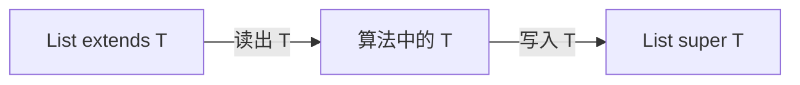
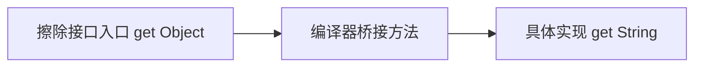
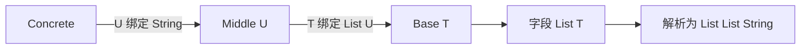
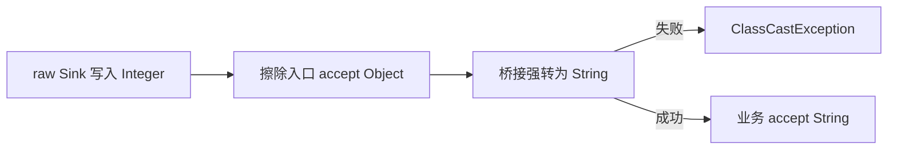

# 泛型Generics原理：从类型关系、擦除到通配符与框架类型解析

> **阅读目标**：沿“问题 → 可选方案 → 实现机制 → 代价与边界”理解设计，能用具体交错、调用链或资源生命周期解释结果。配套 [泛型Generics面试](泛型Generics面试.md)。

> **版本口径**：语言与接口契约优先；JDK（Java Development Kit，Java 开发工具包）8、17、21、25 是本文的对照节点，25 为本篇参考版本，并非“最新版本”声明。实现细节不自动成为跨版本保证。

[返回 Java 知识体系导读](../学习路线.md)

## 阅读路线

| 章节 | 核心问题 |
|---|---|
| [1. 为什么需要泛型](#p-01) | 把容器与算法的类型约束提前到编译期，减少散落的强转与延迟失败。 |
| [2. 不变、协变与数组](#p-02) | 泛型默认不变，数组协变依靠运行期存储检查，两者把安全成本放在不同阶段。 |
| [3. PECS 与通配符捕获](#p-03) | extends 适合安全读取上界，super 适合安全写入下界，关键是当前使用方向。 |
| [4. 类型参数、边界与推断](#p-04) | 类型变量用于连接多个位置，通配符用于表达某位置的存在性约束。 |
| [5. 擦除、强转与桥接方法](#p-05) | 擦除替换类型变量为边界，桥接方法维护泛型覆写在运行时的多态。 |
| [6. 可具体化类型、数组与堆污染](#p-06) | 运行时能否检查类型决定哪些构造安全，警告不能靠强转消失。 |
| [7. 反射 Type、类型令牌与继承替换](#p-07) | 反射读取的是声明元数据，匿名子类可保留签名，但不会自动捕获任意运行时实参。 |
| [8. API 设计、框架解析与诊断](#p-08) | 泛型应增加可证明约束，而不是用复杂签名掩盖运行时不确定性。 |
| [9. 通配符捕获的具体推导](#p-09) | 捕获辅助方法把同一个未知元素类型命名，不是把未知类型强转成 Object。 |
| [10. 多层泛型替换：框架如何从 T 解析到嵌套实体类型](#p-10) | 解析需沿继承边建立以变量声明身份为键的替换环境，递归替换结构，而不是只取一次父类型实参。 |
| [11. 桥接、原始类型与受污染调用：失败为何发生在别处](#p-11) | 静态类型检查可被未检查入口绕开，桥接或调用方强转只是最后暴露问题的位置。 |
| [12. 从安全复制函数推导方差、捕获与运行期校验](#p-12) | 逐步推导与反例验证 |

<a id="p-01"></a>
## 1. 为什么需要泛型

> 🎯 **核心结论**：把容器与算法的类型约束提前到编译期，减少散落的强转与延迟失败。

没有泛型时，集合存取 Object，错误可能到很远的读取位置才抛 ClassCastException。泛型把“此 List 只接受 String”等不变量写入声明，编译器检查调用并在必要位置生成强转；运行时并没有为每个类型实参复制一个独立的 ArrayList 实现。


**读图**：擦除与保留签名可以同时成立。执行指令使用擦除后的类型，声明处的泛型签名仍可供反射读取；不能把“泛型全都消失”与“对象知道全部实参”任何一个绝对化。

<a id="p-02"></a>
## 2. 不变、协变与数组

> 🎯 **核心结论**：泛型默认不变，数组协变依靠运行期存储检查，两者把安全成本放在不同阶段。

若 `List<Integer>` 是 `List<Number>` 的子类型，调用方就能经后者 add(3.14)，破坏原列表约束。所以 Integer 是 Number 子类型，并不能推出两个参数化 List 也有相同子类型关系。

```java
Number[] numbers = new Integer[1];
// numbers[0] = 3.14; // 编译通过，但运行时 ArrayStoreException
// java.util.List<Number> xs = new java.util.ArrayList<Integer>(); // 编译拒绝
```

| 模型 | 关系 | 代价 |
|---|---|---|
| 数组协变 | Integer[] 可赋给 Number[] | 写入要运行期检查 |
| 泛型不变 | `List<Integer>` 非 `List<Number>` | 静态安全，但需通配符表达弹性 |
| Object 容器 | 接受多种对象 | 取回类型信息弱，容易延迟强转失败 |

Java 泛型当前不直接接受基本类型实参，`List<int>` 不合法，装箱的空间与计算成本也不能忽略。未来语言项目的方向不能当作本文参考版本已提供的能力。

<a id="p-03"></a>
## 3. PECS 与通配符捕获

> 🎯 **核心结论**：extends 适合安全读取上界，super 适合安全写入下界，关键是当前使用方向。

PECS（Producer Extends, Consumer Super，生产者用上界、消费者用下界）：从 `List<? extends Number>` 可安全读取 Number，但不能随便 add(Integer)，因为实际可能是 `List<Double>`；向 `List<? super Integer>` 可写 Integer，读取通常只能承诺 Object，因为实际可能是 `List<Object>`。

```java
static <T> void copy(java.util.List<? super T> dst,
                     java.util.List<? extends T> src) {
    for (T value : src) dst.add(value);
}
```

**边界**：extends 容器不是“完全只读”，可能 clear、remove 或写 null；只是不允许凭已知上界随便写入非空候选值。super 也不是“只能写不能读”，而是读取类型承诺较弱。实际集合还可能不支持结构修改。



**读图**：左右不是同一种类型关系的反向继承，而是算法两端允许的操作。`List<?>` 是某个未知元素类型，不等于 `List<Object>`。捕获辅助方法可为同一个未知类型引入局部类型变量，以支持安全交换等操作。

<a id="p-04"></a>
## 4. 类型参数、边界与推断

> 🎯 **核心结论**：类型变量用于连接多个位置，通配符用于表达某位置的存在性约束。

`<T>` T first(`List<T>` xs) 把返回类型与输入元素相连；`List<?>` 只表达不知道具体元素类型。方法泛型与所属类泛型独立，static 方法不能直接使用类实例的 T。推断依赖实参、目标类型和边界，不是运行时观察对象后猜类型。

交叉边界可写 `<T extends Number & Comparable<T>>`，类边界只能有一个且在首位。`Comparable<? super T>` 常比 `Comparable<T>` 更适合允许父类型比较契约的算法。递归边界用于限制操作关系，不意味着 T 必须“直接实现自身比较器”。

**反例**：两个重载仅把 `List<String>` 改成 `List<Integer>` 会在擦除后签名冲突；把泛型返回类型换一个实参也不能单独构成重载。应改方法名、参数结构或引入显式策略，避免通过不可维护的原始类型绕开。

<a id="p-05"></a>
## 5. 擦除、强转与桥接方法

> 🎯 **核心结论**：擦除替换类型变量为边界，桥接方法维护泛型覆写在运行时的多态。

无界 T 通常擦除为 Object，有界 T 擦除为其最左边界；所以“所有 T 一律变 Object”错误。调用点可能插入 checkcast，使污染在读取时暴露。

```java
interface Box<T> { T get(); }
class TextBox implements Box<String> {
    public String get() { return "ok"; }
}
```

TextBox 声明 get():String，而擦除后的接口入口返回 Object。编译器可生成 synthetic bridge get():Object，转调具体实现。参数型覆写也可能生成桥接并包含强转，错误输入可在桥接处失败。



**读图**：桥接保证覆写分派，不是手工业务方法。反射扫描方法时需识别 isBridge/isSynthetic，框架要把桥接与实际目标映射起来，不能简单当两套独立业务方法注册。

<a id="p-06"></a>
## 6. 可具体化类型、数组与堆污染

> 🎯 **核心结论**：运行时能否检查类型决定哪些构造安全，警告不能靠强转消失。

Reifiable Type（可具体化类型）在运行时有足够信息，例如普通非泛型类、原始类型及符合规则的无界通配参数化类型。`List<String>` 不可具体化，因此不能 new `List<String>`[10]，也不能直接 new T[] 或 T.class；`List<?>[]` 有不同的合法性。

Heap Pollution（堆污染）指参数化类型变量引用了不符合其参数化约束的对象，常由 raw type、未检查强转、反射或泛型可变参数数组暴露造成。

```java
java.util.List raw = new java.util.ArrayList<String>();
raw.add(42); // unchecked 警告
java.util.List<String> words = raw; // unchecked 警告
// words.get(0) 在需要 String 的位置会失败
```

@SafeVarargs 是作者对方法实现安全性的承诺，不是编译器证明。若把 varargs 数组暴露、写入不兼容值或转交不受控代码，标注也不会修复错误。限制注解可用方法种类，是因为不能让未经验证的覆写轻易破坏承诺。

instanceof `List<?>` 可检查擦除后的容器类型。对不可具体化类型的 instanceof 是否允许还涉及源表达式与检查转换规则，不能笼统背成“任何参数化 instanceof 都非法”；常见从 Object 判断 `List<String>` 的写法不成立。

<a id="p-07"></a>
## 7. 反射 Type、类型令牌与继承替换

> 🎯 **核心结论**：反射读取的是声明元数据，匿名子类可保留签名，但不会自动捕获任意运行时实参。

Class 表示运行时类，Type 体系还包括 ParameterizedType、TypeVariable、WildcardType、GenericArrayType。Field.getGenericType 可返回声明的 `List<String>`，而 new `ArrayList<String>`().getClass() 与 `ArrayList<Integer>` 的 Class 并不因此不同。

```java
abstract class TypeRef<T> {
    final java.lang.reflect.Type type =
        ((java.lang.reflect.ParameterizedType) getClass()
            .getGenericSuperclass()).getActualTypeArguments()[0];
}
// new TypeRef<java.util.List<String>>() {}.type 可保留该父类签名
```

上例故意是最小模型，只适用于预期的直接参数化子类；生产解析器需处理多层继承、接口、变量替换、所有者类型、数组和循环边界。在 `<T>` 方法里 new `TypeRef<List<T>>`() {} 保留的仍可能是 TypeVariable T，不能凭这个技巧得知调用时真实 String。

| 工具 | 表达能力 | 局限 |
|---|---|---|
| `Class<T>` | 一个具体类令牌 | 表达不了完整 `List<String>` |
| Type / TypeRef | 声明的嵌套类型结构 | 未绑定变量仍需解析 |
| 显式转换器 / 工厂 | 运行时构建与校验 | 调用方需传递策略 |

<a id="p-08"></a>
## 8. API（Application Programming Interface，应用程序编程接口）设计、框架解析与诊断

> 🎯 **核心结论**：泛型应增加可证明约束，而不是用复杂签名掩盖运行时不确定性。

设计参数时优先使用消费者/生产者边界，返回值通常尽量给调用方清晰类型而不是到处返回通配符。只有需要跨多个参数或返回值建立关系时才引入命名 T；无关联参数复用同一个 T 反而制造不必要约束。

容器框架解析 `Repository<User,Long>` 需沿继承路径建立 TypeVariable→Type 的映射，再逐层替换；看到中间接口上的 T 不能立即当 Object 结束。相反，原始类型继承确实可能丢掉必要信息，要有失败诊断或显式令牌兜底。

**排查顺序**：先看 javac 的 unchecked/rawtypes 警告；用 javap 观察签名与桥接；定位最早污染写入，别只修复后来 checkcast；框架场景记录声明类型、实际 Class 和变量替换映射。

测试至少覆盖：父类比较器、未知类型捕获、原始类型污染、多层泛型继承、泛型数组与 varargs 别名。能通过一次正常 String 输入，不足以证明一个强转安全。

<a id="p-09"></a>
## 9. 通配符捕获的具体推导

> 🎯 **核心结论**：捕获辅助方法把同一个未知元素类型命名，不是把未知类型强转成 Object。

```java
static void swapFirstTwo(java.util.List<?> xs) {
    swapCaptured(xs);
}
private static <T> void swapCaptured(java.util.List<T> xs) {
    if (xs.size() < 2) return;
    T first = xs.get(0);
    xs.set(0, xs.get(1));
    xs.set(1, first);
}
```

`List<?>` 表示“有某个具体但未知的元素类型”。直接尝试以 Object 写回会超出已知约束；辅助方法让编译器为同一次传入捕获一个 T，读出的 T 再写回同一个 `List<T>` 就保持一致。

**前提与代价**：本例只证明类型关系，不保证实际列表支持 set，也不处理并发缩短导致的越界。类型安全、可修改性和并发安全是三组不同契约。

另一个常见设计是 `<T>` T max(`Collection<? extends T>`, `Comparator<? super T>`)：集合生产 T，比较器消费 T，返回值连接到同一个 T。若把两个位置都写成独立的 ?，就失去了能把返回类型与输入联系起来的命名关系。

<a id="p-10"></a>
## 10. 多层泛型替换：框架如何从 T 解析到嵌套实体类型

> 🎯 **核心结论**：解析需沿继承边建立以变量声明身份为键的替换环境，递归替换结构，而不是只取一次父类型实参。

### 10.1 一次具体推导
```java
static class Base<T> { java.util.List<T> rows; }
static class Middle<U> extends Base<java.util.List<U>> {}
static class Concrete extends Middle<String> {}
```

在 Concrete 的上下文里，rows 应解释为 `List<List<String>>`，但直接对 Base.rows 调 getGenericType 得到的仍是声明 `List<T>`。这不是反射丢信息，而是你尚未提供继承路径的替换上下文。

| 沿路径读取 | 新建立关系 | 累积解释 |
|---|---|---|
| Concrete → `Middle<String>` | Middle.U → String | U 已绑定 |
| `Middle<U>` → `Base<List<U>>` | Base.T → `List<U>` | 先代入现有 U，得到 `List<String>` |
| Base.rows：`List<T>` | 递归进入外层实参 T | `List<List<String>>` |



**读图**：变量不是单纯字符串名字。两个无关声明里都叫 T 的变量不能共用映射，TypeVariable 的声明来源是身份的一部分。接口分支还可能提供不同路径，必须处理一致性或报告冲突。

### 10.2 替换器的核心递归
```text
resolve(type, environment, visiting):
  Class                -> 返回该类
  TypeVariable         -> 查其声明身份的绑定；有绑定就递归；无绑定则保留未解析状态
  ParameterizedType    -> 递归替换 owner 与各实参，保留完整原始类型
  GenericArrayType     -> 替换组件类型；按结果形成相应数组类型表示
  WildcardType         -> 替换上下界，保留 extends / super 方向
```

这是算法模型，不是可直接执行的 Java 实现。visited/visiting 用来识别递归边界，不能看到 `T extends Comparable<T>` 就无限展开。保留未解析变量比默默擦成 Object 更有助于诊断；真正需要运行期构造对象时，还必须有可实例化的类、工厂或转换器。

原始类型继承可能真的丢失绑定信息，此时应选择“明确失败、要求 Type 令牌、使用调用方指定模型”之一，不能假装泛型父类一定提供实体 Class。

### 10.3 为什么 Type 不能只强转成 Class
`List<String>` 是 ParameterizedType，`T[]` 可是 GenericArrayType，`? super User` 是 WildcardType。解析器返回 Class 会丢掉嵌套参数；以字符串拼接代替 Type 也容易混淆所有者、数组和加载器身份。

若自行实现参数化 Type，还应满足结构化 equals/hashCode 等契约，不能只实现漂亮的 toString。缓存键需结合实际上下文类型，不应只以字段名或声明 Base.class 命中所有子类。

参考：[Type 模型](https://docs.oracle.com/en/java/javase/25/docs/api/java.base/java/lang/reflect/Type.html)、[ParameterizedType 契约](https://docs.oracle.com/en/java/javase/25/docs/api/java.base/java/lang/reflect/ParameterizedType.html)。

<a id="p-11"></a>
## 11. 桥接、原始类型与受污染调用：失败为何发生在别处

> 🎯 **核心结论**：静态类型检查可被未检查入口绕开，桥接或调用方强转只是最后暴露问题的位置。

### 11.1 一个有参数桥接的例子
```java
interface Sink<T> { void accept(T value); }
static class StringSink implements Sink<String> {
    public void accept(String value) { System.out.println(value.length()); }
}
```

擦除接口入口是 `accept(Object)`，具体实现是 `accept(String)`。编译器可生成 bridge `accept(Object)`，先把参数转成 String 再调用业务实现。正常泛型调用受编译器约束，raw Sink 却可将 Integer 送进入口，错误于桥接强转时暴露。



**读图**：不是桥接方法破坏了类型安全，而是未检查入口绕开了原有约束。错误可能发生在编译器生成的方法里，但最早错误点通常是原始类型调用、未检查强转或反射写入。

### 11.2 泛型 varargs 为什么特别容易混淆
`List<String>...` 的运行期承载是数组，而数组有自己的组件检查。把这个数组作为 Object[] 暴露后，写入另一个合法 List 对象可能不触发数组存储异常，却已违反更细的 String 元素约束；等以后 get 才出现 ClassCastException。

因此 @SafeVarargs 审查要问：数组有没有逃逸？有没有经别名写入？有没有交给未知代码？只遍历读取且不泄露数组的实现更容易证明。警告压制的范围应尽可能小，并在说明里记录为什么强转受外部不变量保证。

### 11.3 反射赋值也不自动校验集合元素
字段声明为 `List<String>`，其运行期字段类型仍是 List。反射设置一个 `List<Integer>` 可能通过原始字段类型检查，却在业务后续读取字符串时失败。若反序列化器声称支持泛型校验，就必须使用解析后的 Type 递归校验内容，而不只做 field.getType().isInstance。

**排查路径**：从最后 checkcast 栈帧向上追对象写入与转换来源；保留 rawtypes/unchecked 编译诊断；针对错误元素、嵌套 List 与多层继承做反例。修复“把读取改成 Object”会把错误推得更远，不是修好约束。

<a id="p-12"></a>
## 12. 从安全复制函数推导方差、捕获与运行期校验

> 🎯 **核心问题**：PECS 不是为了让代码更复杂，而是把算法真正需要的读写能力写成可检查约束。

### 一、从一个失败签名开始
若复制函数只接收两个相同的 `List<T>`，则 `List<Integer>` 到 `List<Number>` 的合法复制可能受不必要限制。算法对源只读取，对目标只写入，所以源应表达可生产 T，目标应表达可消费 T。

```java
static <T> void copy(java.util.List<? super T> target,
                     java.util.List<? extends T> source) {
    for (T item : source) target.add(item);
}
```

对 `List<Number>` 目标与 `List<Integer>` 源，编译器可选择满足全部约束的 T，不是运行时取一个元素看看类型。若反过来往整数列表复制任意 Number，则可能写入 Double，必须拒绝。

### 二、为什么源不能随便写回
`List<? extends Number>` 可能实际是整数列表，也可能是小数列表。读取可承诺 Number，但写 Integer 不对所有可能实参都合法。写 null、删除、清空等操作要另按类型与实现支持判断，“上界集合完全只读”是过度简化。

`List<? super Integer>` 则可能是整数、Number 或 Object 列表；写 Integer 对它们均合法，读取却通常只能承诺 Object。类型能力与当前内容不同：即使眼下全是 Integer，也不能把声明提升为可读取 Integer 的证明。

### 三、捕获必须连接同一次未知类型
从 `List<?>` 读出 Object 后，不能随便把这个 Object 写入另一个 `List<?>`，两个问号可能代表不同类型。即使变量名相近，也没有建立相等关系。

辅助 `<T>` 方法可以为同一个列表的未知类型命名，从中读出的 T 再写回同一列表是安全的。它不能用来“证明两个任意未知列表实参相同”。这也是为什么某些交换函数能捕获，而跨两个列表的任意交换仍不合法。

### 四、类型安全与操作支持必须分开
复制到不可修改列表可能抛 UnsupportedOperationException，写 null 可能触发集合自身约束，并发修改也可能破坏遍历。泛型只检查类型关系，不保证容量、顺序、可修改性、线程安全和业务不变量。

| 层次 | 谁负责 |
|---|---|
| 能否把 Integer 写进目标 | 泛型静态约束 |
| 目标是否支持 add | 集合操作契约 |
| 多线程同时复制是否一致 | 同步与所有权协议 |
| 是否允许重复或 null | 具体容器及业务规则 |

### 五、运行期检查包装能弥补多少
Collections.checkedList 等包装可在经过该入口的写入处检查元素 Class，从而更早暴露原始类型污染。但 `Class<List>` 无法表达完整的 `List<String>` 元素深度，绕过包装继续持有原列表写入也可逃过检查。它更像边界防线，不是让擦除泛型突然全部运行期具体化。

需要把外部 JSON 映射成多层模型时，应传递完整 Type 并递归转换验证。对已存在集合做未经检查强转，只改变编译器视角，不会转换内部对象。

参考：[Collections 检查包装](https://docs.oracle.com/en/java/javase/25/docs/api/java.base/java/util/Collections.html)、[JLS 类型与子类型](https://docs.oracle.com/javase/specs/jls/se25/html/jls-4.html)。

<a id="p-versions"></a>
## 版本演进与学习边界

| 节点 | 变化 | 边界 |
|---|---|---|
| 5 | 泛型、装箱、可变参数 | 兼容性目标与擦除有关 |
| 7 | 菱形语法、SafeVarargs | 简写与警告抑制不改变运行时类型 |
| 8 | 目标类型推断增强 | 推断仍是编译期约束求解 |
| 9 | 私有实例方法可用于 SafeVarargs 等语言演进 | 注解合法范围按目标版本核对 |
| 17 / 21 / 25 | 模式匹配相关语法演进 | instanceof 合法性看源类型与检查转换，不只背一句禁令 |

本文参考版本未将 `List<int>` 或泛型特化作为已交付常规能力，未来项目提案应单独核验。

<a id="p-references"></a>
## 参考资料与源码入口

- [JLS（Java Language Specification，Java 语言规范） 4：类型、擦除、可具体化与子类型](https://docs.oracle.com/javase/specs/jls/se25/html/jls-4.html)
- [JLS 18：类型推断](https://docs.oracle.com/javase/specs/jls/se25/html/jls-18.html)
- [Type 反射模型](https://docs.oracle.com/en/java/javase/25/docs/api/java.base/java/lang/reflect/Type.html)
- [SafeVarargs](https://docs.oracle.com/en/java/javase/25/docs/api/java.base/java/lang/SafeVarargs.html)

<a id="p-glossary"></a>
## 附录：术语与缩写

| 术语 | 英文全称 | 中文含义 |
|---|---|---|
| JDK | Java Development Kit | Java 开发工具包 |
| JVM | Java Virtual Machine | Java 虚拟机 |
| API | Application Programming Interface | 应用程序编程接口 |
| PECS | Producer Extends, Consumer Super | 生产者用上界，消费者用下界 |
| Raw Type | Raw Type | 原始类型 |
| Reifiable Type | Reifiable Type | 可具体化类型 |
| Heap Pollution | Heap Pollution | 堆污染 |
| Bridge Method | Bridge Method | 编译器桥接方法 |
| Type Erasure | Type Erasure | 类型擦除 |
| JLS | Java Language Specification | Java 语言规范 |
