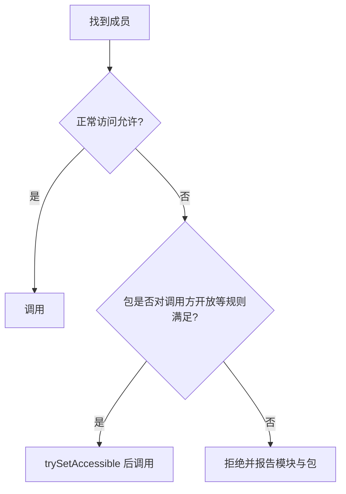

# 反射Reflection原理：从运行时元数据到调用、权限与框架缓存

> **阅读目标**：沿“问题 → 可选方案 → 实现机制 → 代价与边界”理解设计，能用具体交错、调用链或资源生命周期解释结果。配套 [反射Reflection面试](反射Reflection面试.md)。

> **版本口径**：语言与接口契约优先；JDK（Java Development Kit，Java 开发工具包）8、17、21、25 是本文的对照节点，25 为本篇参考版本，并非“最新版本”声明。实现细节不自动成为跨版本保证。

[返回 Java 知识体系导读](../学习路线.md)

## 阅读路线

| 章节 | 核心问题 |
|---|---|
| [1. 反射的作用与可选方案](#p-01) | 反射把编译时写死的类型和成员选择，延迟为运行时查询与调用。 |
| [2. Class 与成员发现](#p-02) | Declared 表示声明范围，public 查询包含继承范围，二者不是可访问权限开关。 |
| [3. 调用、接收者与异常边界](#p-03) | 反射会适配规定的参数转换，业务抛错则经 InvocationTargetException 包装。 |
| [4. 构造、字段与对象不变量](#p-04) | 反射能绕过部分普通调用形式，但不自动保持构造与对象不变量。 |
| [5. 模块、exports 与 opens](#p-05) | 可发现不等于可访问，setAccessible 也不是强封装的通行证。 |
| [6. MethodHandle、Lookup 与 VarHandle](#p-06) | 句柄是带类型与访问能力的调用工具，不能理解成无权限的极速反射。 |
| [7. 性能、缓存与版本](#p-07) | 先分离查询和调用成本，再看优化条件，旧版膨胀阈值不能解释所有新版本。 |
| [8. 框架扫描与可靠性清单](#p-08) | 正确反射框架首先需要清晰的成员解析、访问和生命周期规则。 |
| [9. 精确调用的最小验证](#p-09) | invokeExact 的返回类型也属于调用点描述，表达式上下文会影响匹配。 |
| [10. 从反射扫描到调用计划：一次解析、明确验证、受控复用](#p-10) | 框架应缓存完整且不可变的调用计划，避免每次按名字猜方法，也避免把访问失败藏到业务调用时。 |
| [11. 反射、句柄与字节码的连接：查找能力和调用形态](#p-11) | 反射负责通用发现，句柄组合表达调用图，字节码调用点承载适配与链接；三者不能靠固定性能排名替代分析。 |
| [12. 反射 varargs、转换与虚分派：把查找和执行拆开验证](#p-12) | 逐步推导与反例验证 |

<a id="p-01"></a>
## 1. 反射的作用与可选方案

> 🎯 **核心结论**：反射把编译时写死的类型和成员选择，延迟为运行时查询与调用。

序列化器、依赖注入和插件框架往往只知道类型配置，而不预先知道全部业务类；反射允许统一发现构造器、字段、方法和注解，再调用或赋值。但它增加了运行期失败面，不能把反射当作任意访问与类型安全的替代品。

| 方案 | 优点 | 代价 / 适用边界 |
|---|---|---|
| 普通接口调用 | 静态检查、易优化、明确契约 | 必须提前知道接口 |
| 反射 | 通用元数据与动态调用 | 查询、转换、访问和异常在运行期处理 |
| MethodHandle | 类型化可组合调用句柄 | Lookup 权限与签名适配更复杂 |
| 编译生成 | 把发现与适配移到构建期 | 生成配置、构建时间、动态扩展受限 |


**读图**：每步都可能失败，缓存查询结果只能减少发现开销，不能替代权限校验、输入校验或业务授权。

<a id="p-02"></a>
## 2. Class 与成员发现

> 🎯 **核心结论**：Declared 表示声明范围，public 查询包含继承范围，二者不是可访问权限开关。

| 方法族 | 查找范围 | 需要注意 |
|---|---|---|
| getMethods/getMethod | public 方法，包含继承 | 接口默认方法与覆写关系 |
| getDeclaredMethods/getDeclaredMethod | 当前类声明，含非 public | 不自动包含父类私有方法，不自动开放访问 |
| getFields/getField | public 字段，包含继承 | 字段隐藏与声明类 |
| getDeclaredFields | 当前声明字段 | 不保证业务排序 |
| getConstructors / DeclaredConstructors | 构造器不继承 | public 与全部声明范围不同 |

查找方法按名称及精确参数 Class 匹配，不执行 Java 源码级重载决议：查 int 参数应传 int.class，不能以 Integer.class 查找再期待自动选中；调用阶段才涉及特定拆箱和基本类型拓宽。

Class.forName 默认初始化，类字面量和不初始化的查找有不同语义。反射拿到 Method 不表示已执行目标 static 初始化，但某些实际调用会触发。扫描阶段应避免无必要初始化。

<a id="p-03"></a>
## 3. 调用、接收者与异常边界

> 🎯 **核心结论**：反射会适配规定的参数转换，业务抛错则经 InvocationTargetException 包装。

实例方法的接收者必须是兼容实例；静态方法调用时接收者被忽略，通常传 null 表意清楚。Method.invoke 支持规定的拆箱和拓宽，不会替你做任意字符串转换或基本类型窄化。变长参数在反射层仍是数组参数，不能把任意数量 Object 想当然变成目标 varargs。

```java
var m = String.class.getMethod("substring", int.class);
try {
    System.out.println(m.invoke("java", 1)); // ava
} catch (java.lang.reflect.InvocationTargetException ex) {
    throw new IllegalStateException("target failed", ex.getCause());
}
```

| 失败 | 常见含义 |
|---|---|
| NoSuchMethodException | 成员查询签名或范围不匹配 |
| IllegalAccessException | 当前访问不被允许 |
| IllegalArgumentException | 接收者、数量或参数转换不适配 |
| InvocationTargetException | 目标方法本身抛异常，原始原因在 cause |

**边界**：框架要区分基础设施失败与业务失败；动态代理转发时如果把包装异常原样抛出，可能进一步触发非预期的受检异常包装。

<a id="p-04"></a>
## 4. 构造、字段与对象不变量

> 🎯 **核心结论**：反射能绕过部分普通调用形式，但不自动保持构造与对象不变量。

优先通过 getDeclaredConstructor(...).newInstance(...) 构造，旧 Class.newInstance 已废弃，异常表达也不够清晰。newInstance 仍执行相应构造协议，不是“不经过构造器生成对象”的接口。

Field.set/get 对基本类型有规定转换，写静态字段还可能触发声明类初始化。final 字段不可被理解为普遍可改：静态 final、记录类和隐藏类的 final 等有不可修改限制；即便特定反射写入被允许，也涉及安全发布和优化假设，不能用来做普通动态配置。

**比较**：构造器或工厂可集中校验字段关系；逐字段反射注入可能经历暂时不一致状态。反序列化或对象映射框架应定义构造顺序、必填值、失败清理与发布时机，不要在半构造状态向外暴露对象。

<a id="p-05"></a>
## 5. 模块、exports 与 opens

> 🎯 **核心结论**：可发现不等于可访问，setAccessible 也不是强封装的通行证。

JPMS（Java Platform Module System，Java 平台模块系统）区分模块可读性、包导出与包开放。exports 面向正常公共访问，opens 允许符合条件的深反射。AccessibleObject 能在规则允许时抑制部分语言访问检查，不能任意打开其他模块。



**读图**：trySetAccessible 返回失败可用于受控降级，setAccessible(true) 可能抛 InaccessibleObjectException。给所有模块全量开放会扩大访问面，库设计更适合公开稳定接口、明确开放必要包或生成适配代码。

“反射可绕过 private”要带前提，也不能当业务授权。即使 Java 访问检查允许，用户输入也不应直接决定任意类名、方法名和调用参数。

<a id="p-06"></a>
## 6. MethodHandle、Lookup 与 VarHandle

> 🎯 **核心结论**：句柄是带类型与访问能力的调用工具，不能理解成无权限的极速反射。

MethodHandles.Lookup 在创建相应句柄时执行访问检查，持有高权限 Lookup 或私有句柄等于持有能力，不应随意交给外部插件。privateLookupIn 等操作仍有模块与访问条件，不自动击穿封装。

MethodHandle 的 MethodType 精确描述参数和返回值。invokeExact 要求调用点描述精确一致，连返回类型上下文也会影响；invoke 可按规则适配，asType 显式构造适配。错误可抛 WrongMethodTypeException，而不是自动执行任意强转。

VarHandle 是变量访问与原子操作抽象，提供普通、opaque、acquire/release、volatile 及原子更新等模式。选择弱模式需证明内存顺序；获取字段句柄与正确使用并发模式是两件事。

| 工具 | 核心对象 | 典型用途 |
|---|---|---|
| Reflection | Class/Method/Field 等元数据 | 框架发现、通用调用 |
| MethodHandle | 类型化调用句柄 | 动态语言、适配与热点调用链 |
| VarHandle | 变量访问句柄 | 原子状态与显式内存访问模式 |

<a id="p-07"></a>
## 7. 性能、缓存与版本

> 🎯 **核心结论**：先分离查询和调用成本，再看优化条件，旧版膨胀阈值不能解释所有新版本。

历史核心反射实现常用本地调用后生成访问器的 inflation（膨胀）路径。JDK 18 通过 JEP 416（JDK Enhancement Proposal 416，JDK 增强提案 416）改用方法句柄重实现核心反射，不能再把“调用若干次后生成访问器”当成所有现代反射的统一机制。

性能取决于成员查找是否重复、目标是否稳定、参数装箱、访问检查与 JIT（Just-In-Time Compilation，即时编译）优化。缓存 Method 或句柄有帮助，但“反射一定慢几十倍”与“MethodHandle 必然比反射快”都需实测条件。


**读图**：缓存会改变生命周期。按类名缓存还会混淆多个加载器中的同名类；键应包含真实类型身份。可考虑 ClassValue 或加载器作用域缓存，仍需检查值和其他全局引用，不能仅把键换弱引用就宣称无泄漏。

<a id="p-08"></a>
## 8. 框架扫描与可靠性清单

> 🎯 **核心结论**：正确反射框架首先需要清晰的成员解析、访问和生命周期规则。

扫描实体或服务时，构建“发现→去除或解析桥接→合并声明→验证签名→创建调用器”的过程。桥接方法、合成成员、记录组件、继承覆盖与参数名是否保留都会影响结果；参数名通常需编译器保留，不能默认叫业务名称。

AOT（Ahead-of-Time Compilation，提前编译）/闭世界环境可能要求显式注册反射可达性；普通 JVM 运行成功不保证本地镜像一定保留全部动态元数据。具体限制依工具版本与配置，本文不把某一工具的规则当语言规范。

| 症状 | 先定位 |
|---|---|
| 方法明明存在却查不到 | Declared/public 范围、精确参数、定义加载器 |
| 新 JDK 访问失败 | 模块、opens、库是否使用内部类 |
| 代理层异常变形 | InvocationTargetException 是否解包 |
| 缓存后热部署内存上涨 | Class/Method/句柄保留加载器 |
| 调用耗时高 | 查找、适配、调用和目标业务分别计时 |

**验证路线**：覆盖公有/私有/继承/静态/桥接、基本类型参数、目标抛错、模块拒绝和两个同名加载器类型。重点保证失败诊断清楚，不用一次成功调用证明通用适配正确。

<a id="p-09"></a>
## 9. 精确调用的最小验证

> 🎯 **核心结论**：invokeExact 的返回类型也属于调用点描述，表达式上下文会影响匹配。

```java
var lookup = java.lang.invoke.MethodHandles.publicLookup();
var type = java.lang.invoke.MethodType.methodType(String.class, int.class);
var handle = lookup.findVirtual(String.class, "substring", type);
String suffix = (String) handle.invokeExact("java", 1);
System.out.println(suffix); // ava
// Object wrong = handle.invokeExact("java", 1); // 返回描述变成 Object，不精确匹配
Object adapted = handle.invoke("java", 1);       // 允许规定的适配
```

这是需要置于 throws Throwable 的方法内的调用片段。findVirtual 得到的句柄还把接收者 String 作为首参数，因此完整调用类型是 (String,int)String，而不是只看被查找方法显式声明的 int 参数。

**推演**：直接在 Object 变量上下文用 invokeExact 会请求返回 Object 的调用点，即使真实 String 可赋给 Object，也不符合“精确”。改 invoke 或先 asType 为所需签名才是显式适配；不能靠“Java 平时支持向上转型”解释精确调用。

privateLookupIn 的目标是受规则控制地取得查找能力，而非普遍绕过模块；得到句柄后，也仍应限制外部可调用的方法集合。

<a id="p-10"></a>
## 10. 从反射扫描到调用计划：一次解析、明确验证、受控复用

> 🎯 **核心结论**：框架应缓存完整且不可变的调用计划，避免每次按名字猜方法，也避免把访问失败藏到业务调用时。

### 10.1 调用计划应该包含什么
```text
目标类型身份 + 实际业务方法
精确参数模型 + 泛型上下文 + 注解解析结果
已验证的访问方式 + 参数转换策略
异常还原策略 + 生命周期所属作用域
```

只缓存 `methodName -> Method` 无法区分重载、实现类型和加载器。只把目标换成其运行时 getClass，也可能落到代理生成类型而非预期声明模型。先建立明确的目标类型规则，再定位成员。


**读图**：把复杂失败尽可能提前，不等于启动时执行全部业务方法或初始化全部可选插件。计划建立可按需完成，但第一次失败要给出类型、签名、模块与原因。

### 10.2 参数转换必须有显式规则
字符串 "12" 转 int 是框架转换，不是 Method.invoke 自动承诺；null 不能随意进入基本类型；枚举与时间转换要说明合法值、大小写、时区和错误策略。嵌套泛型的转换需使用已绑定 Type，不能只看 raw Class。

| 检查阶段 | 举例 | 建议失败信息 |
|---|---|---|
| 发现 | 未找到精确重载 | 类型、参数列表、查找范围 |
| 访问 | 模块未开放 | 调用方模块、目标模块与包 |
| 转换 | null 送入 int | 参数位置、目标类型、允许范围 |
| 调用 | 目标抛业务异常 | 保留 cause，区分基础设施包装 |

外部输入不能直接选择任意 Class.forName 和任意方法。需要注册可调用入口、限制转换与资源消耗，再谈权限抑制；Java 可访问不等于业务已授权。

### 10.3 ClassValue 的能力与边界
ClassValue 可把数据关联到实际 Class，适合按类型缓存元数据。computeValue 在竞争下可能被多次求值，最终安装规则不等于“昂贵计算全局绝对一次”；计算应避免不可重复副作用。

与全局 `Map<String,Plan>` 相比，它不会仅凭名字混淆隔离类型，但缓存值仍可能保留其他加载器、注册表与目标实例。若把 Plan 又加入外部永久列表，ClassValue 不能替外部列表完成清理。缓存键、值和外部根应一起分析。

参考：[ClassValue](https://docs.oracle.com/en/java/javase/25/docs/api/java.base/java/lang/ClassValue.html)、[Method](https://docs.oracle.com/en/java/javase/25/docs/api/java.base/java/lang/reflect/Method.html)。

<a id="p-11"></a>
## 11. 反射、句柄与字节码的连接：查找能力和调用形态

> 🎯 **核心结论**：反射负责通用发现，句柄组合表达调用图，字节码调用点承载适配与链接；三者不能靠固定性能排名替代分析。

### 11.1 Method 转 MethodHandle 改变了什么
`lookup.unreflect(method)` 可把已有 Method 转成句柄，但仍受 Lookup 与成员访问规则约束；它不是拿到任意 Method 就自动具有私有访问能力。若 Method 的 accessible 标志已按反射访问规则合法设置，unreflect 有相应的免检路径；取得该标志本身仍不能无条件绕过模块封装。`bindTo(target)` 可绑定接收者，减少调用点显式参数；asType 等适配会构造新的句柄形态。

调用签名越稳定、目标越可预测，运行时越可能优化；若每次换目标、重新查找、不断构造适配链，句柄也会有成本。性能比较应分别测发现、适配、调用与目标业务，避免把缓存后的句柄与每次重新查找的反射作不对等对比。

### 11.2 为什么句柄不是普通 Object... 方法
invoke/invokeExact 是签名多态入口，编译器和虚拟机按实际调用点描述处理。其声明外观不能解释全部调用语义：调用点返回类型、参数基本类型和接收者都会影响匹配。上一章的精确返回示例可用 javap 对照真实描述符。


**读图**：句柄可以是能力对象。把私有方法的可调用句柄暴露给插件，相当于给出了该能力，不能再指望每次调用都按原始插件身份重新做同一套发现授权。

### 11.3 验证模块边界的反例
两个具名模块中，目标包仅 exports 而不 opens：正常公共接口可调用，不代表另一个模块能 trySetAccessible 私有字段。若增加最小范围开放，则只对授权调用域提供所需能力；“把全部模块都开放”会掩盖框架依赖内部实现的问题。

闭世界编译与 AOT（Ahead-of-Time Compilation，提前编译）工具还可能要求登记可达动态入口。使用 MethodHandle 并不天然消除所有动态分析要求，具体工具仍需在目标产物验证。

参考：[Lookup 与访问能力](https://docs.oracle.com/en/java/javase/25/docs/api/java.base/java/lang/invoke/MethodHandles.Lookup.html)、[MethodHandle](https://docs.oracle.com/en/java/javase/25/docs/api/java.base/java/lang/invoke/MethodHandle.html)。

<a id="p-12"></a>
## 12. 反射 varargs、转换与虚分派：把查找和执行拆开验证

> 🎯 **核心问题**：getMethod 找到了方法，为何 invoke 仍可能参数不匹配？拿到父类 Method 是否一定调用父类实现？

### 一、精确查找没有源码重载决议
查找用名称及精确参数 Class，例如 int.class 与 Integer.class 不相同。Java 源码调用时的自动装箱和重载选择，不能全部搬到 getMethod 上。返回类型通常不是 getMethod 参数匹配的选择项，桥接导致的相关返回类型差异应结合声明规则理解。

### 二、invoke 本身也是可变参数入口
目标 `join(String... words)` 的运行期参数是一个 String[]。反射层又接收 Object...，因此调用者要把“一个数组参数”与“反射的参数数组”分开。

```java
public class InvokeArrayDemo {
    public static String join(String... words) { return String.join("/", words); }
    public static void main(String[] args) throws Exception {
        var method = InvokeArrayDemo.class.getMethod("join", String[].class);
        String[] words = {"a", "b"};
        System.out.println(method.invoke(null, (Object) words)); // a/b
    }
}
```

这里 `(Object) words` 让反射参数列表只有一个元素，该元素是 String[]。若直接把数组误作 Object... 展开，反射可能看到多个 String 参数，而目标需要一个数组，于是参数数量不匹配。null 也应明确是“参数数组为 null”还是“一个参数值为 null”。

### 三、允许转换不等于任意转换
Method.invoke 对基本类型执行规定的拆箱与拓宽；Integer 可适配某些更宽基本类型，不代表 Long 可自动窄化为 int。字符串 "123" 转 int 需要框架转换器。返回基本类型会装箱，void 返回 null；这些都是调用适配，不会修复错误的方法定位。

### 四、父类 Method 调用仍可尊重覆写
对于普通虚方法，拿到父类声明的 Method，在子类实例上 invoke 仍可能执行子类覆写。反射表示“找到了哪个声明”与运行时虚分派选择“执行哪个实现”是不同问题。若需要显式父实现语义，要使用符合权限规则的特殊调用机制，而不是指望 getDeclaredMethod 禁用多态。

### 五、异常栈应分三层看
查找失败、参数/访问失败和目标业务异常是不同层。目标异常以 InvocationTargetException 表示，cause 才是业务原因。框架若同时还有代理包装，需逐层还原但保留基础设施上下文，不要把所有 cause 一律剥到最深然后丢掉失败位置。

**验证矩阵**：基本类型与包装类型查找、拓宽与窄化、单数组参数、无参、单 null、父声明对子对象调用，以及目标业务主动抛错。覆盖这些比重复演示一个无参 public 方法更能检验调用器是否可靠。

参考：[Method 调用契约](https://docs.oracle.com/en/java/javase/25/docs/api/java.base/java/lang/reflect/Method.html)。

<a id="p-versions"></a>
## 版本演进与学习边界

| 节点 | 变化 | 注意 |
|---|---|---|
| 7 | 方法句柄进入平台 | 不等于普通反射 API 被删除 |
| 9 | 模块、trySetAccessible、VarHandle 等 | 访问与内存模式更需明确 |
| 17 | 强封装限制更常遇到 | 旧内部访问技巧不可靠 |
| 18 | JEP 416 用方法句柄重实现核心反射 | 旧膨胀阈值不通用 |
| 21 / 25 | 本篇常规现代反射参考范围 | final、模块与生成代码边界继续核对 |

性能结论不由版本号独自决定，运行形态、调用稳定性和目标业务常常更重要。

<a id="p-references"></a>
## 参考资料与源码入口

- [Method](https://docs.oracle.com/en/java/javase/25/docs/api/java.base/java/lang/reflect/Method.html)、[AccessibleObject](https://docs.oracle.com/en/java/javase/25/docs/api/java.base/java/lang/reflect/AccessibleObject.html)
- [MethodHandle](https://docs.oracle.com/en/java/javase/25/docs/api/java.base/java/lang/invoke/MethodHandle.html)、[Lookup](https://docs.oracle.com/en/java/javase/25/docs/api/java.base/java/lang/invoke/MethodHandles.Lookup.html)、[VarHandle](https://docs.oracle.com/en/java/javase/25/docs/api/java.base/java/lang/invoke/VarHandle.html)
- [JDK 18 重要变化：JEP 416](https://docs.oracle.com/en/java/javase/18/migrate/significant-changes-jdk-release.html)
- [ClassValue](https://docs.oracle.com/en/java/javase/25/docs/api/java.base/java/lang/ClassValue.html)

<a id="p-glossary"></a>
## 附录：术语与缩写

| 术语 | 英文全称 | 中文含义 |
|---|---|---|
| JDK | Java Development Kit | Java 开发工具包 |
| JVM | Java Virtual Machine | Java 虚拟机 |
| API | Application Programming Interface | 应用程序编程接口 |
| JPMS | Java Platform Module System | Java 平台模块系统 |
| JEP | JDK Enhancement Proposal | JDK 增强提案 |
| JIT | Just-In-Time Compilation | 即时编译 |
| AOT | Ahead-of-Time Compilation | 提前编译 |
| Lookup | MethodHandles.Lookup | 带访问能力的句柄查找对象 |
| Inflation | Reflection Inflation | 历史反射访问器膨胀机制 |
