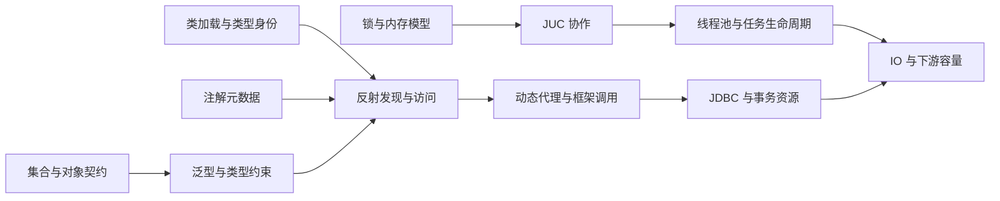

# Java 核心知识体系

> **阅读方式**：每个主题提供原理篇与面试篇。原理篇先解释设计问题，再比较实现与代价；面试篇用于结论表达和失败场景推演。术语附录放在各文档最后。

## 按本轮整理顺序阅读

| 顺序 | 主题 | 原理 | 面试 | 主线 |
|---|---|---|---|---|
| 1 | 集合框架 | [原理](1-1-3-集合框架/集合框架原理.md) | [面试](1-1-3-集合框架/集合框架面试.md) | 契约与复杂度、哈希与树、集合视图、并发容器 |
| 2 | 锁机制 | [原理](1-1-4-锁机制/锁机制原理.md) | [面试](1-1-4-锁机制/锁机制面试.md) | 内存模型、监视器、AQS、条件等待与乐观重试 |
| 3 | 线程池 | [原理](1-1-5-线程池/线程池原理.md) | [面试](1-1-5-线程池/线程池面试.md) | 接纳算法、容量、拒绝、取消、关闭与虚拟线程 |
| 4 | 类加载机制 | [原理](1-1-6-类加载机制/类加载机制原理.md) | [面试](1-1-6-类加载机制/类加载机制面试.md) | 加载链接初始化、类型身份、委派、SPI 与卸载 |
| 5 | 注解Annotation | [原理](1-1-7-注解Annotation/注解Annotation原理.md) | [面试](1-1-7-注解Annotation/注解Annotation面试.md) | 元数据、继承与重复、编译处理、运行时消费者 |
| 6 | 泛型Generics | [原理](1-1-8-泛型Generics/泛型Generics原理.md) | [面试](1-1-8-泛型Generics/泛型Generics面试.md) | 类型关系、PECS、擦除桥接、堆污染与类型令牌 |
| 7 | 反射Reflection | [原理](1-1-9-反射Reflection/反射Reflection原理.md) | [面试](1-1-9-反射Reflection/反射Reflection面试.md) | 成员解析、调用适配、模块、句柄与缓存生命周期 |
| 8 | 动态代理 | [原理](1-1-10-动态代理/动态代理原理.md) | [面试](1-1-10-动态代理/动态代理面试.md) | 接口与子类代理、异常、自调用、拦截链与身份 |
| 9 | JUC | [原理](1-1-11-JUC/JUC原理.md) | [面试](1-1-11-JUC/JUC面试.md) | 原子变量、同步器、异步组合与上下文作用域 |
| 10 | JDBC | [原理](1-1-12-JDBC/JDBC原理.md) | [面试](1-1-12-JDBC/JDBC面试.md) | 连接、绑定、事务、游标、批量与提交不确定性 |
| 11 | IO | [原理](1-1-13-IO/IO原理.md) | [面试](1-1-13-IO/IO面试.md) | 编码、缓冲、多路复用、异步、零拷贝与持久化 |

## 本轮深入阅读

每个主题继续增加两个机制章节，并配套四道追问。保留原有章节与稳定链接，可先读原理主线，再进入下面的具体实现和失败案例。

| 主题 | 深入机制 | 竞争、实验与恢复 |
|---|---|---|
| 集合框架 | [协助扩容与新旧表读写](1-1-3-集合框架/集合框架原理.md#c-19) | [跳表与非阻塞队列](1-1-3-集合框架/集合框架原理.md#c-20) |
| 锁机制 | [发布链、屏障与伪共享](1-1-4-锁机制/锁机制原理.md#p-12) | [Condition 双队列与取消竞争](1-1-4-锁机制/锁机制原理.md#p-13) |
| 线程池 | [工作窃取与计算粒度](1-1-5-线程池/线程池原理.md#p-12) | [总期限与跨池资源依赖](1-1-5-线程池/线程池原理.md#p-13) |
| 类加载机制 | [类文件、分派与 Lambda 链接](1-1-6-类加载机制/类加载机制原理.md#p-09) | [类型隔离实验](1-1-6-类加载机制/类加载机制原理.md#p-10) |
| 注解Annotation | [完整编译期生成器](1-1-7-注解Annotation/注解Annotation原理.md#p-09) | [注解合并与方法解析](1-1-7-注解Annotation/注解Annotation原理.md#p-10) |
| 泛型Generics | [多层类型替换](1-1-8-泛型Generics/泛型Generics原理.md#p-10) | [桥接与污染失败定位](1-1-8-泛型Generics/泛型Generics原理.md#p-11) |
| 反射Reflection | [调用计划与缓存](1-1-9-反射Reflection/反射Reflection原理.md#p-10) | [句柄、调用点与访问能力](1-1-9-反射Reflection/反射Reflection原理.md#p-11) |
| 动态代理 | [可运行增强链](1-1-10-动态代理/动态代理原理.md#p-10) | [重叠接口与异步生命周期](1-1-10-动态代理/动态代理原理.md#p-11) |
| JUC | [FutureTask 状态竞争](1-1-11-JUC/JUC原理.md#p-13) | [CompletableFuture 依赖传播](1-1-11-JUC/JUC原理.md#p-14) |
| JDBC | [连接池借还与失效淘汰](1-1-12-JDBC/JDBC原理.md#p-11) | [事务重试与未知提交恢复](1-1-12-JDBC/JDBC原理.md#p-12) |
| IO | [完整帧解码器](1-1-13-IO/IO原理.md#p-13) | [写背压与关闭状态机](1-1-13-IO/IO原理.md#p-14) |

**示例验证边界**：可运行案例以本机 JDK 21 验证；源码分析明确引用 OpenJDK 25 或所标注框架标签。JDBC 提交断线、真实连接池回收与平台 IO 行为仍需在相应环境做集成验证，文中的状态图与伪代码用于解释协议。

## 把主题串起来

**读图**：图表示知识依赖，不代表所有 API 都必须用到右侧全部机制。学习时可以先按表中顺序，也可沿一条调用链交叉复习。

## 容易混淆的分工

| 交叉主题 | 分工 |
|---|---|
| 集合 / JUC | 集合篇解释结构、顺序和每次操作；JUC 篇解释协作、交接与完成 |
| 锁 / JUC / 线程池 | 锁篇解释互斥与等待；JUC 篇解释同步器与异步依赖；线程池篇解释资源接纳和生命周期 |
| 类加载 / 泛型 / 反射 | 分别回答类型来自哪里、静态约束如何表达、运行期怎样发现与调用 |
| 注解 / 动态代理 | 前者声明元数据，后者可以是消费者建立执行入口的一种实现 |
| JDBC / IO | JDBC 聚焦数据库协议和事务连接，IO 聚焦字节、等待、缓冲与完成 |

## 版本阅读规则

本文档组对照 JDK（Java Development Kit，Java 开发工具包）8、17、21、25，并在重要变化处细化到 9、15、18、19、22、23、24 等节点。**25 是参考版本，不代表任何环境都应机械升级到该版本。**

- 语言/接口规范回答“能依赖什么”，指定版本源码回答“当时怎样实现”。
- 正式特性与预览接口分开：虚拟线程在 21 正式提供，ScopedValue 在 25 正式提供，25 的结构化并发仍为预览。
- 驱动、框架、操作系统与数据库版本会进一步影响行为，尤其是 JDBC 游标、代理选择与 IO 传输路径。

原有平铺文件保留为入口；新的主体内容按编号目录组织，避免相同主题维护两套互相矛盾的正文。
