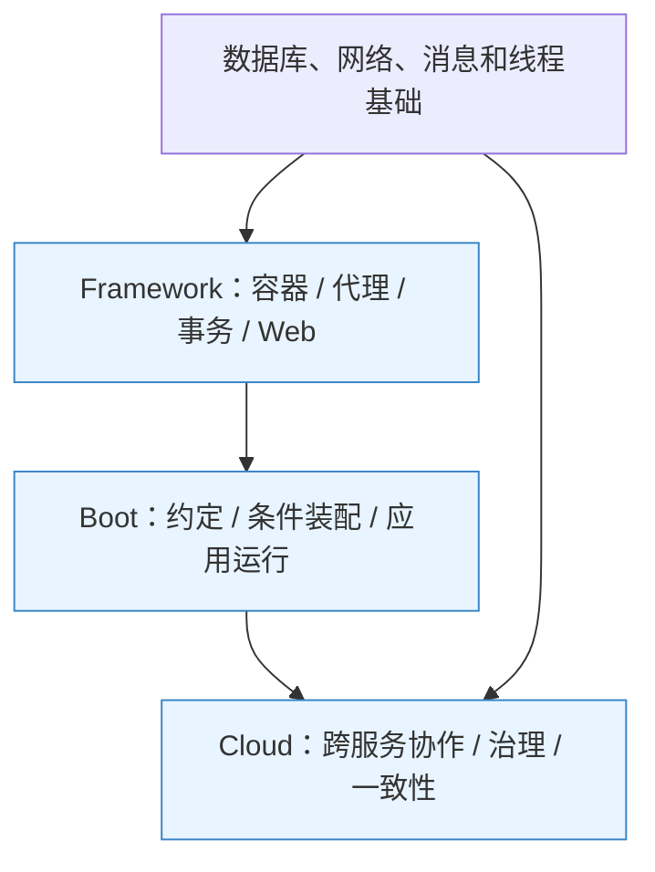

# Spring 学习路线：Framework、Boot、Cloud

> **三类各自成体系，每类分原理与面试两篇。** 原理讲设计动机、机制、方案对比和故障边界；面试用“一句话结论 → 机制 → 取舍 → 追问推演”训练表达。
>
> 图解用于解释对象、调用、资源和状态变化；配置与代码仅在帮助理解时使用，本文档组聚焦知识体系。

## 1. 三类内容分别回答什么

| 类别 | 核心问题 | 原理篇 | 面试篇 |
|---|---|---|---|
| Spring Framework | 一个进程内，对象、代理、事务与请求怎样工作？ | [Spring 原理](chapter_01_SpringFramework/Spring原理.md) | [Spring 面试](chapter_01_SpringFramework/Spring面试.md) |
| Spring Boot | 一个应用怎样基于输入条件自动装配、启动并运行？ | [Spring Boot 原理](chapter_02_SpringBoot/SpringBoot原理.md) | [Spring Boot 面试](chapter_02_SpringBoot/SpringBoot面试.md) |
| Spring Cloud | 调用跨进程后，如何发现、治理、观测和恢复？ | [Spring Cloud 原理](chapter_03_SpringCloud/SpringCloud原理.md) | [Spring Cloud 面试](chapter_03_SpringCloud/SpringCloud面试.md) |

**读图**：这是知识依赖关系，不表示每个应用都需要全部三层。Boot 不替换 Framework，Cloud 也不会替应用自动完成所有一致性设计。

## 2. 推荐阅读顺序

1. **先懂对象与调用**：容器定义、生命周期、作用域、循环依赖、代理、自调用。
2. **再懂资源与请求**：事务管理、传播、事件、异步、缓存、MVC、WebFlux 与安全链。
3. **解释自动装配**：Starter、依赖管理、条件、退让、启动阶段与配置来源。
4. **理解运行机制**：Web 服务器、就绪、关闭、观测、容量、测试、AOT 与版本升级。
5. **最后跨进程推演**：发现、均衡、超时、幂等、韧性、网关、配置、消息与业务状态恢复。

第一次阅读可按顺序走原理；第二次直接回答面试题，遇到讲不清的地方跳回对应锚点。不要把面试篇只当结论清单，追问中的前提同样重要。

## 3. 用一笔订单串起三类知识

| 现象 | 首先分析哪层 | 需要继续验证的边界 |
|---|---|---|
| OrderService 注入失败 | Framework 定义与依赖解析；Boot 条件装配 | 组件是否扫描、定义为何退让、候选如何选择 |
| 自调用事务失效 | Framework 代理 | 方法是否能增强、是否经过代理、实际资源是否受管 |
| 数据源自动出现 | Boot 自动配置 | 类路径、属性、用户定义和条件报告 |
| 端口启动但仍未就绪 | Boot 启动阶段 | Runner、预热、可用性状态与入口流量控制 |
| 库存调用超时 | Cloud 调用治理 | 对端可能已完成，预算、幂等与结果查询必须结合 |
| 数据库提交但通知丢失 | Framework 事件边界 + Cloud 一致性 | 持久化事件意图、重投与消费幂等 |
| 服务重启后仍收到请求 | Boot 关闭 + Cloud 发现与均衡 | 摘流、缓存传播、在途请求与恢复协议 |

## 4. 版本学习口径

| 层次 | 机制学习参照 | 演进对照 |
|---|---|---|
| Framework | 6.2 | 5.3 存量差异、7.x 新基线与能力 |
| Boot | 3.5 | 2.7 存量差异、4.x 模块与依赖变化 |
| Cloud | 2025.0 对 Boot 3.5 的组合 | 2025.1 对 Boot 4.x 的配套关系 |

这些是**学习坐标**。兼容、当前维护状态与项目升级选择是不同问题；版本细节及官方来源见各原理篇。涉及默认行为时，同时说明框架版本、实际实现与是否被项目覆盖。

## 5. 整理约定

- **先解释为什么**：比较手工创建与容器、代理与编织、阻塞与非阻塞、本地事务与业务协议。
- **把前提说完整**：不把“单例”当线程安全，不把“超时”当对端失败，不把“自动配置”当业务正确。
- **突出重点与误区**：章节结论、对比表和故障推演配合阅读。
- **缩写正文展开，术语表放文末**：重要机制不要求读者先记住一张缩写表。
- **以官方资料核对版本**：正文给出解释，参考资料用于进一步查证。
