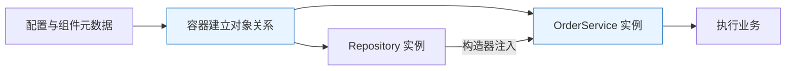
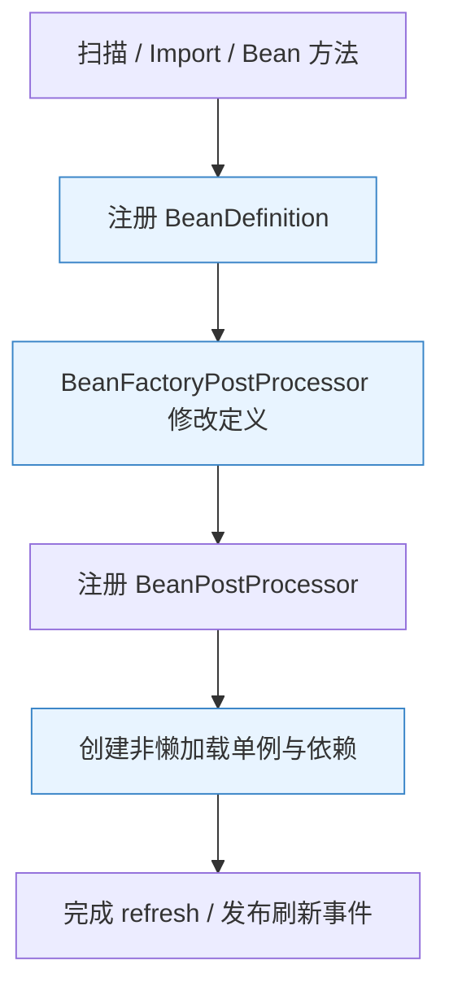
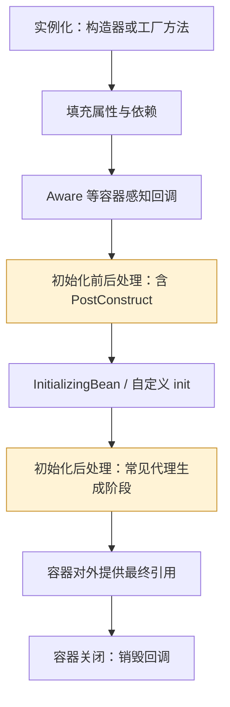
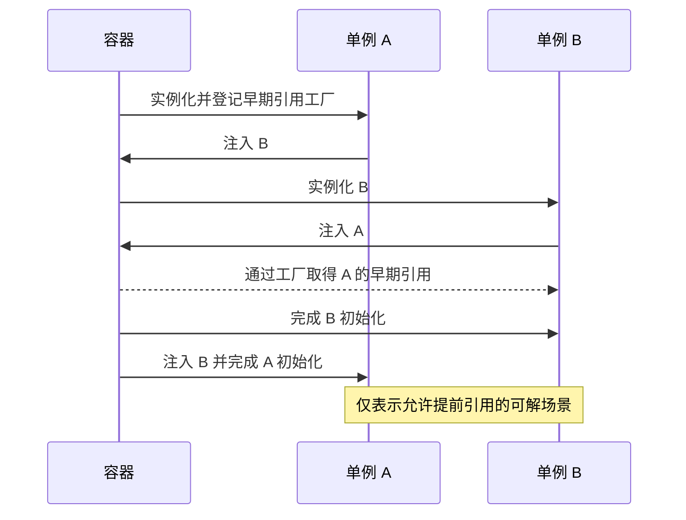
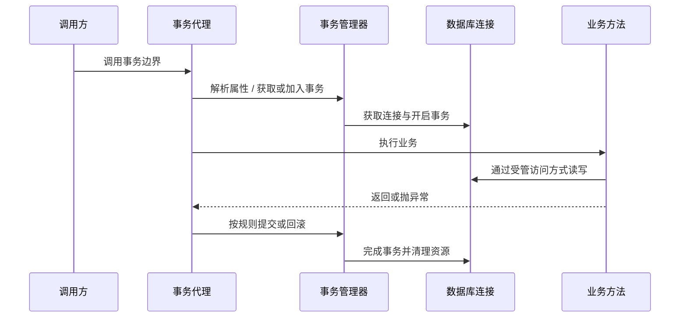
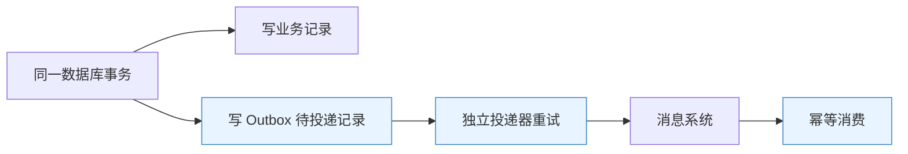
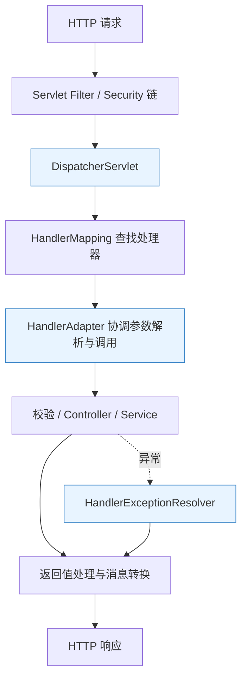
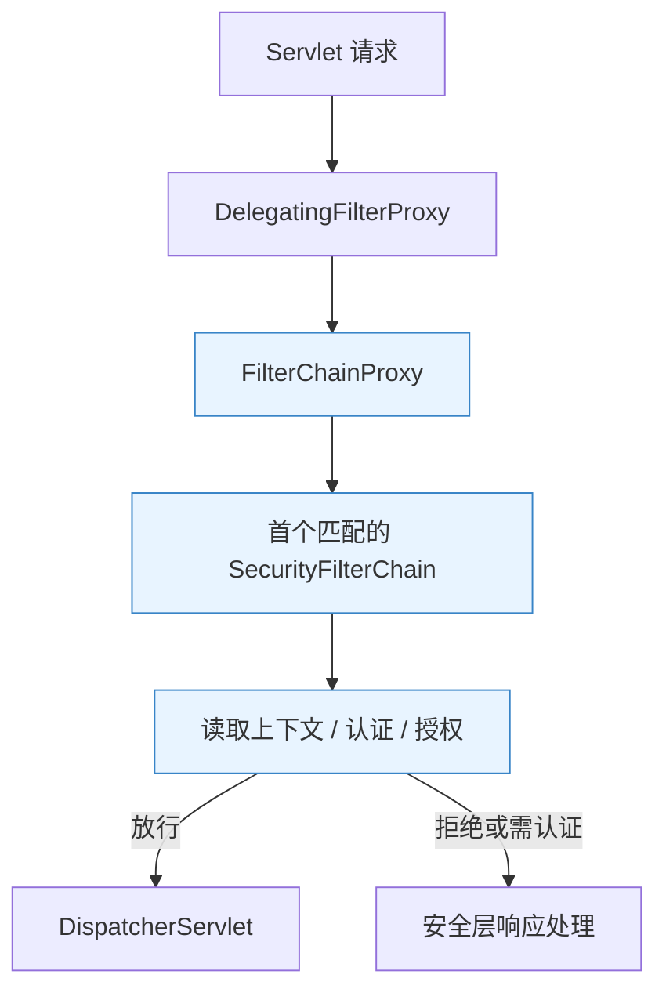

# Spring Framework 原理：从对象管理到应用边界

> **阅读定位**：理解容器为什么存在、代理怎样改变调用、事务为什么有边界。以 Framework 6.2 为主要机制基线，单独说明 7.x 的变化。搭配 [Spring 面试](Spring面试.md) 复述与推演。
>
> **主线**：对象关系 → 容器生命周期 → 代理增强 → 事务资源 → 请求与线程模型。Spring Boot 和 Spring Cloud 分别在此基础上解决应用装配与分布式治理。

## 阅读导航

| 主题 | 先回答的问题 | 章节 |
|---|---|---|
| 容器 | 为什么不直接 new？对象如何成为 Bean？ | [1](#sf-01)、[2](#sf-02)、[3](#sf-03) |
| 对象边界 | 单例是否安全？循环依赖为什么有时能解决？ | [4](#sf-04)、[5](#sf-05) |
| 代理与事务 | 注解为什么失效？回滚为什么超出预期？ | [6](#sf-06)、[7](#sf-07)、[8](#sf-08) |
| 应用模型 | 事件、异步、Web 请求到底在哪执行？ | [9](#sf-09)、[10](#sf-10)、[11](#sf-11) |
| 工程判断 | 怎样验证真实行为？版本升级改变什么？ | [12](#sf-12)、[13](#sf-13) |
| 安全边界 | 请求过滤链怎样建立身份与权限？ | [14](#sf-14) |

## 1. 从手工组装到 IoC：控制权究竟交给了谁

> 🎯 **核心结论**：IoC（Inversion of Control，控制反转）把对象创建、依赖装配和生命周期协调交给容器；DI（Dependency Injection，依赖注入）是实现这种控制反转的重要方式。

### 1.1 问题起点：业务逻辑和对象组装混在一起

订单服务直接 `new JdbcOrderRepository()`，意味着它同时决定业务、数据库实现和依赖构造方式。测试要替换仓储，就不得不修改业务类，或启动真实数据库。把依赖通过构造器传入后，调用方负责组装，业务类只依赖契约。

**DI 不要求使用 Spring**。手写工厂同样可以注入对象；容器的价值在于统一处理复杂对象图、配置条件、作用域、资源释放和横切扩展。

**读图**：容器负责把可替换的实现交给服务，业务运行时仍然是普通 Java 方法调用；并非每次调用都向容器查询依赖。

### 1.2 三种注入方式为什么不等价

| 方式 | 优点 | 代价与适用边界 |
|---|---|---|
| 构造器注入 | 必需依赖显式、可用 final、容易脱离容器测试 | 参数过多往往暴露职责过大；构造器环无法靠提前暴露对象解决 |
| Setter 注入 | 适合确实可选、允许后续设置的依赖 | 对象可能经历依赖不完整阶段，必须约束使用时机 |
| 字段注入 | 写法简短 | 隐藏必需依赖，普通构造难以建立有效对象，测试常需反射或容器 |

单个构造器通常不必写 `@Autowired`。多候选 Bean 先按类型形成候选集，再结合限定符、主候选等规则消歧；不要把“字段名等于 Bean 名”当作所有版本、所有注入场景的第一原则。

### 1.3 BeanFactory 与 ApplicationContext

`BeanFactory` 提供对象获取与基本管理契约；`ApplicationContext` 在其上整合事件、资源、国际化以及扩展器的自动发现。两者不是两个互不相关的容器产品。

**取舍**：手工组装对小型程序更直观；大型应用使用容器降低重复装配成本，但对象来源和条件变得间接，必须能通过 Bean 定义、依赖图和启动报告追踪实际装配结果。

## 2. BeanDefinition 与 refresh：从描述到实例

> 🎯 **核心结论**：容器先建立“怎样创建对象”的定义，再按生命周期生成实例；BeanDefinition 不是 Bean 本身。

### 2.1 定义包含什么

BeanDefinition 描述类型或工厂方法、作用域、依赖、初始化策略等。组件扫描、配置类、`@Import` 和程序化注册，最终都汇入定义体系。名字只是注册与查找标识，不能代替类型、限定符和作用域分析。

**读图**：这是 `refresh()` 的主干简化，不是全部源码步骤。注册处理器本身也可能需要创建对象；Web 容器、监听器、消息源等扩展点分布在不同阶段。

### 2.2 两类扩展点分别能改什么

| 扩展点 | 主要处理对象 | 典型用途 | 常见误用 |
|---|---|---|---|
| BeanDefinitionRegistryPostProcessor | 定义注册表 | 继续注册定义，例如配置类解析 | 把注册过程当作业务运行阶段 |
| BeanFactoryPostProcessor | Bean 定义与工厂元数据 | 修改属性值、处理定义 | 过早 getBean，导致对象提前创建 |
| BeanPostProcessor | Bean 实例创建过程 | 注入、生命周期回调、代理增强 | 以为所有处理都只发生在初始化之后 |

创建过早的对象可能错过尚未就绪的后处理器。诊断“为什么这个 Bean 没代理”时，应检查创建时机与依赖链，而不只检查切点表达式。

### 2.3 配置类的方法调用为何特殊

完整 `@Configuration` 默认通过子类增强拦截 `@Bean` 方法间调用，把调用导向容器中的对象。`proxyBeanMethods=false` 或普通组件中的 `@Bean` 属于不同语义：**直接 Java 方法调用不会自动变成容器查找**。

更清晰的写法是通过 `@Bean` 方法参数表达依赖。这样即使关闭配置类代理，也不必依赖方法间拦截，且更适合提前分析对象关系。

### 2.4 FactoryBean 不是 BeanFactory

`FactoryBean<T>` 是“由一个受管工厂提供产品对象”的扩展接口。通常用名字获取的是产品，`&名字` 获取工厂本身。它适合代理客户端、复杂第三方对象等创建逻辑；产品是否单例由工厂契约与实现决定，不能简单等同工厂自身作用域。

## 3. Bean 生命周期：初始化完成不代表所有能力都可用了

> 🎯 **核心结论**：实例化、依赖注入、初始化、代理暴露、销毁是不同阶段。生命周期回调应做本对象的准备，跨组件业务应选择更明确的就绪边界。

**读图**：部分感知和初始化注解由专用后处理器触发，图中按职责归类。代理也可能在更早的特殊路径产生，例如循环依赖中的早期引用，因此不要把图理解为每类 Bean 都逐步执行同一套固定代码。

### 3.1 为什么不在构造器里访问所有依赖

构造器注入完成后才获得有效依赖；字段注入此时尚未发生。即使自己的字段齐全，其他对象、代理、事务基础设施和整个上下文也可能未完成。构造器适合建立不变量，不适合启动后台线程、执行数据库迁移或长时间远程调用。

`@PostConstruct` 用于注入后的本地初始化，不应假设“调用自己的事务方法”就能走最终代理。需要整体单例就绪可考虑 `SmartInitializingSingleton`；需要协调启动与停止可考虑 `SmartLifecycle`；Boot 中应用任务还要区分 Runner 与 Ready 事件。

### 3.2 销毁的责任边界

容器可管理单例的 `@PreDestroy`、`DisposableBean` 和自定义销毁方法。**prototype 创建后通常交给调用者，容器不会完整跟踪其销毁**。应用应明确线程池、连接、文件与订阅由谁关闭。

依赖方通常先停止，再释放被依赖资源；有持续消费与后台任务时，还要协调“停止接单 → 等待处理 → 关闭连接”。进程被强制终止时，任何销毁回调都不能当作可靠消息协议。

## 4. 作用域、线程安全与依赖解析

> 🎯 **核心结论**：singleton 表示同一容器内同一 Bean 定义共享对象，不表示线程安全，也不表示整个进程只有一个对象。

### 4.1 单例为什么常见

无状态服务可共享依赖与代理，降低重复创建成本。请求数据放入方法局部变量或显式上下文，避免写入共享字段。JVM（Java Virtual Machine，Java 虚拟机）内的对象引用共享，不会因为加上 `@Service` 自动获得锁或请求隔离。

| 作用域 | 共享范围 | 需要特别考虑 |
|---|---|---|
| singleton | 一个容器中的一个定义 | 可变字段的并发、父子容器、代理引用 |
| prototype | 每次容器获取产生新实例 | 注入单例时只解析一次、调用方负责释放 |
| request | 一次 Web 请求 | 无请求上下文的后台线程不能直接使用 |
| session | 一次 HTTP（Hypertext Transfer Protocol，超文本传输协议）会话 | 并发请求、会话复制与内存成本 |

### 4.2 单例注入 prototype 为什么没变成每次一个

依赖注入发生在创建单例时，而不是每次业务方法执行时。若希望每次使用时获取，可使用 `ObjectProvider<T>`、查找方法或作用域代理，并明确“获取一次”的业务边界。

**作用域代理**保持外层引用稳定，在调用时定位当前作用域目标。它解决依赖作用域不匹配，不解决目标对象自身的线程安全。

### 4.3 多候选注入与可选依赖

`@Qualifier` 表达用途筛选，`@Primary` 指定优先候选；Framework 6.2 的 `@Fallback` 可把某些候选标记为后备。集合注入意味着保留多个策略，不能用主候选语义替代排序与业务选择。

`ObjectProvider` 允许延迟、可选和多实例查询。滥用它会让依赖图隐藏在业务执行中，错误由启动期推迟到运行期。必需依赖优先构造器；确实动态、可选的能力再选择延迟获取。

## 5. 循环依赖与三级缓存：为何不是简单缓存三份对象

> 🎯 **核心结论**：三级缓存帮助部分单例依赖环在创建期间获得一致的早期引用，尤其协调代理；它不能解决所有环，更不证明对象在提前暴露时已经可用。

### 5.1 三个缓存存什么

| 名称 | 内容 | 所处阶段 |
|---|---|---|
| singletonObjects | 最终单例引用 | 完成创建后 |
| earlySingletonObjects | 已生成的早期引用 | 创建中且被依赖方提前请求 |
| singletonFactories | 用于生成早期引用的对象工厂 | 已实例化、尚未完全初始化 |

第三层存的是**工厂回调**，可能通过 `getEarlyBeanReference` 返回代理引用；不是“所有未初始化 Bean 的原始对象列表”。第二层可复用首次生成的早期引用，避免重复生成不同代理。

**读图**：A 必须先完成实例化，才能提前提供引用。若 A 构造器必须等待 B，B 构造器又等待 A，连第一个可暴露的 A 都不存在。

### 5.2 哪些场景不能照搬这套解释

- 构造器环：通常直接失败，不能靠这三个缓存凭空生成未构造对象。
- prototype 环：不走同样的单例缓存解决路径。
- 提前调用方法：对象依赖与初始化可能未完成，即使注入成功也可能业务失败。
- 自定义包装与代理不一致：注入了原始对象，最终暴露的却是另一个包装对象，可能报错或产生语义分裂。

Spring Framework 的能力与 Spring Boot 的默认策略必须分开：**Boot 自 2.6 起默认禁止循环引用**，把允许开关打开也无法解决上述所有场景。优先通过拆职责、引入第三个协调服务或事件解环；`@Lazy` 只是延迟目标解析，不能消除业务上的互相依赖。

### 5.3 源码阅读入口

从 `AbstractApplicationContext.refresh()` 进入整体流程；沿 `AbstractBeanFactory.doGetBean()`、`AbstractAutowireCapableBeanFactory.doCreateBean()` 追踪创建；在 `DefaultSingletonBeanRegistry` 观察缓存和创建状态。阅读 `AbstractAutoProxyCreator` 的早期引用与初始化后包装，才能把三级缓存和代理联系起来。

## 6. AOP：为什么增强发生在调用边界

> 🎯 **核心结论**：Spring AOP（Aspect-Oriented Programming，面向切面编程）的常用模式是代理。只有经过代理并匹配规则的调用，才进入增强链。

### 6.1 从重复代码到拦截器链

事务、审计、指标写在每个业务方法内会散落重复逻辑；基类容易限制继承与组合。代理把这些职责组合为拦截器链，业务对象保持较小，但调用路径变得重要。

**读图**：`this.inner()` 没有重新进入左侧代理，因此目标方法上另一个事务、异步或缓存注解可能不生效。方法有注解和调用经过拦截是两个条件。

### 6.2 JDK 代理与 CGLIB 的实质差别

| 方式 | 如何形成代理 | 适合与限制 |
|---|---|---|
| JDK（Java Development Kit，Java 开发工具包）动态代理 | 生成实现接口的代理类 | 按接口暴露能力；调用方不能把代理随意强转成实现类 |
| CGLIB（Code Generation Library，代码生成库）类代理 | 生成目标类子类 | 可代理类方法；final 类无法继承，final/private 方法无法按通常覆盖方式增强 |
| AspectJ 编织 | 修改字节码中的连接点 | 可覆盖更广调用点；引入编译期或加载期工具与治理成本 |

Framework 与 Boot 的默认代理选择可能不同。**是否有接口只是判断条件之一，还要看代理配置**；不要背“有接口必定 JDK”。类代理也不会自动解决 self-invocation（自调用）。

### 6.3 顺序与异常如何改变业务

环绕增强通过 `proceed()` 向下执行；未调用会短路，多次调用可能重复执行业务。外层增强先进入、最后退出。若重试包住事务，每次尝试可以拥有新事务；若事务包住重试，多次尝试可能共用已经被标记回滚的事务。必须核对实际 Advisor 顺序。

吞掉异常会改变事务拦截器看到的结果；记录日志后返回正常值，可能让数据库提交。增强应保留业务异常语义，降级返回也必须明确“失败、兜底还是成功”。

## 7. 声明式事务：注解背后是资源协调

> 🎯 **核心结论**：`@Transactional` 描述事务属性，拦截器结合事务管理器取得、绑定和结束资源；真正的隔离与持久化能力仍由数据库等资源提供。

### 7.1 一次事务方法经历什么

**读图**：图示是本地数据库新事务的典型路径。加入已有事务时不一定新取连接，也不一定由当前方法真正提交。

命令式事务通常通过线程关联资源，使同一线程中的受管数据访问复用连接。直接另建连接、跨线程任务、另一个数据源，不会因为外面存在注解就自动加入同一事务。R2DBC（Reactive Relational Database Connectivity，响应式关系数据库连接）等响应式事务使用 Reactor Context 传递资源，不能照搬 ThreadLocal（线程局部变量）模型。

### 7.2 回滚规则的精确表达

传统默认是未检查异常 `RuntimeException` 和 `Error` 触发回滚，受检异常默认不回滚；可用 `rollbackFor` 等规则覆盖。Framework 6.2 还可在事务管理配置层选择对所有异常回滚，**回答时要说明项目策略，而非只背默认值**。

| 现象 | 原因 | 处理思路 |
|---|---|---|
| 自调用方法注解没效果 | 未经过事务代理 | 把边界放到独立服务，或使用编程式事务 |
| catch 后正常返回仍提交 | 拦截器未看到触发回滚的异常 | 重抛、显式标记回滚，或重新设计错误协议 |
| 异步任务不受外层回滚影响 | 线程/资源边界分离 | 在任务内建立独立事务，明确一致性协议 |
| 方法返回后才报提交异常 | 提交发生在代理退出阶段 | 调用方必须处理最终提交结果 |

### 7.3 可见性、只读与隔离

“事务只能标 public”过于绝对：Framework 6 起类代理默认还可支持 protected、包可见方法，接口代理要求公开接口方法。**对外 public 服务边界最清晰**；private/final、自调用等还要同时检查代理限制。初始化阶段调用也不能假定经过代理。

`readOnly=true` 是对事务系统与资源的提示，可能影响刷新或驱动优化，不是防止所有写入的授权机制。隔离级别是新事务创建时的重要属性；加入已有事务不会自然建立另一套隔离。需要检查事务管理器的验证策略以及数据库实际支持。

## 8. 传播行为：逻辑事务和物理事务要分开

> 🎯 **核心结论**：传播行为决定方法如何参与事务；多个逻辑边界可能共享同一个物理事务，也可能占用多条连接。

| 行为 | 已有事务时 | 无事务时 | 关键代价 |
|---|---|---|---|
| REQUIRED | 加入当前事务 | 新建 | 内层回滚标记可影响外层 |
| REQUIRES_NEW | 挂起外层，独立新建 | 新建 | 通常额外占连接；独立提交造成业务分叉 |
| NESTED | 支持时创建保存点 | 新建 | 依赖管理器与资源支持，不等于独立提交 |
| SUPPORTS | 加入 | 非事务执行 | 行为取决于调用环境 |
| NOT_SUPPORTED | 挂起后非事务执行 | 非事务执行 | 与外层缺少原子性 |
| MANDATORY | 加入 | 报错 | 强制调用方先建立事务 |
| NEVER | 报错 | 非事务执行 | 明确拒绝已有事务 |

### 8.1 为什么捕获内层异常后还会 UnexpectedRollbackException

外层 REQUIRED 调用另一个代理上的 REQUIRED 方法，内层异常触发回滚标记。外层捕获异常不代表清除了共享事务的 rollback-only 状态；最终尝试提交时仍必须回滚，并可能抛出 `UnexpectedRollbackException`，防止调用方误认为已经提交。

**推演前提**：内层调用确实经过代理，且异常命中回滚规则。若只是同对象内部普通调用，则不能直接套用相同的拦截过程。

### 8.2 为什么 REQUIRES_NEW 会把连接池耗尽

N 个并发请求各持有外层连接，再全部等待内层新连接；若连接池没有余量，可能全体等待直到超时。把连接池调大只是缓冲，还应缩小事务跨度、避免事务内远程等待，或改变审计与消息交付方式。

### 8.3 NESTED 与独立事务的区别

保存点回滚可以撤销内层一部分修改，但外层整体回滚仍会撤销这些修改。独立事务已经提交的内容不会随外层回滚。JDBC（Java Database Connectivity，Java 数据库连接）事务管理器较常见保存点支持；JPA（Java Persistence API，Java 持久化 API）等场景需逐项检查，不能由数据库支持保存点推导所有事务管理器都支持。

**选型**：需要整个业务原子完成，用一个清晰的事务；需要失败也持久化审计，应明确独立提交后果；需要跨数据库或消息系统一致性，转向可靠事件、补偿或分布式事务协议。

## 9. 事件、异步与缓存：解耦不等于可靠交付

> 🎯 **核心结论**：进程内事件降低直接依赖；异步改变执行线程；缓存改变读写路径。三者都要重新检查异常、上下文和一致性。

### 9.1 普通事件与事务事件

默认事件广播通常同步执行，监听器耗时计入发布方，异常也可能影响发布调用；自定义广播器或异步监听会改变这些语义。普通 `publishEvent` 不提供磁盘持久化和故障重放。

`@TransactionalEventListener` 默认绑定提交后阶段，适合“事务成功后才触发”的进程内协调；没有事务时默认不执行，除非启用 fallback。**提交数据库和执行监听器之间仍有进程故障窗口**。提交后需要新数据库写入时，应明确开启新事务，而不是假设旧事务还能再次提交。

**读图**：Outbox（事务发件箱）把“业务变更”和“待发送意图”放进一个数据库事务。发送可能重复，因此仍需唯一事件号、幂等与补偿；它不是免费获得端到端恰好一次。

### 9.2 @Async 的边界

常见代理模式下，`@Async` 同样受自调用限制。线程池决定并发与排队，不是注解决定容量。队列过大把拒绝变成长延迟；无界增长可能耗尽内存。要看任务到达率、耗时、队列等待和拒绝策略。

外层事务、日志上下文、安全上下文和请求作用域不会都自动随线程迁移。显式传递必要的业务标识，按框架能力传播可传播的上下文；不要复制数据库连接来“共享事务”。`void` 异步方法异常也不能按普通调用栈回到调用方，需定义独立观测与错误处理。

### 9.3 缓存注解为什么不解决全部缓存问题

`@Cacheable` 抽象缓存查询与填充；`@CachePut` 通常仍执行方法后更新缓存；`@CacheEvict` 执行失效策略。实际一致性还取决于键、过期、并发、后端与事务顺序。

提交前清缓存，另一个线程可能读取旧数据库并回填；提交后清缓存又存在故障窗口。应结合事务感知缓存、提交后失效、重试与业务容忍度设计，不能把注解当作数据库和 Redis 的原子提交。缓存同步选项也不等于所有后端都支持跨实例分布式锁。

## 10. Spring MVC：请求如何变成方法调用

> 🎯 **核心结论**：MVC（Model-View-Controller，模型—视图—控制器）通过前端控制器统一分派请求，参数绑定、校验、异常与输出转换分属不同扩展点。

**读图**：拦截器在处理器执行链参与前后置逻辑；这里省略了异步分派、视图渲染等分支。`@ResponseBody` 的 JSON（JavaScript Object Notation，JavaScript 对象表示法）由消息转换器处理，并非 DispatcherServlet 自己硬编码序列化。

### 10.1 Filter、Interceptor 与 AOP 分别放在哪里

| 机制 | 所在边界 | 常见用途 | 不宜假设 |
|---|---|---|---|
| Servlet Filter | Servlet 请求处理链 | 编码、安全过滤、请求包装 | 一定已经找到 Controller |
| HandlerInterceptor | MVC 处理器链 | 请求关联信息、处理器相关检查 | 覆盖所有非 MVC 入口或完整替代安全框架 |
| 方法 AOP | Bean 方法调用 | 事务、审计、服务级约束 | 所有请求都必然经过该方法代理 |

读取请求体会消费流，审计逻辑需要可重复读取包装与大小限制。统一日志不可直接记录密码、令牌和完整敏感载荷。

### 10.2 参数校验、异常映射与安全边界

绑定失败、请求体校验失败、方法参数约束和业务异常可能发生在不同阶段；统一异常处理应保留状态码与结构化错误，避免一律返回 HTTP 200 掩盖失败。`@ControllerAdvice` 覆盖的是对应 MVC 异常解析链，不会自然接管所有 Filter 内异常。

认证确定身份，授权决定可访问操作与数据；方法安全可保护服务边界，但仍需对象级权限检查。跨域策略是浏览器访问控制的一部分，不能代替服务端身份与权限校验。

## 11. MVC、WebFlux 与虚拟线程：比较的是执行模型

> 🎯 **核心结论**：WebFlux 通过非阻塞链路和背压改善高并发等待的资源使用；MVC 配合合适线程模型也能高效工作。是否更快取决于下游和负载。

| 模型 | 等待 I/O 时 | 主要优势 | 主要约束 |
|---|---|---|---|
| MVC + 平台线程 | 常占用一个请求线程 | 同步代码直观，阻塞生态成熟 | 高并发等待消耗线程与内存 |
| MVC + 虚拟线程 | 适配的阻塞通常可卸载载体线程 | 保留同步写法，降低大量等待的线程成本 | 仍需连接池、限流，计算量不会消失 |
| WebFlux + 响应式驱动 | 通常释放事件循环处理其他事件 | 组合异步流、流式处理与背压 | 全链路模型复杂，事件循环不能随意阻塞 |

### 11.1 背压到底限制什么

Reactive Streams（响应式流规范）中，订阅者以 demand（需求量）表达还能接收多少元素。它协调流内的生产消费速度；不等于自动给整个系统设置入口限流。外部协议、缓冲区与不支持背压的源仍可能需要显式丢弃、限流或排队策略。

### 11.2 为什么 WebFlux 调 JDBC 可能更糟

JDBC 查询阻塞事件循环时，少量慢调用就可能拖住大量连接。迁移到受控阻塞调度器能隔离影响，但仍受工作线程与数据库连接数量约束；要么接受这种混合成本，要么选择响应式驱动，并验证事务与上下文传播。

CPU（Central Processing Unit，中央处理器）密集任务最终受处理器容量限制。非阻塞与虚拟线程都不会让同样的计算免费加速。

### 11.3 怎样做公平比较

用相同的数据库、连接数、入口并发、超时和业务逻辑，对比吞吐、P95/P99 延迟、内存、线程、错误率与下游负载。只测无业务的 hello world，无法证明生产链路应该切换执行模型。

## 12. 验证与排障：沿真实调用链寻找证据

> 🎯 **核心结论**：注解、对象类型和日志只能提供线索；必须确认实例来源、调用经过的代理、资源绑定与提交结果。

| 症状 | 第一组证据 | 继续追查 |
|---|---|---|
| Bean 注入失败 | 定义是否注册、候选类型/限定符 | 扫描范围、条件、父子上下文、泛型 |
| 增强没执行 | 拿到的是否代理、切点是否匹配 | self-invocation、方法可见性、过早创建 |
| 事务没回滚 | 异常是否越过代理、命中何种规则 | 实际事务管理器、连接是否受管、是否跨线程 |
| 启动卡住 | 启动线程栈与等待资源 | 初始化网络调用、锁环、连接池、后台线程 |
| 并发数据错乱 | 共享字段与上下文来源 | 单例可变状态、线程复用、异步传播 |

### 12.1 测试应覆盖哪些边界

纯单元测试验证业务分支，不需要容器；涉及事务、代理、注入条件，使用小范围上下文测试；涉及真实提交、隔离、锁和持久化，使用真实数据库集成测试。

**自动回滚的测试不能直接证明提交后行为正确**。事务事件、数据库约束、消息发送、延迟刷新，可能要显式提交后再断言。测试调用必须经过与生产相同的代理边界；直接 `new Service()` 不会验证声明式事务。

### 12.2 编程式事务何时更清晰

一次业务包含短事务、远程调用、再短事务时，用 `TransactionTemplate` 明确资源持有区间可能比给整个入口加注解更合理。但两个短事务之间已经不再原子，需要状态机、重试与补偿支撑。

## 13. 版本演进：Framework 5、6、7 该怎样区分

> 🎯 **核心结论**：理解稳定机制，再把运行基线、命名空间和新增能力放入版本坐标，避免把旧面经当作当前默认行为。

| 版本线 | 代表变化 | 学习与迁移重点 |
|---|---|---|
| 5.3 | Java 8 时代常见基线，传统 javax 生态 | 用于理解存量系统；不要照搬其依赖到 6/7 |
| 6.0 | Java 17 起步，迁移 Jakarta EE 9+ 命名空间 | `javax.servlet` 等迁移到 `jakarta.*`，检查第三方兼容 |
| 6.1 | 引入同步 RestClient 等能力 | 区分同步 HTTP 客户端与 WebClient 响应式客户端 |
| 6.2 | `@Fallback`、事务默认回滚策略的配置增强等 | 解释多候选和异常策略时带上版本前提 |
| 7.0 | 面向 Jakarta EE 11、JSpecify 空安全；内置重试与并发限制能力 | 检查 Servlet/第三方库兼容，区别新旧重试注解来源 |

`javax` 迁移不是所有 `javax.*` 都机械替换，例如 Java SE 的 `javax.sql` 不在这次统一改名范围。Framework 6/7 的 Java 最低基线为 17；虚拟线程则需要 Java 21 等相应运行时，不能混为一谈。[官方概览](https://docs.spring.io/spring-framework/reference/overview.html)

Framework 7 提供自身的重试与并发限制注解；它们与历史 Spring Retry 项目中的同名概念不能只按短类名判断。重试是否经过代理、异常白名单、退避与幂等仍需设计。[官方韧性机制说明](https://docs.spring.io/spring-framework/reference/core/resilience.html)

### 13.1 三层学习如何衔接

Framework 解释“对象和调用如何工作”；[Boot 原理](../chapter_02_SpringBoot/SpringBoot原理.md) 解释“这些对象为什么被自动装进应用”；[Cloud 原理](../chapter_03_SpringCloud/SpringCloud原理.md) 解释“当调用跨进程后，如何治理失败与一致性”。

## 14. Spring Security：认证、授权和上下文怎样接上请求链

> 🎯 **核心结论**：Security 是 Spring 生态中的独立项目；这里补充它与 Framework 的请求链、代理和线程模型如何连接，避免把安全理解成一个登录拦截器。

### 14.1 从 Servlet Filter 到 SecurityFilterChain

Servlet 容器先进入过滤器链。`DelegatingFilterProxy` 把调用委托给受管安全基础设施，`FilterChainProxy` 根据请求选择匹配的 `SecurityFilterChain`，链中不同过滤器再负责上下文、认证、异常与授权。多个安全链通常按顺序选择首个匹配链，不能假定所有链都会叠加执行。

**读图**：实际过滤器数量和顺序由认证机制与配置决定。安全层直接拒绝时不必进入 Controller，因此 MVC 的异常通知并非所有安全异常的统一出口。[官方安全架构](https://docs.spring.io/spring-security/reference/servlet/architecture.html)

### 14.2 认证不是查到用户就结束

`Authentication` 既可以携带待认证输入，也可以表示已认证身份。常见认证管理器 `ProviderManager` 委托给支持该凭据类型的 `AuthenticationProvider`，例如用户名密码与令牌验证走不同实现。`UserDetailsService` 负责加载特定用户模型，不等于它本身完成全部凭据校验。

认证结果进入 `SecurityContext`，Servlet 模型下常由 `SecurityContextHolder` 通过线程关联访问；跨请求是否持久化由安全上下文存储与配置决定。无状态令牌认证通常每次重新建立身份，而不是“一个线程永久绑定一个用户”。请求结束的清理与异步传播同样重要。

授权在已有可信身份上判断操作与资源范围。接口允许访问订单查询，不代表用户有权查询任意订单；数据所有权应在服务用例中校验。方法安全也依赖相应拦截机制，需要注意自调用和未受管对象。

### 14.3 Session 与令牌不是谁绝对更先进

| 方式 | 状态放在哪里 | 优势 | 代价 |
|---|---|---|---|
| 服务端 Session | 服务端保存会话，客户端持标识 | 撤销与状态控制直接 | 多实例共享、会话存储与容量 |
| 自包含签名令牌 | 客户端携带可验证声明 | 可减少每次集中读取会话 | 撤销、过期、密钥轮转与令牌大小 |
| 混合方案 | 短令牌配合刷新与服务端状态 | 平衡验证成本与控制力 | 协议与生命周期更复杂 |

JWT（JSON Web Token，JSON Web 令牌）只是格式，不代表加密，也不代表不需要服务器状态。是否能撤销、权限变更多久生效、令牌如何保存，必须作为协议解释。

### 14.4 CORS、CSRF 与 XSS 解决不同问题

CORS（Cross-Origin Resource Sharing，跨源资源共享）约束浏览器跨源读取等行为，不是服务端认证。CSRF（Cross-Site Request Forgery，跨站请求伪造）利用浏览器自动携带的凭据诱导执行非预期操作；XSS（Cross-Site Scripting，跨站脚本攻击）则利用注入脚本在受害站点上下文执行。

“接口返回 JSON，所以关闭 CSRF”没有建立正确前提。关键看浏览器是否自动附带认证凭据，例如 Cookie；令牌即使是 JWT，若放在自动发送的 Cookie 中，也不能仅凭格式认定无 CSRF 风险。应根据认证存储方式、浏览器交互与防护协议判断。[官方 CSRF 机制](https://docs.spring.io/spring-security/reference/servlet/exploits/csrf.html)

## 参考资料

- [依赖注入与协作对象](https://docs.spring.io/spring-framework/reference/6.2/core/beans/dependencies/factory-collaborators.html)：容器与依赖解析。
- [生命周期回调](https://docs.spring.io/spring-framework/reference/6.2/core/beans/factory-nature.html)：初始化与销毁契约。
- [AOP 代理机制](https://docs.spring.io/spring-framework/reference/6.2/core/aop/proxying.html)：代理类型、限制与自调用。
- [声明式事务注解](https://docs.spring.io/spring-framework/reference/6.2/data-access/transaction/declarative/annotations.html)、[事务传播](https://docs.spring.io/spring-framework/reference/6.2/data-access/transaction/declarative/tx-propagation.html)：事务边界与传播语义。
- [DispatcherServlet](https://docs.spring.io/spring-framework/reference/6.2/web/webmvc/mvc-servlet.html)、[WebFlux](https://docs.spring.io/spring-framework/reference/6.2/web/webflux/new-framework.html)：Web 编程模型。

## 附录：术语与缩写

| 术语 | 英文全称 | 中文含义 / 使用边界 |
|---|---|---|
| IoC | Inversion of Control | 控制反转，框架接管对象协调等控制流程 |
| DI | Dependency Injection | 依赖注入，从外部提供协作对象 |
| AOP | Aspect-Oriented Programming | 面向切面编程，分离横切逻辑 |
| BeanDefinition | Bean Definition | Bean 创建与配置元数据 |
| BPP | BeanPostProcessor | Bean 后处理器，参与实例生命周期 |
| BFPP | BeanFactoryPostProcessor | Bean 工厂后处理器，主要处理定义 |
| JDK | Java Development Kit | Java 开发工具包，提供接口动态代理能力 |
| CGLIB | Code Generation Library | 常用于生成子类代理的代码生成库 |
| JVM | Java Virtual Machine | Java 虚拟机 |
| JDBC | Java Database Connectivity | 阻塞式数据库访问标准接口 |
| JPA | Java Persistence API | Java 持久化标准接口 |
| R2DBC | Reactive Relational Database Connectivity | 响应式关系数据库连接接口 |
| MVC | Model-View-Controller | 模型—视图—控制器 |
| HTTP | Hypertext Transfer Protocol | 超文本传输协议 |
| JSON | JavaScript Object Notation | 常见结构化数据交换格式 |
| CPU | Central Processing Unit | 中央处理器 |
| ThreadLocal | Thread Local Variable | 线程局部变量，不等于跨线程上下文 |
| Outbox | Transactional Outbox | 事务发件箱，持久化待发送意图 |
| P95 / P99 | 95th / 99th Percentile | 95% / 99% 请求延迟所在分位值 |
| SPI | Service Provider Interface | 服务提供者接口，框架扩展契约 |
| JWT | JSON Web Token | JSON Web 令牌格式，不默认加密 |
| CORS | Cross-Origin Resource Sharing | 跨源资源共享 |
| CSRF | Cross-Site Request Forgery | 跨站请求伪造 |
| XSS | Cross-Site Scripting | 跨站脚本攻击 |
| API | Application Programming Interface | 应用程序编程接口 |
| Java SE | Java Platform, Standard Edition | Java 标准版 |
| Jakarta EE | Jakarta Enterprise Edition | Jakarta 企业级平台规范 |
