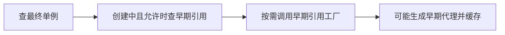
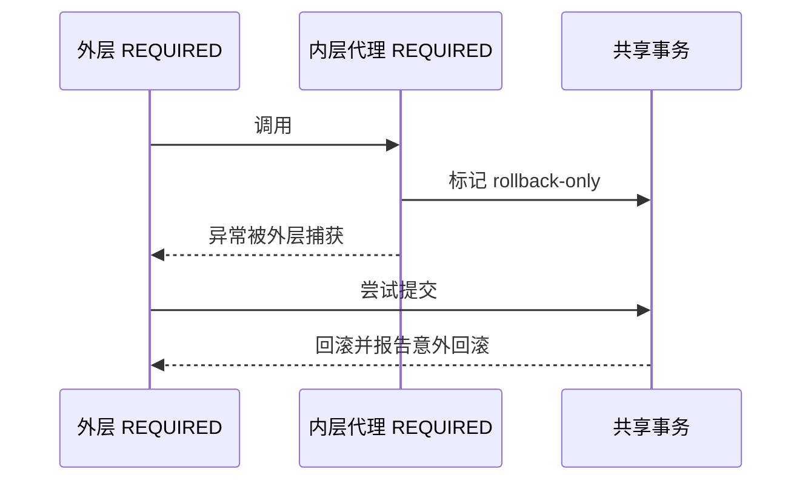
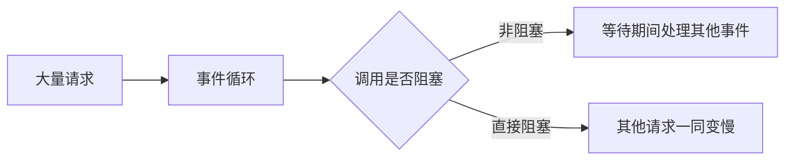

# Spring Framework 面试：从一句话到调用链推演

> **建议用法**：先用一句话开场，再按“前提 → 机制 → 取舍 → 故障证据”展开。版本口径与 [原理篇](Spring原理.md) 一致；默认值需说明版本、代理模式与事务管理器。
>
> **重点路线**：Q1—Q11 容器与生命周期；Q12—Q16 循环依赖与代理；Q17—Q23 事务；Q24—Q30 事件与 Web；Q31—Q34 验证、版本与综合推演；Q35—Q37 安全。

### Q1：IoC 和 DI 到底解决什么问题？

> **一句话结论**：IoC（Inversion of Control，控制反转）让容器协调对象，DI（Dependency Injection，依赖注入）让依赖从外部进入，减少业务与组装耦合。

**机制展开**：订单服务自己创建仓储时，同时决定业务与依赖构造。改成构造器接收接口，测试能传入替身，生产能替换实现。容器进一步管理复杂对象图、作用域、生命周期和扩展，运行时仍主要是普通 Java 方法调用。

**⚖️ 方案对比与代价**：手写工厂同样可以实现 DI，小程序更直观；复杂应用受益于统一管理，但需理解条件和对象来源。

**🔎 追问演练**：不用 Spring 能不能依赖注入？

**推演要点**：能。DI 是设计方式，Spring 提供系统化实现，不能把设计原则等同于一个注解。

**原理展开**：[对应章节](Spring原理.md#sf-01)。

---

### Q2：为什么推荐构造器注入？

> **一句话结论**：它让必需依赖与有效对象状态显式化，也更容易脱离容器测试。

**机制展开**：依赖可保存为 final，缺少必需依赖就无法正常构建。Setter 适合确实可选或后续设置的依赖；字段注入隐藏构造契约，普通 new 出来的对象可能无效。单构造器通常无需额外标记 Autowired。

**⚖️ 方案对比与代价**：参数过多是职责过重的信号，不应仅靠改回字段注入掩盖；需要检查用例划分和策略组合。

**🔎 追问演练**：为什么构造器更容易暴露环？

**推演要点**：A 构造前等待 B，B 构造前又等待 A，此时没有完成实例化的对象可以提前提供引用。

**原理展开**：[对应章节](Spring原理.md#sf-01)。

---

### Q3：BeanFactory 与 ApplicationContext 怎样区分？

> **一句话结论**：前者提供基础对象管理契约，后者整合应用级能力并协调上下文生命周期。

**机制展开**：上下文在 BeanFactory 基础上提供资源、事件、国际化与扩展器发现，通常应用直接使用上下文；研究对象创建则沿底层工厂实现深入。它们不是两个完全独立的容器体系。

**⚖️ 方案对比与代价**：不能只背一个懒加载一个立即加载；实例化还受刷新阶段、懒加载定义及依赖关系影响。

**🔎 追问演练**：Lazy 能解决启动失败吗？

**推演要点**：它可能把错误与创建成本推到首请求；若被非懒加载对象依赖，也可能提前创建。

**原理展开**：[对应章节](Spring原理.md#sf-01)。

---

### Q4：BeanDefinition 与 Bean 的差别是什么？

> **一句话结论**：前者是创建元数据，后者是根据元数据产生的受管对象。

**机制展开**：扫描、配置类、导入和程序化注册汇入定义体系，定义保存类型或工厂方法、作用域和生命周期规则。先处理定义再创建实例，使框架能统一调整装配模型，也让定义存在与对象已经可用成为两个不同状态。

**⚖️ 方案对比与代价**：修改定义不自动修改已经创建对象保存的状态与引用，动态变更需要额外刷新机制。

**🔎 追问演练**：定义注册成功能证明资源可用吗？

**推演要点**：不能。条件匹配、实例初始化、远程连接和真实业务调用是不同验证阶段。

**原理展开**：[对应章节](Spring原理.md#sf-02)。

---

### Q5：两类 PostProcessor 分别能改什么？

> **一句话结论**：BeanFactoryPostProcessor 主要处理定义，BeanPostProcessor 参与实例创建与初始化。

**机制展开**：BeanDefinitionRegistryPostProcessor 还可以新增定义。实例处理器可以参与依赖填充、生命周期和代理，不只在初始化后运行。框架常通过多个扩展点配合完成注册、注入和增强。

**⚖️ 方案对比与代价**：定义处理器中提前 getBean 可能让对象错过后续增强；实例处理器也不适合无约束修改全局定义。

**🔎 追问演练**：为什么某个对象未被所有后处理器处理？

**推演要点**：先查是否被基础设施提前创建，以及它的依赖链，不能只检查后处理器是否注册。

**原理展开**：[对应章节](Spring原理.md#sf-02)。

---

### Q6：Configuration 的代理有什么用？

> **一句话结论**：完整配置类拦截 Bean 方法间调用，关闭 proxyBeanMethods 后直接调用按普通 Java 语义执行。

**机制展开**：默认增强把内部 Bean 方法调用导向容器中的目标对象。关闭增强后，方法体里直接调用另一个创建方法，可能产生额外对象。推荐把协作对象写进 Bean 方法参数，让依赖关系不依赖方法拦截。

**⚖️ 方案对比与代价**：关闭代理减少增强需求，却要求配置写法不依赖其语义；不是无条件性能优化开关。

**🔎 追问演练**：Bean 方法声明单例，直接调用必然单例吗？

**推演要点**：单例约束容器获取路径，没有经过配置类拦截的普通 Java 调用不因此改变。

**原理展开**：[对应章节](Spring原理.md#sf-02)。

---

### Q7：FactoryBean 和 BeanFactory 有何不同？

> **一句话结论**：BeanFactory 管理对象，FactoryBean 是受管工厂，提供另一个产品对象。

**机制展开**：按名字通常取得 getObject 返回的产品，使用 &名字可取得工厂本身。适合代理客户端、复杂第三方资源等创建逻辑；产品是否单例要结合工厂契约，而非只看工厂 Bean 自身的作用域。

**⚖️ 方案对比与代价**：封装创建细节增加了查找与生命周期分析层次，要区分工厂类型、产品类型与最终代理。

**🔎 追问演练**：为什么查到的对象不是工厂类？

**推演要点**：常规查找解析的可能是产品，需明确要获取哪一层，以及工厂能否提供正确产品类型信息。

**原理展开**：[对应章节](Spring原理.md#sf-02)。

---

### Q8：Bean 生命周期怎样讲才准确？

> **一句话结论**：先定义与实例化，再注入、初始化和增强，最后按作用域管理销毁。

**机制展开**：沿构造器或工厂方法、依赖填充、感知回调、初始化前处理、初始化方法、初始化后处理和引用暴露展开。PostConstruct 由相关后处理器触发；循环依赖可能涉及早期代理，不能把简化流程当作所有对象的固定路径。

**⚖️ 方案对比与代价**：初始化阶段不适合无界远程调用和启动不受控线程；整体就绪和本对象字段已赋值是不同边界。

**🔎 追问演练**：PostConstruct 内调用自己的事务方法可靠吗？

**推演要点**：通常没有经过最终事务代理，this 调用也不重新进入代理；应选择明确服务边界与适当启动阶段。

**原理展开**：[对应章节](Spring原理.md#sf-03)。

---

### Q9：单例 Bean 一定线程安全吗？

> **一句话结论**：singleton 规定共享范围，线程安全取决于共享可变状态和访问协议。

**机制展开**：同一容器的同一定义通常共享一个对象，多个请求可同时进入。无状态服务使用方法局部变量更容易安全；把当前用户和中间结果写入字段，会导致交叉覆盖。父子上下文也可能各有相同类型实例。

**⚖️ 方案对比与代价**：锁能保护状态但降低并发并增加死锁风险；优先移除无必要共享状态。

**🔎 追问演练**：改成 ThreadLocal 就一定安全？

**推演要点**：ThreadLocal（线程局部变量）隔离线程而非业务请求，线程复用要清理，跨线程任务需明确传播。

**原理展开**：[对应章节](Spring原理.md#sf-04)。

---

### Q10：单例注入 prototype 为什么没每次新建？

> **一句话结论**：注入发生在创建单例时，后续方法复用保存的依赖引用。

**机制展开**：prototype 控制每次向容器获取时新建，不控制每次字段使用。可用 ObjectProvider、查找方法或作用域代理按需解析；请求作用域代理在调用时定位当前请求目标，不会让对象自动线程安全。

**⚖️ 方案对比与代价**：延迟获取增加灵活性，也将部分错误推到运行期，必须定义一次业务操作应该复用还是重新获取。

**🔎 追问演练**：prototype 的销毁谁负责？

**推演要点**：容器通常不完整跟踪创建后的使用和销毁，资源释放由调用方负责。

**原理展开**：[对应章节](Spring原理.md#sf-04)。

---

### Q11：多个同类型 Bean 如何消歧？

> **一句话结论**：先形成类型候选，再结合限定符、主候选和注入场景选择。

**机制展开**：Qualifier 表达用途筛选，Primary 指定优先候选，Framework 6.2 的 Fallback 可区分后备。集合注入通常保留多个候选，再由排序与业务选择决定使用；名字匹配不应被说成所有场景唯一规则。

**⚖️ 方案对比与代价**：隐式名字依赖简短但脆弱，关键跨模块能力更适合明确限定符与策略契约。

**🔎 追问演练**：Primary 会让集合只剩一个吗？

**推演要点**：不会因此把多候选收集变为单选；单值消歧与集合注入语义不同。

**原理展开**：[对应章节](Spring原理.md#sf-04)。

---

### Q12：三级缓存为什么包含早期引用工厂？

> **一句话结论**：工厂按需生成一致的早期引用，尤其协调依赖注入与代理。

**机制展开**：singletonObjects 放最终单例，earlySingletonObjects 放已生成早期引用，singletonFactories 放生成回调。工厂可调用 getEarlyBeanReference 获得代理，生成后放入早期缓存复用，避免依赖方拿到原始对象而其他调用方拿到代理。

**读图**：查询受创建状态和允许提前引用等条件约束，不是所有对象都走完这条路径。

**⚖️ 方案对比与代价**：不要解释成缓存三份完整对象，也不要宣称所有容器必须用三个 Map；这是 Spring 的延迟暴露与代理协调方案。

**🔎 追问演练**：两个缓存理论上绝对不能实现吗？

**推演要点**：不能下绝对结论。重点是当前实现如何保持引用一致和按需创建代理，而非证明其他算法不存在。

**原理展开**：[对应章节](Spring原理.md#sf-05)。

---

### Q13：哪些循环依赖三级缓存解决不了？

> **一句话结论**：构造器环、prototype 环及部分代理不一致场景，不能套用单例属性注入解环。

**机制展开**：属性注入可以先构造 A 再创建 B，B 依赖 A 时获得早期引用；构造器环在第一个对象实例化前闭合，根本没有可暴露对象。提前调用未初始化对象也可能造成业务错误，即使容器最终成功启动。

**⚖️ 方案对比与代价**：Boot 自 2.6 起默认禁止循环引用；开关只放宽策略，不能消除实现限制。优先拆职责，Lazy 只延迟解析。

**🔎 追问演练**：Lazy 解了启动环就说明设计合理吗？

**推演要点**：不说明。运行时仍可能递归、时序依赖或职责耦合，需要检查实际业务调用图。

**原理展开**：[对应章节](Spring原理.md#sf-05)。

---

### Q14：AOP 为什么使用代理？

> **一句话结论**：代理在调用入口组合横切逻辑，减少业务中的事务、指标与审计重复。

**机制展开**：AOP（Aspect-Oriented Programming，面向切面编程）通过匹配规则形成拦截链，调用经代理到增强再到目标。环绕增强可以短路、修改结果或多次调用 proceed，所以顺序与异常传播都能改变业务。

**⚖️ 方案对比与代价**：代理灵活但受调用边界限制；字节码编织覆盖更广，却增加工具链和排障成本。

**🔎 追问演练**：Around 忘记 proceed 会怎样？

**推演要点**：目标和后续增强可能不执行；多次 proceed 可能重复业务，不应当成纯日志语法。

**原理展开**：[对应章节](Spring原理.md#sf-06)。

---

### Q15：JDK 与 CGLIB 的选择依据是什么？

> **一句话结论**：接口代理依赖接口契约，类代理通过继承增强，实际选择还受配置影响。

**机制展开**：JDK（Java Development Kit，Java 开发工具包）代理实现接口；CGLIB（Code Generation Library，代码生成库）类代理生成子类。final 类不能按子类方式代理，final/private 方法不能通过通常覆盖方式增强；接口代理不可任意强转实现类。

**⚖️ 方案对比与代价**：调用契约与可增强范围比简单性能排名更关键。Framework 与 Boot 默认值可能不同，不能背有接口必然 JDK。

**🔎 追问演练**：强制类代理能解决所有事务失效吗？

**推演要点**：不能。自调用、原始对象、错误事务管理器和异常规则都可能继续导致问题。

**原理展开**：[对应章节](Spring原理.md#sf-06)。

---

### Q16：this 调用为什么绕过增强？

> **一句话结论**：目标对象内部调用通常不会重新进入外层代理。

**机制展开**：外部调用先到代理再到 target，target 内 this.inner 直接调用目标方法，所以 inner 上独立事务、缓存或异步规则可能未被拦截。可拆为另一个受管服务，或用编程式边界表达真正需要增强的位置。

**读图**：内部调用没有回到代理入口，inner 的增强不因此重新执行。

**⚖️ 方案对比与代价**：自注入或当前代理访问能绕行，但增加容器耦合与循环风险；清晰职责拆分更易测试。

**🔎 追问演练**：private 方法加注解为什么不行？

**推演要点**：除了自调用，还受方法不可按通常覆盖方式增强的限制，应同时分析方法能力与调用路径。

**原理展开**：[对应章节](Spring原理.md#sf-06)。

---

### Q17：Transactional 实际协调了什么？

> **一句话结论**：拦截器解析属性，事务管理器协调资源，数据库执行提交、回滚和隔离。

**机制展开**：命令式本地事务通常通过线程关联受管连接，让事务内数据访问复用资源。代理退出时完成事务并清理；加入已有事务的方法不一定创建连接，也不一定独立提交。响应式事务则依靠响应式上下文，不照搬线程模型。

**⚖️ 方案对比与代价**：注解减少模板代码，TransactionTemplate 更适合需要明确局部资源区间的流程，但拆多个事务会改变原子性。

**🔎 追问演练**：另建一个连接会自动加入吗？

**推演要点**：不能假定。要看是否通过对应资源管理机制获取，其他连接、数据源与线程都需单独分析。

**原理展开**：[对应章节](Spring原理.md#sf-07)。

---

### Q18：事务不回滚怎样排查？

> **一句话结论**：先查代理与异常，再查实际管理器、连接和提交边界。

**机制展开**：确认受管对象、非自调用、方法可增强；再看异常是否被 catch、是否命中规则；最后核对资源是否受管、是否跨线程或跨数据源。传统默认 RuntimeException 与 Error 回滚，受检异常默认不回滚，Framework 6.2 可配置统一策略。

**⚖️ 方案对比与代价**：全异常回滚可能合理，也可能改变业务协议；应按项目规则明确设计，而非为消除单例故障任意扩散。

**🔎 追问演练**：catch 后返回 false 为什么可能提交？

**推演要点**：拦截器看到正常返回，不会从布尔值猜测回滚，应抛匹配异常、标记回滚或采用明确编程协议。

**原理展开**：[对应章节](Spring原理.md#sf-07)。

---

### Q19：事务只能标在 public 方法上吗？

> **一句话结论**：要结合版本和代理类型回答，public 服务边界通常最清晰。

**机制展开**：Framework 6 起类代理默认还可支持 protected 与包可见方法，接口代理要求公开接口方法。private/final、自调用和初始化阶段仍要按实际增强能力分析；公开方法也不代表已经经过正确事务代理。

**⚖️ 方案对比与代价**：技巧性使用非公开边界增加理解成本，明确用例入口更利于契约与回归验证。

**🔎 追问演练**：public 加注解就一定生效？

**推演要点**：还要受管、代理启用、调用经过代理并选中正确管理器，public 只是其中一项。

**原理展开**：[对应章节](Spring原理.md#sf-07)。

---

### Q20：readOnly 和隔离级别怎样解释？

> **一句话结论**：只读通常是提示，隔离取决于实际资源，加入已有事务不会自然建立新隔离。

**机制展开**：readOnly 可能影响驱动、刷新和优化，不是通用写权限控制。隔离属性通常在创建新物理事务时应用；内层 REQUIRED 加入外层时沿用既有上下文，是否拒绝不兼容声明还取决于管理器验证策略。

**⚖️ 方案对比与代价**：高隔离增加锁或冲突成本，禁止写入应结合数据库权限与路由约束，不能只靠注解。

**🔎 追问演练**：内层声明最高隔离会自动升级外层吗？

**推演要点**：通常不会。先确认是否新事务，再看实际管理器与数据库行为。

**原理展开**：[对应章节](Spring原理.md#sf-07)。

---

### Q21：为什么捕获内层异常后仍意外回滚？

> **一句话结论**：内外层逻辑事务可能共享物理事务，捕获异常不清除 rollback-only。

**机制展开**：外层经另一个代理调用内层 REQUIRED，内层异常命中规则并标记共享事务回滚。外层 catch 后继续，最终仍不能提交，可能抛 UnexpectedRollbackException，防止调用方误认成功。这里必须有独立拦截和对应标记过程。

**⚖️ 方案对比与代价**：改独立事务能隔离回滚，却会破坏整体原子性，先确认业务是否允许部分提交。

**🔎 追问演练**：this 调用也能直接套用吗？

**推演要点**：不能。若没有独立拦截，标记过程不同，必须按真实调用和异常传播推演。

**原理展开**：[对应章节](Spring原理.md#sf-08)。

---

### Q22：REQUIRES_NEW 隐藏了什么成本？

> **一句话结论**：它通常占用独立连接并独立提交，可能耗尽连接池且形成业务分叉。

**机制展开**：外层挂起仍可能占着连接；N 个请求都持外层连接等内层新连接，池没有余量会全体等待。内层提交后外层失败，已提交内容不会随外层撤销。审计等场景需明确接受这一语义。

**⚖️ 方案对比与代价**：扩大连接池只是缓冲，可能加重数据库负载；缩短事务、减少远程等待或可靠事件更值得优先考虑。

**🔎 追问演练**：连接池加倍就彻底解决？

**推演要点**：不保证。还要看嵌套深度、占用时间、数据库容量和真实并发，且不解决原子性变化。

**原理展开**：[对应章节](Spring原理.md#sf-08)。

---

### Q23：NESTED 和 REQUIRES_NEW 差在哪？

> **一句话结论**：NESTED 通常依靠同一事务保存点，REQUIRES_NEW 使用独立物理事务。

**机制展开**：保存点可撤销内层部分修改，但外层回滚仍撤销整体；独立事务提交后不随外层回滚。NESTED 支持取决于管理器和资源，不能因数据库有保存点就推导所有持久化框架都支持。

**⚖️ 方案对比与代价**：保存点减少额外连接成本，却不能满足独立持久化需求；要先回答失败后哪些记录必须保留。

**🔎 追问演练**：JPA 可直接照搬 JDBC 结论吗？

**推演要点**：不能。JPA（Java Persistence API，Java 持久化 API）与 JDBC（Java Database Connectivity，Java 数据库连接）管理器能力需分别验证。

**原理展开**：[对应章节](Spring原理.md#sf-08)。

---

### Q24：Async 会继承外层事务吗？

> **一句话结论**：命令式事务资源通常不会自动迁移到新的任务线程。

**机制展开**：异步代理把任务交给执行器，任务可创建自己的事务，却不与外层天然构成原子单元。队列、拒绝和错误处理独立存在，void 异步异常也不会按同步调用栈返回。日志、安全与请求上下文同样需要审查传播能力。

**⚖️ 方案对比与代价**：异步减少等待但增加一致性协议；应传必要业务标识，不能复制连接来共享事务。

**🔎 追问演练**：外层回滚，异步已发消息怎么办？

**推演要点**：需要可靠事件意图、幂等与恢复协议，不能依赖线程执行先后来保证原子性。

**原理展开**：[对应章节](Spring原理.md#sf-09)。

---

### Q25：普通事件与事务事件各保证什么？

> **一句话结论**：普通事件通常是同步进程内通知，事务事件关联执行阶段，两者都不自动持久化交付。

**机制展开**：普通监听器耗时和异常可影响发布方；TransactionalEventListener 默认提交后执行，没有事务默认不执行。数据库提交后、监听器运行前进程可能退出；提交后需要新数据库写入也应明确新事务。

**⚖️ 方案对比与代价**：本地事件便于解耦，可靠跨故障交付需要 Outbox（事务发件箱）等持久化方案并配合幂等。

**🔎 追问演练**：提交后事件能替代消息队列？

**推演要点**：不能直接替代，它没有天然提供确认、持久化、重放和跨进程交付协议。

**原理展开**：[对应章节](Spring原理.md#sf-09)。

---

### Q26：缓存注解为什么解决不了所有一致性问题？

> **一句话结论**：缓存操作与数据库提交通常不属于同一个原子协议。

**机制展开**：提交前清理，其他线程可能读取旧数据库再回填；提交后清理又有崩溃窗口。还需区分 Cacheable、CachePut、CacheEvict，设计键、过期、失效重试和后端语义。代理自调用也可能绕过缓存增强。

**⚖️ 方案对比与代价**：事务感知适配、提交后失效与版本校验对应不同不一致窗口，不能指望一个注解等价强一致。

**🔎 追问演练**：缓存同步选项就是分布式锁吗？

**推演要点**：不能一概而论，取决于后端支持与作用范围，本地同步不自动变成跨实例互斥。

**原理展开**：[对应章节](Spring原理.md#sf-09)。

---

### Q27：一次 MVC 请求怎样到达 Controller？

> **一句话结论**：前端控制器按映射找到处理器，再由适配器组织参数、校验、调用和返回处理。

**机制展开**：MVC（Model-View-Controller，模型—视图—控制器）中，DispatcherServlet 协调 HandlerMapping、HandlerAdapter 和异常解析。消息转换器处理请求体和响应体，外层还有 Servlet Filter，处理器链中可以有拦截器，异步分派还有额外边界。

**⚖️ 方案对比与代价**：统一分派方便扩展，但不同阶段的异常由不同机制处理，不能期待 ControllerAdvice 兜底所有 Filter 错误。

**🔎 追问演练**：JSON 是前端控制器自己序列化的吗？

**推演要点**：实际由返回值处理与消息转换器协作，JSON（JavaScript Object Notation，JavaScript 对象表示法）库与定制由配置决定。

**原理展开**：[对应章节](Spring原理.md#sf-10)。

---

### Q28：Filter、Interceptor、AOP 如何选择？

> **一句话结论**：按 Servlet 请求、MVC 处理器与受管服务方法三个边界选择。

**机制展开**：Filter 适合请求包装、安全链和编码；Interceptor 可访问已匹配处理器并做相关前后置；AOP 处理服务事务、审计与方法约束。对异步分派、异常和非 Web 调用的覆盖不同，不能只按写法是否方便选择。

**⚖️ 方案对比与代价**：把所有鉴权放进 MVC 拦截器可能漏掉其他入口，关键服务仍需要明确权限边界与对象所有权校验。

**🔎 追问演练**：日志读完请求体后 Controller 读不到怎么办？

**推演要点**：流已被消费，需要适当可重复读取包装、大小上限与敏感字段策略，避免无限缓存。

**原理展开**：[对应章节](Spring原理.md#sf-10)。

---

### Q29：WebFlux 为什么可能比 MVC 更慢？

> **一句话结论**：非阻塞优化高并发等待的资源使用，不保证所有负载更快。

**机制展开**：事件循环处理大量连接时，直接执行阻塞数据库查询会占住少量关键线程并拖慢其他请求。迁移到受控阻塞调度器能隔离影响，但仍受线程与连接数限制；只让 Controller 返回 Mono 不代表下游已经非阻塞。

**⚖️ 方案对比与代价**：响应式带来组合能力与排障成本，成熟阻塞链路可选择 MVC 与合理线程模型；计算密集任务不凭编程模型加速。

**🔎 追问演练**：切换模型怎样做公平验证？

**推演要点**：使用相同业务、连接数和入口负载，比较吞吐、尾延迟、资源与错误率，而非只测空接口。

**原理展开**：[对应章节](Spring原理.md#sf-11)。

---

### Q30：背压、限流和虚拟线程有什么关系？

> **一句话结论**：背压协调流内供需，限流约束进入速率，虚拟线程降低部分等待成本。

**机制展开**：Reactive Streams（响应式流规范）由消费者请求量协调生产；外部源和缓冲仍需策略。虚拟线程让大量同步等待更便宜，但数据库连接、锁和下游配额不增加。入口无限增长仍可能耗尽系统资源。

**⚖️ 方案对比与代价**：应按瓶颈组合机制，在实际 JDK 与驱动下测量，不能用一个新名词取代所有容量设计。

**🔎 追问演练**：百万虚拟线程等于百万数据库事务？

**推演要点**：不等于。真正访问稀缺资源的并发必须受控，还需考虑排队与超时。

**原理展开**：[对应章节](Spring原理.md#sf-11)。

---

### Q31：为什么单元测试通过，事务上线却失效？

> **一句话结论**：直接 new 对象没有经过生产代理，验证的是业务逻辑而非容器契约。

**机制展开**：单元测试覆盖状态与分支，上下文测试覆盖注入与切点，真实数据库测试验证提交、约束与隔离。自动回滚可能掩盖提交后事件或延迟刷新，因此应对真实提交路径单独断言。

**⚖️ 方案对比与代价**：不必所有测试启动完整系统，但必须保留能暴露关键资源边界的集成测试。

**🔎 追问演练**：方法返回成功能证明提交成功？

**推演要点**：不能。提交可能在代理退出阶段失败，需要调用方观察最终事务结果。

**原理展开**：[对应章节](Spring原理.md#sf-12)。

---

### Q32：Bean 没代理或启动卡住如何定位？

> **一句话结论**：沿创建阶段、依赖链和线程等待寻找证据。

**机制展开**：启动卡住先抓线程栈，区分锁、网络、连接池和初始化任务；代理问题看提前 getBean、切点、方法可见性、原始引用和实际代理类型。源码可沿 refresh、doGetBean、doCreateBean 与单例注册表串起流程。

**⚖️ 方案对比与代价**：Lazy 可能转移故障而非修复；提高超时也不能替代定位阻塞原因。

**🔎 追问演练**：对象能拿到说明已经初始化完成吗？

**推演要点**：不一定，循环依赖可能暴露早期引用，还需确认最终初始化、增强与相关资源状态。

**原理展开**：[对应章节](Spring原理.md#sf-12)。

---

### Q33：Framework 5、6、7 怎样区别？

> **一句话结论**：先说运行与 Jakarta 基线，再说新增能力和行为变化。

**机制展开**：6 起 Java 17 并迁移 Jakarta；6.1 有 RestClient 等演进；6.2 增强后备候选与事务策略；7 面向 Jakarta EE 11、JSpecify，并内置新的重试和并发限制能力。具体方法可见性和默认值应按对应小版本核实。

**⚖️ 方案对比与代价**：迁移要检查第三方库；javax.sql 等 Java SE 包不能机械改名，虚拟线程所需 Java 版本也不等于 Framework 最低版本。

**🔎 追问演练**：Spring 7 Retryable 与 Spring Retry 是同一注解吗？

**推演要点**：不能只看短类名，检查包名、所属项目与代理语义，再验证异常分类、预算和幂等。

**原理展开**：[对应章节](Spring原理.md#sf-13)。

---

### Q34：如何串起容器、代理、事务与事件？

> **一句话结论**：按对象图、调用图、资源图解释一个真实用例。

**机制展开**：订单接口进入受管服务代理，事务管理器获取连接，服务经另一个代理调用用例，异常触发共享回滚标记；外层 catch 后仍可能提交失败。再分别检查提交后事件、异步通知和缓存失效的故障窗口。

**⚖️ 方案对比与代价**：先背注解列表容易遗漏前提，沿真实路径能发现跨线程、自调用和跨服务原子性缺口。

**🔎 追问演练**：库存若是 HTTP 服务，外层能统一回滚吗？

**推演要点**：本地事务不能自动控制远程提交，需要幂等、可靠事件、补偿或适合的分布式协调。

**原理展开**：[对应章节](Spring原理.md#sf-07)。

---

### Q35：SecurityFilterChain 与 MVC 拦截器有什么区别？

> **一句话结论**：安全链在 Servlet 过滤层组织认证授权，MVC 拦截器属于匹配处理器后的执行链。

**机制展开**：DelegatingFilterProxy 将调用交给受管安全基础设施，FilterChainProxy 选择首个匹配的安全链，具体过滤器再处理上下文、认证和授权。安全层可能直接响应而不进入 Controller，ControllerAdvice 也不能自然接管全部安全错误。

**⚖️ 方案对比与代价**：安全框架提供完整协议与清理机制；仅写一个登录拦截器容易漏掉其他入口、异常与上下文边界。

**🔎 追问演练**：多个安全链是否都会执行？

**推演要点**：通常按排序选首个匹配链，顺序和匹配范围错误会使某些接口走到非预期策略，应验证真实请求路径。

**原理展开**：[安全边界](Spring原理.md#sf-14)。

---

### Q36：Session 与 JWT 怎样比较？

> **一句话结论**：Session 主要把状态放服务端，自包含令牌把可验证声明交给客户端，选择取决于撤销和状态管理需求。

**机制展开**：JWT（JSON Web Token，JSON Web 令牌）只是格式，签名不等于加密；还需检查签发方、受众、期限和密钥。Session 便于集中撤销但有共享存储成本，令牌减少部分集中读取，却增加权限变更、撤销和密钥轮转设计。

**⚖️ 方案对比与代价**：不要只比是否有状态。短令牌、刷新凭据和服务端撤销记录也可能形成混合方案，需要完整生命周期。

**🔎 追问演练**：用了 JWT 就能完全不保存任何服务端状态？

**推演要点**：不能由格式推导。退出、盗用处理、刷新和权限即时变更可能需要服务端状态或接受有限延迟。

**原理展开**：[安全边界](Spring原理.md#sf-14)。

---

### Q37：CORS、CSRF、XSS 怎样区分？

> **一句话结论**：它们分别涉及跨源访问、伪造带凭据请求和注入脚本执行，不能互相替代。

**机制展开**：CORS（Cross-Origin Resource Sharing，跨源资源共享）约束浏览器跨源读取等行为；CSRF（Cross-Site Request Forgery，跨站请求伪造）利用自动携带凭据；XSS（Cross-Site Scripting，跨站脚本攻击）让恶意脚本在可信站点上下文执行。是否需要 CSRF 防护要看凭据发送方式。

**⚖️ 方案对比与代价**：返回 JSON 或接口无服务端 Session，都不能独立证明没有 CSRF 风险；输入输出处理、Cookie 与令牌存储需按各自威胁模型设计。

**🔎 追问演练**：JWT 放 Cookie 就天然没有 CSRF 吗？

**推演要点**：不是。若浏览器自动发送该 Cookie，仍需分析跨站伪造请求风险，令牌格式不能代替防护协议。

**原理展开**：[安全边界](Spring原理.md#sf-14)。

---

## 参考与版本核对

版本背景见 [原理篇](Spring原理.md#sf-13)。代理与事务分别核对 [官方代理说明](https://docs.spring.io/spring-framework/reference/6.2/core/aop/proxying.html) 和 [事务注解说明](https://docs.spring.io/spring-framework/reference/6.2/data-access/transaction/declarative/annotations.html)。

## 附录：术语与缩写

| 术语 | 英文全称 | 中文含义 / 使用边界 |
|---|---|---|
| IoC | Inversion of Control | 控制反转，框架接管对象协调等控制流程 |
| DI | Dependency Injection | 依赖注入，从外部提供协作对象 |
| AOP | Aspect-Oriented Programming | 面向切面编程，分离横切逻辑 |
| BeanDefinition | Bean Definition | Bean 创建与配置元数据 |
| BPP | BeanPostProcessor | Bean 后处理器，参与实例生命周期 |
| BFPP | BeanFactoryPostProcessor | Bean 工厂后处理器，主要处理定义 |
| JDK | Java Development Kit | Java 开发工具包，提供接口动态代理能力 |
| CGLIB | Code Generation Library | 常用于生成子类代理的代码生成库 |
| JVM | Java Virtual Machine | Java 虚拟机 |
| JDBC | Java Database Connectivity | 阻塞式数据库访问标准接口 |
| JPA | Java Persistence API | Java 持久化标准接口 |
| R2DBC | Reactive Relational Database Connectivity | 响应式关系数据库连接接口 |
| MVC | Model-View-Controller | 模型—视图—控制器 |
| HTTP | Hypertext Transfer Protocol | 超文本传输协议 |
| JSON | JavaScript Object Notation | 常见结构化数据交换格式 |
| CPU | Central Processing Unit | 中央处理器 |
| ThreadLocal | Thread Local Variable | 线程局部变量，不等于跨线程上下文 |
| Outbox | Transactional Outbox | 事务发件箱，持久化待发送意图 |
| P95 / P99 | 95th / 99th Percentile | 95% / 99% 请求延迟所在分位值 |
| SPI | Service Provider Interface | 服务提供者接口，框架扩展契约 |
| JWT | JSON Web Token | JSON Web 令牌格式，不默认加密 |
| CORS | Cross-Origin Resource Sharing | 跨源资源共享 |
| CSRF | Cross-Site Request Forgery | 跨站请求伪造 |
| XSS | Cross-Site Scripting | 跨站脚本攻击 |
| API | Application Programming Interface | 应用程序编程接口 |
| Java SE | Java Platform, Standard Edition | Java 标准版 |
| Jakarta EE | Jakarta Enterprise Edition | Jakarta 企业级平台规范 |
