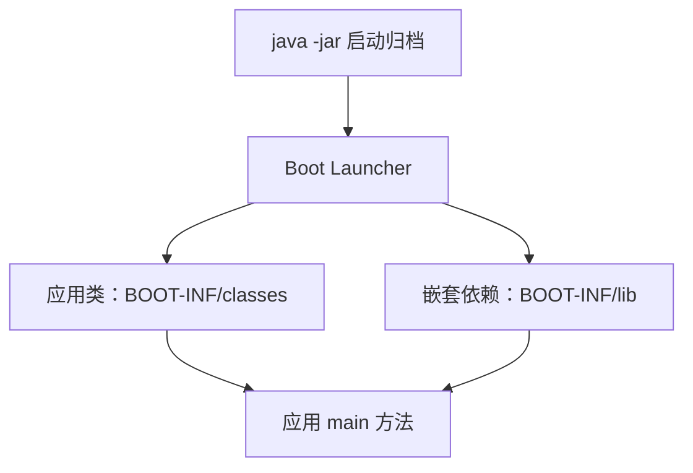
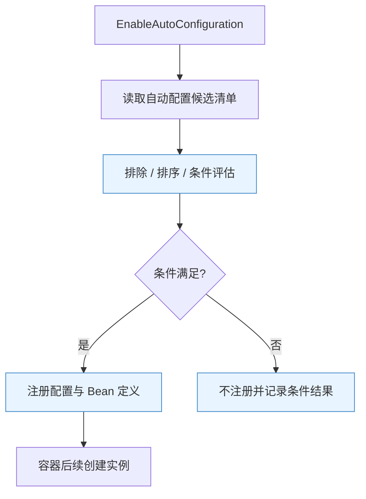
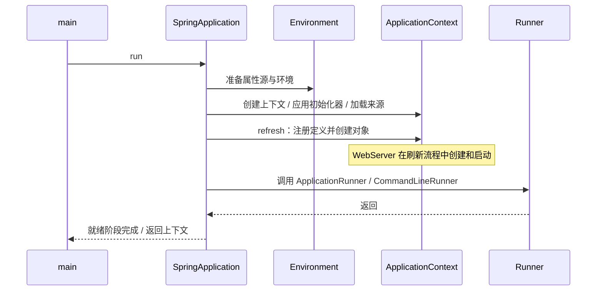
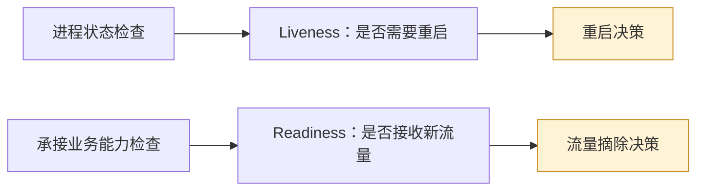

# Spring Boot 原理：从显式装配到可解释的自动配置

> **阅读定位**：理解自动配置如何成立、启动为何按阶段推进，以及应用如何被验证和观测。以 Boot 3.5 为机制基线，单独对照 Boot 4.x。搭配 [Spring Boot 面试](SpringBoot面试.md)。
>
> **主线**：依赖组成 → 配置输入 → 条件装配 → 容器启动 → Web 运行 → 观测与关闭。Boot 使用 Spring Framework，不另造一套 IoC（Inversion of Control，控制反转）、AOP（Aspect-Oriented Programming，面向切面编程）或数据库事务实现。

## 阅读导航

| 关注点 | 对应章节 |
|---|---|
| Boot 为什么出现，Starter 和依赖管理有什么区别 | [1](#sb-01)、[2](#sb-02) |
| 自动配置的发现、条件、退让与自定义 Starter | [3](#sb-03)、[4](#sb-04) |
| 启动过程、配置优先级与 Web 应用模型 | [5](#sb-05)、[6](#sb-06)、[7](#sb-07) |
| 运行观测、容量、测试与诊断 | [8](#sb-08)、[9](#sb-09)、[10](#sb-10) |
| AOT、原生镜像及 Boot 3/4 差异 | [11](#sb-11)、[12](#sb-12) |

<a id="sb-01"></a>
## 1. 从 Spring 应用到 Boot：简化的是哪些决策

> 🎯 **核心结论**：Boot 通过约定、依赖组合和条件装配减少重复工程工作，同时保留显式覆盖的出口。

### 1.1 传统装配为什么容易重复

一个 Web 服务通常都需要版本兼容的依赖、请求分派器、JSON（JavaScript Object Notation，JavaScript 对象表示法）转换、校验、数据源、日志和打包方式。逐项目手工组装可获得直接控制，但团队容易形成多套不一致的默认值，升级也需要重复确认兼容性。

Boot 把常见组合沉淀为可复用规则。它根据类路径、已有 Bean、配置项和应用类型判断该注册什么。**自动不等于没有配置，而是把配置决策编成了条件规则**。


**读图**：Boot 主要决定哪些定义进入容器；对象注入、代理与事务执行仍应回到 Framework 原理分析。

### 1.2 哪些问题没有被自动解决

添加数据库 Starter 不等于数据库已经可用，也不保证查询合理；添加 Web Starter 不保证接口安全；添加观测组件不等于业务指标正确；添加 Cloud 组件不保证分布式调用可靠。

**取舍**：标准应用受益于约定；特殊场景要能追踪实际装配，而不是通过不断排除自动配置“试到能启动”。

<a id="sb-02"></a>
## 2. Starter、BOM、构建插件与可执行包

> 🎯 **核心结论**：Starter 组织依赖，BOM 约束版本，自动配置注册对象，构建插件负责打包等构建任务；四者职责不能混用。

| 名称 | 解决的问题 | 不负责什么 |
|---|---|---|
| Starter | 按能力聚合常用依赖 | 本身不一定包含业务实现，也不保证条件成立 |
| BOM（Bill of Materials，物料清单） | 统一一组依赖的兼容版本 | 仅导入 dependencyManagement 不会自动添加所有库 |
| Auto-configuration | 根据条件注册 Bean 定义 | 不管理所有第三方库的版本 |
| Boot 构建插件 | 重打包可执行归档、支持镜像构建等 | 不是运行期容器 |

### 2.1 为什么不能任意单独提升一个组件版本

依赖版本由多层管理和冲突仲裁共同决定。独立升级 Jackson、Tomcat 或 Spring 模块，可能让编译通过但运行出现 `NoSuchMethodError`。应先查看依赖树与最终仲裁版本，确认兼容范围，再验证使用到的行为。

使用 Boot parent 可同时继承部分构建默认值和依赖管理；仅导入 Boot BOM 更适合已有企业 parent 的项目，但不会自动获得 parent 的全部插件配置。Cloud 还需要匹配自身发布列车的 BOM，不能仅对齐一个 Cloud 子组件版本。

### 2.2 普通 JAR 为什么不能直接运行嵌套依赖

JAR（Java Archive，Java 归档）标准类路径不会自动递归加载任意内部 JAR。Boot 重打包把应用类与依赖按约定组织，并通过启动器和类加载机制装入嵌套依赖。其可执行包与普通库包用途不同，不能把一个可执行归档当作常规依赖包随意引用。



**读图**：布局与启动器使单包分发成为可能。分层归档与镜像缓存可降低重复分发成本，但不会改变业务事务或对象作用域。

<a id="sb-03"></a>
## 3. 自动配置：发现候选、评估条件、注册定义

> 🎯 **核心结论**：自动配置是一套受控的配置类导入机制，不是全类路径组件扫描，也不是按缺少的功能凭空生成代码。

### 3.1 @SpringBootApplication 的三个核心职责

它组合 Boot 配置类标识、自动配置启用和组件扫描。应用类所在包通常成为默认扫描起点，因此放在过低层级会漏掉同级业务组件，放在默认包又可能扩大扫描范围。

**业务组件扫描与自动配置候选发现是两条路径**。Boot 3 的自动配置候选通过 `META-INF/spring/org.springframework.boot.autoconfigure.AutoConfiguration.imports` 等约定导入，而不要求第三方自动配置位于业务扫描包下。[官方自动配置说明](https://docs.spring.io/spring-boot/3.5/reference/using/auto-configuration.html)



**读图**：图按概念合并阶段；条件可能在不同解析与注册阶段评估，不能理解成所有条件都只在某个统一循环执行一次。

### 3.2 条件分别判断什么

| 条件 | 判断维度 | 容易忽略的前提 |
|---|---|---|
| `@ConditionalOnClass` | 类路径存在相关类型 | 存在类不代表远程资源可用 |
| `@ConditionalOnMissingBean` | 尚无匹配 Bean 定义/候选 | 受定义处理时机、类型信息和搜索范围影响 |
| `@ConditionalOnProperty` | 属性值满足规则 | 缺失属性是否匹配需看具体参数 |
| `@ConditionalOnWebApplication` | Web 应用类型 | Servlet 与 Reactive 路径不同 |

`@ConditionalOnMissingBean` 帮助用户自定义 Bean 使默认配置退让；它不是“任何时候新增同名 Bean 都覆盖”的全局规则。**退让按条件语义进行，定义覆盖是另一种机制**。

### 3.3 顺序到底控制什么

`@AutoConfiguration(before/after=...)` 等主要协调定义处理顺序，使依赖的配置条件有机会看到前置定义。它不直接保证 Bean 实例化先后；对象创建顺序主要由依赖关系等决定。

Boot 2.7 开始提供 `.imports` 新机制；Boot 3 不再使用旧 `spring.factories` 键注册自动配置候选。**这不代表 spring.factories 文件对所有扩展机制都消失了**，仍需按扩展点和版本判断。

<a id="sb-04"></a>
## 4. 自定义 Starter：让默认行为可替换、可诊断

> 🎯 **核心结论**：好的 Starter 提供合理默认、明确的配置模型和退让条件；不要扫描用户整个应用，也不要替用户做隐蔽的全局改动。

### 4.1 为什么把 Starter 与自动配置分开

较成熟的组件常把实际能力、自动配置与依赖聚合拆开。使用者可以只引用底层能力，也可以通过 Starter 获得推荐组合；自动配置模块负责把库适配为受管对象。

```java
// 示意：省略 import；配置类需写入 AutoConfiguration.imports。
@AutoConfiguration
@ConditionalOnClass(AuditClient.class)
@EnableConfigurationProperties(AuditProperties.class)
class AuditAutoConfiguration {
    @Bean
    @ConditionalOnMissingBean
    AuditClient auditClient(AuditProperties properties) {
        return new AuditClient(properties.endpoint(), properties.timeout());
    }
}

@ConfigurationProperties("example.audit")
record AuditProperties(URI endpoint, Duration timeout) {}
```

**读代码**：`AuditClient` 是示意业务类型；示例表达条件、属性模型和替换点，并非独立可运行工程。正式实现应补充合法性校验、缺省策略、资源释放和错误说明。

### 4.2 容易导致启动故障的设计

可选库类型出现在不恰当的方法签名或初始化路径，可能在条件处理前触发类加载问题；把可选功能隔离到独立条件配置更稳妥。条件按类存在性判断，并不保证远程地址可连接，是否启动失败应是明确产品策略。

**不要为了“方便”默认注册无界线程池、覆盖用户安全策略或启动不可关闭的线程**。这些不是装配细节，而会改变使用者的容量与安全边界。

### 4.3 如何验证 Starter 的契约

用 `ApplicationContextRunner` 等小范围上下文工具验证：默认能装配、用户 Bean 能替换、功能关闭后不装配、缺少可选类能正常退让、属性无效有可读错误。这里关注的是条件矩阵，不需要为每个 getter 写镜像测试。[官方自动配置开发指南](https://docs.spring.io/spring-boot/3.5/reference/features/developing-auto-configuration.html)

<a id="sb-05"></a>
## 5. SpringApplication 启动：为什么要分多个就绪阶段

> 🎯 **核心结论**：从进程启动到可以承接业务请求，中间存在环境准备、容器刷新、Runner 执行和就绪发布等不同边界。



**读图**：端口已经监听和应用已就绪不是同一个时间点。入口路由是否放流还依赖可用性状态、探针与基础设施的配合。

### 5.1 Environment 为什么必须先准备

日志、应用类型、配置文件位置、条件装配都会读取属性。某些扩展器必须在容器刷新前生效，不能等普通 `@Bean` 创建后才补上。排查“配置写了却没影响日志”时，首先确认属性源被加载的阶段。

### 5.2 Runner 与 Ready 事件适合做什么

Runner 适合有边界、可失败的启动任务。若执行无限循环或等待永不完成的消息消费，会阻止后续就绪阶段。长驻任务应交给受控生命周期组件，明确启动失败、停止与重启策略。

Ready 事件表示正常启动流程推进到相应阶段，不保证全部外部业务依赖未来都健康，也不是集群层面的选主成功或数据预热完成证书。需要预热才能接流量，应把预热纳入明确的就绪判定。

### 5.3 启动慢怎样定位

区分配置加载慢、类与定义解析慢、Bean 初始化慢、数据库连接慢、Runner 慢。通过启动步骤、线程栈和外部调用耗时定位，避免只看最后一条日志。`@Lazy` 可以推迟部分创建，却可能把失败与首请求延迟推到运行期。

<a id="sb-06"></a>
## 6. 外部配置：优先级、绑定和动态更新不是同一件事

> 🎯 **核心结论**：Environment 组合属性源，绑定把属性转换为类型化对象；配置刷新是否重建对象，需要额外机制。

### 6.1 为什么需要外部化

同一制品在不同环境运行，只改变地址、开关和容量等配置，可减少重复构建。它仍需版本追踪、校验和权限，不能把“放在外部”理解为天然安全或天然可动态修改。

下表只比较常见来源，**不是完整优先级清单**；测试属性、开发工具等还有额外来源。

| 常见来源 | 简化的覆盖关系 | 注意事项 |
|---|---|---|
| 默认属性 | 通常优先级较低 | 适合库或应用默认值 |
| 配置数据，如 application 文件 | 通常高于默认属性 | 包内/外部、Profile、导入位置还会继续影响顺序 |
| 操作系统环境变量 | 通常高于配置数据 | 名字映射、列表/Map 绑定要核对 |
| Java 系统属性 | 通常高于环境变量 | 由 JVM（Java Virtual Machine，Java 虚拟机）启动参数提供 |
| 命令行属性 | 默认情况下通常更高 | 可关闭命令行属性加入，不能假定永远生效 |

`@PropertySource` 在刷新过程中加入，对早期读取的 `logging.*`、`spring.main.*` 可能太晚。遇到冲突，应查属性来源和最终值，不要盲目复制一份到更高优先级。[官方外部配置与完整顺序](https://docs.spring.io/spring-boot/3.5/reference/features/external-config.html)

### 6.2 @Value 与 @ConfigurationProperties

| 方式 | 优点 | 代价 |
|---|---|---|
| `@Value` | 少量离散值直接，支持表达式 | 分散在业务类，结构化模型与整体校验较弱 |
| `@ConfigurationProperties` | 类型化聚合、宽松绑定、元数据和校验 | 需要设计配置模型，约束默认值和兼容性 |

连接超时应绑定 `Duration` 等明确类型，避免“500 到底是毫秒还是秒”。缺少地址、非法区间和相互冲突的开关，宜在启动期给出明确校验错误。

### 6.3 Profile 与配置导入

Profile 是条件化配置组合手段，不是安全隔离。多个 Profile 激活时还要理解合并/覆盖规则；列表与 Map 的行为不能靠字符串拼接直觉猜测。`spring.config.import` 可引入额外配置数据，`optional:` 表示允许对应位置缺失，不应把所有加载失败都解释为自动忽略。

修改磁盘文件或远程配置不代表已有 Bean 的构造参数会更新。Boot 基础属性加载、Cloud 刷新作用域、应用显式重建资源是不同机制。高风险容量或路由配置更适合版本化、校验、灰度与回退，而不是无约束实时推送。

<a id="sb-07"></a>
## 7. Web 应用装配与嵌入式服务器

> 🎯 **核心结论**：嵌入式服务器把服务器与应用纳入同一启动、版本和生命周期；它不是功能较少的测试服务器。

### 7.1 外部容器与嵌入式容器的演进

传统 WAR（Web Application Archive，Web 应用归档）部署把容器交给平台运维，多个应用可能共享服务器环境。可执行包把容器依赖与应用一起交付，更容易固定版本与独立发布，但服务器升级也进入应用升级责任范围。

| 方式 | 主要收益 | 主要代价 |
|---|---|---|
| 外部 Servlet 容器 | 平台统一管理服务器 | 应用与平台版本协调、共享环境影响 |
| 嵌入式 Servlet 容器 | 制品自包含、生命周期统一 | 每个应用需要管理服务器版本与资源 |
| Reactive 服务器 | 适合非阻塞请求链 | 需控制阻塞与响应式上下文 |

### 7.2 同时引入 MVC 与 WebFlux 会怎样

Boot 默认选择通常偏向 Servlet MVC（Model-View-Controller，模型—视图—控制器）应用；引入 WebFlux 可能只是为了使用 `WebClient`，不意味着服务端自动变为响应式。显式应用类型与依赖组合仍会影响结果。应查看实际上下文类型与服务器，而不是从依赖名推断。

### 7.3 自定义 MVC 为何可能导致默认行为消失

通常用 `WebMvcConfigurer` 扩展转换器、资源处理等保留 Boot 的自动配置；使用 `@EnableWebMvc` 表达更全面的手工接管，会改变自动配置条件。遇到静态资源、转换器或异常处理行为变化，要先确认是否接管了框架配置。

### 7.4 优雅关闭究竟保证什么

优雅关闭尝试停止接收新请求并等待正在处理的工作，受服务器、协议、生命周期阶段和超时预算影响。后台队列、消息确认、长连接与独立线程池还需要自身停止协议；强杀进程或超过等待预算仍可能中断业务。

**关键顺序**：入口停止放流 → 应用停止接单 → 完成或可恢复地中断在途工作 → 关闭资源。可靠性最终来自幂等、消息重投和可恢复状态，不只来自关闭钩子。

<a id="sb-08"></a>
## 8. Actuator、健康探针与可观测性

> 🎯 **核心结论**：应用是否存活、是否接流量、业务是否正确是三个问题；指标、日志和追踪提供互补证据。

### 8.1 三类观测分别回答什么

| 证据 | 回答的问题 | 典型误区 |
|---|---|---|
| Metrics（指标） | 错误率、吞吐和延迟怎样变化 | 把订单号、用户号作为标签导致高基数 |
| Logs（日志） | 某一步发生了什么 | 全量打印载荷，成本高且泄漏敏感信息 |
| Traces（追踪） | 一次跨组件调用在哪耗时 | 只看成功采样，忽略缺失或未传播上下文 |

Micrometer 提供观测抽象，但仍需正确的埋点与导出。P99（99th Percentile，第 99 百分位）表示延迟分位，不等于最慢请求，也不能把各服务 P99 简单相加得到整条链路的 P99。

### 8.2 Liveness 与 Readiness 为什么分开



**读图**：数据库暂时故障通常不应直接触发所有实例重启，否则放大故障。是否把数据库加入 readiness，则应分析它是不是所有业务都不可缺少的依赖，以及摘除整个集群的后果。

### 8.3 Actuator 端点的三道问题

先看端点是否可用/允许访问，再看是否通过指定技术暴露，最后看安全认证授权。一个端点存在，不等于已经向公网开放；暴露也不代表任何人都能访问。自定义安全链可能改变 Boot 的默认安全装配，应验证实际请求边界。

`env`、配置、堆转储和日志控制等能力具有不同敏感度。按运维需要精确暴露，确认脱敏和授权，不用“全开放方便排障”替代设计。[Actuator 官方说明](https://docs.spring.io/spring-boot/3.5/reference/actuator/endpoints.html)

<a id="sb-09"></a>
## 9. 线程、连接池与虚拟线程：容量不会被自动配置创造

> 🎯 **核心结论**：入口线程、任务队列、数据库连接和下游配额共同限制吞吐；Boot 的默认值只是起点。

### 9.1 一条请求会消耗多种资源

请求可能先占服务器线程，再占事务连接，随后等待远程服务。若数据库连接只有 30 条，创建几千个可运行任务并不能让数据库同时完成几千条事务，只会积累等待。

Little 定律在稳定条件下给出近似关系：**系统内平均请求数 L ≈ 到达率 λ × 平均停留时间 W**。例如每秒 200 次调用，每次平均 0.2 秒，平均约有 40 次在途调用；这不是直接把连接池设成 40 的公式，还要看请求是否全程持连接、流量波动与数据库承载。

### 9.2 虚拟线程能解决什么

Boot 支持在相应 Java 21+ 环境启用虚拟线程。虚拟线程降低大量阻塞等待的线程成本，适合保留同步代码的 I/O（Input/Output，输入输出）密集场景。它不会增加数据库连接、下游吞吐或 CPU（Central Processing Unit，中央处理器）算力。

一些固定线程、锁和本地调用行为受 JDK 版本影响，不能把旧版 pinning（载体线程固定）结论无条件套到所有新 JDK。应在实际 JDK 与负载下测量。无论线程多便宜，都要用并发限制保护稀缺资源。

### 9.3 排队和超时怎样协调

端到端预算要覆盖排队、连接获取、连接建立、读取与业务执行。只有读取超时不足以限制全部耗时。线程池拒绝、连接池等待和请求超时应可观测；超时返回也不保证底层操作已经停止，后续重试仍需幂等。

<a id="sb-10"></a>
## 10. 测试与诊断：选择能暴露问题的最小范围

> 🎯 **核心结论**：测试范围取决于要验证的契约。容器启动成功不能证明接口、事务、序列化与真实依赖都正确。

| 测试方式 | 适合验证 | 无法单独证明 |
|---|---|---|
| 普通单元测试 | 业务状态与算法 | 自动配置、代理、真实提交 |
| Slice Test（切片测试） | Web 层、数据层等特定装配 | 整体应用组合与完整安全链 |
| `@SpringBootTest` | 应用上下文与集成路径 | 未接入的外部系统行为、生产容量 |
| 真实依赖集成测试 | 数据库锁、协议与消息确认 | 生产所有网络故障与规模问题 |

### 10.1 为什么测试环境“能注入”生产却不行

测试可能加载额外配置、替换 Bean、激活不同 Profile，或缓存了不同上下文。切片测试默认只保留有限组件，不能无条件期待所有服务都存在。应明确测试导入、替身和属性来源，避免把为测试补的组件误放进生产扫描路径。

### 10.2 条件报告比反复改注解更有用

自动配置不生效时，沿“依赖是否存在 → 候选是否导入 → 条件为什么匹配/不匹配 → 最终定义是什么 → 实例是否创建”的顺序排查。条件报告用于解释装配决策；它不直接证明远程资源状态或业务正确性。

### 10.3 Boot 3 到 4 的测试迁移

Boot 3.4 起弃用旧 `@MockBean`、`@SpyBean`，Boot 4 移除这些支持，转向 Framework 的 `@MockitoBean`、`@MockitoSpyBean`。新旧注解的声明位置和覆盖语义存在差异，不能只做无脑全文替换；Boot 4 的模块化也会影响测试依赖与包名。

<a id="sb-11"></a>
## 11. AOT 与原生镜像：把哪些工作前移

> 🎯 **核心结论**：AOT 提前分析与生成应用初始化相关代码；原生镜像进一步进行封闭世界分析和机器码生成。它们减少部分启动成本，也约束运行时动态性。

AOT（Ahead-of-Time，提前处理/编译）在 Spring 语境中包含提前分析 Bean 模型并生成辅助代码；GraalVM Native Image 则基于可达性分析构建独立程序。AOT 可以服务于 JVM 运行模式，不应把 AOT 与原生镜像完全画等号。


**读图**：反射、资源和动态代理等能力需要在分析中可知，或通过运行时提示补充。不是“原生镜像完全不能反射”，而是动态行为必须被识别并纳入构建。

### 11.1 封闭世界假设怎样影响配置

构建时推导出的 Bean 结构通常不能在运行时随意改变；影响条件分支的 Profile 或属性需特别检查。运行期仍可读取不少地址、超时等属性，但不能因此推导“任意运行期配置都与普通 JVM 一样”。

### 11.2 与普通 JVM 怎样取舍

| 方面 | 常规 JVM / JIT | 原生镜像 |
|---|---|---|
| 启动与基础内存 | 需要类加载与预热 | 常可降低启动时延与基础占用，需实测 |
| 构建 | 通常较快 | 构建更重，工具链要求更严格 |
| 动态能力 | 运行时弹性较大 | 可达性、反射与资源需要提前确定 |
| 长时间吞吐 | JIT 可根据运行反馈优化 | 不能假定吞吐一定优于 JVM |

JIT（Just-in-Time，即时编译）与 AOT 的权衡要结合短任务、弹性实例、长期服务和诊断需求。迁移应验证真实依赖，不能以“能编出 hello world”替代集成兼容性。[原生镜像官方介绍](https://docs.spring.io/spring-boot/3.5/reference/packaging/native-image/introducing-graalvm-native-images.html)

<a id="sb-12"></a>
## 12. Boot 2、3、4：基线和兼容性比版本数字更重要

> 🎯 **核心结论**：Boot 3 到 4 既有底层 Framework 变化，也有依赖和模块结构变化；升级不是只改一个版本号。

| 版本线 | 基线与代表变化 | 重点核对 |
|---|---|---|
| Boot 2.7 | 传统 Framework 5.3 / javax 生态；自动配置注册过渡期 | 存量配置、旧 Starter 与弃用项 |
| Boot 3.x | Java 17+、Framework 6、Jakarta 命名空间、AOT/原生支持体系 | 第三方库、序列化、监控与安全配置 |
| Boot 3.5 | 适合作为 Boot 3 后期机制学习基线 | 不能由兼容矩阵推断仍处于免费维护期 |
| Boot 4.0 | Java 17+、Framework 7、Servlet 6.1；模块化增强、优先使用 Jackson 3 | Web 服务器、Starter/测试模块、API 与序列化兼容 |
| Boot 4.x 后续小版本 | 基线之上的迭代 | 以对应小版本文档与发布说明为准 |

**Boot 4 最低 Java 版本不是 21**；Java 21 与虚拟线程等可选能力相关。原生构建工具链的最低版本另有要求，不能由 Java 运行基线反推。[Boot 4 系统要求](https://docs.spring.io/spring-boot/4.0/system-requirements.html)

### 12.1 Jackson 3 的影响怎样评估

Boot 4 优先使用 Jackson 3，部分包名、扩展点和默认行为发生变化；注解包存在例外，不能对所有 `com.fasterxml.jackson` 直接全局替换。应使用真实接口样本验证日期、枚举、空值、多态和自定义序列化器。

### 12.2 为什么模块化会暴露“以前顺手就有”的依赖

更细的运行与测试模块使能力边界更明确，但旧项目可能依赖间接传入的类或旧包名。升级时出现缺类，应先定位对应能力的新模块，再按需引入，不宜把所有 Starter 一次加回去。[Boot 4 官方迁移指南](https://github.com/spring-projects/spring-boot/wiki/Spring-Boot-4.0-Migration-Guide)

### 12.3 一条可验证的升级路线

先明确当前版本和 Cloud 配套关系，清理已弃用 API，再逐主要版本迁移。验证不仅是编译，还包括条件装配、HTTP 契约、真实事务提交、观测数据和启动/关闭行为。升级后的行为应与回归样本比较；支持周期和安全补丁则单独查询官方当前状态。

## 参考资料

- [SpringApplication](https://docs.spring.io/spring-boot/3.5/reference/features/spring-application.html)：启动阶段、事件与 Runner。
- [自动配置开发](https://docs.spring.io/spring-boot/3.5/reference/features/developing-auto-configuration.html)：候选注册、条件与测试。
- [外部配置](https://docs.spring.io/spring-boot/3.5/reference/features/external-config.html)：完整属性源规则。
- [Actuator 端点](https://docs.spring.io/spring-boot/3.5/reference/actuator/endpoints.html)：可用、暴露与安全。
- [Boot 4 系统要求](https://docs.spring.io/spring-boot/4.0/system-requirements.html)、[迁移指南](https://github.com/spring-projects/spring-boot/wiki/Spring-Boot-4.0-Migration-Guide)：版本差异。

## 附录：术语与缩写

| 术语 | 英文全称 | 中文含义 / 边界 |
|---|---|---|
| Boot | Spring Boot | 在 Spring 上提供应用约定、装配与运行支持 |
| Starter | Dependency Starter | 一组面向能力的依赖入口 |
| BOM | Bill of Materials | 统一依赖版本的物料清单，不自动引入全部依赖 |
| IoC | Inversion of Control | 控制反转 |
| AOP | Aspect-Oriented Programming | 面向切面编程 |
| JAR | Java Archive | Java 归档 |
| WAR | Web Application Archive | Web 应用归档 |
| JVM | Java Virtual Machine | Java 虚拟机 |
| JDK | Java Development Kit | Java 开发工具包 |
| HTTP | Hypertext Transfer Protocol | 超文本传输协议 |
| JSON | JavaScript Object Notation | 结构化数据交换格式 |
| I/O | Input/Output | 输入输出 |
| CPU | Central Processing Unit | 中央处理器 |
| AOT | Ahead-of-Time | 提前处理或编译 |
| JIT | Just-in-Time | 即时编译 |
| Native Image | Native Executable Image | 基于提前分析构建的原生可执行程序 |
| SPI | Service Provider Interface | 服务提供者接口 |
| Profile | Configuration Profile | 条件配置组合，不是安全隔离机制 |
| Liveness | Liveness Probe | 存活判定，关联是否重启 |
| Readiness | Readiness Probe | 就绪判定，关联是否接流量 |
| P95 / P99 | 95th / 99th Percentile | 延迟分位值 |
| SLO | Service Level Objective | 服务等级目标 |
| API | Application Programming Interface | 应用程序编程接口 |
| Java SE | Java Platform, Standard Edition | Java 标准版 |
| Jakarta EE | Jakarta Enterprise Edition | Jakarta 企业级平台规范 |
| URI | Uniform Resource Identifier | 统一资源标识符 |
