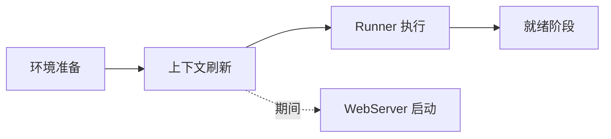
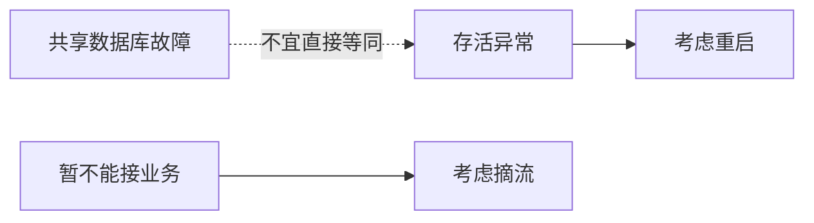
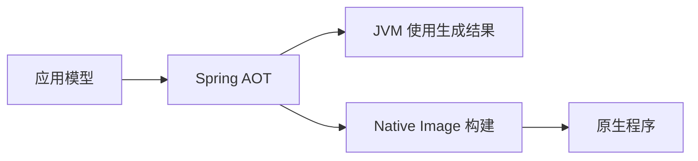

# Spring Boot 面试：把自动装配解释成因果链

> **建议用法**：先给一句话结论，再说明输入、条件、对象和运行结果。与 [原理篇](SpringBoot原理.md) 配套；基线为 Boot 3.5，并单独说明 Boot 4 差异。
>
> **重点路线**：Q1—Q9 装配与依赖；Q10—Q16 启动与配置；Q17—Q20 Web 与关闭；Q21—Q25 观测与容量；Q26—Q31 测试、AOT 和版本。

### Q1：Spring Boot 与 Spring 有什么关系？

> **一句话结论**：Boot 基于 Spring Framework 提供应用约定、条件装配和运行支持，不替换容器与事务核心。

**机制展开**：Framework 负责对象、代理和资源边界；Boot 把 Web、数据访问、日志与运行观测等常见组合编码成默认规则。默认行为由类路径、已有对象、属性和应用类型决定，因此自动配置仍是明确可解释的配置。

**⚖️ 方案对比与代价**：减少重复装配同时引入间接性，关键能力应能追踪定义来源和条件结果；特殊需求仍可显式配置。

**🔎 追问演练**：不用 Boot 能写 Spring Web 应用吗？

**推演要点**：可以。Boot 简化工程组合与运行方式，不是使用 Spring MVC（Model-View-Controller，模型—视图—控制器）的必要前提。

**原理展开**：[对应章节](SpringBoot原理.md#sb-01)。

---

### Q2：Starter、BOM 和自动配置分别是什么？

> **一句话结论**：Starter 聚合依赖，BOM 管理版本，自动配置按条件注册对象。

**机制展开**：BOM（Bill of Materials，物料清单）导入依赖管理，不会把其中所有库都加进项目。Starter 引入能力相关依赖；自动配置检查这些依赖和环境再决定注册 Bean，构建插件另负责重打包等构建任务。

**⚖️ 方案对比与代价**：混淆职责会导致只引入 BOM 却缺类，或依赖已在却因条件不匹配而缺 Bean；排查应分别看依赖树与条件报告。

**🔎 追问演练**：有 Starter 就必然产生对应 Bean 吗？

**推演要点**：不一定。可能被功能开关关闭、缺少必要属性、已有用户对象使其退让，或应用类型不匹配。

**原理展开**：[对应章节](SpringBoot原理.md#sb-02)。

---

### Q3：为什么不建议随意覆盖单个依赖版本？

> **一句话结论**：Boot 管理的是验证过的依赖组合，单独替换可能破坏二进制与行为兼容。

**机制展开**：依赖经多层管理与冲突仲裁决定最终版本，编译时与运行时类路径还可能不同。NoSuchMethodError 常提示编译目标与运行库的接口不一致，但仍需确认实际加载的类与来源。

**⚖️ 方案对比与代价**：必要的安全修复可能需要定向升级，但应先评估兼容范围，验证序列化、服务器、客户端和集成行为。

**🔎 追问演练**：parent 与只导入 BOM 有什么差别？

**推演要点**：parent 可提供额外构建默认值与插件相关配置；只导入 BOM 主要获得依赖版本管理，不继承其全部构建约定。

**原理展开**：[对应章节](SpringBoot原理.md#sb-02)。

---

### Q4：Boot 可执行 JAR 为什么能运行嵌套依赖？

> **一句话结论**：Boot 启动器与归档布局共同支持嵌套依赖加载，普通标准类路径不会自动递归加载内部 JAR。

**机制展开**：JAR（Java Archive，Java 归档）重打包后，应用类与依赖通常分别放在 BOOT-INF/classes 和 BOOT-INF/lib，启动器建立相应加载路径再调用应用 main。它与普通用于依赖引用的库包用途不同。

**⚖️ 方案对比与代价**：单包交付便于固定运行组合，也要管理包大小、分层缓存和服务器版本；不能随意把可执行包当普通库引用。

**🔎 追问演练**：没有 Boot 插件，代码能编译就一定可 java -jar 吗？

**推演要点**：不一定。可执行入口、依赖布局和装载方式属于打包运行契约，需要检查实际生成归档。

**原理展开**：[对应章节](SpringBoot原理.md#sb-02)。

---

### Q5：SpringBootApplication 的核心组成是什么？

> **一句话结论**：组合配置类标识、自动配置启用和组件扫描，三者职责不同。

**机制展开**：应用包通常成为业务扫描起点；自动配置则通过约定的候选导入机制进入，不要求位于该包下。扫描漏包导致业务 Bean 缺失，与自动配置条件失败不是同一个问题，源码和排障入口应分开。

**⚖️ 方案对比与代价**：应用类放得过低可能漏组件，默认包扫描又过宽；明确包结构通常优于不断追加零散扫描路径。

**🔎 追问演练**：第三方自动配置为什么不用扩大 ComponentScan？

**推演要点**：因为它本应通过自动配置候选机制导入，盲目扫描可能注册内部实现并破坏退让顺序。

**原理展开**：[对应章节](SpringBoot原理.md#sb-03)。

---

### Q6：自动配置到底怎样加载？

> **一句话结论**：读取候选清单、执行排除与排序、评估条件，再注册匹配定义。

**机制展开**：Boot 3 的自动配置候选使用 META-INF/spring/org.springframework.boot.autoconfigure.AutoConfiguration.imports 等约定。候选是配置类，不是所有第三方类；条件可能在解析与注册不同阶段求值，实例随后由容器按依赖创建。

**读图**：这是主干职责图，条件可能在解析和注册不同阶段评估。

**⚖️ 方案对比与代价**：不能简化成全包扫描或所有类反射实例化；理解定义阶段有助于解释为什么类存在却没有 Bean。

**🔎 追问演练**：spring.factories 在 Boot 3 完全没用了吗？

**推演要点**：不是。旧键不再用于自动配置候选注册，不等于所有其他扩展机制都停止使用这个文件。

**原理展开**：[对应章节](SpringBoot原理.md#sb-03)。

---

### Q7：ConditionalOnMissingBean 怎么实现用户优先？

> **一句话结论**：自动配置在缺少匹配候选时提供默认对象，让显式对象成为替换入口。

**机制展开**：判断对象类型、名称等条件时，受已处理定义、返回类型信息和搜索范围影响。用户定义先被识别后，默认配置能够退让；它不是任何时候新增对象都自动覆盖的全局规则。

**⚖️ 方案对比与代价**：按类型退让、同名定义覆盖与参数定制器是不同扩展方式；能用属性或定制器完成时，不一定要重建整个组件。

**🔎 追问演练**：用户 Bean 与默认 Bean 名字不同，也能退让吗？

**推演要点**：可能可以，取决于具体条件是否按类型判断，不能只看名字。

**原理展开**：[对应章节](SpringBoot原理.md#sb-03)。

---

### Q8：自动配置顺序就是 Bean 创建顺序吗？

> **一句话结论**：通常不是，配置排序主要影响定义处理，对象创建主要由依赖关系决定。

**机制展开**：AutoConfiguration 的 before/after 等让相关配置按顺序参与解析，便于条件看见前面定义。实例化时容器再解析依赖，若需要先创建某个协作者，应通过明确依赖表达，而非把配置类排序当运行调度。

**⚖️ 方案对比与代价**：DependsOn 可声明初始化依赖但也不能随意解决业务时序；过多隐式顺序会使模块难以组合。

**🔎 追问演练**：after 某数据源配置就保证数据库连接成功了吗？

**推演要点**：不保证。定义先处理、对象创建和远程资源实际可用是三个不同事实。

**原理展开**：[对应章节](SpringBoot原理.md#sb-03)。

---

### Q9：怎样设计一个可靠的自定义 Starter？

> **一句话结论**：给出清晰属性模型、条件边界、默认退让和资源生命周期，并验证条件矩阵。

**机制展开**：通常拆为能力库、自动配置与依赖入口；自动配置按类和属性判断，绑定类型化配置，提供用户替换点。可选类型要适当隔离，避免条件前触发类加载问题；线程、连接与后台任务需可关闭。

**⚖️ 方案对比与代价**：过度自动化可能覆盖用户安全与容量设置。默认值应保守且可解释，不能悄悄创建无界线程池或全局策略。

**🔎 追问演练**：怎么证明用户自定义后能正确替换？

**推演要点**：用小范围上下文分别验证默认、用户对象、禁用开关、缺类与非法属性，而非只验证完整应用能启动。

**原理展开**：[对应章节](SpringBoot原理.md#sb-04)。

---

### Q10：SpringApplication.run 的关键阶段有哪些？

> **一句话结论**：先准备环境，再创建并刷新上下文，之后执行 Runner 并推进应用就绪。

**机制展开**：环境影响日志、配置加载和条件，必须早于普通 Bean；上下文刷新注册定义并创建对象，Web 服务器在刷新流程内创建和启动。Runner 完成后才推进后续就绪阶段，端口监听和业务就绪不能等同。

**读图**：服务器监听与应用完成就绪不是同一阶段。

**⚖️ 方案对比与代价**：阶段化让早期扩展有明确位置，但也要求不要把无界任务放进启动线程；准备工作应有超时与失败策略。

**🔎 追问演练**：端口已通就可以立即接所有业务吗？

**推演要点**：不能仅凭这一点判断，还需预热、可用性状态与平台流量策略配合。

**原理展开**：[对应章节](SpringBoot原理.md#sb-05)。

---

### Q11：Runner、PostConstruct、Ready 事件怎么选？

> **一句话结论**：分别对应启动任务、本对象初始化和启动后阶段，按需要的就绪边界选择。

**机制展开**：PostConstruct 适合注入后的本地准备，不保证整个容器或最终代理可用；Runner 是有边界的应用启动任务，可让失败阻止就绪；Ready 事件也不能保证未来外部依赖始终健康。长驻消费任务更适合受管生命周期组件。

**⚖️ 方案对比与代价**：把所有初始化搬到 Ready 只是移动时序，未必保证业务正确；任务需要可观测、可取消和停止协议。

**🔎 追问演练**：Runner 内无限循环消费消息有什么问题？

**推演要点**：阻止正常返回与后续就绪推进，还让停止和异常处理难以纳入生命周期。

**原理展开**：[对应章节](SpringBoot原理.md#sb-05)。

---

### Q12：启动慢或卡死怎么查？

> **一句话结论**：按环境加载、定义解析、实例初始化、外部连接与 Runner 分阶段定位。

**机制展开**：先取得启动时间线和线程栈，看是在类路径扫描、锁等待、远程配置、数据库连接还是业务初始化。大量 Bean 也可能只是表象，单个同步网络调用就能占主要耗时；证据要落到等待位置和时长。

**⚖️ 方案对比与代价**：Lazy 能缩短部分启动，却可能把故障推到首请求；提高超时或扩大扫描范围都不应作为无证据修复。

**🔎 追问演练**：为什么日志最后停在某 Bean，却未必是它的问题？

**推演要点**：日志只是最后输出点，真实线程可能阻塞在其依赖、后台初始化或锁上，需要线程栈与依赖链佐证。

**原理展开**：[对应章节](SpringBoot原理.md#sb-05)。

---

### Q13：外部配置优先级应该怎样回答？

> **一句话结论**：按具体属性来源与加载阶段回答，常见来源可比较但不能冒充完整清单。

**机制展开**：通常命令行高于 Java 系统属性、环境变量和配置数据，默认属性更低；测试和开发工具等还有额外来源。配置文件内部还区分位置、Profile 与导入顺序，命令行属性加入也可以被禁用。

**⚖️ 方案对比与代价**：盲目把值再复制到高优先级位置会让后续更难排查，应查看最终值与来源，减少重复定义。

**🔎 追问演练**：PropertySource 为什么不能改部分日志设置？

**推演要点**：它通常在刷新过程中加入，对早期已读取的 logging 或 spring.main 属性可能太晚。

**原理展开**：[对应章节](SpringBoot原理.md#sb-06)。

---

### Q14：Value 与 ConfigurationProperties 怎样选？

> **一句话结论**：少量离散值可用 Value，成组配置更适合类型化绑定与校验。

**机制展开**：ConfigurationProperties 可以把地址、Duration 与阈值组织成配置模型，支持宽松绑定、元数据与校验。Value 使用方便且支持表达式，但散落业务字段后，跨字段约束与整体演进更难。

**⚖️ 方案对比与代价**：类型化不是只包一层对象，应明确单位、默认值、范围与组合合法性；配置过多也需要控制公共契约。

**🔎 追问演练**：超时写成整数为什么容易出问题？

**推演要点**：500 的单位可能不清楚，换库时语义更易变化；使用带单位配置和 Duration 可减少歧义。

**原理展开**：[对应章节](SpringBoot原理.md#sb-06)。

---

### Q15：Profile 能不能当环境隔离？

> **一句话结论**：Profile 是条件组合机制，不是权限或网络隔离。

**机制展开**：激活多个 Profile 会叠加配置并按规则覆盖，列表与 Map 还可能有不同合并行为。配置导入可以引入额外来源，optional 表达对指定位置缺失的容忍，不代表所有失败都无条件忽略。

**⚖️ 方案对比与代价**：开发和生产差异应可追踪并受权限约束，不能只靠一个字符串防止误连数据库。

**🔎 追问演练**：只改 Profile 就能安全共用生产凭据吗？

**推演要点**：不能。凭据访问、网络和资源权限需要独立边界，配置组合不提供这些隔离。

**原理展开**：[对应章节](SpringBoot原理.md#sb-06)。

---

### Q16：修改配置文件，Bean 会自动更新吗？

> **一句话结论**：Boot 的属性加载不等于运行中对象重建，已有构造参数通常不会自行变化。

**机制展开**：Environment 属性、ConfigurationProperties 绑定、Cloud 刷新作用域与自定义资源重建属于不同层次。即使环境里出现新值，单例里已经保存的连接或数值也不必然更新；某些资源不能安全热替换。

**⚖️ 方案对比与代价**：地址和阈值可设计动态更新，数据源、密钥和协议切换更需校验、灰度与回退；不能追求所有配置实时生效。

**🔎 追问演练**：RefreshScope 能原子更新整台应用吗？

**推演要点**：不能直接这样理解，它主要围绕作用域目标失效与重建，跨对象与跨实例一致性需要额外协议。

**原理展开**：[对应章节](SpringBoot原理.md#sb-06)。

---

### Q17：嵌入式服务器和外部容器怎样比较？

> **一句话结论**：嵌入式把服务器版本与应用一起交付，外部容器把更多运行环境责任交给平台。

**机制展开**：WAR（Web Application Archive，Web 应用归档）通常部署到外部 Servlet 容器；可执行包可内嵌服务器，生命周期统一且便于独立发布。嵌入式服务器并不是只适合测试，它仍需容量、安全和版本管理。

**⚖️ 方案对比与代价**：自包含提高可复现性，也意味着服务器补丁需要进入应用升级流程；共享外部容器则有平台兼容与相互影响成本。

**🔎 追问演练**：换成内嵌方式就没有服务器运维了吗？

**推演要点**：没有消失，只是责任位置发生变化，连接、线程、协议与补丁仍要管理。

**原理展开**：[对应章节](SpringBoot原理.md#sb-07)。

---

### Q18：同时引入 MVC 和 WebFlux，会跑哪个？

> **一句话结论**：默认通常偏向 Servlet MVC，但要结合显式应用类型和实际配置确认。

**机制展开**：引入 WebFlux 可能只是使用 WebClient，并不意味着服务端自动非阻塞。应看实际上下文类型、服务器与装配条件，不能从存在 Mono 或某个依赖直接推断整条链路模型。

**⚖️ 方案对比与代价**：无意混用会增加依赖与认知成本；确有同步服务端加响应式客户端的需求时，应明确阻塞发生位置与超时。

**🔎 追问演练**：Controller 返回 Mono 就是 WebFlux 服务吗？

**推演要点**：不必然。MVC 也能适配部分异步返回类型，服务端模型还由整体装配决定。

**原理展开**：[对应章节](SpringBoot原理.md#sb-07)。

---

### Q19：EnableWebMvc 为什么可能改变默认行为？

> **一句话结论**：它表达更完整的手工 MVC 配置接管，会影响 Boot 的自动配置条件。

**机制展开**：通常通过 WebMvcConfigurer 扩展转换、资源和拦截器可保留 Boot 默认组合；启用 EnableWebMvc 后部分默认装配退让，静态资源、转换器和参数行为可能与原来不同。需看具体版本实际注册结果。

**⚖️ 方案对比与代价**：全接管提供控制力，也增加维护责任；只是加一个拦截器时不必承担整套配置。

**🔎 追问演练**：加配置后日期序列化变了，先查哪里？

**推演要点**：检查是否接管 MVC、替换转换器或序列化器，再看实际对象与属性，而非只给每个字段加注解。

**原理展开**：[对应章节](SpringBoot原理.md#sb-07)。

---

### Q20：优雅关闭能保证请求都成功吗？

> **一句话结论**：它尝试停止接单并等待在途工作，但受超时、协议与进程终止方式限制。

**机制展开**：入口先摘流，再停止接受新业务并协调请求、消息和后台任务，最后释放资源。Web 服务器的关闭能力不会自动覆盖所有独立线程和业务队列；强制终止或预算耗尽仍会中断。

**⚖️ 方案对比与代价**：增加等待时间能减少中断却拖慢发布；最终仍需幂等、确认和可恢复状态，不能把回调当交付保证。

**🔎 追问演练**：消息消费者先关闭数据库会怎样？

**推演要点**：在途任务可能无法完成却已进入处理，应按依赖方向停止接单、处理或恢复在途工作，再释放资源。

**原理展开**：[对应章节](SpringBoot原理.md#sb-07)。

---

### Q21：Liveness 与 Readiness 有什么区别？

> **一句话结论**：前者关联是否应重启，后者关联是否应承接新流量。

**机制展开**：存活关注应用是否处于无法自行恢复的状态，就绪关注当前服务能力。数据库暂时不可用就让所有实例存活失败，可能造成集体重启风暴；是否纳入就绪也要考虑部分接口能否继续服务。

**⚖️ 方案对比与代价**：探针过严会放大外部故障，过松会继续导入失败流量，应基于依赖关键性与平台摘流效果设计。

**🔎 追问演练**：health 返回 UP 就证明业务正确吗？

**推演要点**：不能。健康检查覆盖有限，业务成功率、延迟和数据状态需要其他证据。

**原理展开**：[对应章节](SpringBoot原理.md#sb-08)。

---

### Q22：Actuator 端点暴露和安全是一回事吗？

> **一句话结论**：不是，端点可用、通过某技术暴露、请求被授权是不同层次。

**机制展开**：端点存在不代表自动向公网开放，配置暴露也不代表匿名可访问。自定义安全链会影响默认安全装配，env、堆转储与日志控制等能力敏感度也不同，应验证真实访问路径和脱敏效果。

**⚖️ 方案对比与代价**：按运维需求最小化暴露方便控制；全开放省配置却可能泄露资源和配置细节。

**🔎 追问演练**：关闭 Web 暴露就保证所有入口不存在？

**推演要点**：不一定，还要核对其他管理技术、独立管理端口及实际访问边界。

**原理展开**：[对应章节](SpringBoot原理.md#sb-08)。

---

### Q23：指标、日志和追踪如何配合？

> **一句话结论**：指标看趋势，日志看事件细节，追踪看调用路径，业务记录保存权威状态。

**机制展开**：Micrometer 提供统一观测接口，但具体埋点仍需正确设计。P99（99th Percentile，第 99 百分位）不能简单跨服务相加；追踪有采样，日志也可能缺失，不能只靠一次 trace 推断总体错误率。

**⚖️ 方案对比与代价**：订单号、用户号作为指标标签会产生高基数，适合受控日志或追踪关联；低基数聚合用于长期统计。

**🔎 追问演练**：接入组件后链路仍断为什么？

**推演要点**：可能绕过了自动配置客户端、异步上下文未传播或消息协议没携带上下文，需要逐边界确认。

**原理展开**：[对应章节](SpringBoot原理.md#sb-08)。

---

### Q24：虚拟线程能代替连接池和限流吗？

> **一句话结论**：不能，它降低等待线程成本，不增加数据库与下游容量。

**机制展开**：Boot 在相应 Java 21+ 环境支持虚拟线程。同步代码的适配阻塞可降低载体线程占用，但连接池、锁与远程配额仍有限；JDK 版本也影响部分固定线程行为，应按实际版本测量。

**⚖️ 方案对比与代价**：线程变便宜后更容易无约束放量，应显式限制稀缺资源并发，而不是不断扩大入口。

**🔎 追问演练**：线程很多却吞吐不涨先查什么？

**推演要点**：看 CPU（Central Processing Unit，中央处理器）、连接等待、锁与下游饱和，定位瓶颈资源；线程数量并不是吞吐能力。

**原理展开**：[对应章节](SpringBoot原理.md#sb-09)。

---

### Q25：线程池、连接池与请求超时怎么协调？

> **一句话结论**：用端到端预算覆盖排队和资源获取，避免任务超时后继续无限消耗。

**机制展开**：Little 定律在稳定条件下近似 L 等于到达率乘平均停留时间，可以估算在途量，但不能直接得到最优连接数。队列过大把拒绝转为长延迟，连接获取、建连与读取也可能有不同超时范围。

**⚖️ 方案对比与代价**：大队列吸收短突发，也可能扩大故障恢复时间；更合理的是有界排队、拒绝策略、并发控制与观测。

**🔎 追问演练**：超时返回后数据库一定停止了吗？

**推演要点**：不一定。取消的传播和资源驱动能力不同，重试仍需幂等和最终结果确认。

**原理展开**：[对应章节](SpringBoot原理.md#sb-09)。

---

### Q26：什么时候用切片测试，什么时候用全上下文？

> **一句话结论**：按要验证的契约选择最小充分范围，组合行为才使用更大上下文。

**机制展开**：普通测试验证业务分支，Web 或数据切片验证特定装配，SpringBootTest 验证应用组合；真实数据库与消息系统用于验证协议、锁和提交。切片默认不会把全部服务都扫描进来。

**⚖️ 方案对比与代价**：全上下文更接近组合行为但慢且故障定位复杂；纯替身快却可能掩盖代理和资源语义。

**🔎 追问演练**：WebMvcTest 找不到 Service 是框架问题吗？

**推演要点**：通常是切片边界，需要按测试目标导入或提供替身，而非把整个生产扫描范围无条件加进来。

**原理展开**：[对应章节](SpringBoot原理.md#sb-10)。

---

### Q27：自动配置测试应该覆盖什么？

> **一句话结论**：覆盖成立与退让条件，而非只断言启动不报错。

**机制展开**：小范围上下文应分别测试默认能力、用户对象替换、功能关闭、可选依赖缺失和属性非法。条件报告解释为什么注册或未注册，但不会证明数据库和外部 API 的业务行为。

**⚖️ 方案对比与代价**：条件矩阵能快速定位 Starter 契约，仍需少量实际依赖集成测试，避免过度模拟掩盖协议不兼容。

**🔎 追问演练**：类在依赖树里却没有 Bean 怎么查？

**推演要点**：候选是否导入、应用类型、属性、已有定义和条件搜索范围逐一核对，再看实例创建异常。

**原理展开**：[对应章节](SpringBoot原理.md#sb-03)。

---

### Q28：MockBean 在新版本里怎样变化？

> **一句话结论**：Boot 3.4 起弃用旧支持，Boot 4 转向 Framework 的 MockitoBean 与 MockitoSpyBean。

**机制展开**：新旧注解的声明位置和覆盖语义有差异，Boot 4 的测试模块与包结构也发生调整。迁移时先确认替身覆盖了正确对象，而不是仅看到编译成功；共享测试配置的声明方式尤其要核对。

**⚖️ 方案对比与代价**：批量文本替换速度快却可能改变测试含义，应该对关键上下文确认对象类型与交互。

**🔎 追问演练**：原来写在 Configuration 里的声明能原样替换吗？

**推演要点**：不能保证，需按新注解允许的位置重构到测试类、字段或适合的组合声明。

**原理展开**：[对应章节](SpringBoot原理.md#sb-10)。

---

### Q29：AOT 和 Native Image 有什么区别？

> **一句话结论**：AOT 是提前分析和生成，Native Image 是进一步构建原生可执行程序，两者不完全等同。

**机制展开**：AOT（Ahead-of-Time，提前处理/编译）可生成初始化代码和运行时提示，也可用于 JVM（Java Virtual Machine，Java 虚拟机）；Native Image 采用封闭世界分析，需要知道反射、资源和代理等可达行为。原生并不是完全不能反射，而是需要被提前识别或声明。

**⚖️ 方案对比与代价**：原生常改善启动和基础占用，但构建更重、动态性受限，长期吞吐不保证优于 JIT（Just-in-Time，即时编译）。

**🔎 追问演练**：原生镜像运行时还能随便改 Profile 切换对象图吗？

**推演要点**：不能照搬普通运行模式。影响构建期 Bean 结构的条件需要提前确定，运行期可变属性应逐类验证。

**原理展开**：[对应章节](SpringBoot原理.md#sb-11)。

---

### Q30：Boot 3 与 Boot 4 的重点差异是什么？

> **一句话结论**：Boot 4 进入 Framework 7 与新 Jakarta 基线，并调整模块、测试和序列化生态。

**机制展开**：Boot 3 基于 Framework 6 且 Java 17 起步；Boot 4.0 仍以 Java 17 为最低运行基线，面向 Servlet 6.1，优先 Jackson 3，并更细分运行和测试模块。不是要求 Java 21 才能启动，也不是改一个版本号即可迁移。

**⚖️ 方案对比与代价**：需要验证第三方库、序列化样本、HTTP 契约和 Cloud 配套。支持周期与兼容矩阵应分开查，不把本文学习基线当维护承诺。

**🔎 追问演练**：Jackson 包名可以全局替换吗？

**推演要点**：不能。注解等存在例外，还要验证默认行为与自定义序列化器；源码可编译不代表线协议兼容。

**原理展开**：[对应章节](SpringBoot原理.md#sb-12)。

---

### Q31：一个 Boot 项目启动成功，意味着准备好上线了吗？

> **一句话结论**：只能证明部分启动路径完成，还需验证业务契约、资源边界与可恢复性。

**机制展开**：从依赖版本、条件装配、配置来源、真实事务提交、接口样本、安全边界、观测和停止行为逐项收集证据。重点关注已自动装配但业务语义仍由项目负责的部分，例如幂等、权限、缓存与消息。

**⚖️ 方案对比与代价**：不用为每个低风险默认项都做重型测试，而是围绕关键用户路径和真实故障边界验证。

**🔎 追问演练**：最容易漏的一个边界是什么？

**推演要点**：提交后行为和进程中断：自动回滚测试、内存事件与关闭回调可能让人高估可靠性，需要真实提交与恢复验证。

**原理展开**：[对应章节](SpringBoot原理.md#sb-12)。

---

## 参考与版本核对

装配与外部配置核对 [自动配置指南](https://docs.spring.io/spring-boot/3.5/reference/features/developing-auto-configuration.html) 和 [属性源说明](https://docs.spring.io/spring-boot/3.5/reference/features/external-config.html)；升级行为核对 [Boot 4 迁移指南](https://github.com/spring-projects/spring-boot/wiki/Spring-Boot-4.0-Migration-Guide)。

## 附录：术语与缩写

| 术语 | 英文全称 | 中文含义 / 边界 |
|---|---|---|
| Boot | Spring Boot | 在 Spring 上提供应用约定、装配与运行支持 |
| Starter | Dependency Starter | 一组面向能力的依赖入口 |
| BOM | Bill of Materials | 统一依赖版本的物料清单，不自动引入全部依赖 |
| IoC | Inversion of Control | 控制反转 |
| AOP | Aspect-Oriented Programming | 面向切面编程 |
| JAR | Java Archive | Java 归档 |
| WAR | Web Application Archive | Web 应用归档 |
| JVM | Java Virtual Machine | Java 虚拟机 |
| JDK | Java Development Kit | Java 开发工具包 |
| HTTP | Hypertext Transfer Protocol | 超文本传输协议 |
| JSON | JavaScript Object Notation | 结构化数据交换格式 |
| I/O | Input/Output | 输入输出 |
| CPU | Central Processing Unit | 中央处理器 |
| AOT | Ahead-of-Time | 提前处理或编译 |
| JIT | Just-in-Time | 即时编译 |
| Native Image | Native Executable Image | 基于提前分析构建的原生可执行程序 |
| SPI | Service Provider Interface | 服务提供者接口 |
| Profile | Configuration Profile | 条件配置组合，不是安全隔离机制 |
| Liveness | Liveness Probe | 存活判定，关联是否重启 |
| Readiness | Readiness Probe | 就绪判定，关联是否接流量 |
| P95 / P99 | 95th / 99th Percentile | 延迟分位值 |
| SLO | Service Level Objective | 服务等级目标 |
| API | Application Programming Interface | 应用程序编程接口 |
| Java SE | Java Platform, Standard Edition | Java 标准版 |
| Jakarta EE | Jakarta Enterprise Edition | Jakarta 企业级平台规范 |
| URI | Uniform Resource Identifier | 统一资源标识符 |
