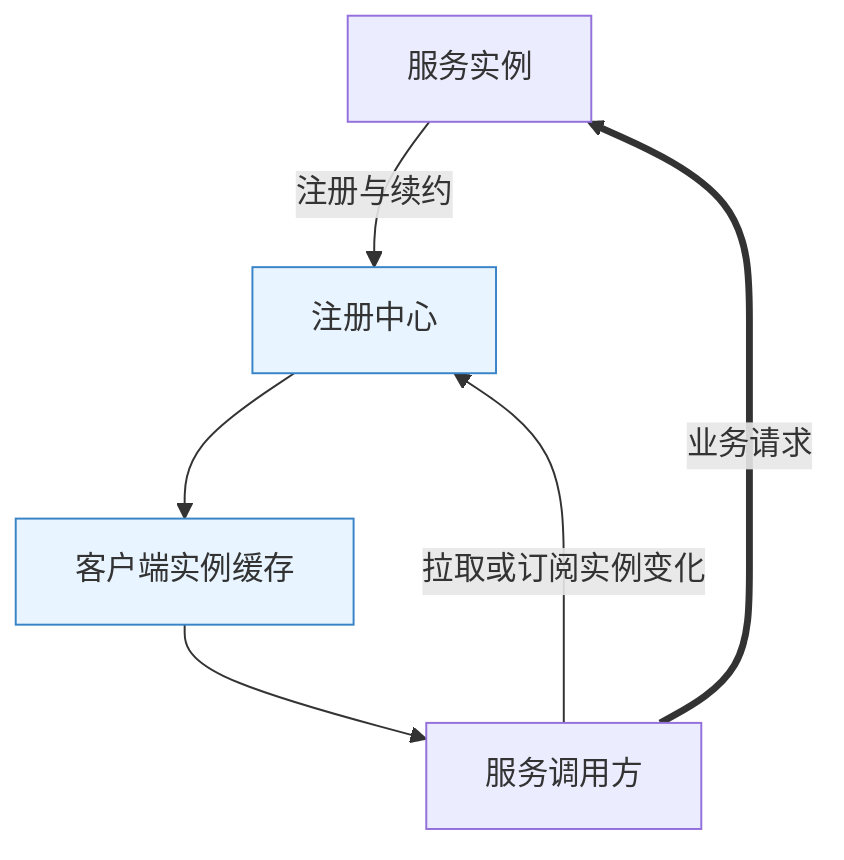
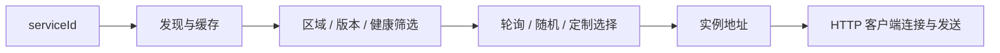
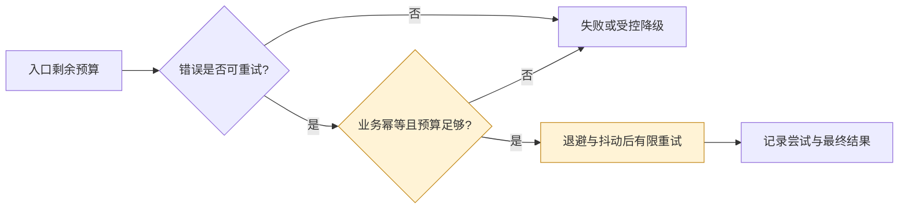
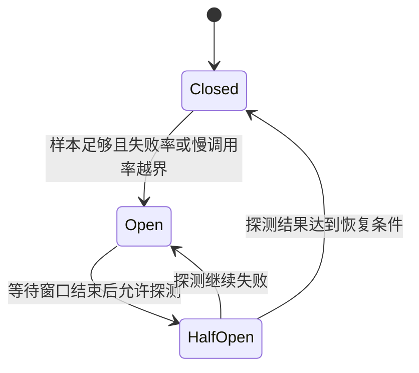
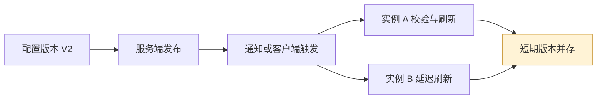
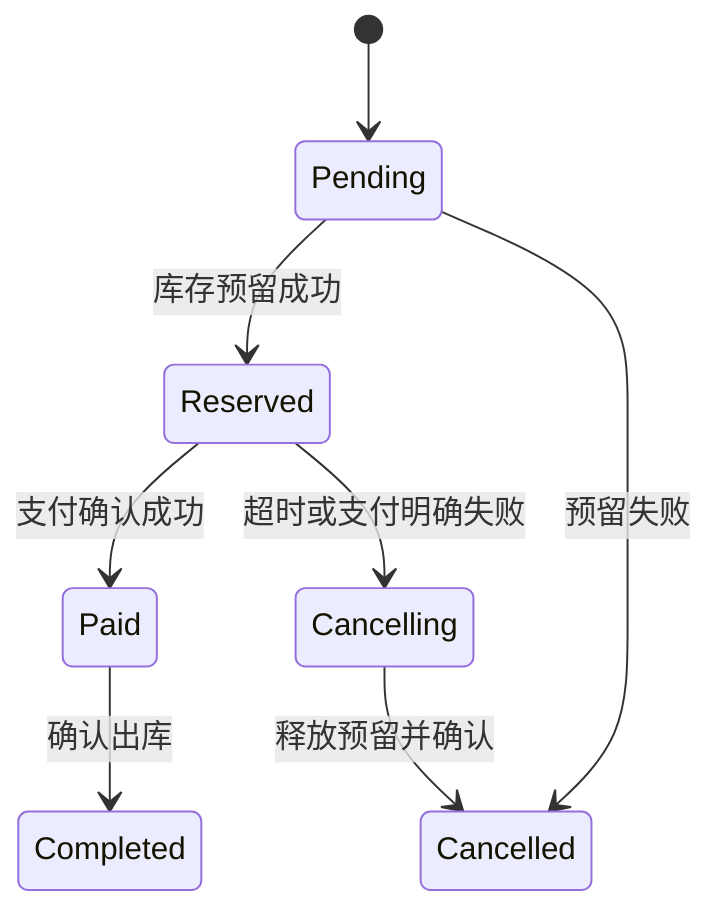

# Spring Cloud 原理：从跨进程调用到可治理的分布式系统

> **阅读定位**：理解为什么需要注册发现、负载均衡、熔断、配置与消息抽象，以及它们解决不了什么。重点是架构演进与故障推演，不是部署步骤。搭配 [Spring Cloud 面试](SpringCloud面试.md)。
>
> **版本口径**：以 Boot 3.5 / Cloud 2025.0 的常见机制为学习参照，同时说明 Boot 4 / Cloud 2025.1 方向。兼容关系与维护状态分开，具体选择以官方当前矩阵为准。

## 阅读导航

| 主线 | 章节 |
|---|---|
| 为什么拆服务，Cloud 到底是什么 | [1](#sc-01)、[2](#sc-02) |
| 调用如何找到实例并发出去 | [3](#sc-03)、[4](#sc-04)、[5](#sc-05) |
| 超时、重试、熔断、隔离与入口治理 | [6](#sc-06)、[7](#sc-07)、[8](#sc-08) |
| 配置、观测、消息与一致性 | [9](#sc-09)、[10](#sc-10)、[11](#sc-11)、[12](#sc-12) |
| 安全、平台整合与故障演练 | [13](#sc-13)、[14](#sc-14)、[15](#sc-15) |

## 1. 从单体到微服务：问题是怎样增加的

> 🎯 **核心结论**：微服务通过独立边界换取团队自治与独立扩展，同时把进程内协作变成有延迟、可能部分失败的网络协议。

### 1.1 架构演进不是单向升级

| 形态 | 解决的主要问题 | 新增代价 | 适合的前提 |
|---|---|---|---|
| 单体 | 统一开发、事务与发布 | 大应用耦合和发布协调 | 团队与业务规模可控 |
| 模块化单体 | 约束领域依赖与职责 | 模块边界需要治理 | 希望先改善结构，暂不承担网络成本 |
| 微服务 | 独立发布、数据所有权与扩展 | 分布式一致性、调用治理、运维观测 | 组织、领域边界和平台能力足够成熟 |

拆成多个进程但共享数据库、同步串联长链、每次一起发布，可能形成“分布式单体”：既保留耦合，又增加网络故障。先问业务边界和团队责任，再选组件。

**读图**：模块边界应先于网络边界。Cloud 提供对新增问题的工具集，不会自动证明拆分正确。

### 1.2 本地调用和远程调用有何本质区别

远程调用超时后，调用方不能只凭异常知道对端是否完成。例如库存扣减已经提交，响应在网络中丢失；直接重试可能再次扣减。**超时描述调用方的等待结果，不是对端业务状态的最终证明**。

这引出四条基础设计：显式截止时间、有限重试、幂等业务协议、可查询与可补偿状态。任何 HTTP（Hypertext Transfer Protocol，超文本传输协议）客户端封装都不能消除这些要求。

## 2. Cloud 的边界、版本列车与组件演进

> 🎯 **核心结论**：Spring Cloud 是多个项目的组合生态，不是一个必须全部安装的平台；组件由发布列车协调版本。

### 2.1 三层职责

| 层次 | 主要问题 | 代表机制 |
|---|---|---|
| Framework | 进程内对象、代理和资源边界 | 依赖注入、事务、MVC |
| Boot | 一个应用如何组装与运行 | 自动配置、外部配置、Actuator |
| Cloud | 多个应用如何协作与治理 | 发现、客户端负载均衡、网关、配置、熔断、消息 |

BOM（Bill of Materials，物料清单）统一一组依赖版本；发布列车是兼容组件组合，不等于每个子组件都使用同一个数字版本。Spring Cloud Alibaba 是相关但独立演进的项目，Nacos、Sentinel、Seata 不能当作 Spring Cloud 核心内置实现直接混写。

### 2.2 学习矩阵与支持周期分开

| Cloud 发布列车 | 对应 Boot 线 | 用途说明 |
|---|---|---|
| 2023.0 | 3.2 / 3.3，其中 3.3 从相应服务版本起支持 | 识别存量项目，不能推导仍在维护 |
| 2024.0 | 3.4 | 同上，检查支持状态 |
| 2025.0 | 3.5 | 本文 Boot 3 机制参照组合 |
| 2025.1 | 4.0；从 2025.1.2 起包含 4.1 | Boot 4 对应组合，子组件版本可能升主版本 |

以上为 **2026-11-09 查阅的兼容关系**，不是生命周期承诺。使用矩阵匹配后，还要检查发布说明、安全补丁与当前支持状态。[官方兼容矩阵](https://spring.io/projects/spring-cloud/)

### 2.3 旧组件如何放回历史位置

| 历史常见组合 | 当前学习重点 | 不能误推的结论 |
|---|---|---|
| Ribbon | Spring Cloud LoadBalancer | Eureka 仍存在，不等于 Ribbon 仍是默认 |
| Hystrix | Spring Cloud CircuitBreaker + Resilience4j 等 | 切换依赖不代表隔离/超时语义完全相同 |
| Zuul 1 | Spring Cloud Gateway | Gateway 存在 WebFlux 与 MVC 不同实现 |
| Sleuth（Boot 2 时代） | Micrometer Observation / Tracing | 新 Boot 项目不应照搬旧 Sleuth 配置 |
| OpenFeign | 仍需理解存量；关注 HTTP Service Clients | feature-complete 不等于已经删除 |

OpenFeign 官方已将项目定位为功能完备、主要维护，并建议关注 Spring HTTP Service Clients。客户端替换仍需验证负载均衡、编码、错误与超时行为。[OpenFeign 官方定位](https://docs.spring.io/spring-cloud-openfeign/reference/)

## 3. 注册发现：控制面故障为什么不一定立即中断业务

> 🎯 **核心结论**：注册中心维护“服务有哪些实例”的控制信息；业务请求通常由客户端直接发往实例，不经注册中心转发。

**读图**：细线是控制面信息流，粗线是业务数据面。缓存使控制面短暂不可用时仍能调用已知实例，也带来过期地址和故障发现延迟。

### 3.1 为什么不用固定地址

固定 IP（Internet Protocol，网际协议）地址简单直接，但弹性扩缩、故障替换与滚动发布会改变实例集合。DNS（Domain Name System，域名系统）与平台服务可隐藏地址；客户端发现则能提供实例元数据、区域和应用级策略，代价是把更多治理逻辑带入客户端。

### 3.2 Eureka 的租约与自我保护

实例注册、周期续约，服务端根据租约和剔除策略判断存活；客户端也维护本地缓存。多个时间窗口叠加，意味着实例退出到完全停止被调用存在延迟，不能把“注册中心页面消失”当成请求绝不再到达的证明。

自我保护旨在避免网络异常时大量误剔除，不等于实例都健康。它可能保留失效地址，需要调用超时、异常观测、实例选择与重试协同。临时关闭保护不能替代根因分析。[Eureka 官方机制](https://docs.spring.io/spring-cloud-netflix/reference/spring-cloud-netflix.html)

### 3.3 ZooKeeper、Consul、Nacos 怎样比较

ZooKeeper 利用会话和临时节点构建发现，一致性与会话失效语义和 Eureka 不同；Consul 有健康检查与一致性存储相关机制；Nacos 的命名与配置能力也有不同模型和模式。比较时应看注册写入、订阅读取、缓存、健康与分区行为，**不要只用 CAP（Consistency, Availability, Partition Tolerance，一致性、可用性、分区容错）模型中的 AP（Availability + Partition Tolerance，可用性与分区容错）/CP（Consistency + Partition Tolerance，一致性与分区容错）标签覆盖全部客户端可见行为**。

### 3.4 优雅下线为什么要多方配合

先阻止新流量并发布不可用状态，再等待发现与负载均衡缓存更新，最后等待在途任务和资源释放。仅停止心跳通常不够快；仅关闭端口会让仍持有旧地址的调用失败。协议必须容忍残余请求和消息重复。

## 4. 客户端负载均衡：选择一个实例之前发生了什么

> 🎯 **核心结论**：负载均衡把“服务名”解析为本次调用的具体实例；候选集合质量和策略常常比轮询算法本身更重要。

Spring Cloud LoadBalancer 可以通过实例列表供应器获取候选，并组合缓存、健康、区域或其他筛选。轮询与随机是常见选择，但一个调用方的轮询并不等于全系统严格平均。[官方 LoadBalancer 说明](https://docs.spring.io/spring-cloud-commons/reference/spring-cloud-commons/loadbalancer.html)

**读图**：选择实例和发送请求是不同职责。选到了实例仍可能连接失败；注册存在也不等于业务健康。

### 4.1 客户端与服务端负载均衡

| 方式 | 优势 | 代价 |
|---|---|---|
| 客户端选择 | 可利用服务语义、区域与版本元数据 | 各语言客户端一致性、版本治理、缓存过期 |
| 代理/平台转发 | 对调用方透明、策略集中 | 转发层容量与额外跳数、连接级分配特点 |
| 两者结合 | 各自覆盖不同边界 | 重复重试、双重摘除、策略冲突需梳理 |

### 4.2 灰度与粘性的问题

按用户或租户筛选版本，需要可信且稳定的路由标识，并把标识传播到下游。只在网关分流而下游随机调用，可能让一次链路混用不同协议版本。粘性改善缓存与状态亲和，也可能造成热点；必须有实例失效后的回退规则。

重试是否重新选实例、候选为空怎样处理、客户端与发现组件是否重复缓存，都应结合具体配置与版本验证。不要假设每次重试必然切换健康实例。

## 5. OpenFeign 与 HTTP 客户端：接口调用仍然是网络协议

> 🎯 **核心结论**：声明式客户端减少编码、参数转换和调用模板代码，不会把远程调用变成本地调用。

### 5.1 一次调用的概念链路

接口代理解析方法元数据 → 编码路径、查询参数与请求体 → 执行拦截器 → 选择目标与底层客户端 → 发送 → 解码响应或映射错误。是否走服务发现，取决于使用服务名还是显式 URL（Uniform Resource Locator，统一资源定位符）等配置路径。

| 选择 | 主要收益 | 必须自己考虑 |
|---|---|---|
| 手写 HTTP 客户端 | 协议控制直接 | 模板代码、错误标准化与观测 |
| OpenFeign | 接口契约表达直观、生态集成成熟 | 超时、重试、线程与依赖兼容 |
| Spring HTTP Service Clients | 基于接口的声明式调用，连接新客户端体系 | 与发现、负载均衡和治理的具体集成 |
| WebClient | 响应式组合与流处理 | 不要用阻塞调用破坏执行模型 |

### 5.2 超时不止 connect 与 read

还可能等待连接池、DNS 解析、TLS（Transport Layer Security，传输层安全）握手、服务端排队和响应体读取。不同底层实现的超时覆盖范围不同；仅设置一个“Feign 超时”无法证明端到端耗时被完整限制。

### 5.3 重试默认值为什么不能凭印象回答

Spring Cloud OpenFeign 常见默认配置使用 `Retryer.NEVER_RETRY`，与原生 Feign 的某些默认行为不同；外层 LoadBalancer、熔断库或网关还可能增加重试。必须检查实际调用链每层策略，而非只看某一个类的默认值。[OpenFeign 特性说明](https://docs.spring.io/spring-cloud-openfeign/reference/spring-cloud-openfeign.html)

### 5.4 共享接口的取舍

共享契约减少重复，但把服务端实现相关注解、DTO（Data Transfer Object，数据传输对象）与客户端一起打包，可能引入发布耦合。契约应稳定、向后兼容，新增字段和枚举要考虑旧消费者；客户端模型不必等于数据库实体。

## 6. 超时、重试与幂等：从单次失败到故障放大

> 🎯 **核心结论**：先分配端到端时间预算，再决定哪些错误可重试、由哪一层重试，以及重复执行如何收敛。

### 6.1 时间预算不是各层随便设一个值

一次入口预算 300 ms，若选择最多两次尝试，每次 100 ms，间隔 20 ms，本地处理和网络余量预留 60 ms，总预算约 280 ms。实际还要让剩余时间沿链路递减，避免调用方早已超时、下游仍耗费数秒工作。

这只是设计示例，不是通用推荐值。取消请求也不保证数据库或对端立即停止，必须保留幂等与结果查询机制。

**读图**：重试不是连接失败后的无条件动作；错误分类、幂等和剩余预算必须同时成立。

### 6.2 重试风暴如何形成

网关最多尝试 3 次，服务 A 对 B 最多尝试 3 次，最坏可能给 B 发出 9 次请求。B 越慢，排队越长，超时越多，新增重试继续增加负载。指数退避与 jitter（随机抖动）减少同步碰撞，但不能凭空恢复已经不足的容量。

**工程选择**：选择最了解业务语义的一层控制重试，限制总尝试次数与比例；对限流、参数错误、明确业务拒绝不要盲目重试。熔断和并发隔离提供快速失败，避免等待资源继续堆积。

### 6.3 幂等键到底需要约束什么

幂等不只是“加一个 requestId”。需要定义作用域、唯一约束、参数一致性、处理中状态、最终结果、过期时间和重复响应协议。数据库唯一键能让竞争收敛，但必须与业务变更处于明确的事务关系。

例如付款键重复但金额不同，应拒绝冲突；第一次仍在执行时，第二次应查询/等待/返回处理中，而不能简单当成成功。缓存去重在故障或过期后可能失效，应按业务重要性选择持久化保障。

## 7. 熔断、隔离、限流与降级：四件不同的事

> 🎯 **核心结论**：熔断根据近期结果阻断故障调用，隔离限制故障占用的资源，限流控制进入速率，降级定义功能受限时的业务响应。

| 机制 | 限制对象 | 典型收益 | 常见误用 |
|---|---|---|---|
| Timeout | 一次等待 | 防止无限等候 | 认为超时意味着对端撤销 |
| Circuit Breaker | 故障依赖调用 | 快速失败并允许恢复探测 | 当作限流器使用 |
| Bulkhead | 并发与执行资源 | 防止一个依赖拖垮所有业务 | 队列太大导致延迟堆积 |
| Rate Limiter | 单位时间请求进入 | 保护配额与容量 | 多实例本地限额被误当全局限额 |
| Fallback | 失败后的响应行为 | 部分保留核心功能 | 把支付失败包装成支付成功 |

### 7.1 熔断状态机

**读图**：Closed 是允许调用，Open 是拒绝调用。单次失败不一定打开熔断器；时间/计数滑窗、最小样本、慢调用阈值和探测数都影响结果。

### 7.2 信号量与线程池隔离

信号量主要限制同时执行的数量，额外线程切换较少；线程池隔离提供独立执行资源与队列，但增加调度、排队和上下文传递成本。响应式链路还需匹配非阻塞模型，不能机械套用阻塞线程池思路。

限流若每个实例允许 100 次/秒，扩为 10 个实例可能变成约 1000 次/秒。全局配额需要共享状态、令牌分配或平台协调，也要权衡网络开销、热点与故障时放行策略。

### 7.3 降级如何保留真实语义

商品推荐可返回缓存或空列表；库存查询可以明确标记“暂不可确认”；付款不应默认成功。应区分可选依赖与核心依赖，记录 fallback 命中并限制旧数据的使用范围。观测只统计 HTTP 200 会掩盖大量业务降级。

Spring Cloud CircuitBreaker 提供抽象，Resilience4j 等提供具体能力。不同实现并不具备完全相同的配置、线程或响应式行为；新版本还可能增加 Framework 7 韧性能力的集成。[官方实现说明](https://docs.spring.io/spring-cloud-circuitbreaker/reference/)

### 7.4 限流算法为何有不同选择

| 算法思路 | 机制与收益 | 代价与边界 |
|---|---|---|
| 固定窗口 | 每个窗口累计数量，实现简单 | 窗口交界可能出现短时间突发 |
| 滑动窗口 | 按滚动时间范围统计，更平滑 | 精确记录或分桶近似增加状态成本 |
| 令牌桶 | 按速率补充令牌，允许桶内积累 | 可控突发不等于严格平滑流出 |
| 漏桶式整形 | 按受控速率释放或处理请求 | 排队增加等待，队列必须有界 |

这些是算法模型，不应把任何产品都直接贴为“标准令牌桶”。例如 Resilience4j 的实现按周期管理许可，并提供等待策略；应看具体实现的时钟、许可预留与并发行为。[Resilience4j 官方限流说明](https://resilience4j.readme.io/docs/ratelimiter)

### 7.5 多种韧性机制组合时先问顺序

限流拒绝是否计入熔断失败？重试每次是否重新获取并发许可？超时发生在整个重试外还是单次尝试内？降级是在最终失败后执行还是每次尝试都执行？同一套机制换一个嵌套顺序，统计、资源占用和用户结果就可能不同。

应画出一次逻辑请求的增强嵌套，并分别统计逻辑请求、物理尝试、被拒绝与降级。配额维度也需明确：按服务、租户、用户或 API 路由，公平性与热点成本完全不同。

## 8. Gateway：入口治理与服务业务如何分工

> 🎯 **核心结论**：网关集中处理路由与通用入口策略，业务服务仍应负责领域规则和资源级授权。

### 8.1 Route、Predicate、Filter

Route 表达目标和规则；Predicate 判断请求是否匹配；Filter 在转发前后执行逻辑。过滤器前置与后置顺序形成嵌套链，顺序不同会改变身份解析、限流键生成、重写路径和错误处理。

**读图**：图示职责顺序，不规定所有系统的固定过滤器排序。鉴权、路由和限流之间的依赖必须显式设计，例如使用用户限流键前必须先确认身份可信。

### 8.2 WebFlux 与 MVC 两条路线

Gateway 有 WebFlux 与 MVC 相关实现，不能把“Gateway 必然只支持 Netty”当作全版本事实。WebFlux 路线依赖响应式执行模型，不能在事件循环直接做阻塞数据库查询；MVC 路线基于 Servlet 模型，过滤器 API 和配置也不应照搬。[官方 Gateway 说明](https://docs.spring.io/spring-cloud-gateway/reference/)

### 8.3 网关为什么不宜承载所有业务

把订单编排、复杂数据库查询和跨服务事务放到网关，会让它变成新的高耦合单体。面向端的聚合可以放到 BFF（Backend for Frontend，面向前端的后端）或独立编排服务，避免所有入口共享一组业务故障。

转发大请求体、流式响应、WebSocket 和重试需要单独验证缓存、内存和协议语义。读入整个请求体再重放，不仅增加内存，也可能重复触发非幂等业务。

## 9. 配置中心与刷新：统一管理不等于原子变更

> 🎯 **核心结论**：配置中心管理版本和分发，客户端决定何时加载及怎样更新对象；跨实例同时生效需要额外发布协议。

### 9.1 Config 的数据模型

Config Server 把配置后端映射到应用、Profile 和 label 等维度，再提供给客户端。Git 后端便于版本追溯，但运行中到底使用哪份配置，还取决于拉取时机、缓存、客户端覆盖来源与刷新结果。

现代客户端通常经 Boot Config Data 的 `spring.config.import` 集成；不要把旧 bootstrap 上下文写法当作所有新项目的唯一路线。[Config Client 官方说明](https://docs.spring.io/spring-cloud-config/reference/client.html)

### 9.2 RefreshScope 到底刷新什么

刷新作用域通常通过代理访问缓存目标，失效后再重新创建目标。它不会暂停所有业务线程并原子替换整个应用对象图，也不是所有资源类都能安全重建。普通 Bean 的已注入字段与构造参数不能因环境属性改变就自动更新。

**读图**：Spring Cloud Bus 能传播变更相关事件，但不能把不同实例和多个数据库的更新变成一个原子事务。必须记录各实例实际配置版本和失败原因。

### 9.3 什么配置不适合随意热更新

线程数、数据源、加密密钥、协议开关和多项关联参数都有重建与一致性成本。可通过不可变配置快照、整体校验、灰度实例与可回滚版本控制风险。配置中心不可用时，选择启动失败还是使用旧配置，应基于安全性、数据正确性和可用性明确决定。

## 10. 分布式观测：把一次业务串起来

> 🎯 **核心结论**：追踪通过上下文连接调用，指标反映整体趋势，日志补充细节；三者都不能替代业务状态记录。

Trace 表示一条分布式调用轨迹；Span 表示其中一段工作。跨 HTTP、消息和线程切换时，需要传播并关联上下文。任意手工创建未装配的客户端，可能绕过 Boot 的观测定制，造成链路断点。

### 10.1 采样与指标为什么要分开

追踪常通过采样控制成本，少量异常可能未被保留；错误率等关键指标不应仅从随机采样链路推导。用户号和订单号适合受控日志/追踪字段，不适合无约束放到时序指标标签中。

SLO（Service Level Objective，服务等级目标）应面向用户体验，例如成功率和可接受延迟。熔断打开、fallback 返回、重试次数、连接池等待是解释 SLO 变化的内部信号，而不是目标本身。

### 10.2 版本演进

Boot 3 生态以 Micrometer Observation / Tracing 为主要集成路径；Sleuth 属于旧组合的学习内容。OTel（OpenTelemetry，开放遥测）与 OTLP（OpenTelemetry Protocol，开放遥测协议）分别是遥测生态/规范及其传输协议，不能把“用了 Micrometer”直接等同“只能接某一个后端”。[Boot Tracing 官方说明](https://docs.spring.io/spring-boot/3.5/reference/actuator/tracing.html)

### 10.3 一次慢调用怎样查

先看入口延迟与错误面，再沿关键路径区分应用排队、连接池等待、网络与下游计算。并发调用的耗时不能简单相加；重试会生成多次尝试，应区分逻辑请求数与物理请求数。关联数据库、消息积压和线程资源，才能找到瓶颈而不是只找到最显眼的服务。

## 11. Cloud Stream：抽象消息连接，不抹平消息语义

> 🎯 **核心结论**：Stream 以函数与绑定组织消息应用，通过 Binder 适配消息系统；顺序、确认、重试和事务仍取决于实际中间件。

### 11.1 函数、绑定和 Binder

`Supplier` 产生数据、`Function` 转换、`Consumer` 消费，是常见函数模型。Binding 连接函数输入输出与外部目的地，Binder 负责与 Kafka、RabbitMQ 等实现交互。降低接入模板代码，不意味着切换消息后端无需重新验证业务语义。[官方 Binder 抽象](https://docs.spring.io/spring-cloud-stream/reference/spring-cloud-stream/overview-binder-abstraction.html)

### 11.2 至少一次与幂等

消费成功写库后、确认消息前进程退出，会导致消息重投。先确认再写库则可能丢业务。通常通过至少一次交付、业务幂等和持久化处理状态收敛；确认、提交偏移和重试执行的具体时机必须按 Binder 验证。

| 问题 | 设计方向 | 代价 |
|---|---|---|
| 短暂网络错误 | 有限重试、退避 | 占用消费能力，可能阻塞分区 |
| 永久非法消息 | 隔离到死信或错误通道 | 需要人工/自动修复与重放协议 |
| 同一订单事件乱序 | 稳定分区键、版本校验 | 热点、并发受限 |
| 重复消费 | 唯一事件号与业务状态判断 | 去重存储与过期管理 |

DLQ（Dead Letter Queue，死信队列）是隔离不可处理消息的手段，不是问题已解决的证据。重放可能再次触发业务，必须保留原始标识和处理记录。

### 11.3 恰好一次为什么有范围

Kafka 事务对受支持的读—处理—写链路提供特定范围的语义，不能顺带使任意 MySQL 更新和外部支付原子完成。框架封装不改变资源参与协议的事实；数据库与消息之间可用 Outbox 等方案协调，消费端仍应验证幂等。

## 12. 跨服务一致性：从本地事务演进到业务协议

> 🎯 **核心结论**：跨服务一致性首先是业务状态和失败恢复设计，再决定是否使用事务协调框架。

本地 `@Transactional` 绑定本地事务管理器，不会自动把 HTTP 对端纳入事务。保持数据库锁等待远程调用，会延长锁与连接占用，且依旧无法覆盖对端提交后的网络失败。

| 方案 | 思路 | 优点 | 代价与边界 |
|---|---|---|---|
| 本地事务 + Outbox | 事务内持久化业务与事件意图 | 可恢复，减少直接双写窗口 | 最终一致、重复投递与积压治理 |
| Saga | 一组本地步骤及补偿 | 适合长业务流程 | 补偿不一定能完全逆转外部事实 |
| TCC | Try / Confirm / Cancel 业务预留 | 可明确控制资源占用与确认 | 侵入业务，处理幂等、空回滚、防悬挂 |
| XA / 2PC | 资源参与两阶段提交 | 特定资源范围的原子协调 | 锁、协调器故障与可用性成本 |

TCC（Try-Confirm-Cancel，尝试—确认—取消）不是简单执行三次 HTTP。Try 必须建立可确认/可取消的预留状态，Cancel 可能先于迟到的 Try 到达；需要事务标识、状态机和合法迁移约束。

XA 是分布式事务资源接口规范，2PC（Two-Phase Commit，两阶段提交）先准备再提交；不能因此把所有宣称分布式事务的产品都解释成相同实现。

### 12.1 订单—库存—支付的可恢复推演

**读图**：支付结果未知时不能立即当成失败释放并重扣。状态机还需查询、超时关闭和补偿重试；图是领域示例，不是一个注解可以自动生成的流程。

Seata 等可提供不同模式与协调能力，但兼容性、SQL（Structured Query Language，结构化查询语言）限制、资源模型和业务侵入取决于具体模式。应先说明要保障哪段状态转换，而不是回答“加全局事务注解就好了”。

## 13. 安全与身份传播：网关认证之后还有什么

> 🎯 **核心结论**：边界认证、服务间身份、用户权限和对象所有权属于不同层次，必须防止不可信身份字段穿透。

JWT（JSON Web Token，JSON Web 令牌）是一种令牌格式。验证签名后还要检查签发方、受众、有效期与业务权限；不能只做 Base64 解码就信任声明。OAuth 2.0（Open Authorization 2.0，开放授权框架）定义授权机制，OIDC（OpenID Connect，开放身份连接）在其上提供身份认证层，三个概念不能互相替代。

网关写入用户头时，应清除外部同名字段；下游还需验证请求来源或令牌，避免攻击者绕过入口直接伪造身份。mTLS（Mutual Transport Layer Security，双向传输层安全认证）验证通信双方身份，也不自动决定用户是否能读取某张订单。

**关键取舍**：只在网关检查统一入口权限较简单，但不能覆盖内部入口与对象级授权。关键服务应在可信上下文上执行自己的权限约束。异步消息也需要身份、数据最小化与审计，不宜把短期用户访问令牌无限保存在消息中。

## 14. Kubernetes 与 Service Mesh：平台能力会取代多少客户端逻辑

> 🎯 **核心结论**：平台可以接管部分发现和网络治理，但业务幂等、领域降级和数据一致性仍需应用负责。

Kubernetes 提供 Service、DNS 和配置等能力，在其内运行的服务不一定再需要一套 Eureka。是否引入 Spring Cloud Kubernetes 或独立发现系统，要看跨平台需求、元数据路由和组织标准，而不是每个微服务教程都有就照装。

Service Mesh（服务网格）可把部分 mTLS、流量策略和遥测放到基础设施层，降低语言差异；代价是额外代理或数据面复杂度、策略排障和平台依赖。它不理解“扣款能否重试”的全部业务语义。

| 能力 | 平台可承担的部分 | 应用必须保留的判断 |
|---|---|---|
| 发现与转发 | Service / DNS / 代理选择 | 协议版本、业务路由与可用性目标 |
| 重试与超时 | 网络级策略 | 幂等、总预算与错误分类 |
| 安全 | 传输加密、工作负载身份 | 用户授权、数据所有权 |
| 观测 | 网络跨度与基础指标 | 业务状态、失败原因和领域指标 |

**避免策略叠加失控**：网关、Mesh、HTTP 客户端和应用重试可能同时生效。应画出实际执行层，把预算、重试和熔断的责任分配清楚。

## 15. 综合推演：从症状到因果链

> 🎯 **核心结论**：故障治理的目标是限制影响并恢复可解释状态；组件越多，越需要清晰的控制面、数据面和业务边界。

| 场景 | 先判断 | 再行动 | 验证恢复 |
|---|---|---|---|
| 注册中心失联 | 客户端缓存是否仍有可达实例 | 保持数据面、限制变更、修复控制面 | 新旧实例视图与失败率收敛 |
| 下游数据库变慢 | 连接等待、长事务、重试是否放大 | 限制并发、减少重试、保护核心路径 | 在途数量、排队与尾延迟下降 |
| 配置误发布 | 哪些实例用了哪个版本 | 暂停扩散、回退并校验 | 配置版本和业务指标均恢复 |
| 消息持续积压 | 生产突增、消费失败还是下游瓶颈 | 隔离坏消息、优化瓶颈、受控扩容 | 消费速率超过输入，重复与错误受控 |
| 灰度后部分失败 | 协议兼容与链路版本是否混用 | 限制灰度、回滚、修复兼容 | 老新客户端契约同时通过 |

### 15.1 一次有价值的演练应该观察什么

注入网络延迟而非只杀进程，观察预算是否耗尽、重试是否有界、隔离是否生效、降级语义是否真实、消息是否可重放。对已付款但响应丢失等“未知结果”场景做结果查询与幂等验证。

最终要能回答：用户看到了什么，业务状态是否一致，系统付出了多少额外请求，恢复需要人工做什么。单独证明熔断器变成 Open，并不等于整个系统可靠。

## 参考资料

- [Spring Cloud 项目与兼容矩阵](https://spring.io/projects/spring-cloud/)：发布列车、项目边界。
- [LoadBalancer](https://docs.spring.io/spring-cloud-commons/reference/spring-cloud-commons/loadbalancer.html)、[Eureka](https://docs.spring.io/spring-cloud-netflix/reference/spring-cloud-netflix.html)：实例发现与选择。
- [OpenFeign](https://docs.spring.io/spring-cloud-openfeign/reference/spring-cloud-openfeign.html)、[CircuitBreaker](https://docs.spring.io/spring-cloud-circuitbreaker/reference/)：调用与韧性抽象。
- [Gateway](https://docs.spring.io/spring-cloud-gateway/reference/)、[Config Client](https://docs.spring.io/spring-cloud-config/reference/client.html)：路由与配置。
- [Stream Binder](https://docs.spring.io/spring-cloud-stream/reference/spring-cloud-stream/overview-binder-abstraction.html)、[Micrometer Tracing 集成](https://docs.spring.io/spring-boot/3.5/reference/actuator/tracing.html)：消息与追踪。

## 附录：术语与缩写

| 术语 | 英文全称 | 中文含义 / 边界 |
|---|---|---|
| BOM | Bill of Materials | 物料清单，协调依赖版本 |
| HTTP | Hypertext Transfer Protocol | 超文本传输协议 |
| IP | Internet Protocol | 网际协议，文中指实例网络地址 |
| DNS | Domain Name System | 域名系统 |
| TLS | Transport Layer Security | 传输层安全 |
| mTLS | Mutual Transport Layer Security | 双向 TLS 身份认证 |
| DTO | Data Transfer Object | 数据传输对象 |
| BFF | Backend for Frontend | 面向前端的后端聚合层 |
| SLO | Service Level Objective | 服务等级目标 |
| OTel | OpenTelemetry | 开放遥测体系 |
| OTLP | OpenTelemetry Protocol | 开放遥测传输协议 |
| Trace / Span | Distributed Trace / Span | 调用轨迹 / 一段工作 |
| DLQ | Dead Letter Queue | 死信队列，隔离失败消息 |
| Outbox | Transactional Outbox | 事务发件箱，持久化事件意图 |
| TCC | Try-Confirm-Cancel | 尝试—确认—取消，业务预留协议 |
| 2PC | Two-Phase Commit | 两阶段提交 |
| XA | X/Open XA Specification | 分布式事务资源接口规范 |
| Saga | Saga Transaction Pattern | 由本地步骤与补偿组成的长事务模式 |
| JWT | JSON Web Token | JSON Web 令牌格式 |
| JSON | JavaScript Object Notation | 结构化数据表示法 |
| OAuth 2.0 | Open Authorization 2.0 | 开放授权框架 |
| OIDC | OpenID Connect | 基于 OAuth 2.0 的身份认证层 |
| CP / AP | Consistency + Partition Tolerance / Availability + Partition Tolerance | CAP 模型中的权衡标签，不能代替具体行为分析 |
| Circuit Breaker | Circuit Breaker | 熔断器，按结果统计决定是否允许调用 |
| Bulkhead | Bulkhead Isolation | 舱壁隔离，限制资源相互影响 |
| Jitter | Random Jitter | 随机抖动，减少集中重试碰撞 |
| API | Application Programming Interface | 应用程序编程接口 |
| Java SE | Java Platform, Standard Edition | Java 标准版 |
| Jakarta EE | Jakarta Enterprise Edition | Jakarta 企业级平台规范 |
| URL | Uniform Resource Locator | 统一资源定位符 |
| SQL | Structured Query Language | 结构化查询语言 |
| CPU | Central Processing Unit | 中央处理器 |
| P99 | 99th Percentile | 第 99 百分位延迟 |
| CAP | Consistency, Availability, Partition Tolerance | 一致性、可用性与分区容错的权衡模型 |
