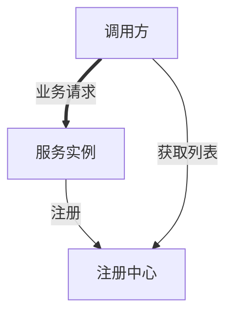
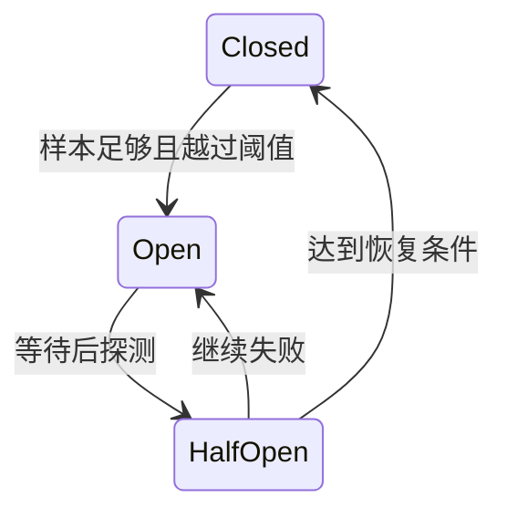
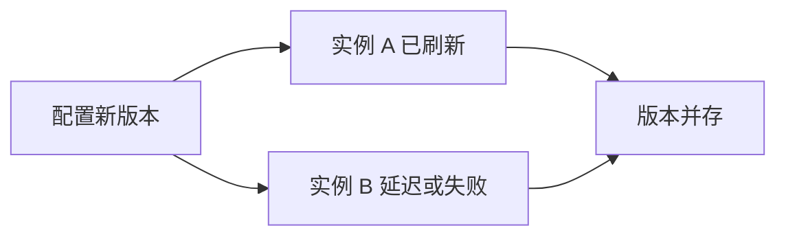
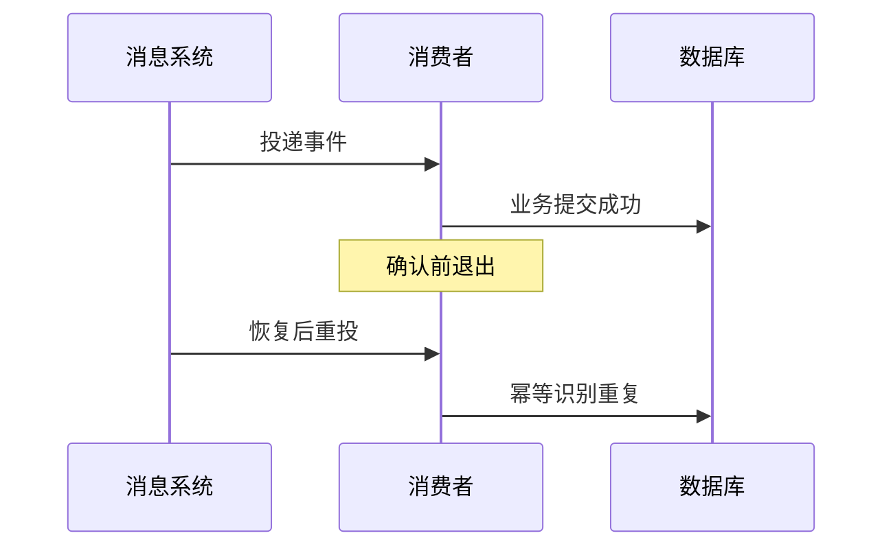
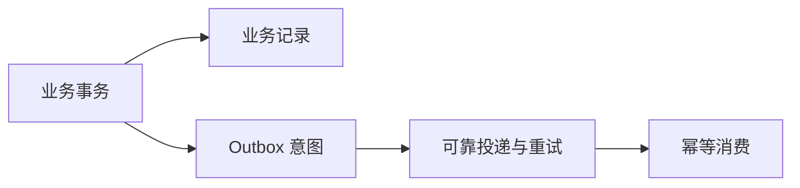

# Spring Cloud 面试：从组件名到分布式故障推演

> **建议用法**：先说它解决什么问题，再说运行机制、失败边界与替代方案。版本兼容以 [原理篇](SpringCloud原理.md#sc-02) 为准，历史组件与当前方案分开回答。
>
> **重点路线**：Q1—Q4 架构与生态；Q5—Q11 发现与选址；Q12—Q20 调用与韧性；Q21—Q26 网关与配置；Q27—Q31 观测与消息；Q32—Q36 一致性、安全与平台。

### Q1：Spring Cloud 是什么，与 Boot 怎么分工？

> **一句话结论**：Cloud 是分布式协作工具生态，Boot 负责单应用装配运行，Framework 提供进程内基础机制。

**机制展开**：Cloud 组合发现、客户端负载均衡、配置、网关、熔断与消息等项目，按需要选用。它不是一个必须全量部署的服务器，也不自动提供业务幂等、全局事务或正确拆分。不同子项目有自己的实现和版本。

**⚖️ 方案对比与代价**：组件越多，策略重叠与排障成本越高；应从实际问题出发选择能力，而不是按教程凑齐全家桶。

**🔎 追问演练**：用了 Boot 就一定要 Cloud 吗？

**推演要点**：不需要。模块化单体、平台已提供发现的应用，或简单固定依赖系统，都可能不需要额外 Cloud 组件。

**原理展开**：[对应章节](SpringCloud原理.md#sc-02)。

---

### Q2：为什么不能直接从单体跳到大量微服务？

> **一句话结论**：独立发布与扩展的收益，需要足以覆盖网络、一致性与组织协作成本。

**机制展开**：本地调用变远程后，延迟、超时、部分失败和未知结果变成正常情况。若多服务共享数据库、一起发布、同步长链调用，会形成分布式单体，既没有自治，又承担网络代价。应先建立领域模块与数据所有权。

**⚖️ 方案对比与代价**：模块化单体通常更容易保留本地事务和简单运维，微服务适合确有独立演进与扩展需求的边界。

**🔎 追问演练**：服务拆得越细性能越好吗？

**推演要点**：不必然。网络跳数和序列化增加，边界过细可能使一个用户请求依赖过多同步调用。

**原理展开**：[对应章节](SpringCloud原理.md#sc-01)。

---

### Q3：Cloud 版本为什么使用发布列车？

> **一句话结论**：发布列车协调一组兼容子项目，不能只看某个组件版本号。

**机制展开**：BOM（Bill of Materials，物料清单）管理组合版本，各子项目数字并不相同。常见关系是 Cloud 2025.0 对 Boot 3.5，2025.1 对 Boot 4.0，后者从 2025.1.2 起包含 Boot 4.1；具体矩阵和支持状态仍需分别核对。

**⚖️ 方案对比与代价**：手工逐项拼版本更灵活也更容易冲突，禁用兼容检查不代表底层真的兼容。

**🔎 追问演练**：匹配矩阵就代表还在免费维护吗？

**推演要点**：不能。兼容描述技术组合，支持周期描述维护状态，必须单独查询官方当前信息。

**原理展开**：[对应章节](SpringCloud原理.md#sc-02)。

---

### Q4：Ribbon、Hystrix、Sleuth 今天怎么介绍？

> **一句话结论**：把它们放在历史位置，再解释当前对应能力与迁移边界。

**机制展开**：客户端均衡重点学习 LoadBalancer，韧性可用 CircuitBreaker 与具体实现，观测主要围绕 Micrometer；Gateway 替代很多旧 Zuul 场景。Eureka 仍存在，不能因为其他 Netflix 组件退出主线就说整个 Netflix 项目都不可用。

**⚖️ 方案对比与代价**：迁移不是更换依赖名，隔离、重试、超时与监控语义可能变化，需要真实链路回归。

**🔎 追问演练**：OpenFeign 也已经被移除了吗？

**推演要点**：不是。官方定位为 feature-complete，建议关注 HTTP Service Clients；存量仍需理解，升级按实际支持版本判断。

**原理展开**：[对应章节](SpringCloud原理.md#sc-02)。

---

### Q5：注册中心是不是所有请求的中转站？

> **一句话结论**：通常不是，业务请求由调用方直接发往已发现的实例。

**机制展开**：服务向注册中心登记和续约，调用方获取实例列表并缓存，负载均衡选择后直接请求实例。注册发现属于控制面，真实业务属于数据面，这解释了注册中心短暂故障时已有调用仍可能继续。

**读图**：控制面和数据面分开，缓存带来故障容忍也带来过期窗口。

**⚖️ 方案对比与代价**：缓存提高控制面故障容忍，却会保留旧地址；必须配合超时、实例选择与优雅下线。

**🔎 追问演练**：注册中心宕机，业务一定立刻不可用吗？

**推演要点**：不一定，取决于本地实例视图、地址是否仍可达、新实例变化以及缓存和客户端故障策略。

**原理展开**：[对应章节](SpringCloud原理.md#sc-03)。

---

### Q6：Eureka 怎样判断实例失效？

> **一句话结论**：通过租约、续约和剔除等机制估计存活，客户端缓存还会增加可见延迟。

**机制展开**：网络中断不等于实例真的停止，实例停止也不一定立即从所有客户端视图消失。服务端周期和客户端更新周期叠加，不能用某个单独心跳周期精确推导所有流量停止时间。

**⚖️ 方案对比与代价**：更快剔除减少误调用，却可能增加网络抖动时的误判；需要结合故障模型与业务恢复策略。

**🔎 追问演练**：自我保护是不是保证健康实例？

**推演要点**：不是。它减少异常网络下的大量误剔除，也可能保留坏地址，客户端仍要处理失败。

**原理展开**：[对应章节](SpringCloud原理.md#sc-03)。

---

### Q7：Eureka、ZooKeeper、Nacos 能只用 AP/CP 区分吗？

> **一句话结论**：不能，必须拆开写入、读取、订阅、缓存与健康语义分析。

**机制展开**：ZooKeeper 会话和临时节点提供一种发现基础；Eureka 以租约和复制维护视图；Nacos 的命名、配置与不同模式又有各自行为。应用实际看到的结果还受客户端缓存和网络路径影响。

**⚖️ 方案对比与代价**：CAP（Consistency, Availability, Partition Tolerance，一致性、可用性、分区容错）是特定模型的权衡工具，不是给一个生态永久贴标签的完整解释。

**🔎 追问演练**：选择时优先问什么？

**推演要点**：地址变化能多快被看到，分区时是否允许读旧视图，实例健康怎样判断，控制面故障时应用如何降级。

**原理展开**：[对应章节](SpringCloud原理.md#sc-03)。

---

### Q8：优雅下线为什么只注销还不够？

> **一句话结论**：注销、客户端视图更新、停止新请求与等待在途任务是多个异步阶段。

**机制展开**：调用方可能仍持有旧列表或复用连接，消息消费者也有已取任务。需要先摘流并停止接单，留出传播窗口，再完成或可恢复地中断在途工作，最后关闭资源；仍应容忍少量残余失败与重投。

**⚖️ 方案对比与代价**：窗口越长发布越慢，越短越易中断；可靠性还需幂等与确认，不只靠等待。

**🔎 追问演练**：只停止心跳会怎样？

**推演要点**：通常要等待租约和缓存变化，不能保证足够快，直接关端口则把旧视图请求变成错误。

**原理展开**：[对应章节](SpringCloud原理.md#sc-03)。

---

### Q9：LoadBalancer 与注册发现区别是什么？

> **一句话结论**：发现提供候选集合，负载均衡从集合中为本次调用选择目标。

**机制展开**：实例列表供应器可组合发现、缓存、区域、健康与元数据筛选，再由轮询、随机或定制算法选择。选中不等于连接成功，注册存在也不代表业务可用；地址最终交给底层客户端发送请求。

**⚖️ 方案对比与代价**：候选集质量与缓存新鲜度往往比算法名更重要，应优先确认错误实例为何仍在列表。

**🔎 追问演练**：轮询保证全系统绝对平均吗？

**推演要点**：不保证。每个调用方有独立状态，实例筛选、并发、长连接和流量分布都影响实际结果。

**原理展开**：[对应章节](SpringCloud原理.md#sc-04)。

---

### Q10：客户端负载均衡和代理转发怎么选？

> **一句话结论**：客户端更接近业务语义，代理更集中透明，组合时需要避免重复策略。

**机制展开**：客户端可利用区域、租户或版本元数据，但每种语言和版本都要维护；代理与平台转发简化应用，却增加转发层容量和连接分配特点。两者可能同时存在，需明确各层路由和失败责任。

**⚖️ 方案对比与代价**：统一平台策略便于治理，业务特殊路由可能仍需应用参与；不要同时盲目启用所有重试。

**🔎 追问演练**：两层重试为什么危险？

**推演要点**：同一次逻辑请求被放大为多次物理请求，额外负载可能让慢依赖更慢，并增加重复执行。

**原理展开**：[对应章节](SpringCloud原理.md#sc-04)。

---

### Q11：灰度路由为什么只做网关分流不够？

> **一句话结论**：下游若再次随机选版本，一条链路仍可能混用不兼容协议。

**机制展开**：需要稳定可信的用户或租户标识，沿调用链传播，并在各选择点形成一致筛选或保持协议兼容。粘性可改善亲和，也可能造成热点，还需故障后回退和版本无候选策略。

**⚖️ 方案对比与代价**：全链路灰度增加治理复杂度，向后兼容的契约往往能显著降低成本，不宜靠强制粘性弥补任意破坏性接口。

**🔎 追问演练**：客户端传一个版本头就能控制灰度？

**推演要点**：不能直接信任，外部字段可能伪造，应清理、校验或由可信入口生成并控制传播。

**原理展开**：[对应章节](SpringCloud原理.md#sc-04)。

---

### Q12：Feign 调用从接口到网络发生了什么？

> **一句话结论**：代理解析契约、编码请求、执行拦截、选择客户端与目标，再解码或映射错误。

**机制展开**：OpenFeign 使方法签名表达远程协议，Spring Cloud 集成配置、发现与负载均衡等能力。使用显式 URL（Uniform Resource Locator，统一资源定位符）与使用服务名，可能走不同目标解析路径；底层 HTTP（Hypertext Transfer Protocol，超文本传输协议）连接池和线程行为仍由具体客户端决定。

**⚖️ 方案对比与代价**：声明式简化模板代码，却容易让人误把远程方法当本地调用；超时、未知结果和契约兼容仍需显式设计。

**🔎 追问演练**：共享服务端实体给客户端最省事吗？

**推演要点**：减少重复同时增加耦合，数据库实体变化可能泄漏成远程契约；更适合稳定 DTO（Data Transfer Object，数据传输对象）。

**原理展开**：[对应章节](SpringCloud原理.md#sc-05)。

---

### Q13：Feign 默认会不会重试？

> **一句话结论**：不能脱离集成层回答，Spring Cloud OpenFeign 常见默认使用 NEVER_RETRY。

**机制展开**：原生 Feign 与 Spring Cloud 集成的默认可能不同，LoadBalancer、网关或韧性库还可能叠加重试。应检查实际 Retryer、底层客户端、状态分类和总尝试数，而不是只看接口有没有一个注解。

**⚖️ 方案对比与代价**：默认不重试避免隐式重复，但短暂错误恢复需要业务选择；重试必须配合幂等与时间预算。

**🔎 追问演练**：配置读超时就限制全部耗时了吗？

**推演要点**：未必，连接池等待、域名解析、建连、握手与响应读取可能分属不同计时范围。

**原理展开**：[对应章节](SpringCloud原理.md#sc-05)。

---

### Q14：端到端超时预算应该怎么分？

> **一句话结论**：从用户等待目标反推各段上限，并让剩余预算逐层递减。

**机制展开**：总预算必须覆盖排队、连接获取、网络、业务、重试和回退。例如 300 ms 内两次各 100 ms 尝试，20 ms 间隔，预留 60 ms 本地与网络余量，约 280 ms；只是推演示例，实际数值来自测量和目标。

**⚖️ 方案对比与代价**：每层独立设一个大超时容易让上游放弃后下游继续工作，取消也不一定中止底层操作。

**🔎 追问演练**：上游超时是不是下游肯定失败？

**推演要点**：不是。下游可能已成功提交但响应丢失，应依靠幂等键与结果查询处理未知状态。

**原理展开**：[对应章节](SpringCloud原理.md#sc-06)。

---

### Q15：重试风暴怎样形成，怎样限制？

> **一句话结论**：失败增加重试，重试增加负载和排队，形成正反馈。

**机制展开**：两层各最多三次尝试，最坏会形成九次下游调用；慢依赖因此更慢。指数退避和 jitter（随机抖动）减少集中碰撞，但容量不足时仍需限制尝试数、比例与在途并发，并让熔断快速拒绝。

**⚖️ 方案对比与代价**：重试适合明确可恢复错误，不适合参数错误、明确业务拒绝和无幂等的写操作。选择理解业务的一层控制。

**🔎 追问演练**：退避时间越长越好吗？

**推演要点**：不一定，会占用用户预算并延后恢复，必须结合总截止时间、错误模型与系统负载。

**原理展开**：[对应章节](SpringCloud原理.md#sc-06)。

---

### Q16：幂等键应该设计到什么程度？

> **一句话结论**：要同时约束唯一性、参数、状态和重复响应，不能只生成 requestId。

**机制展开**：定义键的业务作用域与有效期，通过唯一约束或受控状态竞争决定唯一执行者；重复请求要核对参数，同键不同金额应拒绝。处理中、成功、失败与未知结果要有查询和恢复协议，并和业务变更处于明确事务关系。

**⚖️ 方案对比与代价**：持久化成本更高但可跨故障恢复，纯缓存去重受过期、丢失和故障影响，按业务重要性取舍。

**🔎 追问演练**：先写成功标记再执行付款可以吗？

**推演要点**：会出现标记成功而业务未做；先执行后记也有重复窗口，需要原子业务状态或外部幂等契约协调。

**原理展开**：[对应章节](SpringCloud原理.md#sc-06)。

---

### Q17：熔断器 Closed、Open、Half-Open 各是什么意思？

> **一句话结论**：Closed 允许调用，Open 快速拒绝，Half-Open 用受限探测判断恢复。

**机制展开**：通常按计数或时间窗口统计失败或慢调用，达到最小样本后再比较阈值。打开后等待一段时间，放入部分探测；根据结果关闭或重新打开。单次错误并不必然打开，恢复也不应瞬间灌回全部流量。

**⚖️ 方案对比与代价**：阈值太敏感造成抖动，太宽松则保护不及时；要看依赖容量、调用量与故障恢复特点。

**🔎 追问演练**：熔断开着为什么还看到少量请求？

**推演要点**：可能是半开探测、其他实例有独立状态、统计维度不同或其他调用路径，需要定位实际熔断器实例。

**原理展开**：[对应章节](SpringCloud原理.md#sc-07)。

---

### Q18：熔断、限流、隔离与降级能相互替代吗？

> **一句话结论**：不能，它们分别控制故障调用、进入速率、资源占用与失败后的业务响应。

**机制展开**：限流在依赖尚未故障时也可保护容量；隔离防止一个慢依赖占满线程或连接；熔断基于结果拒绝故障调用；降级可返回旧数据或减少功能，但不能伪造关键业务成功。

**⚖️ 方案对比与代价**：组合顺序影响统计和用户结果，限流拒绝是否计入熔断失败等也需设计；不是每个异常都走同一 fallback。

**🔎 追问演练**：付款失败返回默认成功算降级吗？

**推演要点**：这是错误语义，不是合理降级。应明确失败、处理中或结果未知，并提供查询与恢复。

**原理展开**：[对应章节](SpringCloud原理.md#sc-07)。

---

### Q19：信号量隔离与线程池隔离怎么比较？

> **一句话结论**：前者主要限制并发，后者提供独立执行资源与队列，各有成本。

**机制展开**：信号量开销较低但一般不改变执行线程；线程池把依赖工作放进独立池，减少互相占用，也增加排队、切换和上下文传播。响应式路径应选择匹配模型的隔离方式，避免无意义阻塞。

**⚖️ 方案对比与代价**：大队列可能掩盖饱和并抬高尾延迟，隔离预算还要与数据库连接与调用超时协调。

**🔎 追问演练**：有线程池隔离就不会拖慢其他接口吗？

**推演要点**：不保证，共享连接、CPU（Central Processing Unit，中央处理器）与外部依赖仍可能成为共同瓶颈。

**原理展开**：[对应章节](SpringCloud原理.md#sc-07)。

---

### Q20：常见限流算法如何取舍？

> **一句话结论**：按允许的突发、平滑性与状态成本选择，而不只背算法名字。

**机制展开**：固定窗口简单但窗口交界可突发；滑动窗口减少边界偏差但状态更多；令牌桶允许积累令牌吸收一定突发；漏桶式整形更强调稳定流出，也可能增加排队。实际实现的计数精度、时钟和分布式原子性同样重要。

**⚖️ 方案对比与代价**：本地限流便宜但总额随实例数变化，全局限额需要共享状态或配额分配，并设计故障时放行还是拒绝。

**🔎 追问演练**：每实例 100 次每秒，十实例就是全局 100 吗？

**推演要点**：通常接近 1000 的潜在总额，还会受分布影响。全局语义必须有额外协调。

**原理展开**：[对应章节](SpringCloud原理.md#sc-07)。

---

### Q21：Gateway 的 Route、Predicate、Filter 分别是什么？

> **一句话结论**：Route 表达路由，Predicate 判断匹配，Filter 处理转发前后的逻辑。

**机制展开**：路由匹配和过滤链协作，身份解析、限流键、路径重写、转发与观测存在顺序依赖。过滤链常形成前置与后置嵌套，不能只看一个 order 数字就忽略其他过滤器和错误路径。

**⚖️ 方案对比与代价**：通用入口逻辑适合集中，复杂订单编排放进去会使网关成为高耦合故障点，可放独立 BFF（Backend for Frontend，面向前端的后端）。

**🔎 追问演练**：可以先按用户限流再认证吗？

**推演要点**：若用户键不可信会被伪造，应先建立可信身份或使用不依赖身份的早期粗粒度保护。

**原理展开**：[对应章节](SpringCloud原理.md#sc-08)。

---

### Q22：Gateway 一定是 WebFlux 与 Netty 吗？

> **一句话结论**：不能覆盖所有版本下绝对结论，现在也有 MVC 相关实现路线。

**机制展开**：WebFlux 路线使用响应式模型，事件循环中不能随意执行阻塞数据库或远程同步调用；MVC 路线基于 Servlet 模型，API 与过滤器契约有所不同。两者的依赖和配置应分别核对。

**⚖️ 方案对比与代价**：响应式有利于大量等待与流处理，但要求上下游执行模型配合，不能把示例过滤器无条件跨实现复制。

**🔎 追问演练**：网关里调用数据库鉴权慢怎么办？

**推演要点**：先检查是否阻塞事件循环，再评估缓存、令牌校验、受控隔离与超时，避免让入口等待拖垮所有路由。

**原理展开**：[对应章节](SpringCloud原理.md#sc-08)。

---

### Q23：网关重试请求体有哪些风险？

> **一句话结论**：请求重放需要可重复读取与内存预算，并且业务必须允许重复执行。

**机制展开**：流式请求或大请求体若为重试全部缓存，可能显著增加内存；非幂等 POST 即使技术上可重发，也可能重复创建或扣款。下游已完成但响应丢失时尤其危险，网关不了解全部业务状态。

**⚖️ 方案对比与代价**：把重试放在更理解业务的客户端或服务层常更可控，网关只对明确场景有限使用。

**🔎 追问演练**：HTTP 方法是 GET 就能无限重试吗？

**推演要点**：仍有总预算、负载和接口实际副作用问题，方法语义也不能替代实现验证。

**原理展开**：[对应章节](SpringCloud原理.md#sc-08)。

---

### Q24：Config Server 与本地配置文件相比解决什么？

> **一句话结论**：集中版本、环境和分发管理，但客户端加载与运行更新仍需设计。

**机制展开**：Config 把应用、Profile 和 label 等映射到配置后端，Git 可追溯版本；现代客户端通常用 Config Data 导入。最终生效还受客户端高优先级来源、缓存与加载时机影响，看到仓库更新不代表全体实例更新。

**⚖️ 方案对比与代价**：集中管理带来控制面依赖，应明确启动失败、旧配置容忍和离线策略，而不是一律 optional。

**🔎 追问演练**：配置中心故障时必须让所有实例退出吗？

**推演要点**：取决于配置对安全和正确性的必要性，已有实例与新启动实例也可采用不同策略。

**原理展开**：[对应章节](SpringCloud原理.md#sc-09)。

---

### Q25：RefreshScope 能保证配置同时生效吗？

> **一句话结论**：不能，它主要处理本实例作用域目标失效与重建，不提供全局原子切换。

**机制展开**：代理持有访问入口，目标失效后按作用域机制重建；普通对象保存的旧状态未必同步变化，资源类也不都能安全刷新。多个实例收到通知与完成校验的时间不同，短期版本并存很正常。

**⚖️ 方案对比与代价**：关联参数可用不可变快照整体校验，危险变更更适合灰度和版本回退；不能把热更新当作无成本操作。

**🔎 追问演练**：Cloud Bus 广播就等于原子发布吗？

**推演要点**：不等于。它传播事件，不能让所有实例、数据库和调用方同时提交状态。

**原理展开**：[对应章节](SpringCloud原理.md#sc-09)。

---

### Q26：配置误发布怎样定位与恢复？

> **一句话结论**：先知道哪些实例实际用了哪个版本，再停止扩散并回退验证。

**机制展开**：配置有源版本、加载版本与实际对象状态三个层次，刷新可能部分失败。应收集实例版本与校验结果，评估是否需要重建或重启，再看业务指标是否恢复；仓库回滚并不证明已运行对象回滚。

**⚖️ 方案对比与代价**：保留版本化快照与灰度反馈增加工程成本，但大幅缩短错误定位和恢复时间。

**🔎 追问演练**：改回原文件就够了吗？

**推演要点**：不一定，还要确认属性覆盖、缓存、刷新失败和不可逆业务影响，必要时执行补偿。

**原理展开**：[对应章节](SpringCloud原理.md#sc-09)。

---

### Q27：分布式追踪为什么会断链？

> **一句话结论**：上下文在 HTTP、消息或线程边界没有被正确注入、提取与关联。

**机制展开**：Trace 表示整条轨迹，Span 表示一段工作；客户端、服务端和异步执行器需要配合传播。手工创建未装配的客户端可能绕过观测定制，线程局部信息也不会自动跟着响应式与线程池任务走。

**⚖️ 方案对比与代价**：追踪采用采样控制成本，不能只用抽样链路估算所有业务错误；还需指标与权威业务状态。

**🔎 追问演练**：Boot 3 还按 Sleuth 教程配置吗？

**推演要点**：主要围绕 Micrometer Observation/Tracing，并按实际导出桥接配置；旧教程属于历史版本组合。

**原理展开**：[对应章节](SpringCloud原理.md#sc-10)。

---

### Q28：为什么指标标签不该放订单号？

> **一句话结论**：高基数会令时间序列数量爆炸，增加存储和查询成本。

**机制展开**：路由、结果分类等有限标签适合聚合；订单号和用户号更适合受控日志或追踪。OTel（OpenTelemetry，开放遥测）与 OTLP（OpenTelemetry Protocol，开放遥测协议）也分别是生态体系与传输协议，不能混成一个后端产品。

**⚖️ 方案对比与代价**：细粒度关联需要脱敏与成本控制，监控覆盖率和采样率也要按用途设计。

**🔎 追问演练**：P99 可以沿链路直接相加吗？

**推演要点**：不能。分位值来自不同分布，并发路径与相关性也不同，链路尾延迟应通过真实入口观测。

**原理展开**：[对应章节](SpringCloud原理.md#sc-10)。

---

### Q29：Cloud Stream 的 Binder 抽象有什么价值？

> **一句话结论**：把函数输入输出与消息系统连接解耦，减少接入模板，但不抹平后端语义。

**机制展开**：常见函数模型是 Supplier、Function 和 Consumer，Binding 连接函数与目的地，Binder 适配 Kafka、RabbitMQ 等。确认、分区、重试与事务能力仍需按具体 Binder 和中间件理解。

**⚖️ 方案对比与代价**：统一编程模型降低接入成本，迁移后端仍要验证顺序、吞吐、故障和交付，不是换一个依赖零成本切换。

**🔎 追问演练**：只要使用函数模型就自动幂等吗？

**推演要点**：不会。消息重投与重复执行仍需唯一事件号、业务状态和持久化约束。

**原理展开**：[对应章节](SpringCloud原理.md#sc-11)。

---

### Q30：消费写库成功后确认失败，会怎样？

> **一句话结论**：消息可能再次投递，消费端必须容忍重复。

**机制展开**：先写库后确认有重复窗口；先确认后写库有丢业务窗口。通常通过至少一次交付和业务幂等收敛，确认/偏移提交时机由中间件与 Binder 决定。失败重试还可能阻塞同分区后续事件。

**⚖️ 方案对比与代价**：死信隔离让主流程继续，但 DLQ（Dead Letter Queue，死信队列）仍需修复、审计和重放，不能视作最终处理成功。

**🔎 追问演练**：数据库唯一键一加就够了吗？

**推演要点**：要确认唯一约束与业务更新的事务关系，重复时返回什么，以及是否存在其他外部副作用。

**原理展开**：[对应章节](SpringCloud原理.md#sc-11)。

---

### Q31：Kafka 恰好一次能顺带保证 MySQL 与支付吗？

> **一句话结论**：不能，事务语义有参与资源和处理范围。

**机制展开**：Kafka 可在支持的消息读—处理—写范围协调事务，任意数据库与支付接口不因此成为同一原子单元。Cloud Stream 的封装也不改变参与协议，数据库与消息可用 Outbox 等方案保存事件意图。

**⚖️ 方案对比与代价**：端到端业务往往仍需要幂等、状态查询和补偿，必须说明所谓恰好一次到底覆盖哪一段。

**🔎 追问演练**：把监听方法加 Transactional 就覆盖所有资源吗？

**推演要点**：不一定，实际事务管理器和资源参与能力决定范围，本地注解不会自动升级为全局协议。

**原理展开**：[对应章节](SpringCloud原理.md#sc-11)。

---

### Q32：本地 Transactional 能回滚 HTTP 对端吗？

> **一句话结论**：不能自动控制远程提交，跨服务必须有明确的一致性协议。

**机制展开**：调用方数据库事务和对端事务分属不同资源与进程。对端已经提交但响应丢失，本地回滚不会撤销对端。长时间持锁等待远程调用还放大连接与锁压力，而没有得到全局原子性。

**⚖️ 方案对比与代价**：可选择本地事务加可靠事件、Saga、TCC 或特定资源协调，取决于允许的延迟、补偿与业务侵入。

**🔎 追问演练**：订单失败后直接反向再调一次就够？

**推演要点**：反向调用也会超时、重复与失败，需要持久化状态机和可重试补偿，不是一个 catch 就完成恢复。

**原理展开**：[对应章节](SpringCloud原理.md#sc-12)。

---

### Q33：Outbox、Saga、TCC 和 XA 怎么选？

> **一句话结论**：先定义业务原子边界和恢复需求，再比较最终一致、补偿、预留与资源协调。

**机制展开**：Outbox（事务发件箱）把业务变更和待发意图同库提交；Saga 用本地步骤与补偿推进长流程；TCC（Try-Confirm-Cancel，尝试—确认—取消）明确预留与确认；XA/2PC（Two-Phase Commit，两阶段提交）协调支持协议的资源。

**读图**：Outbox 关闭业务记录与事件意图的双写窗口，后续仍可能重复，不能跳过消费幂等。

**⚖️ 方案对比与代价**：Outbox 有投递延迟，Saga 补偿不总能完全逆转，TCC 侵入业务，XA 有锁与协调可用性成本；没有普遍最优方案。

**🔎 追问演练**：用了 Seata 就不用这些知识吗？

**推演要点**：更需要。产品有不同模式，资源限制、SQL（Structured Query Language，结构化查询语言）支持与业务侵入不同，必须知道采用哪种协议与失败恢复方式。

**原理展开**：[对应章节](SpringCloud原理.md#sc-12)。

---

### Q34：TCC 的空回滚和防悬挂是什么？

> **一句话结论**：它们处理 Cancel 先到或 Try 迟到，防止错误释放与预留泄漏。

**机制展开**：网络超时后协调方可能先发 Cancel，而原 Try 还在途中。空回滚要求没有成功预留也能安全取消并记录状态；防悬挂要求已取消的事务拒绝迟到 Try 再创建预留。Confirm 与 Cancel 也需幂等和互斥合法迁移。

**⚖️ 方案对比与代价**：这需要事务标识、持久化状态和并发约束，不能用三个普通无状态接口代替。

**🔎 追问演练**：Saga 补偿就是数据库 rollback 吗？

**推演要点**：不是。它是新的业务动作，可能无法撤回外部已发生事实，例如已发送通知与已完成物流。

**原理展开**：[对应章节](SpringCloud原理.md#sc-12)。

---

### Q35：网关认证之后服务还要鉴权吗？

> **一句话结论**：需要按可信调用边界与资源所有权判断，入口认证不能替代全部服务授权。

**机制展开**：JWT（JSON Web Token，JSON Web 令牌）需要验证签名、签发方、受众和有效期；网关应清除伪造身份头。下游验证来源并做业务权限与对象级检查，内部调用和消息路径也要考虑。mTLS 验证通信身份，不自动决定用户是否能读取订单。

**⚖️ 方案对比与代价**：只在入口集中策略简单，却可能漏绕行与内部入口；关键服务应保留独立授权责任。

**🔎 追问演练**：OAuth、OIDC、JWT 是一回事吗？

**推演要点**：不是。OAuth 2.0 是授权框架，OIDC（OpenID Connect，开放身份连接）提供身份层，JWT 是令牌格式，不能互相替代。

**原理展开**：[对应章节](SpringCloud原理.md#sc-13)。

---

### Q36：Kubernetes 和 Mesh 会让 Cloud 没价值吗？

> **一句话结论**：它们接管部分网络能力，应用仍需业务语义与一致性，是否保留 Cloud 按能力重叠选择。

**机制展开**：Kubernetes Service/DNS 可提供发现转发，不必固定再加 Eureka；Service Mesh（服务网格）可做传输身份、流量和遥测，但不能完整判断扣款能否重试。Cloud 组件可以补业务侧集成，也可能引入重复策略。

**⚖️ 方案对比与代价**：平台透明性降低语言成本，却增加数据面排障；应画出真实重试和超时层级，避免网关、Mesh 与客户端同时放大请求。

**🔎 追问演练**：排障时如何证明系统真的恢复？

**推演要点**：看入口成功率和尾延迟、在途与重试数量、消息积压及权威业务状态，不能只看组件健康或熔断状态恢复。

**原理展开**：[对应章节](SpringCloud原理.md#sc-14)。

---

## 参考与版本核对

版本组合见 [Cloud 官方矩阵](https://spring.io/projects/spring-cloud/)；客户端行为核对 [OpenFeign 文档](https://docs.spring.io/spring-cloud-openfeign/reference/spring-cloud-openfeign.html)，网关实现边界核对 [Gateway 文档](https://docs.spring.io/spring-cloud-gateway/reference/)。更多资料见 [原理篇](SpringCloud原理.md)。

## 附录：术语与缩写

| 术语 | 英文全称 | 中文含义 / 边界 |
|---|---|---|
| BOM | Bill of Materials | 物料清单，协调依赖版本 |
| HTTP | Hypertext Transfer Protocol | 超文本传输协议 |
| IP | Internet Protocol | 网际协议，文中指实例网络地址 |
| DNS | Domain Name System | 域名系统 |
| TLS | Transport Layer Security | 传输层安全 |
| mTLS | Mutual Transport Layer Security | 双向 TLS 身份认证 |
| DTO | Data Transfer Object | 数据传输对象 |
| BFF | Backend for Frontend | 面向前端的后端聚合层 |
| SLO | Service Level Objective | 服务等级目标 |
| OTel | OpenTelemetry | 开放遥测体系 |
| OTLP | OpenTelemetry Protocol | 开放遥测传输协议 |
| Trace / Span | Distributed Trace / Span | 调用轨迹 / 一段工作 |
| DLQ | Dead Letter Queue | 死信队列，隔离失败消息 |
| Outbox | Transactional Outbox | 事务发件箱，持久化事件意图 |
| TCC | Try-Confirm-Cancel | 尝试—确认—取消，业务预留协议 |
| 2PC | Two-Phase Commit | 两阶段提交 |
| XA | X/Open XA Specification | 分布式事务资源接口规范 |
| Saga | Saga Transaction Pattern | 由本地步骤与补偿组成的长事务模式 |
| JWT | JSON Web Token | JSON Web 令牌格式 |
| JSON | JavaScript Object Notation | 结构化数据表示法 |
| OAuth 2.0 | Open Authorization 2.0 | 开放授权框架 |
| OIDC | OpenID Connect | 基于 OAuth 2.0 的身份认证层 |
| CP / AP | Consistency + Partition Tolerance / Availability + Partition Tolerance | CAP 模型中的权衡标签，不能代替具体行为分析 |
| Circuit Breaker | Circuit Breaker | 熔断器，按结果统计决定是否允许调用 |
| Bulkhead | Bulkhead Isolation | 舱壁隔离，限制资源相互影响 |
| Jitter | Random Jitter | 随机抖动，减少集中重试碰撞 |
| API | Application Programming Interface | 应用程序编程接口 |
| Java SE | Java Platform, Standard Edition | Java 标准版 |
| Jakarta EE | Jakarta Enterprise Edition | Jakarta 企业级平台规范 |
| URL | Uniform Resource Locator | 统一资源定位符 |
| SQL | Structured Query Language | 结构化查询语言 |
| CPU | Central Processing Unit | 中央处理器 |
| P99 | 99th Percentile | 第 99 百分位延迟 |
| CAP | Consistency, Availability, Partition Tolerance | 一致性、可用性与分区容错的权衡模型 |
