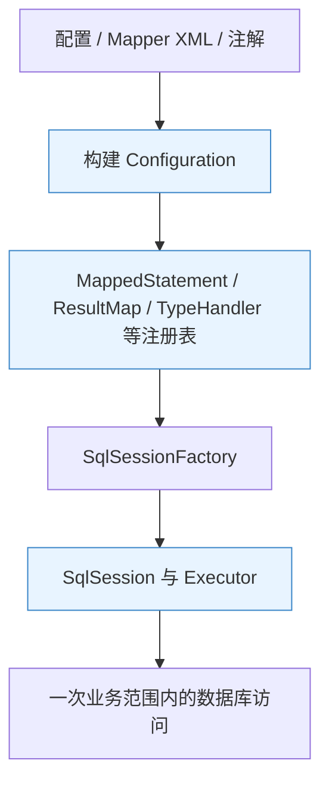
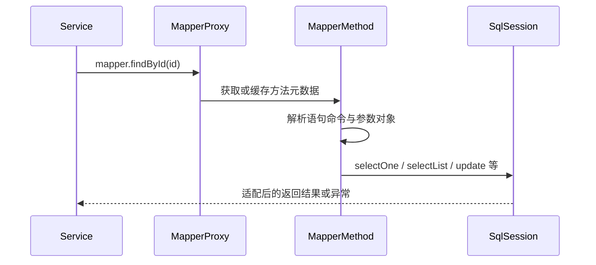
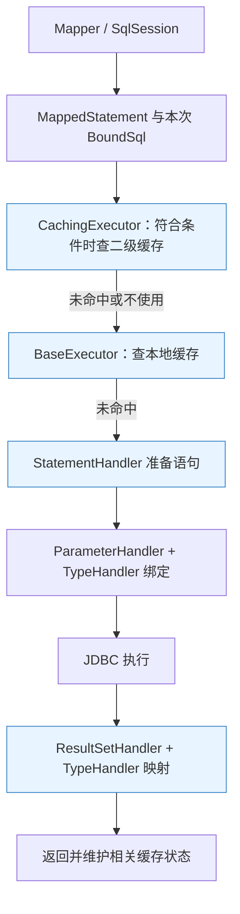
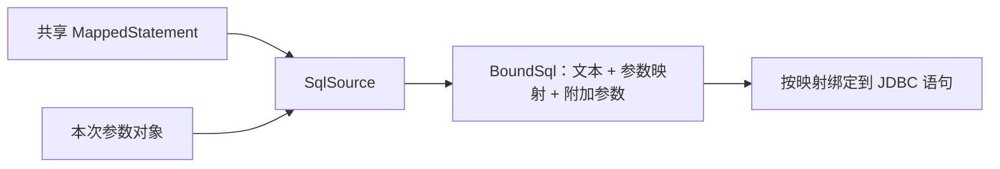
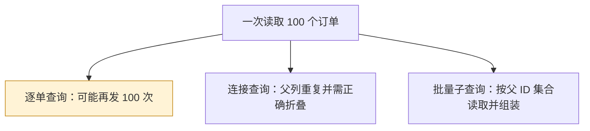
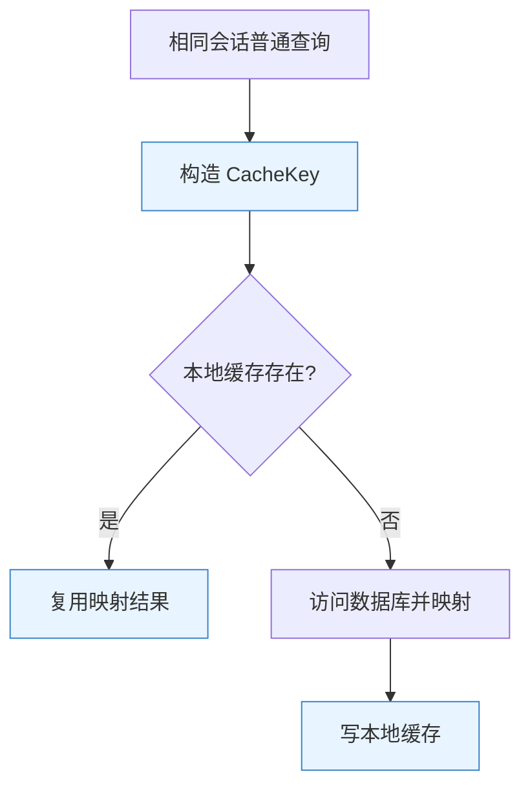
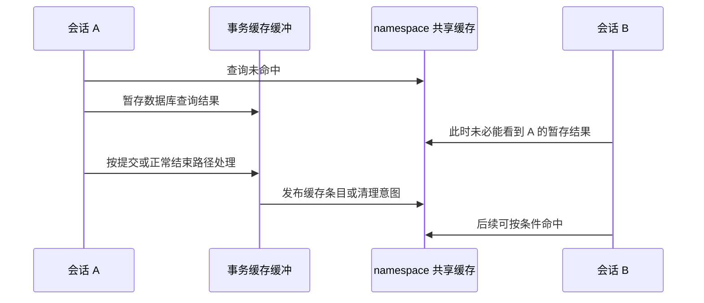
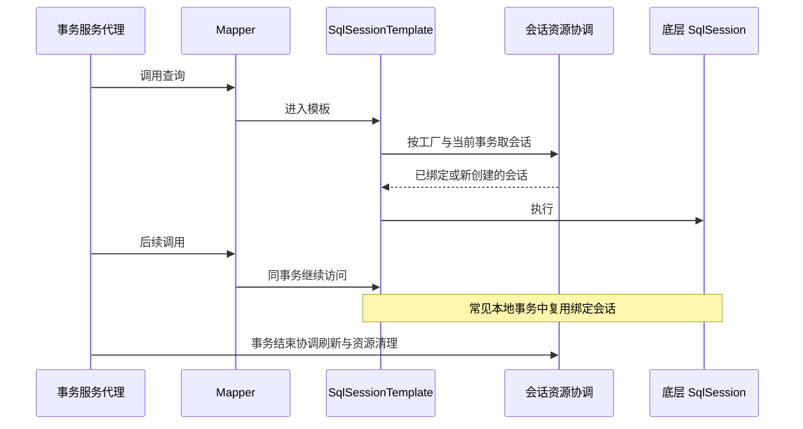
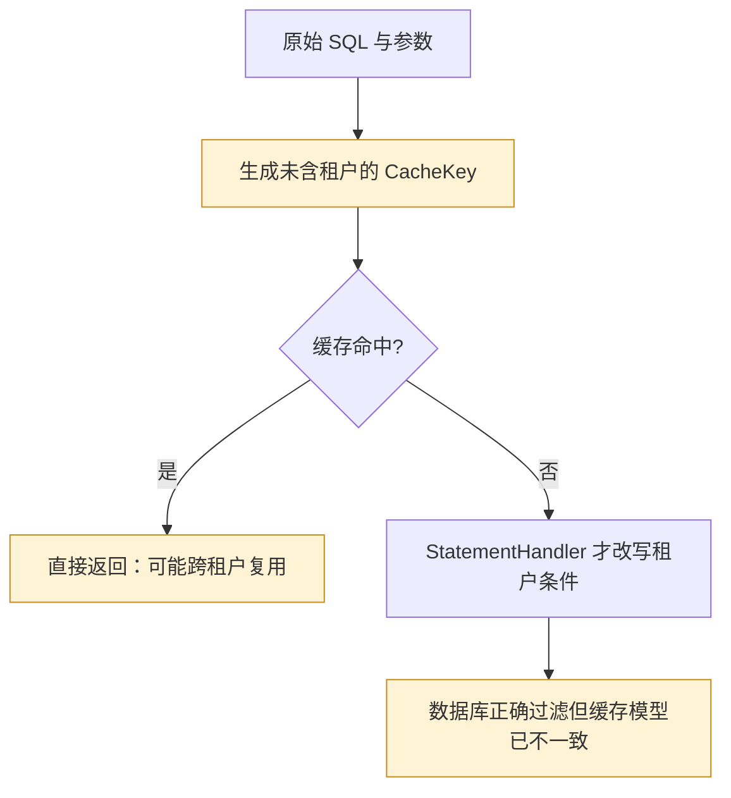

# MyBatis 原理：从 Mapper 方法到 SQL、事务与缓存边界

> **阅读目标**：能沿一次调用解释“语句从哪里来、参数怎样进入、结果如何成形、资源何时结束”，并能分析缓存、分页、批量和插件带来的正确性问题。
>
> **版本口径**：主要用 MyBatis 3.5.x 的成熟机制建立模型，单独说明 3.6.0 与 Spring/Boot 集成线的变化。正文中的源码路径用于定位职责，精确行为以项目锁定版本为准。配套复习见 [MyBatis 面试](MyBatis面试.md)。
>
> **内容定位**：知识、设计比较与故障推演；代码和 SQL 为解释机制的示例，未在当前项目中执行。重要缩写在正文展开，完整术语见文末附录。

## 阅读路线

| 主线 | 章节 | 应当能回答 |
|---|---|---|
| 定位与对象 | [1](#mb-01) → [2](#mb-02) → [3](#mb-03) | 为什么不直接 JDBC？接口没有实现类如何执行？ |
| 一次执行 | [4](#mb-04) → [5](#mb-05) → [6](#mb-06) | 谁生成 SQL？谁绑定参数？动态分支有什么风险？ |
| 结果与关联 | [7](#mb-07) → [8](#mb-08) | 一行怎样变成对象？一对多为什么多查或少数据？ |
| 性能与缓存 | [9](#mb-09) → [10](#mb-10) → [11](#mb-11) | 批量何时执行？相同查询为何命中或没命中？ |
| Spring 集成 | [12](#mb-12) → [13](#mb-13) | Mapper 能否共享？事务与多数据源怎么衔接？ |
| 工程边界 | [14](#mb-14) → [15](#mb-15) → [16](#mb-16) | 插件改写影响什么？怎样分页、导出和定位慢调用？ |
| 生态与版本 | [17](#mb-17) → [18](#mb-18) | MyBatis-Plus 增强了什么？不同版本线如何对应？ |

每章按 **问题 → 机制 → 与其他方案比较 → 成本与失效条件**阅读。不要用“半自动 ORM”“支持缓存”“用了插件”替代完整解释。

<a id="mb-01"></a>
## 1. 从 JDBC 到 MyBatis：抽象掉重复，保留哪些控制权

> 🎯 **核心结论**：MyBatis 主要抽象 SQL 执行、参数绑定和结果映射，让开发者继续掌握 SQL；它不会自动接管数据库建模、执行计划和所有对象状态变化。

### 1.1 JDBC 原始代码里有哪些重复

JDBC（Java Database Connectivity，Java 数据库连接）调用通常要获取连接、创建语句、按序绑定参数、执行、遍历结果、转换类型、处理异常并释放资源。重复流程容易掩盖真正的业务 SQL（Structured Query Language，结构化查询语言），也容易漏掉边界处理。

MyBatis 把 SQL 与映射规则组织起来，通过统一执行链处理模板工作。SQL 可以来自 XML（Extensible Markup Language，可扩展标记语言）、注解或 Provider；**写在 XML 只是表达形式，不是框架本质**。


**读图**：MyBatis 位于应用与 JDBC 之间。索引选择、锁等待和日志持久性仍属于数据库，不能靠换一个映射框架直接修复。

### 1.2 JDBC、JdbcTemplate、MyBatis 与 JPA

| 选择 | 主要抽象 | 收益 | 代价与适用边界 |
|---|---|---|---|
| 原始 JDBC | 驱动访问接口 | 控制直接、额外抽象少 | 模板代码多，资源与映射容易重复 |
| Spring JdbcTemplate | 资源、异常、执行模板 | 简化 JDBC 且保留 SQL | 对复杂映射与 Mapper 契约需自行组织 |
| MyBatis | 映射语句、接口代理、参数和结果 | SQL 可控，复杂报表和数据库特性易表达 | SQL 与映射由团队维护，方言迁移需处理 |
| JPA + Hibernate 等实现 | 持久化实体与对象关系 | 统一对象状态、关联及工作单元模型 | 需要理解抓取、脏检查、刷新与生成 SQL |

JPA（Java Persistence API，Java 持久化 API）是规范，Hibernate 是常见实现，二者不能直接当作同一层概念。ORM（Object-Relational Mapping，对象关系映射）描述对象与关系模型转换；MyBatis 常被称为“半自动 ORM”，这个称呼仅提示 SQL 通常由开发者显式维护。

### 1.3 一个重要反例：修改对象不会自动更新数据库

查询得到 `Order`，调用 `order.setStatus(...)`，并不等于已经执行 UPDATE。MyBatis 没有因为对象被查询出来，就对其所有字段开启自动脏检查。对象在一级缓存里被修改，还可能让后续查询看见修改后的 Java 状态，而数据库完全没变。

**选型抓手**：SQL 控制、对象生命周期模型、关联复杂度、团队习惯与数据库特性，比简单比较“谁性能更高”更有意义。

<a id="mb-02"></a>
## 2. 配置与核心对象：先分清工厂、会话和模板

> 🎯 **核心结论**：工厂保存可共享配置并创建会话，会话承载一次受控资源使用过程；Spring 提供的模板可共享，不代表底层每个会话都线程安全。

### 2.1 从配置材料到执行元数据

构建过程解析全局设置、类型处理器、环境和 Mapper，把每条语句整理为 `MappedStatement` 等元数据，收进 `Configuration`。`SqlSessionFactory` 据此创建会话和执行器，而不是每调用一次接口就重新解析整套 XML。



**读图**：大部分定义在构建阶段整理；某些待决引用可以延后解析，因此启动成功也未必证明所有未调用语句都已经验证。

### 2.2 生命周期与线程安全

| 对象 | 职责 | 常见生命周期 | 共享注意事项 |
|---|---|---|---|
| SqlSessionFactoryBuilder | 构建工厂 | 构建期间 | 通常无需长期持有 |
| SqlSessionFactory | 保存配置并创建会话 | 应用级 | 通常复用，避免运行中任意改共享 Configuration |
| DefaultSqlSession | 执行语句、管理相关会话状态 | 方法/请求/事务范围 | **非线程安全，不应全局单例共享** |
| Mapper 代理 | 把接口调用委托给会话体系 | 取决于绑定的 SqlSession | 原生代理与 Spring 代理的安全条件不同 |
| SqlSessionTemplate | Spring 的会话协调入口 | 可应用级复用 | 可共享，每次转向合适的底层会话 |

连接一般按需取得，不要把创建 SqlSession 必然等同于立刻创建物理数据库连接；也不要把关闭会话等同于销毁连接池中的物理连接。

### 2.3 原生使用和 Spring 使用的责任变化

原生模式中，调用方要明确打开、提交/回滚和关闭；`try-with-resources` 能确保释放，但**关闭不是“无条件提交”**，应按自动提交设置与实际操作明确事务结果。

Spring 模式则通常把资源结束交给事务与模板，业务代码不自行对受管会话调用 `commit/rollback/close`。把两套模式混用，可能产生不受预期事务控制的连接。

<a id="mb-03"></a>
## 3. Mapper 代理：没有实现类，方法如何找到语句

> 🎯 **核心结论**：Mapper 代理保存接口与会话执行入口，通过语句标识和方法元数据把 Java 调用转换为数据库操作。

### 3.1 典型调用入口

Mapper 接口通过 JDK（Java Development Kit，Java 开发工具包）动态代理等机制获得实现，普通映射方法由 `MapperProxy`、`MapperMethod` 协作处理。方法元数据可缓存，减少重复分析；接口默认方法和 Object 方法存在专门分支，不是所有方法都直接拼接 SQL。

XML 映射的典型标识为 **接口全限定名 + 方法名**，对应 `namespace + id`。Java 重载参数并不会自动成为语句标识的一部分，所以不要用重载方法去承载两条独立的同名 XML 语句。



**读图**：代理只负责把契约接到执行入口；连接、缓存和结果映射还有后续分工。

### 3.2 为什么 @Param 能减少环境相关错误

多个实参通常会形成命名参数结构。`@Param("tenantId")` 等显式名字最稳定；未标注时，真实参数名能否使用受编译参数、`useActualParamName`、参数种类与版本影响，也可能存在 `param1` 等通用名字。

单个普通对象、Map、集合和数组的处理并不完全相同，不能背“只有一个参数时随便叫什么”。尤其对象属性、集合包装名字与 `@Param` 命名会影响表达式解析。**面向跨模块 Mapper 契约，优先显式命名或使用清晰的查询对象**。

### 3.3 返回类型不是随便换个集合就行

普通单对象查询对应的 `selectOne` 在多于一个结果时抛出异常，不能当作隐含 LIMIT 1；0 行通常返回 null。基本类型无法表达 null，可能出现绑定异常；聚合计数还应考虑 int 范围不足。

`List<T>`、`Optional<T>`、`@MapKey` Map 和 Cursor 有不同适配路径。Map 返回不必然是“以主键为键的所有行”；要看是否声明 MapKey，以及是单行列值 Map 还是多行索引 Map。

<a id="mb-04"></a>
## 4. 一次 SQL 的执行链：每个组件负责哪一步

> 🎯 **核心结论**：Executor 协调执行策略与缓存，StatementHandler 组织 JDBC 语句，ParameterHandler 绑定值，ResultSetHandler 把返回行组装为对象。

### 4.1 普通列表查询的主干



**读图**：这是普通 List 查询的代表路径，不覆盖 Cursor、自定义结果处理器和所有插件分支。**执行链上二级缓存位于一级缓存之外**，不要把名称中的“一、二级”误当成固定查询先后顺序。

### 4.2 四个常见误解

| 说法 | 更准确的解释 |
|---|---|
| Executor 就是线程池执行器 | 这里是数据库执行策略接口，与 Java 线程池 Executor 不同 |
| 每次都重新解析 XML | 定义通常在构建期解析，本次动态表达式和绑定在执行期求值 |
| TypeHandler 只负责查询返回 | 参数设置与结果读取两端都可能使用 |
| MyBatis 的执行就是数据库执行全部耗时 | 还包括连接等待、映射、对象分配、缓存与插件，数据库端也有锁等待等细分 |

### 4.3 源码如何阅读而不迷失

先走 `MapperProxy.invoke` → `MapperMethod.execute` → `DefaultSqlSession` 的查询/更新方法；再看 `Configuration.newExecutor` 创建具体执行器、装饰缓存并应用插件；最后分别进入 `BaseExecutor`、`RoutingStatementHandler` 和默认参数/结果处理器。

**读源码先画三张图**：定义注册图、单次调用图、连接与事务结束图。只跟一个 `selectList` 方法容易漏掉装饰器和 Spring 会话协调。

<a id="mb-05"></a>
## 5. MappedStatement、SqlSource 与 BoundSql：静态规则和本次结果

> 🎯 **核心结论**：MappedStatement 是语句级定义，SqlSource 生成执行信息，BoundSql 表示一次调用得到的 SQL 文本、参数映射与附加参数。

### 5.1 为什么要分这三层

同一个订单搜索方法，可能只按状态查，也可能额外按时间查；共享元数据应复用，本次输入与生成结果则不能混进全局定义。`BoundSql` 不是简单把所有参数值插进问号后的日志字符串，它保留参数与占位位置的对应关系。

静态语句可在构建阶段完成更多解析；动态语句需按本次条件生成文本和映射。`foreach`、`bind` 等可能产生附加参数，插件复制 BoundSql 时遗漏它们会导致运行期找不到参数。



**读图**：共享与单次执行分离，是可并发执行的基础之一。随意修改共享语句定义会让其他请求受到影响。

### 5.2 #{} 与 ${}：区别是绑定值和替换文本

| 表达式 | 典型处理 | 正确用途 | 风险与限制 |
|---|---|---|---|
| `#{id}` | 生成值占位与 ParameterMapping，再绑定 | 条件值、插入值、更新值 | 不能用来替代表名、列名、排序关键字 |
| `${column}` | 把求值结果替换到 SQL 文本 | 极少数经过严格白名单控制的结构片段 | 不会自动进行可靠 SQL 语义校验或防注入 |

例如 `WHERE id = #{id}`，恶意输入会作为数据值处理，而不是直接成为语法。`ORDER BY #{column}` 通常不会变成按指定列排序；**SQL 标识符不能像普通数据值一样绑定**。

动态排序优先使用后端枚举映射固定片段，或用 `choose` 写出允许分支；不能让客户端直接提交任意 SQL 片段。`#{}` 保护绑定位置，不会修复同一语句中其他 `${}`、Provider 拼接或扩展 API 的风险。

### 5.3 “预编译”到底在哪一层

MyBatis 的常用 PREPARED 路径使用 JDBC PreparedStatement；是否走数据库服务端预处理、驱动是否缓存、执行计划能否复用，取决于驱动与数据库配置。**使用 #{} 不等于已经证明服务端执行计划缓存命中**。

LIKE 查询应把完整模式作为值绑定，或使用明确的数据库拼接表达式，不能把 `#{name}` 放进 SQL 引号里当作参数。若要求按字面搜索 `%`、`_`，还要设计通配符转义，参数绑定本身不改变 LIKE 的业务语义。

<a id="mb-06"></a>
## 6. 动态 SQL：比字符串拼接强在哪里，仍缺少什么

> 🎯 **核心结论**：动态标签把条件结构、分隔符和参数绑定组织起来，减少手工拼接错误；它不保证生成的查询范围符合业务授权。

### 6.1 从字符串拼接到可组合节点

XML 动态 SQL 使用条件与迭代节点组合文本，借助 OGNL（Object-Graph Navigation Language，对象图导航语言）求值。`if` 可独立追加，`choose` 选择一个分支；`where`、`set`、`trim` 负责局部结构修整；`foreach` 遍历参数集合。

| 机制 | 解决的语法问题 | 不负责什么 |
|---|---|---|
| where | 有内容才加 WHERE，并修整前导逻辑连接词 | 不会保证至少一个授权条件存在 |
| set | 组织更新项并修整尾逗号 | 没有任何更新项时不会凭空生成合法业务更新 |
| foreach | 处理括号、分隔符和元素映射 | 不会自动分片海量 IN 参数，也不保证空集语义 |
| choose | 互斥分支，提供 otherwise | 不会判断业务默认分支是否安全 |

相比 Java 手工拼字符串，结构更清晰且参数仍可绑定；相比类型化 DSL（Domain-Specific Language，领域专用语言），XML 对表与列的重构检查较弱。MyBatis Dynamic SQL 是独立的 Java DSL 项目，不能与 XML 的“动态 SQL 功能”当成同一个组件版本。

### 6.2 空集合为什么会变成数据范围事故

意图是“只查这些订单”，但 `ids` 为空时直接跳过整个条件，最终 SQL 可能退化成“查询所有订单”。同样逻辑用于 UPDATE/DELETE，会把缺条件转成大范围修改。

```xml
<!-- 示意：Mapper 参数显式命名为 tenantId、ids；空集合选择返回空集。 -->
<select id="findByIds" resultType="com.example.Order">
  SELECT id, status
  FROM orders
  WHERE tenant_id = #{tenantId}
  <choose>
    <when test="ids != null and ids.size() > 0">
      AND id IN
      <foreach collection="ids" item="id" open="(" separator="," close=")">
        #{id}
      </foreach>
    </when>
    <otherwise>AND 1 = 0</otherwise>
  </choose>
</select>
```

**读代码**：这里明确选择“空集没有结果”。另一种合理契约是在 Service 拒绝空集；若业务明确要求空集代表不筛选，也必须显式表达并校验权限。示例不代替租户身份来源验证。

### 6.3 nullable 不等于业务安全开关

3.5.9 增加 `foreach` 的可空控制相关能力；它处理空值集合如何求值，不会自动选择“查询全部、返回空集或报错”的业务语义。空集合本身也可能不输出循环片段，应检查最终 SQL，而不是只看是否没有抛异常。

### 6.4 生成条件必须做组合验证

至少验证：必填条件缺失、空集合、全部可选字段为空、单字段、多字段、边界日期、极大列表。数值 0、false、空字符串与 null 不相同，不应对所有类型统一写 `!= ''`。时间区间还应明确开闭边界与时区。

**性能代价**：大量可选分支会生成不同 SQL 形状，影响批处理分组、驱动语句复用和执行计划；超大 IN 可造成绑定、解析与网络开销，应比较分块、临时表或业务范围收敛。

<a id="mb-07"></a>
## 7. 结果映射与 TypeHandler：行、列、对象身份如何对应

> 🎯 **核心结论**：resultType 表达目标类型，resultMap 显式描述列到属性及关联身份；TypeHandler 负责 Java/JDBC 值转换，不承担业务流程。

### 7.1 自动映射为什么会静默出错

自动映射依赖列标签、属性名和类型规则。`mapUnderscoreToCamelCase` 可以帮助下划线列名映射驼峰属性，但不会猜测任意别名或关联结构，核心默认也不能与 Boot/扩展项目配置混淆。

多表都返回 `id`、`name` 时，列标签重名可能使对象属性含义不明确。**复杂查询优先明确列清单、别名与 resultMap**；`SELECT *` 会把表结构变化传播成不稳定映射。

### 7.2 resultMap 的 id 为什么不只是数据库主键注释

```xml
<resultMap id="orderWithItems" type="com.example.Order">
  <id property="id" column="order_id"/>
  <result property="status" column="order_status"/>
  <collection property="items" ofType="com.example.OrderItem"
              notNullColumn="item_id">
    <id property="id" column="item_id"/>
    <result property="skuId" column="item_sku_id"/>
  </collection>
</resultMap>
```

**读代码**：SQL 需要提供这些列别名。父子 `<id>` 帮助识别对象身份并折叠重复连接行；它不会在数据库创建主键或唯一约束。复合身份可由多个 id 映射组成，错误身份会把不同对象合并或造成重复。

association 表达单对象关联，collection 表达集合；可以通过嵌套结果或嵌套查询加载，二者性能与一致性不同。外连接空子行应防止生成只有默认值的假子对象。

### 7.3 TypeHandler 的双向工作

参数端将 Java 值写入 PreparedStatement，结果端从 ResultSet/CallableStatement 读出并转换。典型用途有状态码枚举、时间类型、JSON（JavaScript Object Notation，JavaScript 对象表示法）列与数据库专用类型。

| 场景 | 常见问题 | 设计方向 |
|---|---|---|
| null 参数 | 驱动需要明确 JDBC 类型 | 必要时指定 jdbcType，验证实际驱动 |
| 枚举 | 名称变更或序号重排破坏数据 | 选择稳定业务码，约定未知值策略 |
| 时间 | 时区、精度、夏令时理解不一致 | 明确数据库类型与 Java 类型的语义 |
| JSON | 结构不兼容、解码成本高 | 版本化结构、失败说明与大小约束 |

默认枚举处理器通常按名称处理；按 ordinal（序号）持久化会让新增或重排枚举影响旧数据。自定义处理器应专注转换，避免持有每次请求可变状态或执行远程调用。

### 7.4 null、空结果和不可变对象

无结果、整行列值为 null、某个字段为 null 是三种情况；`callSettersOnNulls`、`returnInstanceForEmptyRow` 等设置影响具体表现。基本类型不能表达缺失，Map 的键是否存在也可能受到配置影响。

不可变 DTO（Data Transfer Object，数据传输对象）、record 和构造器映射还需注意参数名、列顺序与版本支持，必要时显式声明构造器映射。不要仅因 setter 自动映射成功，就推导任意构造器都能同样推断。

<a id="mb-08"></a>
## 8. 关联查询、N+1 与延迟加载：少写代码可能增加多少次访问

> 🎯 **核心结论**：关联加载是在查询次数、重复行、内存与一致性之间取舍；延迟加载只推迟访问，不保证减少最终查询数。

### 8.1 三种加载方案

| 方案 | 典型访问次数 | 收益 | 代价 |
|---|---|---|---|
| 每个父对象嵌套 select | 1 + N，缓存可减少部分重复 | 映射直观，按对象加载 | 往返多，容易 N+1 |
| join + 嵌套结果 | 一次查询为常见情况 | 减少往返，单语句视图更明确 | 父列重复、笛卡尔放大、分页复杂 |
| 先父后子批量查询 | 常见两次或分块多次 | 控制传输量、避免逐父查询 | 应用组装与跨语句一致性 |

假设 100 个订单，每个都查询一次明细，就是常见 N+1；如果关联实际共享少量键，本地缓存可能降低次数，但不能据此忽略设计问题。应观察真实 SQL 数和数据分布。



**读图**：优化目标不是机械追求一条 SQL；大连接导致重复数据膨胀时，两阶段加载可能更合理。

### 8.2 延迟加载何时真正发 SQL

在启用相关配置与关联策略后，框架通过结果对象代理和加载器，在访问关联时执行查询。`toString`、日志、调试器和序列化都可能触发加载，具体取决于触发方法配置、代理与访问路径。

延迟加载不是 Mapper 接口代理的同一层职责。延迟属性代理解决结果何时补全，Mapper 代理解决接口方法如何执行。把二者都说成“动态代理”而不区分对象，会解释不清会话与事务问题。

### 8.3 会话关闭后不能简单回答“肯定报错”或“完全没问题”

MyBatis 的部分延迟加载实现可在原执行器已关闭或线程变化时，尝试创建新的执行器和资源；是否成功取决于环境和集成条件。**即使加载成功，也不能推导仍共享原事务和原快照**。

所以不要把受管延迟对象直接交给任意层访问。跨边界返回 DTO 前，在明确事务范围内加载需要的数据，通常更容易控制 SQL 数与一致性。[ResultLoader 实现](https://mybatis.org/mybatis-3/xref/org/apache/ibatis/executor/loader/ResultLoader.html)

### 8.4 一对多分页的典型错误

对 join 后的明细行直接 LIMIT 10，限制的是结果行，可能只得到 2 个订单，还截断最后一个订单的明细。正确对象身份映射只能折叠行，**不能补回数据库没有返回的行**。

常见方案是先分页父订单 ID（Identifier，标识符），再获取这些父对象和全部明细；或使用子查询先限定父范围。两阶段读取要保证租户和权限条件一致、恢复父顺序，并判断是否需要一致快照。详见 [分页章节](#mb-15)。

<a id="mb-09"></a>
## 9. SIMPLE、REUSE、BATCH：复用的到底是什么

> 🎯 **核心结论**：三种执行器改变语句资源与更新发送策略，不改变数据库事务的基本规则。批处理排队、发送成功和最终提交是不同事实。

### 9.1 三种策略比较

| 执行器 | 核心策略 | 收益 | 成本与误区 |
|---|---|---|---|
| SIMPLE | 常规创建并执行语句 | 行为直观，适合作为默认 | 不专门在执行器层跨调用复用 Statement |
| REUSE | 在执行器范围复用相同 SQL 对应语句 | 减少部分重复准备开销 | 不是查询结果缓存，也不保证数据库计划命中 |
| BATCH | 将更新加入 JDBC batch，适时发送 | 降低往返与部分驱动处理成本 | 结果延迟、内存累积、错误定位和主键回填更复杂 |

驱动层可能另有语句缓存与批量重写，数据库也有自己的计划管理；这些层次不能全部归功于 REUSE 或 BATCH。

### 9.2 BATCH 如何分组

典型 `BatchExecutor` 在**相邻调用的最终 SQL 文本和 MappedStatement 都相同**时继续使用当前批组。动态更新列不同会形成不同 SQL；A、B、A 的交替也不能直接当作把所有 A 自动汇成一个大批次。


**读图**：addBatch 不等于数据库已执行，executeBatch 不等于事务已提交。自动提交、事务管理与错误策略决定实际原子边界。

### 9.3 返回值与异常为什么会“晚到”

BATCH 下单次 Mapper 更新返回的 int 可能是执行器占位值，不是真实影响行数。应在 flush 后检查批结果及驱动返回；驱动可能给出未知成功条数或部分失败信息，不能把每个返回值都当成精确业务计数。

实际进入 BatchExecutor 的查询执行路径时通常先 flush 待处理更新，避免查询之前的更新始终滞留；但缓存命中等路径会改变是否真正进入查询执行，所以不要背“任何 select 都无条件发送全部批次”。

### 9.4 分块发送与分块提交

每 500 条 flush 是示意容量策略，不是通用最佳值：需要结合对象大小、驱动、参数限制、日志与锁评估。**一个事务内多次 flush 仍然是同一个事务**；每块提交才改变原子性，失败后要记录进度、幂等重试并处理已提交块。

Spring 集成中，同一工厂的事务会话不应随意在 SIMPLE 与 BATCH 之间切换执行类型；需在进入事务前明确策略。新开独立事务虽然能隔离执行类型，也会改变原子性和连接占用。[执行器源码](https://mybatis.org/mybatis-3/xref/org/apache/ibatis/executor/BatchExecutor.html)

<a id="mb-10"></a>
## 10. 一级缓存：会话内重复读取，为什么不等于数据库隔离

> 🎯 **核心结论**：一级缓存通常属于执行器/会话，默认可复用会话内查询结果；它缓存的是映射后的对象，不是数据库事务快照。

### 10.1 查询键包含哪些信息

典型 CacheKey 包含 MappedStatement 标识、RowBounds 偏移/限制、最终 SQL、参与绑定的输入参数值，以及存在时的环境标识。不是只看“参数一样”，也不是简单使用 Mapper 方法名。



**读图**：图忽略外围二级缓存和自定义 ResultHandler 等分支。命中意味着这次可能没访问数据库，不能用其返回值证明数据库当前状态。

### 10.2 缓存什么时候清理

本地更新路径会清理一级缓存；提交、回滚、关闭和显式 `clearCache()` 等也会影响本地内容。查询的 flushCache 设置同样需关注。外部连接或其他实例更新数据库，不会自动通知这个会话。

`localCacheScope=STATEMENT` 使跨顶层语句调用不共享本地结果，但内部嵌套执行仍需缓存协助处理引用。`cacheEnabled=false` 主要控制二级缓存相关能力，**不是一级缓存总开关**。

### 10.3 Java 对象被修改的反例

同会话查询订单，修改返回对象的 status，却没有调用 update；相同查询键再次读取，可能拿到已修改的同一对象引用。这是对象复用，不是数据库读到了新值，也不是自动脏检查。

因此，不应把持久化对象当作随意装饰响应的共享容器。可以转换为 DTO，或明确对象修改和更新的边界；将 localCacheScope 改为 STATEMENT 也不能替代正确的对象使用习惯。

### 10.4 READ COMMITTED 下为何两次读取仍一样

如果命中一级缓存，第二次根本没有发出 SELECT，数据库隔离级别没有机会决定该次读取。清缓存后再查仍可能相同，则再检查数据库快照、连接、主从延迟和实际提交状态。

**排查顺序**：是否发 SQL → 哪个会话 → 哪个数据源 → 哪个数据库事务视图。不能把应用缓存造成的重复结果直接解释为数据库可重复读。[本地缓存与键构造源码](https://mybatis.org/mybatis-3/xref/org/apache/ibatis/executor/BaseExecutor.html)

<a id="mb-11"></a>
## 11. 二级缓存：namespace 共享、事务缓冲与失效缺口

> 🎯 **核心结论**：二级缓存可在使用同一缓存配置的会话之间共享查询结果，默认并不是全局表级一致缓存。

### 11.1 默认能力与显式启用

全局 cacheEnabled 通常默认允许，但 namespace 需要配置 cache 或引用缓存等条件才有具体二级缓存；还要看语句 useCache、flushCache 和查询方式。不能把全局默认 true 说成“所有 Mapper 默认自动开启二级缓存”。

namespace 并不天然等于一张表。一个 Mapper 可以读多表，多 Mapper 也可以访问同表；框架不会自动分析所有 SQL 并建立表依赖图。

### 11.2 为什么查询结果不是读完就立即共享

`CachingExecutor` 使用事务型缓存协调器暂存新增与清理意图，结合提交、回滚与关闭路径处理。读取结果通常先进入会话侧待发布区域，再在相应结束路径发布；正常关闭的只读会话也可能发布，不能说“必须显式 commit 才能缓存”。



**读图**：图是查询后正常发布示例；回滚路径通常丢弃待添加内容并清理相关状态。缓存有事务缓冲，不意味着它与数据库组成原子两阶段提交或跨实例强一致协议。[CachingExecutor](https://mybatis.org/mybatis-3/xref/org/apache/ibatis/executor/CachingExecutor.html)、[TransactionalCache](https://mybatis.org/mybatis-3/xref/org/apache/ibatis/cache/decorators/TransactionalCache.html)

### 11.3 跨 Mapper 写入为什么可能读旧值

OrderReadMapper 缓存一条订单，OrderWriteMapper 更新同表，但两者没有共享同一缓存或协调失效。写路径并不天然知道读缓存依赖这张表，旧值可能保留。跨服务、手工 JDBC、脚本和其他应用写入也存在类似缺口。

`cache-ref` 可以让相关 namespace 共享指定缓存并协同部分失效，但范围过大会增加互相清理，并不能自动覆盖所有外部写入和并发窗口。`SqlSession.clearCache()` 清本地缓存，也不等于清除全部二级缓存。

### 11.4 readOnly 的真实含义

默认内置读写缓存通常通过序列化复制结果，对结果对象有相应可序列化要求；readOnly=true 可共享同一个实例，要求调用方不修改它。它不是数据库只读事务，也不是把 Java 对象自动变成不可变。

| 选择 | 收益 | 需要接受的成本 |
|---|---|---|
| 不用二级缓存 | 数据访问语义更直接 | 增加数据库访问，可用其他专用缓存优化 |
| 使用 namespace 缓存 | 对低变更、可控写路径减少访问 | 失效依赖、复制与对象内存成本 |
| 显式业务缓存 | 可以按领域键与事件设计 | 开发者负责一致性、重试与故障协议 |

**适用判断**：读多写少只是起点，还要满足写入口可控、可接受短期旧值、缓存键包含隔离维度。余额、权限和强一致状态不应因“命中率很高”就直接引入结果缓存。

<a id="mb-12"></a>
## 12. MyBatis-Spring：为什么单例 Mapper 不等于共享一个 SqlSession

> 🎯 **核心结论**：SqlSessionTemplate 是可共享的协调入口，它根据当前事务获得底层会话；线程安全来自资源隔离和管理，不是把 DefaultSqlSession 加上一个单例注解。

### 12.1 Mapper 扫描注册了什么

MyBatis-Spring 的 Mapper 扫描把接口注册为由 `MapperFactoryBean` 等基础设施提供的对象；它不是给接口自动生成一个业务实现源码文件。FactoryBean 产物是可注入 Mapper，连接到指定工厂或模板。

若只用普通 Spring 组件扫描，也不能假定一个 Mapper 接口会按普通组件方式自动实例化。`@Mapper`、`@MapperScan` 与 Boot 的默认扫描机制应按具体集成路径区分。

### 12.2 一次 Spring 事务中的会话协调



**读图**：单例模板的两个并发调用可以落到各自事务会话，而非争用同一个非线程安全会话。模板可共享不代表参数对象和返回对象也自动线程安全。

### 12.3 没有 Spring 事务时会怎样

经模板的调用在未参与 Spring 事务时会按集成规则自动提交并结束相应资源；多个 Mapper 调用不因此自动成为一个事务。连续两次查询也可能使用不同底层会话，因此不要期待一级缓存一定命中。

相反，明确的同一事务、同一工厂等条件成立时，两个调用通常复用会话，缓存行为会变化。**“Mapper 每调用一次都新建会话”和“Mapper 永远共享会话”都不准确**。[SqlSessionTemplate 官方说明](https://mybatis.org/spring/sqlsession.html)

### 12.4 事务管理器与异常翻译

常见本地集成使用 Spring 数据源事务管理能力，事务管理器与 SqlSessionFactory 应关联正确的 DataSource。Mapper 异常可经集成层翻译为 Spring 的数据访问异常，但翻译不等于自动补偿；回滚仍取决于外层事务代理、异常规则和资源参与情况。

受管 SqlSession 不允许业务代码自行 commit/rollback/close。事务服务发生自调用、跨线程或使用另一工厂时，还要回到 [Spring 事务边界](../2-1-Spring/chapter_01_SpringFramework/Spring原理.md#sf-07) 分析，不能把问题都归到 MyBatis。[官方事务说明](https://mybatis.org/spring/transactions.html)

<a id="mb-13"></a>
## 13. 多数据源与读写分离：路由改变后，事务会跟着换吗

> 🎯 **核心结论**：数据源路由通常影响连接获取；一个事务已绑定连接后，再改路由标记不代表连接自动切换。

### 13.1 两种常见组织

| 组织方式 | 收益 | 需要处理 |
|---|---|---|
| 多工厂、多模板、明确 Mapper 扫描范围 | 对象归属清晰，缓存与配置可隔离 | 防止 Mapper 绑错工厂，选择正确事务管理器 |
| 路由 DataSource + 一个工厂 | 统一调用入口，按上下文选物理源 | 路由时机、事务固定、缓存键缺维度与上下文清理 |

如果事务拦截先取得并绑定连接，内层路由注解才设置目标，可能已经太晚。应核对真实增强顺序、连接获取是否延迟及事务资源绑定，而不是只看注解从上到下的排列。


**读图**：图表达所需时机，不保证所有事务管理器都立即获取连接。具体配置使用延迟连接时，需要继续检查第一次实际取连接的位置。

### 13.2 读写分离为什么影响读己之写

写主库成功后马上读副本，可能因复制延迟看到旧值。MyBatis 缓存和路由又叠加一层可能性：没发 SQL、发向副本、主事务未提交，会表现为不同原因的“没更新”。

同一业务要求立刻确认写结果，可明确读主、保持合适事务连接或采用可验证的一致性策略。读写分离框架不会自动消除复制延迟。

### 13.3 多租户和数据源身份必须进入隔离模型

如果一个工厂下动态路由到不同物理库，默认缓存键中的环境 ID 通常只是逻辑环境名，不能代表本次物理库。相同语句与参数可能产生相同键，即使真实数据源不同。

租户来自 ThreadLocal（线程局部变量），而 SQL 和参数在缓存键生成后才被改写，也可能产生类似问题。需要让隔离维度在正确阶段进入 SQL、参数和缓存键，或者按资源隔离/禁用不适用缓存；**只替换成分布式缓存不会修复键冲突**。

### 13.4 跨库写入不自动原子化

两个数据源分别成功一部分，本地事务注解不会凭空产生跨库原子性。需要重新定义业务状态与协调协议；可衔接 [Cloud 一致性章节](../2-1-Spring/chapter_03_SpringCloud/SpringCloud原理.md#sc-12)。异步路由上下文要显式传播并清理，不应复制数据库连接来共享事务。

<a id="mb-14"></a>
## 14. 插件：拦截四类对象，为什么容易改错阶段

> 🎯 **核心结论**：MyBatis 插件包装指定基础设施接口方法；改写 SQL 时必须同时考虑参数映射、缓存键、计数语句和后续执行路径。

### 14.1 能拦截哪些职责

| 对象 | 常见用途 | 时机风险 |
|---|---|---|
| Executor | 查询/更新、缓存相关策略 | 方法重载与内部调用可能不走同一代理 |
| StatementHandler | 准备、参数化、执行语句 | 到 prepare 时缓存查找可能已经发生 |
| ParameterHandler | JDBC 参数绑定 | 只改值未协调 SQL/映射会错位 |
| ResultSetHandler | 结果映射与处理 | 转换后类型、嵌套身份和内存开销 |

插件不是可拦截任意类任意方法的全局 AOP（Aspect-Oriented Programming，面向切面编程）。`@Intercepts` 等签名要与实际接口方法匹配，内部 self-invocation 也不能假定重新经过外层代理。

### 14.2 注册顺序与执行顺序

原生 InterceptorChain 按列表顺序逐层包装：如果 A、B 都包装同一目标，最终是 B(A(target))，通常 B 前置先执行、后置最后返回。Spring 的排序或扩展框架的内部拦截器链又是另一层，要看最终注册顺序。[InterceptorChain 源码](https://mybatis.org/mybatis-3/xref/org/apache/ibatis/plugin/InterceptorChain.html)

### 14.3 在 prepare 才加租户条件，为什么可能泄漏数据



**读图**：数据库查询正确不代表整体链路正确，命中缓存时甚至不会执行 prepare 插件。隔离属性必须进入所有结果复用路径，而不是只进入最终发出的 SQL。

### 14.4 改写不能只改一条字符串

新增占位符需要同步 ParameterMapping 与值；复制 BoundSql 要保留动态附加参数；分页还可能生成 count 查询；拦截 Executor 不同 query 重载时，要确认哪个是真正入口，已有 CacheKey 是否需要重算。

不要在共享 MappedStatement 上直接写入请求级数据。对 SQL 进行结构改写通常需要解析和方言支持；简单正则很难可靠覆盖子查询、CTE（Common Table Expression，公用表表达式）、union、注释、函数与引号。

**测试重点**：插件叠加顺序、缓存命中、分页/count、多租户、空集合、批处理和嵌套查询，而不只是最简单单表 SQL。

<a id="mb-15"></a>
## 15. 分页、Cursor 与大结果集：限制返回不等于限制数据库工作

> 🎯 **核心结论**：分页要区分数据库执行、网络传输、客户端映射与业务对象数量；流式消费也必须管理连接寿命。

### 15.1 RowBounds 与物理分页

RowBounds 提供偏移和限制，原生通常在结果处理侧跳过与截取，不自动向 SQL 添加数据库 LIMIT。它可能使前面大量行仍被遍历或传输；也不能绝对说它必定一次把所有结果装进 List，实际取数受驱动和结果集方式影响。

物理分页通过 LIMIT/OFFSET 等方言把限制交给数据库，通常减少传输与映射；但大偏移仍可能扫描很多记录。分页插件是改写工具，**不是执行计划优化器**。

### 15.2 深分页如何比较方案

| 方案 | 收益 | 边界 |
|---|---|---|
| OFFSET 分页 | 容易按页号跳转 | 大偏移扫描、并发变更导致漂移 |
| Keyset / Seek 分页 | 从稳定排序位置继续，适合连续读取 | 不便任意跳页，需要完整且唯一的排序游标 |
| 先查窄索引 ID 再回表 | 降低大偏移阶段宽行处理成本 | 增加查询组织，仍需分析扫描量 |

```sql
-- 示例：按创建时间与主键组成稳定游标，参数取自上一页最后一项。
SELECT id, created_at, status
FROM orders
WHERE tenant_id = #{tenantId}
  AND (created_at > #{lastTime}
       OR (created_at = #{lastTime} AND id > #{lastId}))
ORDER BY created_at, id
LIMIT #{pageSize};
```

**读代码**：这是 Mapper SQL 示意，若放入 XML，需要处理 `<` 等 XML 特殊字符；这里使用 `>` 避开该问题。首屏、索引、空值、排序方向、时间变化与游标防篡改都需另外设计。只有 created_at 而无唯一补充键，容易漏掉或重复同时间记录。

### 15.3 count 为什么可能又慢又不准

复杂 join、distinct、group by 或 union 的分页总数不能总靠机械替换 SELECT 列得到。count 优化移除连接也可能改变业务结果。要验证“统计父对象数、连接行数还是分组数”，必要时提供专用 count 或放弃精确总页数。

如果先分页父 ID 再取明细，第二步 IN 查询不保证沿用第一步顺序，需显式排序或按 ID 顺序组装。两个语句之间数据变化时，还要说明采用怎样的事务快照与业务容忍度。

### 15.4 List、Cursor、ResultHandler 比较

| 方式 | 主要特点 | 生命周期与内存代价 |
|---|---|---|
| List | 方法返回完整集合 | 使用简单，大结果映射与持有成本高 |
| Cursor | 按迭代推进映射 | 会话、Statement 与连接需保持有效，必须关闭 |
| ResultHandler | 回调逐步处理 | 不一定积累全部列表，但业务处理和关联映射需约束 |

Cursor 能减少应用端一次持有的对象，不代表 JDBC 驱动一定从服务端逐行取数。fetchSize 通常是驱动提示，是否真正流式还受数据库、驱动选项、自动提交和结果集类型影响。

### 15.5 Spring 中返回 Cursor 的经典陷阱

在没有合适事务范围的 Mapper 调用中，模板可能在方法返回后关闭底层会话；调用方稍后才迭代 Cursor，就遇到资源已关闭。更清晰的设计是在有效资源范围内消费并关闭，而不是将数据库游标跨层长期传递。


**读图**：慢下游会延长连接占用和数据库事务寿命。大型导出还可考虑按稳定键分块、异步任务和可恢复进度；这会改变快照与一致性，应明确约定。

<a id="mb-16"></a>
## 16. 性能、正确性与排障：沿端到端路径拆分

> 🎯 **核心结论**：先确认实际 SQL、参数、资源与返回规模，再判断瓶颈在哪一层；只看 SQL 执行日志的一段耗时不够。

### 16.1 一次 Mapper 调用的时间去哪了

可包含连接池等待、动态 SQL 求值、缓存、插件、数据库网络、锁等待与执行、结果传输、类型转换、对象组装和业务回调。日志工具拦截的位置不同，计时范围也不同。

| 症状 | 首要证据 | 常见下一步 |
|---|---|---|
| Mapper 很慢，数据库执行很快 | 连接等待、行数、映射/插件耗时 | 收窄列、减少结果、查类型转换与 N+1 |
| 相同参数仍发多次 SQL | 会话身份、Statement ID、最终 SQL 与键 | 确认是否跨事务、清缓存或动态分支 |
| 未发 SQL 却读到旧值 | 缓存层、返回对象引用 | 区分一级、二级与业务缓存 |
| 批量到最后才报错 | flush 时机、分组和批结果 | 按块定位并明确是否整体回滚 |
| 偶发租户串数据 | 缓存键、路由、插件顺序 | 先限制影响，再补隔离维度与真实回归 |
| Invalid bound statement | 接口 namespace/id、资源与工厂 | 检查 XML 打包、扫描、绑定工厂及冲突 |

### 16.2 SQL 优化如何接上数据库知识

拿到最终带占位结构和实际绑定信息，确认参数类型、表/列与真实数据库，再用执行计划检查索引、估算与扫描。Java 字符串类型不一定匹配列类型，隐式转换与函数表达式可能影响索引。

只返回需要的列，控制行数与查询次数，通常比先争论 XML 和注解谁更快有价值。数据库索引、MVCC（Multi-Version Concurrency Control，多版本并发控制）与锁见 [MySQL 原理](../../chapter_03_中间件/chapter_03_SQL/MySQL原理.md)。

### 16.3 主键回填和影响行数不要靠猜

`useGeneratedKeys` 使用 JDBC 生成键能力，`keyProperty` 指定写回属性，必要时还有 keyColumn 与嵌套参数路径；`selectKey` 可在前后执行特定取键逻辑。是否支持多行、批次及返回顺序要验证数据库与驱动。

自增键已回填不代表事务已提交，回滚也不保证下次重用原键。使用 `SELECT MAX(id)` 推测本次主键存在竞争，不能当作通用取键方案。

影响行数还受数据库和驱动“匹配行/实际变更行”等语义影响；乐观更新应设计明确的版本条件与冲突处理，而不是把任意返回 0 都解释成数据库异常。

### 16.4 有意义的验证矩阵

纯单元测试可验证查询条件选择和业务状态；真实 MyBatis 上下文测试验证语句注册、参数与结果映射；真实目标数据库验证方言、主键、分页、批处理、锁和隔离。

缓存测试要观察是否真的发 SQL，并用不同会话和事务结束方式推演；动态条件测试覆盖空集与缺权限条件；插件测试覆盖缓存命中和组合顺序。自动回滚测试不足以证明真实提交、主从读取和提交后缓存行为。

<a id="mb-17"></a>
## 17. MyBatis-Plus 与常见增强：便利性不能代替底层语义

> 🎯 **核心结论**：MyBatis-Plus 是在 MyBatis 之上的独立增强项目，通用 CRUD、条件构造与插件减少重复，但不会取消 SQL、事务和缓存边界。

### 17.1 通用方法与条件构造器

CRUD（Create, Read, Update, Delete，增删改查）方法可以减少简单映射。Lambda 条件构造有助于属性引用，但最终 SQL、空值策略和条件缺失仍需检查；不能因此把客户端传来的任意字段、排序或 SQL 片段直接透传。

逻辑删除将删除表达为状态变化，并在相关自动生成路径加入过滤。自定义 SQL、旁路访问、关联与历史查询需单独验证，不应认为加一个注解就覆盖数据库所有入口。索引和唯一约束也要适应新语义。

例如用 `(email, deleted)` 唯一键表示活跃唯一，若 deleted 只有 0/1，可能只允许同 email 保留一条已删除记录；重复创建删除会再碰唯一冲突。要结合历史保留、恢复与唯一性规则建模。[逻辑删除官方说明](https://baomidou.com/en/guides/logic-delete/)

### 17.2 乐观锁插件依赖怎样的数据库协议

```sql
UPDATE orders
SET status = #{newStatus}, version = version + 1
WHERE id = #{id}
  AND tenant_id = #{tenantId}
  AND version = #{oldVersion};
```

**读代码**：竞争者拿着相同旧版本，通常只有先满足条件的更新成功。失败方需要重读、拒绝或按幂等业务重试；插件不会替业务消除冲突。支持哪些方法、参数与自定义写法，要按扩展版本验证。

乐观锁在提交前仍可能与数据库锁发生交互；“乐观”不是数据库完全不加锁。跨行约束、库存总量和外部副作用也不由一列 version 自动保障。[乐观锁插件](https://baomidou.com/en/plugins/optimistic-locker/)

### 17.3 分页与租户插件

分页插件负责按方言改写并处理 count，不能修复 join 父对象分页和深分页的一切代价。MyBatis-Plus 3.5.9 起分页解析相关依赖有拆分，升级需核对模块，不要由核心 MyBatis 版本推断扩展项目依赖。[分页插件](https://baomidou.com/en/plugins/pagination/)

租户插件可注入条件，仍要验证跳过规则、子查询、插入、别名、缓存与计数。租户标识必须来自可信上下文；SQL 解析成功不等于所有业务授权已完成。[多租户插件](https://baomidou.com/en/plugins/tenant/)

### 17.4 扩展项目怎样保持边界清楚

MyBatis、MyBatis-Spring、Boot Starter、MyBatis Dynamic SQL、MyBatis-Plus 和分页扩展分别有自己的版本与支持范围。不要把某个增强项目的自动填充、逻辑删除、乐观锁或分布式 ID 功能说成 MyBatis 核心默认能力。

<a id="mb-18"></a>
## 18. 版本演进与兼容：不要把三个版本号当同一个产品

> 🎯 **核心结论**：核心、Spring 集成、Boot Starter 和扩展项目分别演进；既要理解稳定机制，也要核对运行基线与具体修复。

### 18.1 核心版本中与业务相关的变化

| 版本节点 | 代表变化 | 对理解机制的意义 |
|---|---|---|
| 3.4.1 | 支持真实参数名相关能力；激进延迟加载旧默认需区分 | 参数名依赖编译信息，旧面经默认值可能过时 |
| 3.5.9 | foreach 可空控制相关设置 | 避免把容忍 null 误解成安全处理空查询范围 |
| 3.5.10 | 按参数名构造器自动映射选项等 | 不可变对象映射要看模式与名字信息 |
| 3.5.12 | affectData 支持返回结果集的写语句等 | 查询标签不总等于无副作用读操作 |
| 3.5.16 | 包含虚拟线程兼容相关改进 | 与连接容量、并发安全是不同问题 |
| 3.5.19 | 3.5 线维护节点，包含回归修复 | 补丁也可能影响实际行为，不能只看主版本 |
| 3.6.0 | Java 11 基线，包含构造器集合创建、Cursor 关闭相关改进 | 运行要求与细节应重新验证，不能沿用 Java 8 假设 |

截至 **2026-11-09** 查阅的官方发布页已包含 3.6.0。本文使用 3.5.x 作为机制学习坐标，不表示它是唯一当前选择，也不把发布计划中的未来版本当成已发布能力。[核心发布记录](https://github.com/mybatis/mybatis-3/releases)、[3.6.0 发布说明](https://github.com/mybatis/mybatis-3/releases/tag/mybatis-3.6.0)

### 18.2 affectData 为什么值得关注

一些数据库的 INSERT/UPDATE/DELETE 可以通过 RETURNING、OUTPUT 等返回结果集，需要用适当查询映射读取。3.5.12 起的 affectData 用于表达这种写操作影响数据的事实，协助正确事务控制；flushCache 等缓存策略也需单独配置。

不能因为 XML 标签是 select 就当作纯读，把它送到只读副本、启用结果缓存或忽略提交。应按实际数据库支持与语句副作用判断，不要照搬该语法到不支持的数据库。[官方返回结果写语句说明](https://mybatis.org/mybatis-3/sqlmap-xml.html)

### 18.3 Spring 与 Boot 集成线

| 组合层 | 常见版本线 | 对应环境 |
|---|---|---|
| MyBatis-Spring | 2.1 | Spring Framework 5.x，Java 8+ |
| MyBatis-Spring | 3.0 | Spring Framework 6.x，Java 17+ |
| MyBatis-Spring | 4.0 | Spring Framework 7.0+，Java 17+ |
| MyBatis Boot Starter | 2.3 | Boot 2.7，对应 MyBatis-Spring 2.1 |
| MyBatis Boot Starter | 3.0 | 官方当前矩阵列 Boot 3.2—3.5，对应集成 3.0 |
| MyBatis Boot Starter | 4.0 | Boot 4.0+，对应集成 4.0 |

**MyBatis-Spring 4 不等于 MyBatis 核心 4**。上表是官方当前组合说明，不代表该组合中的任意历史补丁都支持所有新环境，也不是维护周期承诺。[MyBatis-Spring 矩阵](https://mybatis.org/spring/)、[Starter 矩阵](https://mybatis.org/spring-boot-starter/mybatis-spring-boot-autoconfigure/)

### 18.4 Boot 自动配置做了什么

Starter 基于已有 DataSource 和相关条件创建工厂、模板并组织 Mapper 扫描；用户自定义对象、扫描设置与多个数据源可能改变默认路径。配置属性、XML 位置和类路径资源还需正确打包，不是加入依赖就一定存在可用 Mapper。

升级核对依赖树与实际绑定工厂，再验证参数名、动态 SQL、映射、主键、缓存、批处理、插件和真实事务。原生镜像还要验证反射、Mapper/XML 资源与集成支持，不能从 JVM（Java Virtual Machine，Java 虚拟机）启动成功直接推断原生兼容。

<a id="mb-references"></a>
## 参考资料与源码入口

| 主题 | 官方入口 | 阅读目的 |
|---|---|---|
| 定位与配置 | [MyBatis 概览](https://mybatis.org/mybatis-3/)、[配置](https://mybatis.org/mybatis-3/configuration.html) | 理解职责与准确默认值 |
| 映射与动态语句 | [Mapper XML](https://mybatis.org/mybatis-3/sqlmap-xml.html)、[动态 SQL](https://mybatis.org/mybatis-3/dynamic-sql.html) | 参数、结果、缓存和条件表达 |
| 会话 API | [Java API](https://mybatis.org/mybatis-3/java-api.html) | 生命周期、提交与执行器 |
| 代理入口 | [MapperProxy](https://mybatis.org/mybatis-3/xref/org/apache/ibatis/binding/MapperProxy.html)、[MapperMethod](https://mybatis.org/mybatis-3/xref/org/apache/ibatis/binding/MapperMethod.html) | 从方法契约进入执行 |
| 参数名 | [ParamNameResolver](https://mybatis.org/mybatis-3/xref/org/apache/ibatis/reflection/ParamNameResolver.html) | 命名与集合包装 |
| 本地缓存 | [BaseExecutor](https://mybatis.org/mybatis-3/xref/org/apache/ibatis/executor/BaseExecutor.html) | 查询键、清理与事务路径 |
| 二级缓存 | [CachingExecutor](https://mybatis.org/mybatis-3/xref/org/apache/ibatis/executor/CachingExecutor.html)、[事务缓存](https://mybatis.org/mybatis-3/xref/org/apache/ibatis/cache/decorators/TransactionalCache.html) | 共享与发布边界 |
| Spring 会话与事务 | [模板](https://mybatis.org/spring/sqlsession.html)、[事务](https://mybatis.org/spring/transactions.html)、[Mapper 扫描](https://mybatis.org/spring/mappers.html) | 资源隔离、绑定与关闭 |
| 版本 | [核心发布](https://github.com/mybatis/mybatis-3/releases)、[集成矩阵](https://mybatis.org/spring/)、[Starter](https://mybatis.org/spring-boot-starter/mybatis-spring-boot-autoconfigure/) | 区分多个项目的兼容要求 |

在线参考页和源码交叉引用可能持续更新。定位一个生产问题时，应以锁定的依赖版本、对应标签源码与实际驱动复现为准。

<a id="mb-glossary"></a>
## 附录：术语与缩写

| 术语 | 英文全称 | 中文含义 / 边界 |
|---|---|---|
| JDBC | Java Database Connectivity | Java 数据库连接接口 |
| SQL | Structured Query Language | 结构化查询语言 |
| XML | Extensible Markup Language | 可扩展标记语言 |
| ORM | Object-Relational Mapping | 对象关系映射 |
| JPA | Java Persistence API | Java 持久化 API 规范 |
| API | Application Programming Interface | 应用程序编程接口 |
| JDK | Java Development Kit | Java 开发工具包 |
| CPU | Central Processing Unit | 中央处理器 |
| JVM | Java Virtual Machine | Java 虚拟机 |
| OGNL | Object-Graph Navigation Language | 对象图导航语言，用于表达式求值 |
| DSL | Domain-Specific Language | 领域专用语言 |
| DTO | Data Transfer Object | 数据传输对象 |
| JSON | JavaScript Object Notation | JavaScript 对象表示法 |
| CRUD | Create, Read, Update, Delete | 增删改查 |
| AOP | Aspect-Oriented Programming | 面向切面编程 |
| CTE | Common Table Expression | 公用表表达式 |
| MVCC | Multi-Version Concurrency Control | 多版本并发控制，属于数据库实现 |
| ID | Identifier | 标识符 |
| DAO | Data Access Object | 数据访问对象 |
| N+1 | One Main Query Plus N Related Queries | 一次主查询加 N 次关联查询 |
| CacheKey | Cache Key | 缓存查询键，不只是 SQL 文本 |
| MappedStatement | Mapped Statement | 共享的映射语句定义 |
| BoundSql | Bound SQL | 本次执行的 SQL 文本、参数映射与附加参数 |
| SqlSession | SQL Session | 会话访问入口，原生实现通常非线程安全 |
| TypeHandler | Type Handler | Java 与 JDBC 类型转换处理器 |
| RowBounds | Row Bounds | 结果偏移与限制，不自动等同物理分页 |
| Cursor | Result Cursor | 可迭代结果游标，需保持资源有效并关闭 |
| ThreadLocal | Thread Local Variable | 线程局部变量，不自动跨异步任务传播 |
| Keyset Pagination | Keyset / Seek Pagination | 按稳定排序键继续查询的分页方式 |
| Flush | Flush Pending Statements | 把待处理批次发送执行，不等于提交 |
| Commit | Transaction Commit | 事务提交，仍需关注失败与资源范围 |
