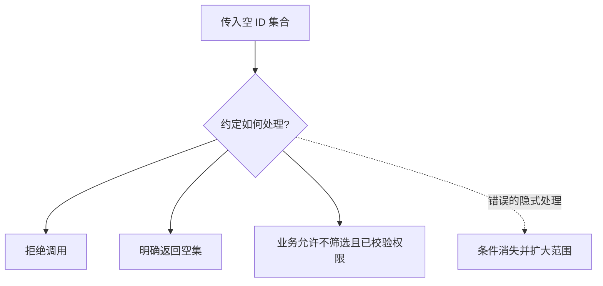
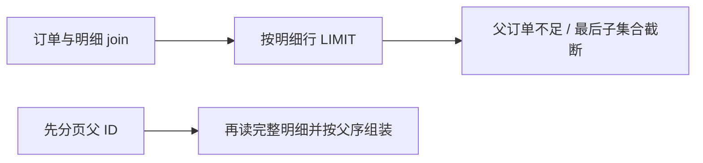
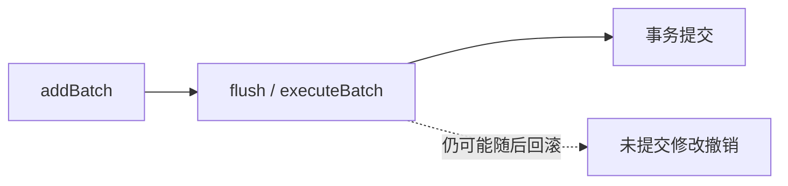
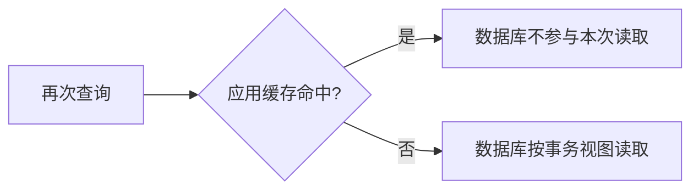
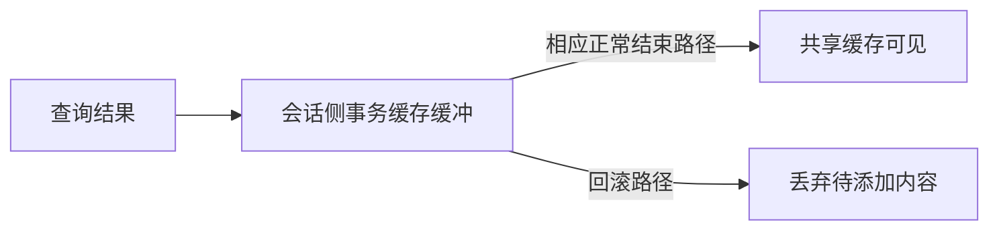
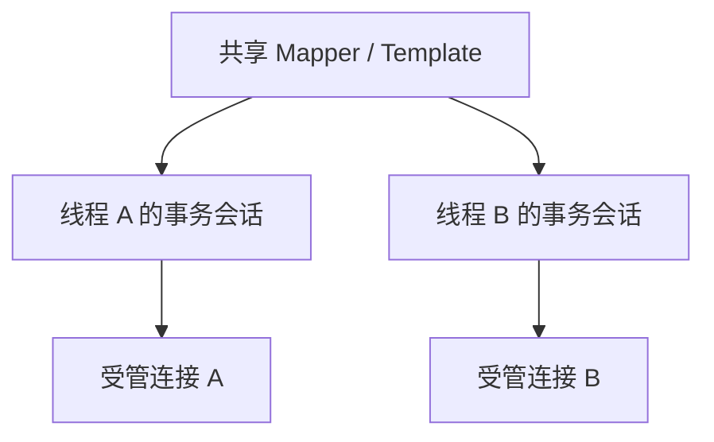
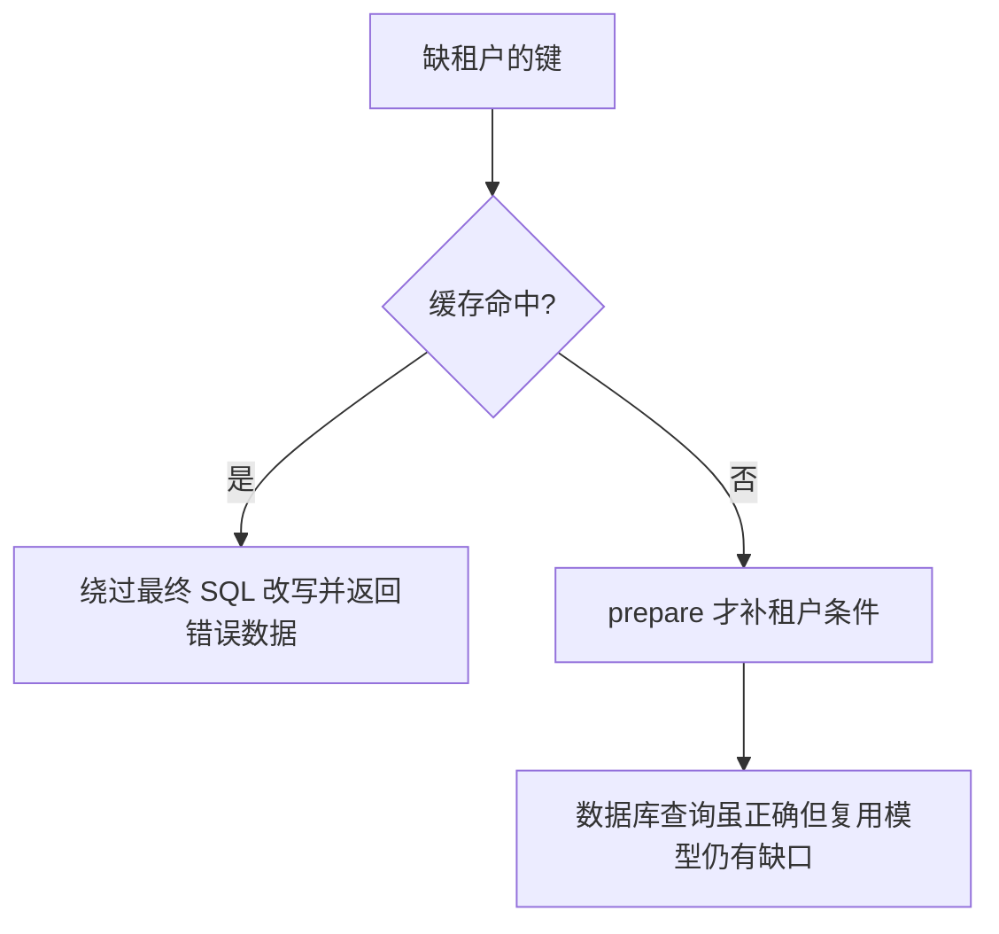

# MyBatis 面试：从一句话到执行、资源和故障推演

> **建议用法**：每题先讲结论，再按“前提 → 执行路径 → 与其他方案比较 → 失败证据”展开。不要用默认值替代项目实际配置，版本差异见 [原理篇](MyBatis原理.md#mb-18)。
>
> **重点路线**：Q1—Q10 定位与对象；Q11—Q18 执行与动态 SQL；Q19—Q26 映射与关联；Q27—Q32 批处理和主键；Q33—Q40 缓存；Q41—Q46 Spring 与数据源；Q47—Q53 插件、分页和性能；Q54—Q60 扩展、版本与综合推演。

## 一、定位、生命周期与 Mapper 契约

### Q1：MyBatis 为什么常被称为半自动 ORM？

> **一句话结论**：它自动化参数、执行和映射，通常仍由开发者显式维护 SQL。

**机制展开**：ORM（Object-Relational Mapping，对象关系映射）描述对象与关系模型转换。MyBatis 不像完整实体工作单元那样普遍跟踪所有字段修改；修改查询对象后仍需显式执行更新。半自动只是定位提示，不能概括所有能力或替代执行链解释。

**⚖️ 方案对比与代价**：SQL（Structured Query Language，结构化查询语言）可控适合复杂查询，但方言、索引与映射维护责任也更显式；不能由抽象层高低直接推断谁总是更快。

**🔎 追问演练**：JPA 与 Hibernate 可以直接视为同一产品吗？

**推演要点**：JPA（Java Persistence API，Java 持久化 API）是规范，Hibernate 是常见实现。应按查询控制、状态管理、关联和团队能力比较，而非只背名称。

**原理展开**：[对应章节](MyBatis原理.md#mb-01)。

---

### Q2：MyBatis 与 JdbcTemplate 主要差别在哪？

> **一句话结论**：两者都能减少 JDBC 模板，MyBatis 更强调映射语句、Mapper 契约和复杂结果组织。

**机制展开**：JDBC（Java Database Connectivity，Java 数据库连接）包含资源、绑定与结果处理。JdbcTemplate 简化资源和异常，仍常由调用方组织 SQL 与映射；MyBatis 进一步管理语句定义、动态条件、代理接口和结果关系。二者都不会代替数据库执行计划。

**⚖️ 方案对比与代价**：简单访问用模板很直接；大量复杂映射可受益于 MyBatis，但增加 XML 与元数据维护。一个项目也可能按场景组合使用。

**🔎 追问演练**：用了 MyBatis 就不需要理解 JDBC 吗？

**推演要点**：仍需理解连接、PreparedStatement、批处理、生成键、驱动参数与提交，这些决定很多框架表面行为。

**原理展开**：[对应章节](MyBatis原理.md#mb-01)。

---

### Q3：SqlSessionFactory 应不应该每次请求重建？

> **一句话结论**：通常应应用级复用，SqlSession 才是受控操作范围内的资源入口。

**机制展开**：工厂构建要解析配置、Mapper、结果规则和类型处理器，重复构建浪费资源且可能产生独立缓存和定义视图。FactoryBuilder 用完通常可丢弃；DefaultSqlSession 持有会话状态，不应全局共享。

**⚖️ 方案对比与代价**：工厂复用不代表运行中可随意修改共享 Configuration，请求级参数不得写入全局定义。

**🔎 追问演练**：创建会话等于立即新建物理连接吗？

**推演要点**：不必然。连接可能按需获取，连接池也可能复用已有物理连接，需要区分会话、逻辑连接与物理连接。

**原理展开**：[对应章节](MyBatis原理.md#mb-02)。

---

### Q4：DefaultSqlSession 和 SqlSessionTemplate 为什么线程安全结论不同？

> **一句话结论**：前者承载可变会话状态，后者是把调用转向合适会话的可共享协调入口。

**机制展开**：原生会话中的执行器、本地缓存和事务资源不应被并发乱用。Spring 模板按当前事务和工厂获取底层会话，多个线程可以分别使用各自资源；线程安全来自协调，不是让所有调用锁着同一个会话。

**⚖️ 方案对比与代价**：共享模板降低资源管理重复，但参数、结果对象与自定义处理器仍可能有共享状态问题。

**🔎 追问演练**：把 DefaultSqlSession 声明成单例 Bean 能变安全？

**推演要点**：不能。容器单例只改变共享范围，反而把非线程安全状态暴露给更多并发调用。

**原理展开**：[对应章节](MyBatis原理.md#mb-02)。

---

### Q5：Configuration 和 MappedStatement 分别保存什么？

> **一句话结论**：Configuration 汇总全局定义，MappedStatement 描述一条映射语句的执行元数据。

**机制展开**：语句定义包含标识、命令类型、SqlSource、结果映射、缓存和相关设置。它不是本次参数或最终结果；配置、XML 和注解通常在构建阶段整理，动态条件在本次执行时再求值。

**⚖️ 方案对比与代价**：共享定义便于复用，也意味着请求级改动不能直接覆盖共享字段；扩展需分清静态定义与单次执行状态。

**🔎 追问演练**：启动成功说明所有 Mapper 方法都正常吗？

**推演要点**：不一定。资源漏打包、待决引用、未走到的动态分支与驱动兼容问题，仍可能在实际调用时暴露。

**原理展开**：[对应章节](MyBatis原理.md#mb-02)。

---

### Q6：Mapper 接口没有实现类，为什么能调用？

> **一句话结论**：动态代理把方法契约转换为映射语句和 SqlSession 操作。

**机制展开**：典型 MapperProxy 根据方法取得可缓存元数据，MapperMethod 解析命令、参数和返回类型，再调用会话的 selectOne、selectList 或更新入口。JDK（Java Development Kit，Java 开发工具包）代理不等于生成了业务实现源码；默认方法和 Object 方法还有特殊路径。

**读图**：这是方法转换层，事务与 JDBC 资源还需沿后续链路分析。

**⚖️ 方案对比与代价**：接口表达契约简洁，但错误可能延后到运行期，应核对语句标识、扫描与参数映射。

**🔎 追问演练**：Mapper 代理就是 Spring 的事务代理吗？

**推演要点**：不是。一个负责接口到数据库操作的转换，另一个负责方法事务边界；它们可以出现在同一调用链的不同位置。

**原理展开**：[对应章节](MyBatis原理.md#mb-03)。

---

### Q7：Mapper 方法能否用重载对应不同 SQL？

> **一句话结论**：不要依赖重载区分同 namespace 下的同名 XML 语句，典型语句标识不包含参数签名。

**机制展开**：映射通常按接口全限定名加方法名查找，XML 用 namespace 加 id。两个 Java 重载不会自然对应两个同名 id 定义，可能产生冲突或共用不符合预期的语句。应使用明确方法名与查询对象。

**⚖️ 方案对比与代价**：少量方法名重复节省不了多少维护，清晰语义更利于定位、指标与兼容演进。

**🔎 追问演练**：Invalid bound statement 先查什么？

**推演要点**：查 namespace/id、资源是否打包加载、Mapper 是否绑定正确工厂，再检查扫描与版本；不是一看到就改接口注解。

**原理展开**：[对应章节](MyBatis原理.md#mb-03)。

---

### Q8：多个参数为什么推荐显式 Param？

> **一句话结论**：显式名字使 Mapper 契约不依赖编译参数和隐式命名细节。

**机制展开**：ParamNameResolver 根据注解、真实参数名能力与参数种类组织参数。真实名字依赖编译保留信息和配置，多参数也可能具有 param1 等通用名。RowBounds、结果处理器等特殊参数还可能单独处理，不能只按方法参数位置猜。

**⚖️ 方案对比与代价**：显式 Param 稳定直观，参数很多时查询对象更易校验；但对象属性变化也应作为接口契约维护。

**🔎 追问演练**：开发环境可用，打包后找不到参数可能为何？

**推演要点**：检查是否保留参数名、是否更换编译配置，以及 XML 引用了真实名还是显式 Param 名，不要只从数据库排查。

**原理展开**：[对应章节](MyBatis原理.md#mb-03)。

---

### Q9：单参数、集合和 Map 能用同一种取名规则吗？

> **一句话结论**：不能，参数对象与命名包装路径不同，显式契约最稳妥。

**机制展开**：普通对象通常按属性解析，Map 按键，集合或数组可能经特定包装，标注 Param 后又有明确名字。不能把单个标量参数的便利性外推为任何单参数都可随便起名，foreach 也必须引用真实存在的集合入口。

**⚖️ 方案对比与代价**：依赖隐式包装节省代码却降低可读性，跨模块或易演进 Mapper 更适合明确命名。

**🔎 追问演练**：List 参数加 Param 后还必须叫 list 吗？

**推演要点**：应使用约定的显式名字，如 ids，具体兼容别名按版本处理；不要把隐式 list 当全部场景的唯一契约。

**原理展开**：[对应章节](MyBatis原理.md#mb-03)。

---

### Q10：selectOne、Map 和基本类型返回有哪些坑？

> **一句话结论**：返回类型决定适配路径，单对象不是默认取第一条，基本类型也不能表达无结果。

**机制展开**：selectOne 通常在多于一条映射结果时抛异常，零条返回 null；基本类型无法接收 null。单行列值 Map 与 MapKey 索引多行 Map 不是同一种结果，计数返回还要考虑整型范围。

**⚖️ 方案对比与代价**：用 LIMIT 1 可能掩盖本应唯一的数据异常；是否允许多行需先由业务和数据库约束确定。

**🔎 追问演练**：Optional 就能避免所有异常？

**推演要点**：它能表达无值，不会使多结果合法，也不替代类型转换、唯一性和资源边界验证。

**原理展开**：[对应章节](MyBatis原理.md#mb-03)。

---

## 二、执行链与动态 SQL

### Q11：四大处理对象怎样串起执行链？

> **一句话结论**：执行器协调策略，语句处理器组织 JDBC，参数和结果处理器完成双向转换。

**机制展开**：Executor 结合缓存与具体策略，StatementHandler 准备并执行语句，ParameterHandler 借助 TypeHandler 绑定值，ResultSetHandler 把结果行组织成对象。这里的 Executor 是数据库执行抽象，不是 Java 线程池。

**⚖️ 方案对比与代价**：分工便于复用和插件扩展，但计时位置不同，观察到的耗时范围也不同，不能把任一层时间当完整请求。

**🔎 追问演练**：TypeHandler 只在结果映射用吗？

**推演要点**：不是。参数写入和结果读取两端都可能用到，这也是空值与枚举问题需要双向验证的原因。

**原理展开**：[对应章节](MyBatis原理.md#mb-04)。

---

### Q12：MappedStatement、SqlSource、BoundSql 怎样区分？

> **一句话结论**：定义描述一条语句，SqlSource 生成执行信息，BoundSql 是本次生成结果。

**机制展开**：MappedStatement 常被多调用共享；SqlSource 可按参数处理动态结构；BoundSql 保存 SQL 文本、参数映射和附加参数，不是把所有值嵌入后的日志字符串。foreach 等产生的临时参数也可能保存在附加区域。

**⚖️ 方案对比与代价**：分离提高复用与并发安全，插件若把本次数据写进共享定义，会污染其他请求。

**🔎 追问演练**：复制 BoundSql 只复制 SQL 字符串行吗？

**推演要点**：不行，还要协调参数映射、参数对象与附加参数，并关注缓存键是否已计算。

**原理展开**：[对应章节](MyBatis原理.md#mb-05)。

---

### Q13：#{} 与 ${} 有什么区别，分别用于什么？

> **一句话结论**：前者绑定数据值，后者替换 SQL 文本，结构片段要由可信白名单决定。

**机制展开**：`#{}` 通常生成问号和参数映射，由 JDBC 绑定；`${}` 把求值结果替换进语句结构。表名、列名和排序方向不能靠普通值占位替代，动态排序可用枚举映射或 choose 固定分支。

**⚖️ 方案对比与代价**：美元替换不是所有场景都绝对不能用，但外部任意文本不可直接进入；井号也不保护同一语句里其他不安全拼接。

**🔎 追问演练**：ORDER BY 里用参数占位就能按传入列排序吗？

**推演要点**：通常不能，驱动绑定的是值而非标识符。需要后端选择固定允许的列与方向。

**原理展开**：[对应章节](MyBatis原理.md#mb-05)。

---

### Q14：PreparedStatement 是否保证服务端预编译和计划复用？

> **一句话结论**：不保证，框架调用 JDBC 接口，实际准备与缓存行为由驱动和数据库共同决定。

**机制展开**：常见 PREPARED 路径通过 PreparedStatement 设置参数，但驱动可能采用不同执行方式，也可能需要特定选项才启用服务端准备或缓存。SQL 形状、参数类型和数据库计划策略还会影响实际复用。

**⚖️ 方案对比与代价**：不要仅凭使用参数占位就承诺性能改善，应看真实驱动、配置与数据库证据。

**🔎 追问演练**：LIKE 的占位符为什么不能直接放进字符串引号？

**推演要点**：那可能变成 SQL 字面文本而非占位。应绑定完整模式，字面搜索通配符还需专门转义。

**原理展开**：[对应章节](MyBatis原理.md#mb-05)。

---

### Q15：动态 SQL 比手工拼字符串好在哪里？

> **一句话结论**：条件结构与参数绑定更集中，减少括号、连接词和分隔符错误。

**机制展开**：动态节点使用 OGNL（Object-Graph Navigation Language，对象图导航语言）求值，if 可独立追加，choose 表达互斥，trim/where/set 处理局部语法。它减少拼接模板，却不会验证所有条件组合的业务授权与性能。

**⚖️ 方案对比与代价**：XML（Extensible Markup Language，可扩展标记语言）表达直观，列名重构和类型检查较弱；类型化 DSL（Domain-Specific Language，领域专用语言）另有收益与限制。

**🔎 追问演练**：MyBatis Dynamic SQL 就是这些 XML 标签吗？

**推演要点**：不是同一个项目概念，前者是独立 Java DSL 库，后者是核心 XML 动态 SQL 功能。

**原理展开**：[对应章节](MyBatis原理.md#mb-06)。

---

### Q16：空 foreach 为什么可能造成越权查询？

> **一句话结论**：若条件被整体跳过，意图中的空集可能退化为没有范围限制。

**机制展开**：只查指定 IDs 的语句，在空集合时省略 IN 条件，可能查全部；用于写操作更危险。应明确定义空集返回空、报错或代表不筛选，并通过 Service 校验或 otherwise 假条件落实，租户条件也不能随意省略。

**⚖️ 方案对比与代价**：nullable 主要处理求值行为，不自动提供安全业务语义；防全表更新插件也不是授权模型。

**🔎 追问演练**：空集合不报错就说明安全吗？

**推演要点**：不说明。应检查最终 SQL 与返回范围，特别验证 null、空列表和权限信息缺失。

**原理展开**：[对应章节](MyBatis原理.md#mb-06)。

---

### Q17：where、set 能保证动态语句正确吗？

> **一句话结论**：它们主要修整局部语法，不保证生成范围和操作意图正确。

**机制展开**：where 在有内容时组织 WHERE 并去掉合适的前导连接词，set 整理更新项与尾逗号。所有可选条件都缺失时，查询范围可能扩大；更新项全缺失时也不会凭空生成合法业务动作。

**⚖️ 方案对比与代价**：语法抽象减少低级错误，业务仍应验证最少条件、可修改字段和空更新策略。

**🔎 追问演练**：有 where 标签就不会全表删除？

**推演要点**：不是。标签没有产生内容时不代表自动拒绝，需要独立的必需条件校验与数据权限约束。

**原理展开**：[对应章节](MyBatis原理.md#mb-06)。

---

### Q18：OGNL 中 null、空串、0、false 可以统一判断吗？

> **一句话结论**：不能，它们代表不同业务状态，表达式还可能发生类型转换。

**机制展开**：数值字段常用是否为 null 判断是否参与筛选，Boolean 应明确三态含义，字符串要区分空与空白。统一写不等于空串可能引入意外比较或排除合法 0；时间边界也要明确时区和开闭区间。

**⚖️ 方案对比与代价**：简短万能模板方便复制，却可能系统性改变条件语义；按字段类型写清楚更可靠。

**🔎 追问演练**：动态条件组合怎么测？

**推演要点**：覆盖必需条件缺失、全部可选为空、单条件、多条件、0/false、边界时间与极大集合，并断言最终范围。

**原理展开**：[对应章节](MyBatis原理.md#mb-06)。

---

## 三、结果映射与关联加载

### Q19：resultMap 中 id 的作用是什么？

> **一句话结论**：它帮助结果映射识别对象身份和折叠关联行，不会创建数据库主键。

**机制展开**：一对多连接会重复返回父列，父子 id 映射辅助判断哪一行属于已有对象。身份错误可能把不同子对象合并或产生重复；复合身份应完整表达，外连接还需避免把全空子行变成假对象。

**⚖️ 方案对比与代价**：自动推断减少配置，显式身份与列别名更适合复杂关联，也利于避免结构变化造成静默错误。

**🔎 追问演练**：加了 id 就能把 LIMIT 截断的明细补齐吗？

**推演要点**：不能。映射只处理数据库已返回的行，不可能补回根本未返回的明细。

**原理展开**：[对应章节](MyBatis原理.md#mb-07)。

---

### Q20：驼峰映射能替代显式映射吗？

> **一句话结论**：能简化规则化命名，不能猜测重名列、业务别名和复杂关联。

**机制展开**：mapUnderscoreToCamelCase 辅助下划线到驼峰转换，多个表都有 id/name 时仍需唯一列标签。自动映射行为和未知列策略也有配置差异，核心默认不能与扩展项目默认混淆。

**⚖️ 方案对比与代价**：简单单表可自动映射，复杂查询宜用列清单、别名和 resultMap；SELECT 星号增加结构演进风险。

**🔎 追问演练**：字段一直为 null 一定是数据库没有值？

**推演要点**：先查最终列标签、属性和类型，再查 setter/构造器与实际结果，不能只看实体字段名。

**原理展开**：[对应章节](MyBatis原理.md#mb-07)。

---

### Q21：TypeHandler 应该承担哪些职责？

> **一句话结论**：专注 Java 与 JDBC 值转换，同时验证参数写入和结果读取。

**机制展开**：可处理稳定状态码、时间或 JSON（JavaScript Object Notation，JavaScript 对象表示法）列，空值有时还需明确 jdbcType。默认枚举通常按名称处理，序号持久化对插入与重排敏感；未知码策略应由契约决定。

**⚖️ 方案对比与代价**：处理器可能被复用，不应保存请求级可变状态或发远程调用；转换异常应提供可定位信息又避免敏感数据泄漏。

**🔎 追问演练**：自定义枚举处理器只测查询够吗？

**推演要点**：不够，还需验证写入、null、未知值、历史码与往返一致性。

**原理展开**：[对应章节](MyBatis原理.md#mb-07)。

---

### Q22：不可变对象和空结果映射有什么注意事项？

> **一句话结论**：构造器映射依赖名字、顺序与版本；无行、空行和空字段要分别判断。

**机制展开**：setter 自动映射成功不能推导任意 record 或构造器都能推断。必要时显式声明参数映射；callSettersOnNulls、returnInstanceForEmptyRow 会影响 null 与空对象表现，基本类型不能表达缺失。

**⚖️ 方案对比与代价**：不可变对象减少共享修改风险，也使构造契约更严格；不应用默认空对象掩盖本来应缺失的数据。

**🔎 追问演练**：返回 DTO 就一定不会触发延迟加载？

**推演要点**：DTO（Data Transfer Object，数据传输对象）是设计用途，不是特殊魔法；要真正完成必要字段加载并避免携带受管延迟代理。

**原理展开**：[对应章节](MyBatis原理.md#mb-07)。

---

### Q23：N+1 查询怎么发现与解决？

> **一句话结论**：先统计真实 SQL 数和关联键分布，再比较 join 与批量加载。

**机制展开**：一次父查询后每个父对象再查关联，会形成常见 1+N；相同键可能被本地缓存减少，但不能据此假定不存在。join 减少往返却重复父列，两阶段按父 ID 集合读子数据可折中传输与组装成本。

**⚖️ 方案对比与代价**：一条 SQL 不是唯一目标，大连接膨胀可能比两次受控查询更差；同时比较数据量、索引和一致性。

**🔎 追问演练**：延迟加载能直接消除 N+1？

**推演要点**：只能避免未被访问的关联查询；若最后都访问，查询次数仍可能很多，甚至在序列化阶段集中触发。

**原理展开**：[对应章节](MyBatis原理.md#mb-08)。

---

### Q24：延迟加载什么时候发 SQL，为什么日志也会触发？

> **一句话结论**：结果代理在满足触发策略的访问时加载关联，不只显式业务 getter 可能触发。

**机制展开**：相关配置和关联 fetch 策略共同决定行为，toString、调试器、序列化和 equals 等可能接触延迟属性。Mapper 接口代理负责执行入口，结果对象延迟代理负责何时补全，两者不是同一个对象。

**⚖️ 方案对比与代价**：节省不需要的加载同时把 SQL 时机变得间接，跨层返回时更难控制事务与尾延迟。

**🔎 追问演练**：排查接口 SQL 变多只看 Service 够吗？

**推演要点**：还需看响应转换、日志与调试行为，确认代理触发方法和实际 SQL 数。

**原理展开**：[对应章节](MyBatis原理.md#mb-08)。

---

### Q25：会话关闭后延迟加载一定报错吗？

> **一句话结论**：不能绝对化，某些路径可尝试新建执行器，但不保证仍在原事务。

**机制展开**：ResultLoader 在原执行器关闭或线程变化时可尝试创建新执行器与资源，能否成功取决于环境与集成配置。成功加载也可能采用另一连接和数据库视图，不能把数据一致性当作已被保留。

**⚖️ 方案对比与代价**：跨边界保留延迟代理减少显式加载代码，却引入隐式访问；在受控范围内生成明确响应更容易验证。

**🔎 追问演练**：因此可以安全跨线程共享延迟实体吗？

**推演要点**：不能由补偿加载路径推导线程安全，它不保证对象状态、事务与上下文的整体安全。

**原理展开**：[对应章节](MyBatis原理.md#mb-08)。

---

### Q26：一对多 join 为什么会分页少数据？

> **一句话结论**：LIMIT 限制连接结果行，未必限制父对象数，并可能截断某个父对象的子集合。

**机制展开**：十行连接记录可能只对应两个订单。resultMap 能去重合并，却不能补回未返回明细。可先分页父 ID 再查完整子数据，或在子查询先限定父范围，同时保持权限、排序和一致性。

**⚖️ 方案对比与代价**：两阶段增加组装和可能的数据变化窗口，但能更清晰控制业务对象数量；不能只依赖分页插件。

**🔎 追问演练**：第二步 IN 查询为何顺序变了？

**推演要点**：IN 不保证按输入 ID 顺序返回，需要显式排序或根据第一步顺序重组。

**原理展开**：[对应章节](MyBatis原理.md#mb-08)。

---

## 四、执行器、批处理与主键

### Q27：SIMPLE、REUSE、BATCH 分别复用什么？

> **一句话结论**：SIMPLE 常规执行，REUSE 复用语句资源，BATCH 累积更新并适时发送。

**机制展开**：REUSE 不是结果缓存，也不保证数据库计划复用；BATCH 借助 JDBC 批处理减少部分往返与处理成本，结果和异常可能延后。驱动语句缓存、批量重写与数据库优化仍是独立层。

**⚖️ 方案对比与代价**：默认常规模式容易解释，优化模式应有负载证据；换执行器不改变数据库事务基本规则。

**🔎 追问演练**：REUSE 开了，相同查询就不访问数据库？

**推演要点**：不是。它复用 Statement，查询结果是否复用由缓存等另一套机制决定。

**原理展开**：[对应章节](MyBatis原理.md#mb-09)。

---

### Q28：批处理 flush 和 commit 到底差在哪？

> **一句话结论**：flush 把待处理更新发送执行，commit 才结束相应数据库事务的提交阶段。

**机制展开**：Mapper 多次调用可先 addBatch，flush 调用 executeBatch 并处理结果；提交路径通常也会触发刷新。自动提交与事务配置影响原子边界，实际查询执行路径还可能先刷新，但缓存命中不等于执行路径必达。

**⚖️ 方案对比与代价**：分块 flush 控制内存，分块 commit 缩小事务却改变整体原子性，需要幂等、进度与失败恢复。

**🔎 追问演练**：每五百条 flush，失败会只回滚最后五百条吗？

**推演要点**：如果仍在一个正常受管数据库事务中，已发送但未提交的前面块也属于这个事务；不能把发送块当提交块。

**原理展开**：[对应章节](MyBatis原理.md#mb-09)。

---

### Q29：BATCH 的更新返回值为何不是 1？

> **一句话结论**：单次更新可能只进入批队列，返回占位值而非真实影响行数。

**机制展开**：真实批结果在 flush 后取得，驱动还可能返回未知成功条数或部分失败标记。不能直接累计每次 Mapper 返回 int 作为业务成功数，生成键也可能等到发送后才回填。

**⚖️ 方案对比与代价**：推迟结果换来吞吐收益，但失败定位与业务计数更复杂，应在明确完成点检查结果。

**🔎 追问演练**：返回负数就表示数据库更新失败吗？

**推演要点**：不应这样推断。先看是否 BATCH 占位或驱动标准结果，再结合异常、批组和最终事务结果。

**原理展开**：[对应章节](MyBatis原理.md#mb-09)。

---

### Q30：动态 SQL 为什么会影响批处理效果？

> **一句话结论**：最终 SQL 形状与语句定义决定批组，不是同一个方法就自动合成一批。

**机制展开**：典型实现仅对相邻且最终 SQL 与 MappedStatement 相同的调用继续当前批组。可选列产生不同文本会拆组，A/B/A 交替也不能简单按全局相同 SQL 归并；查询与 flush 还会结束当前积累。

**⚖️ 方案对比与代价**：按形状分组可改善效率，却要保持业务顺序和依赖；不能为了批量擅自重排有因果关系的更新。

**🔎 追问演练**：固定全部更新列就一定更好？

**推演要点**：未必。可能覆盖不应修改字段或改变 null 语义，要先守住业务契约再优化批次形状。

**原理展开**：[对应章节](MyBatis原理.md#mb-09)。

---

### Q31：批处理部分失败应该怎样恢复？

> **一句话结论**：先确认已发送、已成功、已提交的范围，再决定整体回滚还是按进度恢复。

**机制展开**：驱动可能提供部分更新计数，异常与批结果不代表事务已提交。单事务下按规则回滚可撤销未提交修改；多块已独立提交时，前面块不能随最后一块回滚，需要持久化进度、幂等和补偿。非事务资源或驱动行为也需验证。

**⚖️ 方案对比与代价**：大事务原子性更集中却持锁更久，分块提交资源友好却把恢复责任交给业务；没有只提吞吐不提失败的完整方案。

**🔎 追问演练**：捕获批异常后继续并提交可不可以？

**推演要点**：要按数据库事务状态和业务协议判断，不能假设部分失败后事务仍可安全使用；默认优先明确回滚并受控重试。

**原理展开**：[对应章节](MyBatis原理.md#mb-09)。

---

### Q32：主键回填有哪些实现和边界？

> **一句话结论**：常用 JDBC 生成键能力或 selectKey，回填不等于业务已提交。

**机制展开**：useGeneratedKeys 通过驱动取键，keyProperty 指定回写路径，必要时还有 keyColumn；selectKey 可按数据库需求在前后取值。集合批量、返回顺序和嵌套参数路径要验证，批处理下还可能在 flush 后才获得键。

**⚖️ 方案对比与代价**：数据库自增简单，跨库标识可能采用其他方案，但唯一性、顺序与暴露信息各有成本。

**🔎 追问演练**：SELECT MAX(id) 能取回本次插入键吗？

**推演要点**：存在并发竞争，不能当通用方案；自增值回滚也不保证被下次复用，不应推断 ID 连续。

**原理展开**：[对应章节](MyBatis原理.md#mb-16)。

---

## 五、一级与二级缓存

### Q33：一级缓存的键包含什么？

> **一句话结论**：典型键含语句标识、分页边界、最终 SQL、绑定输入值和存在时的环境标识。

**机制展开**：缓存不是仅按参数或方法名查找。不同 MappedStatement 即使文本相同也可能不同键，动态分支改变 SQL 形状也影响结果；附加参数和实际取值规则需与绑定路径一致。

**⚖️ 方案对比与代价**：键维度精确才能隔离数据，逻辑环境名不一定代表动态路由后的物理库，线程上下文也不会自动加入。

**🔎 追问演练**：同一 tenantId 写在 ThreadLocal 里，缓存自然隔离吗？

**推演要点**：不自然隔离。若未进入键相关 SQL/参数或独立缓存范围，就可能复用其他租户结果。

**原理展开**：[对应章节](MyBatis原理.md#mb-10)。

---

### Q34：一级缓存何时清理，cacheEnabled 是总开关吗？

> **一句话结论**：更新、提交、回滚、关闭与显式清理等会影响本地缓存，cacheEnabled 不是一级缓存总开关。

**机制展开**：BaseExecutor 更新路径清本地缓存，查询 flushCache 和事务结束也需考虑。localCacheScope 为 STATEMENT 时不跨顶层调用复用结果，但嵌套查询仍需内部机制；全局 cacheEnabled 主要影响二级缓存能力。

**⚖️ 方案对比与代价**：改变范围能减少会话结果复用，也增加访问；外部数据库变更不会自动让当前会话失效。

**🔎 追问演练**：SqlSession.clearCache 会清所有 namespace 二级缓存吗？

**推演要点**：不会，它主要清本地缓存；共享缓存的失效要按具体 namespace 和事务缓冲分析。

**原理展开**：[对应章节](MyBatis原理.md#mb-10)。

---

### Q35：数据库读已提交，为什么同会话两次读还是旧值？

> **一句话结论**：可能第二次命中 MyBatis 缓存，数据库根本没有执行第二次读。

**机制展开**：应用缓存先于数据库视图发生作用。先观察是否发 SQL，再检查会话、数据源与事务；清缓存后仍旧，才继续分析数据库快照、提交和副本延迟。READ COMMITTED（读已提交）不能越过应用缓存直接决定返回值。

**读图**：返回值先受应用执行路径影响，再谈数据库隔离，不能颠倒前提。

**⚖️ 方案对比与代价**：数据库隔离和应用缓存可以叠加，但应明确正确性要求；强一致路径不应未经评估使用结果复用。

**🔎 追问演练**：两次值相同就能证明数据库可重复读？

**推演要点**：不能。可能没有新查询，也可能数据本来没变化；需要受控并发和真实 SQL 证据。

**原理展开**：[对应章节](MyBatis原理.md#mb-10)。

---

### Q36：修改查询对象后再次查到新值，数据库一定更新了吗？

> **一句话结论**：不一定，同会话缓存可能复用了被修改的 Java 对象。

**机制展开**：查询对象 status 被 setter 修改但没有执行 update，相同键再次查询可能返回同一引用。MyBatis 不会因此自动脏检查写库，业务层装饰返回值也可能影响后续使用者。

**⚖️ 方案对比与代价**：转换为独立 DTO 或保持查询对象只读更容易控制；换缓存范围只能改变部分现象，不代替对象边界设计。

**🔎 追问演练**：怎么证明确实写入数据库？

**推演要点**：使用明确更新并观察最终提交，再通过独立受控连接或查询验证，同时排除副本和其他缓存。

**原理展开**：[对应章节](MyBatis原理.md#mb-10)。

---

### Q37：二级缓存是否默认开启，查询顺序是什么？

> **一句话结论**：全局允许不等于每个 namespace 已启用，符合条件的普通查询通常先经过二级缓存再到一级。

**机制展开**：需要 namespace 的 cache/cache-ref 等配置与语句 useCache 等条件。CachingExecutor 是外层装饰器，未命中或不适用再委托本地缓存与数据库；Cursor 和自定义结果处理路径不能全按普通 List 图解释。

**⚖️ 方案对比与代价**：缓存层编号不代表固定查询顺序，应沿实际装饰器链判断；二级共享还增加失效与对象复制成本。

**🔎 追问演练**：打开 cacheEnabled 就让所有 Mapper 自动缓存吗？

**推演要点**：不是。要确认具体缓存、语句策略、查询类型及是否真正命中。

**原理展开**：[对应章节](MyBatis原理.md#mb-11)。

---

### Q38：二级缓存什么时候让其他会话可见？

> **一句话结论**：新增与清理意图通常经事务缓存缓冲，在相应提交或关闭路径处理。

**机制展开**：查询结果不必立即发布到共享缓存；回滚通常丢弃待添加内容。正常关闭只读会话也可能发布，因此必须显式 commit 才缓存并不准确。Spring 协调阶段和数据库真正提交的关系也应结合实现分析。

**读图**：是否发布还取决于具体查询与结束方式；这不是数据库与缓存强一致协议。

**⚖️ 方案对比与代价**：事务缓冲减少部分不当发布，但不等于数据库与缓存组成全局原子提交，仍不能承诺强一致。

**🔎 追问演练**：缓存里有结果说明数据库事务肯定成功吗？

**推演要点**：不能作为通用证明，应看实际事务管理与发布路径，提交失败和并发写入仍有独立边界。

**原理展开**：[对应章节](MyBatis原理.md#mb-11)。

---

### Q39：同表由另一个 Mapper 更新，二级缓存会失效吗？

> **一句话结论**：不一定，namespace 缓存不是自动分析 SQL 依赖的表级缓存。

**机制展开**：读取 Mapper 缓存数据，写入 Mapper 若不引用同一缓存，更新可能不清前者。脚本、其他服务和手工 JDBC 更不会自然通知。cache-ref 可协同指定范围，但仍有外部入口和并发窗口。

**⚖️ 方案对比与代价**：共享范围过大会互相频繁清理；写路径复杂或强一致场景可不使用二级缓存，改用更明确领域策略。

**🔎 追问演练**：换成 Redis 二级缓存就解决了吗？

**推演要点**：共享存储不补充失效依赖与键维度，只把同样问题扩展到更多实例；一致性协议仍需设计。

**原理展开**：[对应章节](MyBatis原理.md#mb-11)。

---

### Q40：二级缓存 readOnly 是数据库只读吗？

> **一句话结论**：不是，它主要改变结果共享与复制方式。

**机制展开**：内置读写缓存通常通过序列化复制结果，对对象及引用图有相关要求；readOnly=true 可让调用方共享实例，需要保证不修改。它不会给数据库设只读，也不会把普通 Java 类变不可变。

**⚖️ 方案对比与代价**：复制更安全但有 CPU（Central Processing Unit，中央处理器）和对象成本，共享较快却把修改风险放到调用方；自定义缓存实现还可能不同。

**🔎 追问演练**：把返回对象补个展示字段有风险吗？

**推演要点**：若共享同一实例，可能污染其他调用结果。应使用独立响应对象并验证具体缓存语义。

**原理展开**：[对应章节](MyBatis原理.md#mb-11)。

---

## 六、Spring 事务与数据源

### Q41：Spring 单例 Mapper 为什么可以被并发使用？

> **一句话结论**：常见集成通过 SqlSessionTemplate 为各次调用协调合适会话，而非共享一个原生会话。

**机制展开**：扫描注册通常由 MapperFactoryBean 等提供接口代理，代理再连接模板。不同线程事务有各自资源，同事务同工厂调用通常复用绑定会话；原生 getMapper 绑定非线程安全会话的情况不能照搬此结论。

**⚖️ 方案对比与代价**：容器单例方便注入不代表任何 Mapper 实例都天然安全，还要看绑定对象和自定义扩展状态。

**🔎 追问演练**：自己把原生 Mapper 存进静态字段也一样安全吗？

**推演要点**：不一样。若它持有同一个 DefaultSqlSession，资源和缓存状态可能被并发访问。

**原理展开**：[对应章节](MyBatis原理.md#mb-12)。

---

### Q42：没写 Spring 事务，两个 Mapper 调用会怎样？

> **一句话结论**：它们通常各自按模板规则完成，不自动组成同一个事务。

**机制展开**：事务外执行会由集成层自动提交并结束对应资源，连续调用可能得到不同会话，所以一级缓存未必复用；第一步成功第二步失败，也不能期待第一步被自动回滚。

**⚖️ 方案对比与代价**：显式用例事务能协调本地步骤，但扩大事务范围会持有连接与锁；应按原子需求划边界。

**🔎 追问演练**：没有事务是不是只影响性能？

**推演要点**：还影响原子性、缓存与资源生命周期，甚至返回 Cursor 后能否继续使用。

**原理展开**：[对应章节](MyBatis原理.md#mb-12)。

---

### Q43：Spring 事务不控制 MyBatis 更新先查什么？

> **一句话结论**：查是否经过正确事务代理、使用匹配 DataSource，并核对异常与线程边界。

**机制展开**：Service 自调用可能绕过拦截，catch 后返回可能不触发回滚；Mapper 绑到另一工厂或管理器对应另一源，也可能不是同一资源。手工 openSession 与跨线程任务会进一步改变资源归属。

**⚖️ 方案对比与代价**：不应一概通过在 Mapper 再加事务修复，先确定业务用例原子边界和真实连接。

**🔎 追问演练**：DataSource 名称相似就说明同一资源吗？

**推演要点**：不能，仅有同名地址也不足以证明绑定关系，需核对实际对象、工厂、事务管理器与连接获取路径。

**原理展开**：[对应章节](MyBatis原理.md#mb-12)。

---

### Q44：同事务内 SIMPLE 和 BATCH 能随意混用吗？

> **一句话结论**：同工厂已绑定会话时不能任意改变执行类型，要在事务边界前明确策略。

**机制展开**：模板会按工厂和事务复用资源，已有不同 ExecutorType 时切换可能被拒绝。可设计独立批处理用例或适当隔离事务，但 REQUIRES_NEW 还会额外占连接并独立提交，不只是配置技巧。

**⚖️ 方案对比与代价**：混合模式代码方便却隐藏资源冲突，明确批入口更容易验证刷新、异常与提交。

**🔎 追问演练**：新事务解决执行类型后还有代价吗？

**推演要点**：外层回滚不撤销已提交内层，连接池也可能被嵌套占满，需要业务接受和容量证据。

**原理展开**：[对应章节](MyBatis原理.md#mb-09)。

---

### Q45：多数据源路由为什么设置了却没切换？

> **一句话结论**：事务可能已取得并绑定连接，后改路由标记不会自动替换它。

**机制展开**：要检查路由增强与事务增强的实际顺序，以及是否延迟取连接。多工厂模式还需确认扫描范围和模板绑定，一个 Mapper 绑定错工厂，动态标记可能根本不参与其选源。

**⚖️ 方案对比与代价**：多工厂边界明确但配置更多，路由源统一入口但时机、上下文和缓存更复杂。

**🔎 追问演练**：注解写在事务注解上面就一定先执行吗？

**推演要点**：注解排列不决定代理链顺序，必须看实际注册与增强顺序及连接获取时机。

**原理展开**：[对应章节](MyBatis原理.md#mb-13)。

---

### Q46：写完立即读旧数据有哪些不同原因？

> **一句话结论**：缓存未发新 SQL、读副本延迟和事务未提交都可能表现相似。

**机制展开**：先确认是否执行查询，再看实际物理库、连接与事务视图。事务已固定的连接不一定跟随新路由，逻辑环境标识也不一定隔离不同物理库缓存；读主策略只能解决其中部分问题。

**⚖️ 方案对比与代价**：读写分离提升读扩展，代价是显式一致性需求；关键读己之写路径应选择可验证策略。

**🔎 追问演练**：clearCache 后还旧就一定数据库坏了？

**推演要点**：不能，还可能二级缓存、副本延迟、原事务快照或业务本来未更新，应逐层排除。

**原理展开**：[对应章节](MyBatis原理.md#mb-13)。

---

## 七、插件、分页与性能

### Q47：插件能拦截哪些对象，顺序怎么理解？

> **一句话结论**：核心围绕 Executor、StatementHandler、ParameterHandler、ResultSetHandler 的指定接口方法。

**机制展开**：原生链按注册列表包装，A 后再包装 B 得到 B(A(target))，通常后包装者前置先执行。框架排序和扩展项目内部链另有规则；方法重载和内部调用不保证都重新经过外层代理。

**⚖️ 方案对比与代价**：插件灵活但会改变执行语义，不是任意类任意方法的全局 AOP（Aspect-Oriented Programming，面向切面编程）。

**🔎 追问演练**：拦截六参数 query 就覆盖所有查询吗？

**推演要点**：不一定。四参数入口到内部六参数调用可能不走同一个代理边界，要沿真实调用链核对。

**原理展开**：[对应章节](MyBatis原理.md#mb-14)。

---

### Q48：租户条件加进最终 SQL，为什么还可能串数据？

> **一句话结论**：若缓存键先生成且缺少租户维度，命中时甚至不会执行 SQL 改写。

**机制展开**：StatementHandler.prepare 位于部分缓存查找之后，原语句键可能让两个租户复用结果；一个工厂动态切物理库也可能出现类似问题。隔离维度必须在正确阶段进入 SQL、参数与键，或采用独立资源/禁用不适用缓存。

**⚖️ 方案对比与代价**：数据库过滤正确不证明应用结果隔离正确，租户插件必须覆盖缓存命中、count 与嵌套路径。

**🔎 追问演练**：只关闭二级缓存就万无一失？

**推演要点**：不一定，还需检查一级缓存、业务缓存、路由上下文与其他入口，不能只修一层。

**原理展开**：[对应章节](MyBatis原理.md#mb-13)。

---

### Q49：SQL 改写插件为什么不能只改字符串？

> **一句话结论**：SQL、参数映射、附加参数、缓存键和派生查询必须保持一致。

**机制展开**：增加问号要提供对应 ParameterMapping 和值；复制 BoundSql 不能丢 foreach/bind 附加参数；分页 count 与多租户也要一致。请求数据不可直接写共享 MappedStatement，简单正则难覆盖子查询和方言。

**⚖️ 方案对比与代价**：结构解析与兼容测试成本高，但比错误地修改敏感语句更可控；插件组合应验证所有常见结构。

**🔎 追问演练**：StatementHandler 计时能覆盖缓存与连接排队吗？

**推演要点**：未必。拦截点决定时间边界，需要额外端到端观测才能完整解释。

**原理展开**：[对应章节](MyBatis原理.md#mb-14)。

---

### Q50：RowBounds、物理分页、Keyset 怎样选择？

> **一句话结论**：RowBounds 通常限制结果处理，物理分页限制数据库返回，Keyset 用稳定位置继续读取。

**机制展开**：原生 RowBounds 不自动生成 LIMIT，可能遍历大量前置行；OFFSET 下推减少部分传输但深偏移仍有扫描成本。Keyset 适合连续翻页，需要唯一稳定排序组合和上一页游标，不方便任意跳页。

**⚖️ 方案对比与代价**：选择来自访问模式而非插件名称，索引、数据变更与游标合法性也需验证。

**🔎 追问演练**：只按创建时间作为游标有问题吗？

**推演要点**：相同时间可能多行，缺少唯一补充键容易漏或重复，应使用完整复合排序，并处理空值与方向。

**原理展开**：[对应章节](MyBatis原理.md#mb-15)。

---

### Q51：分页 count 为什么可能错误或很慢？

> **一句话结论**：统计对象可能与连接行或分组不同，机械改写不保证业务等价。

**机制展开**：join 会放大父行，distinct/group by/union 改变计数语义，优化移除连接也可能改变过滤效果。应明确数父对象、结果行还是分组，必要时手写等价 count，并对权限、租户条件保持一致。

**⚖️ 方案对比与代价**：精确总页数会增加开销，一些连续列表可用是否还有下一页替代，但需产品契约允许。

**🔎 追问演练**：分页插件能修复复杂 SQL 一切性能问题？

**推演要点**：不能，它组织改写与计数，不代替执行计划、索引和业务对象分页分析。

**原理展开**：[对应章节](MyBatis原理.md#mb-15)。

---

### Q52：Cursor 就一定不占内存、不占连接吗？

> **一句话结论**：它减少一次持有全部对象的需要，但通常要保持数据库资源直到消费结束。

**机制展开**：会话、Statement 和连接需在迭代时有效；Spring 事务外返回 Cursor 后资源可能已关。fetchSize 通常是驱动提示，真正服务端分批取数还受数据库、驱动、自动提交与结果集设置影响。

**⚖️ 方案对比与代价**：长时间流式消费可能占住连接并延长事务，慢下游要有预算；分块导出更可恢复但快照语义不同。

**🔎 追问演练**：把 Cursor 返回 Controller 再慢慢序列化合适吗？

**推演要点**：通常难控资源寿命和失败响应，宜在明确范围消费关闭，或设计专用异步导出。

**原理展开**：[对应章节](MyBatis原理.md#mb-15)。

---

### Q53：Mapper 调用很慢，数据库 SQL 却很快怎么查？

> **一句话结论**：沿连接、传输、映射、关联、插件与业务处理拆分，不只看数据库计时。

**机制展开**：检查连接池等待、返回行列规模、N+1、类型转换和对象分配，再核对日志拦截位置。最终 SQL 与参数类型也影响计划；应用日志一段耗时和数据库执行器时间可能不是同一个范围。

**⚖️ 方案对比与代价**：先控制查询量与传输，再优化真正热点；讨论 XML 与注解谁快通常远离主要瓶颈。

**🔎 追问演练**：改成 Map 返回一定更快吗？

**推演要点**：不保证，仍有分配和类型转换且失去部分契约，应在相同负载下测量总成本。

**原理展开**：[对应章节](MyBatis原理.md#mb-16)。

---

## 八、扩展生态、版本与综合推演

### Q54：MyBatis-Plus 给 MyBatis 增加了什么？

> **一句话结论**：它是独立增强项目，提供通用操作、条件构造和插件，底层边界仍存在。

**机制展开**：CRUD（Create, Read, Update, Delete，增删改查）减少基础语句，条件构造器与自动填充简化模板；分页、乐观锁、多租户等需具体组件和配置。不能把这些全部说成 MyBatis 核心默认实现。

**⚖️ 方案对比与代价**：简单业务更省代码，复杂关联仍需 SQL 设计；版本、依赖、缓存与事务要按真实组合验证。

**🔎 追问演练**：Lambda 条件是不是不会注入？

**推演要点**：类型引用改善部分字段选择，但原始 SQL 片段、排序和自定义扩展仍可能危险，不能因此透传任意客户端输入。

**原理展开**：[对应章节](MyBatis原理.md#mb-17)。

---

### Q55：乐观锁插件怎样防止并发覆盖？

> **一句话结论**：把旧版本放入更新条件，并在成功更新时推进版本，失败方显式处理冲突。

**机制展开**：两方读到 version=5，更新条件含 version=5 且写成 6，通常先成功者改变状态，后者不再匹配。业务需检查结果并选择重读、拒绝或幂等重试；并非所有自定义方法都自动适配插件。

**⚖️ 方案对比与代价**：冲突少时比长时间业务锁更灵活，冲突多时重试成本高；数据库执行 UPDATE 仍可能加锁。

**🔎 追问演练**：一个版本列能保证跨行库存总量吗？

**推演要点**：不能自动保证所有跨行不变量和外部副作用，需约束、事务或业务协调。

**原理展开**：[对应章节](MyBatis原理.md#mb-17)。

---

### Q56：逻辑删除为什么影响唯一键和自定义 SQL？

> **一句话结论**：删除变成状态变化，数据仍存在，索引与所有读取入口都要理解该状态。

**机制展开**：自动生成路径可加入未删除条件，自定义 SQL、外部访问与历史查询不应假定全覆盖。若用 email/deleted 唯一键且 deleted 只有 0/1，同 email 可能只容纳一条删除历史，重复创建删除再冲突。

**⚖️ 方案对比与代价**：便于审计与恢复也增加数据量、过滤与唯一性设计成本；不能只加字段而不改领域规则。

**🔎 追问演练**：逻辑删除等于数据库审计历史吗？

**推演要点**：不等于，它不自动保存每次修改、操作者和旧值，完整审计需要明确记录模型。

**原理展开**：[对应章节](MyBatis原理.md#mb-17)。

---

### Q57：多租户插件会自动完成权限控制吗？

> **一句话结论**：它可协助加入数据范围，不替代身份验证和全部对象级授权。

**机制展开**：租户必须来自可信上下文，需验证忽略表、插入、别名、子查询、count、缓存与特殊 SQL。用户属于同租户也不代表能查看租户内所有订单，角色与对象所有权是额外规则。

**⚖️ 方案对比与代价**：共享表成本低但隔离责任集中在应用与约束，独立库隔离更清晰也增加资源和迁移成本。

**🔎 追问演练**：只测试最终 SQL 含 tenant_id 够吗？

**推演要点**：不够，还要验证无 SQL 的缓存路径、上下文清理、异步任务和绕过插件入口。

**原理展开**：[对应章节](MyBatis原理.md#mb-17)。

---

### Q58：MyBatis 3.5、3.6 与 Spring/Boot 版本怎样区分？

> **一句话结论**：核心、集成和 Starter 独立演进，升级按组合而非相同数字匹配。

**机制展开**：3.6.0 核心以 Java 11 为基线；MyBatis-Spring 3.0 对 Framework 6，4.0 对 Framework 7；Boot Starter 3.0 当前矩阵列 Boot 3.2—3.5，4.0 对 Boot 4.0+，相应 Java 要求独立核对。3.5 的 foreach、构造器、affectData 等也有小版本差异。

**⚖️ 方案对比与代价**：核心升级不代表第三方插件自动兼容；官方矩阵和维护状态也不是同一问题，需核对当前发布与实际依赖树。

**🔎 追问演练**：MyBatis-Spring 4 表示 MyBatis 核心已经 4 了吗？

**推演要点**：不是，项目名称与版本线不同，必须分别查看最终解析出的依赖与对应源码。

**原理展开**：[对应章节](MyBatis原理.md#mb-18)。

---

### Q59：MyBatis 测试怎样才验证了真正边界？

> **一句话结论**：同时覆盖语句注册、条件、映射、资源和实际数据库协议，而非只 mock Mapper。

**机制展开**：mock Mapper 可以测业务分支，却不测 XML、参数名、插件、缓存或方言。上下文测试验证装配，真实数据库验证生成键、批处理、锁和提交；缓存测试用不同会话与结束方式观察 SQL，动态条件覆盖空集和权限缺失。

**⚖️ 方案对比与代价**：不必每个低风险改动都做全链路测试，但关键契约不能靠替身绕开；自动回滚不足以证明真实提交路径。

**🔎 追问演练**：接口成功返回就证明写入已持久化？

**推演要点**：不能。提交可能在代理退出阶段失败，主键或更新方法返回也不代表全部事务成功。

**原理展开**：[对应章节](MyBatis原理.md#mb-16)。

---

### Q60：订单批量导入后查询错误，怎样做综合推演？

> **一句话结论**：沿语句、会话、提交、数据源、缓存和映射逐层区分事实。

**机制展开**：先核对批次是否只 addBatch、是否 flush/commit、异常是否被吞；再确认查询是否发 SQL、去主库还是副本、是否同会话缓存；最后检查参数、租户、生成键与结果身份。重复导入还要看幂等与唯一约束，而不是先清所有缓存。

**⚖️ 方案对比与代价**：每个组件都能制造相似症状，按执行和资源证据推理才能避免误修；恢复策略需保留已提交范围与业务状态。

**🔎 追问演练**：最关键的几个证据是什么？

**推演要点**：最终 SQL 与绑定、实际工厂/会话/连接、批执行与事务结果、缓存命中以及权威业务记录，合在一起才能说明因果。

**原理展开**：[对应章节](MyBatis原理.md#mb-16)。

---

## 参考与版本核对

- [原理篇官方资料与源码入口](MyBatis原理.md#mb-references)：从概念跳到实际执行路径。
- [核心发布记录](https://github.com/mybatis/mybatis-3/releases)、[集成矩阵](https://mybatis.org/spring/)、[Starter 矩阵](https://mybatis.org/spring-boot-starter/mybatis-spring-boot-autoconfigure/)：区分核心、集成与 Boot 版本。
- [BaseExecutor](https://mybatis.org/mybatis-3/xref/org/apache/ibatis/executor/BaseExecutor.html)、[CachingExecutor](https://mybatis.org/mybatis-3/xref/org/apache/ibatis/executor/CachingExecutor.html)：核对缓存键、查询顺序与清理边界。
- [Spring 会话](https://mybatis.org/spring/sqlsession.html)、[Spring 事务](https://mybatis.org/spring/transactions.html)：核对模板共享与底层资源。

现场回答默认值时，说明适用版本、实际驱动、插件和覆盖配置；不要把一个项目的现象直接推广为框架全部行为。

## 附录：术语与缩写

| 术语 | 英文全称 | 中文含义 / 边界 |
|---|---|---|
| JDBC | Java Database Connectivity | Java 数据库连接接口 |
| SQL | Structured Query Language | 结构化查询语言 |
| XML | Extensible Markup Language | 可扩展标记语言 |
| ORM | Object-Relational Mapping | 对象关系映射 |
| JPA | Java Persistence API | Java 持久化 API 规范 |
| API | Application Programming Interface | 应用程序编程接口 |
| JDK | Java Development Kit | Java 开发工具包 |
| CPU | Central Processing Unit | 中央处理器 |
| JVM | Java Virtual Machine | Java 虚拟机 |
| OGNL | Object-Graph Navigation Language | 对象图导航语言，用于表达式求值 |
| DSL | Domain-Specific Language | 领域专用语言 |
| DTO | Data Transfer Object | 数据传输对象 |
| JSON | JavaScript Object Notation | JavaScript 对象表示法 |
| CRUD | Create, Read, Update, Delete | 增删改查 |
| AOP | Aspect-Oriented Programming | 面向切面编程 |
| CTE | Common Table Expression | 公用表表达式 |
| MVCC | Multi-Version Concurrency Control | 多版本并发控制，属于数据库实现 |
| ID | Identifier | 标识符 |
| DAO | Data Access Object | 数据访问对象 |
| N+1 | One Main Query Plus N Related Queries | 一次主查询加 N 次关联查询 |
| CacheKey | Cache Key | 缓存查询键，不只是 SQL 文本 |
| MappedStatement | Mapped Statement | 共享的映射语句定义 |
| BoundSql | Bound SQL | 本次执行的 SQL 文本、参数映射与附加参数 |
| SqlSession | SQL Session | 会话访问入口，原生实现通常非线程安全 |
| TypeHandler | Type Handler | Java 与 JDBC 类型转换处理器 |
| RowBounds | Row Bounds | 结果偏移与限制，不自动等同物理分页 |
| Cursor | Result Cursor | 可迭代结果游标，需保持资源有效并关闭 |
| ThreadLocal | Thread Local Variable | 线程局部变量，不自动跨异步任务传播 |
| Keyset Pagination | Keyset / Seek Pagination | 按稳定排序键继续查询的分页方式 |
| Flush | Flush Pending Statements | 把待处理批次发送执行，不等于提交 |
| Commit | Transaction Commit | 事务提交，仍需关注失败与资源范围 |
