# Redis 原理：从命令执行到缓存与分布式协作

> **阅读目标**：沿一条请求解释数据如何执行、编码、过期、持久化、复制及分片，再推导缓存与锁的故障边界。
>
> 本文讨论 Redis 社区/开源服务端的核心模型，以 **7.4** 为实验基线，比较 **6.x、7.0、7.2、7.4、8.0、8.2** 的代表性变化，不将这些版本视为完全相同，也不将本文列出的最高版本称为当前最新版本。Redis Software、Redis Cloud、Redis Stack 与兼容实现的能力不能直接混用。
>
> 配套复习：[Redis面试.md](Redis面试.md)。缩写在正文首次使用时展开，完整术语位于[文末附录](#glossary)。

## 阅读路线

**建议先读**：[单机 → 主从 → 哨兵 → 集群的架构演进](#architecture-evolution)，先明确每种形态解决的问题，再进入执行和数据结构。

| 目标 | 推荐章节 | 要能说清的问题 |
| --- | --- | --- |
| **理解性能** | [执行模型](#execution) → [数据结构](#structures) → [批量与原子性](#atomicity) | 哪些成本被省掉，哪些操作仍会阻塞？ |
| **理解可靠性** | [持久化](#persistence) → [复制](#replication) → [Sentinel](#sentinel) → [Cluster](#cluster) | 返回成功、复制完成、持久化与切主分别保证什么？ |
| **理解业务正确性** | [缓存一致性](#cache) → [分布式锁](#locks) → [限流与库存](#patterns) | 失效、重试、超时和旧请求会怎样？ |
| **架构与扩展** | [架构演进](#architecture-evolution) → [专题补全](#advanced-topics) | 单机到集群各解决什么？客户端与调度还有哪些边界？ |
| **选型与落地** | [消息模型](#messaging) → [排障](#operations) → [版本](#versions) → [实验](#experiments) | 为什么选这个模型，怎样验证边界？ |

全文按 **问题 → 可选方案 → Redis 的实现 → 优势 → 代价与失效窗口** 展开。图中蓝色表示处理与存储，橙色表示等待或风险边界，绿色表示结果或恢复机制。

<a id="execution"></a>

## 1. 执行模型：快在哪里，单线程指什么

> 🎯 **本章抓手**
>
> **普通命令的核心执行通常串行，但整个 Redis 进程不是只有一个线程。**
>
> 内存访问、事件驱动和简化并发共同降低成本；大操作和慢外部链路仍会抬高延迟。

### 1.1 一条请求的路径

客户端将命令编码成 **RESP（Redis Serialization Protocol，Redis 序列化协议）**，通过连接送入服务端。服务端读取、解析、检查权限、查找键、执行命令，再组织响应。修改还可能进入复制和持久化链路。

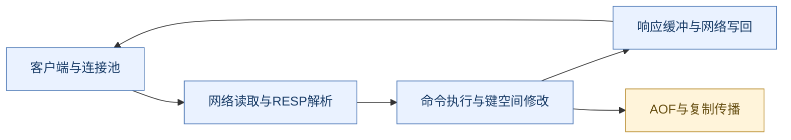

**读图抓手**：客户端收到成功响应，不代表副本已追上或数据已同步到物理介质；它也不代表调用方的数据库事务成功。

### 1.2 为什么不让每条命令都由独立线程修改键空间

| 设计 | 优势 | 成本 |
| --- | --- | --- |
| 每连接/请求一个执行线程 | 可并行处理多个独立任务 | 共享键、过期字典、编码转换等需同步；线程和上下文切换有成本 |
| 事件驱动、串行执行普通命令 | 数据结构并发控制较简单，命令执行边界清楚 | 一个慢命令可能拖慢同实例其他请求 |
| 多实例/分片 + 网络并行 | 通过不同键空间获得并行度 | 路由、多键协作和故障管理复杂 |

Redis 的传统核心路径选择第二种，并通过分片扩展处理能力。**串行执行减少的是并发协调成本，不会使 O(N) 操作自动变成 O(1)。**

事件循环利用 **I/O（Input/Output，输入输出）多路复用**关注就绪连接，而不是让每个空闲连接占一个阻塞执行线程。这里的“多路复用”描述连接等待方式，不等于所有命令并行执行。

### 1.3 网络线程与后台任务的边界

Redis 6 引入可配置的网络 I/O 线程；读写路径是否启用、承担哪些工作取决于配置与版本。持久化刷写、异步释放、后台保存等也存在后台线程或子进程。Redis 8 对 I/O 与性能继续改进，不能把 6.x 的具体实现套给所有后续版本。

**CPU（Central Processing Unit，中央处理器）**密集的长 Lua 脚本、大集合遍历和大响应构造仍可能拖住普通命令执行。网络吞吐受限时增加 I/O 并行可能有效，命令本身耗时过长时却未必有效。

### 1.4 为什么内存系统仍会慢

延迟包括连接池等待、网络往返、服务端排队、命令执行、持久化/系统压力和响应传输。**RTT（Round-Trip Time，网络往返时间）**可能比一次简单内存操作贵得多；大响应还会占用网络与客户端解码时间。

因此“Redis 是内存所以不会阻塞”“单线程所以不需要看 CPU”“开多线程就能线性加速”都缺少条件。应按链路拆解问题，而非只背单线程标签。

<a id="architecture-evolution"></a>

## 2. 架构演进：从单机到主从、哨兵与集群

> 🎯 **先理解“问题如何推动架构变化”**
>
> **主从复制增加冗余，Sentinel管理故障转移，Cluster分摊键空间与写入。**
>
> 它们解决不同问题，Cluster不是“更高级所以所有场景都应该升级到它”。

### 2.1 四种形态的演进主线


**读图抓手**：这是问题驱动的学习路线，不是产品要求必须逐站升级。Cluster使用自己的拓扑和故障处理，不依赖再挂一套Sentinel才能选主。

| 形态 | 数据分布 | 主要解决 | 尚未解决 | 新增复杂度 |
| --- | --- | --- | --- | --- |
| 单机 | 一份完整键空间 | 简单、低成本访问 | 实例故障、容量及吞吐上限 | 备份和重启恢复 |
| 主从 | 主和副本各持完整键空间 | 冗余、可选读扩展 | 自动切主、单主写上限 | 复制延迟、同步成本与读一致性 |
| 主从+Sentinel | 数据仍是完整复制 | 故障检测、自动切换、地址发现 | 单份键空间容量、写热点、严格零丢失 | 仲裁、角色收敛、客户端切换 |
| Cluster | 主节点分片，每片配副本 | 总容量、多键写并行、相应高可用 | 单热key、跨槽事务、异步丢写窗口 | 槽路由、迁移、多键约束、分片级故障 |

### 2.2 单机：为什么是合理起点

单个Redis实例保存全部键，客户端只需知道一个入口，命令顺序和多键操作边界相对简单。对数据规模可控、可接受短暂中断或有完整重建路径的场景，单机可能符合成本目标。

它至少有三种不同上限：**可靠性上限**是实例/宿主机故障会中断访问；**容量上限**是工作数据与运行余量必须能装进单实例内存；**吞吐上限**由执行、网络、响应大小和命令组合共同决定。

增加磁盘或打开**AOF（Append Only File，仅追加文件）**主要改变恢复能力，不等于让所有业务数据自动转为磁盘存储并突破内存容量。加I/O线程也不会让一个长脚本自动并行。


**为什么备份不能当在线高可用**：有备份只说明有机会恢复历史，还要启动新实例、加载数据、追赶和切换客户端。恢复用时必须满足业务目标，不能只看文件还在。

### 2.3 主从：为什么先复制，而不是立即分片

复制让另一个节点维护完整副本。当目标是增加冗余或分摊允许陈旧的读取，而不是突破单份数据规模时，复制通常比分片更容易保持原有键空间语义。

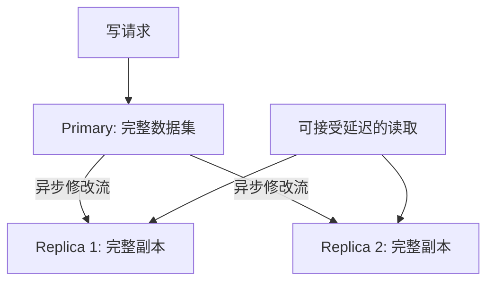

**它增加的能力**：主节点失效时有其他数据副本可供人工或上层系统恢复；副本可承担合适读取和部分备份职责。

**它没有增加的能力**：副本不是按数据块各存一部分，所有副本仍要装下完整数据；所有写入仍由当前主节点承接，所以增加三个副本不等于写吞吐变四倍。

**为什么读扩展不是免费收益**：读写分离将复制延迟暴露给业务。用户刚修改资料就查到旧资料、权限刚撤销却读副本旧权限，都是必须定义的行为。复制网络、全量同步、主节点输出缓冲也会消耗资源。

### 2.4 主从为什么还缺一套“控制机制”

主节点出问题后，至少需要回答四个问题：它是真的失败还是某条网络不可达？哪个副本应该接管？谁有权发起切换？客户端如何找到新主？

仅设置复制关系不会自动回答全部问题。靠人工切换存在响应慢、选择落后副本、两个运维者并发操作或客户端还连旧主的风险；让每个副本自行宣布接管，则可能在网络隔离时形成多个主。

因此，数据复制之外还需要**故障观察、切换授权与拓扑发现**。这也是理解Sentinel设计的入口，而不是先背三个配置名。

### 2.5 Sentinel：给主从增加控制面

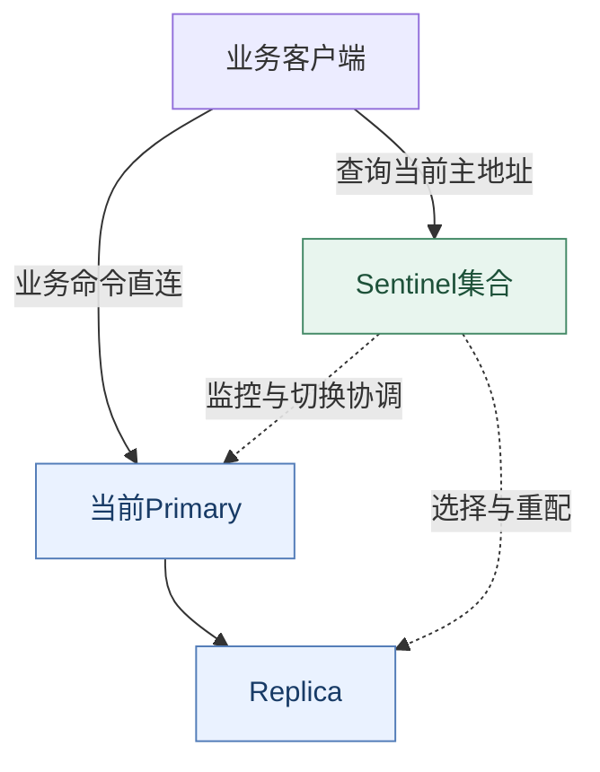

**Sentinel不是数据代理**：它告诉客户端当前主节点在哪里并管理故障转移，业务GET/SET通常直接访问数据节点。客户端只连得上Sentinel，却无法访问返回的主地址，业务仍然失败。

多个Sentinel观察者减少“我连不上所以它一定死了”的单点误判。主观下线、客观下线与多数授权分别回答观察、确认和执行资格；不是简单三个进程只要有一个在就能切主。

**代价**：多维护一套监控协调状态；客户端要处理地址变化、连接重建及执行结果不确定；旧主重新加入时还需要角色收敛与数据同步。与人工切换相比，恢复更自动化，但不因此变成零中断。

### 2.6 哨兵切主为什么仍可能丢成功写入

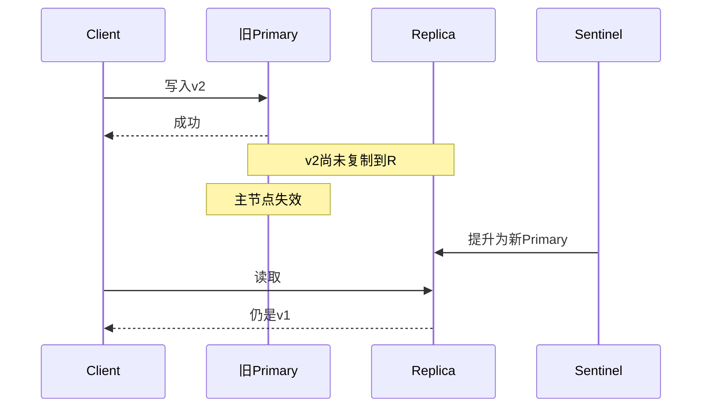

**读图抓手**：Sentinel改变的是故障恢复决策，没有把之前的异步复制改为逐条共识提交。更快完成切换和更低数据损失是相关但不同的目标。

WAIT、WAITAOF及副本写入门槛可降低部分风险，但需要分别分析确认范围、选主与设备故障。对于严格业务约束，应明确权威数据源、幂等和恢复，而不能只回答“配哨兵”。

### 2.7 为什么从哨兵走向分片

假设一份在线数据需要300GB，而合适的单实例有效内存只有100GB。增加两个完整副本，只是让三台机器各自都面临300GB的数据需求；它不会把数据均摊成每台100GB。

再假设写请求已经打满一个主节点，所有副本仍在复制相同修改，不能帮主节点并行执行同一键空间的任意写入。此时需要把**不同键的所有权拆给多个主节点**，而不仅是继续复制。

这类问题也可以用业务拆实例或外部路由解决。关键设计变化是“从复制全部数据，转为分配部分数据”，Cluster是Redis原生的一种实现。

### 2.8 Cluster：分片加副本的两层结构

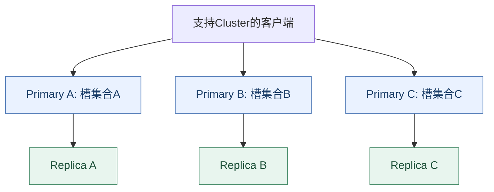

横向看，不同主节点承接不同槽的数据和写入；纵向看，每个分片通过副本增加冗余。**分片与复制是两个维度**：三主无副本能够分数据，但不等于能容忍任意主节点失效；一主三副本有冗余，但不是四份分片容量。

常见“三主三副”是六个Redis数据实例，不代表只要六个容器就有六台机器的故障隔离。主副本是否落在独立宿主机、机架或可用区，决定共同故障影响。

### 2.9 Cluster为什么引入路由和多键代价

单机全部数据由一个执行者管理，多键脚本和事务较容易放在同一边界。分片后，相关键可能在不同节点，各节点独立执行就不能天然构成同一原子单元。

Cluster使用槽归属与客户端路由避免所有流量经过统一数据代理；代价是客户端处理拓扑、重定向、失败与迁移。hash tag可让相关键同槽，却又可能制造热点。

| 分片思路 | 路由责任 | 优点 | 代价 |
| --- | --- | --- | --- |
| 应用自行拆实例 | 应用或业务服务 | 可按业务域隔离 | 迁移和拓扑责任落到应用 |
| 外部代理分片 | 代理层 | 客户端可少感知部分路由 | 额外网络跳转、容量与高可用层 |
| Redis Cluster | 原生槽与支持拓扑的客户端 | 分片和故障协议配套 | 客户端复杂度、同槽限制与迁移治理 |

不能仅按“有多少机器”比较三者；要看路由、状态、故障和原子操作的边界在哪里。

### 2.10 读写分离、分片和高可用为什么不能混用

| 目标 | 主要手段 | 需要接受或补偿的边界 |
| --- | --- | --- |
| 扩读 | 副本读、本地缓存 | 复制延迟或失效治理 |
| 扩总容量 | 分片、业务拆分 | 键路由与跨分片操作 |
| 扩多键写吞吐 | 多主分片并行 | 负载分布、单key仍归某片 |
| 缩短节点故障恢复 | 副本与自动切主 | 切换时断连、丢写窗口与客户端重试 |
| 防误删除与历史恢复 | 独立备份、恢复演练 | 恢复点与恢复时间 |
| 防旧写破坏业务 | 权威约束、版本或合适协调 | 不能仅靠增加实例数量 |

### 2.11 架构升级并不解决单个热点

单个key始终映射到一个槽，Cluster扩容通常不会把它自动切成多份。一个巨型Hash也不会因增加节点就变成多个较小Hash。

热读可评估本地层与请求合并；热写可能需要业务分桶和汇总，但精确读总和与原子修改的语义会变化。**不能先承诺全局精确顺序，再把同一实体任意分散后声称语义不变。**

### 2.12 如何在面试中完成架构选型

先问数据是否可重建、写入和读取峰值、单份数据大小、热点分布，以及允许中断和丢失多久。然后按瓶颈推导：单机满足约束时不必盲目分片；需要自动故障转移但单份容量与写入仍可控时考虑主从+Sentinel；容量或分散写负载超过单主时再评估Cluster。

最后交代新成本：客户端发现、读陈旧、跨槽限制、节点失效后的连接与重试、扩缩容迁移，以及独立备份。**“用了Cluster所以高可用且强一致”不是合格的架构解释。**

参考：[复制模型](https://redis.io/docs/latest/operate/oss_and_stack/management/replication/)、[Sentinel](https://redis.io/docs/latest/operate/oss_and_stack/management/sentinel/)、[Cluster设计与边界](https://redis.io/docs/latest/operate/oss_and_stack/reference/cluster-spec/)。

<a id="structures"></a>

## 3. 数据类型与内部编码：空间、定位与更新的取舍

> 🎯 **本章抓手**
>
> **对外类型决定语义，内部编码决定具体成本；编码随版本、大小和操作变化。**

### 3.1 类型不等于固定数据结构

| 对外类型 | 常见用途 | 7.x 常见内部表示与注意点 |
| --- | --- | --- |
| String | 缓存值、计数、锁标记 | 整数表示或字符串表示，不能认为总是字符数组 |
| Hash | 对象字段、分组属性 | 小对象可用 listpack，较大对象通常用哈希表 |
| List | 双端队列 | quicklist，节点内可用 listpack |
| Set | 去重、成员判断、集合运算 | intset、listpack 或哈希表，取决于版本与内容 |
| Sorted Set（ZSet） | 排行榜、范围查询 | 小集合可用 listpack；较大集合通常结合跳表与字典 |
| Bitmap | 位状态、签到 | 基于字符串位操作，并非独立的键类型 |
| HyperLogLog | 近似基数统计 | 概率结构，不保存完整去重集合 |
| Stream | 事件追加、消费组 | 有序ID与紧凑记录组织，另维护消费状态 |

`TYPE` 看外部语义，`OBJECT ENCODING` 看当前内部表示。编码阈值由目标版本和配置决定，不应把某篇教程中的常量当成永久约定。

### 3.2 SDS 为什么比 C 的裸字符串更适合

**SDS（Simple Dynamic String，简单动态字符串）**将长度与容量等元数据放在字符串头部。由元数据可获得长度，不必每次扫描到零字节；按显式长度处理也可以保存二进制数据。

| 方案 | 长度与边界 | 追加成本 |
| --- | --- | --- |
| 传统零结尾字符串 | 通常需要扫描确定长度 | 需小心容量与缓冲区边界 |
| 带长度/容量的动态字符串 | 直接读取元数据，二进制友好 | 容量不足时仍需重新分配和复制 |

预留空间可摊薄连续追加的分配次数，代价是未用容量。小字符串的紧凑分配可减少分配器开销，但更新可能引起编码转换。**“长度可直接读取”不代表字符串所有操作都恒定时间。**

### 3.3 紧凑编码为什么有时比哈希表好

小 Hash 的字段和值很少时，连续内存扫描可能比大量指针和分配更经济。listpack 将元素紧凑组织，减少对象头、指针和分配碎片；代价是定位、插入或扩容可能扫描与移动数据。

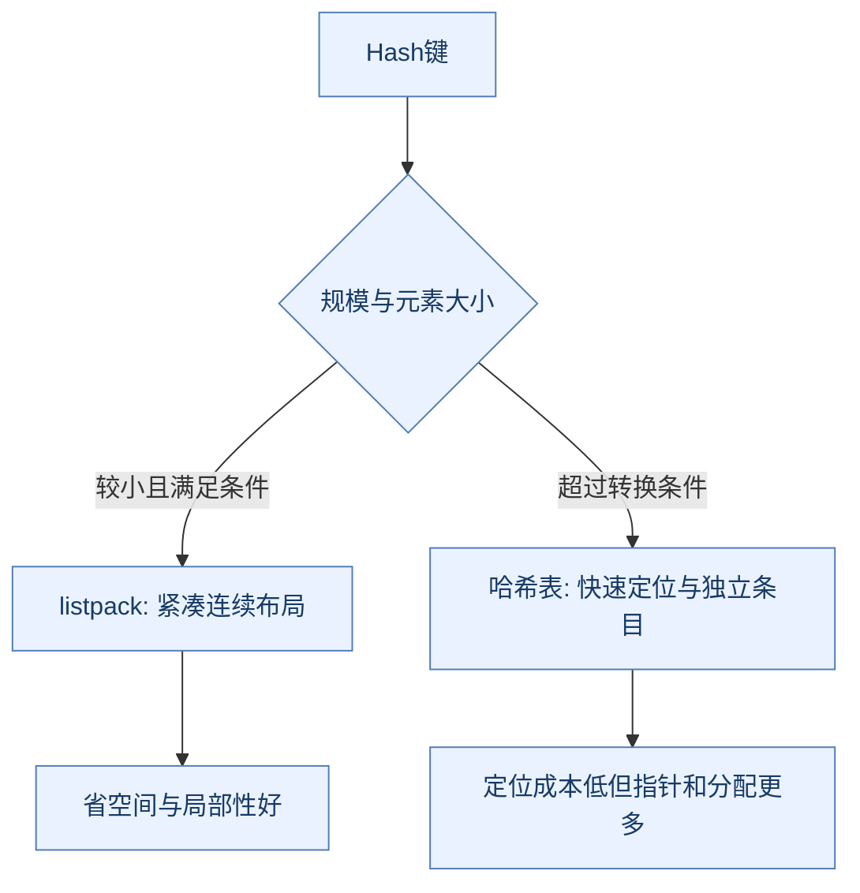

**读图抓手**：紧凑编码与哈希表服务不同规模，转换是空间与更新成本的权衡。

压缩列表 ziplist 的历史实现存在连锁更新等问题；listpack 通过元素自身的编码设计减少相关耦合。新版本应解释当前编码，旧源码讨论要标明版本，不能将 Hash 永远说成“ziplist 或 hashtable”。

编码转换可能在一次写操作中触发，因此数据量变化也可能改变单次请求延迟。聚合很多字段虽然节约键开销，却可能制造大键、粗粒度迁移与过期管理问题。

### 3.4 哈希表与渐进式 rehash

哈希冲突通过桶内组织处理；扩容时若一次搬完全部条目，主执行路径会出现明显停顿。渐进式 rehash 让新旧表在迁移期间共存，将部分搬迁分摊到后续操作与后台周期工作。

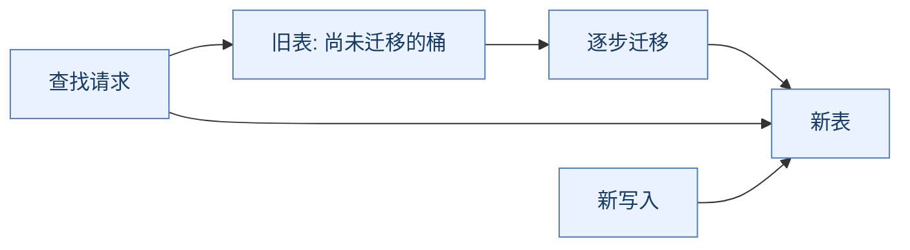

**读图抓手**：迁移期新旧表共存，查找与写入规则不同，减少停顿但增加临时内存。

**收益**是降低一次全量迁移造成的停顿，**代价**是迁移期双表内存与查找复杂度。单个超长冲突链、分配压力或其他大操作仍可能影响延迟，不能把“渐进式”理解成严格恒定时间。

### 3.5 ZSet 为什么结合跳表和字典

字典便于按 member 找 score，跳表便于按分数顺序遍历、定位范围和计算排名。单用哈希表难以高效做有序范围，单用有序链表则查找慢；平衡树也是可行方案，跳表提供相对直观的概率层级实现。

```text
高层:  head ----------------> score=30 ----------------> tail
中层:  head ----> score=10 --> score=30 ----> score=50 --> tail
底层:  head -> 5 -> 10 -> 20 -> 30 -> 40 -> 50 ---------> tail
```

沿高层跳跃、逐层下降，再在底层连续扫描。常见查找期望复杂度为 O(log N)，范围返回还要加上返回数量 M，即 O(log N + M)；大范围结果依然可能很贵。相同 score 的 member 有确定排序规则，不等于自动保留业务插入顺序。

### 3.6 概率结构为什么不是通用 Set 替代品

HyperLogLog 通过少量统计状态估算不同元素数，节省内存，但不支持恢复完整成员集合。Bloom Filter（布隆过滤器）通过多次哈希设置位，回答“可能存在/一定不存在”，允许假阳性，不能把它当成精确索引。

布隆过滤器没有假阴性的结论依赖正确添加、未错误清空、配置及实现正常等条件；数据同步缺失仍会使业务漏查。Redis 核心旧版本是否有现成布隆命令取决于发行包/模块，不能将 Redis Stack 或 Redis 8 集成能力直接套到裸 Redis 6。

参考：[数据类型](https://redis.io/docs/latest/develop/data-types/)、[内存优化](https://redis.io/docs/latest/operate/oss_and_stack/management/optimization/memory-optimization/)、[7.4 内部对象与编码定义](https://github.com/redis/redis/blob/7.4/src/server.h)。

<a id="expiry"></a>

## 4. 过期、淘汰与内存回收

> 🎯 **本章抓手**
>
> **过期决定有效期，淘汰决定内存不足时牺牲谁，释放决定内存何时实际回收。**

### 4.1 为什么不用每个键一个定时器

**TTL（Time To Live，生存时间）**表达数据有效期。对每个键创建独立定时任务，任务数量和维护成本会随键规模增长；只在访问时检查又会让永不再访问的过期键长时间占内存。

Redis 结合访问时的惰性过期检查与主动过期周期工作。主动工作受时间与开销预算约束，避免过期处理无限占用执行时间。**到期是逻辑有效性边界，不是保证在同一毫秒释放全部内存。**

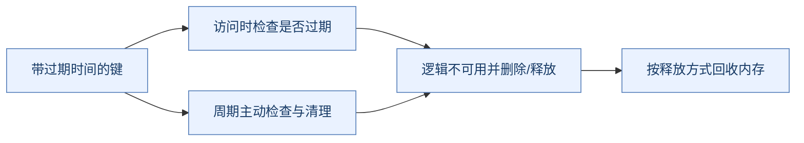

**读图抓手**：到期、清理与内存回收分层发生，不用RSS变化替代业务有效性判断。

批量同一时刻过期会集中制造删除和回源压力，适当打散 TTL 可以平滑负载，但不能替代数据库容量和请求限流。修改、覆盖、续期命令对 TTL 的影响各不相同，不能假设所有更新都保留有效期。

### 4.2 为什么近似 LRU，而不是精确维护所有访问顺序

**LRU（Least Recently Used，最近最少使用）**偏向淘汰久未访问项；**LFU（Least Frequently Used，最不经常使用）**偏向保留经常访问项。

精确 LRU 通常需要维护全局访问顺序，每次读取都更新元数据。Redis 通过采样与候选管理近似选择，降低精确全局维护成本；LFU 也使用有界频率状态与衰减，不能理解为永久准确计数。

| 策略 | 候选范围 | 适用条件与代价 |
| --- | --- | --- |
| allkeys-lru / allkeys-lfu | 所有键 | 纯缓存常用候选；重要键也可能被淘汰 |
| volatile-lru / volatile-lfu | 设置了过期的键 | 混合数据时限制候选，但没有合格键时可能无法释放 |
| volatile-ttl | 带过期键中偏向更早到期 | 不等于按最近访问或业务价值排序 |
| allkeys-random / volatile-random | 对应范围随机选择 | 简单，但不理解访问热度 |
| noeviction | 不淘汰 | 内存不足时部分需要分配的写入报错，不等于所有命令停止 |

`maxmemory` 是 Redis 内存管理门槛，不是进程 **RSS（Resident Set Size，常驻内存大小）**的绝对硬上限。复制/持久化缓冲、分配碎片、子进程写时复制等都要额外留空间。[官方淘汰策略](https://redis.io/docs/latest/develop/reference/eviction/)

### 4.3 DEL 与 UNLINK 为什么不同

`DEL` 的删除可能包含同步释放大对象成本；`UNLINK` 将键从键空间移除，复杂释放可交给后台处理。逻辑删除已经完成，不表示内存立刻回到操作系统。

**大键不是只有“大 String”**：含数百万元素的集合、大 Hash、巨型 Stream 都可能引发遍历、释放、持久化与迁移成本。异步释放降低部分阻塞，却不修复网络传输、复制和访问粒度问题。

<a id="atomicity"></a>

## 5. Pipeline、事务、Lua 与 Functions

> 🎯 **本章抓手**
>
> **少一次网络往返、阻止命令交错、失败自动回滚，是三种不同能力。**

### 5.1 Pipeline 为什么快，又为什么不是事务

逐条发送并等待结果，会让一次次 RTT 串行相加。Pipeline 连续发送多条命令后批量读取结果，减少网络等待和系统调用成本；Redis 仍执行相应命令，并不因此获得任意逻辑并行。

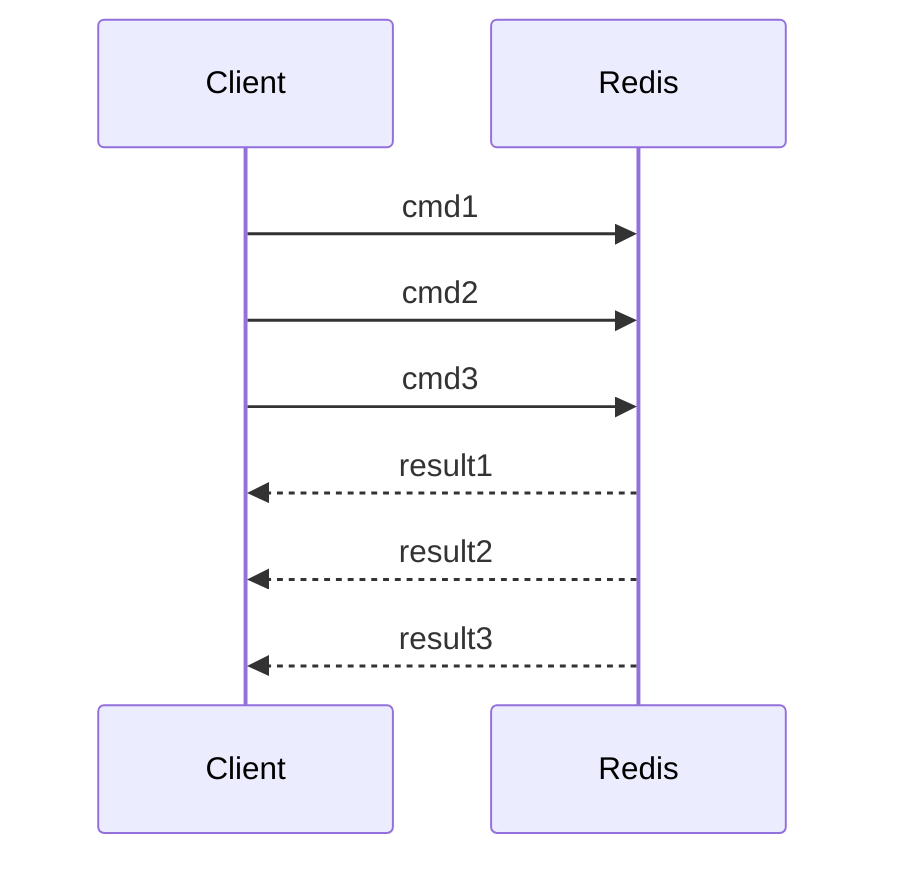

**读图抓手**：Pipeline重叠通信等待，没有因此把多条命令变成不可交错事务。

批量过大增加输出缓冲、客户端内存和尾延迟。Pipeline 不保证这些命令整体不与其他客户端交错，也不解决“先读结果，再决定下一条写命令”的依赖逻辑。[Pipelining](https://redis.io/docs/latest/develop/using-commands/pipelining/)

### 5.2 MULTI/EXEC 与 WATCH

`MULTI` 后先入队，`EXEC` 时按顺序执行，普通命令执行不会被其他客户端命令插入。`WATCH` 在提交前检查所关注键是否变化，变化则本次事务不执行，由客户端重新读取和重试。

| 机制 | 能做什么 | 不能做什么 |
| --- | --- | --- |
| 单条原子命令 | INCR、条件SET等单次变更 | 覆盖多个独立往返的业务流程 |
| Pipeline | 批量降低通信成本 | 自动提供事务隔离与回滚 |
| MULTI/EXEC | 一组排队命令顺序隔离执行 | 运行期错误自动撤销已成功命令 |
| WATCH + EXEC | 乐观条件检查 | 高冲突下避免重试开销 |
| Lua / Functions | 将有依赖的逻辑放服务端隔离执行 | 出错后自动回滚所有已做写入 |

> ⚠️ **易错点**：Redis 事务不等同于数据库事务。运行期类型错误可能让某条失败、其他条仍成功；入队阶段错误与执行阶段错误要分别判断。

因此，事务执行结果需要逐项检查。`EXEC` 超时或连接断开也可能产生不确定结果，不能简单认为所有命令未执行。[事务语义](https://redis.io/docs/latest/develop/using-commands/transactions/)

### 5.3 Lua 为什么适合“检查后修改”

客户端分开发 GET 和 DECR，两个调用之间可能有其他修改；脚本把检查和变更放进一个服务端执行单元，可避免普通客户端命令交错。

以下为单键、正整数库存演示，不包含订单持久化与重复请求治理：

```lua
local stock = tonumber(redis.call('GET', KEYS[1]))
if not stock or stock <= 0 then
    return 0
end
redis.call('DECR', KEYS[1])
return 1
```

**为什么先校验再写**：脚本隔离执行，不代表出错会回滚已经做的写入；将所有可能失败的输入和类型检查尽量放在前面。长脚本还会阻塞其他命令，不能把它当成任意时长的计算服务。

脚本键应通过 `KEYS` 显式提供；Cluster 下相关多键通常要在同一槽。`EVALSHA` 使用脚本摘要减少重复传输，但缓存丢失后要处理 `NOSCRIPT`，不能只在部署时加载一次就假设永远存在。

### 5.4 Functions 与临时脚本的对比

Redis 7.0 引入 Functions，用于服务端函数库管理。相较将脚本缓存当作长期部署仓库，函数可随数据持久化/复制链路管理，但仍需版本发布、命名、权限与分片部署规划。

**选择顺序**：先看单条命令能否解决；独立批量考虑 Pipeline；读改写逻辑考虑脚本/函数；需要数据库级业务原子性时，回到真实数据源事务与幂等设计。[Lua 执行模型](https://redis.io/docs/latest/develop/programmability/eval-intro/)

<a id="persistence"></a>

## 6. 持久化：快照、日志与崩溃恢复

> 🎯 **本章抓手**
>
> **内存修改成功、写入操作系统缓存、完成设备同步，是不同的持久化边界。**

### 6.1 RDB 为什么选择后台快照

**RDB（Redis Database，Redis 数据库快照格式）**保存某个时点的数据。后台保存通过 fork 子进程生成快照，父进程继续服务，减少长时间阻塞保存数据的影响。

**COW（Copy-On-Write，写时复制）**允许父子最初共享内存页，修改时再复制对应页。它不等于“子进程完全不占额外内存”：高写入率可能导致大量页复制，fork 页表本身也有开销。

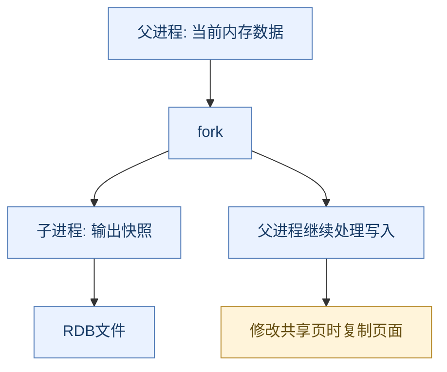

相较每次写入都追加持久日志，快照文件紧凑，适合备份与较快加载；代价是快照间的新数据可能不在恢复文件中。备份复制、恢复演练及异地保存仍是独立任务。

### 6.2 AOF 的三种刷写策略

**AOF（Append Only File，仅追加文件）**记录数据修改的日志。写入文件与调用 fsync 同步设备不是一回事，前者可能只进入操作系统页缓存。

| appendfsync | 成本与通常窗口 | 不能承诺的事 |
| --- | --- | --- |
| always | 每批相关写入尽可能等待同步，延迟和吞吐受设备影响 | 覆盖所有硬件/机房级故障 |
| everysec | 通常约每秒同步，常见性能与恢复点折中 | 任何情况下最多只丢精确1秒 |
| no | 依赖操作系统同步调度 | 提供固定可量化的最小丢失窗口 |

`everysec` 在设备拥塞、后台重写和配置影响下可能出现额外延迟；不要把经验窗口变成数学上界。持久化错误和磁盘不足也必须告警，而不是只关注命令成功率。

### 6.3 AOF 重写为什么不直接保留全部历史

同一个计数键被加一百万次，恢复当前值不必永远重放一百万条历史。重写根据当前数据产生精简恢复表示，减少文件膨胀和加载时间。它重建的是当前状态，不是审计日志。

Redis 7.0 的多部分 AOF 将基线文件和增量文件通过清单关联。后台生成新基线期间，新的修改进入增量链路，完成后切换有效文件集合。基线还可以使用 RDB 格式，不能认为 `.aof` 体系中的每一部分都必定是纯文本命令。

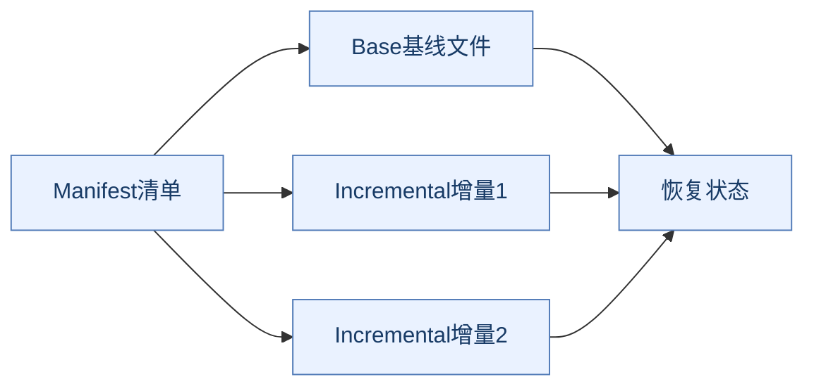

**读图抓手**：备份和恢复要处理清单关联的一致文件集合，不能随手只拷一个增量文件。重写还要为新旧文件并存与 COW 留资源。

### 6.4 为什么复制不能替代备份

复制会传播错误删除、错误覆盖及一些逻辑损坏；副本不是天然隔离的历史版本。持久化文件也可能遭误操作或共同故障。备份应保存在独立恢复位置，并通过真实加载验证。

**RPO（Recovery Point Objective，恢复点目标）**回答可接受损失多少历史；**RTO（Recovery Time Objective，恢复时间目标）**回答多久恢复。要同时测文件加载、复制追赶、客户端重连与业务重建，而不只看备份是否生成。[持久化设计](https://redis.io/docs/latest/operate/oss_and_stack/management/persistence/)

<a id="replication"></a>

## 7. 复制：异步传播与同步确认的边界

> 🎯 **本章抓手**
>
> **默认异步复制提高服务吞吐，但已确认写入仍可能在故障切换中丢失。**

### 7.1 全量与部分重同步

新副本或缺少可续传历史时，需要全量同步：获得基线数据，再应用基线生成期间及之后的增量。短暂断连后，如果复制身份与 offset 条件满足，且所需字节仍在 backlog 中，则可部分重同步。

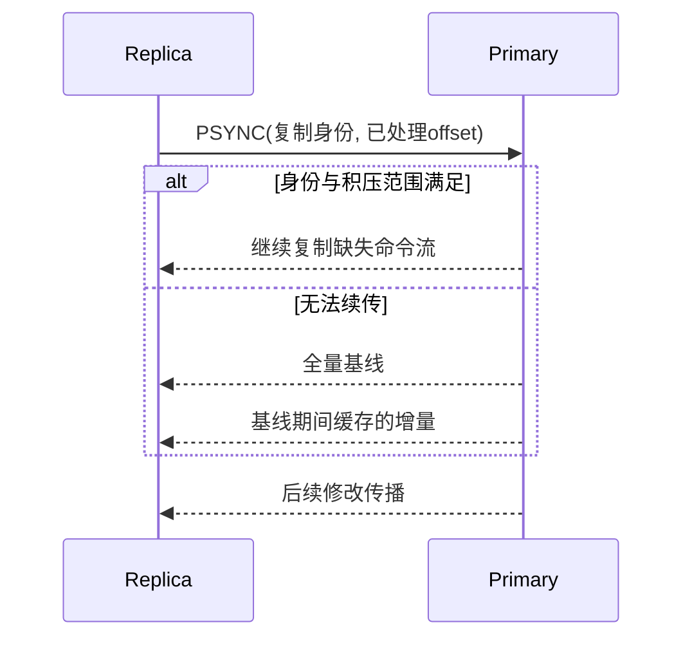

**读图抓手**：部分续传依赖复制身份和backlog范围，条件不满足就需要基线与增量。

**PSYNC（Partial Resynchronization，部分重同步命令）**避免每次断连都复制整个数据集；代价是主节点需要保留复制 backlog。backlog 太小、断连太久或历史身份不匹配都会导致全量，带来网络、内存和加载压力。

### 7.2 为什么不默认每次等所有副本

| 策略 | 优点 | 故障与延迟成本 |
| --- | --- | --- |
| 主节点执行后返回，异步传播 | 响应少受慢副本影响 | 切到未追上的副本可能丢失成功写入 |
| 等指定副本确认 | 降低部分数据丢失概率 | 延迟取决于副本，超时仍需判断结果 |
| 共识日志提交 | 在相应模型下协调已提交历史 | 协议与可用性代价不同，不是Redis默认复制模型 |

Redis 的默认主副复制不是 Raft 数据共识。`min-replicas-to-write` 和 `min-replicas-max-lag` 可在副本数量/延迟条件不足时限制主节点写入，但不是逐条同步复制承诺。

### 7.3 WAIT 与 WAITAOF 分别等什么

`WAIT` 等待当前连接此前写入被指定数量副本确认，返回实际满足的副本数。它不等于 fsync，也不把 Redis 自动升级为强一致存储。超时返回不足数量不会撤回之前写入。

Redis 7.2 引入 `WAITAOF`，可等待当前连接此前写入在本地及副本 AOF 同步条件满足，增强可观测的持久化确认。它仍受部署、选主、设备与故障假设约束，不能把一次确认等同于外部业务事务完成。

连接池要特别注意**“此前写入”属于哪条连接**。写入与确认若被调度到无关连接，不能用后者证明前者的复制进度。[WAIT](https://redis.io/docs/latest/commands/wait/)、[WAITAOF](https://redis.io/docs/latest/commands/waitaof/)

### 7.4 读写分离为什么可能破坏业务判断

写主、读副可以分摊读取，但读到的可能是旧状态。“写成功后立即查不到”并不一定是缓存删除，而可能是复制延迟。扣库存、权限变更、生效确认等需要分析读一致性，不能只把所有 GET 路由到副本。

读副本也不等于扩写能力；一个主节点仍接收该键空间的写入。扩写通常需要分片或业务拆分。[复制机制](https://redis.io/docs/latest/operate/oss_and_stack/management/replication/)

<a id="sentinel"></a>

## 8. Sentinel：监控、仲裁与自动切主

> 🎯 **本章抓手**
>
> **Sentinel提供非分片主副部署的高可用控制，不代理业务流量，也不让复制变成零丢失。**

### 8.1 为什么故障检测需要多个观察者

一个观察者请求超时可能是自身网络故障，不足以证明主节点真的不可用。Sentinel 先形成 **SDOWN（Subjectively Down，主观下线）**判断，再按配置的 quorum 汇总对主节点的 **ODOWN（Objectively Down，客观下线）**判断。

实际执行故障切换还需要获得 Sentinel 多数授权选出执行者；**故障判断的 quorum 不等于故障转移授权多数**。即便 quorum 设为 1，也不能让少数侧随意完成自动切主。

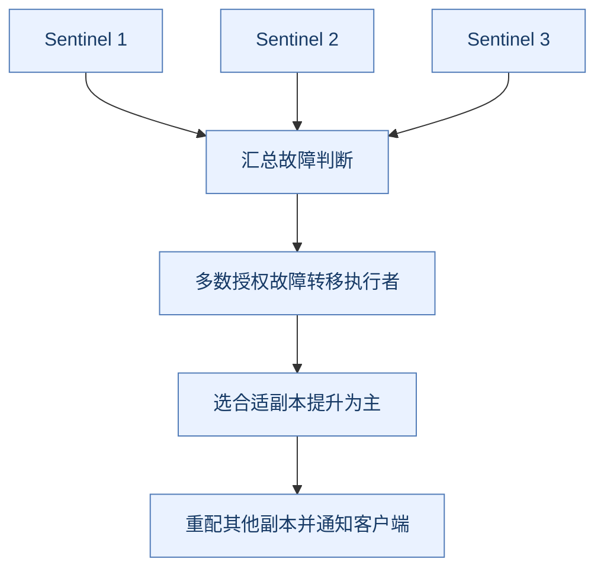

**读图抓手**：故障观察、授权、提升和客户端发现是不同阶段，不是单个quorum参数包办。

### 8.2 切主为什么不是修改一个IP就结束

执行者需要选择可用且合适的副本，提升角色，重配其他副本，并让客户端发现新主。客户端需要支持 Sentinel 发现或由适配层处理；写死旧主地址会导致切换后持续失败。

选副本还涉及可用性、优先级、复制进度等规则，不是简单取内存最多或机器性能最好的一台。

### 8.3 网络分区为什么可能让旧主继续接收写

Sentinel 无法跨网络强制隔离旧主的所有客户端。旧主可能短暂仍接收请求，新主也已提供服务；旧主恢复后通常按新拓扑重同步，其分叉写入可能丢失。

限制副本条件写入能缩小一些窗口，但无法把所有故障变成线性一致。关键业务应将权威约束放在合适的数据源或协议中。Sentinel 至少多实例部署并跨故障域放置，不能三个进程都在同一宿主机就声称覆盖主机失效。[Sentinel 官方说明](https://redis.io/docs/latest/operate/oss_and_stack/management/sentinel/)

<a id="cluster"></a>

## 9. Cluster：哈希槽、重定向与多键边界

> 🎯 **本章抓手**
>
> **Sentinel解决主副切换，Cluster同时提供分片与相应故障恢复；它们不是同一部署加不同名字。**

### 9.1 为什么使用固定哈希槽

Redis Cluster 将键映射到 16384 个槽，通常用 **CRC16（16-bit Cyclic Redundancy Check，16位循环冗余校验）**计算哈希后取槽。槽再映射到节点。

直接 `hash(key) % 节点数` 在节点数变化后会让许多键重新映射；槽作为间接层，使扩缩容可以迁移一部分槽，而不必改全部键的映射公式。槽是管理粒度，不是“一定对应一个线程”。

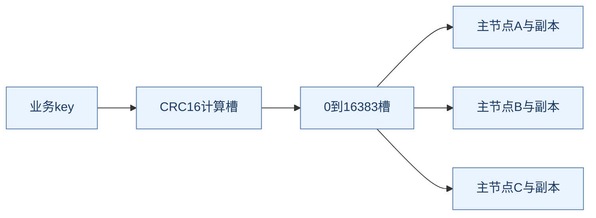

**读图抓手**：key先映射槽，再映射节点；分片不拆开单个key。

### 9.2 MOVED 与 ASK 为什么要区分

`MOVED` 指示槽的路由位置，客户端通常更新槽缓存；`ASK` 用于迁移过渡，客户端针对本次请求向目标节点发送 `ASKING` 后执行，不应把它简单当作永久映射更新。

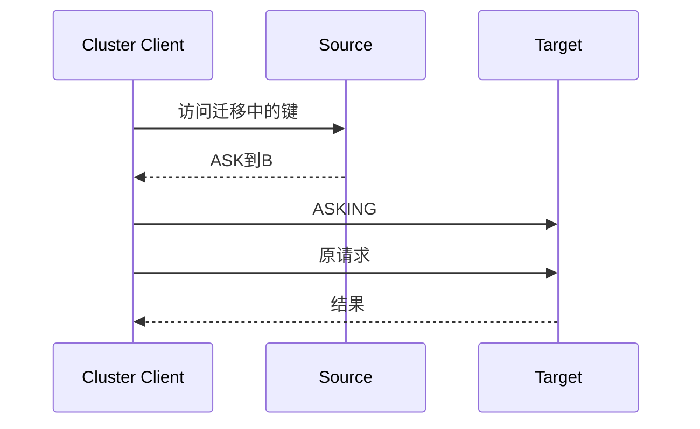

**读图抓手**：ASK处理当前迁移请求，MOVED更新槽归属的语义不同。

**代价**：客户端要维护拓扑、处理重定向与重试；服务端宣告地址必须可达。入口可连不代表所有槽归属节点可访问。

### 9.3 hash tag 为什么既方便又危险

`order:{1001}:stock` 与 `order:{1001}:result` 使用同一 hash tag，可映射到相同槽，让相关多键脚本或事务具备执行条件。代价是将这些键固定聚到同一分片。

如果所有订单都使用 `{all-orders}`，多键操作方便了，却制造一个超级热点。**同槽是执行约束，不是全局事务能力。**客户端拆分跨槽批量查询也不等于得到原子快照。

### 9.4 分片能解决什么，不能解决什么

| 问题 | 分片效果 | 还需做什么 |
| --- | --- | --- |
| 总键空间大 | 分摊容量 | 规划副本、迁移和故障余量 |
| 多键写负载高 | 可分散到多个主节点 | 避免hash tag和业务key倾斜 |
| 单个热key | 通常仍由一个槽节点处理 | 本地缓存、请求合并或业务可行的拆分 |
| 单个巨型对象 | 迁移与操作仍重 | 拆对象，缩小访问粒度 |
| 强一致库存 | Cluster本身不自动提供 | 外部权威账本、幂等与恢复机制 |

Cluster 的主副复制仍有异步窗口；多数主节点可达的故障处理规则不等于每条业务写通过多数副本共识提交。[Cluster 规范](https://redis.io/docs/latest/operate/oss_and_stack/reference/cluster-spec/)

<a id="cache"></a>

## 10. 缓存：回源、一致性与失效治理

> 🎯 **本章抓手**
>
> **缓存是数据库之外的第二份状态，两个调用交换顺序不能消灭所有故障窗口。**

### 10.1 Cache-Aside 为什么常见

读取先查缓存，未命中再查数据库并回填；写入先更新数据库，再删除缓存，让后续读取重建。这种 **Cache-Aside（旁路缓存）**模式实现相对清晰，数据库保持权威。

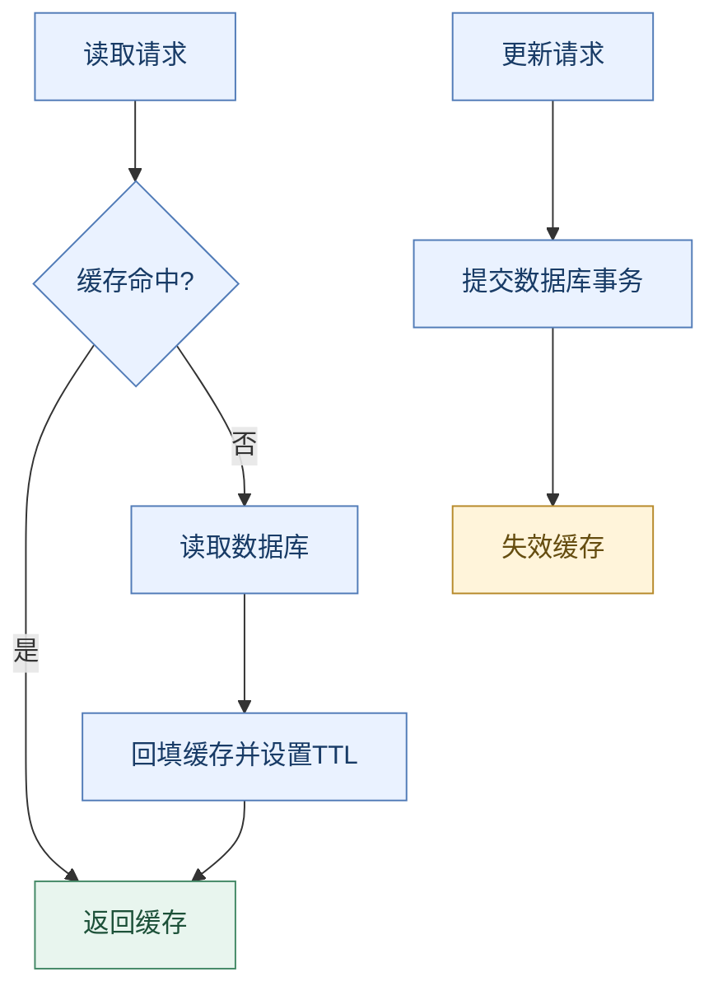

与 Write-Through（穿透写入，由缓存层协调写源）相比，旁路模式把责任留在应用；与 Write-Behind（延后写源）相比，它不默认把尚未落库的数据当作已可靠保存。模式选择依赖可接受的丢失和延迟窗口。

### 10.2 为什么通常更新数据库后删除缓存，而不是直接更新缓存

两个并发写者的缓存写入顺序可能与数据库提交顺序不一致，较旧值最后覆盖缓存。删除缓存让下一次读取回到权威源，减少同时维护两份最新值的复杂度，但不等于强一致。

| 顺序 | 故障窗口 |
| --- | --- |
| 先删缓存，再更新数据库 | 中间读请求可能回填旧数据库值 |
| 先更新数据库，再删缓存 | 删除失败可能留下旧缓存 |
| 数据库与缓存都更新 | 并发写可能让缓存按错误顺序覆盖 |

### 10.3 “先更新数据库再删除”仍会读到旧值吗

会。读请求先因未命中读取旧数据库快照；写请求提交新值并删除缓存；那个较早的读请求最后才把旧值回填。旧回填的生命周期可能持续到 TTL 或下一次失效。

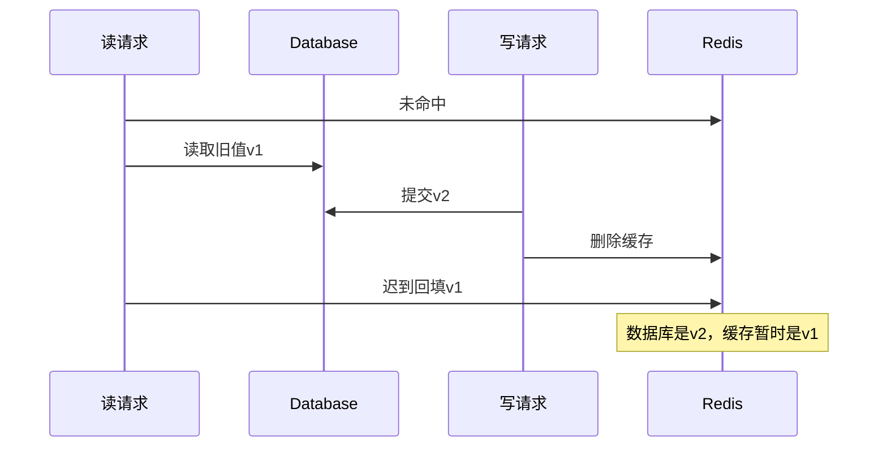

**读图抓手**：旧回填可以发生在新写删除之后，解释了一次写请求看似成功却仍读旧值。

**双删加延时**可以覆盖部分竞争时序，但延时值很难对任意慢请求给出保证。更严格的方案要引入版本校验、回填屏障/协调、对敏感读取走权威源，或接受有界陈旧并缩短有效期。

删除失败可使用数据库事务 Outbox（事务性待发布表）或 **CDC（Change Data Capture，数据变更捕获）**可靠投递失效事件。它解决失效通知恢复，不会自动消灭所有旧回填竞争。

### 10.4 穿透、击穿、雪崩分别是什么

| 现象 | 主要触发 | 常见治理 | 代价 |
| --- | --- | --- | --- |
| 穿透 | 大量查询不存在的数据 | 空值短缓存、入口校验、布隆过滤器 | 空值可能短暂遮住新建数据；过滤器需同步 |
| 击穿 | 热点过期后大量并发回源 | singleflight请求合并、互斥重建、逻辑过期 | 等待、旧值容忍与重建故障治理 |
| 雪崩 | 集中过期或缓存整体故障 | TTL抖动、限流、分批预热、降级 | 数据库仍需容量边界与业务取舍 |

**逻辑过期**把业务失效时间放进值中，过期时可返回旧数据并异步重建；它用陈旧数据换可用性，不适用于必须立即生效的权限或余额判断。

### 10.5 多级缓存为什么更难失效

本地缓存省网络并保护热key，但每个实例都有自己的状态。Redis 6 的服务端辅助客户端缓存通过跟踪与失效通知帮助治理；它不是把所有本地数据自动变成一致副本。

连接断开、通知处理延迟和订阅/跟踪重建期间要定义清空或失效策略。通知不能被当作永久可靠事件日志；需要强一致的判断应回到适当数据源。[客户端缓存参考](https://redis.io/docs/latest/develop/reference/client-side-caching/)

<a id="locks"></a>

## 11. 分布式锁：所有权、租约与旧持有者

> 🎯 **本章抓手**
>
> **锁键还在不在，与旧业务线程会不会继续写外部资源，是两个问题。**

### 11.1 SET NX PX 为什么必须合在一次命令

```text
SET lock:order:1001 unique-owner-token NX PX 10000
```

`NX` 只在不存在时写入，`PX` 设置毫秒有效期。若先 SETNX 再 EXPIRE，中间崩溃可能留下无期限锁；合并命令消除这两步之间的窗口。

每次成功获取应使用独特的所有者 token。释放时必须在服务端一次完成比较与删除，避免误删别人接管后的锁：

```lua
if redis.call('GET', KEYS[1]) == ARGV[1] then
    return redis.call('DEL', KEYS[1])
end
return 0
```

此处比较 token 与删除作为一个隔离单元执行；先 GET 再由客户端单独 DEL 仍存在竞争窗口。[官方锁模式](https://redis.io/docs/latest/develop/clients/patterns/distributed-locks/)

### 11.2 续期为什么也不是绝对安全

续期要检查所有者，且必须在仍有效时完成。进程长时间暂停、网络分区或调度拥塞会使续期错过期限。看门狗降低租约过短的风险，不会暂停其他系统的时钟，也不会阻止旧线程恢复运行。

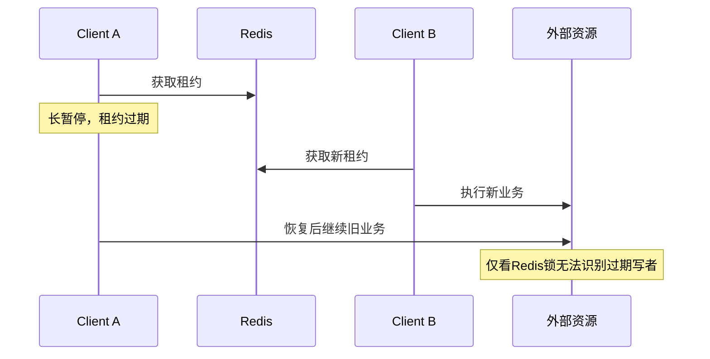

**读图抓手**：租约过期后旧线程仍能恢复，外部资源必须具备自己的正确性约束。

### 11.3 所有者 token 与 fencing token 不一样

随机 owner token 证明“这把锁是不是我的”，避免误解锁；**fencing token（隔离令牌）**是随有效所有权推进的序号，外部资源拒绝旧序号的写入，阻止过期持有者继续产生副作用。

这需要外部资源实际执行序号检查，且序号源在故障后不会倒退。简单依赖异步复制 Redis 的自增值不能无条件提供全局可靠 fencing；应按要求选用具备相应保证的协调或数据库机制。

### 11.4 Redlock 与其他方案如何比较

Redlock 在多个独立实例上按多数与时间预算获取租约，用更复杂的机制降低单实例故障风险。它依赖时间、暂停、网络等假设，不能简化成“多数成功所以线性一致”。

| 需求 | 可评估方向 | 必须证明什么 |
| --- | --- | --- |
| 缓存重建去重 | Redis租约与请求合并 | 偶发重复重建是否可接受 |
| 订单唯一状态变化 | 数据库条件更新、唯一约束与事务 | 业务不变量是否由权威源约束 |
| 严格资源排他 | 共识协调 + 资源侧fencing等 | 故障后旧请求是否真正被拒绝 |

**锁不是业务正确性的替身**。即使实现互斥，客户端超时重试、外部事务和补偿仍需设计。

<a id="patterns"></a>

## 12. 限流、库存与幂等设计

> 🎯 **本章抓手**
>
> **服务端原子状态适合快速决策，但权威账本、重试和故障恢复仍需单独设计。**

### 12.1 四类限流的取舍

| 算法 | 状态 | 优势 | 代价 |
| --- | --- | --- | --- |
| 固定窗口 | 窗口计数 | 简单、内存少 | 相邻窗口边界可出现双倍突发 |
| 滑动日志 | 每次请求时间 | 精确表达最近窗口 | 高流量时记录与清理成本高 |
| 滑动窗口计数 | 分桶计数 | 内存与平滑性折中 | 结果近似，桶粒度影响精度 |
| 令牌桶 | token数和补充时间 | 允许有限突发，长期平均受控 | 原子补充/扣减与时钟边界需处理 |

固定窗口若 `INCR` 后独立 `EXPIRE`，崩溃可能使计数不再自动重置。脚本可把初始化过期和计数合并，但还要定义超时重试是否重复计数、按用户/接口如何划分key。

滑动日志常用 ZSet，成员必须区分同毫秒请求，否则重复 member 会覆盖而少计。清理成本与单键热点也应纳入容量估算。使用哪种时钟及回退处理需明确，不能仅写一个时间差公式。

### 12.2 库存扣减为什么还需要预占与落库闭环

脚本可以让单实例/同槽的一次库存校验与扣减不被交错，但主副切换丢写、业务下单失败、重复请求和异步落库失败仍会破坏业务结果。

```mermaid
flowchart LR
    R[带requestId的请求] --> A[原子校验与预占]
    A --> M[可靠事件/待处理记录]
    M --> D[数据库订单与库存事务]
    D --> C[确认预占]
    D --> F[失败补偿与对账]
    classDef default fill:#EAF2FF,stroke:#527CB8,color:#183B66;
```

图只是职责划分，不表示用几个跨系统调用就获得原子性。需要明确预占、投递与落库之间的恢复依据；同一请求重试不能再次扣减，补偿也不能无条件加回已经完成的库存。

### 12.3 幂等标记为什么不能随手 SETNX

先标记成功再做业务，崩溃可能把未完成请求当完成；先做业务再标记，崩溃可能重复执行。状态至少需要区分处理中、完成与失败恢复，并有结果重放或权威源唯一约束。

幂等 TTL 应覆盖合法重试和历史重放窗口。对关键数据库业务，去重记录与业务变更在同一个本地事务中完成，通常比跨 Redis 和数据库分别写更容易证明正确。

<a id="messaging"></a>

## 13. Pub/Sub、List、Stream 与消息队列

> 🎯 **本章抓手**
>
> **实时通知、阻塞领取、持久事件与消费确认属于不同语义，不能只按命令简单程度选。**

### 13.1 四种模型对比

| 模型 | 保存/消费方式 | 优点 | 主要边界 |
| --- | --- | --- | --- |
| Pub/Sub | 在线订阅者接收发布 | 广播通知简单 | 离线不自动补历史，没有消费组ACK恢复 |
| List + 阻塞弹出 | 消费者等待元素后取出 | 简单工作队列 | 弹出后崩溃需另建处理中与恢复机制 |
| Stream普通读取 | 按ID读取追加记录 | 可按位置回读 | 保留、修剪、持久化与读取进度要规划 |
| Stream消费组 | 分配新记录并维护待确认状态 | 支持ACK与接管恢复 | 业务成功到ACK间仍可能重复 |

### 13.2 阻塞读取为什么不是阻塞全部Redis

`BLPOP`、带 BLOCK 的 Stream 读取在条件不满足时将客户端登记为等待者，服务端继续处理其他请求；不是在命令执行线程里 sleep 到有消息为止。

这与客户端高频短轮询相比减少空请求，但服务端仍要维护等待连接和唤醒状态。阻塞连接不宜与普通命令随意共用同一个连接池槽，否则客户端侧可能出现排队。

### 13.3 PEL、ACK 与消息体不是一回事

**PEL（Pending Entries List，待确认条目列表）**跟踪消费组已交付但尚未确认的记录。`XACK` 移除待确认状态，不等于删除 Stream 中消息体；`XDEL` 或修剪影响记录保留，也不等于数据库副作用完成。

```mermaid
flowchart LR
    S[Stream记录] --> G[XREADGROUP交付]
    G --> P[进入组的PEL]
    P --> B[执行业务]
    B --> A[XACK移除待确认状态]
    P --> C[空闲超时后接管重处理]
    classDef default fill:#EAF2FF,stroke:#527CB8,color:#183B66;
```

**读图抓手**：PEL、业务完成和消息保留是不同状态，接管与ACK不会自动形成外部事务。

消费者崩溃后，其他成员需结合 `XPENDING`、`XAUTOCLAIM` 等恢复闲置待确认记录；它们不会自动理解业务是否已经落库。副作用应幂等，修剪要考虑慢组和待确认记录，否则可能只剩待确认引用却找不到原始载荷。

### 13.4 为什么不能把Stream直接当作Kafka替代

Stream 提供方便的内存数据集内消息功能，但保留容量、Redis 持久化与切主窗口、消费者恢复及运维生态不同。Kafka 以分区日志、长期流式管道和独立消费进度为核心；两者都需要治理重复与外部一致性。

Redis 8.2 的确认/删除增强不表示旧版本自动具备多组协调删除语义。选型先列明历史保留、吞吐、分区、恢复目标与外部系统集成。[Streams 文档](https://redis.io/docs/latest/develop/data-types/streams/)

<a id="operations"></a>

## 14. 容量、热点与延迟排障

> 🎯 **本章抓手**
>
> **总内存够、平均延迟低，不代表热点、尾延迟和故障恢复满足要求。**

### 14.1 内存容量不能只加value大小

```text
主数据内存 ≈ key + value + 对象头 + 字典/编码开销 + 过期元数据 + 分配碎片
实例预留 ≈ 主数据 + 客户端/复制/AOF缓冲 + fork/COW余量 + 运行安全空间
集群总资源还要乘副本，并考虑分片分布和迁移临时占用
```

抽样用 `MEMORY USAGE`、`OBJECT ENCODING` 和真实业务数据估算，再做峰值写入、持久化和全量同步实验。平均值还要看尾部大对象；少数巨型key可能决定最坏延迟。

### 14.2 先判断慢在哪里

| 层次 | 证据 | 解释边界 |
| --- | --- | --- |
| 客户端 | 连接池等待、请求超时、编解码耗时 | 超时不证明服务端没有执行 |
| 网络 | RTT、带宽、重传、大响应 | 服务端执行快也可能端到端慢 |
| 命令 | SLOWLOG、LATENCY、具体复杂度 | SLOWLOG主要看执行，不能覆盖全部网络等待 |
| 内存/系统 | used_memory、RSS、碎片、交换、CPU | 碎片比率高可能因数据集很小，需看绝对值 |
| 持久化 | fork耗时、COW、AOF延迟/错误 | 平均命令耗时未必体现周期性尖峰 |
| 复制/集群 | offset差、全量同步、切主与重定向 | 稳态健康不代表故障窗口安全 |

**P99（99th Percentile，99分位数）**能揭示尾延迟，但不是最坏值。不要只凭平均指标判定服务正常。

### 14.3 KEYS 与 SCAN 的取舍

`KEYS` 可能一次遍历整个键空间并构造大响应；`SCAN` 将遍历分摊到多次调用，降低单次阻塞风险。`COUNT` 是工作量提示，不保证每批恰好几条；`SCAN` 不是一致快照，数据变化中可能重复或变化。

Cluster 遍历还需覆盖相关主节点；只对一个连接 SCAN 不代表扫描整个集群。批量清理必须限制速率、检查命名范围并处理重复，不能把“用了SCAN”当作绝对无影响。

### 14.4 热key与大key分别治理

| 问题 | 有效措施 | 风险 |
| --- | --- | --- |
| 热读key | 本地缓存、请求合并、副本读的适用场景 | 失效与陈旧读取 |
| 热写key | 业务分桶、分层聚合、限流 | 全局精确结果与合并成本 |
| 大集合 | 按访问边界拆分、分页返回、控制元素数 | 跨键一致性与多键操作 |
| 大键删除 | 评估UNLINK与分批处理 | 释放仍需资源，不能无界并发 |

把一个精准全局计数拆为十份并不是免费扩容：读取总和不是天然原子快照，重试与聚合仍需设计。应先澄清允许近似还是必须精确。

<a id="versions"></a>

## 15. 版本演进：6.x、7.x与8.x怎么区分

> 🎯 **本章抓手**
>
> **版本、发行包、模块、托管产品与客户端是五个不同维度。**

### 15.1 代表性变化

| 版本 | 与后端开发相关的变化 | 对学习与升级的影响 |
| --- | --- | --- |
| 6.0 | 网络I/O线程、ACL、RESP3、客户端缓存跟踪 | “只有一个线程”“只有一个密码”等旧结论失效 |
| 6.2 | GETEX/GETDEL、XAUTOCLAIM等命令 | 简化一些读改写和Stream恢复，但需客户端支持 |
| 7.0 | Functions、多部分AOF、更多listpack使用、分片Pub/Sub | 脚本管理、恢复文件和编码讲解要更新 |
| 7.2 | WAITAOF等持久化确认能力 | 区分复制ACK与AOF同步确认 |
| 7.4 | Hash field expiration字段级过期，脚本缓存行为演进 | 不能继续说“Hash字段完全无法单独过期”；脚本需处理缓存缺失 |
| 8.0 | 整合更多原Redis Stack能力为统一发行，并继续优化性能 | JSON、搜索、概率结构等可用性要核对具体包与版本 |
| 8.2 | Stream确认、删除、修剪协调增强，如XACKDEL | 多组保留与删除策略更丰富，但不自动变成业务EOS |

**ACL（Access Control List，访问控制列表）**用于更细的命令、键及用户权限；**RESP3（Redis Serialization Protocol version 3）**扩展协议表达能力。客户端支持、协商与实际启用都应确认，不是服务器升级后所有连接自动获得所有新行为。

这里的 **EOS（Exactly-Once Semantics，精确一次语义）**必须限定观察范围；Redis新增确认命令不会使外部数据库副作用自动精确一次。

```mermaid
flowchart LR
    A[6.x: 网络并行与协议权限] --> B[7.0: 函数与多部分AOF]
    B --> C[7.2: WAITAOF]
    C --> D[7.4: Hash字段过期]
    D --> E[8.x: 集成数据能力与持续演进]
    classDef default fill:#EAF2FF,stroke:#527CB8,color:#183B66;
```

### 15.2 Hash字段过期为什么有价值

旧的对象级 TTL 会让整份 Hash 一起过期；若会话的不同字段生命周期不同，过去可能拆多个 key，或自己维护时间并清理。7.4 增加字段级过期，使这些状态可在 Hash 内分别管理。

它减少一些额外键和自建清理，但字段数量、查询行为、键级TTL与字段TTL交互、客户端命令支持都要测试。**不能因为有字段TTL，就把无限多会话塞进单个巨大Hash。**[Hash字段过期](https://redis.io/docs/latest/data-types/hashes/)、[HEXPIRE命令](https://redis.io/docs/latest/commands/hexpire/)

### 15.3 Redis 8 的集成能力不等于所有旧版核心都有

应区分“传统 Redis 核心类型”“通过模块或 Redis Stack 提供的能力”“Redis 8 统一发行中的集成能力”。部署前确认镜像、实际加载能力、持久化兼容和命令范围；只看版本大号不足以判断应用能否运行。

版本材料还可能同时讨论 Cloud 和 Software，不能把后者专有高可用或存储能力写成所有开源部署的默认属性。[Redis 8.0新特性](https://redis.io/docs/latest/develop/whats-new/8-0/)、[开源版本发布索引](https://redis.io/docs/latest/operate/oss_and_stack/stack-with-enterprise/release-notes/redisce/)

### 15.4 升级验证清单

1. **服务端与发行包**：核对目标小版本、补丁、模块/集成能力与配置变化；发行与许可条件以对应官方说明为准。
2. **客户端**：核对 RESP、连接池、Cluster/Sentinel发现、新命令及重试行为。
3. **数据恢复**：用备份在隔离环境加载，验证多部分AOF、函数和模块数据；不假设新格式可任意降级。
4. **功能行为**：验证TTL、脚本、字段过期、Stream恢复及错误处理。
5. **运行指标**：比较内存编码、P99、复制、fork与重写成本；不要只用空库压测结果推导生产收益。

参考：[Redis官方源码与历史发布](https://github.com/redis/redis/releases)、[7.4新特性](https://redis.io/docs/latest/develop/whats-new/7-4/)、[8.2 Stream增强](https://redis.io/blog/redis-82-streams-bitmap/)、[XACKDEL命令](https://redis.io/docs/latest/commands/xackdel/)。

<a id="advanced-topics"></a>

## 16. 常见专题补全：从实现细节到业务设计

> 🎯 **本章抓手**
>
> **这些主题不只是记住某个命令，而是说明状态保存、并发、精度和故障恢复怎么配合。**

### 16.1 延迟队列：为什么ZSet比过期通知更适合做调度索引

用score保存到期时间、member保存唯一任务ID，调度器查询不大于当前时间的任务。它能按到期顺序定位，避免扫描全部任务；但“找到到期任务”只是第一步。

| 实现 | 优点 | 主要问题 |
| --- | --- | --- |
| 每任务设置TTL并监听过期 | 使用简单，能观察键变化 | 事件不保证精确时刻产生，订阅断开不补历史 |
| ZSet按到期score查询 | 到期条件明确，可查询与重试 | 要维护领取、处理中、完成和超时恢复 |
| 数据库到期索引/外部调度 | 可与权威任务状态结合 | 扫描、锁竞争、精度与吞吐需要评估 |

**为什么不能用ZPOPMIN直接等到期**：它返回最小score，不会替业务判断时间是否已经到达；阻塞版本主要等非空，也不等价于等score到期。

正确的知识模型是到期任务从ready原子迁入inflight，附带领取标记/租约；业务完成后确认，超时未确认则按规则重投。

```mermaid
flowchart LR
    R[ready: score为到期时间] -->|原子检查并迁移| I[inflight: 领取人与期限]
    I --> B[业务执行]
    B --> A[完成确认]
    I -->|超时恢复| R
    classDef amber fill:#FFF4DA,stroke:#B78A2B,color:#654D10;
    class I amber;
```

**只读再删除**可能多消费者重复领取；**原子删除后执行**虽然避免同时领取，却可能在删除后进程崩溃时永久漏任务。因此需要可恢复处理中状态，而不只是把两个命令换成Lua。

多个相关键在Cluster中要考虑同槽；时钟、轮询间隔、任务突发、租约过期后的旧任务、幂等和重试上限也要纳入设计。任务若是关闭订单，最终应由数据库状态条件决定是否允许关闭，不能收到调度就无条件改状态。[键空间通知边界](https://redis.io/docs/latest/develop/pubsub/keyspace-notifications/)

### 16.2 Jedis与Lettuce：线程安全不等于连接状态可混用

连接池让调用借用并归还已有连接，减少反复握手成本；多路复用则让多个逻辑请求共享长连接，通过协议响应顺序/客户端状态管理进行分发。两者可组合，但不是同一个概念。

| 对比 | 连接池 | 长连接多路复用 |
| --- | --- | --- |
| 核心资源 | 多条可借用连接 | 少量共享连接上的在途请求 |
| 主要优势 | 独占操作与上下文较易隔离 | 减少连接数量，适合并发非阻塞普通命令 |
| 主要风险 | 池等待、泄漏、连接数放大 | 大响应队头阻塞、阻塞命令与连接级状态干扰 |

Jedis传统使用方式常通过池管理连接；Lettuce支持共享连接与连接池，具体API要按所用客户端版本判断。**线程安全说明对象可按契约并发使用，不意味着MULTI、WATCH、SELECT等连接状态可以被无关请求交错共享。**

BLPOP、阻塞Stream读取、订阅，以及事务/专属状态通常需要相应专用连接或专用客户端API。WAIT、WAITAOF也要关注当前连接此前写入，而非随便借一条新连接确认。

```mermaid
flowchart TB
    A[普通短命令] --> M[可多路复用连接]
    B[事务/阻塞/订阅等] --> D[专用状态与连接边界]
    M --> R[Redis]
    D --> R
```

**热点排障提示**：重试、池大小和在途上限一起设计。网络变慢时无限增加池大小，可能将客户端排队转成服务端排队，而不是解决瓶颈。[连接池与多路复用](https://redis.io/docs/latest/develop/clients/pools-and-muxing/)、[Lettuce连接池](https://redis.github.io/lettuce/advanced-usage/connection-pooling/)

### 16.3 Spring缓存注解为什么不等于跨系统一致性方案

`@Cacheable`主要表达命中与回填，`@CachePut`表达调用后更新缓存，`@CacheEvict`表达失效。它们降低业务接入成本，没有让Redis与数据库自动处在一个原子事务中。

默认代理模式下，类内部自调用可能不经过缓存拦截；“方法被调用了”与“注解生效了”应区分。方法完成、事务提交、缓存删除的先后还受代理与事务协作方式影响，不能只看注解写在同一方法上就推导正确顺序。

**sync=true不是天然分布式锁**：它表达对同步加载的请求，实际保障依赖缓存提供者；不能无条件声称跨所有应用实例只加载一次。

缓存键必须表达真正影响结果的条件：租户、用户、语言、业务版本等。如果方法仅以商品ID作key，却返回包含用户折扣的结果，就可能错误复用不同用户数据。缓存空值、有效期、序列化与大范围清空也都需要显式设计。

**与手写旁路对比**：注解减少重复代码，却把行为放进代理与缓存配置；手写更显式，但更易散落不一致逻辑。两者都需要前面缓存一致性章节中的故障治理。[Spring缓存语义](https://docs.spring.io/spring-framework/reference/integration/cache/annotations.html)、[Spring Data Redis Cache](https://docs.spring.io/spring-data/redis/reference/redis/redis-cache.html)

### 16.4 碎片、交换与THP：为什么“内存存储”仍有系统级延迟

Redis逻辑对象释放后，分配器可能保留页面供复用；因此used_memory下降而RSS仍高，不必然说明键没有释放。要分别看分配器内部利用、页面驻留和数据集大小。

**THP（Transparent Huge Pages，透明大页）**在部分Linux内存与fork/COW负载中可能放大复制和延迟；交换到磁盘的页再次访问又会触发缺页和回读。它们解释的是运行时成本，不是命令算法复杂度。

| 现象 | 应比较的证据 | 不应直接得出的结论 |
| --- | --- | --- |
| 碎片比率高 | 绝对多占字节、数据集大小、分配器指标 | 一定浪费了大量内存，立刻重启即可 |
| 周期性延迟 | fork、COW、磁盘、过期与重写时间 | 一定是某条GET慢 |
| 释放后RSS不降 | 分配器复用和页面回收状态 | DEL/UNLINK完全无效 |
| 内存页被交换 | 缺页、系统内存压力与回读 | 纯内存系统不可能访问磁盘 |

主动碎片整理通过搬迁等方式回收部分碎片，付出CPU和额外工作；支持情况和有效性依赖构建、分配器及配置。它不是治疗内存泄漏、无限数据增长或COW峰值的通用按钮。[延迟诊断](https://redis.io/docs/latest/management/optimization/latency/)

### 16.5 扩缩容与Gossip：为什么“节点加进来”不等于“负载已均衡”

加入节点只增加成员，不会天然把所有既有槽和键自动按理想负载摊匀。需要槽重分配与实际迁移；分片数和槽数均衡，也可能因某个key特别热而负载不均。

```mermaid
flowchart LR
    A[新增节点] --> B[成员发现与拓扑传播]
    B --> C[选择迁移槽]
    C --> D[迁移键并处理过渡路由]
    D --> E[更新槽归属]
    E --> F[客户端刷新与校验负载]
```

Gossip（流言传播）让节点交换成员与故障观察等信息，减少单点集中目录依赖；代价是状态传播不是瞬间完成，需要故障判定、任期及冲突处理规则。Cluster的config epoch等元数据版本用于裁决槽归属信息，不能与复制数据offset混为一谈。

迁移期间客户端可能收到ASK，完成后可能需要按MOVED更新路由。大键、迁移流量、临时内存和过渡多键操作都影响尾延迟。缩容必须先移走槽，不能把“删实例”当成完整数据迁移算法。

**为什么是16384槽**：槽位图大小为16384/8=2048字节，体现路由粒度与节点协议开销的折中。它不是数据条数上限，不代表必须有16384节点，也不能仅凭这个数字推导任意规模线性扩展。[Cluster规范](https://redis.io/docs/latest/operate/oss_and_stack/reference/cluster-spec/)

### 16.6 CAP与一致性：为什么不能只给Redis贴“AP/CP”标签

**CAP（Consistency, Availability, Partition Tolerance，一致性、可用性与分区容错）**讨论网络分区时的取舍；这里的一致性不是“数据最终看起来一样”，也不是数据库事务里业务约束的同义词。常见CP/AP说法分别强调在分区条件下优先一致性或可用性的取向，不能替代具体读写和故障规则。

Redis默认异步复制存在成功写入在切主时丢失的窗口。多数节点侧的故障处理和少数侧停止服务条件，不能直接推导每条写入都线性一致。Sentinel也可能短暂存在仍接受请求的旧主。

| 概念 | 要回答的问题 |
| --- | --- |
| 命令隔离执行 | 同实例普通命令是否在操作中间插入？ |
| 读自己写 | 当前客户端写后是否能读到相应结果？ |
| 线性一致性 | 并发操作能否表现为遵守真实先后关系的单一顺序？ |
| 最终一致性 | 停止更新并恢复通信后是否可按模型收敛？ |
| 持久性 | 相应故障后成功数据能否保留？ |

因此，正确回答是明确部署模式、读写路径、复制和确认条件、分区持续时间，以及业务观察边界。**原子命令、WAIT成功、启用Cluster都不能单独当成全链路线性一致证明。**

### 16.7 布隆过滤器：从误判率推导空间，而不是只背“省内存”

理想模型下，预期元素数为n、位数组m位、哈希次数k，假阳性概率可近似表示为：

```text
p ≈ (1 - exp(-k*n/m))^k
m ≈ -n*ln(p)/(ln(2)^2)
k ≈ (m/n)*ln(2)
```

例如n=100万、目标p=1%，理论位数组约959万位，约1.2MB（十进制），k约7。实际实现还有元数据、扩展层与分配开销，不应把理论值当进程总内存。

容量超出原规划会使误判率上升或触发实现的扩展策略；不能无限加数据却期待概率不变。普通布隆结构也不适合随便清位删除元素，因为不同元素可能共享位。需要删除语义时，应评估相应可删除结构或重建流程。

业务接入还要解决“数据库新增成功，过滤器尚未更新”的时间窗口，否则数学模型中的无假阴性也保护不了同步错误。重建应定义基线、增量追赶和切换边界。[布隆过滤器](https://redis.io/docs/latest/develop/data-types/probabilistic/bloom-filter/)

### 16.8 排行榜与金额：score精度和并列规则

ZSet的score采用双精度浮点表示，不是任意精度十进制。整数在可精确表示范围内能稳定表达，但把完整64位长整数ID或超大金额随手塞进score，可能因精度损失发生合并或错序。

金额可按合适最小单位转整数，但仍要校验范围；权威金融计算应保留在满足业务精度与事务要求的数据源。用“分数加极小时间小数”编码次序也可能因量级不同损失小数部分。

并列分数的成员有确定字典序规则，不自动按先到先得排序。需要并列优先级时，应明确是否能用成员编码、另一个字段或业务层排序，并验证更新和分页。

**深分页问题**：大offset范围访问可能需要跳过很多记录，不能只引用O(log N)就忽略扫描和返回量。按游标继续读取时，还需定义同score成员边界，以及榜单持续变化时允许重复或遗漏的范围。[ZRANGE复杂度](https://redis.io/docs/latest/commands/zrange/)

### 16.9 逻辑库、命名空间与序列化：为什么“同一个key”可能并不相同

单机逻辑库只是键空间编号，不提供独立CPU、内存淘汰、持久化和故障隔离。Redis Cluster只支持数据库0，不能把SELECT多个库当作分片方案。[SELECT限制](https://redis.io/docs/latest/commands/select/)

命名空间可编码业务、租户和对象版本，但前缀不会隔离资源；真正需要租户容量和故障隔离时，要评估独立实例或其他限额机制。

序列化决定键和值的实际字节。两个客户端都以为使用字符串`user:1`，如果一个键序列化为原始文本、另一个使用对象序列化，服务端看到的可能是两条不同字节序列。切换编码又可能导致旧值无法解码。

缓存格式升级应定义版本字段或key版本、兼容读取、旧数据淘汰与回滚，不能只替换序列化器后假设历史值自动更新。命中率突然下降、键空间变大或类型错误时，应检查实际字节与所连逻辑库，而不只看业务打印字符串。

### 16.10 有效期如何随更新变化：不能只背一个EXPIRE

| 操作类别 | 应理解的规则 | 业务含义 |
| --- | --- | --- |
| SET覆盖键 | 默认会替换旧值并清除原TTL，除非按命令选项保留/重新设置 | 更新缓存可能意外变永久数据 |
| INCR、HSET等原对象修改 | 与覆盖整个键的语义不同，键级TTL通常保留 | 计数累加不必每次重设固定窗口期限 |
| EXPIRE/PEXPIRE | 设置或修改键级有效期；条件选项有版本要求 | 可控制只在特定条件下续期 |
| GETEX | 读取并按选项调整有效期 | 看似读命令的业务路径可能产生修改 |
| TTL/PTTL返回值 | 区分剩余时间、无过期与键不存在 | -1与-2不能当相同“未命中” |

Hash字段TTL与整个Hash键的TTL又是两个层次。修改字段是否保留字段级TTL，要按对应字段命令和版本核对，不能从键级INCR保留TTL推导所有字段更新规则。

**固定窗口与滑动续期必须分开**：每次计数都重设完整TTL，得到的可能是“最后访问后才过期”，不再是原来固定起点的窗口。锁续期、会话滑动有效期和限流窗口也不能共用同一套刷新规则。[EXPIRE语义](https://redis.io/docs/latest/commands/expire/)

<a id="experiments"></a>

## 17. 最小实验与故障验证

> 🎯 **本章抓手**
>
> **先写预期，再观察结果；“命令能运行”不等于已验证并发与故障正确性。**

### 17.1 单节点环境

需要 Docker。以下命令逐条在 PowerShell 或 Bash 执行；使用7.4系列标签供学习，正式复现应固定实际补丁或镜像摘要。容器不挂持久卷，删除后数据消失，仅绑定本机端口供实验。

```shell
docker run -d --name redis-learning -p 127.0.0.1:6379:6379 redis:7.4 redis-server --appendonly yes --appendfsync everysec
docker exec redis-learning redis-cli PING
docker exec -it redis-learning redis-cli
```

之后在 redis-cli 内执行：

```text
SET demo:counter 0 EX 60
INCR demo:counter
TTL demo:counter
HSET demo:user:1 name Alice level 3
TYPE demo:user:1
OBJECT ENCODING demo:user:1
MEMORY USAGE demo:user:1
HEXPIRE demo:user:1 60 FIELDS 1 level
HTTL demo:user:1 FIELDS 2 name level
```

预期 counter 自增且仍有TTL；Hash字段level有剩余过期时间，未设置过期的name返回相应无期限标记。实际编码依版本和配置决定，不把输出固定为唯一字符串。

### 17.2 验证“隔离执行不等于回滚”

在实验键上执行：

```text
SET demo:number not-a-number
MULTI
INCR demo:number
SET demo:after ok
EXEC
GET demo:after
```

`INCR`因类型内容失败，后面的SET仍可能成功，`GET demo:after`应返回ok。这个实验专门验证运行期错误，不能推广为所有入队错误都表现相同。

### 17.3 观察Stream待确认状态

```text
XGROUP CREATE demo:events demo-group 0 MKSTREAM
XADD demo:events * orderId 1001 status created
XREADGROUP GROUP demo-group consumer-1 COUNT 10 STREAMS demo:events >
XPENDING demo:events demo-group
```

记录返回的实际ID，然后执行 `XACK demo:events demo-group 实际ID`，再检查XPENDING和XRANGE。应看到待确认条目减少，但消息体并非因此自动删除。这里的中文“实际ID”是操作说明，需替换为输出值。

### 17.4 后续故障实验

| 实验 | 所需环境 | 验证目标 |
| --- | --- | --- |
| 锁过期后旧线程恢复 | 两客户端、外部版本检查 | owner token无法阻止旧业务副作用 |
| 复制确认与切主 | 主副、Sentinel、可控故障 | 复制与持久化/业务提交的边界 |
| RDB与AOF恢复 | 独立数据目录与可恢复副本 | 实际恢复点、加载耗时、文件集合 |
| Cluster迁移 | 多主副Cluster、支持Cluster的客户端 | MOVED/ASK与同槽限制 |
| 旧回填覆盖新状态 | 可控数据库读延迟与并发写 | 旁路缓存的一致性窗口 |

结束redis-cli后可清理本实验容器：

```shell
docker stop redis-learning
docker rm redis-learning
```

以上是实验步骤与预期，不表示已经在当前环境运行。单节点不能验证Sentinel多数授权、Cluster切换或多副本可靠性。

## 附录 A：官方资料与源码入口

| 主题 | 官方资料 |
| --- | --- |
| 数据类型与编码 | [Data types](https://redis.io/docs/latest/develop/data-types/)、[7.4 server.h](https://github.com/redis/redis/blob/7.4/src/server.h) |
| 内存、过期与淘汰 | [Memory optimization](https://redis.io/docs/latest/operate/oss_and_stack/management/optimization/memory-optimization/)、[Eviction](https://redis.io/docs/latest/develop/reference/eviction/)、[EXPIRE](https://redis.io/docs/latest/commands/expire/) |
| Pipeline、事务、Lua | [Pipelining](https://redis.io/docs/latest/develop/using-commands/pipelining/)、[Transactions](https://redis.io/docs/latest/develop/using-commands/transactions/)、[Scripting](https://redis.io/docs/latest/develop/programmability/eval-intro/) |
| 持久化与复制 | [Persistence](https://redis.io/docs/latest/operate/oss_and_stack/management/persistence/)、[Replication](https://redis.io/docs/latest/operate/oss_and_stack/management/replication/) |
| 高可用与集群 | [Sentinel](https://redis.io/docs/latest/operate/oss_and_stack/management/sentinel/)、[Cluster specification](https://redis.io/docs/latest/operate/oss_and_stack/reference/cluster-spec/) |
| 锁与客户端缓存 | [Distributed locks](https://redis.io/docs/latest/develop/clients/patterns/distributed-locks/)、[Client-side caching](https://redis.io/docs/latest/develop/reference/client-side-caching/) |
| 消息与版本 | [Streams](https://redis.io/docs/latest/develop/data-types/streams/)、[Release notes](https://redis.io/docs/latest/operate/oss_and_stack/stack-with-enterprise/release-notes/redisce/) |

<a id="glossary"></a>

## 附录 B：术语与缩写

| 缩写/术语 | 英文全称或原词 | 中文与使用边界 |
| --- | --- | --- |
| Redis | Remote Dictionary Server | 远程字典服务名称来源，当前能力不止字典 |
| RESP / RESP3 | Redis Serialization Protocol / version 3 | Redis序列化协议/第三版，客户端需支持 |
| SDS | Simple Dynamic String | 简单动态字符串，不是所有操作都O(1) |
| I/O、CPU | Input/Output、Central Processing Unit | 输入输出、中央处理器 |
| RTT | Round-Trip Time | 网络往返时间，不等于命令执行时间 |
| TTL | Time To Live | 生存时间，到期不等于瞬间回收物理内存 |
| LRU / LFU | Least Recently Used / Least Frequently Used | 最近最少使用/最不经常使用，Redis采用近似管理 |
| RSS | Resident Set Size | 常驻内存大小，不等于used_memory |
| RDB | Redis Database | 快照格式与相应持久化方式 |
| AOF | Append Only File | 仅追加日志；写文件与fsync不同 |
| COW | Copy-On-Write | 写时复制，高写入下可能产生大量额外页 |
| PSYNC | Partial Resynchronization | 部分重同步命令；依赖身份与backlog范围 |
| ACK | Acknowledgement | 确认；复制确认、落盘确认、消费确认不同 |
| SDOWN / ODOWN | Subjectively Down / Objectively Down | Sentinel主观/客观下线 |
| CRC16 | 16-bit Cyclic Redundancy Check | Cluster槽计算所用校验算法 |
| PEL | Pending Entries List | Stream消费组待确认状态，非消息体本身 |
| CDC | Change Data Capture | 数据变更捕获，不自动消除旧回填竞争 |
| ACL | Access Control List | 访问控制列表，用于细粒度权限 |
| RPO / RTO | Recovery Point Objective / Recovery Time Objective | 恢复点/恢复时间目标 |
| EOS | Exactly-Once Semantics | 精确一次语义，需限定观察范围 |
| P99 | 99th Percentile | 99分位数，不等于最大值 |
| Pipeline | Pipelining | 连续发送批量命令以减少通信等待 |
| CAS | Compare-And-Set | 比较并设置，WATCH类乐观检查思想相关 |
| Lua / Functions | Lua / Redis Functions | 服务端脚本语言/函数库机制，不自动回滚 |
| hash tag | Hash Tag | 用键中约定片段控制槽归属，可能形成热点 |
| owner / fencing token | Owner Token / Fencing Token | 随机所有权标记/资源侧隔离令牌，不能混用 |
| Outbox | Transactional Outbox | 在数据库本地事务中持久化待发布意图 |
| JSON | JavaScript Object Notation | 数据交换格式；现成JSON命令取决于发行能力 |
| SQL / DB | Structured Query Language / Database | 结构化查询语言/数据库 |
| MQ | Message Queue | 消息队列；不同产品和模型保障不同 |
| THP | Transparent Huge Pages | 透明大页，部分fork/COW负载可能放大延迟与内存压力 |
| CAP | Consistency, Availability, Partition Tolerance | 一致性、可用性与分区容错，不能替代具体故障模型 |
| Gossip | Gossip Protocol | 节点间传播成员及观察状态，不是每条数据写入的共识 |
| epoch | Epoch | 任期/版本，区分拓扑历史，不是业务数据offset |
