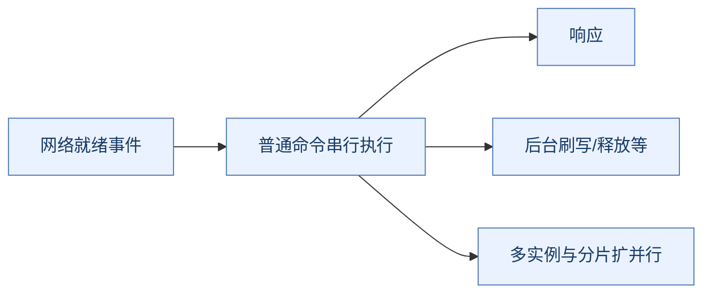
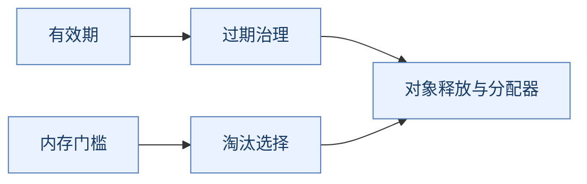
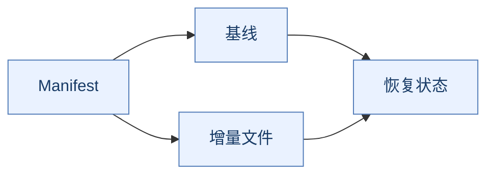
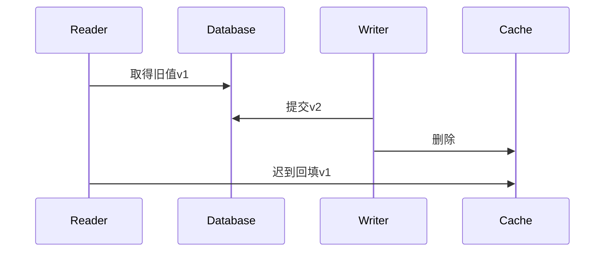
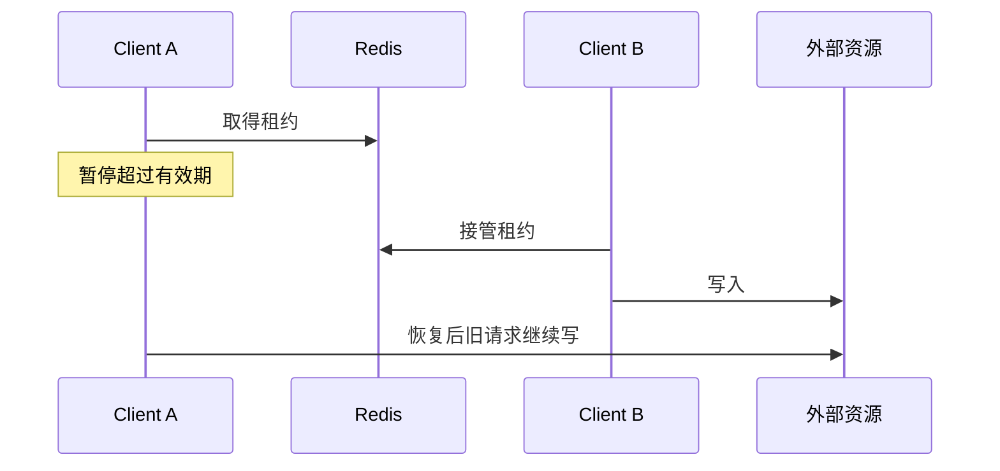
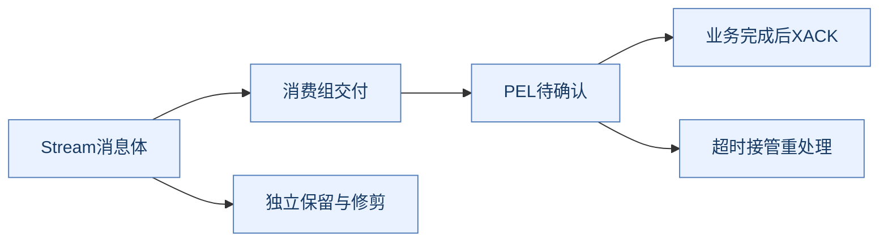

# Redis 面试：回答框架、实现取舍与故障推演

> **使用方式**：先读引用块中的一句话结论，按“问题 → 实现 → 替代方案 → 故障边界”复述，再回答追问。完整机制见 [Redis原理.md](Redis原理.md)。
>
> **版本口径**：基础按7.4，比较6.x、7.0/7.2/7.4、8.0/8.2的代表变化；不声称覆盖所有后续版本。缩写正文展开，完整全称见[文末术语附录](#glossary)。

## 复习导航

| 顺序 | 题目 | 训练目标 |
| --- | --- | --- |
| **先讲主链路** | Q1～Q6、Q15～Q24 | 从命令执行讲到数据恢复和集群路由 |
| **再讲实现** | Q7～Q14、Q33～Q35 | 解释结构与算法为何这样选，付出什么代价 |
| **重点做推演** | Q25～Q32、Q40 | 画出竞争窗口，定义业务不变量与恢复依据 |
| **补全架构与常见专题** | Q41～Q56 | 从单机到集群说明动机、代价与边界，推导延迟队列和客户端问题 |
| **最后补版本** | Q36～Q39 | 将旧结论放回具体版本和发行能力 |

---

## 一、执行模型与原子性

**本篇重点**：先分清网络等待、命令隔离和持久化，不用“单线程很快”解释一切。

### Q1：Redis是什么，什么时候适合使用？

> **一句话结论**：Redis提供以内存数据结构为核心的快速状态访问，但缓存、协调与权威存储的可靠性要求不同。

**机制展开**：先按业务看使用角色：缓存是可重建状态；计数、会话、排行榜是在线状态；锁与消息又涉及失败和重试。明确是否允许丢失、多久恢复、是否需要历史保留，才能讨论部署与持久化。

**⚖️ 方案对比与代价**：不能只因访问快就把订单账本搬入Redis。关系数据库提供另一套约束、查询和事务能力；本地缓存省网络却难以全局失效。

**🔎 追问演练**：Redis不可用时，所有请求能直接回数据库吗？

**推演要点**：不一定，数据库可能只具备正常缓存命中率下的承载能力，需要限流、合并、分级降级和恢复预热。

**原理展开**：[对应章节](Redis原理.md#execution)。

---

### Q2：Redis单线程为什么快？它到底有哪些线程？

> **一句话结论**：普通命令核心执行通常串行，性能来自内存、事件驱动和较低的共享状态协调成本。

**机制展开**：网络就绪事件驱动连接处理，普通命令串行修改键空间；网络I/O、异步释放、刷盘以及后台保存等有其他线程或子进程。版本与配置决定具体分工。

**⚖️ 方案对比与代价**：每请求一个执行线程可并发，但共享键、过期和编码转换需要同步；Redis用较简单的串行核心配合分片扩展，代价是长命令拖慢同实例。

**🔎 追问演练**：开启I/O线程能让一个巨型集合命令线性加速吗？

**推演要点**：通常不能。它优化网络相关路径，不等同于把该命令拆成并行计算，应先定位排队、CPU（Central Processing Unit，中央处理器）、响应大小和命令复杂度。

**原理展开**：[对应章节](Redis原理.md#execution)。

---

### Q3：为什么Redis服务端执行很快，应用仍然超时？

> **一句话结论**：端到端延迟还包括连接池、网络、排队、返回数据量和客户端编解码。

**机制展开**：SLOWLOG主要观察命令执行，不能覆盖全部客户端等待。连接池耗尽、大响应、跨地域RTT（Round-Trip Time，网络往返时间）和超时重试叠加都可能让服务端看着不慢而应用持续超时。

**⚖️ 方案对比与代价**：只增大超时可能积累更多在途请求；只加连接也可能放大服务端压力。应先测各阶段耗时，再限制并发和批量。

**🔎 追问演练**：超时后重试INCR安全吗？

**推演要点**：不天然安全。首次可能已执行而响应丢失，重试会再次加一，需要请求幂等或可容忍重复的业务语义。

**原理展开**：[对应章节](Redis原理.md#operations)。

---

### Q4：Pipeline、事务和Lua的区别是什么？

> **一句话结论**：Pipeline降低通信等待，事务控制一组命令隔离执行，Lua把依赖逻辑移到服务端；它们不等价。

**机制展开**：Pipeline可连续发送独立命令；MULTI先入队，EXEC再执行；Lua可在一次服务端执行中读取、判断和修改。运行结果与网络成功仍要分别判断。

**⚖️ 方案对比与代价**：单条原子命令够用时最简单；事务运行期错误不自动回滚；Lua适合短逻辑却会占用执行路径。批量太大又增加内存和尾延迟。

**🔎 追问演练**：Pipeline可以做“读库存后若大于零再扣减”吗？

**推演要点**：不能仅靠批量发送消除读改写竞争。应使用合适原子命令、WATCH重试或先校验后修改的短脚本。

**原理展开**：[对应章节](Redis原理.md#atomicity)。

---

### Q5：Redis事务为什么没有数据库式回滚？

> **一句话结论**：MULTI/EXEC保证排队命令执行时不被普通客户端命令穿插，但运行期失败不会撤回此前成功命令。

**机制展开**：入队阶段语法/参数错误与执行阶段类型错误不同。前者可能使事务无法执行，后者可能只让对应命令失败而其他命令成功，所以必须检查EXEC结果列表。

**⚖️ 方案对比与代价**：数据库事务常支持更丰富的回滚和隔离模型；Redis选择更简单执行边界。不能用“有事务”推导出跨数据库原子提交。

**🔎 追问演练**：执行INCR遇到非数字字符串，后面的SET会不会执行？

**推演要点**：在运行期类型内容错误的演示中，后面的SET仍可成功；不要把该表现推广到所有入队错误。

**原理展开**：[对应章节](Redis原理.md#atomicity)。

---

### Q6：WATCH与Lua怎么选？

> **一句话结论**：WATCH做客户端乐观检查，Lua在服务端执行短小依赖逻辑，选择取决于冲突和执行成本。

**机制展开**：WATCH后读状态、计算、MULTI/EXEC，相关键变化则放弃并重试；Lua避免普通命令在检查和修改之间插入，但不自动回滚已经写入的部分。

**⚖️ 方案对比与代价**：WATCH把计算留给客户端却增加往返与冲突重试；Lua减少往返但长计算阻塞实例。Functions更适合管理可部署函数库。

**🔎 追问演练**：WATCH高冲突下不断失败怎么办？

**推演要点**：限制重试并做退避，检查热点与键粒度，必要时改短脚本、单条命令或将权威状态约束放在数据库。

**原理展开**：[对应章节](Redis原理.md#atomicity)。

---

## 二、数据结构与内存

**本篇重点**：每一种编码都要说明定位、更新和空间成本，阈值按版本核对。

### Q7：对外类型和内部编码有什么区别？

> **一句话结论**：类型描述命令语义，编码描述数据在内存中的具体组织方式，二者不能一一写死。

**机制展开**：同一个Hash可随大小、元素长度和版本从紧凑编码转换为哈希表。TYPE与OBJECT ENCODING观察不同层面，MEMORY USAGE帮助估算成本。

**⚖️ 方案对比与代价**：紧凑编码省指针和分配，但定位与更新可能扫描/移动；哈希表定位方便，却有额外空间。固定阈值需查目标版本配置。

**🔎 追问演练**：对象刚变大时出现延迟尖峰，可能是什么？

**推演要点**：编码转换、扩容、重新分配或rehash都可能参与，需结合命令、数据量和内存证据，不能仅说网络抖动。

**原理展开**：[对应章节](Redis原理.md#structures)。

---

### Q8：SDS比普通C字符串好在哪里？

> **一句话结论**：SDS（Simple Dynamic String，简单动态字符串）用长度和容量元数据支持二进制内容与更方便的动态管理。

**机制展开**：获取长度不必扫描零结尾，追加可利用剩余容量；不同大小可采用不同头部布局。二进制安全依赖显式长度，而不是字符是否可打印。

**⚖️ 方案对比与代价**：裸C字符串元数据少但长度扫描和容量管理麻烦；SDS头部和预留空间占内存，容量不足仍需复制，不能说所有操作都是O(1)。

**🔎 追问演练**：一条很大的APPEND为什么仍可能慢？

**推演要点**：可能涉及重新分配、大量复制和内存压力；摊销优化不会消除单次扩容成本。

**原理展开**：[对应章节](Redis原理.md#structures)。

---

### Q9：listpack为什么用于小集合？ziplist讲法还通用吗？

> **一句话结论**：紧凑连续布局降低小对象的空间与分配成本，具体使用范围随版本变化。

**机制展开**：listpack把元素及其编码信息紧凑组织，适合少量小元素；超过条件后可转更适合定位和更新的结构。旧ziplist的连锁更新问题是理解演进的切入点。

**⚖️ 方案对比与代价**：每元素独立节点省移动却增加指针、对象头与分配；连续布局局部性好但插入可能移动。新旧版本不能混写固定编码表。

**🔎 追问演练**：为了省键开销，把所有用户放一个Hash合适吗？

**推演要点**：可能形成大键、热点和粗粒度迁移；需按业务访问和生命周期拆分，不应只优化对象头。

**原理展开**：[对应章节](Redis原理.md#structures)。

---

### Q10：渐进式rehash怎么减少阻塞？

> **一句话结论**：迁移期间保留新旧表，将条目搬迁分摊到后续工作，而不是一次搬完整张表。

**机制展开**：查找可能检查新旧表，新写入进入新表，迁移逐步推进直到旧表可释放。这样减少全量搬迁的一次停顿，但增加迁移期状态和内存。

**⚖️ 方案对比与代价**：一次性rehash流程简单却可能长停顿；渐进式不是严格恒定成本，冲突链、分配与大操作仍可能导致尖峰。

**🔎 追问演练**：扩容期间为什么内存会上升？

**推演要点**：双表并存、桶与条目迁移、分配器行为都可能增加占用，容量应留扩容和后台任务余量。

**原理展开**：[对应章节](Redis原理.md#structures)。

---

### Q11：ZSet为什么使用跳表和字典？

> **一句话结论**：较大ZSet通常用字典按member定位，用跳表维护按score排序，服务两类访问。

**机制展开**：跳表通过多层指针跳跃定位，再在底层顺序输出；字典可快速找到成员已有分数。排名还需相关跨度等辅助信息，不能只画单层链表。

**⚖️ 方案对比与代价**：单哈希表范围排序贵，单链表定位慢；平衡树也是备选，具体实现复杂度与常数成本不同。返回M条结果时不能忽略M。

**🔎 追问演练**：同score是否按插入时间排名？

**推演要点**：通常有明确的member排序规则，不应自动假设FIFO；业务需要稳定次序可设计分数/成员，但要评估精度与边界。

**原理展开**：[对应章节](Redis原理.md#structures)。

---

### Q12：Bitmap、Set、HyperLogLog、布隆过滤器如何选？

> **一句话结论**：先明确要精确成员、精确位状态、近似数量，还是快速排除不存在。

**机制展开**：Set保留成员并支持精确集合操作；Bitmap适合可映射到稠密整数域的位状态；HyperLogLog估算基数；布隆过滤器回答可能存在并允许假阳性。

**⚖️ 方案对比与代价**：不能从HyperLogLog还原全部用户，也不能让布隆过滤器作最终授权判断。稀疏巨大ID空间可能让Bitmap浪费内存。

**🔎 追问演练**：布隆过滤器说不存在就一定不能查库吗？

**推演要点**：需保证写入和过滤器同步正确。业务新数据未加入、误清空或重建切换错误会带来系统层面漏查，必要时要有回退。

**原理展开**：[对应章节](Redis原理.md#structures)。

---

### Q13：过期与淘汰有什么不同？为什么不每键一个定时器？

> **一句话结论**：过期按有效期治理数据，淘汰按内存压力选择牺牲对象；两者目标不同。

**机制展开**：访问时检查过期与主动周期工作配合，避免只靠惰性检查残留太多冷过期键，也避免为每个键维护独立定时任务的成本。

**⚖️ 方案对比与代价**：主动工作有预算，过期清理与实际内存释放未必发生在同一毫秒。集中到期还会制造清理与数据库回源尖峰。

**🔎 追问演练**：TTL（Time To Live，生存时间）到了，为什么RSS（Resident Set Size，常驻内存大小）没立即下降？

**推演要点**：逻辑有效性、对象释放、分配器复用和操作系统回收是不同层次，不能凭RSS判断过期机制失效。

**原理展开**：[对应章节](Redis原理.md#expiry)。

---

### Q14：LRU、LFU和maxmemory策略怎么选？

> **一句话结论**：LRU（Least Recently Used，最近最少使用）看近期访问，LFU（Least Frequently Used，最不经常使用）看频率及衰减；还要先选候选范围和不可淘汰数据边界。

**机制展开**：Redis近似采样降低精确全局顺序维护成本。allkeys面向全部键，volatile限定带过期键；noeviction则在无法继续相应分配写入时报错。

**⚖️ 方案对比与代价**：纯缓存与权威状态混在同一可淘汰实例风险大。LFU不能保证精准保留业务价值最高的数据，也不能消除热点。

**🔎 追问演练**：设置maxmemory等于容器内存上限安全吗？

**推演要点**：不安全，复制/AOF（Append Only File，仅追加文件）缓冲、碎片、fork/COW（Copy-On-Write，写时复制）等需要余量；maxmemory不是进程RSS硬上限。

**原理展开**：[对应章节](Redis原理.md#expiry)。

---

## 三、持久化、复制与高可用

**本篇重点**：把成功响应、复制确认、同步落盘、故障转移和备份恢复分开。

### Q15：RDB、AOF应该怎么选？

> **一句话结论**：RDB（Redis Database，Redis数据库快照格式）提供时点快照，AOF提供修改日志恢复表示；选择由恢复点、恢复时间和运行成本共同决定。

**机制展开**：RDB适合紧凑备份和恢复基线，可能丢快照后的变更；AOF可缩小部分恢复窗口，但带来写入、同步、重写和文件管理成本。两者可结合。

**⚖️ 方案对比与代价**：没有一组持久化参数能替代独立备份与恢复演练。缓存可重建也要估算回源容量，不能简单认为禁持久化没有业务代价。

**🔎 追问演练**：AOF开了是否就不用RDB备份？

**推演要点**：不是。复制/日志可能传播误操作，备份需要独立恢复点及验证；选择还取决于恢复速度和保存周期。

**原理展开**：[对应章节](Redis原理.md#persistence)。

---

### Q16：fork和COW为什么会导致内存、延迟尖峰？

> **一句话结论**：子进程保存快照时共享页会在修改后复制，高写入与大数据集会放大成本。

**机制展开**：fork要处理页表等状态，并非完全免费；之后父进程修改共享页触发COW（Copy-On-Write，写时复制），额外内存与操作频率相关。

**⚖️ 方案对比与代价**：后台保存减少了全程停服，但没有消除系统级工作。预留只看value大小会低估峰值，需要测fork耗时、复制页和设备负载。

**🔎 追问演练**：为什么平时内存够，BGSAVE时被终止？

**推演要点**：可能是COW与缓冲把实际占用推过容器/系统限额，要结合系统事件确认，不能只调maxmemory后继续猜。

**原理展开**：[对应章节](Redis原理.md#persistence)。

---

### Q17：everysec是否最多丢一秒？AOF重写是什么？

> **一句话结论**：everysec表达常规同步策略，不是任意故障与负载下精确一秒的数据损失上界。

**机制展开**：追加到文件可能只到操作系统缓存，后台fsync受设备和调度影响；重写从当前状态生成精简基线，减少历史膨胀。7.0起要理解多部分AOF与manifest。

**⚖️ 方案对比与代价**：always提高同步等待成本，no依赖OS；重写需要新旧文件并存、COW和磁盘余量。它不是业务审计历史压缩。

**🔎 追问演练**：恢复时只复制一个incremental文件行不行？

**推演要点**：不行，应保持清单与相关基线、增量的一致集合，并按版本恢复流程验证。

**原理展开**：[对应章节](Redis原理.md#persistence)。

---

### Q18：Redis复制如何全量同步与部分重同步？

> **一句话结论**：副本通过复制身份与offset协商，历史仍可续传则补增量，否则加载基线并追赶。

**机制展开**：PSYNC（Partial Resynchronization，部分重同步）依赖复制身份兼容和backlog字节范围。新副本、长断连或不足的backlog都可能触发全量。

**⚖️ 方案对比与代价**：全量简单但昂贵，部分续传节约资源却需要保留历史缓冲；backlog容量应结合写流量和最长预期断连估算。

**🔎 追问演练**：网络短抖为何仍反复全量？

**推演要点**：查写入突发是否迅速覆盖backlog、身份变化、连接和重同步日志，不能仅按断连秒数判断。

**原理展开**：[对应章节](Redis原理.md#replication)。

---

### Q19：WAIT、WAITAOF、min-replicas能保证不丢吗？

> **一句话结论**：它们约束不同边界，可降低部分风险，但不把默认异步复制变成任意故障下强一致。

**机制展开**：WAIT等待本连接此前写入的副本处理确认；WAITAOF等待相应AOF同步条件；min-replicas按副本数量/延迟条件限制写入，不是逐条同步确认。

**⚖️ 方案对比与代价**：等待带来延迟和失败处理；超时返回不足数量不会撤回原写入。确认操作必须关注连接上下文。

**🔎 追问演练**：连接池写一次再随便借连接WAIT能证明什么？

**推演要点**：不能用无关连接的此前写入状态证明目标写已复制，应使用正确客户端/连接语义并检查返回值。

**原理展开**：[对应章节](Redis原理.md#replication)。

---

### Q20：读写分离为什么可能读不到刚写的数据？

> **一句话结论**：主写副读默认存在复制滞后，读到旧值不一定是写失败或缓存被删。

**机制展开**：异步传播让主节点响应不完全等待副本；副本追赶、网络和负载决定何时可读到新状态。读自己写和权限即时生效需要明确额外策略。

**⚖️ 方案对比与代价**：副本扩读取不等于扩主写；把所有敏感读转主可能增加主压力，但比假设副本总是最新更容易定义行为。

**🔎 追问演练**：支付成功页面查询适合直接随机读副吗？

**推演要点**：需要业务确定可接受延迟，敏感确认可读权威源或指定一致性路径，避免把旧状态误判成未支付并重复触发。

**原理展开**：[对应章节](Redis原理.md#replication)。

---

### Q21：Sentinel的quorum与多数授权有什么区别？

> **一句话结论**：quorum用于汇总主节点故障判断，多数授权用于选出合法故障转移执行者。

**机制展开**：Sentinel先形成SDOWN（Subjectively Down，主观下线），再汇总为ODOWN（Objectively Down，客观下线）；自动切主还需足够Sentinel授权，之后选副本、提升、重配并通知客户端。

**⚖️ 方案对比与代价**：多个观察者降低单点误判，但不能跨网络强制停止旧主所有客户端；默认异步复制仍有成功写入丢失窗口。

**🔎 追问演练**：三个Sentinel只剩一个，quorum设1就一定能自动切主吗？

**推演要点**：不能把故障判断条件当成授权多数。还要检查多数、可用副本及客户端发现，不是简单一个超时参数。

**原理展开**：[对应章节](Redis原理.md#sentinel)。

---

## 四、分片、缓存与分布式锁

**本篇重点**：用完整故障时序推导方案，避免将单条原子命令当成全链路正确性。

### Q22：Sentinel与Cluster分别解决什么？

> **一句话结论**：Sentinel管理非分片主副的高可用，Cluster增加槽分片及对应故障处理。

**机制展开**：Sentinel不代理数据也不自动分摊整个键空间写入；Cluster客户端将不同槽请求路由到不同主节点，每个分片再有副本。

**⚖️ 方案对比与代价**：只需要高可用未必需要分片复杂度；容量或多键写吞吐超过单主时才需评估分片，并接受跨槽限制。

**🔎 追问演练**：换成Cluster，单个热key会被均摊吗？

**推演要点**：通常不会，同一个键仍归一个槽；要靠本地缓存、合并、业务拆分等解决，且分析一致性。

**原理展开**：[对应章节](Redis原理.md#cluster)。

---

### Q23：为什么Cluster是16384槽，不直接对节点数取模？

> **一句话结论**：槽作为键与节点之间的间接层，使扩缩容可以按槽迁移而不改变全部键的映射公式。

**机制展开**：CRC16（16-bit Cyclic Redundancy Check，16位循环冗余校验）计算槽，槽再映射主节点；客户端缓存映射并处理变化。具体槽数是协议设计，不是线程数量。

**⚖️ 方案对比与代价**：直接节点数取模在增删节点后重映射范围大；一致性哈希也是分布式路由方案，但Redis Cluster明确使用哈希槽。

**🔎 追问演练**：有槽之后迁移就没有成本了吗？

**推演要点**：仍要搬键、占网络、管理过渡路由和失败恢复，大键/热点会让迁移更难。

**原理展开**：[对应章节](Redis原理.md#cluster)。

---

### Q24：MOVED、ASK、hash tag及跨槽限制怎么解释？

> **一句话结论**：MOVED偏向槽路由更新，ASK表示迁移中的本次转向；hash tag可让相关键同槽。

**机制展开**：ASK请求到目标节点前需执行ASKING；客户端不能把所有ASK都当永久拓扑更新。多键事务或脚本通常要求同槽。

**⚖️ 方案对比与代价**：同槽方便原子多键操作，却可能把大量业务集中到一个分片；客户端拆分跨槽批量不是原子快照。

**🔎 追问演练**：所有订单都用{orders}可以吗？

**推演要点**：会把相关键锁定到同一槽，可能失去分片收益。应按真正需要原子协作的实体选择tag。

**原理展开**：[对应章节](Redis原理.md#cluster)。

---

### Q25：缓存与数据库怎么保持一致？先删还是后删？

> **一句话结论**：常见旁路模式先提交数据库再失效缓存，但它提供的是需要补救机制的最终一致路径。

**机制展开**：先删后写会让中间读取回填旧值；直接双更新又可能让缓存写入顺序与DB（Database，数据库）提交顺序不同。后删减少维护两份最新值的复杂度，但删除失败和迟到回填仍存在。

**⚖️ 方案对比与代价**：不能只交换两个调用的顺序就消灭跨系统窗口；Outbox/CDC（Change Data Capture，数据变更捕获）恢复失效通知，版本和回填协调处理其他竞争，敏感读取走权威源。

**🔎 追问演练**：删除成功为什么仍看到旧缓存？

**推演要点**：早先未命中的读请求可能已取得旧数据库快照，在删除之后才回填，需要按完整时序而非只看写请求排查。

**原理展开**：[对应章节](Redis原理.md#cache)。

---

### Q26：延迟双删能做到强一致吗？

> **一句话结论**：不能，固定延时只能覆盖部分竞争时序，无法为任意慢请求和故障给出保证。

**机制展开**：读请求、数据库事务快照、网络和重试的时间分布不固定；第二次删除也可能失败。延迟估计偏短覆盖不足，偏长又扩大陈旧窗口。

**⚖️ 方案对比与代价**：延迟双删可作特定条件下缓解方案；严格业务需版本、协调或读权威源。失效事件可靠传递与旧回填约束也是两个问题。

**🔎 追问演练**：有CDC后能否删掉所有TTL？

**推演要点**：不宜仅凭CDC就假设永远不会漏通知或旧回填。需要定义重建、断链恢复和陈旧兜底，TTL仍可能有治理价值。

**原理展开**：[对应章节](Redis原理.md#cache)。

---

### Q27：穿透、击穿、雪崩分别如何治理？

> **一句话结论**：先分不存在查询、单热点重建和大面积失效，再选对应措施。

**机制展开**：穿透可空值缓存、校验、过滤；击穿可请求合并、互斥重建或逻辑过期；雪崩需TTL打散、预热、限流和下游保护。每种措施都有一致性和恢复成本。

**⚖️ 方案对比与代价**：逻辑过期用旧值换可用性，不适合所有授权/余额场景；布隆有假阳性且需同步；锁重建要有失败释放和等待边界。

**🔎 追问演练**：缓存整体故障时只加重试为什么更糟？

**推演要点**：重试会放大数据库流量与在途请求，先限制并发和非关键需求，再按恢复容量逐步预热。

**原理展开**：[对应章节](Redis原理.md#cache)。

---

### Q28：多级缓存和客户端缓存有什么优缺点？

> **一句话结论**：本地缓存能省网络并保护热key，但增加跨实例失效和连接恢复治理。

**机制展开**：Redis服务端辅助跟踪可发送失效通知，客户端维护本地值；断连或跟踪状态改变时需要明确清空和重建策略。它不是把通知变成永久可靠日志。

**⚖️ 方案对比与代价**：仅Redis一层路径简单但网络与热点压力更高；两级访问快却要处理陈旧值、容量和负缓存，关键数据仍要限定一致性。

**🔎 追问演练**：断连期间本地缓存还能无限使用吗？

**推演要点**：应按业务定义有效期或清空，不能把失去失效通道后的旧值当作仍然一致。

**原理展开**：[对应章节](Redis原理.md#cache)。

---

### Q29：Redis分布式锁有哪些基本正确性条件？

> **一句话结论**：原子获取并设租约，独特owner token，原子校验后释放，还要处理过期和故障。

**机制展开**：SET NX PX避免获取后尚未设过期就崩溃；解锁脚本比较当前owner再删除，防止误删接管者锁。超时、续期和客户端重试均要有边界。

**⚖️ 方案对比与代价**：客户端先GET后DEL仍可能误删；只有锁TTL不足以保护外部资源，副本切主也可能暴露互斥窗口。

**🔎 追问演练**：持有者暂停超过TTL，恢复后还能写数据库吗？

**推演要点**：能，锁不会自动终止旧线程。应由资源侧版本/隔离令牌或业务条件拒绝无效写，而不是仅检查锁曾经拿到。

**原理展开**：[对应章节](Redis原理.md#locks)。

---

### Q30：看门狗、fencing token与Redlock分别解决什么？

> **一句话结论**：续期延长租约，fencing由资源拒绝旧写，Redlock基于多独立实例与时间预算获取租约，保障不同。

**机制展开**：随机owner证明锁归属，fencing要求有效序号与资源侧检查；看门狗也会受暂停和网络影响。Redlock依赖明确故障与时间假设，不等于简单多数共识。

**⚖️ 方案对比与代价**：缓存重建可容忍偶发重复，金融等不变量常需要数据库唯一/条件更新或合适协调机制。不能用同一锁口号覆盖所有业务。

**🔎 追问演练**：Redis INCR生成fencing是否天然不会回退？

**推演要点**：异步复制切主可能丢失自增历史，必须证明序号源与资源检查的可靠性，不能只因是递增命令就断言全局单调。

**原理展开**：[对应章节](Redis原理.md#locks)。

---

## 五、业务设计、消息与排障

**本篇重点**：先定义模型与容量，再说明边界、监控和恢复。

### Q31：用Redis设计限流如何比较算法？

> **一句话结论**：固定窗口简单，滑动更平滑，令牌桶允许有限突发；先定义平均速率、突发和精度。

**机制展开**：计数与首次过期应原子处理；滑动日志可用ZSet，成员要区分同毫秒请求；令牌补充和扣减需要一个正确的原子更新边界。

**⚖️ 方案对比与代价**：固定窗口边界突发大；滑动日志空间和清理重；分桶近似更省；全局单key可能成为热点，多级限流又改变精确度。

**🔎 追问演练**：同毫秒请求用时间戳作唯一member会怎样？

**推演要点**：相同member会更新覆盖而少计，应加入请求唯一性并控制记录规模和保留范围。

**原理展开**：[对应章节](Redis原理.md#patterns)。

---

### Q32：Lua扣库存就能保证不超卖吗？

> **一句话结论**：脚本解决一次服务端执行中的校验扣减竞争，不自动解决切主丢写、重复请求和数据库落库。

**机制展开**：需要请求幂等、预占状态、可靠投递/恢复依据、订单数据库约束、失败补偿和对账。每一步都要考虑业务成功响应丢失后的重试。

**⚖️ 方案对比与代价**：以Redis做快速预筛可减数据库压力，但权威约束位置必须明确；补偿不能无条件加回已确认库存。

**🔎 追问演练**：扣成功后订单服务宕机怎么办？

**推演要点**：依靠可恢复预占/事件记录继续处理或按规则释放，并确保恢复、重试和补偿不会重复修改。

**原理展开**：[对应章节](Redis原理.md#patterns)。

---

### Q33：Pub/Sub、List与Stream怎么选？

> **一句话结论**：通知、任务领取、可回读事件与待确认消费是不同模型，先定义丢失和恢复要求。

**机制展开**：Pub/Sub面向在线订阅；List弹出后业务崩溃要自建处理中恢复；Stream用ID记录和消费组待确认状态支持回读及接管。

**⚖️ 方案对比与代价**：Stream仍受Redis保留容量、持久化和切主窗口约束。不能只因有ACK（Acknowledgement，确认）就推导和Kafka相同的日志、分区及可靠性语义。

**🔎 追问演练**：BLPOP阻塞会让整个Redis停住吗？

**推演要点**：没有数据时主要登记等待客户端，事件循环继续处理其他请求；仍需管理等待连接与客户端连接池隔离。

**原理展开**：[对应章节](Redis原理.md#messaging)。

---

### Q34：Stream的PEL、XACK、XAUTOCLAIM和修剪怎么配合？

> **一句话结论**：PEL（Pending Entries List，待确认条目列表）保存组的已交付未确认状态，ACK清进度引用，接管恢复闲置任务，修剪管理消息体。

**机制展开**：PEL（Pending Entries List，待确认条目列表）不是消息载荷；业务成功后ACK前崩溃会重处理。接管需合理空闲阈值和幂等，避免慢消费者与接管者同时执行副作用。

**⚖️ 方案对比与代价**：保留太短可能删除未完成任务的载荷；只看组新消息进度会遗漏长期pending。8.2协调删除能力也不替代业务事务。

**🔎 追问演练**：XACK后XRANGE为什么还能看到消息？

**推演要点**：ACK确认该组处理状态，不等于删除Stream消息体；多组消费更需独立分析各组进度与保留策略。

**原理展开**：[对应章节](Redis原理.md#messaging)。

---

### Q35：线上Redis慢、大key、热key怎么排查？

> **一句话结论**：先分端到端链路与具体key分布，再区分执行重、网络重、内存压力和后台任务。

**机制展开**：看连接池、RTT、响应大小、SLOWLOG、LATENCY、内存/RSS、fork/AOF和复制。SCAN分摊扫描但不是快照，COUNT不保证数量，Cluster要覆盖相关节点。

**⚖️ 方案对比与代价**：加连接或扩分片不能自动解决一个热key；UNLINK降低部分同步释放，却不降低原本大对象的读取、迁移和复制成本。

**🔎 追问演练**：碎片率很高是否立刻重启？

**推演要点**：先看绝对碎片、数据集大小、分配器与内存压力，再评估整理或迁移；高比率不必然意味着大量浪费，重启也有恢复风险。

**原理展开**：[对应章节](Redis原理.md#operations)。

---

## 六、版本与综合设计

**本篇重点**：回答小版本、发行包、客户端与特性，不把所有Redis混为一个实现。

### Q36：Redis 6、7、8的关键变化是什么？

> **一句话结论**：按小版本、发行能力和客户端区分，不能用“都是Redis”忽略执行、持久化和命令演进。

**机制展开**：6包含I/O线程、ACL（Access Control List，访问控制列表）、RESP3（Redis Serialization Protocol version 3，Redis序列化协议第三版）和跟踪缓存；7.0包含Functions、多部分AOF等；7.2有WAITAOF；7.4有Hash字段过期；8.0整合更多数据能力，8.2改进Stream确认/删除。

**⚖️ 方案对比与代价**：新版本不意味所有旧模块、托管能力、协议和新命令自动启用。实际收益应按现有瓶颈验证，兼容实现也不能直接共用版本结论。

**🔎 追问演练**：服务端升级了，客户端还不支持新命令怎么办？

**推演要点**：检查客户端版本、API与协议支持，必要时按官方兼容方式调用并补测试；不能只以Redis主版本断言可用。

**原理展开**：[对应章节](Redis原理.md#versions)。

---

### Q37：Redis 7.0多部分AOF和Functions带来什么？

> **一句话结论**：它们分别改进持久化文件生命周期与服务端逻辑管理，不能混为性能开关。

**机制展开**：多部分AOF由manifest关联基线和增量；Functions把函数库纳入管理与恢复链路，区别于仅依赖临时脚本摘要缓存。Cluster仍需管理各分片函数部署。

**⚖️ 方案对比与代价**：恢复应使用一致文件集合；函数发布需考虑权限、兼容和回滚。函数隔离执行仍不提供数据库式自动回滚。

**🔎 追问演练**：备份只拷appendonly目录里的最大文件可以吗？

**推演要点**：不能，应确认清单引用的完整基线与增量，以及备份过程中一致性和恢复可用性。

**原理展开**：[对应章节](Redis原理.md#versions)。

---

### Q38：7.4字段过期解决了什么，可能引入什么问题？

> **一句话结论**：Hash可为不同字段设置生命周期，减少一部分拆key和自建清理，但不取消大键风险。

**机制展开**：对象级TTL与字段级TTL分别管理，命令如HEXPIRE/HTTL要结合实际返回值理解。客户端、查询行为和更新保留语义需按版本核对。

**⚖️ 方案对比与代价**：旧版可拆key或维护时间戳，前者元数据多，后者清理复杂；字段TTL集中方便，但单个巨大Hash仍会造成热点、迁移和访问问题。

**🔎 追问演练**：字段消失后是不是整个用户对象都不该存在？

**推演要点**：需要业务定义对象完整性与缺省行为，不能把字段级生命周期当成天然完整对象一致性。

**原理展开**：[对应章节](Redis原理.md#versions)。

---

### Q39：Redis 8.0和8.2有哪些值得关注的变化？

> **一句话结论**：8.0强调统一集成更多数据能力，8.2增强Stream确认、删除与修剪协作；要区分具体发行包。

**机制展开**：传统核心、Redis Stack/模块、Redis 8统一发行和Redis Software/Cloud是不同口径。8.2的XACKDEL等命令需按多组引用与保留策略理解。

**⚖️ 方案对比与代价**：集成减少部分部署组合成本，也增加数据恢复、索引和客户端验证范围；新确认删除命令并不让业务副作用自动精确一次。

**🔎 追问演练**：裸Redis 6能直接执行所有JSON（JavaScript Object Notation，数据交换格式）或布隆命令吗？

**推演要点**：不能只靠产品名判断，应查实际模块、发行与命令支持；新版与兼容产品也要分别验证。

**原理展开**：[对应章节](Redis原理.md#versions)。

---

### Q40：设计高并发商品缓存系统，如何说明完整方案？

> **一句话结论**：先定义陈旧窗口与权威源，再组合容量、失效、热点保护和故障恢复，而不是堆命令。

**机制展开**：估算峰值读取、缓存命中、对象尾部大小与TTL；使用旁路缓存和可恢复失效、热key本地层及合并重建、数据库容量保护；按需选Sentinel或Cluster，观测命中、回源、P99（99th Percentile，99分位数）与恢复。

**⚖️ 方案对比与代价**：本地层降低热点但失效更难，长TTL减少回源却扩大陈旧，分片扩容量却增加路由与多键限制。不能承诺同时零延迟、零陈旧、零丢失且无限扩展。

**🔎 追问演练**：缓存整体失效、数据库只能承受十分之一请求，怎么办？

**推演要点**：限流与业务分级、合并和预热按容量逐步恢复；对敏感正确性路径保持权威检查，避免无限重试与瞬时全量回源。

**原理展开**：[对应章节](Redis原理.md#cache)。

---

## 七、架构演进与常见专题追问

**本篇重点**：从瓶颈推导架构，从状态与失败窗口推导业务方案，不用更多节点或更多注解替代正确性证明。

### Q41：单机、主从、哨兵和集群是如何演进的？

> **一句话结论**：复制解决冗余，哨兵管理自动切主，集群按槽分摊数据和写入；演进由瓶颈驱动。

**机制展开**：单机缺少在线冗余且容量/吞吐受限；主从增加完整副本，但故障还需判定与切换；Sentinel增加控制面，却仍是一份数据和单主写；Cluster才把不同键分给多个主节点。

**⚖️ 方案对比与代价**：不是越复杂越好。分片带来路由、跨槽限制与迁移；若数据与写量单主足够，只因需要高可用未必应直接分片。

**🔎 追问演练**：数据是单机的两倍大，多加一个副本能装下吗？

**推演要点**：不能，副本仍保存完整键空间，不是各存一半；需要分片、拆业务或调整数据模型。

**原理展开**：[对应章节](Redis原理.md#architecture-evolution)。

---

### Q42：有主从复制为什么还不能自动高可用？

> **一句话结论**：数据副本只提供接管基础，还需故障判断、合法执行者、合适候选和客户端发现。

**机制展开**：独立副本不能仅凭自身连不上主就都宣布接管，否则网络隔离可能出现多个主；人工切换又可能慢、选错副本或让客户端继续使用旧地址。

**⚖️ 方案对比与代价**：Sentinel或Cluster自动化控制面减少人工恢复工作，但不替代数据复制，也不自动消除异步丢写和重试。

**🔎 追问演练**：主从开了持久化，主挂后是否就无需切换逻辑？

**推演要点**：持久化帮助恢复数据，不能让在线请求自动转到正确节点；恢复与发现是不同职责。

**原理展开**：[对应章节](Redis原理.md#architecture-evolution)。

---

### Q43：Sentinel是不是代理？业务是否经过它转发？

> **一句话结论**：Sentinel监控与协调拓扑，业务客户端通常发现当前主地址后直连数据节点。

**机制展开**：控制面处理故障观察、授权、提升和重配；数据面承接GET/SET。客户端还要处理连接重建和超时后的不确定结果。

**⚖️ 方案对比与代价**：统一代理可隐藏部分拓扑但增加中转层；Sentinel模式让客户端承担发现，少了数据代理却更依赖客户端适配和地址可达。

**🔎 追问演练**：能连Sentinel，但返回的新主地址不通，会怎样？

**推演要点**：业务仍失败。控制入口可达不等于数据入口可达，应区分发现、路由和实际连接。

**原理展开**：[对应章节](Redis原理.md#architecture-evolution)。

---

### Q44：三主三副为什么不是六倍有效容量、六倍写吞吐？

> **一句话结论**：只有不同主分片分摊数据，副本重复保存相应分片；单key仍归一个槽。

**机制展开**：同样数据副本占用物理内存；每个主节点承接所属键写入，副本主要承担冗余和合适读取。负载不均、复制与后台任务会影响实际收益。

**⚖️ 方案对比与代价**：多实例同宿主机也不等于独立故障域。容量与写吞吐需按主分片和热点分布估算，不能按容器总数倍乘。

**🔎 追问演练**：三个主不同槽数很均匀，为什么某一台仍满载？

**推演要点**：槽负载不等价，一个热key或大集合就可能主导CPU与网络，迁移空槽不能解决。

**原理展开**：[对应章节](Redis原理.md#architecture-evolution)。

---

### Q45：Cluster扩容为什么不是加节点就自动均衡？

> **一句话结论**：成员加入、槽分配、数据迁移和客户端路由更新是不同阶段。

**机制展开**：选择迁移槽并搬键，处理ASK过渡与MOVED后的路由；节点间通过Gossip等传播成员和观察状态，元数据epoch参与拓扑裁决。

**⚖️ 方案对比与代价**：搬迁占网络、内存与执行资源，大键可能影响尾延迟；缩容先移出槽，不能直接删节点。均匀槽数也不保证均匀业务负载。

**🔎 追问演练**：扩容能把现有热Hash拆到多个主节点吗？

**推演要点**：不能自动把单key内部元素分开，要改业务数据模型，并处理跨键一致性与查询。

**原理展开**：[对应章节](Redis原理.md#advanced-topics)。

---

### Q46：Redis究竟是CP还是AP？原子命令等于强一致吗？

> **一句话结论**：应给出部署和故障模型，不用一个CAP标签替代对复制、读写和切换窗口的分析。

**机制展开**：CAP（Consistency, Availability, Partition Tolerance，一致性、可用性与分区容错）中的一致性与单实例命令隔离不同；Redis异步复制可能在已响应后丢写，旧主在隔离中也可能短暂接收请求。

**⚖️ 方案对比与代价**：WAIT、WAITAOF、写副本门槛和多数故障规则改善不同边界，但都不能单项证明端到端线性一致。

**🔎 追问演练**：单条INCR原子，读副本为什么还能倒退？

**推演要点**：原子性说明一次实例执行边界，副本读取可能落后，切主也可能缺少历史；必须区分不同一致性维度。

**原理展开**：[对应章节](Redis原理.md#advanced-topics)。

---

### Q47：用Redis设计延迟队列，为什么不能只用ZPOPMIN？

> **一句话结论**：最小score不是已经到期，领取还必须有原子判断与可恢复处理中状态。

**机制展开**：以到期时间为score查询ready，将符合条件记录原子迁入inflight，设置领取信息和租约；完成后确认，超时再按规则恢复。

**⚖️ 方案对比与代价**：只读再删可能重复领取；原子删后执行仍可能崩溃漏任务；可恢复inflight换来状态和重投治理。Cluster相关键还需考虑同槽。

**🔎 追问演练**：原子Lua删除后返回任务，服务立即宕机怎么办？

**推演要点**：若无处理中记录任务可能永久丢失，必须保留恢复依据并让业务幂等；Lua原子不等于任务已完成。

**原理展开**：[对应章节](Redis原理.md#advanced-topics)。

---

### Q48：Redis过期通知能可靠关闭超时订单吗？

> **一句话结论**：过期通知不是精确定时、持久化可补历史的任务系统，不能作为唯一正确性依据。

**机制展开**：过期删除有主动/被动检查和预算，通知产生不保证等于TTL到期瞬间；Pub/Sub订阅断开后没有通用历史重投。

**⚖️ 方案对比与代价**：可以辅助通知或触发检查，但可靠关单应有持久任务/到期索引、恢复扫描和数据库条件更新。调度触发与业务状态判断分开。

**🔎 追问演练**：订单已支付，迟到关单事件来了怎么办？

**推演要点**：按权威订单状态和版本做条件更新，拒绝非法跃迁；不能收到过期事件就无条件取消。

**原理展开**：[对应章节](Redis原理.md#advanced-topics)。

---

### Q49：Jedis和Lettuce如何选连接模型？线程安全意味着什么？

> **一句话结论**：连接池和多路复用解决不同资源复用问题，线程安全不等于连接状态能任意混用。

**机制展开**：传统Jedis连接使用需按API约定隔离；Lettuce支持共享连接及池。普通短命令可共享，事务、阻塞、订阅与确认上下文要用适当专用连接或客户端机制。

**⚖️ 方案对比与代价**：池提供独占边界但可能耗尽，多路复用省连接却可能受大响应队头阻塞。不能把客户端版本更新后的API都套成历史固定结论。

**🔎 追问演练**：在共享连接中一个线程MULTI，另一个线程普通写，会不会受影响？

**推演要点**：MULTI等是连接级状态，不能仅凭客户端对象线程安全就允许无关逻辑交错，应隔离该会话。

**原理展开**：[对应章节](Redis原理.md#advanced-topics)。

---

### Q50：Spring的Cacheable、CacheEvict能保证缓存一致吗？

> **一句话结论**：缓存抽象减少接入代码，没有把Redis与数据库自动放进同一个原子事务。

**机制展开**：代理模式、自调用、事务提交与失效时机、缓存提供者和key设计都影响行为；sync=true的实际范围依赖提供者，不是天然跨实例分布式锁。

**⚖️ 方案对比与代价**：手写旁路更显式但易散乱，注解更简洁却隐藏拦截和配置。两者都要处理删除失败、迟到回填和恢复。

**🔎 追问演练**：同商品给不同用户展示折扣，只用商品ID缓存有什么风险？

**推演要点**：会复用用户相关结果，key必须表达租户、用户或其他影响结果的维度，或缓存与用户无关的基础数据。

**原理展开**：[对应章节](Redis原理.md#advanced-topics)。

---

### Q51：内存碎片、THP、Swap对Redis有什么影响？

> **一句话结论**：命令存内存不意味着系统没有页面、分配器与fork相关成本。

**机制展开**：THP（Transparent Huge Pages，透明大页）可能在部分COW负载放大开销；交换页回读带来停顿；释放对象后分配器仍可能保留页面，所以RSS不会按used_memory同步下降。

**⚖️ 方案对比与代价**：碎片整理用CPU等资源换回部分页面利用率；重启可能清状态却增加恢复风险，也不能解决数据无限增长。

**🔎 追问演练**：碎片率2.0就一定比1.2更严重吗？

**推演要点**：还要看绝对浪费字节、数据集大小和真实内存压力；小数据集的比例会被放大。

**原理展开**：[对应章节](Redis原理.md#advanced-topics)。

---

### Q52：布隆过滤器如何估内存？为什么误判率会变化？

> **一句话结论**：位数、元素量和哈希次数决定理想误判率，超容量或同步错误会改变业务效果。

**机制展开**：理想模型m约为-n*ln(p)/(ln2)^2，k约为(m/n)*ln2；100万元素、1%假阳性理论位数组约1.2MB，不含实现元数据与扩展层。

**⚖️ 方案对比与代价**：降低p要更多空间/计算；普通结构不能任意清位删除。过滤器还需正确添加、基线重建与增量衔接，数学无假阴性不覆盖业务漏同步。

**🔎 追问演练**：新商品落库成功，但过滤器还没添加时怎么办？

**推演要点**：定义一致更新、可靠增量或回退路径，避免直接过滤成不存在；重建切换也不能丢期间新增。

**原理展开**：[对应章节](Redis原理.md#advanced-topics)。

---

### Q53：ZSet排行榜为何要关注score精度和深分页？

> **一句话结论**：score是双精度浮点，不是任意精度业务数值；复杂度还包括跳过和返回记录。

**机制展开**：大整数和小数叠加编码可能丢精度，相同score按成员规则排序而不是自动先到先得；大offset查询有扫描成本，游标也需处理并列分数边界。

**⚖️ 方案对比与代价**：整数最小单位在范围内可减少小数误差，但权威金额仍应由适合数据源计算。排行榜更新中分页也不天然是快照。

**🔎 追问演练**：把64位雪花ID完整放score就一定能排序吗？

**推演要点**：不能无条件保证，应核对双精度精确整数范围与业务编码，避免不同ID映射为相同score。

**原理展开**：[对应章节](Redis原理.md#advanced-topics)。

---

### Q54：逻辑库和key前缀能隔离租户资源吗？

> **一句话结论**：它们主要隔离命名，不提供独立CPU、淘汰、持久化和故障域。

**机制展开**：单机SELECT切换逻辑库是连接状态，Cluster只支持数据库0；前缀帮助管理和定位，却不限制某租户制造热点或占满共享内存。

**⚖️ 方案对比与代价**：业务域隔离可用前缀起步，但严格资源和故障隔离要评估独立实例或支持相应机制的产品，代价是连接和运维成本。

**🔎 追问演练**：单机多个逻辑库迁Cluster，直接继续SELECT可以吗？

**推演要点**：不可以，要重新设计命名空间与迁移，并核对跨槽事务和客户端状态。

**原理展开**：[对应章节](Redis原理.md#advanced-topics)。

---

### Q55：SET、INCR、EXPIRE、GETEX如何影响TTL？

> **一句话结论**：覆盖整个键与修改原对象语义不同，不能假设所有更新都保留或刷新TTL。

**机制展开**：SET默认覆盖会清原TTL，除非按选项保留/重设；INCR等原对象修改通常保留键TTL；GETEX读取时可修改期限。TTL/PTTL还需区分无过期和键不存在。

**⚖️ 方案对比与代价**：每次计数都重设完整TTL可能把固定窗口改成最后访问后过期；字段级TTL又有自己的更新规则，不能从键TTL直接类推。

**🔎 追问演练**：固定一分钟限流，每次请求都EXPIRE 60会怎样？

**推演要点**：持续请求可能不断续期，不再按原固定窗口重置；应明确窗口起点并原子初始化期限。

**原理展开**：[对应章节](Redis原理.md#advanced-topics)。

---

### Q56：为什么相同业务key在两个客户端里读不到？

> **一句话结论**：先检查实际键字节、序列化、逻辑库与集群入口，不只比较日志字符串。

**机制展开**：字符串序列化和对象序列化可能产生不同键字节；值编码升级也可能让旧数据无法解析。连接SELECT状态、key前缀和业务版本都会影响查找。

**⚖️ 方案对比与代价**：直接替换序列化器改动小，却可能导致命中率骤降、空间放大和回滚困难。应设计格式版本、兼容读和旧缓存淘汰边界。

**🔎 追问演练**：缓存格式升级后不兼容旧值，是否直接全量回源就好？

**推演要点**：可能触发雪崩，应评估容量、渐进更新和回退；格式升级也是缓存可靠性设计的一部分。

**原理展开**：[对应章节](Redis原理.md#advanced-topics)。

---

## 附录 A：参数与命令速查

> **参数表用于定位，不是生产配置模板。** 默认值、单位、适用部署及版本需按实际环境确认。

| 领域 | 参数/命令 | 关注点 |
| --- | --- | --- |
| 内存 | maxmemory / maxmemory-policy | 不是RSS上限，候选范围与错误行为要明确 |
| 淘汰 | maxmemory-samples | 近似算法精度与采样开销 |
| 持久化 | save / appendonly / appendfsync | 快照、日志与设备同步边界 |
| 重写 | auto-aof-rewrite-percentage / auto-aof-rewrite-min-size | 触发与资源预算，不是无成本压缩 |
| 复制 | repl-backlog-size | 根据流量与断连窗口估算 |
| 写入门槛 | min-replicas-to-write / min-replicas-max-lag | 不是逐条同步复制 |
| 确认 | WAIT / WAITAOF | 连接上下文、实际返回数量与超时语义 |
| Sentinel | down-after-milliseconds / quorum | 检测与多数授权分别考虑 |
| 延迟 | SLOWLOG / LATENCY / INFO | 命令执行与端到端延迟分开 |
| 内存定位 | MEMORY USAGE / OBJECT ENCODING | 实测数据成本，避免固定阈值迷信 |
| 遍历与释放 | SCAN / UNLINK | 非快照遍历，逻辑删除与物理回收分开 |
| Stream | XPENDING / XAUTOCLAIM / XACK | 恢复待确认任务不等于只看新消息 |
| 锁 | SET NX PX + 校验删除脚本 | owner与租约，不自动保护外部副作用 |

## 附录 B：用故障窗口检验回答

| 故障点 | 必须能说明的后果 |
| --- | --- |
| Redis执行成功、客户端超时 | 重试可能重复执行，不能把超时当作未写入 |
| 主响应成功、复制未完成就故障 | 新主可能缺少成功写入 |
| 锁过期、旧线程恢复 | owner token防误解锁，却不能阻止外部旧写 |
| 数据库提交、缓存删除失败 | 需要可恢复的失效与陈旧兜底 |
| 旧读回填晚于新写删除 | 先库后删仍可能短暂陈旧 |
| 脚本先写后报错 | 隔离执行不等于自动回滚 |
| Stream业务成功、ACK前退出 | 可能重投，需要业务幂等 |
| 删除Stream载荷、任务仍pending | 恢复可能找不到原数据，保留策略需协调 |

## 附录 C：官方资料

- [数据类型](https://redis.io/docs/latest/develop/data-types/)
- [事务](https://redis.io/docs/latest/develop/using-commands/transactions/)与[Lua](https://redis.io/docs/latest/develop/programmability/eval-intro/)
- [持久化](https://redis.io/docs/latest/operate/oss_and_stack/management/persistence/)与[复制](https://redis.io/docs/latest/operate/oss_and_stack/management/replication/)
- [Sentinel](https://redis.io/docs/latest/operate/oss_and_stack/management/sentinel/)与[Cluster规范](https://redis.io/docs/latest/operate/oss_and_stack/reference/cluster-spec/)
- [锁模式](https://redis.io/docs/latest/develop/clients/patterns/distributed-locks/)与[Stream](https://redis.io/docs/latest/develop/data-types/streams/)
- [开源发布索引](https://redis.io/docs/latest/operate/oss_and_stack/stack-with-enterprise/release-notes/redisce/)

## 附录 D：术语与缩写

| 缩写/术语 | 英文全称或原词 | 中文与使用边界 |
| --- | --- | --- |
| Redis | Remote Dictionary Server | 远程字典服务名称来源，当前能力不止字典 |
| RESP / RESP3 | Redis Serialization Protocol / version 3 | Redis序列化协议/第三版，客户端需支持 |
| SDS | Simple Dynamic String | 简单动态字符串，不是所有操作都O(1) |
| I/O、CPU | Input/Output、Central Processing Unit | 输入输出、中央处理器 |
| RTT | Round-Trip Time | 网络往返时间，不等于命令执行时间 |
| TTL | Time To Live | 生存时间，到期不等于瞬间回收物理内存 |
| LRU / LFU | Least Recently Used / Least Frequently Used | 最近最少使用/最不经常使用，Redis采用近似管理 |
| RSS | Resident Set Size | 常驻内存大小，不等于used_memory |
| RDB | Redis Database | 快照格式与相应持久化方式 |
| AOF | Append Only File | 仅追加日志；写文件与fsync不同 |
| COW | Copy-On-Write | 写时复制，高写入下可能产生大量额外页 |
| PSYNC | Partial Resynchronization | 部分重同步命令；依赖身份与backlog范围 |
| ACK | Acknowledgement | 确认；复制确认、落盘确认、消费确认不同 |
| SDOWN / ODOWN | Subjectively Down / Objectively Down | Sentinel主观/客观下线 |
| CRC16 | 16-bit Cyclic Redundancy Check | Cluster槽计算所用校验算法 |
| PEL | Pending Entries List | Stream消费组待确认状态，非消息体本身 |
| CDC | Change Data Capture | 数据变更捕获，不自动消除旧回填竞争 |
| ACL | Access Control List | 访问控制列表，用于细粒度权限 |
| RPO / RTO | Recovery Point Objective / Recovery Time Objective | 恢复点/恢复时间目标 |
| EOS | Exactly-Once Semantics | 精确一次语义，需限定观察范围 |
| P99 | 99th Percentile | 99分位数，不等于最大值 |
| Pipeline | Pipelining | 连续发送批量命令以减少通信等待 |
| CAS | Compare-And-Set | 比较并设置，WATCH类乐观检查思想相关 |
| Lua / Functions | Lua / Redis Functions | 服务端脚本语言/函数库机制，不自动回滚 |
| hash tag | Hash Tag | 用键中约定片段控制槽归属，可能形成热点 |
| owner / fencing token | Owner Token / Fencing Token | 随机所有权标记/资源侧隔离令牌，不能混用 |
| Outbox | Transactional Outbox | 在数据库本地事务中持久化待发布意图 |
| JSON | JavaScript Object Notation | 数据交换格式；现成JSON命令取决于发行能力 |
| SQL / DB | Structured Query Language / Database | 结构化查询语言/数据库 |
| MQ | Message Queue | 消息队列；不同产品和模型保障不同 |
| THP | Transparent Huge Pages | 透明大页，需结合fork/COW负载分析 |
| CAP | Consistency, Availability, Partition Tolerance | 一致性、可用性与分区容错，不是简单产品标签 |
| Gossip / epoch | Gossip Protocol / Epoch | 节点信息传播/任期或版本，区分拓扑与数据进度 |
