# ZooKeeper 原理：从协调状态到一致性与故障恢复

> **阅读目标**：理解分布式应用如何就成员、顺序和所有权达成约定，以及断连、切主、超时之后还能依赖哪些状态。
>
> 基础语义以 **ZooKeeper 3.8/3.9 系列**为主，机制参考固定版本3.9.4文档；版本章节补充3.5以来的演进和核验时的发布状态。本文讨论知识与架构，不提供部署配置。
>
> 配套复习：[ZooKeeper面试.md](ZooKeeper面试.md)。缩写在正文首次使用时展开，完整全称位于[文末附录](#glossary)。

## 阅读路线

| 主线 | 快速跳转 | 应能解释的问题 |
| --- | --- | --- |
| **先理解定位** | [协调服务](#coordination) → [架构演进](#architecture) | 为什么需要协调？为什么不是再建一张共享表就结束？ |
| **再理解状态** | [数据模型](#data-model) → [事务标识](#versions) → [会话](#sessions) | 哪个版本、哪个会话、哪个节点共同决定所有权？ |
| **再推导协议** | [ZAB广播](#zab) → [选举与恢复](#recovery) → [一致性](#consistency) | 什么算提交？切主如何保住有效历史？读取是否总是最新？ |
| **最后理解应用** | [Watch](#watches) → [锁与选主](#recipes) → [注册与配置](#discovery) | 事件丢失、旧线程恢复和结果未知时怎么处理？ |
| **查阅与深化** | [持久化](#persistence) · [Curator](#curator) · [性能与权限](#operations) · [版本](#releases) | 哪些成本会拖慢协调，哪些功能取决于版本？ |

全文按 **问题 → 备选方案 → 实现 → 收益 → 代价与故障边界**展开。蓝色表示数据与处理，橙色表示不确定或等待，绿色表示提交、恢复或有效结果。

<a id="coordination"></a>

## 1. 为什么需要协调服务

> 🎯 **先抓住定位**
>
> **ZooKeeper维护少量关键协调状态，让不同进程对顺序、成员与所有权形成可推导的约定。**

### 1.1 协调与业务存储解决不同问题

应用通常已经有数据库、缓存、消息队列，仍然需要回答：当前哪些实例被认为在线？谁有资格执行单例任务？多个竞争者按什么顺序获得资源？配置更新如何被应用感知？

这些问题的数据量未必大，但状态变化影响面很广。一个错误的领导者判断可能让两个执行者同时发任务；一个过期注册信息可能把请求导向失效实例。

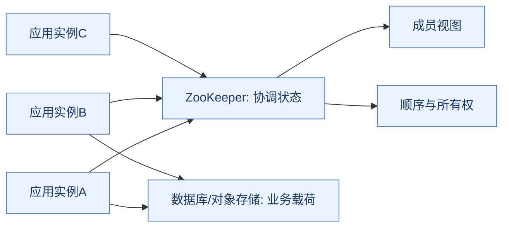

**读图抓手**：应用用协调结果指导业务，但业务数据不必流经ZooKeeper。协调状态正确也不代表外部数据库副作用自动正确。

### 1.2 为什么不只用数据库或缓存

| 方案 | 优点 | 需要自己补的机制 |
| --- | --- | --- |
| 数据库唯一约束/条件更新 | 与业务事务容易结合 | 成员探活、事件通知、会话与竞争顺序 |
| Redis原子命令/租约 | 快速、使用普遍 | 租约过期、切主丢写、旧持有者保护 |
| ZooKeeper协调原语 | 顺序更新、会话临时节点、Watch等配套 | 客户端状态机、恢复、外部资源隔离 |

ZooKeeper不是所有锁与注册场景的唯一答案。如果业务不变量本来就在数据库，一条条件更新可能比引入额外协调服务更容易证明；如果要求跨多个进程维护长期协调关系，配套会话与通知原语更有价值。

### 1.3 为什么不把大对象和高频业务日志放进去

数据树主要在内存中提供访问，更新又要进入有序复制链路。大节点、大量子节点、频繁变更与广泛监听都会影响整个协调服务。

ZooKeeper适合保存配置版本、成员信息、候选节点和少量状态，而不是大文件、全量商品详情或高吞吐事件历史。**可写入字节不等于适合作为业务载荷仓库。**

<a id="architecture"></a>

## 2. 架构演进：单机、投票集群与Observer

> 🎯 **从问题推导架构**
>
> **集群增加协调服务的故障冗余；Observer扩展服务能力而不扩大投票集合；它们都不是业务数据分片。**

### 2.1 单机为什么不满足协调高可用

单机可以让多个客户端共享一个顺序状态，但服务节点失效后，客户端就失去共同裁决点。磁盘保存了数据，也需要恢复进程和连接，无法等价于在线持续协调。

再加一个被动副本仍需决定失联时谁能接管，避免两个节点各自认为自己有效。这与Redis主从演进中的控制问题相似，但ZooKeeper把多数和有序历史作为协调协议的一部分。

### 2.2 Leader、Follower、Observer分别做什么

| 角色 | 服务客户端 | 更新路径 | 是否参与普通多数投票 |
| --- | --- | --- | --- |
| Leader | 可以 | 给写事务排序、组织广播与提交 | 是 |
| Follower | 可以，本地读 | 转发写入、接收提议并确认 | 是 |
| Observer | 可以，本地读 | 转发写入，接收已决定的更新 | 否 |

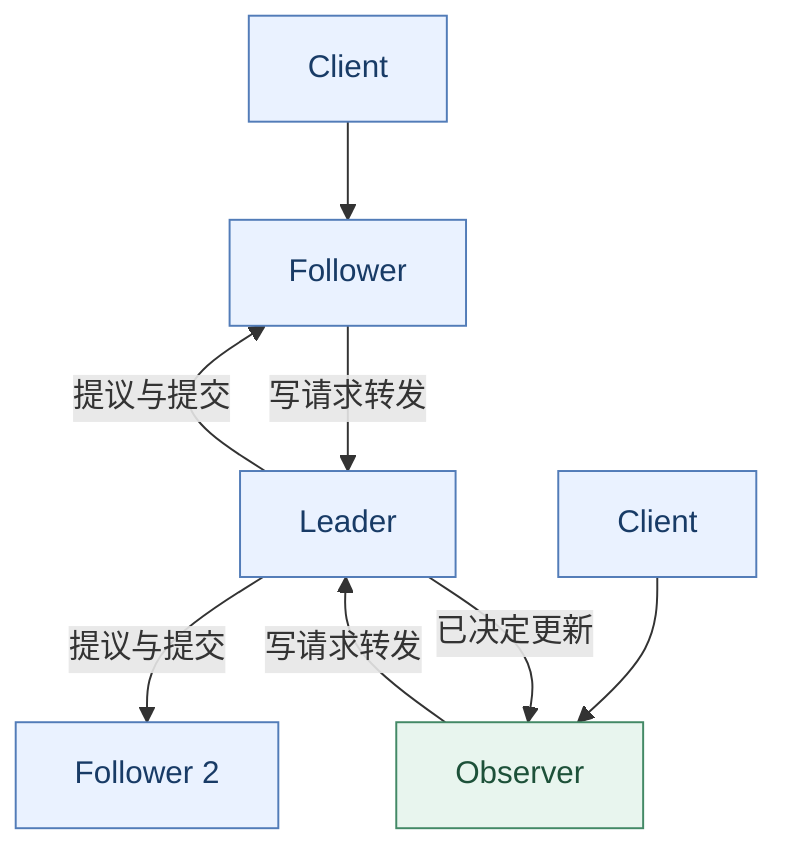

**读图抓手**：客户端不必先发现Leader再发所有请求；连接Follower/Observer也可以写，由服务端转发。与Kafka生产者直连分区Leader、Redis Cluster按槽路由的模型不同。

### 2.3 为什么常用3或5个投票节点

对普通多数quorum，投票节点数N需要 `floor(N/2)+1` 形成多数，可容忍 `floor((N-1)/2)` 个失效。

| 投票节点 | 多数 | 最多容忍失效 | 相邻规模的取舍 |
| --- | --- | --- | --- |
| 2 | 2 | 0 | 挂1个就失去多数 |
| 3 | 2 | 1 | 常见较小冗余集合 |
| 4 | 3 | 1 | 比3个多成本但未多容忍1个 |
| 5 | 3 | 2 | 多一层故障余量，也有复制和运维成本 |

奇数是多数成本的常见选择，不是协议禁止偶数。复杂层级/权重quorum不能直接套普通节点计数公式。

### 2.4 多数交集为什么重要

任意两个多数集合有交集，结合选举、历史比较和恢复规则，可以防止互相冲突的历史被当作有效提交延续。**交集只是安全推导的一部分，不是只数够机器就自动安全。**

网络分成3+2时，五节点普通集合的3节点侧可能继续推进，2节点侧不能独立形成新的合法写提交。已有连接、本地旧数据和只读模式行为还需单独讨论。

### 2.5 Observer为什么能扩读，却不能让写入无限扩展

增加投票者会增加协议传播和确认管理成本；Observer不进入投票集合，可以分担连接与读取，降低部分核心成员压力。

但Observer仍需获得和应用状态，写入仍由同一个Leader排序。加Observer不会把同一数据树拆成多份并行写，也不能把跨地域写延迟变成本地内存延迟。

所有节点仍维护相应完整状态，ZooKeeper ensemble（服务集合）不是Redis Cluster式哈希分片。数据规模超出单节点适用范围时，应减少载荷或划分独立协调域。[Observer设计](https://zookeeper.apache.org/doc/r3.9.4/zookeeperObservers.html)

<a id="data-model"></a>

## 3. 数据模型：znode为什么同时像文件和目录

> 🎯 **节点是协调对象**
>
> **路径、数据、版本、子节点、权限和所属会话共同组成状态，不能只把znode当字符串key。**

### 3.1 树形命名空间

```text
/app
├── config
│   └── active-version
├── services
│   └── payment
│       ├── instance-a
│       └── instance-b
└── locks
    └── order-1001
        ├── candidate-0000000001
        └── candidate-0000000002
```

znode可同时保存字节数据和子节点。父节点必须存在，不具备通用文件系统那种任意文件语义；子节点列表也不应被当作天然排序的业务队列。

节点数据通常应保持很小。接口和缓冲大小限制与版本/配置有关，不应通过单纯放大限制来容纳巨型配置和成千上万实例的一次性大响应。

### 3.2 节点生命周期与顺序属性

| 类型 | 生命周期/特征 | 适用与边界 |
| --- | --- | --- |
| Persistent | 不因创建会话结束自动删除 | 配置、目录、业务协调元数据 |
| Ephemeral | 绑定会话，会话结束后由服务端清理 | 在线成员、锁候选；不能直接当永久记录 |
| Sequential | 在指定路径前缀后追加顺序号 | 排队和候选排序；范围与父路径相关 |
| Ephemeral Sequential | 临时生命周期+顺序号 | 公平竞争、领导者候选 |
| Container | 用于协调容器的辅助清理 | 子节点清空后可能被回收，父路径需可重建 |
| TTL节点 | 满足时间和无子节点条件后可成为删除候选 | 需启用，不是精确定时器 |

Ephemeral节点不能有子节点。Persistent不代表永远不能被删除，只有“不因会话结束自动删除”这一层含义。

### 3.3 临时节点与TTL为什么不同

**TTL（Time To Live，生存时间）**节点按未修改时长等条件进入后台清理候选；临时节点按所属会话状态清理。持续连着的客户端也可能拥有TTL到期节点，断连客户端的临时节点则未必立即消失。

顺序号适合一个父目录中的竞争排序，不应直接包装成跨所有目录、跨删除重建和恢复都永久单调的全局业务ID。需要识别父节点生命周期与计数边界。

### 3.4 ACL与路径组织

**ACL（Access Control List，访问控制列表）**控制节点操作权限。权限检查按操作对象执行：创建/删除子节点涉及父节点权限，读写节点数据涉及对应节点权限等，不能仅用“能读父目录”推导全部权限。

ZooKeeper ACL不是默认递归继承模型。给父节点设置权限，不会自动让所有已有和未来子节点按同一策略继承；应用与框架需要显式管理。[数据模型与权限](https://zookeeper.apache.org/doc/r3.9.4/zookeeperProgrammers.html)

<a id="versions"></a>

## 4. zxid、version与epoch：位置、条件和任期

> 🎯 **三个维度不要混**
>
> **zxid（ZooKeeper Transaction ID，ZooKeeper事务标识）标识有序事务，节点version做条件更新，epoch区分领导任期；它们不是一个全局版本变量。**

### 4.1 zxid如何表达事务顺序

**zxid（ZooKeeper Transaction ID，ZooKeeper事务标识）**按事务历史有序推进。常见表示为64位，高32位对应Leader epoch，低32位对应该epoch内事务计数。

```text
zxid = [ Leader epoch: 高32位 ][ counter: 低32位 ]
例：0x00000005_00000012
    表示任期5中相应位置的事务，不是毫秒时间戳
```

它帮助比较日志历史和节点变更，不是每次读取都生成一条新事务。不能把zxid差值当精确业务请求数，因为事务类型和批处理等口径不同。

### 4.2 Stat中哪些字段重要

| 字段 | 含义 | 常用推导 |
| --- | --- | --- |
| czxid | 创建节点的事务标识 | 区分同路径删除后重建的实例 |
| mzxid | 最近数据修改事务标识 | 判断节点数据所属历史位置 |
| pzxid | 最近子节点集合变更的事务标识 | 成员视图发生变化的位置 |
| version | 数据变更版本 | setData/check的条件 |
| cversion | 子节点变更版本 | 不等于数据修改次数 |
| aversion | ACL变更版本 | 不等于数据版本 |
| ephemeralOwner | 临时节点所属会话 | 辅助判断节点所有权 |

路径相同不代表是同一个节点实例；version相同也不能覆盖删除重建带来的全部身份变化。复杂并发协议应明确节点身份与父目录生命周期。

### 4.3 CAS为什么比无条件覆盖安全

**CAS（Compare-And-Set，比较并设置）**让客户端带期望版本更新。两客户端都读到version=7，只有满足条件的修改能成功推进；另一个收到版本不匹配后必须重新读和判断。

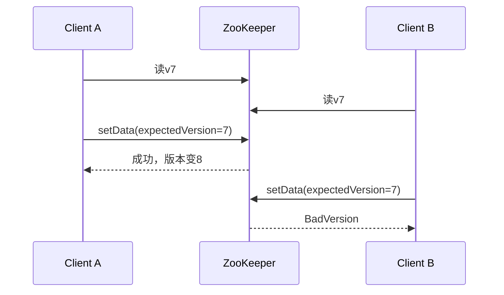

相较最后写覆盖，它避免部分丢失更新；代价是高竞争下失败和重试。版本检查不自动覆盖外部数据库写入，也不能将一个不再成立的业务条件原样重试。

### 4.4 multi是ZooKeeper内的原子操作组

`multi`可把检查、创建、修改、删除等操作组合作为一个原子事务：相应检查失败时整组不按部分成功方式生效。与Redis MULTI/EXEC运行期失败不自动回滚的语义不同。

但它只覆盖ZooKeeper状态，不能与MySQL或HTTP（Hypertext Transfer Protocol，超文本传输协议）调用自动组成同一事务；连接丢失后客户端仍可能不知道整组是否已经成功，需要按身份与最终状态恢复。

<a id="sessions"></a>

## 5. 会话：连接断开不等于所有权立即消失

> 🎯 **这是协调应用的生命线**
>
> **连接是当前通信通道，会话是可跨短暂重连维持的服务端状态。**

### 5.1 为什么会话要独立于TCP连接

**TCP（Transmission Control Protocol，传输控制协议）**连接会因抖动或服务器切换中断。如果每次连接断开都立刻删除临时节点，会让短暂网络问题触发大面积成员与锁变更。

会话允许客户端在协商的有效窗口内重连到集合中的其他服务器，恢复同一个协调身份。服务端按其规则判断会话过期，客户端不能仅凭本地超时断言会话还有效。

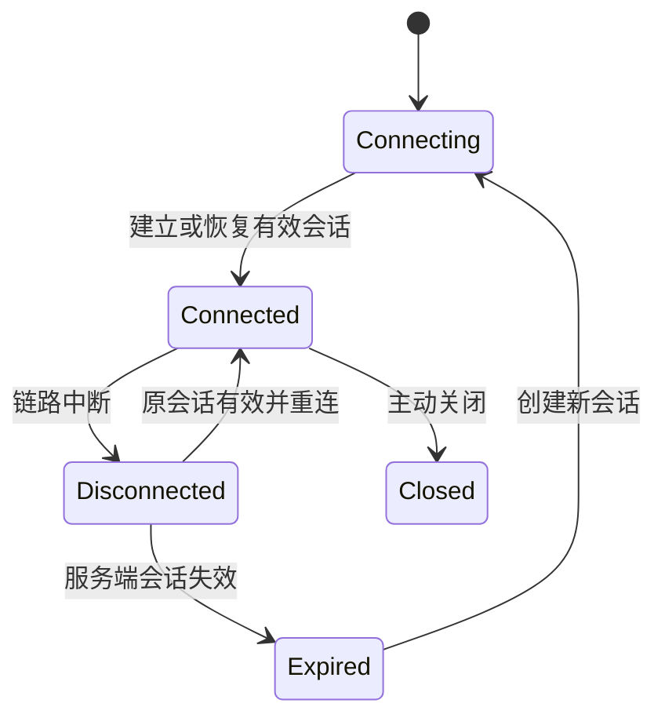

**读图抓手**：新会话不是原会话续命。原临时节点、旧锁所有权和旧状态不能直接沿用。

### 5.2 session timeout的收益与代价

超时短，失效检测和资源重新竞争可能更快，但更容易把暂时停顿、拥塞和长暂停转成会话失效；超时长则对短抖动更宽容，却让真正故障的成员更久占着临时资源。

客户端请求值会与服务端允许范围协商，不应只按一个客户端配置推断实际期限。会话失效与临时节点删除也不是由外部进程退出事件直接触发的即时回调。

### 5.3 GC暂停为什么可能导致旧执行者继续工作

**GC（Garbage Collection，垃圾回收）**或其他长暂停可能让客户端停止续会话。服务端判定过期并让其他竞争者接管后，旧进程仍可能恢复原业务线程。

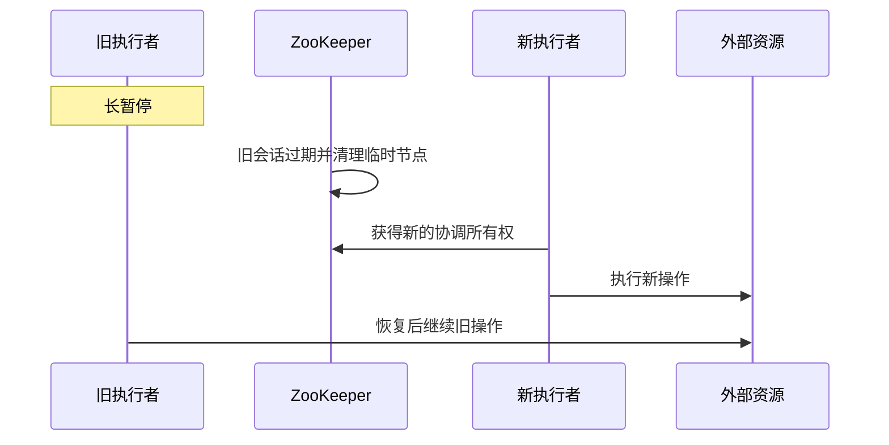

**会话清理能撤销ZooKeeper中的资格，不能自动杀死外部线程或撤回已经发出的网络请求。**严格资源保护需要外部版本、条件更新或fencing。

### 5.4 ConnectionLoss与SessionExpired处理不同

| 情况 | 能说明什么 | 应做什么 |
| --- | --- | --- |
| ConnectionLoss | 通信失败，写结果可能未知 | 恢复连接后按业务身份核实，避免盲重试 |
| SessionExpired | 不能再依赖旧会话身份 | 建立新会话并重新获取协调资格 |
| AuthFailed | 身份认证失败 | 修正身份/配置，不无限按网络错误重试 |

会话密码和身份用于协议恢复，应按敏感凭据管理。复制一个会话身份让多个进程随意并用，不是通用的“共享登录态”方案。[会话语义](https://zookeeper.apache.org/doc/r3.9.4/zookeeperProgrammers.html)

<a id="zab"></a>

## 6. ZAB：写入如何变成一致历史

> 🎯 **先明确提交条件**
>
> **Leader排序、投票成员确认与有序提交共同构成写入路径；不是主节点本地写成功就向集群宣告完成。**

### 6.1 为什么需要原子广播

两个客户端并发修改相同协调状态，不同副本如果按不同顺序执行，最终可能得到不同所有者。**ZAB（ZooKeeper Atomic Broadcast，ZooKeeper原子广播协议）**为更新提供可靠、有序的交付与恢复基础。

单Leader降低并发排序复杂度；与任意节点直接接受并独立提交的多主模型相比，更容易定义一致历史，代价是写排序集中且需要切主恢复。

### 6.2 正常广播路径

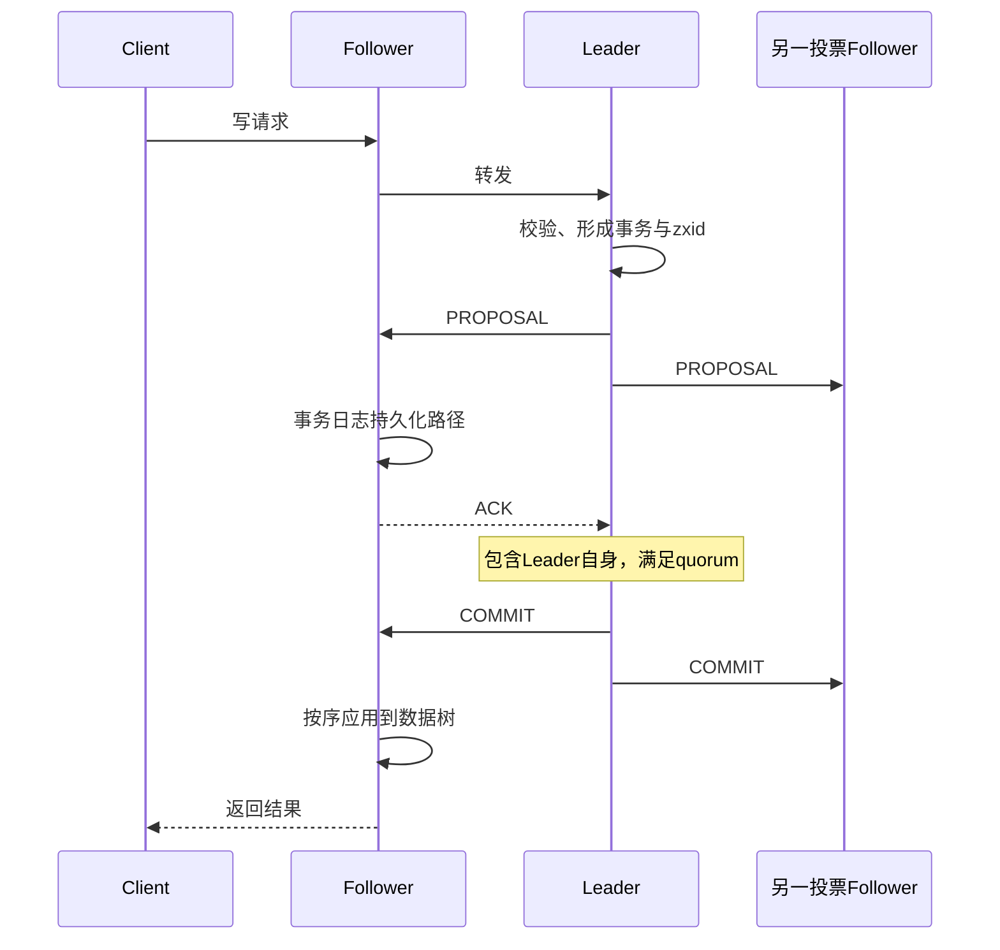

图省略批量、线程与Observer传播细节。**ACK（Acknowledgement，确认）**是协议确认，不是客户端业务数据库已提交的证明；默认可靠日志链路与磁盘配置也是安全假设的一部分。

### 6.3 为什么不等全部副本

等所有节点可以让慢副本无限拖住服务；仅Leader确认则在其失效后容易丢掉已宣布成功的历史。quorum（法定集合，常见为多数）允许部分故障并为恢复提供历史交集。

Observer不进入普通多数集合，不能用“2个投票者+3个Observer有5台，所以多数是3”计算容错。投票者与服务连接节点数量要分开。

### 6.4 ZAB与两阶段提交为什么不能等同

PROPOSAL/ACK和COMMIT的外观与两阶段流程相似，但ZAB针对复制状态机的有序日志和主节点恢复。传统 **2PC（Two-Phase Commit，两阶段提交）**协调不同事务参与者，其故障、阻塞与应用语义不同。

不能因为有“先准备、再提交”就把两套协议保障混在一起。ZooKeeper multi也不是自动替外部数据库实施2PC。[原子广播内部说明](https://zookeeper.apache.org/doc/r3.9.4/zookeeperInternals.html)

<a id="recovery"></a>

## 7. 选举、同步与恢复：新Leader不能只凭编号上任

> 🎯 **选出一个人还不够**
>
> **候选资格、历史对齐与建立新任期共同决定能否安全恢复写入。**

### 7.1 故障恢复需要解决什么

旧Leader失效时，有的节点已持久化提议，有的已收到提交，有的还没跟上。若随便选一台并立即接收新写，可能覆盖已提交历史或把冲突尾部当作有效记录。

恢复先建立可信的新领导关系，确定可延续历史，再让相关节点同步到有效状态后进入正常广播。**LOOKING不只是“正在ping别人”，也代表服务处于选举相关状态。**

### 7.2 选举比较哪些信息

常见Fast Leader Election（快速领导者选举）比较候选的peer epoch、最后事务zxid以及server ID等，以选择适合延续历史的候选，并按选举轮次处理消息。

| 信息 | 用途 | 不能混成什么 |
| --- | --- | --- |
| peer epoch | 候选的历史任期信息 | 不是客户端会话版本 |
| last zxid | 比较日志历史位置 | 不是节点业务负载 |
| server ID | 历史比较相同时的确定性次序 | 不是永远编号最大者优先 |
| election epoch/逻辑轮次 | 区分选举阶段消息 | 不等于zxid中所有任期字段的同义词 |

这是理解规则的入口，不是只比较一个三元组就能忽略协议状态和quorum条件。启动与故障选举也不能机械背成同一串编号演示。

### 7.3 历史同步为什么有多种方式

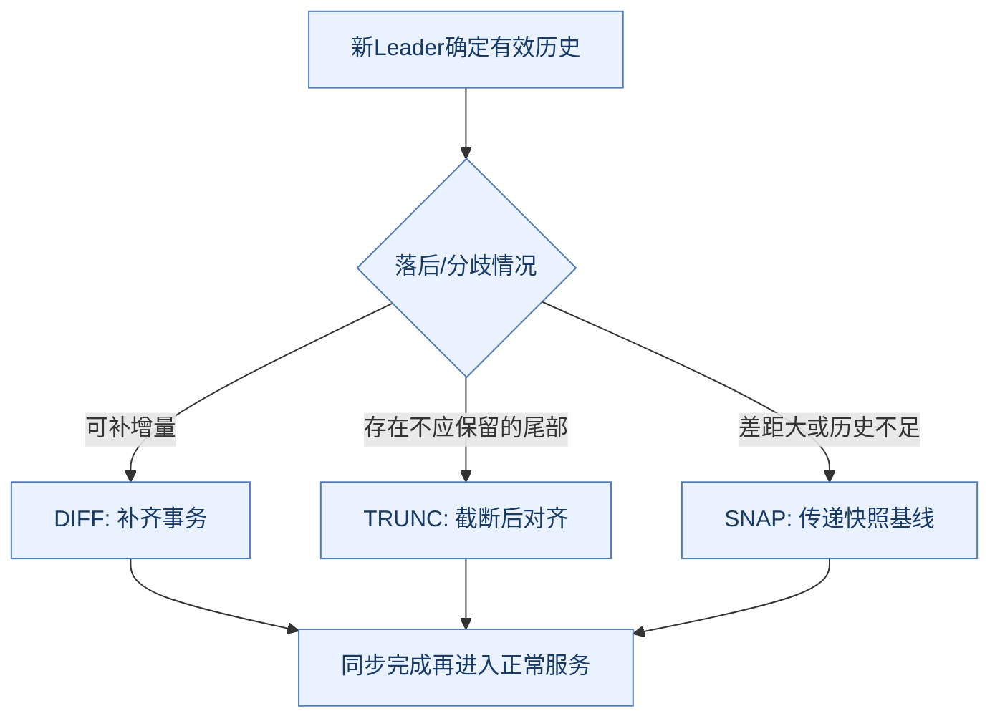

增量减少全量复制成本；截断删除分歧尾部；快照帮助历史不足的节点追赶。选择依具体状态和版本实现，不能把每次重连都等同于全量同步。

### 7.4 已提交与未提交记录如何判断

在协议与持久化假设满足时，恢复要保留已提交的有效历史。但某条请求未向客户端返回成功，不代表它最终一定不存在；它可能已被提交，只是响应丢失。

同样，不能一概说“所有曾经未提交的提议必然删除”。恢复如何延续提议由新历史和协议阶段决定。**客户端只能知道收到的结果，不能用没收到成功替代服务端事务事实。**

### 7.5 为什么多数规则还需要任期和日志规则

只凭一个瞬间多数在线不足以阻止旧消息、旧Leader和冲突历史。任期用于隔离过期领导关系，有序历史用于判断可延续前缀，quorum提供交集。

选举完成也不意味着每个客户端下一毫秒都恢复：服务器同步、会话恢复、Watch重建与业务资格重获会继续影响恢复时间。

<a id="consistency"></a>

## 8. 一致性：写全序不等于所有读都最新

> 🎯 **最容易被口号掩盖的边界**
>
> **普通读可由连接服务器本地完成；“ZooKeeper协调一致”不能翻译成每次getData都读取全局实时最新值。**

### 8.1 写与读为何采用不同路径

写入需要在集群形成一致顺序，而读本地状态可以减少每次都经Leader或quorum的成本。收益是读吞吐和延迟；代价是不同客户端可能在不同时间看到不同进度。

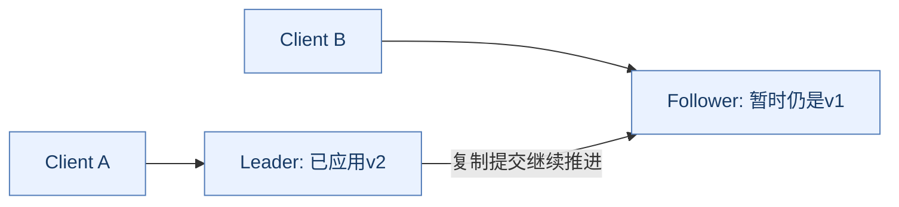

在官方文档所描述的模型中，**写操作是线性一致的，而普通读不提供同样的全局最新读保证**。不能因写入可以全序，就把读语义抬高到相同强度。

因此讨论一致性应分：更新顺序、单客户端操作顺序、读自己写、跨客户端新鲜度、外部业务不变量，而不是只给产品贴一个词。

### 8.2 会话顺序与跨客户端观察

同一客户端的请求顺序和已观察状态有相应保证；不同客户端通过外部消息通信时，不能无条件假设读到同一进度。新建独立会话也不能不加条件继承另一个会话的一切观察历史。

例如A完成配置更新后，通过HTTP告诉B“已更新”。B连接另一台较落后服务器读取，不能仅凭那条外部通知推导普通本地读必定立即看见新值。

### 8.3 sync有什么用，为什么仍不能夸大

`sync`后再读是常见的推进观察进度模式，但**官方内部文档明确指出，sync并非quorum操作，不能严格证明任意故障情形下的全局最新读取**。

需要协调判定时，应优先用条件写、节点身份/版本和相应原子协议判断资格，而不是把一次普通读包装成“绝对实时真相”。[一致性与sync边界](https://zookeeper.apache.org/doc/r3.9.4/zookeeperInternals.html)

### 8.4 CAP中的一致性与单节点原子性不同

**CAP（Consistency, Availability, Partition Tolerance，一致性、可用性与分区容错）**讨论网络分区中的约束。ZooKeeper更新在失去所需quorum时不能继续按正常安全路径提交，是理解其取舍的重点。

但是“常被归为偏一致性的协调服务”不等于所有普通读都是线性一致。只读模式如果启用，又可能向支持该模式的客户端提供陈旧读取；业务要知道自己是否处于只读连接，不能继续执行依赖最新所有权的操作。

<a id="watches"></a>

## 9. Watch：变化提示，不是可靠事件日志

> 🎯 **用事件驱动重新读取状态**
>
> **Watch适合告诉客户端“需要重新核实”，不适合记录每一次业务变化。**

### 9.1 为什么不用固定周期轮询所有节点

频繁轮询简单，但没有变化时也持续付出请求和响应成本；降低频率又增加发现延迟。Watch在读取/检查时注册兴趣，变更后由服务端通知，减少无效查询。

| 模型 | 优势 | 代价 |
| --- | --- | --- |
| 固定轮询 | 恢复逻辑直观，天然可重新取当前状态 | 请求开销与发现延迟冲突 |
| Watch通知再回读 | 对低频变化高扇出场景减少空读 | 注册、重连、回调与视图恢复复杂 |
| 持久事件日志 | 可逐事件回放与追进度 | 需要历史保留与消费确认模型 |

Watch不提供消息队列式的永久历史、独立消费位移与任意断线回放。事件中的路径和类型也不等于变化后的完整数据。

### 9.2 标准Watch的触发规则

| 注册接口 | 观察内容 | 典型事件 |
| --- | --- | --- |
| exists | 是否存在及相关状态变化 | 创建、删除、数据变化 |
| getData | 节点数据 | 数据变化、节点删除 |
| getChildren | 直接子节点集合 | 子节点集合变化、父节点删除 |

`getChildren`监听父目录，不等于递归监听所有后代数据变化。`getData`作用于不存在节点会失败，等待一个尚未出现的节点通常需要exists。

### 9.3 一次性Watch为什么会漏掉中间状态

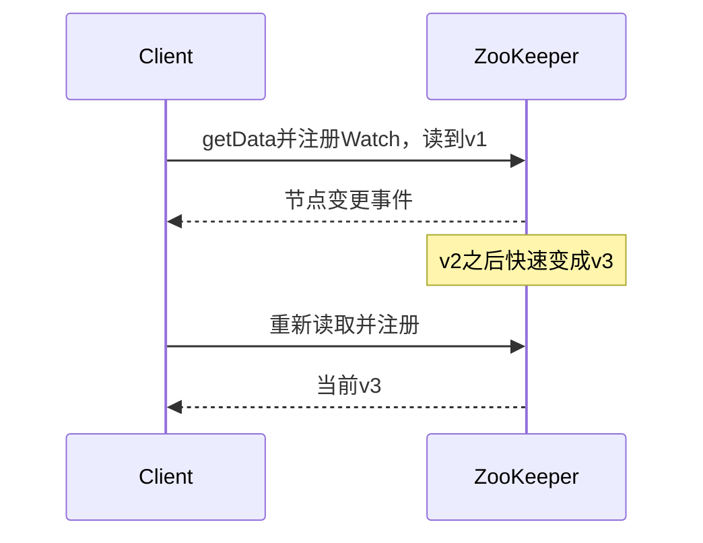

**读图抓手**：客户端可以重新得到当前状态，但不保证看到每个中间版本。注册与读一起进行有助于降低手工“先读后注册”的竞争窗口，却不会把Watch变成逐事件审计。

### 9.4 重连、持久Watch与递归Watch

3.6引入Persistent Watch和Persistent Recursive Watch，事件触发后无需按标准一次性模式重新注册；递归变体覆盖相应子树事件。持久递归模式的事件类型也与标准父目录监听不同。

“持久”描述注册生命周期，不等于服务器为离线客户端保留无限事件历史。会话失效后要按新会话重新建立需要的状态；断连期间短暂创建又删除的节点等情况不能凭普通Watch保证完整观察。

恢复通常是**重建观察 → 回读当前视图 → 按版本/身份协调并发结果**。不能只等下一次事件修复本地陈旧缓存。

### 9.5 回调为什么要快

客户端Watch事件处理通常有顺序分发边界。回调里做阻塞锁获取、慢数据库调用或长计算，可能堵住后续通知甚至形成依赖死锁。

可将业务工作交给受控执行器，但还需保证同一状态的顺序、去抖、幂等和容量限制。无限线程池只是把事件队列变成另一个无界队列。[Curator Watch回调说明](https://curator.apache.org/docs/tech-note-01/)

<a id="recipes"></a>

## 10. 分布式锁、领导者选举与屏障

> 🎯 **配方建立在原语之上**
>
> **临时节点表达会话资格，顺序节点表达竞争顺序，Watch避免忙等；外部资源仍需要自己的保护。**

### 10.1 为什么用临时顺序节点排队

在锁目录下创建临时顺序候选，读取并按正确规则排序候选；最前者获得锁，其他候选通常只监听自己的直接前驱，前驱离开后重新检查。

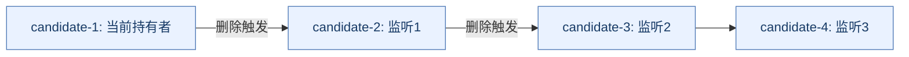

与所有等待者监听同一锁节点相比，前驱监听减少每次释放唤醒所有人的**惊群**。代价是管理候选节点、排序与竞争状态。

### 10.2 前驱消失的竞争窗口怎么处理

读取候选列表后，前驱可能在设置Watch前已被删除。此时exists结果为空，应立即重查自身位置，而不是等一个永远不会来的删除事件。

```text
创建并确认自己的候选身份
循环：
    读取候选集合并排序
    若自己是当前最前候选：进入有条件的业务资格
    否则：对直接前驱执行exists并注册Watch
          若前驱已不存在：立即重新检查
          若前驱仍存在：等待事件后重新检查
会话失效或取消：终止旧资格并清理/恢复状态
```

事件唤醒后仍要检查，不应把“收到一次删除事件”直接当作永久持锁证明。

### 10.3 创建超时为什么需要可恢复身份

临时顺序create可能已经成功，但响应丢失。直接重试会创建第二个候选，造成重复排队或遗留状态。

给请求加入可识别的唯一标识，重连后检查相应候选，才能区分重试与原成功。通用重试框架不能代替每种非幂等操作的恢复设计。[官方锁配方](https://zookeeper.apache.org/doc/r3.9.4/recipes.html)

### 10.4 ZooKeeper锁为什么也需要fencing

会话过期后，临时候选被清理，新竞争者可获锁，但旧持有者的线程仍可能恢复。**fencing token（隔离令牌）**需要外部资源检查并拒绝过期所有者写入。

顺序号、zxid或其他令牌能否直接用，取决于作用域、父目录重建、集群恢复与令牌比较规则。不能抽出任意整数就声称跨所有恢复都永久单调。

**锁服务约束谁获得资格，资源服务约束谁的写入最终被接受。**这是与Redis租约锁比较时必须交代的共同边界。

### 10.5 领导者选举与锁有何关系

应用层领导者候选可用临时顺序节点选择一个活跃执行者，失败后其他候选接替。但这是**应用角色选举**，与ZooKeeper服务器内部的Leader选举不是同一协议层。

领导资格变化还要停止旧定时任务、更新路由和保护外部写。收到选中回调不等于初始化已完成，断连不等于下一位立即能无缝接管。

### 10.6 读写锁、信号量与屏障的成本

读写锁需要区分读写候选并设计前驱依赖；信号量限制有效资格数量；屏障让参与者等到某个条件共同推进。它们都需要明确会话失效、成员数量、取消和超时恢复。

使用ZooKeeper实现队列是可行配方，不等于它适合高吞吐、长保留消息平台。一个根目录下无界创建和删除大量任务会让数据树与Watch成为负担。

<a id="discovery"></a>

## 11. 服务注册与配置管理

> 🎯 **服务端视图不等于业务健康全貌**
>
> **临时节点表达会话存续，配置Watch表达状态变化，两者都需要客户端恢复与应用判断。**

### 11.1 注册发现怎样建立本地视图

服务实例用临时节点注册地址和少量元信息，消费者读取成员并注册Watch，本地选择可用实例；变更事件后重新构建视图。

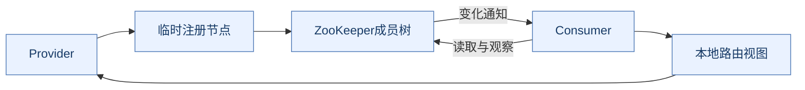

消费者通常直接访问业务实例，ZooKeeper不是业务流量代理。注册信息存在也不代表业务线程池、数据库或某个接口健康；会话仍可续，但服务实际可能过载。

### 11.2 为什么断连时不能无限相信本地缓存

消费者缓存成员可在短暂协调故障中继续发请求，提高可用性，但会失去新的成员变更。需要按场景定义继续使用、主动健康探测、降级或停止某类敏感决策。

重连后应重建完整当前视图，不把“收到RECONNECTED”当作所有旧缓存都已自动正确。成员身份还应区分同地址重启或同路径重建。

### 11.3 配置为什么需要版本与发布协议

只把一大段配置setData写入并广播变化，可能让不同应用在不同时间生效；有的加载成功，有的解析失败，回滚也可能与新发布竞争。

可将不可变配置版本与active-version指针分开：先准备完整版本并验证，再用条件更新切换指针，客户端按版本拉取和应用。旧版本保留用于回退，但仍需定义多实例生效窗口和兼容要求。


**原子切换指针不等于所有应用同一时刻切换内存状态。**需要全局同时变更的业务，应增加相应发布协调，而不是只调用一次setData。

<a id="persistence"></a>

## 12. 事务日志、快照与重启恢复

> 🎯 **内存树不代表只保存在内存**
>
> **事务日志保护更新历史，快照缩短重建路径，恢复要同时考虑文件和集群有效历史。**

### 12.1 为什么不每个更新都重写整棵树

整树落盘对小修改成本过大；追加事务日志更适合持续写入。只追加日志又会让启动重放越来越久，所以周期性快照保存恢复基线。

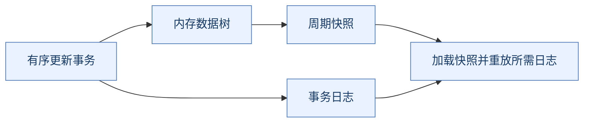

ZooKeeper快照可以是处理更新期间的fuzzy snapshot（模糊快照），不应当作某一瞬间完全停止写入后拍出的数据库快照；恢复需要配套事务日志及协议规则。

### 12.2 为什么磁盘慢会拖慢协调写入

日志持久化在可靠写入链路中占有位置，设备延迟、排队和共享磁盘争用会传导到确认与提交。批量刷写摊薄开销，却不能消除设备瓶颈。

为了压测数字关闭可靠持久化约束，不能再沿用原来故障模型下的安全结论。应先分解客户端往返、排队、日志同步和Follower确认的成本。

### 12.3 日志清理与备份恢复为什么不能随意删文件

恢复基线需要相应日志延续，单看文件“很旧”不足以判断可删除。按版本保留与清理机制管理日志/快照，并验证独立备份能够恢复。

副本会复制误删除和错误配置，不能替代独立历史备份。集群整体恢复还可能使外部系统观察到的历史与令牌假设发生变化，要把业务恢复和fencing来源一起评估。[快照与恢复说明](https://zookeeper.apache.org/doc/r3.9.4/zookeeperSnapshotAndRestore.html)

<a id="curator"></a>

## 13. Curator与客户端错误恢复

> 🎯 **框架降低重复实现，不取消协议边界**
>
> **重试、连接恢复、所有权恢复与业务幂等是四件事。**

### 13.1 为什么直接用原生API容易出错

应用要处理连接状态、异步结果、Watch重建、create结果未知、取消和清理。Apache Curator提供框架与常见协调配方，帮助统一这些复杂模式。

但框架不能判断任意数据库操作是否能重做，也不能自动知道旧业务线程是否仍在工作。选择配方前需要理解其契约和连接状态处理。

### 13.2 CONNECTED、SUSPENDED、LOST、RECONNECTED

| Curator状态 | 应理解的业务含义 |
| --- | --- |
| CONNECTED | 已建立连接，仍需完成应用初始化 |
| SUSPENDED | 无法正常依赖当前通信，应暂停需要协调保证的敏感工作 |
| LOST | 不再依赖旧会话资格，需要重获相应资源 |
| RECONNECTED | 通信恢复，不等于旧资格和本地视图都已自动恢复 |
| READ_ONLY | 按具体模式可读，不能按正常可写协调路径处理 |

不要只在LOST停业务：断连不确定期间，旧资格可能已失效但本地尚未获知。具体策略可按安全性与可用性需求区分，并结合资源侧隔离。

### 13.3 可重入锁和资源清理

`InterProcessMutex`等配方有自己的线程与重入契约；成功获取后，应平衡释放次数，并明确超时未获取时不能执行临界区。重入是某种客户端/线程所有权规则，不是任意进程共享资格。

回调中阻塞等待依赖其他Watch的锁可能死锁；业务工作应从通知分发中解耦，并限制队列规模。[Curator锁](https://curator.apache.org/docs/recipes-shared-reentrant-lock/)、[错误处理](https://curator.apache.org/docs/errors/)

### 13.4 一个可审查的业务状态机

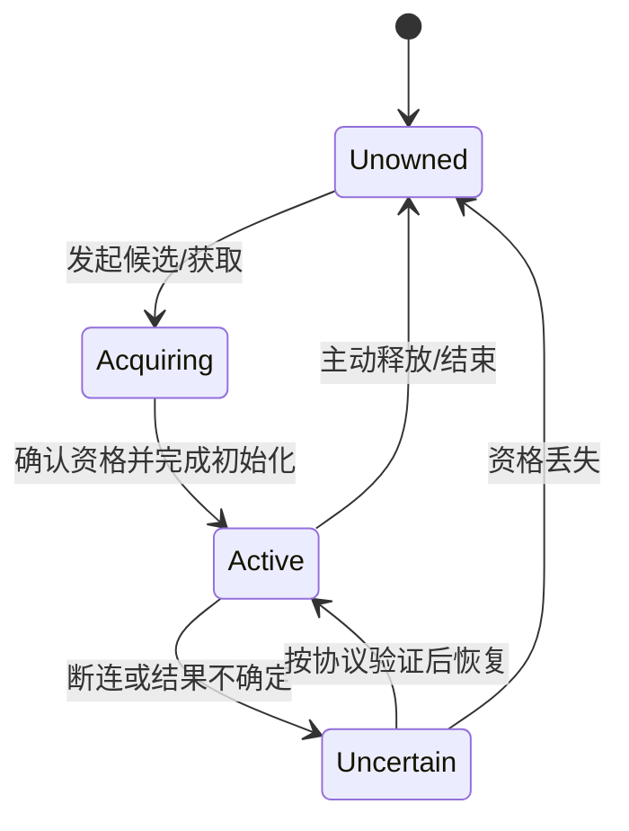

关键不是把所有异常catch后继续运行，而是定义哪些状态允许外部写入、哪些必须暂停、怎样识别旧请求和完成恢复。

<a id="operations"></a>

## 14. 性能、可观测性与权限边界

> 🎯 **协调慢常常是放大效应**
>
> **大数据、大扇出、重连风暴与慢磁盘，会将少量状态变化放大为全系统压力。**

### 14.1 容量为什么不只看节点数据大小

应同时计入路径与Stat对象、子节点、ACL、会话、Watch、连接缓冲和日志/快照开销。大父目录导致getChildren响应大，数据少但Watch很多也会占资源。

节点数均匀不代表负载均匀；一个所有客户端都监听的根目录可能放大通知与回读。缩小监听范围、合并变更与有界重试，比盲目增加投票者更有针对性。

### 14.2 连接风暴为什么会拖慢会话恢复

同一时刻大量客户端失联重连，会竞争连接、认证、会话恢复、Watch重设与数据回读资源。固定间隔同步重试还会让波峰重复出现。

退避与抖动、有限并发、分层恢复、合理超时与客户端复用有助于降低压力。但“调大session timeout”同时延长真正故障的资格清理，不能只看成功率改善而忽视恢复语义。

### 14.3 监控与健康检查要分层

| 信号 | 回答的问题 | 不能替代什么 |
| --- | --- | --- |
| 进程存活/端口响应 | 服务器是否接受连接 | 是否已加入有效quorum |
| Leader/Follower/Observer状态 | 当前角色与成员同步 | 客户端资格是否恢复 |
| 请求延迟与未完成请求 | 排队/执行是否拥堵 | 所有网络与业务耗时 |
| 同步成员与日志/磁盘延迟 | 提交和恢复是否受阻 | 独立备份有效性 |
| 会话、Watch与连接数量 | 是否泄漏或存在风暴 | 业务成员真实健康 |

`ruok`返回`imok`主要说明进程处于相应可响应状态，不能据此证明集群可正常提交。四字命令白名单与AdminServer行为还取决于版本和配置。

### 14.4 安全性与命名空间

**SASL（Simple Authentication and Security Layer，简单认证与安全层）**、认证身份、ACL和**TLS（Transport Layer Security，传输层安全协议）**分别涉及身份、授权与链路保护，不能仅配置其中之一就认为所有路径都已保护。

连接串chroot提供相对命名空间便利，不等于独立资源或权限隔离。多租户还要明确谁可创建目录、删除候选、改配置或调整成员。[管理与观测](https://zookeeper.apache.org/doc/r3.9.4/zookeeperAdmin.html)

### 14.5 时间参数为什么属于不同层次

| 概念 | 主要作用 | 不能替代什么 |
| --- | --- | --- |
| tickTime | 服务端基础时间粒度，多种时限以其为单位 | 客户端单次业务调用预算 |
| session timeout | 客户端会话有效性，存在协商范围 | TCP断开时刻或外部业务任务超时 |
| initLimit | 跟随节点初始化/同步相关的tick预算 | 业务请求重试次数 |
| syncLimit | 正常跟随与同步相关的tick预算 | 客户端锁租约或任意全链路截止时间 |
| 应用等待超时 | 调用方愿意等待结果多久 | 服务端是否已经完成事务的证明 |

网络慢、磁盘慢、长GC都可能表现为连接或同步异常，但它们需要不同证据。把所有时限调大可能减少短暂抖动导致的失败，也会延长真正故障的发现与资格接管；应先确定是哪一层没有推进。

<a id="releases"></a>

## 15. 版本演进与相关生态

> 🎯 **旧教材结论需要带版本**
>
> **“Watch永远一次性”“成员只能静态改”“所有节点只有四种组合”都不能无条件覆盖现代版本。**

### 15.1 代表性演进

| 范围 | 代表能力 | 对原理学习的影响 |
| --- | --- | --- |
| 传统基础模型 | 持久/临时、顺序、会话和标准Watch | 仍是理解配方的主线 |
| 3.5系列 | 动态重配置、Container、TTL等逐步引入 | 成员变化与节点类型不能只背旧表 |
| 3.6起 | Persistent与Persistent Recursive Watch | 一次性是标准Watch语义，不是所有Watch |
| 3.8/3.9系列 | 持续修复、管理、安全与性能演进 | 服务器、客户端、JDK与补丁需一起核对 |

TTL节点3.5.3加入，默认需相关功能启用，且满足条件后进入删除候选，不是精确延时触发。Persistent Watch从3.6.0引入，不表示提供永久事件回放。[节点与Watch版本说明](https://zookeeper.apache.org/doc/r3.9.4/zookeeperProgrammers.html)

### 15.2 动态重配置为什么不是直接改节点数量

成员变化改变quorum定义，若每台机器各自随意加载一个不同集合，可能破坏交集与有效领导关系。动态重配置将成员变更纳入一致协议，管理新旧配置的合法演进。

它减少静态改配置和滚动操作的复杂度，但仍要核对启用、权限、兼容和实际成员健康；不能将客户端连接串加一个地址当成完成服务端成员变更。[动态成员设计](https://zookeeper.apache.org/doc/r3.9.4/zookeeperReconfig.html)

### 15.3 发布状态如何阅读

按2026-11-08核验的官方发布页，3.9.7被标为Current，3.8.8被标为Stable；3.7已标记结束维护。这里的标签是项目发布策略，不意味着“较新一定风险更低”或“同一分支任意旧补丁都适合继续使用”。

正文固定参考3.9.4机制文档，实际选择补丁、JDK（Java Development Kit，Java开发工具包）与升级路径应核对对应发布说明；测试重点包括会话、Watch、认证、客户端兼容、恢复与协调配方。[官方发布页](https://zookeeper.apache.org/releases/)、[官方新闻](https://zookeeper.apache.org/news/)

### 15.4 与Redis、Kafka、etcd比较时先比较模型

| 对象 | 核心模型 | 对比重点 |
| --- | --- | --- |
| ZooKeeper | 会话、树形协调状态、有序更新与Watch | 成员/资格/配方与客户端恢复 |
| Redis | 内存数据结构、可选持久化与复制 | 低延迟状态、缓存、租约及故障窗口 |
| Kafka | 分区日志与独立消费进度 | 高吞吐事件保留和流式处理 |
| etcd | 基于Raft的版本化键值协调模型 | [读取与Watch契约](https://etcd.io/docs/v3.6/learning/api_guarantees/)需独立核对 |

不能只把Redis说成“AP”、ZooKeeper说成“CP”就结束，也不能把ZooKeeper Watch当Kafka消费日志。比较应说明新鲜度、历史保留、故障假设、规模和客户端契约。

Kafka迁移到KRaft，说明其元数据管理采用内置共识路径，不代表所有外部业务都不再需要协调服务，也不代表ZooKeeper自身失去全部适用场景。

## 附录 A：故障推演清单与官方资料

| 推演 | 应能解释的结果 |
| --- | --- |
| create成功但响应丢失 | 结果未知，需要可恢复身份而非盲创建第二候选 |
| 断连但会话未过期 | 临时节点不必立即消失，应用资格应谨慎处理 |
| 会话失效后旧线程恢复 | ZooKeeper资格已变，外部副作用仍需隔离 |
| 前驱在监听前删除 | exists为空应重查，不能等待已错过的事件 |
| 标准Watch两次注册间多次修改 | 当前状态可恢复，中间事件不保证全部可见 |
| Leader在提议传播时失效 | 选举、历史同步与新任期后再继续，客户端结果可能未知 |
| 五投票节点分裂为3+2 | 普通多数侧可满足提交条件，少数侧不能独立提交新写 |
| 普通读连接落后服务器 | 不能无条件断言读到全局最新值 |

- [Programmer's Guide：节点、会话、权限、Watch](https://zookeeper.apache.org/doc/r3.9.4/zookeeperProgrammers.html)
- [Internals：广播、恢复与一致性](https://zookeeper.apache.org/doc/r3.9.4/zookeeperInternals.html)
- [Overview：定位与保障](https://zookeeper.apache.org/doc/r3.9.4/zookeeperOver.html)
- [Recipes：锁、选主、屏障等配方](https://zookeeper.apache.org/doc/r3.9.4/recipes.html)
- [Observers](https://zookeeper.apache.org/doc/r3.9.4/zookeeperObservers.html)与[动态重配置](https://zookeeper.apache.org/doc/r3.9.4/zookeeperReconfig.html)
- [Admin Guide](https://zookeeper.apache.org/doc/r3.9.4/zookeeperAdmin.html)与[快照恢复](https://zookeeper.apache.org/doc/r3.9.4/zookeeperSnapshotAndRestore.html)
- [Curator错误处理](https://curator.apache.org/docs/errors/)与[锁配方](https://curator.apache.org/docs/recipes-shared-reentrant-lock/)

<a id="glossary"></a>

## 附录 B：术语与缩写

| 术语/缩写 | 英文全称或原词 | 中文与边界 |
| --- | --- | --- |
| ZK | ZooKeeper | 协调服务的常用简称 |
| znode | ZooKeeper data node | 数据树中的协调节点，不是服务器实例 |
| ZAB | ZooKeeper Atomic Broadcast | 有序原子广播协议，不是任意业务2PC |
| zxid | ZooKeeper Transaction ID | 事务历史标识，不是毫秒时钟 |
| epoch | Epoch | 任期/轮次，需区分peer、选举轮次等上下文 |
| quorum | Quorum | 法定集合；普通部署常用多数，特殊配置规则不同 |
| ensemble | Ensemble | ZooKeeper服务集合，不是数据分片集合 |
| FLE | Fast Leader Election | 快速领导者选举，比较历史与资格而非只比编号 |
| ACK | Acknowledgement | 协议确认，不等于外部业务完成 |
| CAS | Compare-And-Set | 比较并设置，version支持的乐观条件操作 |
| ACL | Access Control List | 访问控制列表，不自动递归继承 |
| TTL | Time To Live | 生存时间，节点进入删除候选而非精确定时 |
| TCP | Transmission Control Protocol | 传输控制协议，连接与会话不同 |
| FIFO | First In, First Out | 先进先出，须明确作用于哪个通道/操作序列 |
| 2PC | Two-Phase Commit | 两阶段提交，不与ZAB混为一谈 |
| GC / JVM | Garbage Collection / Java Virtual Machine | 垃圾回收/Java虚拟机，长暂停影响会话 |
| CAP | Consistency, Availability, Partition Tolerance | 一致性、可用性、分区容错，不能简化普通读语义 |
| SASL / TLS | Simple Authentication and Security Layer / Transport Layer Security | 认证框架/传输层安全协议 |
| API / ID | Application Programming Interface / Identifier | 应用编程接口/标识符 |
| HTTP | Hypertext Transfer Protocol | 超文本传输协议，外部通知不自动约束ZK读进度 |
| JDK | Java Development Kit | Java开发工具包，按目标版本验证兼容 |
| DIFF / TRUNC / SNAP | Difference / Truncate / Snapshot | 增量、截断与快照相关恢复消息语义 |
| fencing token | Fencing Token | 由外部资源识别过期资格的隔离令牌 |
| Watch | Watch | 状态变化观察机制，不是可靠业务事件日志 |
