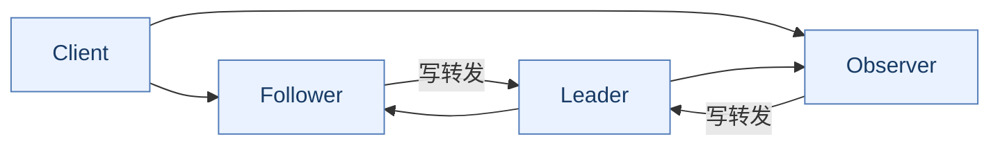
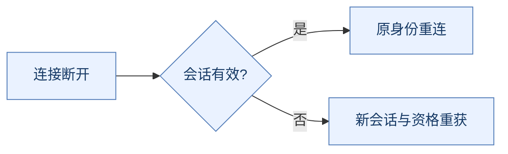
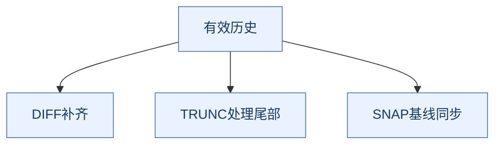
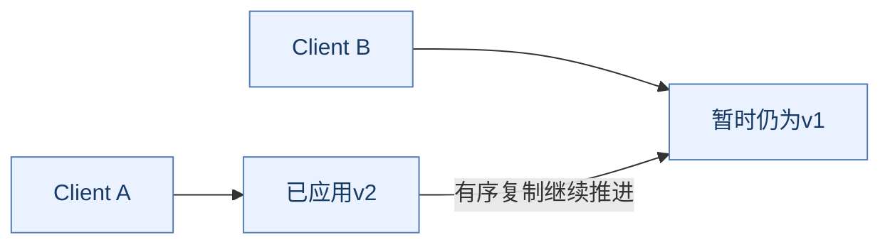
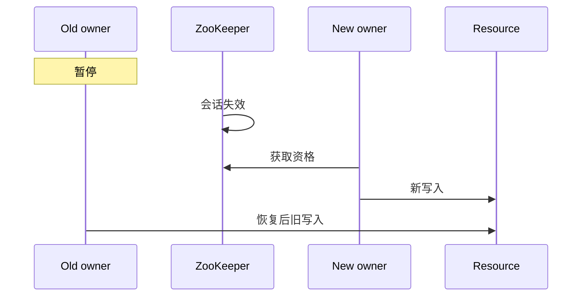
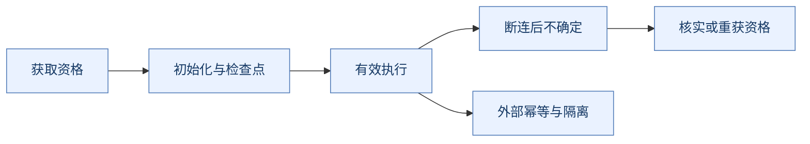

# ZooKeeper 面试：架构演进、协议推导与故障边界

> **使用方式**：先复述一句话结论，再按“为什么需要 → 实现 → 对比 → 失败时怎样”展开。完整机制见 [ZooKeeper原理.md](ZooKeeper原理.md)。
>
> **版本口径**：以3.8/3.9系列为主，固定机制参考3.9.4文档，历史能力标注版本。缩写正文解释，文末提供[术语附录](#glossary)。

## 复习导航

| 阶段 | 题目 | 训练目标 |
| --- | --- | --- |
| **先讲模型** | Q1～Q12 | 角色、quorum、数据树和版本 |
| **再讲协议** | Q13～Q23 | 会话、提交、选举恢复和读一致性 |
| **重点推演** | Q24～Q34 | Watch、锁、注册、配置的竞争与恢复 |
| **补全实践边界** | Q35～Q44 | 框架、观测、版本、只读与业务设计 |

---

## 一、定位与架构演进

**本篇重点**：先解释协调问题，再区分完整复制、投票与Observer扩展。

### Q1：ZooKeeper是什么，为什么不是通用数据库？

> **一句话结论**：ZooKeeper保存少量关键协调状态，帮助进程就成员、顺序和资格形成约定。

**机制展开**：业务关心谁在线、谁有资格执行、配置生效到哪个版本，数据未必大但影响范围大。数据树、会话、有序更新和Watch共同服务这些问题。

**⚖️ 方案对比与代价**：数据库条件更新适合业务本地不变量，Redis适合快速状态；ZooKeeper不适合大对象或高吞吐业务历史，不能只按有GET/SET类API（Application Programming Interface，应用编程接口）比较。

**🔎 追问演练**：服务注册还要把所有业务请求经ZooKeeper转发吗？

**推演要点**：通常不需要，应用得到地址后直连服务，协调路径与业务数据路径分开。

**原理展开**：[对应章节](ZooKeeper原理.md#coordination)。

---

### Q2：Leader、Follower和Observer有什么区别？

> **一句话结论**：三者都可承接客户端，Leader排序写，Follower参与相应投票，Observer不进入投票集合。

**机制展开**：连接Follower/Observer的写会转发到Leader，普通读可用本地状态。Observer接收已决定更新，不承担同样的投票确认角色。

**⚖️ 方案对比与代价**：增加Observer可分担连接和读，但仍要同步数据；增加投票者则影响quorum与复制开销，两者不能按总机器数混算。

**🔎 追问演练**：连接Observer能不能写？

**推演要点**：可以由它转发，但不是Observer自行决定提交，也不会让写排序变为多主。

**原理展开**：[对应章节](ZooKeeper原理.md#architecture)。

---

### Q3：为什么常用奇数节点，3和5分别容错多少？

> **一句话结论**：普通多数集合下，3节点需2个，容忍1个失效；5节点需3个，容忍2个。

**机制展开**：多数floor(N/2)+1使不同合法集合有交集，结合任期与恢复规则保住有效历史。4节点也合法，但需3个，通常不比3节点多容忍1个。

**⚖️ 方案对比与代价**：奇数是成本折中，不是协议禁止偶数；特殊权重/层级quorum还要另算。实例同宿主机不等于独立故障域。

**🔎 追问演练**：2个投票者加3个Observer是否能当作5节点多数？

**推演要点**：不能，Observer不补投票资格；两个投票者的普通多数仍都需要可用。

**原理展开**：[对应章节](ZooKeeper原理.md#architecture)。

---

### Q4：为什么ZooKeeper加节点不等于Redis Cluster扩容量？

> **一句话结论**：ZooKeeper ensemble通常复制同一协调状态，不按槽分配不同键空间。

**机制展开**：投票成员与Observer都要应用相应状态，写入仍由Leader排序；Observer主要分担连接与读，不切分大树。

**⚖️ 方案对比与代价**：Redis Cluster分片把不同键交给不同主节点，ZooKeeper解决协调历史的复制；不能用增加Observer解决无限数据增长。

**🔎 追问演练**：一棵树超过单节点适用内存，继续加Observer有用吗？

**推演要点**：不会把每份树变小，应减少载荷、外置大数据或拆独立协调域，并评估跨域语义。

**原理展开**：[对应章节](ZooKeeper原理.md#architecture)。

---

### Q5：ZooKeeper集群与Redis哨兵有何本质区别？

> **一句话结论**：ZooKeeper内部有序复制与多数恢复是服务协议的一部分，Sentinel主要管理Redis主副故障转移。

**机制展开**：Redis默认异步复制可在成功响应后丢写；ZooKeeper写入要按相应quorum及历史规则形成提交。两者的普通读、会话和租约模型也不同。

**⚖️ 方案对比与代价**：不能因此说ZooKeeper任意读绝对最新或任意锁外部副作用自动安全。比较必须给具体操作和故障模型。

**🔎 追问演练**：为什么ZooKeeper有多数仍要关心客户端状态？

**推演要点**：服务端资格变化不会自动暂停旧业务线程，断连、结果未知和外部资源仍需治理。

**原理展开**：[对应章节](ZooKeeper原理.md#architecture)。

---

## 二、节点、版本与原子操作

**本篇重点**：路径、身份、数据版本和事务位置分别负责什么。

### Q6：znode的数据模型是什么？与文件系统像在哪里、不同在哪里？

> **一句话结论**：znode在树形路径下同时带数据、子节点、版本、权限和部分生命周期属性。

**机制展开**：父目录组织命名空间，节点可同时有数据和子节点；Stat描述数据/子节点/权限版本与历史位置。节点不是物理服务器。

**⚖️ 方案对比与代价**：树方便管理和观察，但大父目录会让getChildren响应很大；路径并不提供独立容量或自动权限继承。

**🔎 追问演练**：所有实例注册成一个巨型节点的JSON好吗？

**推演要点**：每次变更复制和通知整个大值，竞争和回读成本高；应按访问与变更边界组织，载荷保持小。

**原理展开**：[对应章节](ZooKeeper原理.md#data-model)。

---

### Q7：持久、临时、顺序、Container、TTL节点怎么区分？

> **一句话结论**：生命周期与顺序是不同维度，现代节点类型不止旧教材中的四种组合。

**机制展开**：临时节点绑定会话，顺序节点在前缀后追加序号；Container帮助清理协调目录，TTL（Time To Live，生存时间）节点满足条件后进入删除候选，需要相应功能启用。

**⚖️ 方案对比与代价**：TTL不是精确定时器，Persistent不等于不可删除；Container父路径可被回收，配方要能恢复目录。

**🔎 追问演练**：TTL节点能精确在一分钟后执行关单吗？

**推演要点**：不能，删除与通知不保证精确触发，还需可靠调度和数据库状态条件。

**原理展开**：[对应章节](ZooKeeper原理.md#data-model)。

---

### Q8：临时节点什么时候删除？断网就删吗？

> **一句话结论**：临时节点按会话结束/过期清理，不是每次TCP（Transmission Control Protocol，传输控制协议）断开立即删除。

**机制展开**：客户端可在有效窗口重连恢复原会话；短断连与SessionExpired不同。临时节点不能创建子节点，拥有者由会话关联。

**⚖️ 方案对比与代价**：短超时加速清理却增加误失效，长超时容忍抖动却延迟故障接管。两者都不能终止外部业务线程。

**🔎 追问演练**：进程卡死但系统还活着，临时节点会怎样？

**推演要点**：取决于会话是否还能维持及服务端判定，不能只看PID存在或端口是否开着。

**原理展开**：[对应章节](ZooKeeper原理.md#sessions)。

---

### Q9：zxid是什么，为什么高低32位重要？

> **一句话结论**：zxid（ZooKeeper Transaction ID，ZooKeeper事务标识）是有序事务标识，常见编码高32位为Leader epoch、低32位为事务计数。

**机制展开**：它帮助比较有效历史与节点变更，不是毫秒时钟；读操作并不都产生新zxid，差值也不是精确业务请求数。

**⚖️ 方案对比与代价**：墙上时钟可能偏移，任期与计数更适合协议排序；但不能把同一个字段套作所有目录与外部系统的永久业务ID。

**🔎 追问演练**：zxid与version哪个适合setData条件更新？

**推演要点**：API通常用节点version作期望条件；zxid描述事务历史，两者作用不同。

**原理展开**：[对应章节](ZooKeeper原理.md#versions)。

---

### Q10：version、cversion、aversion、czxid分别说明什么？

> **一句话结论**：数据、子节点、权限各有版本，创建事务身份又不同于这些计数。

**机制展开**：version跟踪数据变更，cversion跟踪子节点变更，aversion跟踪ACL（Access Control List，访问控制列表），czxid关联创建；同路径被删除重建后应视为新实例。

**⚖️ 方案对比与代价**：只比较路径或version可能忽略身份变化；复杂协议还要明确父目录重建和节点生命周期。

**🔎 追问演练**：数据version没变，子节点集合就一定没变吗？

**推演要点**：不一定，观察对象不同，应看相应子节点状态和版本，不能用数据版本代替。

**原理展开**：[对应章节](ZooKeeper原理.md#versions)。

---

### Q11：ZooKeeper如何用版本实现CAS？

> **一句话结论**：客户端提交期望version，只有条件仍成立才能修改，冲突者重新读取和判断。

**机制展开**：两个客户端都看到v7，先成功者推进版本，后者收到BadVersion；这避免部分无条件覆盖造成的丢失更新。

**⚖️ 方案对比与代价**：CAS（Compare-And-Set，比较并设置）增加冲突重试，不能把旧业务条件直接循环重放，也不能覆盖外部数据库事务。

**🔎 追问演练**：BadVersion后直接把version改成最新再set行吗？

**推演要点**：要重读业务状态并重算目标，否则等于绕过原条件，可能仍覆盖他人更新。

**原理展开**：[对应章节](ZooKeeper原理.md#versions)。

---

### Q12：multi和Redis MULTI/EXEC语义相同吗？

> **一句话结论**：ZooKeeper multi提供操作组原子性，不能套用Redis运行期失败仍可能部分成功的说明。

**机制展开**：检查、创建、修改、删除等按原子事务处理，条件失败不按部分成功生效；但结果返回前断连仍可能让客户端无法确认最终事实。

**⚖️ 方案对比与代价**：multi只覆盖ZooKeeper状态，不包含MySQL、HTTP（Hypertext Transfer Protocol，超文本传输协议）和本地文件。它不是免费全链路分布式事务。

**🔎 追问演练**：multi超时后能直接执行一遍外部扣款再重提吗？

**推演要点**：不能，将结果未知和业务幂等分开核实，避免重复外部副作用。

**原理展开**：[对应章节](ZooKeeper原理.md#versions)。

---

## 三、会话、ZAB与故障恢复

**本篇重点**：沿断连、提交、切主三条路径推导，不把结果未知当失败。

### Q13：连接、会话和客户端句柄有何关系？

> **一句话结论**：连接是当前通信通道，会话承载可跨短重连保持的身份，句柄管理客户端状态。

**机制展开**：客户端会尝试其他服务器恢复有效会话；会话失效后必须用新身份，旧临时节点和旧资格不能直接沿用。

**⚖️ 方案对比与代价**：每次断连新建会话可能导致成员与候选抖动；无限等旧会话又可能一直依赖无效资格。

**🔎 追问演练**：连回同一台机器是否证明还是原会话？

**推演要点**：不证明，应根据协议/客户端状态和会话身份判断，服务器地址不是会话标识。

**原理展开**：[对应章节](ZooKeeper原理.md#sessions)。

---

### Q14：SessionExpired后为什么必须重新获取锁或领导资格？

> **一句话结论**：服务端已不再承认旧会话，原临时资格可能已清理并由别人接管。

**机制展开**：旧线程仍可能恢复，RECONNECTED只说明通信恢复，不是把所有旧业务状态恢复到有效状态；新会话要重建观察与候选。

**⚖️ 方案对比与代价**：盲目继续有双写风险，永远停止又影响可用性，应设计暂停、核实、重新获取和资源侧隔离。

**🔎 追问演练**：旧临时节点还看得到，能否继续当持有者？

**推演要点**：不能仅凭一次读取判断自己仍有效，要核对会话、节点身份与协议状态，并防旧读。

**原理展开**：[对应章节](ZooKeeper原理.md#sessions)。

---

### Q15：ConnectionLoss时如何判断create到底成功了没有？

> **一句话结论**：通信失败可能发生在提交前或响应后，必须按可恢复身份核实，不能只看异常。

**机制展开**：尤其顺序create，盲重试会产生第二个候选；请求标识可帮助重连后识别已有节点，配方应处理取消和清理。

**⚖️ 方案对比与代价**：指数退避改善负载，不等于让非幂等操作变幂等；不存在一个通用catch后重试策略解决全部操作。

**🔎 追问演练**：创建锁候选失败后为何可能留下排队节点？

**推演要点**：原create可能已成功但响应丢失，需检查自己的唯一标识与会话状态，避免遗留影响后续竞争。

**原理展开**：[对应章节](ZooKeeper原理.md#recipes)。

---

### Q16：ZAB正常写入流程是什么？

> **一句话结论**：Leader排序提议，投票成员按协议记录并确认，满足quorum后有序提交和应用。

**机制展开**：Follower或Observer转发客户端写；Leader形成zxid与事务，广播提议，集合法定确认，发送提交，各节点按序推进数据树。

**⚖️ 方案对比与代价**：只等Leader容易丢有效历史，等所有节点又会被慢或离线副本拖住；quorum配合恢复规则平衡。

**🔎 追问演练**：Observer数量增加会改变普通提交多数吗？

**推演要点**：不会，它不进入普通投票集合，但传播和应用状态仍消耗资源。

**原理展开**：[对应章节](ZooKeeper原理.md#zab)。

---

### Q17：为什么事务日志和磁盘会影响ZAB安全与延迟？

> **一句话结论**：可靠更新路径依赖日志持久化和确认，慢设备会传导到提交与排队。

**机制展开**：持久化不是收到网络包就算完成，批量同步可摊薄成本；调整日志安全约束后不能继续沿用原故障模型结论。

**⚖️ 方案对比与代价**：只存内存快但故障恢复风险不同，每次全量保存树又昂贵，追加日志和周期快照服务不同恢复环节。

**🔎 追问演练**：为追压测吞吐关闭同步后能继续宣称相同可靠性吗？

**推演要点**：不能，必须重新说明持久化假设、共同故障与恢复边界。

**原理展开**：[对应章节](ZooKeeper原理.md#persistence)。

---

### Q18：Leader选举是不是server ID最大的获胜？

> **一句话结论**：应比较候选历史和任期等条件，编号通常是历史条件相同时的确定性次序。

**机制展开**：Fast Leader Election涉及peer epoch、last zxid、server ID和选举轮次；还要收集合法支持并完成激活与同步。

**⚖️ 方案对比与代价**：只背编号启动演示忽略故障日志差异；历史足够新也不能跳过协议阶段立即开放新写。

**🔎 追问演练**：编号最大但日志旧的节点一定当选吗？

**推演要点**：不能如此断言，应按候选历史比较、当前轮次和quorum状态推导。

**原理展开**：[对应章节](ZooKeeper原理.md#recovery)。

---

### Q19：DIFF、TRUNC、SNAP分别解决什么？

> **一句话结论**：分别对应增量补齐、分歧尾部处理与快照基线同步，是恢复历史的不同工具。

**机制展开**：新Leader建立有效历史后，节点可能落后、带有不该保留尾部，或缺少可用增量；不同条件选择不同对齐方式。

**⚖️ 方案对比与代价**：每次全量简单但开销大，永不截断又会保留冲突历史；增量不能解决任意分歧。

**🔎 追问演练**：没有向客户端返回成功的事务一定删掉吗？

**推演要点**：不一定，可能已提交而响应丢失，也可能在恢复历史中延续，不能拿客户端未知代替服务端事实。

**原理展开**：[对应章节](ZooKeeper原理.md#recovery)。

---

### Q20：ZAB与Paxos、Raft、2PC能混为一谈吗？

> **一句话结论**：都涉及分布式决策，但问题范围、阶段和实现契约不同，不能只按消息形状类比。

**机制展开**：ZAB（ZooKeeper Atomic Broadcast，ZooKeeper原子广播协议）面向有序更新和Leader恢复；2PC（Two-Phase Commit，两阶段提交）面向事务参与者的共同提交；Raft等有各自日志共识模型，版本字段与选举细节不可直接互换。

**⚖️ 方案对比与代价**：两阶段外观不说明故障语义相同。比较应交代排序、quorum、恢复与应用边界，而不是背协议名。

**🔎 追问演练**：用了ZooKeeper是否自动让多个数据库参加2PC？

**推演要点**：不是，multi覆盖ZooKeeper内部操作，外部系统仍需自己的协调、幂等或本地事务设计。

**原理展开**：[对应章节](ZooKeeper原理.md#zab)。

---

## 四、一致性与Watch

**本篇重点**：区分本地读取、严格新鲜度、事件提示与可靠日志。

### Q21：ZooKeeper读是否一定最新？

> **一句话结论**：普通读可由连接服务器本地处理，不能无条件视为全局实时最新读取。

**机制展开**：写入有一致有序历史，副本应用进度可能暂时不同；同一客户端顺序与跨客户端外部通信是不同保证。

**⚖️ 方案对比与代价**：本地读提高吞吐并减少每次quorum开销，却需要说明新鲜度。不能用“CP系统”覆盖所有读API。

**🔎 追问演练**：A写完通知B，B读另一节点为何仍旧？

**推演要点**：外部通知没有自动推进B所连节点的应用进度，需按相应协议与业务条件设计。

**原理展开**：[对应章节](ZooKeeper原理.md#consistency)。

---

### Q22：sync之后getData能严格保证最新吗？

> **一句话结论**：sync后读是常见进度推进模式，但官方指出sync并非quorum操作，不能证明任意故障下绝对最新。

**机制展开**：应区分正常进度对齐的实用效果与严格理论保证；罕见领导状态/网络时序仍需按文档边界分析。

**⚖️ 方案对比与代价**：把所有读加sync可能增加成本，也不能替代用版本条件和资格协议判断敏感变更。

**🔎 追问演练**：拿锁前sync读一次是不是就永远安全？

**推演要点**：不是，还要考虑读取后的竞争、会话失效和外部资源隔离，不能用一次读取授予永久资格。

**原理展开**：[对应章节](ZooKeeper原理.md#consistency)。

---

### Q23：ZooKeeper在网络分区时如何取舍？

> **一句话结论**：失去所需quorum的一侧不能按正常路径独立提交新更新，以保护有效历史。

**机制展开**：五个普通投票者分3+2时，三节点侧可能满足条件继续，少数侧不具备新写quorum；只读连接行为另算。

**⚖️ 方案对比与代价**：多数数量不是全部推导，还要看有效角色、历史同步与客户端状态；CAP（Consistency, Availability, Partition Tolerance，一致性、可用性与分区容错）一致性不等于所有普通读线性一致。

**🔎 追问演练**：五个进程都活着为什么仍不能写？

**推演要点**：可能网络割裂、同步失败或角色未就绪，进程存活与合法提交集合不同。

**原理展开**：[对应章节](ZooKeeper原理.md#consistency)。

---

### Q24：Watch为什么优于固定轮询，又有什么代价？

> **一句话结论**：Watch减少无变化时的空查询，以注册、回调和恢复复杂度换及时变化提示。

**机制展开**：客户端读取/检查时注册兴趣，服务端在相关变化后通知；业务再读取当前状态，维护本地视图。

**⚖️ 方案对比与代价**：轮询简单却在频率与延迟间折中，事件日志能保历史但更重；Watch不是消息队列，没有任意断线回放。

**🔎 追问演练**：能用Watch记录每次库存变更审计吗？

**推演要点**：不适合，可能合并观察和漏掉中间状态，应使用可靠业务事件日志或审计数据源。

**原理展开**：[对应章节](ZooKeeper原理.md#watches)。

---

### Q25：exists、getData、getChildren的Watch不同在哪里？

> **一句话结论**：存在、数据和直接子节点集合是三个不同观察对象，不能都当递归监听。

**机制展开**：exists适合等待尚未出现节点；getData观察数据和删除；getChildren关注直接子节点集合和父删除，不天然通知所有后代数据修改。

**⚖️ 方案对比与代价**：精确缩小监听降低扇出，但要跟随结构变化重建；监听大根目录方便却可能导致回读风暴。

**🔎 追问演练**：父目录的getChildren Watch能发现孙节点数据变化吗？

**推演要点**：不能无条件如此推断，需要对应层级/数据监听，或按版本使用合适持久递归机制。

**原理展开**：[对应章节](ZooKeeper原理.md#watches)。

---

### Q26：Watch都是一次性的吗？持久Watch是否绝不漏事件？

> **一句话结论**：标准Watch一次性，3.6起还有持久和递归变体；持久注册不等于永久事件历史。

**机制展开**：持久Watch触发后仍在，递归变体覆盖相应子树事件；断连和会话恢复仍要核对当前状态与注册。

**⚖️ 方案对比与代价**：减少重复注册不取消网络与应用恢复，事件类型也不能与标准父目录监听完全混用。

**🔎 追问演练**：重连后等下一条事件修复缓存够吗？

**推演要点**：不够，应重建所需观察并读取当前视图，防止断连期间变化已结束而没有新事件到来。

**原理展开**：[对应章节](ZooKeeper原理.md#watches)。

---

### Q27：为什么Watch回调里不能做慢调用或直接阻塞获取锁？

> **一句话结论**：事件处理有顺序分发边界，阻塞会拖住其他通知，甚至阻塞完成当前锁所需的事件。

**机制展开**：回调快速记录/调度工作，有界执行器处理业务；还要管理同一节点事件顺序、版本和积压。

**⚖️ 方案对比与代价**：无限线程池只是转移无界排队；同步串行所有业务又放大事件延迟，需按状态粒度设计。

**🔎 追问演练**：收到旧事件后异步回读结果比新结果更晚回来怎么办？

**推演要点**：以版本、身份或串行化控制应用顺序，不能按线程完成先后来覆盖本地最新视图。

**原理展开**：[对应章节](ZooKeeper原理.md#curator)。

---

## 五、锁、选主与业务配方

**本篇重点**：每个配方都要交代竞争窗口、会话变化和外部副作用。

### Q28：临时顺序节点如何实现分布式锁？

> **一句话结论**：创建候选并排序，最前者获得资格，其余监听直接前驱，唤醒后重查。

**机制展开**：临时生命周期处理会话结束，顺序后缀提供同一竞争域内顺序，前驱Watch减少惊群；资格还受会话和节点身份约束。

**⚖️ 方案对比与代价**：单固定节点竞争简单却可能唤醒所有等待者，排队配方更有序但管理与恢复复杂。

**🔎 追问演练**：为什么不是所有等待者都监听持有者？

**推演要点**：释放会同时唤醒大量客户端；前驱链通常只需唤醒下一位，再由其重查。

**原理展开**：[对应章节](ZooKeeper原理.md#recipes)。

---

### Q29：读取候选列表后前驱恰好删除怎么办？

> **一句话结论**：exists注册时若前驱已不存在，立即重新判断，不能睡等已经错过的删除事件。

**机制展开**：读取列表、选择前驱与注册观察之间存在竞争；任何唤醒都只是提示，再查自己位置才能决定是否获权。

**⚖️ 方案对比与代价**：把通知当锁授予会忽略并发候选、会话变化和重复通知；正确循环需要取消与异常恢复分支。

**🔎 追问演练**：一次事件回调是否足以直接进入临界区？

**推演要点**：不够，要检查当前资格及应用状态，并让外部资源拒绝过期工作。

**原理展开**：[对应章节](ZooKeeper原理.md#recipes)。

---

### Q30：锁候选create响应丢失后为什么不能直接再create？

> **一句话结论**：顺序create不是天然幂等，可能在服务端已经成功并形成另一个候选。

**机制展开**：以请求唯一标识恢复原结果，检查会话和相应子节点，再决定继续或清理。取消时也要治理可能成功但未被当前线程记录的节点。

**⚖️ 方案对比与代价**：普通网络重试降低偶发失败却可能制造重复资格，退避不替代幂等身份设计。

**🔎 追问演练**：重连后看见两个带同业务标识的候选怎么办？

**推演要点**：按配方和会话事实识别有效尝试，避免两个候选同时支配业务；需要预先定义可恢复身份和清理逻辑。

**原理展开**：[对应章节](ZooKeeper原理.md#recipes)。

---

### Q31：ZooKeeper锁为什么也要fencing？

> **一句话结论**：会话删除旧资格后，旧进程仍可能恢复并向外部系统发请求。

**机制展开**：fencing token由资源侧比较，拒绝过期资格；仅在锁服务中记录候选顺序不等于数据库已强制检查。

**⚖️ 方案对比与代价**：Redis租约与ZooKeeper会话的机制不同，但都不能远程终止旧线程。令牌源还要考虑目录重建与集群恢复。

**🔎 追问演练**：随便用顺序后缀就能永久全局单调吗？

**推演要点**：不能，应明确作用域、父节点生命周期、溢出与恢复假设，不能直接跨所有历史比较。

**原理展开**：[对应章节](ZooKeeper原理.md#recipes)。

---

### Q32：应用Leader选举和ZooKeeper内部Leader选举是什么关系？

> **一句话结论**：应用候选配方运行在ZooKeeper数据树之上，内部选举决定服务端如何提交协调状态。

**机制展开**：应用可用临时顺序候选选单例任务执行者；服务器使用内部选举、quorum和恢复机制，两个层次不同。

**⚖️ 方案对比与代价**：回调选中不表示业务初始化已完成，失权也不自动停旧外部请求，应设计状态机和隔离。

**🔎 追问演练**：ZooKeeper换Leader是否所有应用都必须重选Leader？

**推演要点**：不必机械等同，取决于会话是否保留、配方状态和业务策略；服务端切换与应用资格变化不同。

**原理展开**：[对应章节](ZooKeeper原理.md#recipes)。

---

### Q33：服务注册临时节点存在就证明服务健康吗？

> **一句话结论**：它主要反映会话相关存续，不等于所有业务依赖与接口都健康。

**机制展开**：服务可能继续续会话但数据库已不可用或线程池饱和；消费者本地成员视图也可能暂时陈旧。

**⚖️ 方案对比与代价**：注册发现降低硬编码成本，仍需业务健康判断、超时与降级；过度激进摘除又可能放大抖动。

**🔎 追问演练**：注册中心短暂不可用，消费者必须全部停服务吗？

**推演要点**：按业务定义缓存视图可用边界，对普通调用可做谨慎容忍，对资格敏感操作应优先安全与核实。

**原理展开**：[对应章节](ZooKeeper原理.md#discovery)。

---

### Q34：ZooKeeper配置中心如何做版本发布与回滚？

> **一句话结论**：将不可变配置版本与激活指针分开，准备验证后用条件更新切换，再让客户端按版本加载。

**机制展开**：Watch提示回读active-version，客户端校验并应用；旧版本用于回退，但每个应用生效时刻不天然同步。

**⚖️ 方案对比与代价**：单大节点覆盖简单，却增加竞争、解析失败和回滚不清晰；原子指针缩小协调变更，不替代应用发布协议。

**🔎 追问演练**：切换指针成功就代表所有机器立即用新配置吗？

**推演要点**：不是，还需观察客户端加载与确认，关键同步生效要额外协调。

**原理展开**：[对应章节](ZooKeeper原理.md#discovery)。

---

## 六、框架、运维与版本

**本篇重点**：恢复不是一个重试开关，版本和观测必须对应真实契约。

### Q35：Curator的SUSPENDED、LOST、RECONNECTED怎么处理？

> **一句话结论**：通信中断、资格丢失与通信恢复是不同状态，业务要明确何时暂停和重获资源。

**机制展开**：敏感外部工作在不确定时不能无限依赖旧权；LOST后重建相应身份，RECONNECTED后核实视图和资格，不只重跑一个回调。

**⚖️ 方案对比与代价**：框架提供配方与重试，不能自动使数据库副作用幂等或拦住全部旧任务。

**🔎 追问演练**：只在LOST暂停，SUSPENDED期间一直写外部资源安全吗？

**推演要点**：不能无条件保证，客户端尚未获知最终失效时别人可能已接管，应结合不确定状态策略和资源fencing。

**原理展开**：[对应章节](ZooKeeper原理.md#curator)。

---

### Q36：事务日志、快照和备份为什么都需要？

> **一句话结论**：日志延续更新，快照缩短重建，独立备份提供故障和误操作后的历史恢复依据。

**机制展开**：快照可能是fuzzy snapshot，配套日志完成恢复；设备延迟影响确认，文件清理要保留必要基线与历史。

**⚖️ 方案对比与代价**：副本会传播误删除，不能代替备份；只存日志启动越来越慢，只有快照又缺少之后更新。

**🔎 追问演练**：随手删掉看起来很旧的事务日志可以吗？

**推演要点**：不能只凭时间，应遵循版本清理和恢复依赖并做恢复验证。

**原理展开**：[对应章节](ZooKeeper原理.md#persistence)。

---

### Q37：Watch多、子节点多、重连风暴会有什么影响？

> **一句话结论**：协调元数据和扇出本身有成本，数据少也可能因连接与观察状态形成压力。

**机制展开**：根目录广泛观察会触发大量通知和回读，大getChildren响应占网络和内存，同步重试又产生周期波峰。

**⚖️ 方案对比与代价**：增加投票者可能提高确认成本，不是所有性能问题的答案；缩小观察、批次、退避与有界恢复更有针对性。

**🔎 追问演练**：ruok返回imok能否证明集群正常写入？

**推演要点**：不能，只是进程响应的一层检查，还要看角色、有效quorum、同步与请求延迟。

**原理展开**：[对应章节](ZooKeeper原理.md#operations)。

---

### Q38：ACL会继承吗？chroot与TLS能替代授权吗？

> **一句话结论**：ACL不是默认递归继承，命名空间便利与链路加密也不等于节点操作授权。

**机制展开**：创建/删除子节点等涉及父权限，数据读写涉及相应节点；认证、ACL与TLS（Transport Layer Security，传输层安全协议）分别约束不同层。

**⚖️ 方案对比与代价**：开放父目录不应被误认为所有子节点自动安全；chroot隔开相对路径却不提供资源或完整权限隔离。

**🔎 追问演练**：只给父节点设ACL，未来创建的锁候选一定同样受保护吗？

**推演要点**：不应如此假设，应用或配方必须按权限策略创建和管理子节点。

**原理展开**：[对应章节](ZooKeeper原理.md#data-model)。

---

### Q39：动态重配置为什么不能直接修改所有机器名单？

> **一句话结论**：成员变化改变quorum定义，必须按一致协议管理新旧集合演进。

**机制展开**：动态重配置把合法成员变更纳入服务状态，需相应启用、权限与兼容条件；连接串只是客户端发现入口。

**⚖️ 方案对比与代价**：静态人工变更容易不一致，动态机制降低部分运维复杂度，但不取消成员健康与恢复检查。

**🔎 追问演练**：客户端连接串新增一台机器就等于它有投票权吗？

**推演要点**：不等于，服务端成员角色和客户端入口是两套状态。

**原理展开**：[对应章节](ZooKeeper原理.md#releases)。

---

### Q40：3.5、3.6到3.8/3.9有哪些值得关注的变化？

> **一句话结论**：节点类型、动态成员、Watch和管理安全不断演进，旧教材结论需带版本。

**机制展开**：3.5系列引入动态重配置、Container和TTL等，3.6起有持久/递归Watch；3.8/3.9应按实际分支补丁和客户端兼容核对。

**⚖️ 方案对比与代价**：持久Watch不是事件日志，TTL不是精确定时器；Current/Stable是发布策略标签，不保证任意旧补丁都同样适合。

**🔎 追问演练**：讲Watch永远一次性是否正确？

**推演要点**：只描述标准Watch成立，不能覆盖3.6起的持久变体，仍应解释会话与重连边界。

**原理展开**：[对应章节](ZooKeeper原理.md#releases)。

---

## 七、边界追问与系统设计

**本篇重点**：用完整故障模型回答只读、超时、选型和调度。

### Q41：只读模式能继续做锁与领导资格决策吗？

> **一句话结论**：只读连接提供的可观察状态不能替代正常可写协调路径和新鲜资格验证。

**机制展开**：失去正常写入quorum时若支持且启用只读，客户端可能还能读某些旧状态；应识别READ_ONLY并限制敏感决策。

**⚖️ 方案对比与代价**：可用陈旧数据换部分读取可用性，不能又宣称所有权总是最新且可续。

**🔎 追问演练**：只读时看到自己的旧候选最小，能继续当Leader吗？

**推演要点**：不能仅靠该读判断，必须考虑会话、有效quorum、旧视图及外部资源保护。

**原理展开**：[对应章节](ZooKeeper原理.md#consistency)。

---

### Q42：tickTime、session timeout、initLimit、syncLimit各是什么？

> **一句话结论**：分别涉及基础时间粒度、客户端会话和服务端同步容忍，不能用一个超时解释全部故障。

**机制展开**：会话时限经协商，服务端跟随者初始化与正常同步有相应时间预算；过短易将抖动转故障，过长延后恢复与资格清理。

**⚖️ 方案对比与代价**：增大所有超时可隐藏抖动，却扩大真正故障窗口；应先分客户端、服务器同步、磁盘和网络路径。

**🔎 追问演练**：业务请求超时是否证明服务端会话已过期？

**推演要点**：不证明，请求等待预算、通信断连和服务端会话判定不同。

**原理展开**：[对应章节](ZooKeeper原理.md#sessions)。

---

### Q43：如何与Redis、Kafka、etcd做协调选型？

> **一句话结论**：先定义顺序、成员、读新鲜度、历史与故障目标，再比较具体API契约。

**机制展开**：ZooKeeper围绕会话树和配方，Redis围绕快速数据结构与相应复制，Kafka围绕分区事件历史，etcd有其Raft、版本、租约与读取契约。

**⚖️ 方案对比与代价**：不能把Watch当消费日志，不能把一种产品的锁/读保证直接移植给另一种；外部业务副作用都需单独协调。

**🔎 追问演练**：Kafka不用ZooKeeper后，是不是所有业务都不应使用ZooKeeper？

**推演要点**：不是，这是Kafka元数据架构变化，不是对所有分布式协调需求的否定。

**原理展开**：[对应章节](ZooKeeper原理.md#releases)。

---

### Q44：设计分布式调度主节点，如何把方案讲完整？

> **一句话结论**：候选选主只是入口，还需业务初始化、失联处理、资源隔离和恢复验证。

**机制展开**：用合适配方维护资格，获得后加载业务检查点并启动任务；断连进入不确定状态，失权停止/取消旧工作，资源侧拒绝过期请求，重获后再恢复。

**⚖️ 方案对比与代价**：短会话提高接管速度却增加误失效，长会话相反；多数可用性与外部业务吞吐/幂等也要分别论证。

**🔎 追问演练**：旧Leader发出的任务已在网络上，新Leader又开始调度怎么办？

**推演要点**：任务或目标系统按任期/幂等键等拒绝无效重复，不能以回调已停止证明已发请求消失。

**原理展开**：[对应章节](ZooKeeper原理.md#curator)。

---

## 附录 A：高频误区速查

| 误区 | 正确边界 |
| --- | --- |
| 节点多就写吞吐线性增加 | Leader仍排序，投票传播成本也增加 |
| Observer可用来补普通多数 | Observer不参与相应投票 |
| 编号最大永远当Leader | 历史、任期、协议轮次与quorum也决定 |
| 所有getData都是实时最新 | 普通本地读存在跨客户端新鲜度边界 |
| sync是万能严格最新读 | 官方指出它非quorum操作，不能无条件证明 |
| Watch永远一次性 | 标准一次性，3.6起有持久变体 |
| 持久Watch等于可靠事件日志 | 注册持久不代表无限历史回放 |
| 断连立即删临时节点 | 连接与会话分别判断 |
| 会话删除就能停止旧业务 | 外部线程与请求需幂等、版本或fencing |
| 父ACL自动保护全部子节点 | 非默认递归继承模型 |
| ruok成功等于quorum健康 | 进程响应不能证明有效提交能力 |
| multi覆盖外部数据库 | 仅ZooKeeper操作组原子性 |

## 附录 B：官方资料

- [Programmer's Guide](https://zookeeper.apache.org/doc/r3.9.4/zookeeperProgrammers.html)
- [Internals与一致性](https://zookeeper.apache.org/doc/r3.9.4/zookeeperInternals.html)
- [Recipes](https://zookeeper.apache.org/doc/r3.9.4/recipes.html)
- [Observers](https://zookeeper.apache.org/doc/r3.9.4/zookeeperObservers.html)
- [动态重配置](https://zookeeper.apache.org/doc/r3.9.4/zookeeperReconfig.html)
- [管理指南](https://zookeeper.apache.org/doc/r3.9.4/zookeeperAdmin.html)
- [Curator错误处理](https://curator.apache.org/docs/errors/)与[锁契约](https://curator.apache.org/docs/recipes-shared-reentrant-lock/)
- [官方发布页](https://zookeeper.apache.org/releases/)

## 附录 C：术语与缩写

| 术语/缩写 | 英文全称或原词 | 中文与边界 |
| --- | --- | --- |
| ZK | ZooKeeper | 协调服务的常用简称 |
| znode | ZooKeeper data node | 数据树中的协调节点，不是服务器实例 |
| ZAB | ZooKeeper Atomic Broadcast | 有序原子广播协议，不是任意业务2PC |
| zxid | ZooKeeper Transaction ID | 事务历史标识，不是毫秒时钟 |
| epoch | Epoch | 任期/轮次，需区分peer、选举轮次等上下文 |
| quorum | Quorum | 法定集合；普通部署常用多数，特殊配置规则不同 |
| ensemble | Ensemble | ZooKeeper服务集合，不是数据分片集合 |
| FLE | Fast Leader Election | 快速领导者选举，比较历史与资格而非只比编号 |
| ACK | Acknowledgement | 协议确认，不等于外部业务完成 |
| CAS | Compare-And-Set | 比较并设置，version支持的乐观条件操作 |
| ACL | Access Control List | 访问控制列表，不自动递归继承 |
| TTL | Time To Live | 生存时间，节点进入删除候选而非精确定时 |
| TCP | Transmission Control Protocol | 传输控制协议，连接与会话不同 |
| FIFO | First In, First Out | 先进先出，须明确作用于哪个通道/操作序列 |
| 2PC | Two-Phase Commit | 两阶段提交，不与ZAB混为一谈 |
| GC / JVM | Garbage Collection / Java Virtual Machine | 垃圾回收/Java虚拟机，长暂停影响会话 |
| CAP | Consistency, Availability, Partition Tolerance | 一致性、可用性、分区容错，不能简化普通读语义 |
| SASL / TLS | Simple Authentication and Security Layer / Transport Layer Security | 认证框架/传输层安全协议 |
| API / ID | Application Programming Interface / Identifier | 应用编程接口/标识符 |
| HTTP | Hypertext Transfer Protocol | 超文本传输协议，外部通知不自动约束ZK读进度 |
| JDK | Java Development Kit | Java开发工具包，按目标版本验证兼容 |
| DIFF / TRUNC / SNAP | Difference / Truncate / Snapshot | 增量、截断与快照相关恢复消息语义 |
| fencing token | Fencing Token | 由外部资源识别过期资格的隔离令牌 |
| Watch | Watch | 状态变化观察机制，不是可靠业务事件日志 |
