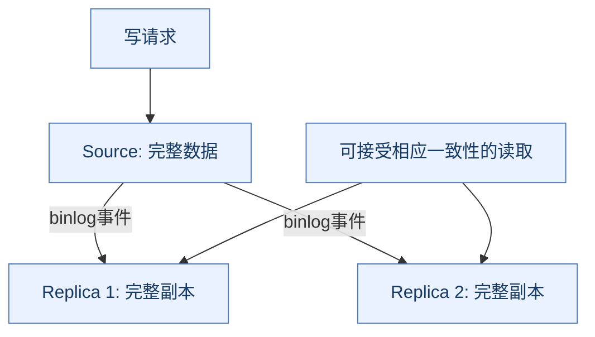
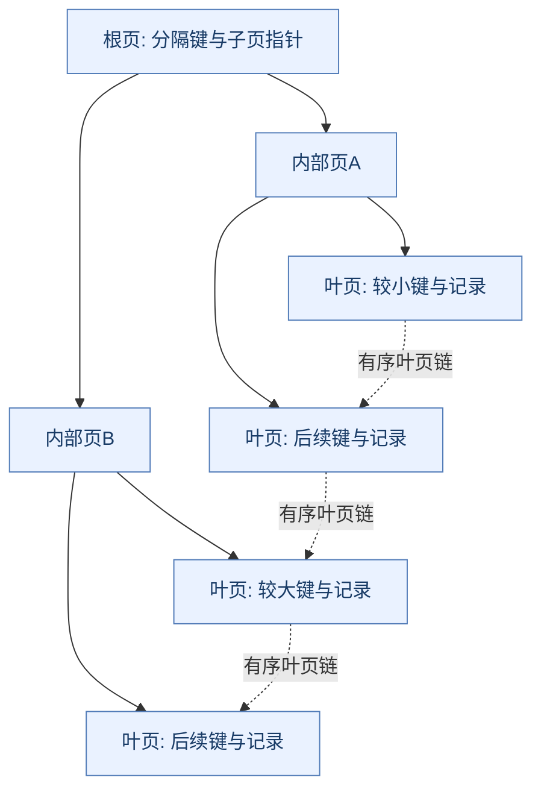
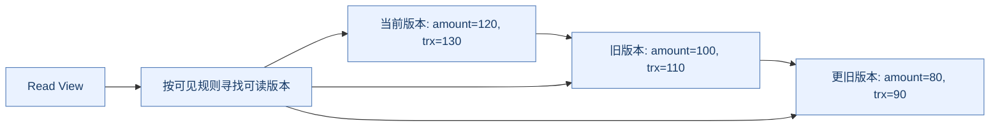
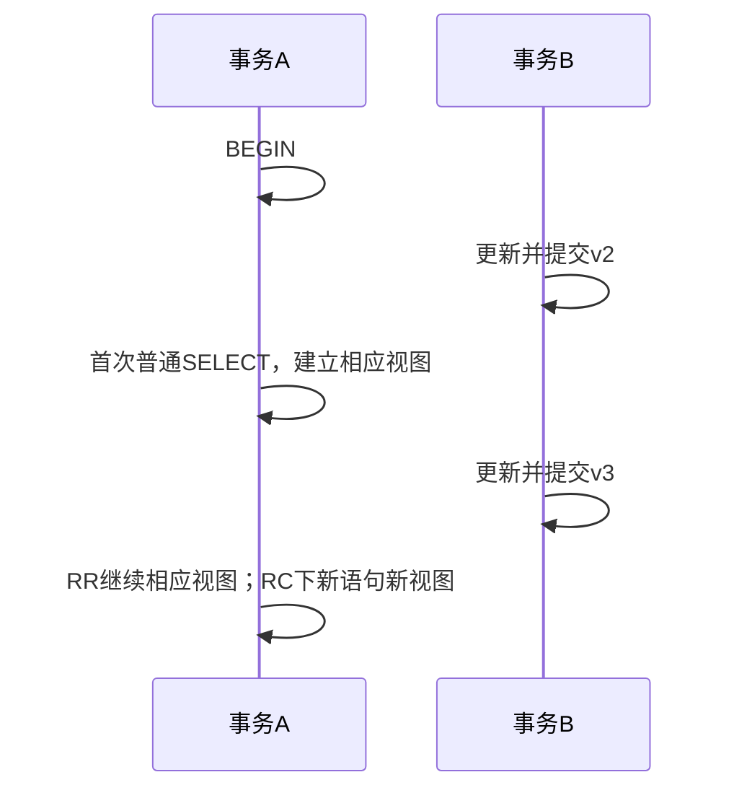
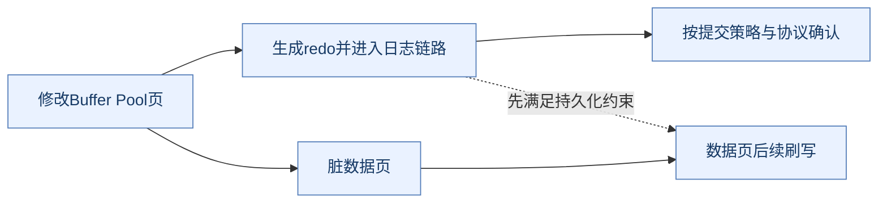
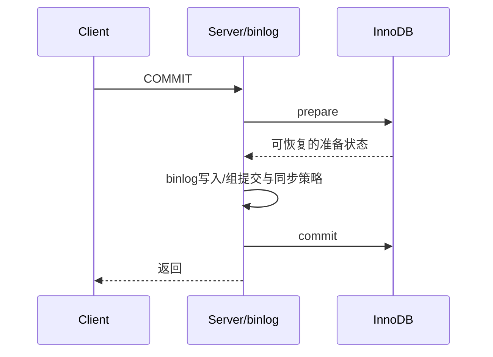
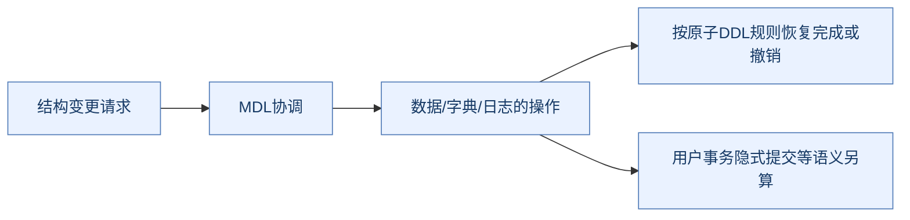
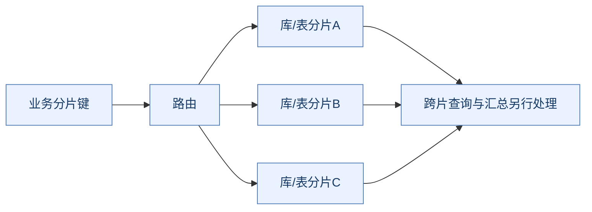
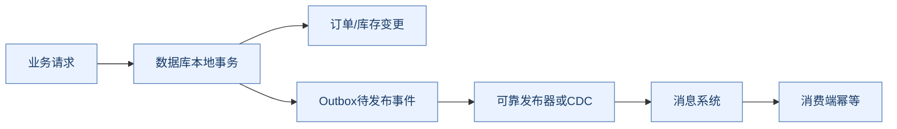

# MySQL 原理：从一条 SQL 到事务、恢复与架构演进

> **阅读目标**：把查询性能、并发正确性、提交持久性和复制高可用连成完整模型，能够从执行路径与故障窗口推导结果。
>
> 以 **InnoDB与MySQL 8.0/8.4** 为基础，标注5.7、8.0小版本、8.4及后续发布模型的差异。原有 [MySQL.md](MySQL.md) 保留为历史专题笔记，新内容不覆盖它。配套复习见 [MySQL面试.md](MySQL面试.md)。
>
> 本文以知识、架构、例子和故障推演为主。SQL（Structured Query Language，结构化查询语言）仅用于说明，不代表已经在当前环境执行。缩写在正文解释，完整术语放在[文末附录](#glossary)。

## 阅读路线

| 主线 | 快速跳转 | 要能回答的问题 |
| --- | --- | --- |
| **请求与架构** | [执行链路](#execution) → [架构演进](#architecture) | 单机、主从、高可用和分片分别解决什么？ |
| **数据与性能** | [页与缓存](#storage) → [索引](#indexes) → [优化器](#optimizer) → [SQL优化](#sql-tuning) | 为什么走索引仍慢，执行计划哪里估错？ |
| **并发正确性** | [事务与MVCC](#transactions) → [锁](#locking) → [死锁与MDL](#deadlocks) | 谁读到哪个版本、锁住什么、为何等待？ |
| **持久与恢复** | [日志](#logs) → [提交与恢复](#recovery) → [复制](#replication) | 返回成功、写入日志、副本收到和已应用有什么区别？ |
| **设计与演进** | [DDL](#ddl) · [建模](#schema) · [分库分表](#sharding) · [业务一致性](#business) · [排障](#operations) · [版本](#releases) | 什么约束被保留，什么代价转移到应用？ |

每个关键机制按 **问题 → 备选方案 → 实现 → 收益 → 代价与边界**展开。不要用“有索引”“RR（Repeatable Read，可重复读）”“双1”“主从”四个词替代完整论证。

<a id="execution"></a>

## 1. 一条SQL如何执行

> 🎯 **先分清职责**
>
> **Server层理解SQL、优化和组织执行；InnoDB负责相应数据组织、事务、锁与恢复。**

### 1.1 读请求的基本路径

**SQL（Structured Query Language，结构化查询语言）**先经过连接与权限上下文，再进行解析、名称解析与检查、优化和执行；执行器通过存储引擎接口取记录，并进行相应过滤、连接和结果输出。


**读图抓手**：客户端慢不一定是引擎查找慢。连接池排队、元数据锁、执行、结果传输和客户端处理都可能占时间。

### 1.2 为什么连接池、线程缓存、线程池不能混为一谈

连接池通常在应用侧复用数据库连接，减少握手与创建开销；服务端线程缓存减少连接处理线程的反复创建，不是把全部SQL放进一个有界工作线程池的同义词。

线程池能力还与发行版/组件有关。`thread_cache_size`不能直接解释为“配置SQL执行线程池大小”，更不能无条件设为CPU（Central Processing Unit，中央处理器）核数倍数就认为最优。

连接多不意味着并行效率高：锁竞争、调度、每连接缓冲和磁盘压力可能增加。先限制在途工作、缩短事务并定位瓶颈，再决定池大小。

### 1.3 为什么8.x执行图不应再画Query Cache

旧Query Cache缓存查询结果，表数据变更导致失效，维护和竞争可能抵消收益；MySQL 8.0已移除它。**Buffer Pool缓存页，与缓存SQL结果是不同层次。**

应用缓存可减少数据库请求，却引入第二份状态的一致性和失效问题，不能因为数据库有页缓存就当作应用结果已缓存。

### 1.4 一条UPDATE比SELECT多什么

更新除了找记录，还需当前条件判断、锁、旧版本恢复依据、新数据页修改、redo和相应binlog提交链路。事务成功返回不要求每个脏数据页都先写回最终表空间。

关键顺序由预写日志和提交协议约束，不应机械背成所有线程都严格依次执行六次同步I/O（Input/Output，输入输出）。下面日志章节会将内存修改、日志持久与数据页刷写分开。

<a id="architecture"></a>

## 2. 架构演进：单机到复制、高可用与分片

> 🎯 **由瓶颈推动演进**
>
> **副本复制全部数据，分片拆分数据所有权；自动切换、读扩展和写扩展是不同能力。**

### 2.1 演进主线


| 形态 | 主要收益 | 没解决什么 | 增加的代价 |
| --- | --- | --- | --- |
| 单机 | 事务和查询边界直观 | 节点故障、单份容量与处理上限 | 备份恢复和容量治理 |
| 主从/一主多副 | 冗余、适用的读扩展、恢复基础 | 默认异步丢写窗口、单主写瓶颈 | 延迟、复制故障、读一致性 |
| 高可用复制/集群体系 | 故障发现、成员与接管能力 | 所有读全新、业务永不重复 | 角色隔离、路由、恢复与重试 |
| 分片 | 总数据与部分写负载分散 | 跨片原子事务和全局查询 | 路由、迁移、全局唯一与应用协作 |

这不是要求所有系统逐步升级成最复杂架构，而是解释新约束如何改变选择。

### 2.2 主从为什么扩读不扩单份写能力



副本保存完整数据并重放修改，增加副本不把一张大表自动切成多份。主库仍承接写入、生成日志和维护索引；副本还消耗复制与应用资源。

读写分离把复制延迟暴露给业务。订单刚支付、库存刚扣减后读副本旧值，可能引起错误提示或重复操作，应按读取语义选择路径。

### 2.3 自动切主为什么不只是切一个地址

需要确认故障、选择合适副本、隔离旧主、处理未完成事务与复制差距，再更新入口和客户端连接。旧主若仍接受写入，可能形成分叉历史。

监控组件、代理、路由和数据库复制协议各有职责。**自动接管减少恢复工作，不代表默认异步复制中所有已响应事务都在新主上。**

### 2.4 Group Replication、InnoDB Cluster与分库分表

**MGR（MySQL Group Replication，MySQL组复制）**提供组成员、事务排序与认证等机制；可单主或多主，但多主不意味着任何并发冲突都不失败。

InnoDB Cluster把组复制与管理、路由等配套能力结合。它通常复制相应完整数据，并不是按业务键水平拆表的同义词。

分库分表改变数据所有权，跨片连接、排序、事务和唯一约束随之变难。因此“集群”必须说明具体模型，不能把NDB Cluster、InnoDB Cluster和应用分片当作同一个产品。

<a id="storage"></a>

## 3. InnoDB页、Buffer Pool与后台维护

> 🎯 **缓存减少访问成本，日志约束正确顺序**
>
> **页缓存、脏页、事务日志和旧版本服务不同目标，不能统称成一块缓存。**

### 3.1 为什么按页组织，而不是每行一次磁盘访问

磁盘和内存管理通常按较大单位搬运。InnoDB常见默认页大小为16KiB，实际受实例初始化配置与特性约束；一页可容纳多条记录和管理信息。

页内有记录组织、目录及空闲空间等结构；逻辑相邻的索引键不保证所有物理页都在连续磁盘位置。行很大时还可能使用溢出页，不能用“页大小除整行长度”精确推导所有表容量。

### 3.2 Buffer Pool的读写路径


Buffer Pool减少数据与索引页读取，修改后的页可延后写回。收益是避免每次事务都随机刷全部数据页；代价是淘汰、脏页刷新、日志空间和内存容量必须配合。

### 3.3 为什么改进LRU与后台刷脏

**LRU（Least Recently Used，最近最少使用）**若被一次大扫描填满，热点页可能被挤出。InnoDB采用冷热/新旧区域等管理，降低扫描污染；具体比例与晋升条件可配置，不能把一个默认值当不变结构定律。

后台刷脏让系统提前回收可用页与推进恢复基线；如果脏页或redo空间压力太大，前台会被迫等待。Buffer Pool命中率高仍可能因刷脏、锁或网络而慢。

### 3.4 AHI与Change Buffer为何不是万能开关

**AHI（Adaptive Hash Index，自适应哈希索引）**尝试对适合的热点访问建立额外快捷路径；它不是用户随意创建的第二套通用哈希索引，维护与竞争也有成本。

Change Buffer在满足条件时延缓部分非唯一二级索引冷页变更，减少立即读入并合并的成本；唯一性检查、特定索引形态和版本条件限制其适用性。不能简单数成“3次I/O必降成1次”。

**8.4中Change Buffer默认关闭，AHI默认也关闭**，学习机制与默认是否启用必须分开。打开前应以真实负载验证读写、恢复和竞争成本。[Buffer Pool](https://dev.mysql.com/doc/refman/8.4/en/innodb-buffer-pool.html)、[Change Buffer](https://dev.mysql.com/doc/refman/8.4/en/innodb-change-buffer.html)

<a id="indexes"></a>

## 4. 索引：B+树为什么适合通用行存储

> 🎯 **不是背“树高三层”**
>
> **索引用空间和写维护换定位与顺序访问能力，收益由选择性、页访问和返回量决定。**

### 4.1 B+树、二叉树、哈希与LSM的对比

| 方案 | 擅长 | 代价与边界 |
| --- | --- | --- |
| B+树 | 等值、范围、按索引顺序访问 | 页分裂、维护、随机访问和写放大 |
| 二叉平衡树 | 内存有序定位 | 对磁盘页而言扇出小，可能访问更多层 |
| 哈希 | 适用条件下的等值定位 | 不直接服务有序范围、最左组合和排序 |
| LSM | 缓冲/顺序化写入、分层合并 | 读放大、压缩合并、空间与实现取舍 |

**LSM（Log-Structured Merge Tree，日志结构合并树）**是另一类存储设计，不是InnoDB默认B+树的别名。比较应基于访问与维护成本，而不是给所有负载一个固定排名。

### 4.2 聚簇与二级索引


InnoDB聚簇索引叶子保存行数据；二级索引通常包含对应主键作为行定位依据。无显式主键时会按规则选合适唯一非空索引，仍没有则生成内部行标识。

“回表”增加另一棵树的定位与页访问，并不是一定多一次物理磁盘I/O；页可能在内存。覆盖访问也不能被夸大为任意可见性与锁场景都绝不访问聚簇信息。

### 4.3 主键为什么影响全部二级索引

主键宽度会放大二级索引条目和缓存压力。随机宽主键也可能增加写入局部性和页分裂成本；趋势增长的短主键常便于维护，但不保证没有尾部竞争或热点。

**UUID（Universally Unique Identifier，通用唯一标识符）**与递增整数应按编码、顺序、生成和查询需求比较；有序编码的UUID不能与完全随机文本形式混为一谈。

### 4.4 联合索引为什么有最左前缀

联合索引按键元组的字典序排列，例如 `(user_id,status,created_at,id)`：先按user_id，再在同一user内按status，之后按时间和id。

```text
(42,1,2026-11-01,101)
(42,1,2026-11-02,102)
(42,2,2026-10-01,103)
(43,1,2026-11-01,104)
```

等值约束前导列容易定位连续范围；跳过前导列或扩大前导范围后，后续列不再天然形成一个小连续区间。**这不等于范围条件之后的列全部毫无作用**：它们仍可能参与过滤、覆盖或某些优化路径。

### 4.5 ICP、覆盖与Skip Scan分别优化什么

**ICP（Index Condition Pushdown，索引条件下推）**让符合条件的索引字段过滤尽量在引擎侧完成，减少不必要整行访问。它不创造一棵新索引，也不保证缩小前面范围扫描的所有工作。

覆盖利用索引已有列满足查询；Skip Scan在受支持、成本合适的情况下枚举前导值等方式使用缺少前导等值条件的索引，不能因此宣布“最左前缀不存在”。

添加索引应同时估算写维护、空间和冗余。一个把所有字段都放进去的超宽索引，可能用读取收益换来更差写入与缓存行为。[索引组织](https://dev.mysql.com/doc/refman/8.4/en/innodb-index-types.html)、[ICP](https://dev.mysql.com/doc/refman/8.4/en/index-condition-pushdown-optimization.html)

### 4.6 用树图推导扇出、树高和范围读取



内部页主要组织分隔键与指针，叶页保存相应记录，能够用较高扇出降低层数。范围查询定位起点后沿叶页顺序继续，不必为每条结果都从根重新定位。

若内部平均扇出为F、每叶平均可容纳R条记录，三层结构粗略容量为F²×R；但F与R受主键宽度、记录长度、页头、目录、填充率和维护状态影响。不能脱离行宽断言“三层固定装两千万行”。

树高也不等于每次必做同样次数物理读：根与内部页常在缓存，二级索引回表、溢出页和可见性检查又可能增加工作。**算法层数、逻辑页访问和物理I/O是三个口径。**

<a id="optimizer"></a>

## 5. 优化器与执行计划：索引存在为什么不一定选

> 🎯 **先问估计和真实是否一致**
>
> **优化器选择估计成本较低的路径，不是见到索引就必须使用。**

### 5.1 成本、统计与选择性

选择性低、返回比例高时，二级索引扫描加大量回表可能比直接扫描更贵。统计过期、数据倾斜、列相关性和参数分布又可能让估计失真。

直方图等统计帮助估算某些值分布，但不是额外访问索引；更新统计也不保证每条计划必定改善。先看估计扫描量与实际数据，再判断索引设计、统计或查询结构问题。

### 5.2 EXPLAIN到底看什么

| 观察点 | 想知道什么 | 常见误读 |
| --- | --- | --- |
| 访问路径、key | 用了哪条路径 | 有key就一定快 |
| rows / filtered | 估计扫描与过滤 | 等于真实运行计数 |
| key_len | 参与定位等的键长度线索 | 越大越好，或直接等于返回列数 |
| Extra | 过滤、覆盖、排序等 | filesort必定写磁盘 |
| 树/JSON计划 | 连接、算子和成本关系 | 只看最外层一行 |

`Using index`与`Using index condition`不是一个意思。前者常提示覆盖访问，后者提示下推条件；仍要结合整条计划、语句类型和实际执行判断。

### 5.3 EXPLAIN ANALYZE为何要谨慎理解

它会实际执行相应语句/查询路径，并输出算子时间、实际行数和循环等信息；不是纯静态预测。对高成本语句不能认为“前面加EXPLAIN就没有运行代价”。


循环内一次很快的算子被调用几十万次，也可能主导总耗时；不能只看单次时间。输出时间与累计/平均口径应按版本格式解释。[EXPLAIN](https://dev.mysql.com/doc/refman/8.4/en/explain.html)

### 5.4 条件写法怎样影响可索引性

隐式类型转换、列上函数、排序规则不匹配和表达式可能改变可用范围。`LIKE '%abc'`通常不具备普通前缀B+树定位优势；`IS NULL`却不应被一概说成不能使用索引。

表达式/函数索引、优化器转换、OR的分支选择和Index Merge等又使“出现某关键字必失效”的口诀不可靠。应问**哪部分范围、过滤或顺序能力被保留**。

<a id="sql-tuning"></a>

## 6. 常见SQL优化：保持语义再减工作量

> 🎯 **把扫描、排序、连接和网络分别算清**
>
> **优化不是换一种写法就一定快，先确认结果语义，再比较真实执行路径。**

### 6.1 一个贯穿全文的订单索引例子

以订单表包含 `id,user_id,status,amount,created_at`，主键id，联合索引 `(user_id,status,created_at,id)` 为例。其价值取决于实际条件和返回列，而不是索引名字。

```sql
SELECT id, created_at
FROM orders
WHERE user_id = 42 AND status = 1
  AND created_at >= '2026-11-01 00:00:00'
ORDER BY created_at, id
LIMIT 20;
```

前导等值后按时间/id顺序取前20条，通常比扫描所有订单再排序更合适；若返回payload等未覆盖大字段，又要考虑回表和传输成本。不要在没有数据分布与计划时杜撰唯一正确执行结果。

### 6.2 深分页：offset、延迟关联与游标

| 做法 | 减少什么 | 保留什么代价 |
| --- | --- | --- |
| LIMIT大offset | 写法简单，可按页跳转 | 可能需扫描/跳过大量前置记录 |
| 延迟关联 | 先用窄覆盖路径找主键，降低前面大行读取 | 大offset扫描本身仍在 |
| Keyset游标 | 从上次排序键继续，减少跳过 | 不天然支持任意页跳转和固定快照 |

```sql
SELECT id, created_at
FROM orders
WHERE user_id = 42 AND status = 1
  AND (created_at > '2026-11-01 12:00:00'
       OR (created_at = '2026-11-01 12:00:00' AND id > 1001))
ORDER BY created_at, id
LIMIT 20;
```

需要稳定且唯一的排序边界；只用时间会漏/重复同时间记录。行构造器与OR改写对范围利用可能不同，要看目标版本计划。持续变化的数据也不因此变成分页快照。

### 6.3 排序、分组与临时表

索引顺序与过滤条件匹配时可减少额外排序；否则filesort表示使用相应排序流程，不意味着一定磁盘落盘。分组也可能使用不同聚合/排序/临时结构，不能保证GROUP BY输出天然有序。

内存预算、返回列宽、实际行数和临时数据溢出影响成本。盲目把每连接排序缓冲调得很大，可能在高并发时耗尽内存。

### 6.4 连接、子查询与批量

嵌套循环用外侧记录驱动内侧定位，外侧数量和内侧索引很关键；Hash Join适合某些等值连接，通过哈希结构组织匹配，但有构建、内存和溢出成本。

EXISTS、IN、子查询、连接可能被优化器改写；不能只按语法形式排绝对快慢。注意NULL语义、重复行、外连接过滤位置和实际返回规模。

批量写减少往返与提交固定成本，但批次太大增加锁持有、日志、复制和失败重试成本。合理批次来自数据大小、时间预算与业务原子边界，不是统一固定1000行。

### 6.5 COUNT与SELECT *

`COUNT(*)`统计结果行，`COUNT(col)`忽略该列NULL，`COUNT(DISTINCT...)`还涉及去重。InnoDB按事务可见性统计，不能维护一个适合所有Read View的全局精确行数直接返回。

`COUNT(1)`并不因为常量小就必然更快；可用路径和条件决定成本。SELECT *增加覆盖难度、行宽、网络和客户端处理，但确实需要整行时仍要按实际查询设计，不能只是删字段却改变业务。

<a id="transactions"></a>

## 7. 事务、隔离级别与MVCC

> 🎯 **从可见性而不是口诀理解隔离**
>
> **一致性读看历史视图，锁定读/修改走相应当前状态与锁；事务内自己的修改又有单独可见性。**

### 7.1 ACID如何分工

**ACID（Atomicity, Consistency, Isolation, Durability，原子性、一致性、隔离性、持久性）**分别涉及事务完成边界、约束与业务不变量、并发观察和故障后数据保留。

undo、redo、锁、版本与提交协议协作实现部分保障，但业务转账必须仍正确表达两边修改和约束；数据库不会理解任意“业务正确”的含义。

### 7.2 为什么使用多版本，而不是所有读都锁住

**MVCC（Multi-Version Concurrency Control，多版本并发控制）**通过历史版本与可见性规则让普通一致性读在许多场景下不阻塞写。收益是读写并发，代价是版本链、undo保留、purge及不同读取模式的理解成本。



**Read View（读视图）不是创建时复制整张表。**它保存可见性判断信息，读取时按版本链重建需要的记录。

### 7.3 一个Read View的判断例子

以简化模型说明：创建视图时活跃写事务集合为 `{110,120}`，最小活跃ID为110，下一个待分配ID为130。对别的事务产生的版本：

| 版本事务ID | 判断 | 原因 |
| --- | --- | --- |
| 100 | 可见 | 早于当时最小活跃事务 |
| 110 | 不可见 | 当时仍活跃 |
| 115 | 可见 | 位于边界间但不在活跃集合，已完成相应提交 |
| 120 | 不可见 | 当时仍活跃 |
| 135 | 不可见 | 创建视图后才出现的历史 |

还要考虑当前事务自身修改、事务类型和内部状态；不能把上表当省略一切实现细节的完整源码。看不到当前版本时，借undo链寻找适合版本。

### 7.4 RC与RR在何时建立视图

**RC（Read Committed，读已提交）**下普通一致性读通常每次语句建立新的视图；**RR（Repeatable Read，可重复读）**下普通一致性读通常复用首次建立的事务视图。



**BEGIN本身通常不等于立即创建RR快照**；`WITH CONSISTENT SNAPSHOT`等明确语法和隔离条件要单独考虑。事务自己的修改可以被自己看到，因此结果并不总是“纯粹来自同一旧时刻的整库照片”。

### 7.5 快照读与当前读为何会出现不同结果

普通SELECT的一致性读、SELECT FOR UPDATE/FOR SHARE的锁定读和UPDATE/DELETE不是一套视图规则。把普通读看到的旧数量直接拿去无条件写当前行，仍可能破坏业务。

例如先读stock=1，再在应用里写stock=0，两个事务可能都认为成功。用 `UPDATE ... SET stock=stock-1 WHERE stock>0` 并判断影响行数，才能将约束放在一个合适的当前修改边界。

### 7.6 长事务为什么影响purge

旧Read View可能仍需要历史版本，purge不能随便清掉这些undo。长事务还可能持有锁、元数据访问及资源，放大历史与复制压力。

不是每个长时间存在的连接都有相同影响，要看事务是否开始、是否建立视图、是否写入和持有什么锁。只读事务也可能因旧快照阻碍历史清理。[MVCC](https://dev.mysql.com/doc/refman/8.4/en/innodb-multi-versioning.html)、[一致性读](https://dev.mysql.com/doc/refman/8.4/en/innodb-consistent-read.html)

<a id="locking"></a>

## 8. 锁：记录、间隙与索引访问路径

> 🎯 **先确定语句和路径，再谈锁范围**
>
> **隔离级别、索引形态、访问范围、匹配情况和语句类型共同决定锁，不能只凭WHERE文字画区间。**

### 8.1 锁与latch为何不同

事务锁协调业务并发访问，可持有到事务边界；内部latch（短期同步原语）保护内存结构等实现临界区。看到数据库等待，要区分事务冲突、内部争用与I/O，不把所有等待都叫行锁。

**S（Shared，共享）**与**X（Exclusive，排他）**表示常见数据锁模式。意向锁帮助表级与行级锁协调，不是“提前把整张表的数据全锁死”。

### 8.2 三种常见索引锁

| 锁 | 保护对象 | 主要用途 |
| --- | --- | --- |
| Record Lock | 索引记录 | 协调已有记录修改 |
| Gap Lock | 记录之间的间隙，不含记录本身 | 限制对应间隙插入 |
| Next-Key Lock | 记录及其前侧间隙 | 范围并发控制 |

```text
索引键： 10             20             30
间隙：      (10,20)         (20,30)
临键：      (10,20]         (20,30]
```

实际锁还可能含边界、伪记录和其他索引，图只是解释语义。Gap Lock之间可兼容，不等于它们允许其他事务在间隙中随意插入。

### 8.3 一个唯一索引等值的对比

假设主键已有10、20、30，事务显式运行于RR，采用相应主键查找：

| 锁定读条件 | 关键区别 |
| --- | --- |
| `id=20 FOR UPDATE`且命中完整唯一键 | 通常以该记录锁为核心，不必按一般范围锁住其前侧间隙 |
| `id=15 FOR UPDATE`且未命中 | 仍可能锁住对应间隙，阻止别人插入15 |
| 非唯一键等值 | 可能扫描多个匹配及边界，范围不同 |
| 范围条件 | 取决于访问路径和边界，不等于只锁最终返回行 |

“查不到所以没加锁”和“等值查询永远不锁间隙”都不成立。复合唯一键只用部分列，也不能当完整唯一等值。

### 8.4 没有索引是不是自动升级表锁

不是这个推导。InnoDB可能因访问路径扫描并锁住大量索引记录及相应范围，导致效果接近阻塞整表，但不能把它直接说成发生了行锁升级到表锁。

即使表没有用户索引，引擎也有聚簇组织。索引缩小扫描通常也缩小冲突面，但增加索引不能保证死锁消失。

### 8.5 RR是否消灭所有幻读

普通一致性读的视图和锁定范围读的next-key等机制，从不同路径处理可见集合与插入冲突。混合快照、当前修改与自己新写入的观察可能比“所有SELECT永远同一批行”复杂。

RC通常减少普通搜索/扫描的间隙锁使用，但外键与重复键检查等仍有例外。不要把Gap Lock写成“只有RR任何情况下才可能存在”。[InnoDB锁](https://dev.mysql.com/doc/refman/8.4/en/innodb-locking.html)、[范围与幻行](https://dev.mysql.com/doc/refman/8.4/en/innodb-next-key-locking.html)

### 8.6 两会话推演：命中、未命中与提交边界

在隔离实验表中，假设主键值只有10、20、30，两个会话都明确使用InnoDB和RR，且执行计划采用相应主键路径：

| 时序 | 会话A | 会话B | 应解释的现象 |
| --- | --- | --- | --- |
| 1 | BEGIN；查id=20 FOR UPDATE |  | 完整唯一命中，以记录锁为核心 |
| 2 | 保持事务 | 更新id=20 | 与A的记录锁冲突，需要等待 |
| 3 | COMMIT | 继续执行或按错误规则结束 | 锁生命周期与事务边界相关 |
| 4 | 新事务查id=15 FOR UPDATE |  | 不存在记录也可能保护对应间隙 |
| 5 | 保持事务 | 插入id=15 | 可能因间隙保护等待 |

不能把上述推导机械应用到所有非唯一索引、RC、缺少前导条件或优化器选择其他路径的语句。真实验证要同时观察事务、执行计划与data_locks/data_lock_waits等信息。

锁定读通常需要在明确事务边界内使用；只发一条语句却马上自动提交，不能假设后续客户端业务处理期间仍持续持有资格。

<a id="deadlocks"></a>

## 9. 死锁、锁等待与元数据锁

> 🎯 **等待不是死锁，解除等待也不等于完成业务恢复**
>
> **先画谁持有什么、谁等谁，再确定回滚范围与重试语义。**

### 9.1 为什么有行锁仍会死锁


循环等待形成死锁；单方向等一个慢事务并不是死锁。统一资源访问顺序、缩短事务、缩小扫描和合理索引降低概率，却不能替代完整恢复处理。

### 9.2 检测、超时与重试

死锁检测可选择受害者回滚事务；锁等待超时的默认回滚范围通常只是当前语句，具体取决于配置和错误类型。应用不能把两者都简单catch后继续提交旧事务。

重试通常应从完整业务事务边界重新读取和判断，限制次数并退避；数据库以外已经完成的动作还要幂等。热点上大量检测本身也有成本，但关闭检测后必须接受超时路径和调优代价。[死锁检测](https://dev.mysql.com/doc/refman/8.4/en/innodb-deadlock-detection.html)

### 9.3 MDL为什么能把普通查询也堵住

**MDL（Metadata Lock，元数据锁）**保护表结构与对象定义。长事务访问表后可能一直持有相应MDL，DDL（Data Definition Language，数据定义语言）申请不兼容锁后排队，后续请求也可能因队列关系形成大面积等待。


“只是加个字段”也要经过元数据协调，不能因为数据变更算法很快就忽略前后的锁阶段。排障要看阻塞链与事务，不只看当前SQL是否执行耗时长。[MDL](https://dev.mysql.com/doc/refman/8.4/en/metadata-locking.html)

<a id="logs"></a>

## 10. undo、redo、binlog与Doublewrite

> 🎯 **四种机制各守一段边界**
>
> **回滚/历史版本、崩溃重做、Server层事件历史、页完整性不能互相替代。**

### 10.1 功能对比

| 机制 | 主要服务 | 不能替代什么 |
| --- | --- | --- |
| undo | 回滚与历史版本重建 | 通用业务审计和全部崩溃重做 |
| redo | 重做页等修改，崩溃恢复基础 | 长期复制历史与业务回滚 |
| binlog | Server层二进制事件、复制和按时间恢复依据 | 单独恢复任意不完整物理数据页 |
| Doublewrite | 部分页写入损坏时的完整页恢复基础 | 事务提交判定与undo |

### 10.2 WAL为什么允许提交不先刷全部数据页

**WAL（Write-Ahead Logging，预写日志）**要求相关日志满足约束后，数据页才可安全持久化。修改很多分散页时，先保留可重做日志比每次提交同步随机刷所有数据页更经济。



redo并非笼统“所有日志都纯物理、binlog都一句SQL”的对称口诀。binlog可使用行事件等格式，redo也有自己的记录类型和内部编码，讨论时先讲用途与恢复边界。

### 10.3 LSN、checkpoint与循环日志

**LSN（Log Sequence Number，日志序列号）**表示redo进度。checkpoint推进恢复基线，让不再需要的旧redo空间可重用；redo容量有限，脏页不推进时写入可能等待可用空间。

更大日志容量可缓解部分写入突发，也增加空间与恢复治理成本。它不是让系统可以无限期不刷脏页，更不能与长期binlog保留互换。

### 10.4 Doublewrite为什么不是“redo已经够了”

数据页写入可能发生部分完成，得到不能正确重做的破损基础页。Doublewrite先保存可恢复的完整页副本，再写最终位置，使恢复能获得有效页基线后继续重做。


它减少撕裂页风险，付出额外写入与空间；底层原子写入能力和版本/配置会改变路径，不能无条件建议关闭。[Redo](https://dev.mysql.com/doc/refman/8.4/en/innodb-redo-log.html)、[Doublewrite](https://dev.mysql.com/doc/refman/8.4/en/innodb-doublewrite-buffer.html)

<a id="recovery"></a>

## 11. 提交协议、刷盘策略与崩溃恢复

> 🎯 **成功响应与不确定结果都要能解释**
>
> **InnoDB状态与binlog提交结果要协调；**客户端超时不证明事务没有提交**。**

### 11.1 为什么需要协调redo与binlog

若引擎已提交而binlog没保存，副本/按日志恢复可能缺事务；若binlog保存了而引擎最终丢了，又可能出现复制与本地主数据不一致。

常用理解模型是引擎prepare、binlog写入并按策略同步、引擎commit标记，再返回；真实实现有组提交、并发与多个刷写阶段，不能把概念流程当每事务固定串行几次fsync。



这是数据库内部提交协调，不等同于给任意外部系统自动执行分布式两阶段提交。

### 11.2 “双1”到底加强哪部分

| 配置 | 主要约束 |
| --- | --- |
| innodb_flush_log_at_trx_commit=1 | 相应提交redo写入与同步策略 |
| sync_binlog=1 | 相应binlog提交/组的同步策略 |

它们是常见较强本地持久化组合，但设备是否正确兑现同步、文件系统、共同故障和备份恢复仍需独立分析。不能由“双1”推导自动跨机房零损失。

### 11.3 崩溃点怎么推导

| 崩溃时刻 | 恢复要关注什么 |
| --- | --- |
| redo prepare前 | 是否存在已持久化但未提交修改，按恢复规则处理 |
| prepare已持久、binlog结果未完成 | 不能仅凭prepare就对外认定提交 |
| binlog完整事务结果已持久、引擎commit标记未完成 | 用事务关联与协议判断完成相应提交 |
| 提交完成、客户端未收到响应 | 服务端可能已成功，应用重试需要幂等 |

恢复会配合redo、undo和提交判定，不是“所有redo重放完就把所有修改都当提交”，也不是“没看到客户端成功就回滚”。

### 11.4 为什么组提交能减少固定成本

多个并发事务共享部分日志同步工作，摊薄设备等待。吞吐改善依赖并发和日志路径，但单事务延迟、批量等待、binlog与复制仍要整体观察。

业务大事务和组提交是两个概念：不应为了摊薄fsync把十万条无关业务强行塞进一个巨大原子单元。[Binlog](https://dev.mysql.com/doc/refman/8.4/en/binary-log.html)

<a id="replication"></a>

## 12. 复制、GTID与高可用一致性

> 🎯 **收到日志不等于已经可读**
>
> **发送、接收落日志、应用事务、对外读取和故障接管是不同阶段。**

### 12.1 复制链路与格式


行格式、语句格式、混合格式对事件表达、数据量、确定性和恢复有不同影响；不能认为binlog永远等于原始SQL文本。副本并行应用也受事务依赖、热点、DDL与资源限制，不是配置线程数就任意并行。

### 12.2 GTID解决什么，不解决什么

**GTID（Global Transaction Identifier，全局事务标识）**在复制体系中标识事务，帮助自动定位和管理已执行集合。它不表示事务到所有副本都已提交，也不天然表示跨业务分片全局提交顺序。

它减少文件位置切换管理的一部分复杂度，但不能替代一致历史检查、错误处理和正确副本选择。[GTID](https://dev.mysql.com/doc/refman/8.4/en/replication-gtids-concepts.html)

### 12.3 异步与半同步

默认异步源库可在副本确认前完成相应提交响应；**半同步复制**等待满足条件的副本接收确认，典型确认涉及relay log持久化，不等于副本SQL已应用并能读到新值。

等待点、要求副本数和超时回退策略会改变可用性与数据风险。半同步若超时回退异步，就不能继续按“所有成功写都满足同一确认级别”理解。[半同步语义](https://dev.mysql.com/doc/refman/8.4/en/replication-semisync.html)

### 12.4 延迟不只有一个Seconds_Behind指标

传输慢、应用慢、大事务、DDL、锁、热点和副本机器资源都可能制造延迟；一个平均/秒数指标不能覆盖全部事务状态。应结合复制通道、接收/执行位置、GTID集合与应用错误分析。

读自己写可选择读主、同一业务路由粘滞，或基于指定事务已应用的等待机制等；每种方案都有超时与失败处理。盲目固定sleep并不能保证任意负载下追平。

### 12.5 Group Replication与多主冲突

组复制的认证、排序和成员规则改善相应高可用模型；不同事务仍可能在认证或锁阶段冲突，应用需处理回滚与重试。

组内一致性级别会影响切主时是否等积压应用以及事务前后等待。**成员达成组协议不等于每个读接口在任意模式下都自动最新。**多主也不等于无冲突写扩展。[组复制概述](https://dev.mysql.com/doc/refman/8.4/en/group-replication-summary.html)、[一致性级别](https://dev.mysql.com/doc/refman/8.4/en/group-replication-configuring-consistency-guarantees.html)

<a id="ddl"></a>

## 13. DDL、元数据与在线变更

> 🎯 **Instant、Inplace、Online、Atomic描述不同维度**
>
> **数据不重建、允许并发、崩溃原子和用户事务可回滚不是同一件事。**

### 13.1 三类算法与锁阶段

**DDL（Data Definition Language，数据定义语言）**改变结构。不同操作可能支持INSTANT、INPLACE或COPY，具体还受版本、字段位置、表特性与已有变更影响。

| 概念 | 重点 | 常见误读 |
| --- | --- | --- |
| INSTANT | 满足条件时主要变更元数据 | 任何字段变化都瞬时且无锁 |
| INPLACE | 使用相应引擎内路径 | 必定不重建数据 |
| COPY | 通过复制重建等路径 | 所有操作成本都相同 |
| Online | 某些阶段允许并发DML | 从开始到结束完全不等待MDL |

**DML（Data Manipulation Language，数据操作语言）**指插入、更新、删除等数据操作。在线DDL仍可能在起止阶段申请不兼容元数据锁，或受并发变更与资源预算约束。

### 13.2 Atomic DDL为什么不是事务里可以随便ROLLBACK

支持的原子DDL将数据字典、引擎操作和日志等协调到可恢复的一致结果，改善崩溃中间状态。许多DDL仍触发隐式提交，不等于用户BEGIN后任意改表都能回滚。



### 13.3 大表变更先评估什么

操作是否重建、临时空间、日志与副本积压、锁等待、长事务、失败重试和回退路径，都比一个“在线”标签重要。影子表/增量同步等工具又有触发器、切换与兼容限制，不能当免费无锁改表。

本章讲知识边界，不提供生产执行脚本。[Online DDL](https://dev.mysql.com/doc/refman/8.4/en/innodb-online-ddl-operations.html)、[Atomic DDL](https://dev.mysql.com/doc/refman/8.4/en/atomic-ddl.html)、[隐式提交](https://dev.mysql.com/doc/refman/8.4/en/implicit-commit.html)

<a id="schema"></a>

## 14. 数据建模：类型、约束与统计语义

> 🎯 **模型错误不能只靠索引修复**
>
> **先表达业务不变量，再比较空间、精度、排序、唯一性和迁移成本。**

### 14.1 金额与数值精度

FLOAT/DOUBLE是近似数值，精确金额常用合适精度的DECIMAL或最小单位整数，同时校验范围与舍入规则。DECIMAL不自动解决所有业务舍入，整数也不是永远不会溢出。

`INT(11)`中的旧显示宽度不等于11位存储上限，类型本身的字节与有无符号决定数值范围。类型选择应看真实上下界与未来增长，不只看眼前样本。

### 14.2 字符集、排序规则与索引

字符集决定编码，collation（排序规则）决定比较和排序行为；大小写、重音等规则可能影响唯一键。utf8mb4与历史utf8别名不能混为“完全一样的UTF-8支持”。

连接、参数和列的字符/类型不匹配也可能影响比较与索引利用。VARCHAR长度不是固定字节数，索引长度和行大小还受编码及其他开销影响。

### 14.3 NULL、唯一键与业务幂等

SQL中NULL比较有三值逻辑，`= NULL`不等于`IS NULL`。**唯一索引通常允许多个NULL**，这不一定满足业务“缺省也唯一”的要求，应明确定义。

可用唯一业务键实现幂等，但冲突时要辨别确实同一请求还是其他约束失败；不能把任何插入错误都当已完成。

### 14.4 时间与JSON

DATETIME与TIMESTAMP在存储范围、时区转换和语义上不同，选择应结合跨时区和客户端设置。分页或排序使用时间时还需稳定的第二键。

JSON（JavaScript Object Notation，数据交换格式）便于表达灵活字段，却不免除类型验证、查询索引与数据演进。频繁过滤的核心业务字段是否应结构化、是否需要生成列/表达式索引，要按查询和约束设计。

<a id="sharding"></a>

## 15. 分区、分库分表与全局约束

> 🎯 **路由缩小数据范围，也改变事务边界**
>
> **分区不等于独立服务器分片，分片不等于自动保留所有单库能力。**

### 15.1 表分区为什么不等于写吞吐无限扩展

原生分区可按规则管理同一逻辑表的数据，某些条件可做partition pruning（分区裁剪），也便于生命周期管理；仍受实例资源和引擎规则约束。

没有可裁剪条件时可能访问很多分区，唯一键等约束也受分区规则限制。不能仅按表大就认定分区优于合理索引或归档。

### 15.2 水平分片引入什么



相同用户/订单相关数据尽量落在合适原子边界，有利于局部事务；代价是跨用户统计、全局排序、唯一约束和迁移复杂。热点分片键也会限制收益。

### 15.3 扩容为什么不是改一个取模数

直接对节点数取模会改变大量键归属；路由表、虚拟桶或范围等策略降低部分迁移复杂度，但都需要基线复制、增量追赶、双读/切流与回退计划。

迁移中的重复和缺失比“数据最终复制完了”更关键；客户端重试、旧路由和后台任务必须有明确版本边界。

### 15.4 全局ID与全局唯一

主键唯一、业务幂等唯一与全局排序是不同要求。分布式ID算法可能受时钟、生成节点标识和重启影响；数据库唯一约束则只覆盖其所在的约束域。

全局订单号需要去哪里判重、同一请求路由是否稳定、跨片事务是否必要，应先于盲目选“雪花算法”回答。

<a id="business"></a>

## 16. 业务正确性：库存、幂等与事件双写

> 🎯 **把不变量放进原子边界**
>
> **外部锁减少竞争，数据库约束才决定相应业务变更是否真正合法。**

### 16.1 条件更新为什么比先查后无条件写可靠

```sql
UPDATE inventory
SET stock = stock - 1
WHERE sku_id = 1001 AND stock > 0;
```

检查影响行数并区分不存在/不足等业务原因，可以把校验与扣减放在同一修改语句。还需订单请求幂等、事务边界和故障重试，避免同一请求多扣。

读改写更复杂时可用版本条件或锁定读，但锁持有期间不宜长时间调用远程服务，避免把外部延迟带入数据库锁范围。

### 16.2 幂等记录和业务结果为什么要共同提交

同一个本地事务中插入唯一请求标识并修改业务，成功后记录可复用结果。若标记先独立提交，业务失败后重试可能被错误跳过；若业务先独立提交，则可能重复执行。

唯一冲突不应吞掉其他错误，事务超时和提交响应丢失还需要按业务标识核实。重试不是简单重新发一遍所有外部动作。

### 16.3 Outbox如何解决可靠发布意图



**CDC（Change Data Capture，数据变更捕获）**可从日志等来源获取变更。Outbox将业务与待发布意图本地原子保存，跨系统发布仍可能重复，需要消费幂等、顺序与清理治理。

### 16.4 数据库与Redis缓存为什么仍需失效协议

事务提交与缓存失效是两个系统操作。先库后删减少部分竞争，却仍有删除失败和迟到旧回填；CDC恢复通知也不自动解决所有回填竞争。

敏感读取、版本校验、可恢复失效与陈旧窗口应按业务定义，不能只因为主库事务正确就宣称缓存也实时一致。

<a id="operations"></a>

## 17. 慢查询、连接耗尽与故障定位

> 🎯 **先用证据分层，再改参数**
>
> **端到端延迟、执行计划、锁等待和设备压力必须关联看。**

### 17.1 从现象建立证据链

| 现象 | 优先证据 | 避免误判 |
| --- | --- | --- |
| 应用超时、数据库SQL不慢 | 池等待、网络、结果消费 | 超时就认定SQL未执行 |
| 查询忽快忽慢 | 参数分布、缓存、计划和并发 | 一定只是索引失效 |
| 多数请求排队 | 阻塞链、长事务、MDL、连接 | 一律扩max_connections |
| 写入周期性尖峰 | redo空间、刷脏、设备、组提交 | 命中率高就排除存储问题 |
| 副本延迟增加 | 接收/应用、事务依赖、大事务和DDL | 仅凭单个Seconds_Behind值判断 |

### 17.2 Performance Schema、sys与慢日志

Performance Schema提供等待、语句和事务等观测，sys提供相应便捷视图；慢日志按规则记录执行现象。工具本身也有采样、启用和开销边界。

抓到慢SQL后应保留参数、计划、实际行数、锁等待与系统时间线。只拿一条SQL在空库测一次，无法代表生产选择性和并发。

### 17.3 长事务与连接池为什么会形成放大

一个阻塞者拖住更多事务，更多连接等待，应用重试又增加流量。扩大连接上限可能把故障放大，应先确认等待链、限制新增工作并按业务处理阻塞与恢复。

**P99（99th Percentile，99分位数）**揭示尾部，但不是最大值。吞吐、错误率、事务时间和恢复用时也要一起看。

### 17.4 容量不能只按行数估计

数据页、二级索引、undo、redo、binlog、临时文件、在线变更空间、副本和备份都占资源。峰值写入、全量恢复与大事务所需余量可能比静态表文件更关键。

**RPO（Recovery Point Objective，恢复点目标）**与**RTO（Recovery Time Objective，恢复时间目标）**应通过恢复与切换推演验证，不能只靠“有备份、有副本”的列表证明。

<a id="releases"></a>

## 18. 版本差异：5.7、8.0、8.4与后续发布模型

> 🎯 **机制、默认值、可用功能和维护状态分开说**
>
> **不能把旧版参数、语法与执行计划口诀无条件复制到8.4及后续版本。**

### 18.1 代表性变化

| 范围 | 代表能力/变化 | 学习与迁移影响 |
| --- | --- | --- |
| 5.7历史基线 | 保留较多旧术语、结构与能力边界 | 不应按历史教材画现代Query Cache或DDL图 |
| 8.0 | 事务数据字典、支持的原子DDL、窗口函数、CTE、更多优化能力 | 具体小版本决定Hash Join、EXPLAIN ANALYZE、INSTANT等可用范围 |
| 8.0后续小版本 | redo管理、即时DDL、观测与优化不断演进 | “都是8.0”不足以判断语法和行为一致 |
| 8.4 LTS | 长期支持线、默认值与弃用移除变化 | AHI/Change Buffer默认关闭，认证与管理兼容需核对 |
| 9.7 LTS及后续 | 后续长期支持与Innovation线继续演进 | 按目标版本能力、兼容和升级路径判断 |
| 日历命名Innovation | 官方后续采用如26.7的年月式版本 | 不能继续把所有新版本机械命名成9.x |

**CTE（Common Table Expression，公用表表达式）**帮助组织查询，不保证天然更快；窗口函数提供分组窗口内计算语义，也要考虑排序和临时工作。

### 18.2 LTS与Innovation是什么

**LTS（Long-Term Support，长期支持）**与Innovation（创新发布）是不同维护/功能演进路径，不等于前者完全不需要补丁、后者只适合实验。选型要看兼容验证、支持周期和所需能力。

本文以8.4为固定机制参考，不称它为当前唯一最新版本。2026年后的命名和维护状态应以官方当期资料核对。[发布模型](https://dev.mysql.com/doc/refman/8.4/en/mysql-releases.html)、[官方后续命名说明](https://blogs.oracle.com/mysql/a-more-predictable-mysql-release-model-calendar-versions-lts-and-innovation)

### 18.3 旧结论如何校正

| 容易误记 | 应如何说明 |
| --- | --- |
| 查询先查Query Cache | 8.0已移除，页缓存与应用缓存分别讨论 |
| thread_cache_size是SQL线程池 | 线程复用与工作池不同，发行能力也不同 |
| 无索引直接升级表锁 | 可能大范围扫描加锁，不等于发生该锁升级 |
| RR所有读都是旧快照 | 当前读、自己修改和一致性读应区分 |
| 范围之后索引列完全无用 | 定位、过滤、覆盖与排序能力分别分析 |
| 双1保证任意故障零丢 | 本地同步策略不等于所有硬件和跨域保障 |
| 在线DDL全程无锁 | 数据算法、并发与MDL阶段不同 |
| 主从/组复制就是分片 | 完整副本和拆键空间不同 |

### 18.4 升级应核对什么

服务端、连接器、认证、字符排序规则、SQL模式、保留关键字、数据字典、执行计划、复制语法和恢复文件兼容都需要验证。8.4默认禁用的旧认证插件等变化不能通过随手照搬旧配置解决所有问题。

按官方支持路径升级，不能任意跳过中间支持线或假设物理文件可直接降级。本文只解释知识边界，不给当前项目执行升级。[8.4变化](https://dev.mysql.com/doc/refman/8.4/en/mysql-nutshell.html)、[后续升级路径](https://dev.mysql.com/doc/refman/9.7/en/upgrade-paths.html)

## 附录 A：推演练习与官方资料

| 推演 | 应能说明的边界 |
| --- | --- |
| RR中BEGIN后别人提交，自己首次SELECT | 视图建立时机，不把BEGIN当所有场景快照点 |
| 快照读后再做UPDATE | 当前修改与历史视图不同，需业务条件 |
| 唯一命中与唯一未命中锁定读 | 记录与间隙处理不同 |
| 死锁与锁等待超时 | 回滚范围与重试边界不同 |
| binlog已完成而redo commit未完成时崩溃 | 内部提交协议与事务关联恢复 |
| COMMIT响应丢失 | 结果未知，按幂等标识核实 |
| 半同步收到确认后立即读副本 | 接收落日志不等于已经应用 |
| 在线DDL前有长事务 | MDL等待可能放大影响 |

- [InnoDB索引](https://dev.mysql.com/doc/refman/8.4/en/innodb-index-types.html)、[Buffer Pool](https://dev.mysql.com/doc/refman/8.4/en/innodb-buffer-pool.html)
- [MVCC](https://dev.mysql.com/doc/refman/8.4/en/innodb-multi-versioning.html)、[一致性读](https://dev.mysql.com/doc/refman/8.4/en/innodb-consistent-read.html)
- [锁](https://dev.mysql.com/doc/refman/8.4/en/innodb-locking.html)、[死锁](https://dev.mysql.com/doc/refman/8.4/en/innodb-deadlock-detection.html)
- [EXPLAIN](https://dev.mysql.com/doc/refman/8.4/en/explain.html)、[ICP](https://dev.mysql.com/doc/refman/8.4/en/index-condition-pushdown-optimization.html)
- [Redo](https://dev.mysql.com/doc/refman/8.4/en/innodb-redo-log.html)、[Doublewrite](https://dev.mysql.com/doc/refman/8.4/en/innodb-doublewrite-buffer.html)、[Binlog](https://dev.mysql.com/doc/refman/8.4/en/binary-log.html)
- [复制](https://dev.mysql.com/doc/refman/8.4/en/replication.html)、[组复制](https://dev.mysql.com/doc/refman/8.4/en/group-replication-summary.html)
- [Online DDL](https://dev.mysql.com/doc/refman/8.4/en/innodb-online-ddl-operations.html)、[原子DDL](https://dev.mysql.com/doc/refman/8.4/en/atomic-ddl.html)

<a id="glossary"></a>

## 附录 B：术语与缩写

| 缩写/术语 | 英文全称或原词 | 中文与边界 |
| --- | --- | --- |
| SQL | Structured Query Language | 结构化查询语言 |
| ACID | Atomicity, Consistency, Isolation, Durability | 原子、一致、隔离、持久，需配合业务约束 |
| MVCC | Multi-Version Concurrency Control | 多版本并发控制，不是整库复制快照 |
| RC / RR | Read Committed / Repeatable Read | 读已提交/可重复读，区分读取模式 |
| RU | Read Uncommitted | 读未提交，不能保证业务读取正确 |
| Read View | Read View | 可见性判断状态，普通读与当前修改分开 |
| WAL | Write-Ahead Logging | 预写日志，不是所有日志都相同 |
| LSN | Log Sequence Number | redo等内部进度，不是binlog文件位置 |
| MDL | Metadata Lock | 元数据锁，与行记录锁不同 |
| S / X | Shared / Exclusive | 共享/排他锁模式 |
| IS / IX | Intention Shared / Intention Exclusive | 意向共享/意向排他，协调层级锁 |
| ICP | Index Condition Pushdown | 索引条件下推，减少部分整行访问 |
| AHI | Adaptive Hash Index | 自适应哈希索引，版本默认值不同 |
| LRU | Least Recently Used | 最近最少使用，缓存管理不是精确统一规则 |
| LSM | Log-Structured Merge Tree | 日志结构合并树，与B+树有不同取舍 |
| UUID | Universally Unique Identifier | 通用唯一标识符，编码和顺序影响成本 |
| GTID | Global Transaction Identifier | 复制事务标识，不代表全部副本都已应用 |
| MGR | MySQL Group Replication | MySQL组复制，不是分库分表 |
| DDL / DML | Data Definition Language / Data Manipulation Language | 数据定义/数据操作语言 |
| CTE | Common Table Expression | 公用表表达式，组织语法不等于性能承诺 |
| CDC | Change Data Capture | 数据变更捕获，不自动处理全部外部一致性 |
| LTS | Long-Term Support | 长期支持发布路径 |
| RPO / RTO | Recovery Point Objective / Recovery Time Objective | 恢复点/恢复时间目标 |
| P99 | 99th Percentile | 99分位数，不等于最大值 |
| CPU / I/O | Central Processing Unit / Input/Output | 中央处理器/输入输出 |
| JSON | JavaScript Object Notation | 数据交换格式，需设计查询与演进 |
| NULL | SQL NULL | 缺失/未知值相关语义，不等于空字符串 |
| redo / undo / binlog | Redo Log / Undo Log / Binary Log | 重做/回滚历史/二进制事件，各有职责 |
| fsync | File synchronization system call | 文件同步系统调用，依赖存储兑现语义 |
| Outbox | Transactional Outbox | 本地事务持久化待发布意图 |
| CAS | Compare-And-Set | 比较并设置，版本条件实现乐观检查思想 |
