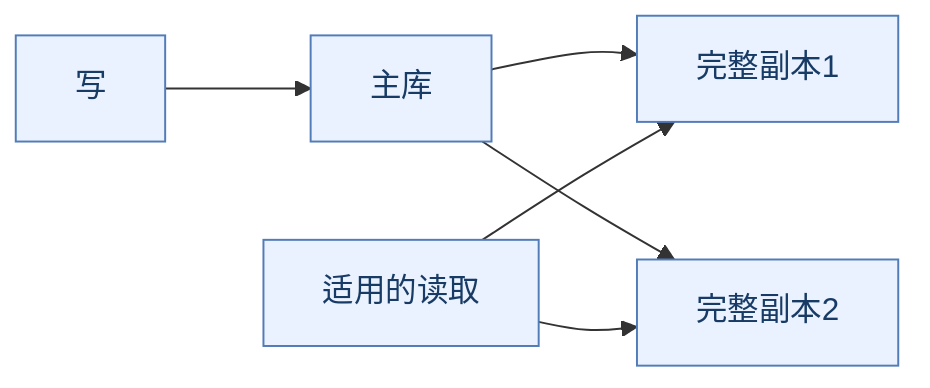
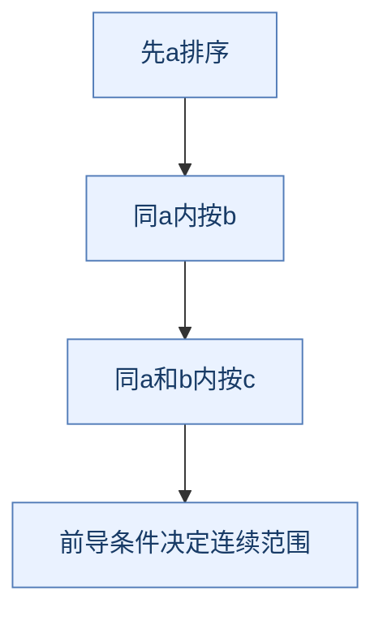
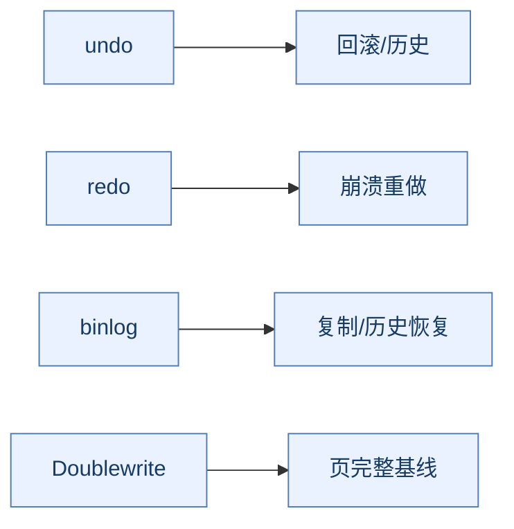
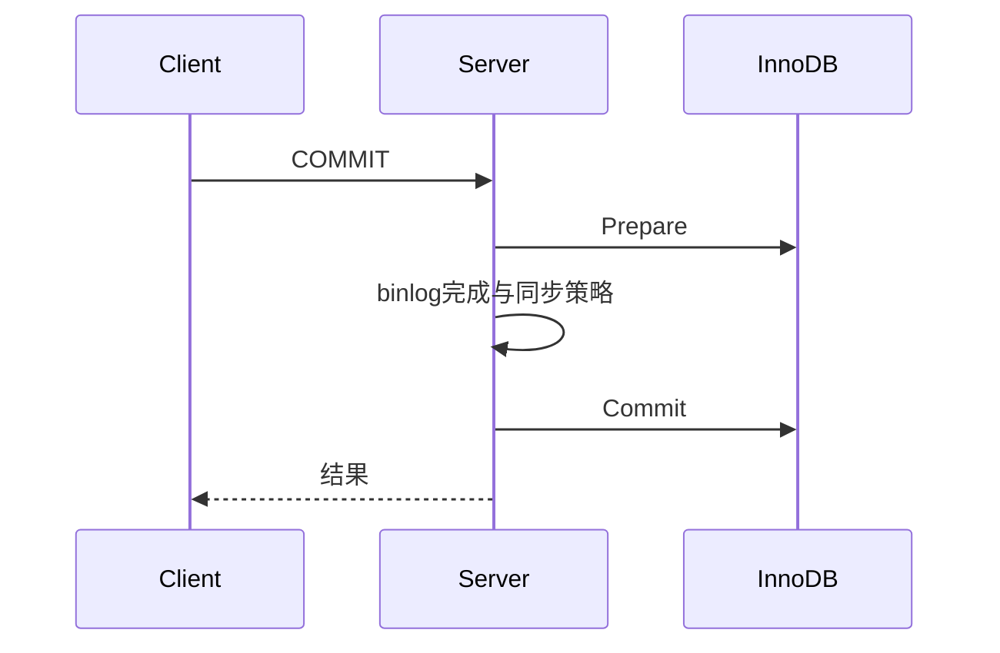
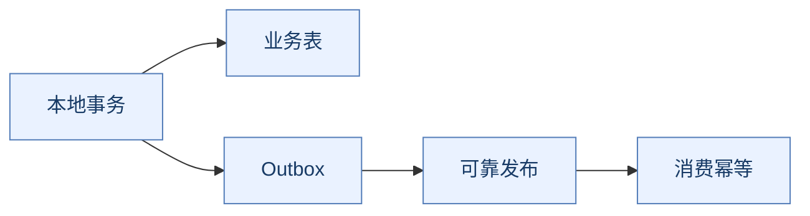

# MySQL 面试：执行路径、事务推导与架构取舍

> **使用方式**：先复述结论，再按“为何需要 → 如何实现 → 可选方案 → 故障与代价”展开。完整机制见 [MySQL原理.md](MySQL原理.md)。
>
> 以InnoDB与8.0/8.4为基础，版本差异另作说明。缩写在正文首次出现时展开，文末提供[术语附录](#glossary)。原有 [MySQL.md](MySQL.md) 保留，读新文档时注意版本与实现边界。

## 复习导航

| 阶段 | 题目 | 训练目标 |
| --- | --- | --- |
| **先串主链路** | Q1～Q8、Q39～Q48 | 从请求到持久与副本，分清各完成边界 |
| **重点练索引** | Q9～Q24 | 画出访问与排序路径，别只背失效口诀 |
| **重点做事务推演** | Q25～Q38 | 视图、当前读、锁范围、等待和重试 |
| **补业务与版本** | Q49～Q60 | 在线变更、模型、分片、外部一致性与恢复 |

---

## 一、执行链路与架构

**本篇重点**：区分入口、Server层、引擎和复制/分片职责。

### Q1：一条SELECT从客户端到结果经过什么？

> **一句话结论**：连接与Server层组织解析优化执行，引擎提供数据访问，端到端还包含网络和客户端等待。

**机制展开**：应区分连接池排队、权限上下文、优化、引擎取行、结果构造与返回。并非所有耗时都属于索引查找。

**⚖️ 方案对比与代价**：只优化SQL（Structured Query Language，结构化查询语言）可能无法改善池等待或大响应；先分段取证。

**🔎 追问演练**：SLOWLOG里SQL不慢，应用为何超时？

**推演要点**：可能在连接池、网络、结果消费或其他阶段等待，超时也不证明服务端没有执行。

**原理展开**：[对应章节](MySQL原理.md#execution)。

---

### Q2：连接池、thread cache、线程池有何区别？

> **一句话结论**：连接复用、线程创建复用与工作执行调度是不同层次。

**机制展开**：应用连接池复用会话，thread_cache_size涉及服务端线程缓存；专门线程池能力还与发行版和组件有关。

**⚖️ 方案对比与代价**：增大连接数可能增加竞争、缓冲与排队，不等于提升真实吞吐。

**🔎 追问演练**：把thread_cache_size设CPU（Central Processing Unit，中央处理器）倍数就得到线程池吗？

**推演要点**：不是，需先明确资源模型与有效并发，不能按参数名猜职责。

**原理展开**：[对应章节](MySQL原理.md#execution)。

---

### Q3：Buffer Pool与Query Cache有什么区别？

> **一句话结论**：前者缓存数据/索引页，后者是旧版查询结果缓存，8.0已移除。

**机制展开**：页缓存减少存储访问，不必理解SQL最终结果；结果缓存面对表变更失效和并发维护成本。

**⚖️ 方案对比与代价**：应用缓存还能减少数据库请求，却引入额外一致性问题。

**🔎 追问演练**：8.4中能在执行图上保留Query Cache吗？

**推演要点**：不应作为真实执行组件，历史机制需明确版本。

**原理展开**：[对应章节](MySQL原理.md#execution)。

---

### Q4：为什么主从能扩读却不自动扩写？

> **一句话结论**：副本保存完整数据并重放修改，单份写入仍由主节点承接。

**机制展开**：副本能处理适合的读取，主库仍维护索引、事务和日志。增加完整副本不把大表切成几份。

**⚖️ 方案对比与代价**：读副本暴露延迟，复制也消耗网络与应用资源。

**🔎 追问演练**：写后立刻查询能随便随机读副本吗？

**推演要点**：要定义读自己写和生效要求，必要时读主或按事务应用进度等待。

**原理展开**：[对应章节](MySQL原理.md#architecture)。

---

### Q5：高可用切主为什么不只是换地址？

> **一句话结论**：还需要故障判断、副本选择、旧主隔离、历史一致性与客户端恢复。

**机制展开**：旧主仍可写会产生分叉，副本未应用或缺日志会影响接管；超时事务结果又可能未知。

**⚖️ 方案对比与代价**：自动切换缩短恢复但不使默认异步复制零丢失，恢复与备份也不同。

**🔎 追问演练**：主挂后选延迟最小副本就一定安全？

**推演要点**：还要看完整事务历史、角色与隔离条件，单个延迟指标不够。

**原理展开**：[对应章节](MySQL原理.md#architecture)。

---

## 二、页、缓存与索引

**本篇重点**：从页访问、树组织、维护成本推导，而不是背固定I/O（Input/Output，输入输出）次数。

### Q6：页和Buffer Pool为什么能提高性能？

> **一句话结论**：按页搬运和缓存复用降低重复存储访问，脏页延后刷写减少提交随机写。

**机制展开**：命中访问内存，缺页加载；修改产生脏页，按日志约束刷回。页大小、行宽与溢出决定实际空间。

**⚖️ 方案对比与代价**：缓存容量、淘汰、刷脏与redo空间要协调，命中率高也可能写阻塞。

**🔎 追问演练**：缓存命中率99%以上为何仍很慢？

**推演要点**：查锁、CPU、网络、大响应、刷脏与日志等待，而非只看命中率。

**原理展开**：[对应章节](MySQL原理.md#storage)。

---

### Q7：改进LRU为什么能减少扫描污染？

> **一句话结论**：把新载入与真正热点分层管理，避免一次大扫描直接挤掉全部热页。

**机制展开**：冷热区域与晋升规则降低短期批量读污染，后台刷脏帮助留可用页和推进恢复基线。

**⚖️ 方案对比与代价**：参数和工作负载决定效果，不能把默认比例当永久最优。

**🔎 追问演练**：给Buffer Pool几乎全部物理内存合适吗？

**推演要点**：还要留连接、排序、日志、系统与其他任务空间，按实际实例模型估。

**原理展开**：[对应章节](MySQL原理.md#storage)。

---

### Q8：AHI与Change Buffer都必须打开吗？

> **一句话结论**：都是条件性优化，8.4默认关闭，需以真实负载验证而非背历史默认。

**机制展开**：AHI（Adaptive Hash Index，自适应哈希索引）为适合热点建立快捷路径；Change Buffer延后部分可缓冲二级索引冷页变更。唯一检查和索引条件限制使用。

**⚖️ 方案对比与代价**：维护、竞争、合并及恢复都有成本，不能简单承诺固定减少几次I/O。

**🔎 追问演练**：8.4不改参数就一定在用Change Buffer吗？

**推演要点**：不能，要看有效配置和实际活动，先区分机制存在与已启用。

**原理展开**：[对应章节](MySQL原理.md#storage)。

---

### Q9：B+树为何适合InnoDB通用索引？

> **一句话结论**：高扇出降低页层数，叶页有序便于范围读取，平衡等值、范围和更新成本。

**机制展开**：内部页组织分隔键和指针，定位叶页后可顺序取范围；缓存又减少实际物理读取。

**⚖️ 方案对比与代价**：哈希适合某些等值，二叉树扇出小，LSM（Log-Structured Merge Tree，日志结构合并树）写入与合并成本不同，没有全部负载统一冠军。

**🔎 追问演练**：树高三层就必然三次磁盘I/O吗？

**推演要点**：不是，页可能缓存，回表与其他检查又可能增加访问，要区分三种口径。

**原理展开**：[对应章节](MySQL原理.md#indexes)。

---

### Q10：聚簇索引与二级索引怎么组织？

> **一句话结论**：聚簇叶子保存行数据，二级条目通常包含主键作为定位依据。

**机制展开**：二级条件命中后若需要未覆盖列，继续按主键定位；无显式主键时引擎按规则选择或生成聚簇标识。

**⚖️ 方案对比与代价**：主键变宽会放大二级索引与缓存成本，不只是主键自己变大。

**🔎 追问演练**：表没有用户主键就没有聚簇结构吗？

**推演要点**：不是，会按引擎规则选择合适唯一非空键或内部标识。

**原理展开**：[对应章节](MySQL原理.md#indexes)。

---

### Q11：回表与覆盖索引分别是什么？

> **一句话结论**：回表补取未覆盖的行信息，覆盖利用已有索引列满足查询。

**机制展开**：回表增加另一索引路径与页访问，但不等于固定一次物理读；覆盖也需结合可见性和语句类型。

**⚖️ 方案对比与代价**：超宽覆盖索引降低部分读成本，却增加空间和写维护。

**🔎 追问演练**：Using index与Using index condition相同吗？

**推演要点**：不同，覆盖访问线索与索引条件下推线索要分别解释。

**原理展开**：[对应章节](MySQL原理.md#indexes)。

---

### Q12：自增主键一定优于UUID吗？

> **一句话结论**：常见短、趋势增长主键有局部性和二级空间优势，但应结合生成与业务约束。

**机制展开**：随机宽键可能增页分裂和缓存占用，顺序写也可能尾部热点；有序编码UUID（Universally Unique Identifier，通用唯一标识符）又不同于随机文本UUID。

**⚖️ 方案对比与代价**：全局唯一、可猜测性、迁移、写入和查询要综合，不能只按名称排序。

**🔎 追问演练**：雪花ID是否天然没有热点和时钟风险？

**推演要点**：不是，需核对生成节点、时钟与编码，还要看真实索引写分布。

**原理展开**：[对应章节](MySQL原理.md#indexes)。

---

### Q13：联合索引为什么遵循最左前缀？

> **一句话结论**：索引按元组字典序排列，前导条件决定能否定位小而连续的范围。

**机制展开**：(a,b,c)先按a再b再c；缺少前导约束或前导范围变大后，后列不再天然给一个窄区间。

**⚖️ 方案对比与代价**：定位、过滤、排序、覆盖是不同能力，后列未用于窄定位不等于完全无用。

**🔎 追问演练**：a等值、b范围后c就绝不能发挥作用吗？

**推演要点**：不能这样概括，可能做过滤、覆盖或其他优化，需看计划。

**原理展开**：[对应章节](MySQL原理.md#indexes)。

---

### Q14：ICP、Index Merge、Skip Scan分别意味着什么？

> **一句话结论**：它们优化不同访问/过滤工作，不是证明任何索引都无条件高效。

**机制展开**：ICP（Index Condition Pushdown，索引条件下推）将适用索引条件交给引擎减少整行访问，其他策略组合索引或枚举前导值，有条件和成本限制。

**⚖️ 方案对比与代价**：优化器可能不选，也可能估错；不应因存在Skip Scan就否定最左排列原理。

**🔎 追问演练**：加一个提示强制索引就是长期解决方案吗？

**推演要点**：先核对统计、选择性与真实参数，提示可能在分布变化后变差。

**原理展开**：[对应章节](MySQL原理.md#optimizer)。

---

### Q15：哪些写法会影响索引，哪些口诀不可靠？

> **一句话结论**：类型、表达式、排序规则与范围关系影响能力，不能凭关键字断言全部失效。

**机制展开**：列上函数、隐式转换、前导模糊可能改变定位；IS NULL、OR等仍可能有合适路径，函数索引也需匹配。

**⚖️ 方案对比与代价**：重写必须保持语义，尤其NULL和字符比较；不能只追求看起来用了key。

**🔎 追问演练**：字符串列和数字参数比较有何问题？

**推演要点**：比较规则可能改变语义及定位路径，应用绑定类型应与模型匹配。

**原理展开**：[对应章节](MySQL原理.md#optimizer)。

---

### Q16：索引越多越好吗？

> **一句话结论**：索引以空间与写维护换读能力，需按查询收益和冗余评估。

**机制展开**：每次写可能维护多棵树，主键宽度还影响二级成本；重复、低收益与超宽索引会挤缓存。

**⚖️ 方案对比与代价**：删索引也可能伤某类少见关键查询，应看负载窗口和依赖。

**🔎 追问演练**：只看一条慢SQL加宽索引有什么风险？

**推演要点**：可能改善单读却放大所有写入和恢复成本，需要全负载验证。

**原理展开**：[对应章节](MySQL原理.md#indexes)。

---

## 三、执行计划与SQL优化

**本篇重点**：先保证语义，比较估计与实际工作量。

### Q17：优化器为什么放着索引不用？

> **一句话结论**：它按统计估计成本，低选择性与大量回表时扫描可能更经济。

**机制展开**：数据倾斜、过期统计、列相关性和参数不同会造成估计偏差；直方图帮助估算而非新增索引。

**⚖️ 方案对比与代价**：有索引不是目标，少做必要工作才是；更新统计也不保证所有计划变好。

**🔎 追问演练**：强行让低选择性条件走二级索引一定更快吗？

**推演要点**：不一定，随机回表与范围量可能更贵，应比较实际行数、页和时间。

**原理展开**：[对应章节](MySQL原理.md#optimizer)。

---

### Q18：EXPLAIN应该如何看，rows是真是假？

> **一句话结论**：先看访问和连接结构，再看估计行数、过滤、键长度与额外工作。

**机制展开**：rows/filtered通常是估计，key不证明快，Extra也需上下文；多层计划不能只读第一行。

**⚖️ 方案对比与代价**：静态计划适合定位假设，实际负载、缓存与并发仍要核对。

**🔎 追问演练**：key_len越大计划就越好吗？

**推演要点**：不一定，长度是使用线索，不能代替选择性、扫描量和结果成本。

**原理展开**：[对应章节](MySQL原理.md#optimizer)。

---

### Q19：EXPLAIN ANALYZE与EXPLAIN有什么不同？

> **一句话结论**：ANALYZE实际运行相应路径并给算子行数、时间和循环，不是零成本预测。

**机制展开**：比较估计和真实，找最早失真的算子；内层单次快却循环多也可能主导。格式口径依版本解释。

**⚖️ 方案对比与代价**：不应对任意重语句直接在线运行，计划观测也会消耗真实资源。

**🔎 追问演练**：实际行数差一百倍先改哪里？

**推演要点**：先查参数分布、统计与过滤/连接估计，再评估索引和结构，不盲改全局缓冲。

**原理展开**：[对应章节](MySQL原理.md#optimizer)。

---

### Q20：深分页为什么慢，延迟关联能彻底解决吗？

> **一句话结论**：大offset仍可能扫描大量前置条目，延迟关联主要降低前置大行读取。

**机制展开**：先用窄索引找ID再关联可减回表；游标从上一排序键继续减少跳过，但需要唯一稳定边界。

**⚖️ 方案对比与代价**：任意页跳转、持续更新和固定快照不是游标天然提供的能力。

**🔎 追问演练**：只按created_at作分页游标安全吗？

**推演要点**：同时间多行可能漏重，应加入id等第二排序键并验证计划。

**原理展开**：[对应章节](MySQL原理.md#sql-tuning)。

---

### Q21：filesort一定落盘吗，GROUP BY一定有序吗？

> **一句话结论**：filesort是额外排序路径标识，不等于必落盘；GROUP BY不保证输出顺序。

**机制展开**：索引顺序符合时可少排序，否则内存、临时结构和溢出影响成本；需要顺序应显式ORDER BY。

**⚖️ 方案对比与代价**：加大每连接缓冲可能在并发时放大内存，而非无条件加速。

**🔎 追问演练**：SQL不写ORDER BY，测试总有序能依赖吗？

**推演要点**：不能，计划与执行可变化，业务顺序必须明确表达。

**原理展开**：[对应章节](MySQL原理.md#sql-tuning)。

---

### Q22：JOIN、EXISTS、IN、子查询怎么选？

> **一句话结论**：先对齐重复行与NULL等语义，再看优化器改写与实际路径。

**机制展开**：嵌套循环关注外侧数量和内侧定位，Hash Join有构建与内存成本，子查询可能被改写为其他执行形态。

**⚖️ 方案对比与代价**：语法名字不能给固定快慢排名，外连接过滤位置还可能改变结果。

**🔎 追问演练**：把NOT IN随手改成NOT EXISTS会怎样？

**推演要点**：要检查NULL和关联条件，性能优化不能悄悄改变业务集合。

**原理展开**：[对应章节](MySQL原理.md#sql-tuning)。

---

### Q23：COUNT星号、COUNT1和COUNT列有何区别？

> **一句话结论**：COUNT星号/常量计结果行，COUNT列忽略该列NULL，不能只比符号长短谈性能。

**机制展开**：InnoDB可见行依事务视图，不能给所有事务共用一个精确总行数；条件与路径决定扫描。

**⚖️ 方案对比与代价**：近似统计、缓存计数与精确一致计数是不同业务语义。

**🔎 追问演练**：COUNT1是否必然比COUNT星号快？

**推演要点**：不能这么推断，应看优化器处理、可用索引和真实条件。

**原理展开**：[对应章节](MySQL原理.md#sql-tuning)。

---

### Q24：批量插入和大事务怎么权衡？

> **一句话结论**：批量摊薄往返和固定成本，大事务却增加锁、日志、复制与恢复代价。

**机制展开**：行宽、执行时间、业务原子范围及失败重试决定批量，组提交也不等于业务要合并成巨事务。

**⚖️ 方案对比与代价**：固定每批1000条不适合所有载荷，应按时间和资源预算测。

**🔎 追问演练**：一百万条全部一个事务提交最省成本吗？

**推演要点**：可能制造长锁、undo、复制和回滚压力，需按业务一致性合理拆分。

**原理展开**：[对应章节](MySQL原理.md#sql-tuning)。

---

## 四、事务、MVCC与锁

**本篇重点**：可见性、修改条件、索引锁范围与事务边界要一起分析。

### Q25：ACID分别由什么支持，C是不是数据库自动懂业务？

> **一句话结论**：日志、锁、版本和提交协议协作，业务一致性仍需正确模型与约束。

**机制展开**：原子与回滚、隔离可见性、持久化边界是不同机制；转账金额和状态关系必须由业务事务表达。

**⚖️ 方案对比与代价**：只列redo/undo不能证明任意业务正确，外部缓存消息又超出本地事务。

**🔎 追问演练**：事务内执行了错误业务公式，提交后还算有事务吗？

**推演要点**：数据库可按机制完成事务，但不会自动修正错误业务含义。

**原理展开**：[对应章节](MySQL原理.md#transactions)。

---

### Q26：四种隔离级别如何理解？

> **一句话结论**：从读未提交到已提交、可重复读、串行化，分别约束不同并发观察和冲突行为。

**机制展开**：InnoDB实现还要区分普通一致性读、锁定读和修改，不能仅按标准现象表推全部锁。

**⚖️ 方案对比与代价**：更强隔离可能增加等待，较低隔离又需要业务显式条件保护。

**🔎 追问演练**：RR（Repeatable Read，可重复读）是否表示所有语句都读取同一个历史状态？

**推演要点**：不是，当前修改、锁定读和自身写入都要分别解释。

**原理展开**：[对应章节](MySQL原理.md#transactions)。

---

### Q27：MVCC具体靠什么，Read View是不是复制整张表？

> **一句话结论**：可见性状态加行版本历史按需重建，不是为每个事务复制数据库。

**机制展开**：版本携事务信息和undo关联，Read View按活跃集合与边界判断是否可见，不可见则继续找旧版。

**⚖️ 方案对比与代价**：省去部分读写互斥，却增加历史保留、purge和版本链读取成本。

**🔎 追问演练**：旧版本为什么不在事务提交后立刻全部删掉？

**推演要点**：其他仍有效读视图可能需要它，清理须遵守可见性需求。

**原理展开**：[对应章节](MySQL原理.md#transactions)。

---

### Q28：RC与RR分别什么时候建立Read View？

> **一句话结论**：RC（Read Committed，读已提交）普通读通常每语句新视图，RR通常复用首次建立的事务一致性视图。

**机制展开**：BEGIN一般不立刻建立RR读视图，明确一致性快照语法与隔离条件另算。

**⚖️ 方案对比与代价**：RC可见更新更及时但跨语句变化更多；RR稳定历史又可能保留更久版本。

**🔎 追问演练**：BEGIN后别人提交，再首次SELECT能见到吗？

**推演要点**：不能只凭BEGIN断言看不到，要按视图建立时点和语句类型推导。

**原理展开**：[对应章节](MySQL原理.md#transactions)。

---

### Q29：当前读、快照读和自己的写有何关系？

> **一句话结论**：普通一致性读、锁定读/修改使用不同规则，自己修改又可被自己观察。

**机制展开**：RR里先SELECT旧值，再UPDATE可能修改当前可用行；事务结果不必是纯粹某个旧时刻整库照片。

**⚖️ 方案对比与代价**：把旧快照数值拿来无条件覆盖当前状态，会有丢失更新和业务竞争。

**🔎 追问演练**：先查stock为1再SET stock为0就防超卖吗？

**推演要点**：不够，需条件扣减或适当锁定与幂等，检查影响行数。

**原理展开**：[对应章节](MySQL原理.md#transactions)。

---

### Q30：长事务为什么影响undo、锁和系统恢复？

> **一句话结论**：它可能保留旧视图或持有锁，使历史清理和并发推进受阻。

**机制展开**：是否有影响取决于事务、视图、写入和持锁；长连接不等于长事务，纯读也可能阻止部分purge。

**⚖️ 方案对比与代价**：分批减少压力但可能改变业务原子边界，应先定义可拆分单元。

**🔎 追问演练**：只读事务不加行锁，就没有副作用吗？

**推演要点**：不能，旧视图、MDL（Metadata Lock，元数据锁）与资源保留仍需观察。

**原理展开**：[对应章节](MySQL原理.md#transactions)。

---

### Q31：Record、Gap、Next-Key锁分别保护什么？

> **一句话结论**：记录、记录间隙、记录加前侧间隙是不同锁对象。

**机制展开**：锁在索引访问中建立，范围受隔离、索引唯一性、命中和语句路径影响；不能只看最终返回行。

**⚖️ 方案对比与代价**：间隙锁阻止某些插入，锁范围越大并发冲突越多，但不自动等于表锁。

**🔎 追问演练**：两个Gap Lock兼容是否允许别的事务插入？

**推演要点**：不是同一问题，间隙锁之间兼容不取消对插入的限制。

**原理展开**：[对应章节](MySQL原理.md#locking)。

---

### Q32：唯一等值命中、未命中与非唯一查询锁有何不同？

> **一句话结论**：完整唯一命中通常记录锁为核心，未命中也可能保护间隙，非唯一还需扫描匹配和边界。

**机制展开**：复合唯一只用部分列不属于完整唯一等值；索引路径和隔离条件改变分析。

**⚖️ 方案对比与代价**：不能用“等值都无间隙”“查不到就不锁”代替推导。

**🔎 追问演练**：主键有10/20/30，RR锁定查15，插入15可能等待吗？

**推演要点**：可能，未命中对应间隙仍受保护，应按实际事务与计划验证。

**原理展开**：[对应章节](MySQL原理.md#locking)。

---

### Q33：没有索引更新是不是行锁自动升级表锁？

> **一句话结论**：不能这样表述，可能是扫描并锁住大量索引记录和范围。

**机制展开**：引擎仍有聚簇组织，扫描范围大使阻塞效果接近整表，但不是据此发生某种自动升级协议。

**⚖️ 方案对比与代价**：合适索引缩小冲突面，却不保证没有死锁或热点。

**🔎 追问演练**：UPDATE只改一行为什么可能挡住很多请求？

**推演要点**：查扫描路径、锁范围、事务边界与其他索引维护，别只看最终影响行数。

**原理展开**：[对应章节](MySQL原理.md#locking)。

---

### Q34：RC有没有间隙锁，RR是否彻底没有幻读？

> **一句话结论**：RC减少普通扫描的间隙锁但有重复键/外键检查例外，RR也须区分读取模式。

**机制展开**：RR普通读用视图，锁定范围读用相应锁机制；混合当前修改与自己新写的观察更复杂。

**⚖️ 方案对比与代价**：标准现象表有帮助，但不是所有实现与业务组合的完整证明。

**🔎 追问演练**：能说Gap Lock只在RR任何情况下才存在吗？

**推演要点**：不能，需给语句、隔离、索引和检查上下文。

**原理展开**：[对应章节](MySQL原理.md#locking)。

---

### Q35：意向锁、MDL和行锁是一回事吗？

> **一句话结论**：它们分别参与锁层级、结构定义和记录并发，保护范围不同。

**机制展开**：意向模式协调表级与行级请求，MDL保护元数据，S/X记录锁影响行访问。内部latch又是实现同步层。

**⚖️ 方案对比与代价**：把所有等待都叫行锁会误诊，需看等待对象与持有者。

**🔎 追问演练**：有IX就说明整表所有行禁止别人访问吗？

**推演要点**：不是，意向锁不是把全部记录都锁死。

**原理展开**：[对应章节](MySQL原理.md#locking)。

---

### Q36：死锁与锁等待超时如何区分，回滚范围一样吗？

> **一句话结论**：循环依赖是死锁，单向等慢事务不是；错误后的回滚范围也不能一概处理。

**机制展开**：检测可回滚受害事务，锁等待超时默认常只回滚当前语句，配置与错误类型影响结果。

**⚖️ 方案对比与代价**：统一访问顺序、短事务和索引降低概率，不取代重试设计。

**🔎 追问演练**：捕获超时后继续提交旧事务安全吗？

**推演要点**：需确认错误范围和业务状态，通常应按清晰事务边界恢复，不能无条件继续。

**原理展开**：[对应章节](MySQL原理.md#deadlocks)。

---

### Q37：死锁重试应该重试一条SQL还是完整事务？

> **一句话结论**：通常从完整业务事务边界重新读取和判断，并治理外部副作用。

**机制展开**：单句重发可能保留过期计算与部分执行状态；重试应有上限、退避和稳定请求标识。

**⚖️ 方案对比与代价**：关闭检测可能减部分热点成本，却转向超时处理，不能当通用提速按钮。

**🔎 追问演练**：事务外先发消息后数据库死锁，重试会怎样？

**推演要点**：可能重复消息，需将发布与事务协调或使用可靠Outbox及消费幂等。

**原理展开**：[对应章节](MySQL原理.md#deadlocks)。

---

### Q38：长事务与DDL为什么能拖住后续SELECT？

> **一句话结论**：MDL持有、DDL（Data Definition Language，数据定义语言）排队与后续锁请求可能形成等待放大链。

**机制展开**：数据算法瞬时也需元数据协调，旧事务不结束可让结构变更等锁；队列关系再影响新请求。

**⚖️ 方案对比与代价**：只盯DDL运行秒数或只杀当前SELECT可能没找到根阻塞者。

**🔎 追问演练**：加字段用INSTANT是不是绝不阻塞？

**推演要点**：不是，适用性和MDL阶段都要检查。

**原理展开**：[对应章节](MySQL原理.md#ddl)。

---

## 五、日志、恢复与复制

**本篇重点**：成功响应、日志持久、接收与应用分别解释。

### Q39：undo、redo、binlog分别是什么？

> **一句话结论**：undo服务回滚与旧版本，redo服务崩溃重做，binlog服务Server层事件历史与复制恢复。

**机制展开**：三者分工不同，binlog可用行事件而非原SQL，redo也有具体内部记录形态，不能只背物理对逻辑。

**⚖️ 方案对比与代价**：它们都不是独立万能审计或备份替代品，应按恢复目标组合。

**🔎 追问演练**：有binlog能否不需要redo？

**推演要点**：不能据此恢复任意不完整引擎物理页，边界不同。

**原理展开**：[对应章节](MySQL原理.md#logs)。

---

### Q40：WAL为什么让提交不必先刷所有数据页？

> **一句话结论**：先满足日志可恢复约束，允许脏数据页后续刷写，减少提交随机I/O。

**机制展开**：修改内存页产生redo，提交按策略推进日志；数据页刷写受相关日志约束，不是无序随便写。

**⚖️ 方案对比与代价**：日志空间有限，checkpoint与后台刷脏仍必需，不能无限缓存修改。

**🔎 追问演练**：日志很大是否就能永远不刷数据页？

**推演要点**：不行，恢复基线、可用页和有限日志空间都要求持续推进。

**原理展开**：[对应章节](MySQL原理.md#logs)。

---

### Q41：Doublewrite为什么不能被redo简单替代？

> **一句话结论**：部分写坏的数据页可能不是有效重做基线，Doublewrite帮助恢复完整页。

**机制展开**：先保留完整页副本再写目标位置，异常时用有效页配合redo；不是执行同一事务两遍。

**⚖️ 方案对比与代价**：增加写入与空间成本，底层原子写和版本配置可改变路径，不能凭跑分快就关闭。

**🔎 追问演练**：页校验能发现坏页，是否就能修复？

**推演要点**：发现与恢复不同，还需要完整基线和日志等恢复依据。

**原理展开**：[对应章节](MySQL原理.md#logs)。

---

### Q42：redo、binlog为什么需要内部提交协调？

> **一句话结论**：避免引擎提交结果与复制/恢复日志历史出现不匹配。

**机制展开**：以prepare、binlog完成和engine commit理解概念，再考虑组提交与并发阶段。

**⚖️ 方案对比与代价**：这不是自动涵盖所有外部系统的分布式事务。

**🔎 追问演练**：binlog完整已持久而commit标记没完成就崩溃怎么办？

**推演要点**：按关联事务与恢复协议完成相应判定，不能只见prepare就一律回滚。

**原理展开**：[对应章节](MySQL原理.md#recovery)。

---

### Q43：双1、组提交分别保证或优化什么？

> **一句话结论**：双1加强相应本地日志同步策略，组提交摊薄多事务固定同步成本。

**机制展开**：redo与binlog各自策略要协调；组共享同步不等于业务强行合成一个巨大事务。

**⚖️ 方案对比与代价**：设备兑现、文件系统、共同故障和跨机房不由两参数自动保证。

**🔎 追问演练**：双1就能声称跨可用区零丢失吗？

**推演要点**：不能，还要复制、接管、故障模型和独立恢复。

**原理展开**：[对应章节](MySQL原理.md#recovery)。

---

### Q44：COMMIT超时后事务到底成功没有？

> **一句话结论**：可能成功、失败或结果暂未知，不能由客户端异常单独判断。

**机制展开**：服务端提交后响应丢失很常见；稳定业务唯一标识、结果查询与幂等恢复用于避免重复。

**⚖️ 方案对比与代价**：无限重试减少不了语义不确定，反而可能重复扣款/下单。

**🔎 追问演练**：自动重发整笔扣款就安全吗？

**推演要点**：需在权威数据源用唯一请求及事务保证，外部副作用也要协调。

**原理展开**：[对应章节](MySQL原理.md#business)。

---

### Q45：复制线程、relay log与副本应用是什么关系？

> **一句话结论**：源事件传输、接收保存、调度应用和最终可读是不同阶段。

**机制展开**：副本接到日志可能还没执行，依赖、大事务、DDL、锁和资源影响并行应用。

**⚖️ 方案对比与代价**：加应用线程不能打破事务依赖或解决设备与热点上限。

**🔎 追问演练**：副本日志收齐后读到旧订单是否一定异常？

**推演要点**：不一定，可能尚未应用，要看具体事务进度和读取路径。

**原理展开**：[对应章节](MySQL原理.md#replication)。

---

### Q46：GTID解决什么，是否就是全局提交时间？

> **一句话结论**：它标识复制事务并帮助定位已执行历史，不代表所有副本都完成或全业务分片总序。

**机制展开**：GTID（Global Transaction Identifier，全局事务标识）集合简化部分位置管理与接管，但仍要检查历史完整性、事务错误和候选。

**⚖️ 方案对比与代价**：不能把有GTID当自动无损切换，也不能用标识替代备份恢复。

**🔎 追问演练**：两个副本Seconds_Behind一样就历史一样吗？

**推演要点**：不证明，应结合事务集合、接收/应用和错误状态。

**原理展开**：[对应章节](MySQL原理.md#replication)。

---

### Q47：半同步是不是副本已经执行完成？

> **一句话结论**：典型确认针对接收并持久化relay log，不等于SQL已应用可读。

**机制展开**：等待点、要求数量、超时和回退决定语义；回退异步后成功响应不能再按同一确认级别理解。

**⚖️ 方案对比与代价**：增加确认改善部分丢失风险却增加延迟与失败处理。

**🔎 追问演练**：半同步提交后马上读副本仍旧怎么办？

**推演要点**：确认和应用分开，可读主或按指定事务应用等待，处理超时。

**原理展开**：[对应章节](MySQL原理.md#replication)。

---

### Q48：Group Replication与多主是否等于无冲突强一致？

> **一句话结论**：组协议、认证和一致性等级改善相应模型，多主仍可能冲突失败，读语义需配置解释。

**机制展开**：认证/锁阶段可回滚，切主积压与事务前后等待受一致性设置影响。

**⚖️ 方案对比与代价**：完整数据复制不等于分片，多主也不能让同一热点无限并行。

**🔎 追问演练**：用了InnoDB Cluster是否还需业务幂等？

**推演要点**：需要，响应不确定、应用重试和外部系统仍有各自窗口。

**原理展开**：[对应章节](MySQL原理.md#replication)。

---

## 六、DDL、建模与业务一致性

**本篇重点**：把正确约束放进合适原子边界，明确迁移和外部系统成本。

### Q49：Online、INSTANT、INPLACE、COPY有什么不同？

> **一句话结论**：它们分别涉及算法与并发维度，不能看名字推导全程无锁或不重建。

**机制展开**：具体变更、版本与表特性决定算法，INPLACE也可能重建，INSTANT有适用限制，前后MDL仍需协调。

**⚖️ 方案对比与代价**：快数据阶段不代表无等待，临时空间与副本延迟也应估算。

**🔎 追问演练**：线上改一列失败后直接让算法自动降级好吗？

**推演要点**：需明白可能退成昂贵路径，按目标变更与资源边界评估而非盲执行。

**原理展开**：[对应章节](MySQL原理.md#ddl)。

---

### Q50：原子DDL等于BEGIN里改表能回滚吗？

> **一句话结论**：不等于，原子DDL服务崩溃一致结果，许多DDL仍触发隐式提交。

**机制展开**：数据字典、引擎与日志协调减少半成结构状态；用户事务语义另有规则。

**⚖️ 方案对比与代价**：不能用ROLLBACK能力类比任意数据库产品，应核对具体语句。

**🔎 追问演练**：先UPDATE后ALTER，最后ROLLBACK会怎样？

**推演要点**：须按隐式提交规则判断，不能假设前面所有数据操作都会撤销。

**原理展开**：[对应章节](MySQL原理.md#ddl)。

---

### Q51：金额用DECIMAL还是整数，INT11表示什么？

> **一句话结论**：精确金额选择合适精度或最小单位整数并定义舍入；旧显示宽度不等于存储范围。

**机制展开**：近似浮点有精度误差，整数有范围与单位成本，DECIMAL也需业务舍入规则。

**⚖️ 方案对比与代价**：类型不仅影响空间，也影响计算、比较、索引和迁移。

**🔎 追问演练**：把DOUBLE改成DECIMAL就解决所有对账差异吗？

**推演要点**：未必，历史精度、舍入时点、单位和业务公式都需核对。

**原理展开**：[对应章节](MySQL原理.md#schema)。

---

### Q52：字符集、collation、NULL唯一语义如何影响业务？

> **一句话结论**：编码、比较排序和缺失值语义分别影响存储、索引与约束。

**机制展开**：大小写/重音规则可能影响唯一；唯一索引通常允许多个NULL，SQL NULL也不是空字符串。

**⚖️ 方案对比与代价**：升级排序规则可能改查询与冲突行为，不能只认为字符看起来一样。

**🔎 追问演练**：可空业务唯一列能保证缺省请求只出现一次吗？

**推演要点**：不一定，要明确NULL语义并设计实际唯一约束或非空标识。

**原理展开**：[对应章节](MySQL原理.md#schema)。

---

### Q53：分区表与分库分表是不是一回事？

> **一句话结论**：原生分区主要仍在相应实例模型内管理表数据，跨库分片改变所有权与事务边界。

**机制展开**：分区裁剪要有合适条件，分片则涉及路由、全局查询、唯一和迁移。

**⚖️ 方案对比与代价**：表大不是唯一依据，索引、归档和工作集可能先解决问题。

**🔎 追问演练**：分区多了写吞吐就按数量倍增吗？

**推演要点**：不能，仍受实例CPU、存储、日志和热点约束。

**原理展开**：[对应章节](MySQL原理.md#sharding)。

---

### Q54：分片键、扩容、全局ID如何设计？

> **一句话结论**：让相关原子业务尽量局部化，再定义全局约束和迁移边界。

**机制展开**：节点数取模变化会重映射大量键，路由/虚拟桶降低部分复杂度，但基线、增量与切换仍需治理。

**⚖️ 方案对比与代价**：全局主键唯一不等于业务请求幂等，跨片排序也非天然存在。

**🔎 追问演练**：更换路由时旧客户端继续写怎么办？

**推演要点**：要有路由版本、切流与恢复协议，不能只复制完数据就宣布完成。

**原理展开**：[对应章节](MySQL原理.md#sharding)。

---

### Q55：库存、乐观锁与业务幂等怎么配合？

> **一句话结论**：用条件更新约束当前状态，用稳定唯一标识避免同一请求重复成功。

**机制展开**：扣减WHERE stock>0并查影响行数，复杂修改可用版本或锁定读；去重和业务在本地事务共同提交。

**⚖️ 方案对比与代价**：分布式锁能减少竞争但不应替代权威数据库约束，外部操作仍需协调。

**🔎 追问演练**：扣减已提交但客户端超时后又扣一次怎么办？

**推演要点**：按请求ID恢复结果，不能让相同业务请求再次无条件扣减。

**原理展开**：[对应章节](MySQL原理.md#business)。

---

### Q56：MySQL与消息/Redis双写怎样保证恢复？

> **一句话结论**：先定义本地原子与跨系统可恢复边界，交换两次调用顺序不能消灭窗口。

**机制展开**：Outbox本地保存业务和发布意图，发布/CDC（Change Data Capture，数据变更捕获）可能重复，消费幂等；缓存失效还要考虑迟到旧回填。

**⚖️ 方案对比与代价**：增加表、发布器、清理和延迟成本，换来故障后的可靠恢复依据。

**🔎 追问演练**：CDC发了缓存删除就一定再无旧缓存吗？

**推演要点**：旧读仍可能晚回填，通知恢复和回填版本治理是两件事。

**原理展开**：[对应章节](MySQL原理.md#business)。

---

## 七、排障、版本与综合设计

**本篇重点**：按证据、目标小版本和故障模型回答。

### Q57：慢SQL、连接耗尽怎么按证据排查？

> **一句话结论**：分连接、网络、执行、锁与设备层看时间线，再改计划或资源。

**机制展开**：结合真实参数、计划、实际行数、事务和阻塞链，Performance Schema/sys与慢日志提供不同观测。

**⚖️ 方案对比与代价**：增大max_connections可能把应用排队转成数据库压力，重试也会放大故障。

**🔎 追问演练**：只在空表跑SQL快能证明生产没问题吗？

**推演要点**：不能代表数据倾斜、缓存、索引体积、并发与结果规模。

**原理展开**：[对应章节](MySQL原理.md#operations)。

---

### Q58：备份、binlog、复制与RPO/RTO是什么关系？

> **一句话结论**：副本服务在线冗余，独立备份和日志服务历史恢复，目标需通过演练验证。

**机制展开**：误删除会传播到副本；恢复还包含基线加载、日志重放、路由切换和业务核对，不只看备份生成成功。

**⚖️ 方案对比与代价**：更长保留用空间换恢复窗口，更多副本又不能代替独立历史。

**🔎 追问演练**：有binlog就能从任何时刻恢复吗？

**推演要点**：还要一致基线、完整连续事件、位置与恢复规则，不能只有零散日志。

**原理展开**：[对应章节](MySQL原理.md#operations)。

---

### Q59：5.7、8.0、8.4及后续版本有哪些重点差异？

> **一句话结论**：按小版本、发行能力和发布线解释，不能把旧图和参数直接套到现代版本。

**机制展开**：8.0移除Query Cache并演进数据字典、原子DDL和优化；8.4改默认与兼容边界，后续LTS（Long-Term Support，长期支持）和日历命名Innovation又有独立路径。

**⚖️ 方案对比与代价**：LTS不是无需补丁，Innovation也不是只看号大就必须升级；认证、连接器、排序、计划、恢复和复制都需核对。

**🔎 追问演练**：8.4的AHI与Change Buffer还应照旧默认开启讲吗？

**推演要点**：不应，机制存在与默认有效配置不同，参考对应官方参数与负载验证。

**原理展开**：[对应章节](MySQL原理.md#releases)。

---

### Q60：设计高并发订单库，怎样讲完整而不堆参数？

> **一句话结论**：先定义原子约束、访问与恢复目标，再推导索引、事务、架构和容量。

**机制展开**：围绕订单/库存/请求唯一性建模，按查询设计索引，缩短事务并幂等；按需读扩展、高可用或分片，配合Outbox、监控和恢复。

**⚖️ 方案对比与代价**：缓存提升读能力却带一致性，副本有延迟，分片削弱单库能力，每步需明确新增复杂度。

**🔎 追问演练**：面试官要求立即一致、无限扩展、零停机零丢失怎么办？

**推演要点**：量化约束和故障模型，说明成本与不能同时无条件满足的目标，给可验证取舍。

**原理展开**：[对应章节](MySQL原理.md#architecture)。

---

## 附录 A：高频误区与验证方向

| 误区 | 核对方向 |
| --- | --- |
| 有索引就快、没有key就一定错 | 实际扫描、回表、返回比例和成本 |
| 范围之后所有索引列无效 | 定位、下推过滤、覆盖与顺序分别解释 |
| 三层树必固定三次物理读 | 缓存、实际页访问和回表 |
| RR里所有语句都旧快照 | 一致性读、当前修改、自己写入 |
| RC任何情况都无Gap Lock | 重复键/外键等例外与具体语句 |
| 无索引自动升级表锁 | 实际扫描锁范围与引擎组织 |
| 事务异常都只回滚当前语句 | 死锁、超时、配置和具体错误 |
| COUNT1一定比COUNT星快 | 结果语义、可见性与执行路径 |
| 双1保证任意故障零丢失 | 同步策略、设备与复制故障模型 |
| 半同步ACK表示已应用 | 接收日志、应用、可见状态不同 |
| INPLACE绝不重建、在线绝不锁 | 具体操作、版本与MDL阶段 |
| 多主集群等于分片 | 完整复制与数据所有权拆分不同 |

## 附录 B：官方资料

- [索引](https://dev.mysql.com/doc/refman/8.4/en/innodb-index-types.html)与[EXPLAIN](https://dev.mysql.com/doc/refman/8.4/en/explain.html)
- [MVCC](https://dev.mysql.com/doc/refman/8.4/en/innodb-multi-versioning.html)与[一致性读](https://dev.mysql.com/doc/refman/8.4/en/innodb-consistent-read.html)
- [锁](https://dev.mysql.com/doc/refman/8.4/en/innodb-locking.html)与[死锁](https://dev.mysql.com/doc/refman/8.4/en/innodb-deadlock-detection.html)
- [Redo](https://dev.mysql.com/doc/refman/8.4/en/innodb-redo-log.html)、[Binlog](https://dev.mysql.com/doc/refman/8.4/en/binary-log.html)
- [复制](https://dev.mysql.com/doc/refman/8.4/en/replication.html)与[组复制](https://dev.mysql.com/doc/refman/8.4/en/group-replication-summary.html)
- [DDL支持](https://dev.mysql.com/doc/refman/8.4/en/innodb-online-ddl-operations.html)与[版本变化](https://dev.mysql.com/doc/refman/8.4/en/mysql-nutshell.html)

## 附录 C：术语与缩写

| 缩写/术语 | 英文全称或原词 | 中文与边界 |
| --- | --- | --- |
| SQL | Structured Query Language | 结构化查询语言 |
| ACID | Atomicity, Consistency, Isolation, Durability | 原子、一致、隔离、持久，需配合业务约束 |
| MVCC | Multi-Version Concurrency Control | 多版本并发控制，不是整库复制快照 |
| RC / RR | Read Committed / Repeatable Read | 读已提交/可重复读，区分读取模式 |
| RU | Read Uncommitted | 读未提交，不能保证业务读取正确 |
| Read View | Read View | 可见性判断状态，普通读与当前修改分开 |
| WAL | Write-Ahead Logging | 预写日志，不是所有日志都相同 |
| LSN | Log Sequence Number | redo等内部进度，不是binlog文件位置 |
| MDL | Metadata Lock | 元数据锁，与行记录锁不同 |
| S / X | Shared / Exclusive | 共享/排他锁模式 |
| IS / IX | Intention Shared / Intention Exclusive | 意向共享/意向排他，协调层级锁 |
| ICP | Index Condition Pushdown | 索引条件下推，减少部分整行访问 |
| AHI | Adaptive Hash Index | 自适应哈希索引，版本默认值不同 |
| LRU | Least Recently Used | 最近最少使用，缓存管理不是精确统一规则 |
| LSM | Log-Structured Merge Tree | 日志结构合并树，与B+树有不同取舍 |
| UUID | Universally Unique Identifier | 通用唯一标识符，编码和顺序影响成本 |
| GTID | Global Transaction Identifier | 复制事务标识，不代表全部副本都已应用 |
| MGR | MySQL Group Replication | MySQL组复制，不是分库分表 |
| DDL / DML | Data Definition Language / Data Manipulation Language | 数据定义/数据操作语言 |
| CTE | Common Table Expression | 公用表表达式，组织语法不等于性能承诺 |
| CDC | Change Data Capture | 数据变更捕获，不自动处理全部外部一致性 |
| LTS | Long-Term Support | 长期支持发布路径 |
| RPO / RTO | Recovery Point Objective / Recovery Time Objective | 恢复点/恢复时间目标 |
| P99 | 99th Percentile | 99分位数，不等于最大值 |
| CPU / I/O | Central Processing Unit / Input/Output | 中央处理器/输入输出 |
| JSON | JavaScript Object Notation | 数据交换格式，需设计查询与演进 |
| NULL | SQL NULL | 缺失/未知值相关语义，不等于空字符串 |
| redo / undo / binlog | Redo Log / Undo Log / Binary Log | 重做/回滚历史/二进制事件，各有职责 |
| fsync | File synchronization system call | 文件同步系统调用，依赖存储兑现语义 |
| Outbox | Transactional Outbox | 本地事务持久化待发布意图 |
| CAS | Compare-And-Set | 比较并设置，版本条件实现乐观检查思想 |
