# Kafka 原理：从分区日志到业务一致性

> 阅读目标：理解一条事件如何被路由、批量发送、复制、提交、读取和处理，并能推导故障时会发生什么。
>
> 基础流程以 Kafka 3.x/4.x 共有的分区日志模型展开，涉及差异时标注小版本；配置示例仍固定为 4.1，本地实验使用 4.1.2。第 11 章比较 3.x 与 4.0/4.1/4.2 的关键演进，不把它们视作完全相同的实现，也不声称覆盖全部后续版本。文中“消费组”默认指普通 Consumer Group 的 subscribe 模型，Share Group 单独说明。面试复习见 [Kafka面试.md](Kafka面试.md)。

全文按“问题 → 备选方案 → 实现 → 收益 → 代价与边界”解释关键设计。阅读时关注消息、复制状态、消费进度和业务副作用分别存在哪里、由谁改变，而不只记参数名。

## 阅读路线

**顺着消息走一遍**：建立日志模型 → 跟踪写入与复制 → 推导读取与提交 → 处理事务和业务一致性。

**按需查阅**：[版本差异](#versions)用于区分3.x/4.x；[文末术语附录](#glossary)用于回查缩写。正文在术语首次出现时解释全称，不要求预先背表。

| 阶段 | 章节 | 应当能够回答的问题 |
| --- | --- | --- |
| 建立模型 | 1～2 | 为什么 Topic 要分区？控制面和数据面如何分工？ |
| 跟踪写入 | 3～5 | send 返回代表什么？acks、ISR、HW 如何配合？ |
| 跟踪读取 | 6～7 | 拉取位置、提交位置和业务完成位置为什么不同？ |
| 推导一致性 | 8～9 | 幂等、事务、数据库去重分别解决什么问题？ |
| 版本与落地 | 10～12 | 如何做容量规划、排障和故障验证？ |

| 学习路径 | 快速跳转 |
| --- | --- |
| **主链路** | [日志模型](#log-model) → [集群架构](#architecture) → [发送](#producer) → [存储](#storage) → [复制](#replication) |
| **消费与一致性** | [消费](#consumer) → [组协调](#rebalance) → [事务](#transactions) → [业务一致性](#business-consistency) |
| **查阅与实践** | [运维](#operations) · [版本差异](#versions) · [实验](#experiments) · [术语附录](#glossary) |

<a id="log-model"></a>

## 1. 从事件到分区日志

> 🎯 **先建立一个模型**
>
> **Kafka保存的是可重放的分区日志，消费进度和数据保留是两套状态。**
>
> 重点分清：Topic与Partition、局部顺序与全局顺序、消费完成与日志删除。

### 1.1 消息队列之外的日志模型

假设订单服务产生三条事件：订单创建、订单支付、订单取消。Kafka 不会因为积分服务已经处理某条事件，就把该事件从所有订阅方的数据中删除。积分、统计、审计服务可以各自读取同一条日志，维护不同进度。

这个模型把两个问题拆开了：**数据还保留多久**由 Broker 的日志策略决定，**某个业务处理到哪里**由消费组进度决定。因此，**消费组落后并不能阻止日志过期**；数据仍在保留窗口内，也不代表某个组还没有消费过。

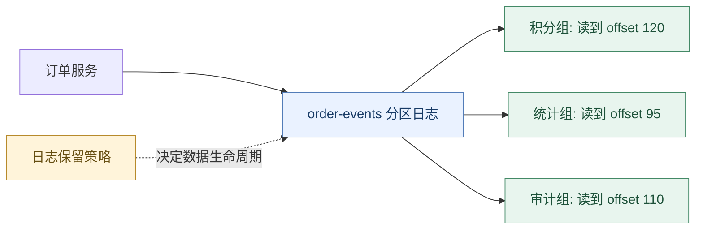

**读图抓手**：一份日志保留多组独立进度，保留策略不由某个组的完成情况决定。

图中 offset 为同一分区的示意值。一个 Topic 含多个分区时，消费进度实际是一组 `(topic, partition, offset)`，不是一个全局数字。

### 1.2 一条 Record 中有什么

| 字段 | 用途 | 设计注意点 |
| --- | --- | --- |
| topic / partition | 确定目标日志 | 显式 partition 会绕过常规 key 路由 |
| key | 路由、压缩、业务关联 | key 的字节序列需要稳定 |
| value | 事件载荷 | 明确 schema 与兼容策略 |
| timestamp | 事件或追加时间 | 不等于定时投递时间 |
| headers | 携带追踪及辅助信息 | 不应把必要业务标识仅放在易丢失的上下文中 |
| offset | 服务端追加后的位置 | 仅在该分区内有意义 |

业务载荷建议包含稳定的 `eventId`、`aggregateId`、事件类型和业务版本。`eventId` 标识这一次事件，`aggregateId`（如 orderId）标识事件属于哪个业务实体；两者承担不同职责。

### 1.3 为什么需要 Partition

单个有序日志可以简化顺序读取，但一个日志的写入及处理能力有限。Kafka 将 Topic 拆成多个日志，并把它们分布在不同 Broker 上，获得并行读写能力。

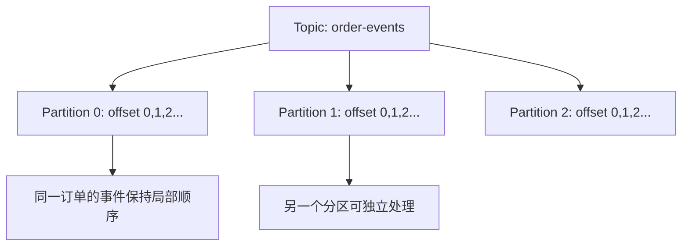

分区带来的关键权衡是：**更高并行度与局部顺序并存，但没有跨分区的天然全局顺序**。时间戳也不能建立严格的跨主机因果顺序，因为存在时钟误差、网络延迟与并发。

### 1.4 同 key 顺序成立的条件

默认路由下，同 key 进入同分区需要 key 序列化、分区数及分区逻辑保持一致。若 key 原来映射到 3 个分区，扩成 6 个后，一些 key 会落到新分区；旧数据仍留在旧分区，新旧数据可能被不同消费者并行处理。

完整的订单顺序还要求：源端先建立正确的业务顺序，生产端处理重试排序，消费端不把同订单事件无序并行执行。**分区有序不能修复源端已经反序发送的事件**。

### 1.5 为什么选分区日志：与全局队列、逐消息删除对比

**要解决的问题**：既要让多业务独立消费与重放，又要有足够吞吐和可管理的状态成本。

| 方案 | 优点 | 成本与局限 |
| --- | --- | --- |
| 单个全局有序日志 | 顺序边界清晰，恢复位置简单 | 串行瓶颈，难以同时获得全局顺序与高并行度 |
| 多分区有序日志 | 并行扩展，分区内顺序，按 key 局部聚合 | 跨分区无天然顺序，热点 key 仍可能限制吞吐 |
| 逐消息确认并回收的工作队列 | 易表达任务完成、单条失败重投与竞争领取 | 要维护记录级状态；多订阅与长期历史回放需要额外模型 |

Kafka 的普通组将“一个分区处理到哪里”压缩成一个位置，配合追加日志，适合大量连续流式处理。它付出的代价是**单条乱序确认不自然**、失败记录容易挡住分区、历史保留与消费完成解耦。

这不是说工作队列性能一定低，也不是说其他 MQ（Message Queue，消息队列） 不支持流式日志；比较对象是数据和进度模型。Kafka 后来的 Share Group 正是在同一日志基础上增加记录级领取与确认状态。

**具体例子**：订单审计需要读过去七天，日志模型很合适；图像处理任务耗时从 10ms 到 10min 不等，工作领取模型可能更容易平衡负载。选择取决于顺序、重放和单条任务调度需求。

<a id="architecture"></a>

## 2. 集群架构：控制面与数据面

> 🎯 **看清角色与路径**
>
> **Controller管元数据，Broker管数据；客户端发现Leader后直接读写。**
>
> 沿架构图找出：谁决定归属、谁保存数据、谁在故障后接替。

### 2.1 三个 Broker 如何存放两个分区

以下示例中两个分区都有 3 个副本，Leader 分散在不同 Broker，以分摊客户端流量。

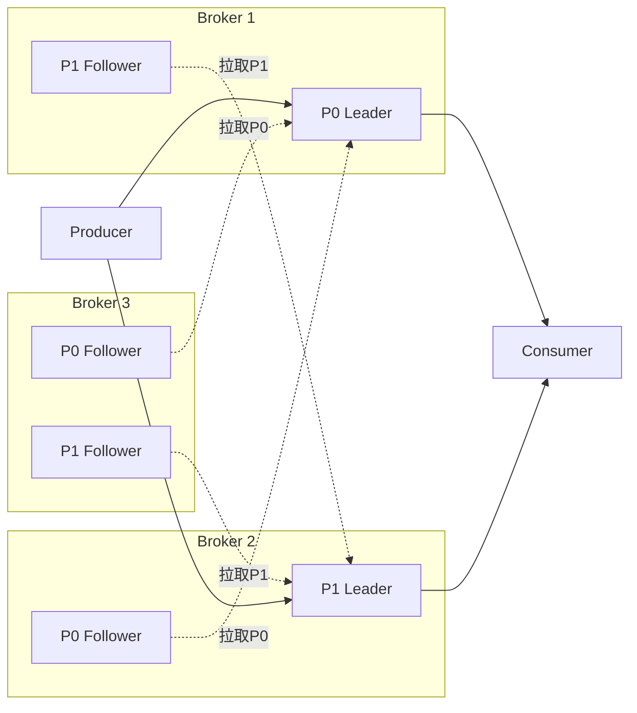

虚线表示 Follower 主动发起 Fetch，而不是 Leader 主动广播所有数据。客户端通常直接访问对应分区 Leader；特定副本读取配置可以改变读取位置，不能把 Leader 描述为所有情况下唯一可读节点。

### 2.2 客户端为什么只需要 bootstrap.servers

`bootstrap.servers` 是发现集群的入口。客户端连接其中一个可用节点，获取 Topic 分区、Leader 地址等元数据，再直接连接目标节点；入口节点不代理所有后续请求。

这解释了一个常见故障：入口地址可达，但元数据中返回的 `advertised.listeners` 地址无法从客户端网络访问，最终仍然收发超时。容器内部的 localhost 与宿主机的 localhost 也不是同一个网络位置。

### 2.3 KRaft 负责什么

Kafka 4.x 使用 KRaft（Kafka Raft，Kafka元数据共识机制） 管理集群元数据。Controller quorum 中的活动 Controller 负责元数据变更，其他 Controller 跟踪元数据日志；Broker 根据元数据更新分区状态。

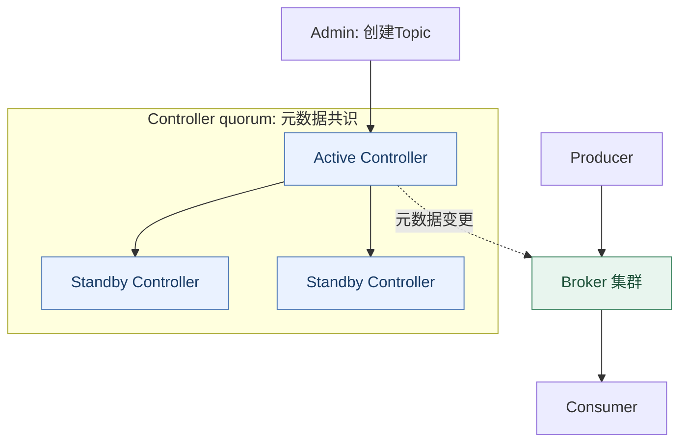

**读图抓手**：元数据协调与业务数据读写分开；业务事件不经过Controller转发。

**读图要点**：业务消息不需要先经过 Controller；元数据共识与业务分区复制是两套机制。不能因为控制面使用 Raft，就说所有业务分区也通过 Raft 多数提交。

Controller 常采用 3 或 5 个节点；多数存活是共识继续推进的重要条件。Controller 多数不可用会阻止元数据变更和必要的故障切换，但不意味着所有已建立的数据读写在同一时刻立即停止。

`process.roles` 可以配置 broker、controller 或两者组合。组合模式方便实验，关键生产部署通常将角色分离，以隔离资源和故障影响。[KRaft 官方说明](https://kafka.apache.org/41/operations/kraft/)

### 2.4 为什么让客户端发现 Leader，而不经过统一路由代理

**备选方案**：所有流量经统一代理转发；或者客户端持有分区元数据，直连目标 Broker。

代理能集中隐藏拓扑、统一接入策略，但会增加网络跳转、连接与带宽压力，还需要避免代理层成为故障和扩容瓶颈。Kafka 采用元数据发现与直连，将路由工作分摊到客户端，使分区 Leader 分布能直接转化为网络并行度。

代价是客户端更复杂：需要缓存和刷新元数据，识别切主错误，并能访问 Broker 对外宣告的所有必要地址。跨网络部署因此不能只放通 bootstrap 入口。

**控制面分离的原因**：如果每条业务消息都经过 Controller，元数据管理就会被数据吞吐拖累；如果每个 Broker 各自随意决定分区状态，又难以形成一致拓扑。Kafka 用统一元数据决策与分散数据读写分工，隔离两类负载。

### 2.5 KRaft 元数据决策为什么需要多数，而不是谁先启动谁决定

如果两个 Controller 在网络分区两侧都能独立修改分区归属，Broker 就可能收到冲突指令。Raft 用任期、投票和日志提交约束元数据决策：节点在选举超时后发起竞选，在满足日志与投票规则并取得多数支持后成为 Leader；变更先写元数据日志，再按共识条件提交并应用。

两个多数集合必有交集，这结合每任期投票和日志新旧约束，帮助防止相互冲突的历史同时成为有效决策。只说“3 个节点挂 1 个还能用”还不够，关键是剩余节点能否形成有效多数及满足协议状态。

**与主备加心跳对比**：只凭失联就强行切主，在网络隔离时可能让两边都认为对方失败；共识协议优先限制决策资格，代价是少数侧不能继续提交新元数据。日志和快照让备 Controller 持续跟踪状态，避免每次都从外部存储重新构造全部状态。

这个多数规则针对元数据；业务分区的 ISR（In-Sync Replicas，同步副本集合） 复制规则不能直接替换成这里的投票逻辑。

<a id="producer"></a>

## 3. Producer：从 send 到结果确认

> 🎯 **沿发送链路追踪**
>
> **send()返回、Broker确认、下游处理成功，是三个不同的完成点。**
>
> 重点比较：同步等待与异步攒批，分清缓冲、在途请求和最终发送结果。

### 3.1 send 并不是直接同步写 Broker

生产者通常由应用调用线程完成序列化、分区选择与记录入队，由后台 Sender 负责组装请求、网络发送和重试。多个分区的批次可以合并到发往同一 Broker 的请求中。

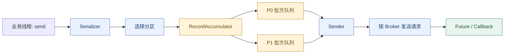

**读图抓手**：先进入缓冲、再发网络、最后报告结果，三者不能混成同一个完成点。

`send()` 返回 Future 一般只说明记录进入发送流程，并不说明 Broker 已确认。同步等待 `get()` 或处理回调才能获知最终结果。即便是异步接口，元数据不可用、缓冲区不足时也可能阻塞，受到 `max.block.ms` 等约束；序列化器中的用户代码还可能自行阻塞。

回调应避免执行慢数据库操作或长时间计算，否则可能阻塞发送相关线程，影响其他记录完成通知。业务线程、发送缓冲、网络在途请求和 Broker 响应构成一条有背压的链路。

### 3.2 分区选择的优先级

| 条件 | 通常行为 | 后果 |
| --- | --- | --- |
| 显式指定 partition | 使用指定分区 | 应用承担分区有效性及热点管理 |
| 未指定分区，存在 key | 默认逻辑对序列化 key 哈希 | 稳定映射便于局部顺序 |
| 两者都没有 | 默认逻辑倾向批量及负载均衡 | 不适合依赖业务 key 顺序的场景 |

自定义分区器、忽略 key 的配置等会改变上述行为。讨论路由时必须先说默认条件，不能把某个历史 StickyPartitioner 实现当成所有版本的固定规则。

### 3.3 batch.size、linger.ms 与 compression

`batch.size` 是按分区组织批次的大小目标；不是整个 Producer 的内存上限，也不是单条消息的严格大小上限。活跃分区越多，攒批和缓冲内存的压力往往越大。

`linger.ms` 允许为攒批等待一小段时间。Kafka 4.1 默认是 5ms；批次足够大时不必等满时间，Broker 背压或网络阻塞又可能使实际等待超过它。因此它既不是每条记录固定延迟，也不是端到端延迟上限。

以每分区每毫秒只有一条小消息为例，立即发送会产生很多小请求；等待几毫秒可合并记录，减少请求及压缩开销。若流量已经很大，批次迅速填满，稍大的 linger 也未必增加明显等待。

压缩按批次进行，收益取决于字段重复度、消息大小和算法/级别。zstd、lz4 等应使用真实负载比较压缩率与 CPU（Central Processing Unit，中央处理器），不能用固定排名替代测试。

> ⚠️ **易错点**：`linger.ms`不是发送总超时；`send()`返回也不代表写入成功。

### 3.4 三类超时不要混淆

| 参数 | 约束范围 | 不能解释成什么 |
| --- | --- | --- |
| `max.block.ms` | 部分 Producer API 等待元数据/缓冲等的阻塞 | 所有用户代码的执行上限 |
| `request.timeout.ms` | 一次请求等待响应 | 记录完整重试周期 |
| `delivery.timeout.ms` | send 返回后报告最终结果的总时限 | 每次重试都重新开始的无限预算 |

**发送超时是一种不确定结果**：记录可能没有写入，也可能已写入但响应未到达。应用如果重新调用 send，应以业务 eventId 处理潜在重复；协议幂等只识别它能够关联的重试。

### 3.5 用结果语义设计发送代码

下面是控制流程示意，省略实例构造及异常分类，不是完整可运行程序：

```java
// record 的业务载荷中应包含稳定 eventId。
producer.send(record, (metadata, error) -> {
    if (error == null) {
        // 仅说明满足所配置的 Kafka 确认条件；不代表下游已处理。
        onKafkaAcknowledged(metadata.topic(), metadata.partition(), metadata.offset());
    } else {
        // 将失败交给可靠的恢复机制；仅打一条日志不能保证最终送达。
        // 避免在发送回调线程内执行阻塞式恢复工作。
        signalDeliveryFailure(record, error);
    }
});
```

如果数据已在 Outbox 中，发送失败可以保留待发送状态并由发布器重试；如果数据仅在进程内存中，进程退出就可能失去恢复依据。异步回调解决的是“知道结果”，可靠事件源解决的是“失败后还能恢复”，两者需要同时考虑。

参考：[Producer 配置](https://kafka.apache.org/41/configuration/producer-configs/)。

### 3.6 为什么异步攒批，而不是逐条同步请求

| 方案 | 一次往返期间能做什么 | 适合情况与代价 |
| --- | --- | --- |
| 每条 send 后立即 get | 当前业务线程等待该记录结果 | 流程简单，但同一线程难以重叠网络等待 |
| 连续异步 send + 回调 | 多条记录与多个分区可同时推进 | 吞吐较高，但必须管理缓冲、失败和进程退出 |
| 异步攒批 + 批次压缩 | 摊薄请求头、系统调用、网络往返及重复字段成本 | 低流量时增加等待，缓冲数据面临进程故障窗口 |

假设一次往返需要 5ms，单线程逐条等待在不计其他成本时最多约 200 次/秒；这只是该发送方式的约束，不是 Kafka 单分区上限。异步允许网络等待重叠，批量则让一次请求携带更多记录。

**为什么批次按分区组织**：分区是日志追加、序列校验与路由目标的基本单位。按分区攒批便于连续追加和独立重试，再按 Broker 合并网络请求。代价是活跃分区很多、每分区流量很小时批次难填满。

**为什么批次压缩优于每条单独压缩**：相邻事件常重复字段名、业务枚举和结构，跨记录压缩能利用这些冗余；单条独立压缩的字典与头部开销可能抵消收益。压缩也引入 CPU、解压和内存成本，无法让随机高熵数据凭空变小。

**约束关系**：吞吐、延迟、CPU、内存和可靠性应一起比较。`linger.ms=0` 也不表示关闭一切批处理；恰好在等待中累积的记录仍可能形成批次。

<a id="storage"></a>

## 4. Broker：请求处理与日志存储

> 🎯 **把性能拆成具体成本**
>
> **追加、分段、索引、缓存、批量传输分别优化不同环节。**
>
> 每个优化都问：少了哪种I/O（Input/Output，输入输出）、复制或状态管理？付出了多少等待和复杂度？

### 4.1 网络线程与请求处理线程

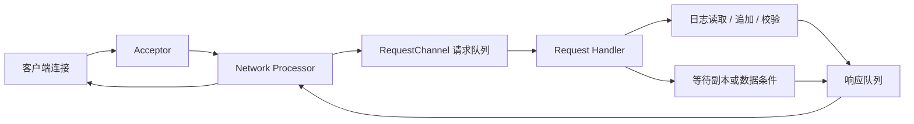

Acceptor 接受连接，Network Processor 负责网络读写，请求处理线程执行 Produce/Fetch 等逻辑。等待副本追赶的请求无需一直占住业务线程阻塞等待，可以登记为延迟操作，条件满足或超时后推进。

这里的“延迟操作”是服务端请求管理机制，不是业务定时投递功能。Purgatory 按相关事件监听等待操作，时间轮辅助管理超时。发生副本推进、数据追加等事件时可尝试完成等待请求。

调优要先区分排队、执行、复制等待和网络发送时间：CPU 空闲但磁盘已满负荷时，增加 `num.io.threads` 可能只增加争用。[网络层说明](https://kafka.apache.org/41/implementation/network-layer/)

### 4.2 Partition、Segment 与索引

```text
order-events-0/
├── 00000000000000000000.log        # Segment 的记录批次
├── 00000000000000000000.index      # offset 稀疏索引
├── 00000000000000000000.timeindex  # 时间索引
├── 00000000000000100000.log
├── 00000000000000100000.index
└── 00000000000000100000.timeindex
```

文件名中的数字是 Segment 的 base offset。日志分段使滚动、查找和清理有了基本单位；活跃段仍在追加，旧段可参与清理或远端卸载。日志中还可能存在事务索引、快照等辅助文件，上图只展示主要查找文件。

查找 offset=100350 的过程：先根据 base offset 定位起始位置不大于目标的 Segment，再在 `.index` 中找到不大于目标的最近索引项，从对应物理位置扫描记录批次。

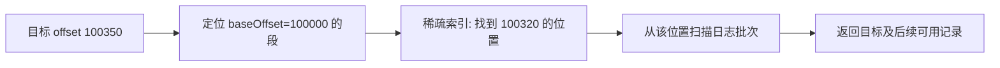

稀疏索引减少了索引体积和写入成本，代价是局部扫描。索引使用 mmap 可以利用操作系统虚拟内存和页缓存，但 mmap 不代表整个索引永远驻留物理内存。

### 4.3 PageCache、刷盘与零拷贝

写入文件通常先进入操作系统页缓存，后续由系统刷写到设备。读热数据可能直接命中缓存，避免磁盘读取。Kafka 将大量缓存管理交给操作系统，降低在 JVM（Java Virtual Machine，Java虚拟机） 堆中维护所有消息的成本。

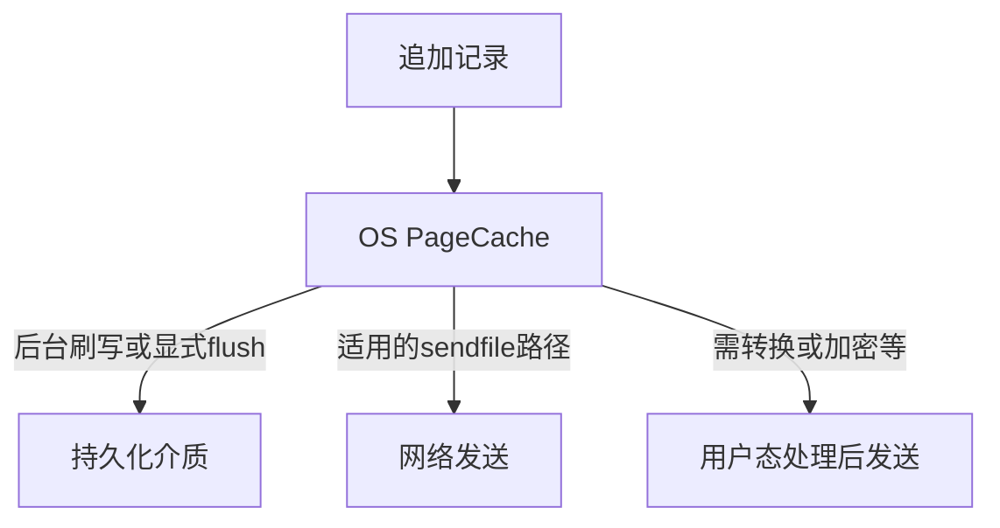

**多副本确认与物理持久化是两种保证**。多个故障域中的副本有助于对冲部分机器故障；同故障域同时断电、存储故障仍要单独评估。Kafka 有 flush 相关配置，但不能把 `acks=all` 等同为每个副本同步 fsync。

零拷贝主要减少文件数据在内核与用户态之间的中转；TLS（Transport Layer Security，传输层安全协议）、格式转换、平台和 JDK（Java Development Kit，Java开发工具包） 都会改变实际传输路径。不要机械背诵任何环境都固定几次复制或上下文切换。

### 4.4 delete、compact 与 tombstone

`delete` 以保留时间或大小控制旧 Segment 清理，不会因某个消费组落后而自动保住数据。清理是异步的，不是每条记录到期就精确删除。

`compact` 用 key 的最新状态清理历史值，适合变更日志及最新状态恢复。它不是即时去重：后台清理前，消费者仍能读到多个版本。value=null 的 tombstone 表示 key 被删除，删除标记自身也有保留期。

| 清理前 | 压缩后的逻辑结果 |
| --- | --- |
| offset 0: A=created | A 的旧状态可移除 |
| offset 1: B=created | B 的旧状态可移除 |
| offset 2: A=paid | 保留 A 的最新值 |
| offset 3: B=null | 删除 B 的标记，之后也可能被清理 |

压缩不会给剩余记录重新编号，因此 offset 可以存在空洞。日志压缩后的数据也不一定包含重建全部历史业务所需的信息，事件审计与最新状态恢复应选择不同保留策略。[Topic 配置](https://kafka.apache.org/41/configuration/topic-configs/)

### 4.5 为什么用 Segment、稀疏索引和 OS 页缓存

**存储要解决三个问题**：高效追加、按位置读取、低成本回收历史。不同备选方案影响的是不同环节。

| 设计选择 | 可替代做法 | Kafka 的收益 | 代价 |
| --- | --- | --- | --- |
| 追加日志 | 任意位置更新/删除记录 | 写入路径规整，批量容易，读写可顺序化 | 单条修改要改用新事件，删除依赖后台策略 |
| Segment | 一个无限增长的大文件 | 段级回收、滚动与查找边界清晰 | 文件、索引和段生命周期需要管理 |
| 稀疏索引 | 每条记录建密集索引 | 更低索引体积与追加成本 | 查询需从最近索引项扫描 |
| OS PageCache | JVM 堆内维护全部热点记录 | 复用系统缓存，减少堆占用和 GC | 与其他进程竞争内存，缓存未命中仍受磁盘限制 |
| 适用路径的 sendfile | read 到用户态再 write | 减少大批数据中转 | 加密/转换等路径未必适用 |

**为什么日志适合删除整段**：对连续历史记录，逐条删除会导致索引调整、碎片或额外回收；段级删除把许多记录的清理合成少量文件操作。代价是时间或容量保留不会精确到单条消息瞬间。

**为什么压缩不在每次写入时立即改旧值**：即时按 key 原地更新会把高吞吐追加路径变成查询和随机修改。后台 Compaction 允许先顺序写，再择机整理历史；代价是状态不是瞬间去重，还需要清理资源和 tombstone 规则。

**何时优势下降**：频繁回放冷数据、热点集合远大于内存、Broker 与其他服务竞争页缓存时，缓存命中假设不再成立。此时要看真实磁盘读取、远端回读和网络，而非仅凭“Kafka 用 PageCache”判断性能。

### 4.6 等待请求为什么不用一个线程睡到超时

有些请求已经进入 Broker，但还不能立即响应：Produce 需要等副本确认，Fetch 需要等足够可读数据。若每个请求占一个线程睡眠，大量等待会消耗线程、栈和调度；若不断扫描全部请求，又容易产生无效检查。

| 实现方式 | 如何发现可完成请求 | 主要成本 |
| --- | --- | --- |
| 每请求阻塞线程 | 条件通知或睡眠结束 | 大量线程与上下文调度 |
| 固定周期扫描 | 每轮检查所有等待对象 | 延迟受扫描周期影响，检查量随请求数增长 |
| 按到期时间的堆 | 取最早到期任务 | 插入/删除通常有对数成本，还需处理事件提前完成 |
| 事件索引 + 时间轮 | 条件变化时只检查关联请求，到期再触发超时 | 管理索引、取消、时间槽与层级迁移 |

Kafka 的 DelayedOperationPurgatory（延迟操作等待区）结合事件与超时：例如按相关分区关联等待 Produce，Follower 进度变化时尝试完成该分区请求；若始终不满足条件，则由超时机制结束等待。分层时间轮将定时任务归入时间槽，超出当前层范围时放入上层，临近到期再迁移。

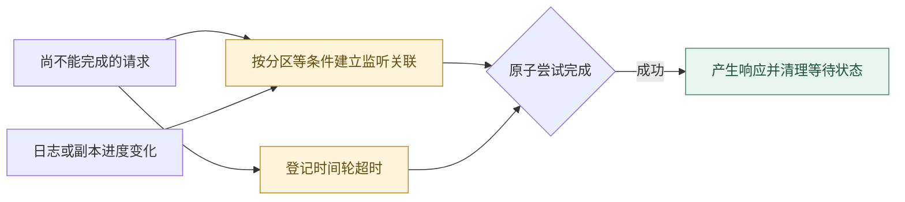

**读图抓手**：事件满足与超时都可能尝试完成请求，需要防止重复完成并清理等待状态。

事件和超时可能竞相完成同一操作，必须保证只完成一次并正确取消/清理其他关联。时间轮减少大量超时的管理成本，但不是所有操作无条件严格 O(1)，也不能消除同一时间槽到期任务突发造成的压力。

<a id="replication"></a>

## 5. 复制、确认与故障恢复

> 🎯 **可靠性看故障窗口**
>
> **已追加不等于已复制提交，多副本也不等于所有故障下绝不丢失。**
>
> 按acks、ISR、**HW（High Watermark，高水位）**、任期和安全候选推导结果，再检查故障域。

### 5.1 ISR 不是所有副本，也不是永久名单

分区副本集合描述“计划有几份数据”，ISR 描述“当前哪些副本满足同步条件”。Follower 通过 Fetch 追赶，长时间不拉取或无法及时追上可能被移出 ISR；恢复后满足条件才可重新加入。

ISR 维护的目的是不被无限落后的副本拖住，同时给可靠写入和安全选主提供依据。仅仅连接仍在、仍发心跳，并不能证明副本日志同步。

### 5.2 三种 acks 及其故障窗口

| acks | Producer 何时获知成功 | 典型风险 |
| --- | --- | --- |
| 0 | 不等待 Broker 确认 | 不能从响应确认是否写入 |
| 1 | Leader 本地追加后响应 | 未复制时切主可能丢失 |
| all | 当前 ISR 全部完成复制确认 | ISR 太小或共同故障仍有风险 |

副本数 3、min ISR=2 时，可以用下表推导行为，而不是只记“三副本安全”：

| 当前 ISR 数量 | acks=all 的条件 | 含义 |
| --- | --- | --- |
| 3 | 等待 3 个同步副本确认 | 不是任意 2 个确认即可 |
| 2 | 等待这 2 个副本确认 | 允许一个副本暂时落后 |
| 1 | 不满足最小同步副本门槛 | 拒绝可靠写入，应用要处理失败 |

发生错误并不意味着记录一定没追加。某些记录可能已进入日志但最终没有满足确认条件，因此失败处理仍要考虑不确定结果和业务幂等。

> ⚠️ **易错点**：`acks=all`不是“任意两个副本确认”，也不是“全部副本逐条同步刷盘”。

### 5.3 LEO 与 HW：已追加不等于已提交

**LEO（Log End Offset，日志末端位置）**是每个副本下一条待追加的位置；**HW（High Watermark，高水位）**是复制提交边界。消费可见范围使用排他边界表示：普通读取不会越过 HW，offset 必须小于该边界。

假设日志已有 offset 0～9，LEO=10。Leader 又追加 offset=10，其 LEO 变为 11，但复制条件尚未完成时 HW 可以仍为 10。

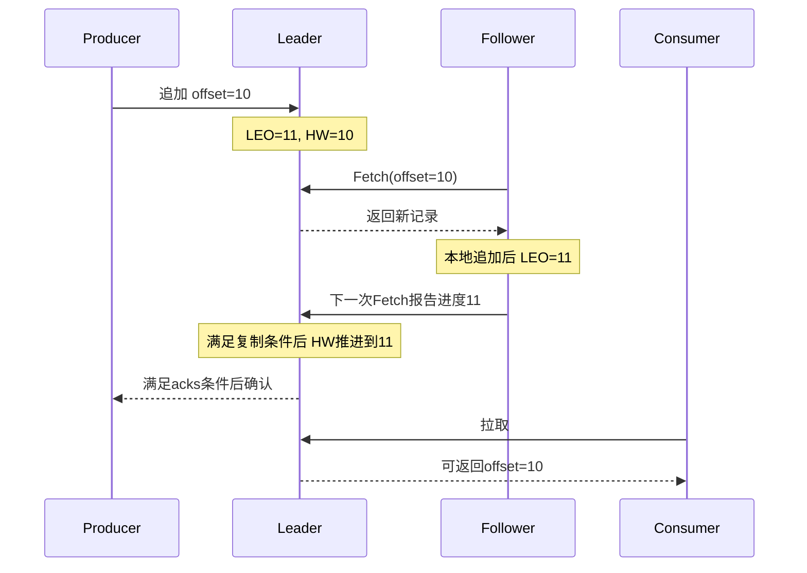

这是简化时序；真实集群需要跟踪多个副本状态、ISR 变更及请求时限。HW 在不同副本上还可能传播滞后，不能把它当成每一瞬间全部副本 LEO 的实时最小值。

### 5.4 Leader Epoch 如何帮助副本对齐

**KIP（Kafka Improvement Proposal，Kafka改进提案）**用于记录设计变更；本节对应KIP-101。提案编号表示设计来源，不代表全部版本都有相同实现。

只有 offset 不能证明日志一致：旧 Leader 和新 Leader 可能都在位置 100 之后追加过不同内容。Leader Epoch 标识一段 Leader 任期，通过 epoch 与日志边界的关联区分共同历史和分歧部分。

恢复副本向当前 Leader 查询相关任期边界，确认共同历史后截断冲突尾部，再继续 Fetch。这避免旧机制单纯依据可能滞后的本地 HW 做不必要截断。

**边界**：如果某条 acks=1 记录只存在于已失效的旧 Leader 上，新 Leader 根本没有它，Leader Epoch 不会凭空补回。复制确认与历史对齐是两个不同问题。[KIP-101](https://cwiki.apache.org/confluence/display/KAFKA/KIP-101+-+Alter+Replication+Protocol+to+use+Leader+Epoch+rather+than+High+Watermark+for+Truncation)

### 5.5 安全选主与可用性

落后副本上位可能让已确认历史回退。禁止 unclean 选举优先保护日志历史，代价是在没有安全副本时无法恢复服务。Kafka 4.x 的 Eligible Leader Replicas（ELR（Eligible Leader Replicas，安全Leader候选副本））会影响安全候选集合，深入故障推演时应核对集群功能开关，不能只凭“是否在当前 ISR”作全部判断。

可靠性应按故障模型描述：允许丢失几个副本、是否跨机架、是否涉及整站故障、是否能从备份恢复。参数组合是其中一部分。[Broker 配置](https://kafka.apache.org/41/configuration/broker-configs/)

### 5.6 按故障发生位置推导结果

| 故障时刻 | Kafka 中可能的状态 | 应用如何处理 |
| --- | --- | --- |
| 记录尚在 Producer 缓冲区，进程退出 | Broker 可能从未接收 | 从可靠事件源恢复，不能依赖内存队列 |
| Leader 追加后、Follower 复制前失效 | acks=1 已成功的记录可能不在新 Leader | 评估复制门槛与数据损失风险 |
| 已满足复制条件，但确认响应丢失 | 日志中可能已存在记录 | 允许协议重试，业务重发使用稳定 eventId |
| 发送返回失败，但本地日志已追加 | 最终可见性与恢复结果需进一步判断 | 不把失败等同于绝对未写入 |
| 消费副作用成功、位移未提交 | 恢复后可能重投 | 业务去重与副作用在同一事务中完成 |
| 位移提交成功、业务尚未完成 | 恢复可能跳过未完成业务 | 禁止越过未完成记录提交 |
| 多副本所在机房同时失效 | 本地复制可能无法提供站点级恢复 | 验证跨站复制、备份及 RPO/RTO |

这张表把“丢消息”拆成源事件丢失、日志历史丢失和业务漏处理。排查时先确定所指的层次，再讨论对应保障，避免仅凭消费 lag 为零就宣布全链路成功。

### 5.7 为什么是 Leader + Follower，而不是任意副本都写

**目标**：在明确的分区顺序下实现复制与故障恢复。

| 方案 | 协调方式 | 收益 | 难点 |
| --- | --- | --- | --- |
| 单副本 | 单节点决定日志顺序 | 简单、没有复制等待 | 节点或存储失效可能失去数据和服务 |
| Leader + Follower | Leader 决定追加顺序，Follower 拉取 | 顺序与序列校验路径明确，复制责任集中 | Leader 负载、切换与落后副本处理 |
| 多主/无主写入 | 多节点接受并发写 | 某些模型下有较高写可用性 | 冲突解决、全序确定与读一致性更复杂 |

Kafka 为分区内顺序选择单 Leader 追加；Follower 拉取便于批量追赶、断线恢复与按日志位置复制，但需要报告进度，HW 传播会有延迟。与 Leader 主动推送相比，复制数据流更容易由接收方按位置连续请求；这并不意味着网络拥塞与磁盘慢会自动消失。

**为什么不一直等所有配置副本**：任意一个长期离线副本都可能让全部写入停滞。ISR 将当前可同步的副本纳入确认，min ISR 阻止集合退化到过少副本后仍宣称可靠成功。这里并非 Raft 固定多数投票；副本配置、ISR 变化、安全选主规则及 ELR 功能状态必须一起分析。

**为什么不默认逐条 fsync 后再复制**：逐条强制持久化把设备等待带到每条写入路径。批量和异步刷写通常能减少开销，复制则抵抗部分节点故障，但它们不能替代对共享电源、故障域和持久化设备的评估。

<a id="consumer"></a>

## 6. Consumer：读取、处理与提交

> 🎯 **区分读取与业务进度**
>
> **拉取位置、业务连续完成位置、已提交位移必须分开。**
>
> 先比较Pull/Push，再用具体offset推导：现在能安全提交到哪里？

<a id="pull-push"></a>

### 6.1 为什么采用 pull：先比较推送、短轮询与长轮询

**问题背景**：Broker 写入速度与每个消费者处理速度不一致。需要决定谁主导交付节奏，以及没有消息时如何避免无意义请求。

| 实现方式 | 工作过程 | 优点 | 主要代价 |
| --- | --- | --- | --- |
| Push，服务端推送 | Broker 在有数据时向消费者交付 | 易形成及时通知，客户端不必不断发起取数 | 需按消费者能力做流控、在途限制与确认 |
| Short polling，短轮询拉取 | 客户端请求；无数据立即返回，再周期请求 | 请求模型简单，客户端决定节奏 | 空响应多；加大周期又增加发现延迟 |
| Long polling，长轮询拉取 | 客户端请求；数据不足时服务端等待条件或超时再响应 | 避免高频空转，同时由客户端发起与限定批量 | 服务端要管理等待请求；仍需超时、连接和背压 |

Kafka Fetch 采用拉取并支持长轮询。它不是每过固定秒数才去数据库查一下，也不是服务器完全不能持有等待状态。

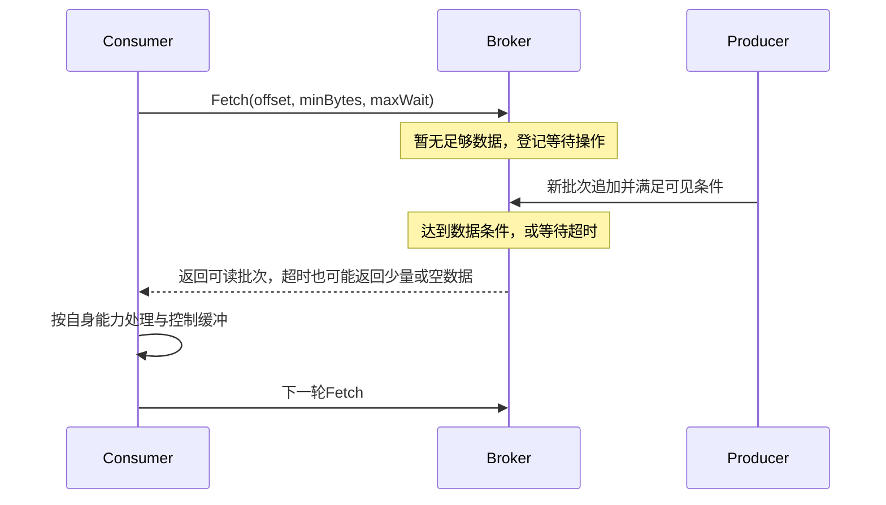

**慢消费者示例**：生产为 10000 条/秒，某消费者只能处理 1000 条/秒。没有流控的 push 会让客户端接收缓冲不断增长；有 credit、prefetch 或在途确认窗口的 push 可以限制这一压力，但 Broker 必须维护并执行交付控制。Kafka 将更多节奏控制放在客户端与日志读取位置上：慢消费者落后，需要追赶时从日志继续读取。

**批量优势从何而来**：拉取请求可以表达从某个 offset 读取多大一批。消费者落后时，已有日志可直接按块读取，不必为每条记录建立一轮业务交付。Push 也可以批量，区别在于如何获知下游接收能力和决定何时发送，并不是 push 必然逐条。

**代价不能省略**：pull 不会自动限速所有业务工作；客户端仍可预取，异步任务队列仍可能撑爆内存。需要有界缓冲、pause/resume 和依赖超时。Broker 仍承担日志磁盘和等待请求成本；长期落后还可能超过保留窗口。

**三个时间参数的不同含义**：`fetch.max.wait.ms` 约束 Broker 对拉取的等待；`poll(Duration)` 约束应用轮询调用愿意等待多久；`max.poll.interval.ms` 衡量应用持续轮询的进度，不能互相替代。没有数据时正常长轮询不等于业务处理卡死。

**什么时候 push 也合适**：少量实时通知、已有完善信用流控的任务队列或双向流系统都可能适合推送。Kafka 的选择契合大规模持久化日志、批量追赶和消费者速度差异，不是所有消息系统的唯一最优解。[官方 push/pull 设计讨论](https://kafka.apache.org/41/design/design/)

### 6.2 消费组的并行度

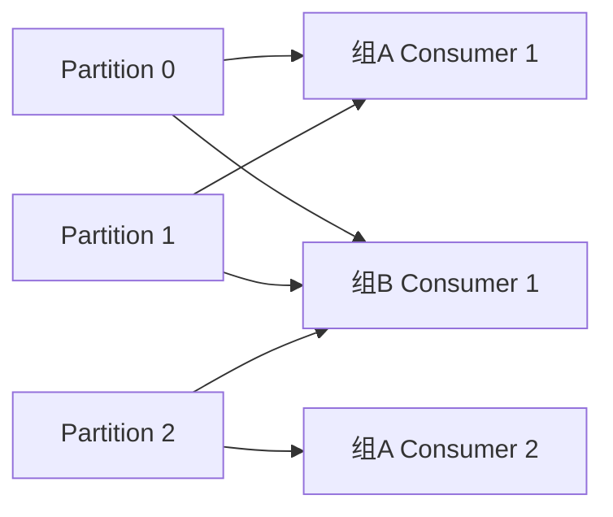

组 A 的两个成员共享三个分区；组 B 独立读全部三个分区。增加组 A 成员可以重新分担分区，但成员数超过可分配分区后，多出的成员不会获得分区。

这条规则针对普通组的订阅与分配模型；手动 assign 绕过组分配，Share Group 使用不同消费语义。改变 group.id 相当于改变消费进度命名空间，不是简单的“同一消费者换名字”。

### 6.3 Fetch 与 poll 不是同一个边界

客户端可以按批次预取，`poll()` 再把获取的数据交给应用。`max.poll.records` 控制单次返回记录数，不等同于 Broker 网络响应字节上限；减少它并不一定同比减少客户端已缓存的数据。

`fetch.min.bytes` 与 `fetch.max.wait.ms` 在数据较少时平衡等待和请求频率。`max.partition.fetch.bytes`、`fetch.max.bytes` 约束拉取大小，但为保证前进，首个非空分区中的大批次存在特殊处理，不能简单视作绝对拒收阈值。

> ⚠️ **易错点**：提交的是**下一条需要处理的位置**，不能越过尚未完成的记录。

### 6.4 三个位置必须分开

| 位置 | 谁维护 | 作用 |
| --- | --- | --- |
| 客户端 position | Consumer | 下一条待交付/读取的位置 |
| 业务连续完成位置 | 应用 | 判断哪些副作用已完成 |
| committed offset | 消费组进度存储 | 分区重分配或恢复后从哪里继续 |

`poll()` 返回 10～14 后，position 可能已经来到 15，但业务只完成 10 和 11。此时安全提交位置是 12，**不能提交 15**；否则恢复后 12～14 被跳过。

同样，如果 10、12、13 已完成，11 未完成，**安全提交位置仍只能是 11**。提交使用**“下一条需要处理的位置”**，而不是“最大完成 offset”。若原日志存在压缩空洞，要按实际交付记录的顺序判断，不能等待一个不存在的 offset。

### 6.5 自动提交、同步提交与异步提交

自动提交与客户端轮询流程相关，不是无条件独立运行的业务成功检测器。同步完成整批后再轮询，与把工作交给线程池后立即继续轮询，安全性不同；后者可能自动提交尚未完成的记录。

`commitSync()` 等待提交结果，流程容易理解，但增加等待；`commitAsync()` 降低等待开销，但错误回调不能盲目重提旧进度。若较新的 offset 已提交，再把旧 offset 提交成功，会造成恢复进度回退。

不管哪种方式，崩溃都可能发生在业务成功、提交成功之间，所以至少一次处理需要幂等。关闭自动提交后，`close()` 也不是“自动替我提交所有完成业务”的承诺。

### 6.6 多线程处理的正确边界

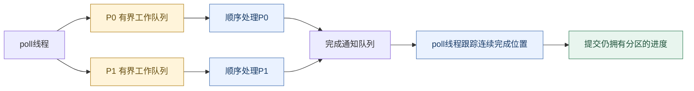

**读图抓手**：工作线程反馈完成结果，poll线程只提交连续完成且仍拥有的分区进度。

KafkaConsumer 通常由单线程调用；工作线程只处理业务并反馈结果。队列必须有界，达到容量时由 poll 线程 pause 对应分区，同时继续进行必要的轮询；容量恢复后再 resume。

Rebalance 撤销分区时，需要停止给该分区分发新任务，协调在途任务与完成进度。若旧任务在分区交给新消费者后仍继续写数据库，Kafka 的成员身份校验不会自动阻止其外部副作用，因此还需业务幂等、版本或租约等保护。

参考：[Consumer 配置](https://kafka.apache.org/41/configuration/consumer-configs/)。

### 6.7 为什么提交一个位置，而不是对每条消息 ACK

| 进度模型 | 如何表示成功 | 优势 | 约束 |
| --- | --- | --- | --- |
| 普通组 offset 提交 | 每分区记录下一待处理位置 | 连续流处理状态紧凑，便于批量与回放 | 表达“后面成功、前面失败”需要应用跟踪 |
| 逐记录 ACK | 对每条记录维护交付/完成状态 | 容易表示单条重投及耗时不均的任务 | 要管理记录级状态、在途窗口、确认和过期 |

示例：交付 100、101、102，只有 100 与 102 完成。提交 103 会漏过 101；提交 101 又意味着恢复后可能再执行 102。Kafka 普通组把稀疏完成状态留给应用处理，安全进度只推进到连续完成的边界。

```text
记录位置         100      101      102      103
业务状态         完成     未完成   完成     未处理
可提交位置                101
含义                     从这里恢复，102可能重复，所以需要幂等
```

这解释了为什么普通组适合分区有序批处理，却不直接等同于可任意领取与 ACK（Acknowledgement，确认） 的任务队列。Share Group 改为维护记录级获取锁和确认，换取同分区内任务分担，也引入锁过期、投递次数与重投管理。

<a id="rebalance"></a>

## 7. 组协调与 Rebalance

> 🎯 **协调的是当前所有权**
>
> **Rebalance重新分配分区，但不会自动撤销旧线程的数据库副作用。**
>
> 区分Controller、Coordinator与Group Leader；比较Eager、Cooperative和新协议。

### 7.1 Coordinator、Group Leader、Controller 不同

| 角色 | 范围 | 职责 |
| --- | --- | --- |
| Controller | 集群元数据 | 分区状态、元数据变更等 |
| Group Coordinator | 消费组 | 管理成员与消费组协议、进度 |
| Group Leader | classic 协议中的组成员 | 执行所选客户端分配逻辑 |
| Partition Leader | 一个分区 | 数据追加、复制与通常的客户端读写 |

一个 Broker 可以承担多个数据/协调角色，但不能因此将角色等同。新 Consumer 协议将分配逻辑放到服务端，也不再使用 classic 的客户端 Group Leader 分配流程。

### 7.2 classic 协议的基本流程

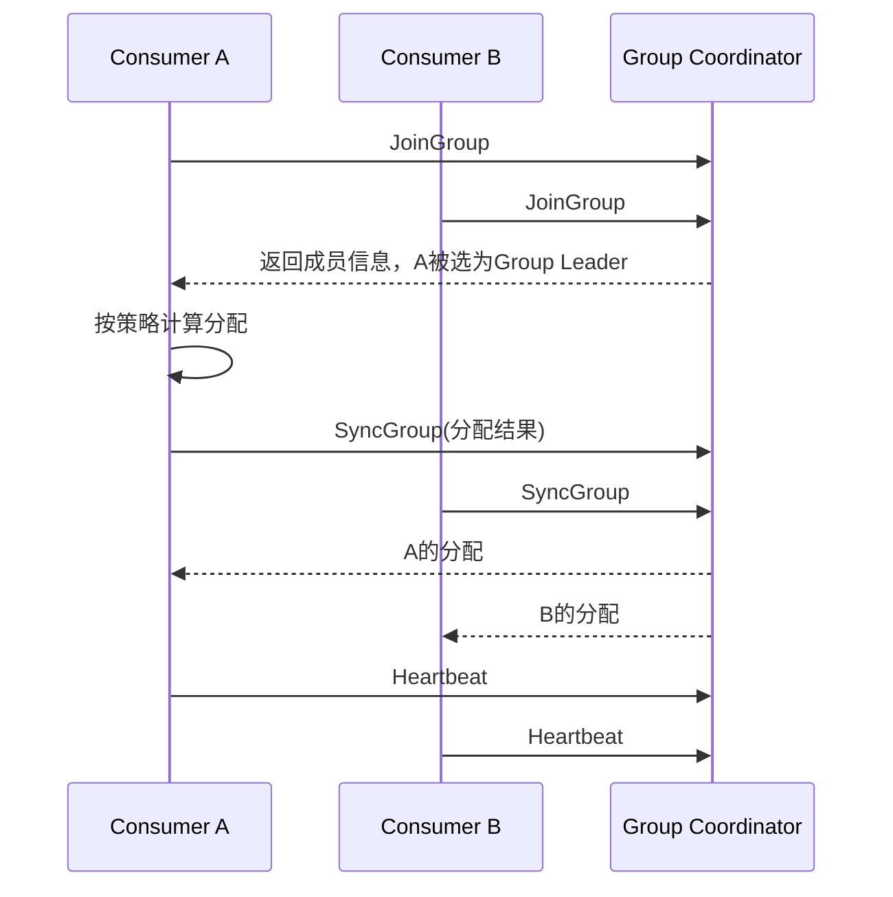

成员进入/退出、故障检测及订阅分区变化等可触发重新分配。Eager 策略先撤销再分配，容易产生全组停顿；Cooperative 策略允许分阶段转交分区，降低不必要迁移。它们是分区交接方式，不能简单与新旧 API（Application Programming Interface，应用编程接口） 一一等同。

### 7.3 两类超时各自回答什么

session timeout 用来判断成员是否失联，poll interval 用来判断应用是否持续推进。即使后台心跳正常，业务处理太久、迟迟不 poll，也可能失去成员资格；长时间 GC（Garbage Collection，垃圾回收） 又可能同时影响两者。

举例：每次 poll 取 500 条，串行处理每条平均 800ms，总计约 400 秒，已经超过默认 300 秒 poll 间隔。减少批量可能缓解，但若单条外部调用无超时，减少记录数也无法保证前进。应为业务依赖设置明确超时和失败策略。

### 7.4 新 Consumer 协议与静态成员

Kafka 4.0 起正式可用的新 Consumer 协议，通过 `group.protocol=consumer` 选择；服务端协调分配与成员推进，减少 classic 的全组同步屏障。它不能保证完全没有迁移停顿，也不能修复慢业务。

consumer 模式下，心跳与会话参数由 Broker 侧相关配置控制，不能把 classic 的 `heartbeat.interval.ms`、`session.timeout.ms` 原样搬过去。Kafka 4.1 客户端仍需明确核对所用协议及默认值。

`group.instance.id` 静态成员可减少部分短暂离线的重分配，但 ID 必须独特，故障检测可能因此延后；它不是永久保住分区的机制。[协议说明](https://kafka.apache.org/41/operations/consumer-rebalance-protocol/)

### 7.5 为什么要分配所有权：与无协调竞争读取对比

如果多个普通消费者随意读取同一个分区并执行副作用，它们可能从相同 offset 开始，造成重复，并难以决定谁的提交代表全组进度。组协议为分区建立当前归属，用成员身份和代次/epoch 拒绝不合格的协议操作。

**Eager 与 Cooperative 的差别**：Eager 先全量撤销，状态转换直观，但小变动也可能停止全组工作；Cooperative 分阶段交接必要分区，减少无关迁移，但协议和回调状态更复杂。两者都不能让旧工作线程的数据库副作用自动停止。

**KIP-848 为什么把分配搬到服务端**：classic 中客户端 Group Leader 要收集并计算分配，成员变更需要跨成员同步；新协议让 Coordinator 管理目标分配和成员逐步协调，降低全局屏障成本。代价是服务端协调状态与策略责任增加，旧自定义客户端分配器也不能不加修改直接沿用。

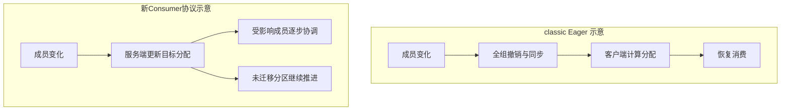

需要注意：classic 也能使用 Cooperative 策略；图中不能把所有 classic 行为都当成 Eager。新协议改善协调方式，但应用慢、分区迁移和恢复仍有实际开销。

### 7.6 分配策略为什么不只有一种

| 策略/维度 | 主要目标 | 代价或注意点 |
| --- | --- | --- |
| Range | 对每个Topic按范围分配 | 多Topic且分区数不能均分时，同一批成员可能反复多拿分区 |
| RoundRobin | 将可分配分区轮流分担 | 订阅集合不同会影响结果；不强调保留原归属 |
| Sticky | 尽量均衡并保留既有归属 | 优化目标与状态更复杂，仍受订阅约束 |
| Cooperative交接 | 减少一次变更中撤销的分区 | 是交接语义，不能简单等同于所有均衡策略 |

例如两个成员订阅两个各有 3 分区的 Topic，Range 每 Topic 都可能按 2/1 分配，累计成 4/2；跨 Topic 的轮流分担则可能更接近 3/3。分区数均衡仍不代表负载均衡：一个热点 key 就可能让“只拿一个分区”的成员比其他成员更忙。

因此选择分配策略前，要先知道成员订阅是否一致、是否有热点、迁移代价多大。新 Consumer 协议使用服务端分配机制，不能直接把 classic 的客户端策略配置当成通用配置。

<a id="transactions"></a>

## 8. 幂等与 Kafka 事务

> 🎯 **把保障范围说完整**
>
> **幂等识别协议重试，事务绑定Kafka结果，读隔离限制未决输出可见性。**
>
> 不要用“开启EOS（Exactly-Once Semantics，精确一次语义）”代替对输入、输出、位移和外部副作用的逐项分析。

### 8.1 四个不同的保证

| 保证 | 解决的问题 | 未解决的问题 |
| --- | --- | --- |
| 分区复制 | 部分节点故障时的数据冗余 | 业务是否重复执行 |
| 幂等 Producer | 协议重试重复追加 | 业务重复 send、数据库副作用 |
| Kafka 事务 | Kafka 多分区写入及输入位移原子提交 | 外部数据库本地事务 |
| 消费业务幂等 | 重投事件重复影响业务 | 原始事件是否可靠发布 |

### 8.2 PID、Producer Epoch 与 Sequence

Broker 以生产者身份、epoch 和分区内序列状态识别重试批次。成功响应丢失后，同批次重试可被识别；应用重新构造并发送同一业务事件，则仍可能被视为新的合法记录。

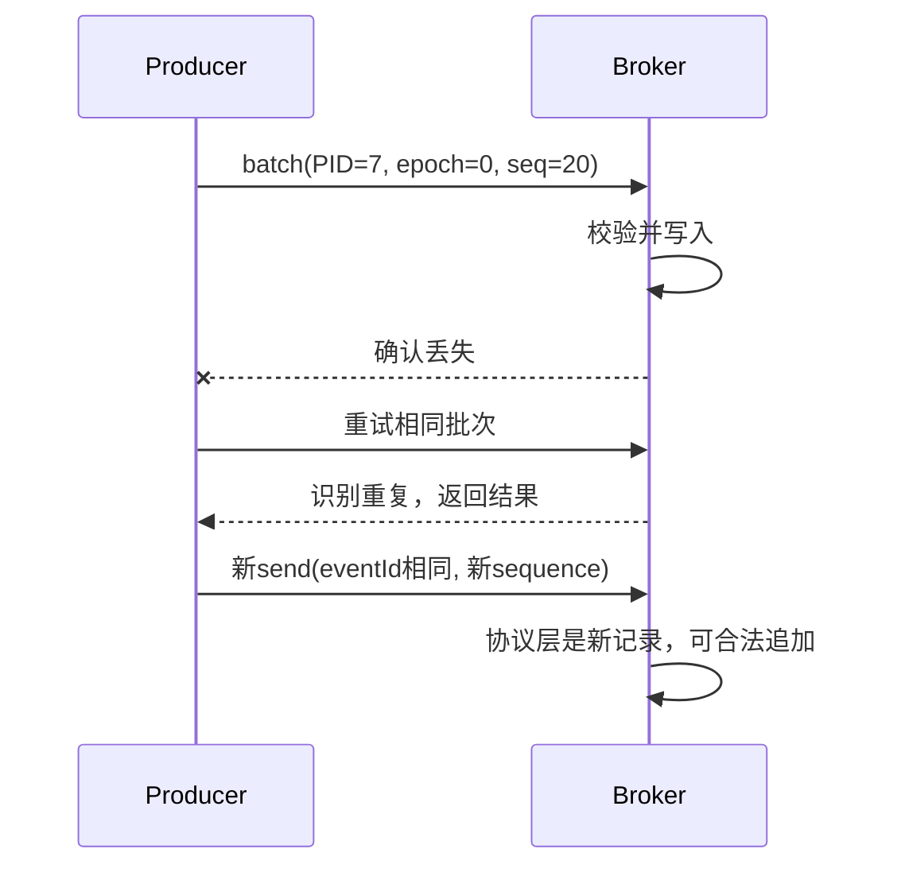

开启幂等需要 acks=all、retries>0、单连接在途请求不大于 5；它通过序列校验在允许的并发范围内维护顺序。Broker 保存有限状态，不能概括成所有旧 sequence 都永久无条件 ACK。

普通非事务 Producer 恢复后通常使用新 PID（Producer ID，生产者身份），不提供业务级跨进程去重。Broker 状态可由日志、快照与副本恢复，因此“Broker 重启必然失去幂等能力”也是错误说法。

### 8.3 事务如何把输出和输入位移绑定

消费输入 offset=100，生成两条输出，然后把输入进度 101 纳入同一个 Kafka 事务。提交后输出和消费进度都生效；中止后输出不对 read_committed 消费者可见，输入进度也不应推进。

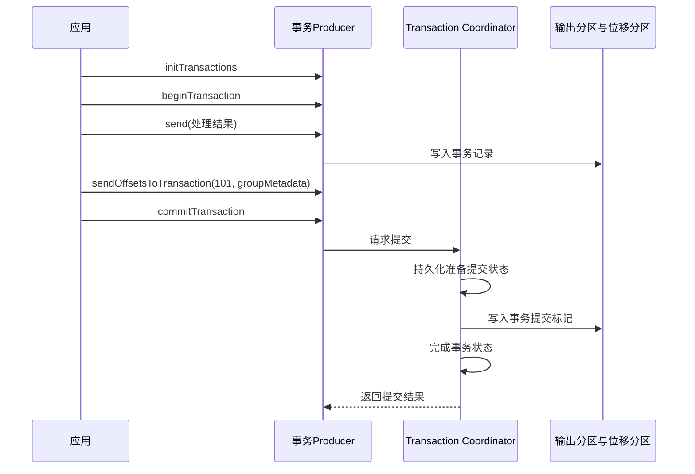

这是理解用的协调流程，实际请求随协议版本有所演进。事务 Coordinator 将状态持久化在 `__transaction_state`，以便故障后继续完成已决定的事务。跨分区原子性不代表各分区消费者在同一物理时刻观察到所有记录。

> ⚠️ **易错点**：复制完成只决定HW；`read_committed`还受LSO（Last Stable Offset，最后稳定位置）约束。

### 8.4 LSO（Last Stable Offset）为什么会挡住后面的消息

假设 offset 10 是未决事务 T1 的记录，11 是普通记录，12 是已提交事务 T2 的记录，即使复制 HW 已超过 12，read_committed 读取仍可能被最早未决事务挡在 10 之前。

```text
offset:       8        9       | 10(T1未决)  11(普通)  12(T2已提交) | 13
                              ^ LSO                              ^ HW
read_committed: 只能前进到稳定边界之前，过滤中止事务
read_uncommitted: 不以事务稳定边界过滤，仍受复制可见边界约束
```

因此，事务过长不仅影响自身输出可见性，也可能延后同分区后续记录。`read_committed` 仍能读取稳定范围中的非事务记录，不是“只读带事务的数据”。

### 8.5 transactional.id 与 fencing

transactional.id 表示稳定逻辑实例，不同并发实例不可共用。新实例恢复时通过生产者身份与 epoch 机制隔离旧实例，旧实例继续事务操作可能收到不可恢复错误，应关闭。

fencing 防止旧 Kafka 事务生产者继续写入，不会自动 fence 掉它正在执行的数据库 SQL（Structured Query Language，结构化查询语言） 或 HTTP（Hypertext Transfer Protocol，超文本传输协议） 请求。业务外部副作用仍需额外协调。[事务与处理语义](https://kafka.apache.org/41/design/design/)

### 8.6 事务应用的控制流程与异常边界

以下伪代码说明边界，实际实现须结合所用客户端 API 和异常类型：

```text
消费者：enable.auto.commit=false，isolation.level=read_committed
生产者：配置该逻辑实例专属且可恢复的 transactional.id

启动时：initTransactions()

循环：
    records = poll()
    beginTransaction()
    对每条输入计算输出并 send()
    offsets = 本批各分区实际完成的下一位置
    sendOffsetsToTransaction(offsets, 当前consumer.groupMetadata())
    commitTransaction()
```

异常分支不能简单写成“catch 后继续下一批”：

- **可以中止并重处理的失败**：按客户端异常语义执行 abort；消费者本地 position 不会因此自动回退，需恢复到正确输入位置，或重建消费者使其从有效提交进度恢复。
- **生产者被 fence 等不可恢复错误**：关闭旧生产者并停止该实例，不能继续用同一对象盲目重试。
- **提交阶段结果不确定**：按对应 API 的超时和重试契约处理，不能一律假设中止，也不能不核对状态就重复执行外部副作用。
- **Rebalance 导致所有权变化**：当前组元数据与分区归属可能失效，事务必须与消费组协调，不能用过期的分区进度继续推进。

事务提交也受生产者在途发送结果影响。事务中不能启动无法追踪的异步输出后就假设全部业务已经完成；所有纳入事务的记录与位移必须对应同一批实际处理结果。

### 8.7 为什么同时需要幂等、事务与读隔离

**只做重试**可以提高最终送达概率，但响应丢失时可能重复追加。**只做幂等**可以识别协议重试，却不能让两个分区的输出和输入位移共同成功。**只做原子写入但允许读未提交**又会让下游观察到后来中止的输出。

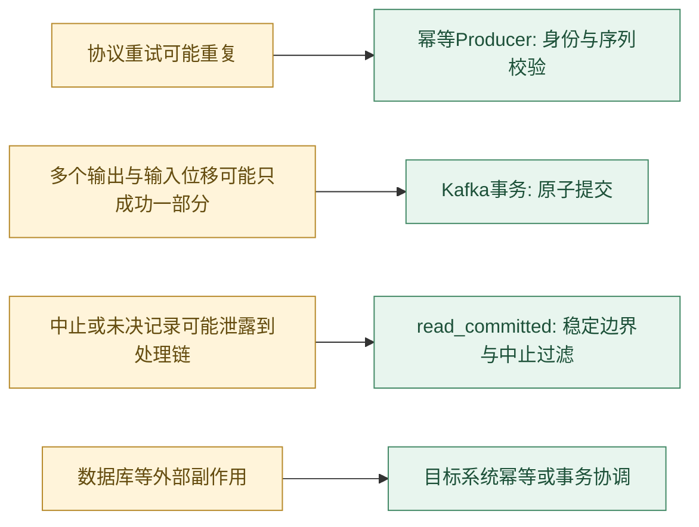

**读图抓手**：每种保障针对不同问题，协议幂等、Kafka事务和外部业务幂等不能互相替代。

**与全链路分布式事务对比**：把所有数据库和 Kafka 都纳入统一两阶段提交，需要各参与方支持并处理锁、超时和协调者恢复。Kafka 事务专注 Kafka 日志和输入进度，避免声称自动覆盖任意外部系统。Outbox 与幂等消费则通过可靠发布、重试和本地原子性获得最终一致，代价是事件延迟、重复投递及补偿治理。

**与“先提交位移再处理”对比**：提前提交偏向至多一次，减少重投但可能漏处理；处理后提交偏向至少一次，避免越过未完成工作但可能重复。精确一次必须定义观察边界，不能用两个调用的先后顺序消除所有窗口。

### 8.8 事务Coordinator故障时，决定存在哪里

事务的价值不只在于正常路径先后调用哪些方法，还在于出错后能否根据持久状态恢复决定。Coordinator不能只在内存里记“准备提交”，否则自身崩溃后无法区分哪些参与分区应提交。

| 故障阶段 | 恢复时关注什么 | 对应用的含义 |
| --- | --- | --- |
| 记录已写、事务尚未决定 | 持久事务状态与超时规则 | read_committed不应把未决输出当成功结果 |
| 提交决定已持久化、部分marker未完成 | 恢复协调者继续推进既有决定 | 不能因响应慢就假设业务可任意重新执行 |
| 已提交、客户端未收到响应 | 最终结果与客户端API重试契约 | 不确定结果不等于中止 |
| 中止事务后需要重处理 | 输入有效提交位置及本地position | **abort不会自动重置Consumer读取位置** |

持久化决定加参与分区事务标记，使恢复能继续推进；代价是额外日志、网络与可见性等待。Marker到达和稳定边界推进也不是跨分区的同时快照，应用不能把Kafka事务当成多分区任意查询的数据库快照隔离。

<a id="business-consistency"></a>

## 9. 数据库与事件的一致性

> 🎯 **从双写窗口推导方案**
>
> **Outbox原子保存业务与发布意图，消费幂等原子保存去重与业务结果。**
>
> 两端各自使用本地原子性，中间允许可恢复重试，并处理重复和顺序。

### 9.1 双写为什么总有窗口

| 执行顺序 | 第一步成功、第二步失败的结果 |
| --- | --- |
| 先提交数据库，再发 Kafka | 数据库已有订单，但没有订单事件 |
| 先发 Kafka，再提交数据库 | 下游收到事件，但订单可能不存在 |

**交换两步顺序不能消除窗口**，Kafka 事务也不能直接包住 MySQL 本地事务。

### 9.2 事务 Outbox 的可靠性闭环

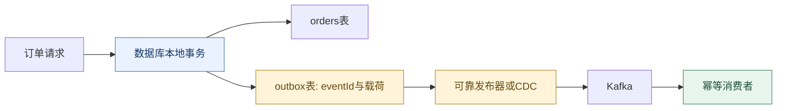

**读图抓手**：业务与outbox本地原子提交，跨系统发布靠可靠重试，重复由消费幂等吸收。

在同一个数据库事务里写订单和 outbox，原子保证“订单成功就有待发布事件”。发布器将 outbox 投递到 Kafka，再标记进度。如果投递成功后发布器崩溃、尚未记录完成，重启会再次投递，因此消费幂等仍然必需。

发布器还要处理扫描分页、顺序、并发抢占、积压、失败重试与清理。先标记完成再发送会引入漏发；不能为了避免重复而改变为这个顺序。

> ⚠️ **易错点**：**去重标记成功、业务执行失败**同样可能漏处理，两者必须共同提交或回滚。

### 9.3 消费去重必须与业务变更原子提交

以下为数据库处理的结构示意：

```sql
BEGIN;
-- event_id 上有唯一约束；只有本事件首次成功插入才执行业务。
INSERT INTO consumed_event(event_id, processed_at)
VALUES ('evt-1001', CURRENT_TIMESTAMP);

UPDATE orders
SET status = 'PAID', version = 2
WHERE id = 1001 AND status = 'CREATED' AND version = 1;

-- 应用检查业务影响行数与业务规则，必要时回滚或进入异常处理。
COMMIT;
-- 数据库事务成功后，才提交 Kafka 消费位移。
```

若插入去重记录发生唯一冲突，只能在确认对应业务事务已经成功的情况下按重复处理；其他约束错误、连接错误不能吞掉。eventId 去重保护重复事件，**业务版本保护过期或乱序事件**，两者不能完全互相替代。

Redis SETNX（SET if Not eXists，仅在不存在时写入） 若先标记再执行业务，可能在标记后崩溃导致漏处理；先业务后标记又可能重复。TTL（Time To Live，生存时间） 过期后旧事件也可能再次生效。跨 Redis 和数据库没有天然的原子事务。

### 9.4 重试、死信与顺序冲突

失败后阻塞原分区可保持处理次序，但会拖住同分区其他 key。转入重试 Topic 可以释放主链路，却可能出现后续“发货”先于重试中的“支付”完成。

有序业务应明确选择：按 key 暂停、状态机拒绝非法跃迁、版本检测后延期，或允许业务补偿。死信不是成功处理的同义词，需要明确谁负责修复、何时重放以及是否允许主消费进度越过失败事件。

### 9.5 事件格式演进也属于可靠性设计

消息在日志里可能保留数天，重放时的消费者版本可能已与发送时不同。即使 Broker 一条不丢，如果新消费者无法解析旧事件，业务仍不能恢复。

| 变更 | 可能的问题 | 常见设计方式 |
| --- | --- | --- |
| 增加字段 | 旧消费者可能拒绝未知字段 | 明确序列化格式的兼容规则，使用可选字段或默认值 |
| 删除或重命名字段 | 旧事件或旧消费者缺少必要信息 | 兼容过渡、双字段阶段或显式事件版本 |
| 金额单位改变 | 解析成功但业务含义错误 | 字段名/单位明确，避免静默改变含义 |
| key 编码改变 | 同业务实体路由发生变化 | 单独评估路由迁移与顺序边界 |
| 删除事件含义改变 | 重放后对象被错误恢复或删除 | 定义 tombstone、业务删除事件与版本关系 |

Schema 校验可以避免一部分格式错误，但不能自动保证业务语义兼容。应将旧事件回放纳入版本发布验证，并保留足以定位 eventId、源位置和事件版本的信息。

### 9.6 为什么 Outbox 比交换双写顺序更可靠

| 方案 | 成功与失败依据 | 主要窗口 |
| --- | --- | --- |
| 数据库后发事件 | 两个系统分别成功 | 数据库成功、发送前崩溃会漏事件 |
| 发事件后写数据库 | 两个系统分别成功 | 下游可能看到不存在或回滚的业务 |
| 仅用内存重试 | 进程保留任务才可恢复 | 进程退出后任务依据消失 |
| 数据库 Outbox + 可靠投递 | 业务和待发事件在一个本地事务 | 发布/标记之间仍可能重复，需下游幂等 |
| 目标系统共同事务协调 | 由共同协议决定结果 | 参与方能力、锁与恢复复杂度更高 |

Outbox 的优势不是“Kafka 与数据库双写突然原子”，而是将必须原子的那一部分收缩到同一个数据库：业务状态与待发布意图。跨系统部分改为可恢复地重试。故障窗口由可能漏发转为可能重复，重复再由稳定 eventId 与本地事务解决。

**代价**：多写一张表或采集日志、维护发布水位与清理、监控延迟、处理同实体多事件顺序。对于允许丢失的非关键指标，这些成本未必划算；对于订单等需要恢复依据的事件，它们通常有明确价值。

<a id="operations"></a>

## 10. 容量、性能与运维推导

> 🎯 **先量化再调参数**
>
> **吞吐、保留容量、尾延迟和故障余量共同决定资源需求。**
>
> 从分区与下游指标定位瓶颈；多加线程、消费者或分区并不总能解决积压。

### 10.1 先建立计算口径

假设平均记录大小为 B 字节、速率为 R 条/秒、保留 T 秒、副本数 F、实测存储压缩比 C（压缩后/压缩前）：

```text
入口载荷速率 = R × B
载荷保留容量 ≈ R × B × T × F × C
分区下限 ≈ ceil(max(目标生产吞吐/单分区生产吞吐,
                       目标消费吞吐/单分区消费吞吐))
积压清空时间 ≈ 当前积压 / (消费速率 - 新增速率)
```

最后一式要求消费速率大于新增速率且速率近似稳定。容量还要加上索引、协议、容量波动、迁移临时占用及故障余量；消费网络、复制网络和磁盘带宽也应分别计算。

例如 10 万条/秒、平均 1KB，十进制入口约 100MB/s；不压缩、保留一天、3 副本，仅载荷约 25.92TB。这还不足以决定 Broker 数，因为 CPU、网络、单盘吞吐和故障后剩余容量可能先成为限制。

### 10.2 分区多为什么也会变慢

更多分区会增加日志文件、索引、活跃批次、元数据和副本管理开销。若总流量固定，拆得过细还可能使每个分区的批次更小，降低压缩及请求效率。

Broker 扩容并不会自动把全部历史分区迁移得均匀；需要副本重分配或相应自动化工具，并控制迁移流量。增加分区也不会把旧分区数据自动重新切分。

### 10.3 监控要分层看

| 层次 | 应关注的信号 | 能帮助区分什么 |
| --- | --- | --- |
| Producer | 发送错误、重试、队列时间、请求延迟 | 缓冲不足还是服务端响应慢 |
| Broker | 请求排队/处理/远端等待、磁盘、CPU、网络 | CPU、存储或复制瓶颈 |
| Replica | ISR 变化、离线分区、同步状态 | 副本是否具备容灾能力 |
| Consumer | 分区 lag、最老事件年龄、处理耗时、Rebalance | 流量增长、慢处理或分配抖动 |
| 业务 | 订单状态延迟、重复率、死信量 | 基础设施正常但业务是否仍失效 |

offset 差值不是精确业务待处理条数；压缩空洞、事务控制记录及不同隔离边界等都会影响解释。总 lag 也可能掩盖单个热点分区，必须看分区分布。

### 10.4 积压处理的决策路径

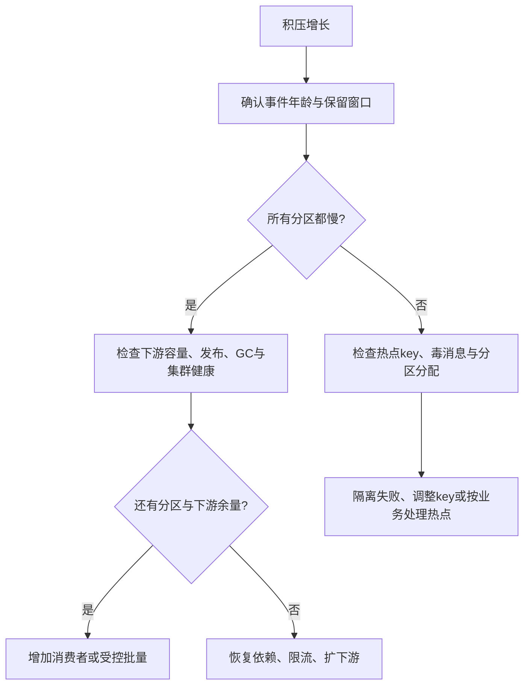

临时转发 Topic 只在并行度确为瓶颈且顺序和迁移条件允许时有效。若下游数据库已经饱和，加消费者和转发层可能进一步放大压力。

<a id="extensions"></a>

## 11. 版本演进：3.x 与 4.x 为什么不能混着讲

> 🎯 **版本必须精确到能力**
>
> **3.x不等于ZooKeeper，4.x也不是所有新特性都同时成熟或自动启用。**
>
> 分别核对：小版本、运行模式、客户端、协议、feature与补丁。

<a id="versions"></a>

### 11.1 先明确比较的对象

“我们用 Kafka 3”至少缺少四个信息：具体小版本、ZooKeeper/KRaft 模式、客户端版本、启用的协议/功能版本。升级 Broker 的程序，并不意味着客户端自动选择新协议，也不意味着所有集群 feature 已提升。

本文选取 3.3、3.6、3.9、4.0、4.1、4.2 这些与核心设计相关的里程碑作比较，不提供部署占有率排名，也不将 4.2 称为当前最新版本。能力成熟度与具体补丁缺陷需分开判断。

```mermaid
flowchart LR
    A[3.3: 新集群KRaft正式可用] --> B[3.6: 分层存储早期阶段]
    B --> C[3.9: ZK迁移桥梁与分层存储正式可用]
    C --> D[4.0: 仅KRaft与新Consumer协议GA]
    D --> E[4.1: Share Preview与Streams协议早期访问]
    E --> F[4.2: Share正式可用与Streams协议核心能力GA]
    classDef blue fill:#EAF2FF,stroke:#527CB8,color:#183B66;
    class A,B,C blue;
    classDef green fill:#E8F5EE,stroke:#438966,color:#1D5139;
    class D,F green;
    classDef amber fill:#FFF4DA,stroke:#B78A2B,color:#654D10;
    class E amber;
```

**版本资料**：[3.3 KRaft 里程碑](https://blogsarchive.apache.org/kafka/entry/what-rsquo-s-new-in)、[3.9 发布说明](https://kafka.apache.org/blog/2024/11/06/apache-kafka-3.9.0-release-announcement/)、[4.0 发布说明](https://kafka.apache.org/blog/2025/03/18/apache-kafka-4.0.0-release-announcement/)、[4.1 发布说明](https://kafka.apache.org/blog/2025/09/04/apache-kafka-4.1.0-release-announcement/)、[4.2 升级说明](https://kafka.apache.org/42/getting-started/upgrade/)。

### 11.2 核心差异速查

| 维度 | 3.x | 4.0 | 4.1 | 4.2补充 |
| --- | --- | --- | --- | --- |
| 元数据模式 | ZK 与 KRaft 并存，成熟度随小版本演进 | 仅支持 KRaft，不能直接以 ZK 模式运行或在4.0中执行ZK迁移 | 延续KRaft | 延续KRaft |
| 普通消费组新协议 KIP-848 | 后期版本有早期演进，不能把整个3.x说成GA | GA；客户端需选择 group.protocol=consumer | 延续并改进 | 延续 |
| Share Group KIP-932 | 不是3.x通用生产能力 | Early Access | Preview | 正式可用，需核对feature启用 |
| Streams专用Rebalance KIP-1071 | 原有任务协调方式 | 不等于普通Consumer协议GA就同步支持 | Early Access | 核心能力GA，功能范围仍需核对 |
| Tiered Storage KIP-405 | 3.6起发展，3.9正式可用 | 延续 | 延续 | 延续并改进 |
| ELR KIP-966 | 不能套用4.x候选状态推导 | 可用，默认未开启 | 新建集群默认开启，升级集群需查状态 | 按实际feature核对 |
| 事务协议 KIP-890 | 3.7有第一阶段防御改进 | 完成强化阶段，协商后可逐事务推进Producer Epoch | 事务API错误处理进一步统一 | 持续完善 |
| Producer linger.ms 默认 | 0ms | 5ms | 5ms | 应按目标版本配置确认 |
| Java最低要求 | 依组件和小版本判断，存在Java 8历史兼容 | Clients/Streams Java 11；Broker/Connect/工具 Java 17 | 不应把服务端要求直接套到所有客户端 | 核对目标组件文档 |
| 旧协议/格式兼容 | 保留较多历史兼容 | 移除部分旧协议API及旧消息格式v0/v1 | 继承新边界 | 继续核对弃用与移除 |

该表比较能力，不表示“升级后所有行都自动生效”。4.0 的兼容与 JDK 要求依据[官方发布说明](https://kafka.apache.org/blog/2025/03/18/apache-kafka-4.0.0-release-announcement/)，精确升级约束依据[4.0 升级指南](https://kafka.apache.org/40/getting-started/upgrade/)。

### 11.3 KRaft：新集群可用与旧集群可迁移是两件事

3.3 将 KRaft 标记为新集群生产可用，不表示当时所有 ZK（ZooKeeper，外部协调服务） 集群都能以相同成熟度平滑迁移。后续版本不断补齐迁移、运维和元数据管理能力。3.9 既是 3.x 最后一个功能版本，也是保留 ZK 模式的最后一条版本线。

```mermaid
flowchart TD
    A[已有3.x集群] --> B{元数据模式}
    B -->|ZooKeeper| C[选择受支持桥梁版本，例如3.9.x]
    C --> D[按迁移流程建立KRaft并迁移元数据]
    D --> E[验证并完成迁移]
    B -->|已是KRaft| F[核对软件与metadata版本升级路径]
    E --> F
    F --> G[滚动升级4.x程序]
    G --> H[观察验证后提升对应feature版本]
```

这里是路径示意，不能替代操作手册。正式完成迁移、提升 metadata.version 或 feature 后，回退边界可能变化，不能假设换回旧安装包即可回滚。

**动态 quorum 的价值**：静态 Controller 名单变更牵涉多节点配置；3.9 的 KIP-853 支持动态成员管理，降低增删控制器难度。但 3.9 本身不支持把现有静态 quorum 直接转换成动态 quorum，不能看见该特性就认为老集群自动具备。[3.9 迁移与动态quorum说明](https://kafka.apache.org/blog/2024/11/06/apache-kafka-3.9.0-release-announcement/)

### 11.4 Consumer协议：服务端支持不等于客户端已经使用

| 比较点 | classic | consumer（KIP-848） |
| --- | --- | --- |
| 分配计算 | 客户端Group Leader执行所选策略 | 服务端Coordinator维护目标分配 |
| 协调方式 | JoinGroup/SyncGroup等，策略决定交接行为 | 心跳协议推进成员与分配协调 |
| 心跳间隔和会话时限 | 客户端参数参与控制 | 服务端group.consumer相关参数控制 |
| 自定义客户端分配器 | 可使用相应客户端策略接口 | 不能原样沿用classic配置 |
| 升级判断 | 不能只看Broker版本 | 还需客户端版本、group.protocol与服务端feature |

**设计收益**：降低大组全局同步成本，将分配管理集中到协调者。**代价**：服务端责任增加，迁移涉及策略、回调、正则订阅和参数适配。新协议不是“没有Rebalance”，也不替代应用处理超时和外部副作用保护。[协议迁移说明](https://kafka.apache.org/41/operations/consumer-rebalance-protocol/)

### 11.5 ELR：为什么“不在ISR就只能不安全选主”过于粗糙

旧的简化推理是 ISR 提供安全候选，ISR 以外统称落后副本。但“现在不在 ISR”与“缺少已提交历史”并不等价。ELR（Eligible Leader Replicas）记录满足额外安全条件的候选，使某些不在当前 ISR 中的副本仍可安全当选。

**理解示例**：A/B/C 曾同步，C先落后离开，A/B继续提交。B再离线后，ISR只剩A且低于min ISR=2，严格最小ISR规则阻止HW继续推进。符合ELR跟踪规则的B可能保存了已提交前缀，恢复后可成为安全候选；C可能缺少A/B后来确认的数据，不能仅因“曾经是副本”获得同等待遇。

ELR 的收益是改善特定故障顺序下的安全恢复能力，不是允许任意落后副本上位。Controller维护候选状态；开启该功能也会改变min.insync.replicas配置管理与HW推进相关约束。4.0可显式启用，4.1新建集群默认启用，升级来的集群要检查feature。[ELR官方机制与启用说明](https://kafka.apache.org/41/operations/eligible-leader-replicas/)

### 11.6 事务：为什么要逐事务区分过期请求

只依赖进程生命周期的身份隔离，不足以解释某些事务结束、重试和下一事务交错的异常时序。4.0强化协议（KIP-890）在启用并使用支持的生产者客户端时，每个事务推进Producer Epoch，帮助防止上一事务的迟到请求混入下一事务。

这意味着“Producer Epoch只在initTransactions时加一”已经不是通用说法。是否生效取决于客户端、Broker和事务feature；4.1又通过KIP-1050统一事务API错误处理，应用仍要区分可重试、中止与不可恢复错误。[事务协议说明](https://kafka.apache.org/41/operations/transaction-protocol/)

### 11.7 Share Group：从分区独占到记录级分担

```mermaid
flowchart LR
    P[同一个分区中的记录] --> A[普通组: 一个成员取得该分区]
    P --> B[Share组: 不同成员领取不同记录]
    B --> C[记录获取锁]
    C --> D[处理后确认 / 释放 / 拒绝等]
    D --> E[未完成时按规则重投与计数]
    classDef blue fill:#EAF2FF,stroke:#527CB8,color:#183B66;
    class A,B blue;
    classDef amber fill:#FFF4DA,stroke:#B78A2B,color:#654D10;
    class C amber;
    classDef green fill:#E8F5EE,stroke:#438966,color:#1D5139;
    class D,E green;
```

**问题**：任务耗时差异大时，普通组把整个分区交给一个成员，扩消费者超过分区数也无法分担该分区。Share Group允许同分区的不同记录被多个成员处理，以记录级获取与确认替代单一连续进度模型。

**收益**：适合独立任务与耗时不均的工作负载。**代价**：增加记录状态、锁定、投递计数与重投管理；不应要求它提供普通组式的分区内业务处理顺序，也不保证副作用绝不重复。

**成熟度**：4.0 Early Access、4.1 Preview、4.2正式可用。4.2还补充长处理锁续期（RENEW）等能力；GA（General Availability，正式可用）不代表旧集群无需配置即自动开启，仍要检查share.version和内部状态Topic要求。[4.2发布说明](https://kafka.apache.org/blog/2026/01/14/apache-kafka-4.2.0-release-announcement/)

### 11.8 分层存储：为什么不让所有历史永远占本地盘

只用本地盘时，长保留会把存储容量与Broker数量绑在一起，故障恢复或迁移也可能涉及大量历史数据。Tiered Storage将封闭Segment上传远端，本地优先保留热数据，老数据需要时回读。

```mermaid
flowchart LR
    W[持续写入] --> H[本地活跃段与热数据]
    H -->|封闭段上传| R[远端存储与元数据]
    C[消费者] -->|近期读取| H
    C -->|历史回放| B[Broker远端读取路径]
    B --> R
    classDef blue fill:#EAF2FF,stroke:#527CB8,color:#183B66;
    class H blue;
    classDef amber fill:#FFF4DA,stroke:#B78A2B,color:#654D10;
    class B amber;
    classDef green fill:#E8F5EE,stroke:#438966,color:#1D5139;
    class R green;
```

**收益**：长保留不必完全由本地盘承载；**代价**：上传与元数据链路、插件兼容、远端请求费、回读延迟和故障恢复更复杂。它不是完全无状态Broker，也不能默认与任意日志压缩或Topic配置组合都兼容。

3.6起发展，3.9正式可用；核心框架与具体RemoteStorageManager插件的成熟度要分别判断。测试用本地实现不是生产对象存储方案。[3.9分层存储说明](https://kafka.apache.org/39/operations/tiered-storage/)

### 11.9 升级时分别验证什么

1. **组件**：Broker、Controller、Clients、Connect、Streams及第三方Connector分别核对版本与JDK；Spring Kafka版本不能直接当作Apache Kafka版本。
2. **模式**：确认ZK/KRaft，先走受支持迁移路径，避免直接替换4.x程序启动旧ZK集群。
3. **兼容**：4.0移除了旧协议API和消息格式v0/v1；老客户端和非Java客户端需要单独核对，不要假设任意版本互通。
4. **默认值**：记录当前有效配置，特别是linger、事务和消费协议；显式配置有助于避免默认值变化导致行为漂移。
5. **feature**：区分**程序升级完成**与metadata、group、transaction、ELR、share等功能版本变更；后者可能改变回退条件。
6. **验证**：先验证收发、位移、回调、事务、指标与故障恢复，再按版本文档完成特性提升；保留基于真实回退边界的恢复方案。

“4.x比3.x更快”不能作为升级结论。应逐项说明它减少了什么协调成本、增加了什么能力，以及应用如何启用并验证收益。完整路径以[对应版本升级指南](https://kafka.apache.org/40/getting-started/upgrade/)为准。

<a id="experiments"></a>

## 12. 通过实验检验理解

> 🎯 **用故障验证理解**
>
> **实验要同时观察成功路径与中断时刻，单节点不能证明多副本容灾。**
>
> 每次实验先写预期，再核对日志、位移、事务可见性和业务副作用。

### 12.1 最小收发实验

以下命令逐条执行，适用于安装了 Docker 的 PowerShell 或 Bash。数据未挂载持久卷，删除容器会丢失本实验数据；单副本环境不能验证容灾。

```shell
docker run -d --name kafka-learning -p 127.0.0.1:9092:9092 apache/kafka:4.1.2
docker logs kafka-learning
```

等待启动完成后，创建 Topic：

```shell
docker exec kafka-learning /opt/kafka/bin/kafka-topics.sh --bootstrap-server localhost:9092 --create --topic order-events --partitions 3 --replication-factor 1
docker exec kafka-learning /opt/kafka/bin/kafka-topics.sh --bootstrap-server localhost:9092 --describe --topic order-events
```

生产者终端执行下列命令，然后输入 `order-1001:created`、`order-1001:paid`：

```shell
docker exec -it kafka-learning /opt/kafka/bin/kafka-console-producer.sh --bootstrap-server localhost:9092 --topic order-events --property parse.key=true --property key.separator=:
```

消费者在另一个终端执行：

```shell
docker exec -it kafka-learning /opt/kafka/bin/kafka-console-consumer.sh --bootstrap-server localhost:9092 --topic order-events --group principle-demo --from-beginning --property print.key=true --property print.partition=true --property print.offset=true
```

观察同 key 的分区及 offset；增加同组消费者观察分配，换一个全新组名观察独立进度。`--from-beginning` 不会强制覆盖消费组已有的有效位移。

查看消费组状态：

```shell
docker exec kafka-learning /opt/kafka/bin/kafka-consumer-groups.sh --bootstrap-server localhost:9092 --describe --group principle-demo
```

结束客户端后清理本实验：

```shell
docker stop kafka-learning
docker rm kafka-learning
```

命令依据：[官方 Quick Start](https://kafka.apache.org/41/getting-started/quickstart/)。

### 12.2 故障实验要验证什么

| 实验 | 操作要点 | 应观察的结果 |
| --- | --- | --- |
| 业务成功、提交前退出 | 数据库写入成功后主动终止消费者 | 重启重投，去重表防止二次副作用 |
| 并发处理乱序 | 让较小 offset 处理较慢 | 不得越过未完成记录提交 |
| poll 超时 | 在可控实验中让处理超过 max.poll.interval | 成员变化、提交失败与重复处理 |
| ISR 缩小 | 三副本 Topic，停止一个/两个副本 | 观察 ISR、发送错误及 min ISR 门槛 |
| 事务提交与中止 | 分别提交、abort，使用两种隔离读取 | read_committed 过滤中止事务 |
| 长事务阻塞 | 事务保持未决，再写后续记录 | 稳定边界限制可见进度 |

这些是实验设计，不代表仅靠上面的单节点命令就能完成全部验证。多副本实验需要独立搭建多个 Broker，并先记录副本分布与 Leader 位置。

## 附录 A：官方资料

- [设计与消息语义](https://kafka.apache.org/41/design/design/)
- [Producer 参数](https://kafka.apache.org/41/configuration/producer-configs/)
- [Consumer 参数](https://kafka.apache.org/41/configuration/consumer-configs/)
- [Broker 参数](https://kafka.apache.org/41/configuration/broker-configs/)
- [Topic 参数](https://kafka.apache.org/41/configuration/topic-configs/)
- [KRaft](https://kafka.apache.org/41/operations/kraft/)
- [新消费组协议](https://kafka.apache.org/41/operations/consumer-rebalance-protocol/)
- [基础运维与副本重分配](https://kafka.apache.org/41/operations/basic-kafka-operations/)

---

<a id="glossary"></a>

## 附录 B：术语与缩写

### 核心协议术语

| 缩写/术语 | 英文全称或原词 | 中文与准确含义 |
| --- | --- | --- |
| MQ | Message Queue | 消息队列，泛指一类系统或使用模型 |
| KRaft | Kafka Raft | Kafka 基于 Raft 的元数据共识机制；Raft 是算法名 |
| ZK | ZooKeeper | 旧模式使用的外部协调服务 |
| KIP | Kafka Improvement Proposal | Kafka 改进提案；被接受不等于已在所有版本正式发布 |
| ISR | In-Sync Replicas | 同步副本集合，包含 Leader；成员动态变化 |
| OSR | Out-of-Sync Replicas | 未处于同步状态的副本，常见解释性称呼 |
| ELR | Eligible Leader Replicas | 有资格安全当选 Leader 的候选副本集合，与 ISR 不等同 |
| LEO | Log End Offset | 日志末端位置，即下一条待追加位置 |
| HW | High Watermark | 高水位，复制提交边界；可读记录 offset 小于该值 |
| LSO | Last Stable Offset | 最后稳定位置，受 HW 与未决事务约束；不是最后一条已提交记录的编号 |
| PID | Producer ID（Producer Identifier） | 生产者身份；这里不是操作系统进程号 |
| ACK / acks | Acknowledgement / acknowledgements | 确认；Producer 写入确认与消费者记录确认是不同方向 |
| EOS | Exactly-Once Semantics | 精确一次语义，必须说明其作用范围和故障假设 |
| CDC | Change Data Capture | 数据变更捕获，如将数据库日志转为事件 |
| DLQ | Dead Letter Queue | 死信队列；Kafka 应用常以单独 Topic 实现 |
| MM2 | MirrorMaker 2 | Kafka 跨集群复制工具体系 |
| GA | General Availability | 正式可用；仍需选择合适补丁版本并验证环境 |
| Early Access / Preview | Early Access / Preview | 早期访问 / 预览，不等于正式生产承诺 |

### 性能、运行时与一致性术语

| 缩写/术语 | 英文全称或原词 | 在本文中的含义 |
| --- | --- | --- |
| pull / push | Pull / Push | 拉取 / 推送，描述哪一方主导数据交付请求 |
| long polling | Long Polling | 长轮询：没有足够数据时暂缓响应已有请求 |
| offset / epoch | Offset / Epoch | 日志位置 / 任期，二者不能互相替代 |
| quorum / fencing | Quorum / Fencing | 达成决策所需集合 / 隔离过期实例 |
| I/O（IO） | Input/Output | 输入输出，包括网络和存储操作 |
| OS | Operating System | 操作系统 |
| CPU | Central Processing Unit | 中央处理器 |
| DMA | Direct Memory Access | 直接内存访问；零拷贝不代表没有 DMA 传输 |
| JVM / JDK | Java Virtual Machine / Java Development Kit | Java 虚拟机 / Java 开发工具包 |
| GC / STW | Garbage Collection / Stop-The-World | 垃圾回收 / 全局停顿；Rebalance 中的 STW 是类比 |
| TPS | Transactions Per Second | 每秒事务数；消息压测中常被宽泛用为条/秒，必须声明口径 |
| P50 / P99 | 50th / 99th Percentile | 50/99 分位数，描述延迟分布，不能代替最大值 |
| RPO | Recovery Point Objective | 恢复点目标，描述可接受的数据损失范围 |
| RTO | Recovery Time Objective | 恢复时间目标，描述服务恢复时限 |
| TTL | Time To Live | 生存时间，如去重标记的有效期 |
| API / RPC | Application Programming Interface / Remote Procedure Call | 应用编程接口 / 远程过程调用 |
| HTTP / DNS | Hypertext Transfer Protocol / Domain Name System | 超文本传输协议 / 域名系统 |
| TLS | Transport Layer Security | 传输层安全协议；加密会影响发送路径 |
| SASL / ACL | Simple Authentication and Security Layer / Access Control List | 身份认证框架 / 访问控制列表 |
| SQL / DB | Structured Query Language / Database | 结构化查询语言 / 数据库 |
| ES | Elasticsearch（产品名称） | 常见外部搜索索引目标，不是 Kafka 内部存储 |
| SETNX | SET if Not eXists | Redis 的条件写入概念；跨 Redis 与数据库不自动原子 |

后续代码中的 API 名和参数名保持原样；图中的 P0、C1 等只是节点编号，不属于待背诵的缩写。
