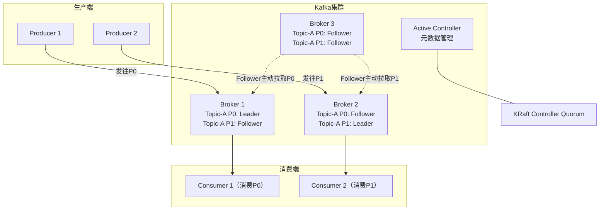
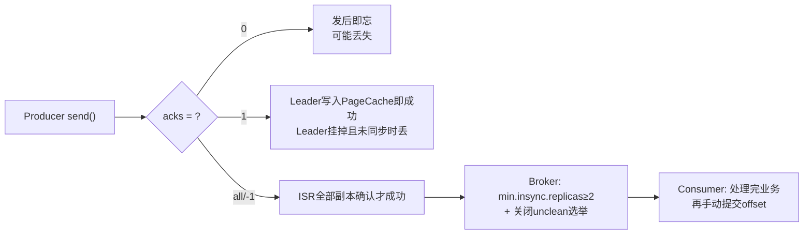
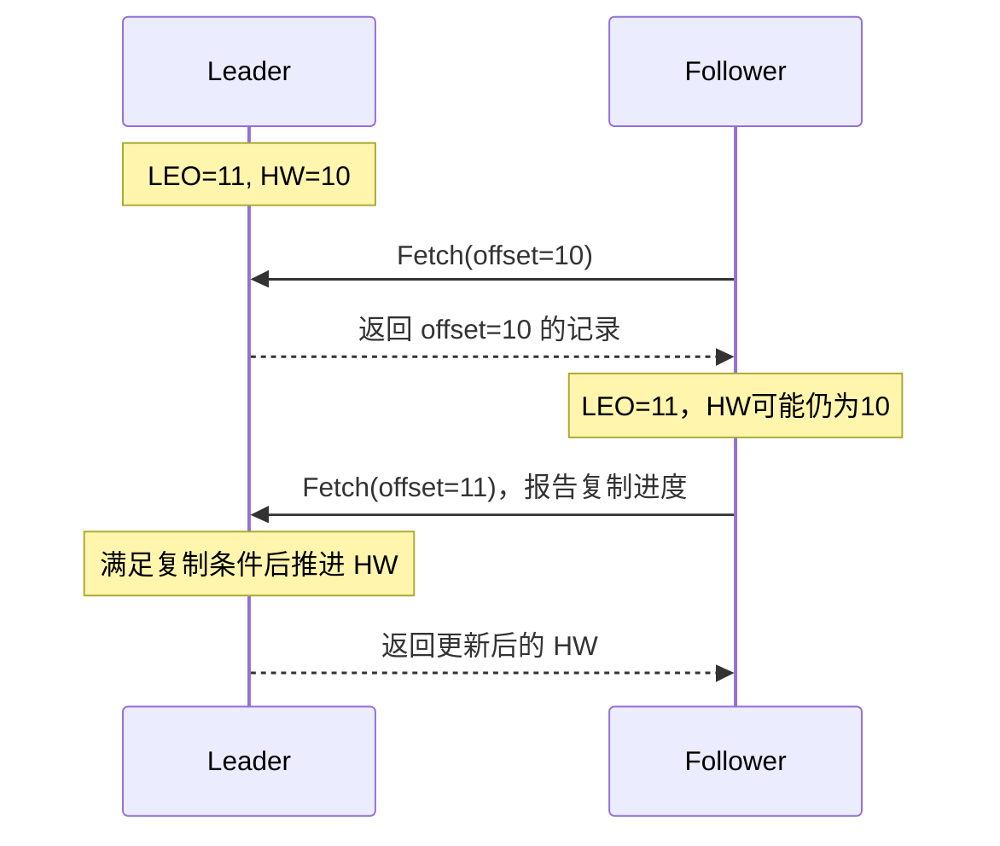
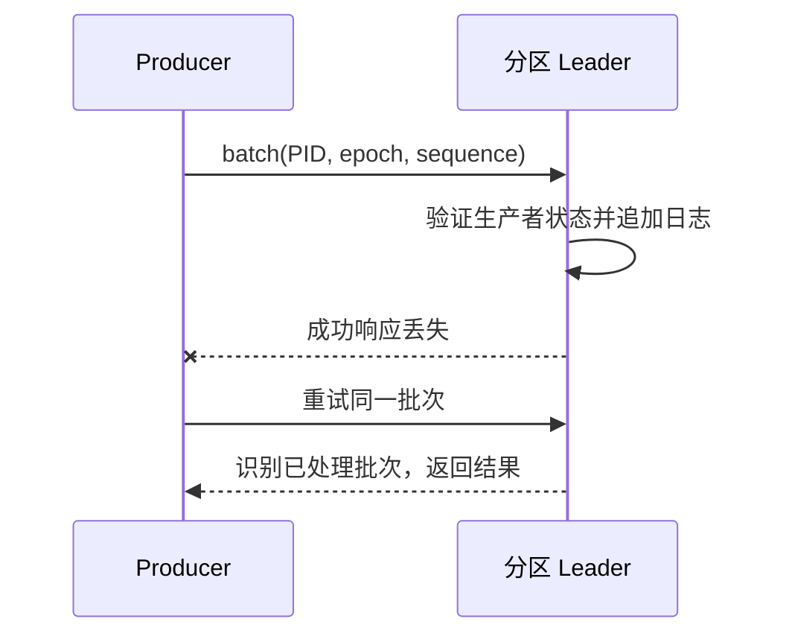
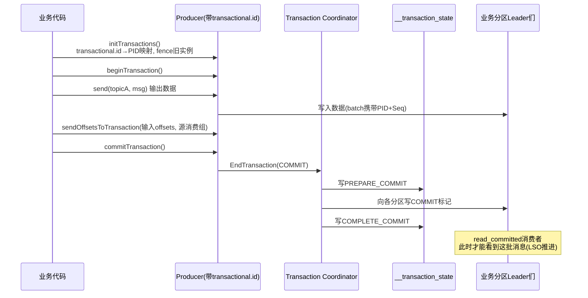
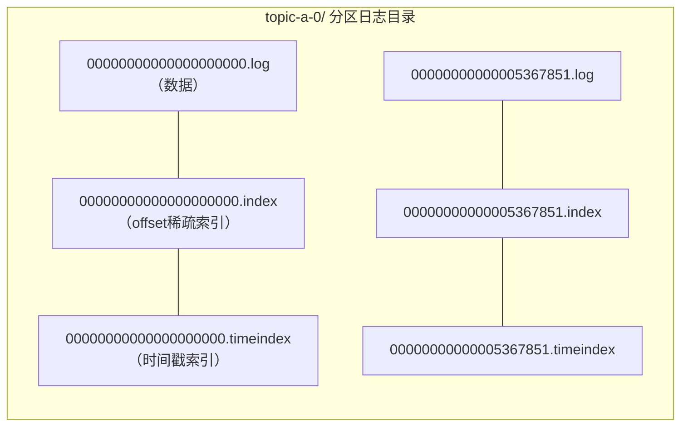
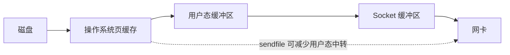
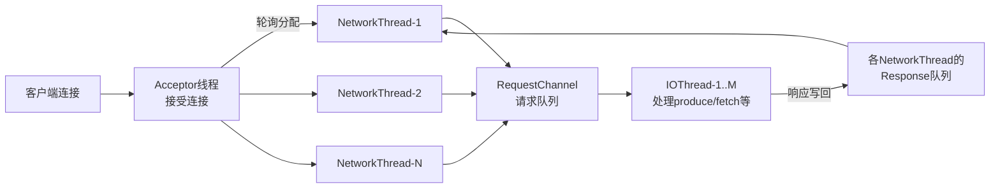
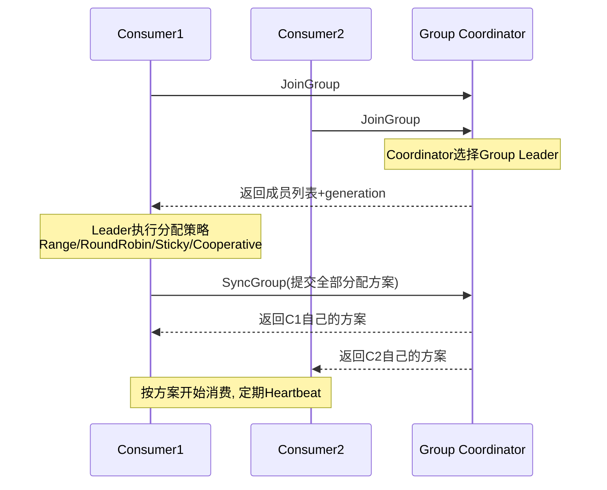
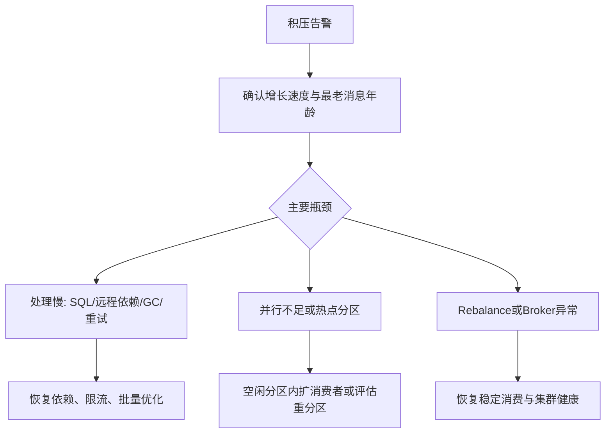

# Kafka 面试：回答框架、机制追问与场景推演

> 配套阅读：[Kafka原理.md](Kafka原理.md)。本篇保留可直接复述的回答，并用追问检验推导能力。
>
> 建议用法：每题先看「一句话结论」训练开场表达，再按「原理 → 细节 → 权衡/解决方案」的框架复述。重点是讲清设计动机、故障窗口和方案权衡。
>
> **版本口径**：基础示例按4.1，版本题比较3.x与4.0/4.1/4.2。不要将3.x等同于ZooKeeper，也不要将4.0早期功能直接视作所有4.x的成熟功能。版本差异见Q31～Q35及[原理篇版本章](Kafka原理.md#versions)。
>
> 缩写在正文首次出现时展开，文末提供[术语附录](#glossary)供回查。

---

## 复习导航

| 优先级 | 题目 | 复习任务 |
| --- | --- | --- |
| **第一轮：主链路** | Q2～Q4、Q6～Q13、Q20～Q22 | 画出消息路径，解释可靠性、位移和事务边界 |
| **第二轮：实现与排障** | Q14～Q19、Q23、Q28～Q30 | 说明替代方案、性能成本与故障证据 |
| **第三轮：选型与版本** | Q1、Q5、Q24～Q27、Q31～Q36 | 说明业务约束、小版本差异与适用条件 |

> **使用方式**：先遮住展开内容复述结论，再回答“为什么不选另一种方案”。遇到推导断点，通过每题的**原理展开**回到对应章节。

## 一、基础与选型篇

**本篇重点**：解释Kafka的日志模型和吞吐来源，再说明顺序、并行与选型的边界。

### Q1：什么是 Kafka？与传统消息队列有何区别？

> **一句话结论**：Kafka 是分布式事件流平台，以可持久化、可复制、可重放的分区日志连接生产者和消费者。

| 维度 | Kafka 的设计 | 对业务的影响 |
| --- | --- | --- |
| 数据组织 | Topic 拆成多个追加日志分区 | 分区内有序，可并行扩展 |
| 消息生命周期 | 保留时间、容量或日志压缩策略决定 | 消费后不会立即删除，可独立重放 |
| 消费方式 | 客户端拉取并维护组进度 | 支持批量与消费速率控制 |
| 多订阅方 | 不同消费组各自记录 offset | 同一事件供多个业务独立使用 |

**典型场景**：异步解耦、削峰、日志聚合、CDC（Change Data Capture，数据变更捕获）、实时计算和数据管道。

**追问边界**：不能把所有传统 MQ（Message Queue，消息队列） 概括成“消费即删除、只支持推送、不能水平扩展”。比较时应说明具体产品、队列类型和确认机制。Kafka 也不是无限容量缓冲区；积压超过保留窗口仍可能失去数据。

**🔎 追问演练**：为什么审计服务可以重新消费，但积压太久仍可能丢失待处理事件？

**推演要点**：消费进度不控制日志保留；审计重放应核对保留窗口、权限与外部副作用。

**原理展开**：[对应章节](Kafka原理.md#log-model)。

---

### Q2：讲一下 Kafka 的整体架构和核心概念

> **一句话结论**：Kafka 架构围绕「Topic 分区化 + 多副本 + Consumer Group」展开，元数据由 ZooKeeper（旧）或 KRaft（Kafka Raft，Kafka元数据共识机制）管理。

**核心概念串讲**（面试时按这条线讲）：

- **Broker**：Kafka 服务节点，多个 Broker 组成集群。
- **Topic**：逻辑上的消息分类；物理上按 **Partition（分区）** 切分，分区是**并行度和扩展性的基本单位**。
- **Replica**：每个分区有多个副本，分为 **Leader**（通常处理客户端读写）和 **Follower**（主动拉取复制；特定配置支持就近副本读取）。
- **ISR（In-Sync Replicas，同步副本集合）**：与 Leader 保持同步的副本集合，是可靠性机制的核心。
- **Producer**：发送消息到 Topic，通过分区策略决定落到哪个分区。
- **Consumer Group**：普通 subscribe 组模型下，组内每个分区同时只分配给一个消费者，组间互不影响——同时实现**队列模式（组内负载均衡）**和**发布订阅模式（组间广播）**。
- **Offset**：每个分区维护一个单调递增的消息序号，消费进度以 offset 记录，这使得 Kafka 消息可重放。
- **Controller**：KRaft Controller quorum 中的活动控制器负责集群元数据管理；可与 Broker 分离部署，不能继续套用“某个 Broker 必然担任 Controller”的旧模式。

**🔎 追问演练**：Controller 挂了，所有业务读写会立即停止吗？

**推演要点**：已有稳定分区可能继续读写，但元数据推进及必要切主受影响；还需区分单个活动 Controller 失效与 quorum 多数丢失。

**原理展开**：[对应章节](Kafka原理.md#architecture)。

**⚖️ 方案对比与代价**：与统一转发代理相比，客户端获取元数据后直连Leader减少中转层，但要求所有必要Broker地址可达；控制面统一决定元数据，数据面分散处理流量。

---

### Q3：Kafka 为什么这么快？（高频必考）

> **一句话结论**：Kafka 的高吞吐来自多个层面的协同：**顺序追加、PageCache、零拷贝、批量+压缩、分区并行**。

1. **顺序写磁盘（Append-Only Log）**
   消息只追加不修改，顺序追加降低寻道与随机写开销；具体收益取决于存储介质和工作负载，不能直接等同于内存性能。这是设计层面的根本决策。

2. **利用 PageCache**
   写入通常先进入 OS（Operating System，操作系统） 页缓存；最终响应还需满足 acks 与复制条件，读取热数据时直接命中 PageCache，避免 JVM（Java Virtual Machine，Java虚拟机） 堆内存开销和 GC（Garbage Collection，垃圾回收） 压力。

3. **零拷贝（Zero-Copy）**
   Broker 向消费者返回文件数据时，在适用路径中可使用 `transferTo/sendfile`，减少用户态复制（详见 Q15）。

4. **批量发送 + 压缩**
   Producer 端 RecordAccumulator 按分区分批攒消息，网络请求以 batch 为单位；支持 lz4/zstd/snappy 压缩，端到端传输，降低网络和磁盘占用。

5. **分区并行**
   Topic 分成多个分区分布在多个 Broker 上，生产和消费天然水平扩展。

6. **稀疏索引**
   Segment + 稀疏索引使消息查找为「二分定位段 + 段内跳跃查找」，降低索引体积与查找成本，最终仍需局部扫描（见 Q14）。

> **权衡**：攒批与压缩通常提高吞吐，但会改变延迟和 CPU（Central Processing Unit，中央处理器） 开销。不要脱离消息大小、副本数、acks、压缩率与硬件条件承诺“百万 TPS（Transactions Per Second，每秒事务数）”。

**🔎 追问演练**：TLS（Transport Layer Security，传输层安全协议） 开启后，为什么不能继续按固定零拷贝次数解释性能？

**推演要点**：文件发送涉及加密和平台实现，路径可能改变；应看 CPU、请求大小、网络及端到端延迟，不能只看磁盘。

**原理展开**：[对应章节](Kafka原理.md#storage)。

**⚖️ 方案对比与代价**：与逐条小请求、随机更新和堆内重复复制相比，顺序追加、批次及OS缓存减少相应开销。收益依赖负载：TLS、冷数据回放、低流量和高熵数据可能改变瓶颈。

---

### Q4：消息如何路由到分区？分区数怎么定？

> **一句话结论**：分区路由决定局部顺序，分区数量要从吞吐与消费并行度推导，再校验资源和扩容成本。

**路由规则**（默认分区器）：
1. 指定了 partition → 直接投递；
2. 指定了 key → `hash(key) % partitionCount`（murmur2），在分区数、分区逻辑和 key 序列化保持不变时，同 key 映射到同一分区；
3. 都没有 → 粘性分区策略（Sticky Partitioner，2.4+）：以批处理和负载均衡为目标；现代默认实现还会考虑分区负载，不能机械理解为逐条轮询或每批必换分区。

**分区数怎么定**（这是高级岗想听的推导过程）：
- **吞吐量倒推**：`分区数 ≥ max(目标生产吞吐 / 单分区生产吞吐, 目标消费吞吐 / 单分区消费吞吐)`。单分区吞吐需压测得出，并对结果向上取整、预留增长及故障余量。
- **消费者并行度约束**：有效获得分区的组成员数不超过分区数，额外成员没有分区。
- **不是越多越好**：分区过多导致——Rebalance 变慢、Producer 活跃批次与缓冲开销增大（按分区组织批次，非每分区固定仅一个 buffer）、故障切换时 Leader 选举分散、端到端延迟上升、文件句柄增多。
- **只能增不能减**：分区增加会破坏 key 路由一致性，所以初始规划要留余量。

**🔎 追问演练**：有 12 个分区、20 个消费者，为何只有部分成员工作？扩成 24 分区能否立刻消化旧积压？

**推演要点**：普通组最多有 12 个成员获得分区；新增分区不会搬走原分区旧记录，旧热点仍可能是瓶颈。

**原理展开**：[对应章节](Kafka原理.md#producer)。

**⚖️ 方案对比与代价**：单分区简化全局日志顺序，多分区换来并行；随机分配容易均摊却丢失实体局部性，按key哈希保留局部顺序却可能形成热点。扩分区还需迁移边界。

---

### Q5：Kafka、RabbitMQ、RocketMQ 如何选型？

> **一句话结论**：先比较业务语义与生态，再用相同约束下的压测比较性能。

| 需求 | 评估方向 | 需要验证的边界 |
| --- | --- | --- |
| 长期保留、重放、CDC、流计算 | Kafka 的日志模型与数据生态 | 保留成本、分区规划、下游治理 |
| 交易消息、延迟投递、消费重试 | 评估 RocketMQ 对应版本能力 | 事务回查、延迟精度、重复处理 |
| 灵活路由与企业消息集成 | 评估 RabbitMQ 的交换机及队列类型 | 确认机制、持久化与集群方案 |

**回答顺序**：吞吐与延迟目标 → 顺序与一致性要求 → 重试/延迟/重放能力 → 运维经验与成本 → 压测验证。

**常见误区**：没有可跨产品直接比较的固定 TPS 排名。Kafka 事务与 RocketMQ 事务消息解决的协调问题不同，不能只写“都支持事务”便认为等价。

**🔎 追问演练**：已有熟悉 RabbitMQ 的团队，是否应该仅因 Kafka 吞吐高就迁移？

**推演要点**：需要证明现有瓶颈和新需求，比较路由、重试、重放、数据保留及运维迁移成本，再以相同可靠性条件压测。

**原理展开**：[对应章节](Kafka原理.md#log-model)。

---

## 二、可靠性与消息语义篇

**本篇重点**：沿生产端、Broker、消费端分析故障窗口，分清复制、幂等、事务与业务去重。

### Q6：Kafka 如何保证消息不丢失？（必考，全链路回答）

> **一句话结论**：消息丢失可能发生在**生产端、Broker 端、消费端**三个环节，要三个环节一起配置才能闭环。

**① 生产端**：
- `acks=all`：当前 ISR 全部副本确认复制后才算发送成功；PageCache 不等于已经持久化到物理介质；
- `retries` 设置足够大（如 `Integer.MAX_VALUE`），配合 `retry.backoff.ms`；
- 开启幂等 `enable.idempotence=true`（3.0+ 默认开启），重试不会导致乱序和重复；
- 用**带回调的异步 send 或同步 send**，不要 fire-and-forget。

**② Broker 端**：
- `replication.factor ≥ 3`；
- `min.insync.replicas = 2`：配合 acks=all，ISR 少于 2 时拒写；若 ISR 为 3，仍需等待这 3 个副本确认，而不是任选 2 个（宁可拒写也不降级丢数据）；
- `unclean.leader.election.enable = false`：禁止落后副本当选 Leader（防数据回退丢失）；
- 通常依靠跨故障域副本提高可靠性，同时评估整机房断电与存储故障；多副本不等于绝对不丢。

**③ 消费端**：
- 关闭自动提交 `enable.auto.commit=false`；
- **业务处理成功后再手动 commit offset**；
- Rebalance 时在适当的分区撤销回调中提交已连续完成的进度；分区已经丢失时不能再假设拥有提交权限。

> 总结句：「生产端用 acks=all+幂等保证写成功是真的成功，Broker 用多副本+min.insync 保证成功的写不随单机故障消失，消费端用先处理再提交保证消费不丢。三者缺一不可。」

**🔎 追问演练**：Producer 收到超时后能否断定没有写入？

**推演要点**：不能。记录可能已追加但确认丢失或复制未及时完成；重发需区分协议重试与新 send，并使用业务 eventId。

**原理展开**：[对应章节](Kafka原理.md#replication)。

**⚖️ 方案对比与代价**：高重试不等于可靠闭环：内存任务在进程退出后不可恢复；可靠事件源、复制门槛与消费幂等各管一段。发送失败和超时也不总表示未写入。

---

### Q7：深入 acks：为什么 acks=all 还要配 min.insync.replicas？

> **一句话结论**：acks=all 约束等待哪些副本，min.insync.replicas 约束同步副本不足时是否允许写入。

- `acks=1` 的隐患：Leader 写入后立刻返回，此时若 Leader 宕机且 Follower 还没同步完，新 Leader 没有这条消息 → **丢失**。
- `acks=all` 的隐患：如果 ISR 收缩到只剩 Leader 自己，"all" 就等于 "1"，退化成不可靠。
- `min.insync.replicas=2` 的作用：**当 ISR 数量低于 2 时直接拒绝写入**（抛 NotEnoughReplicas），把「可用性换可靠性」的决策显式化——要么至少两份数据，要么不写。
- 经典组合：`replication.factor=3, min.insync.replicas=2, acks=all`：在副本正确分散、其余副本同步且故障域独立的前提下，通常可在损失 1 个副本后继续写入；切换可能短暂影响请求。剩 1 个 ISR 时拒写，最终可恢复性取决于存活副本和存储是否完好。
- `unclean.leader.election.enable=true` 则是反向权衡：所有 ISR 都挂时允许 OSR（Out-of-Sync Replicas，非同步副本）（落后副本）上位，**可用性优先、接受数据回退**。是否允许数据回退应由业务恢复目标决定，不能仅按行业一概而论；Kafka 4.x 的 ELR（Eligible Leader Replicas，安全Leader候选副本） 还会影响安全候选副本的判断。

**🔎 追问演练**：副本数为 3、min ISR=2、当前 ISR=3，只等两个确认可以吗？

**推演要点**：不可以。min ISR 是写入门槛，acks=all 仍等待当前 ISR 全部副本；ISR 收缩与请求超时还可能改变最终结果。

**原理展开**：[对应章节](Kafka原理.md#replication)。

**⚖️ 方案对比与代价**：等所有配置副本会被任意离线副本拖住；只等Leader又暴露未复制故障窗口。ISR动态确认配合最小门槛，在可用性与冗余之间设置明确边界。

---

### Q8：ISR 机制：Kafka 如何判定副本"同步"？

> **一句话结论**：ISR 是「与 Leader 保持同步的副本集合」，判定依据不是消息条数，而是**时间**。

- Follower 持续向 Leader 拉取数据。如果 Follower 长时间没有发送 Fetch，或持续不能追上 Leader 日志末端，超过 `replica.lag.time.max.ms` 约束后可被移出 ISR；恢复并满足追赶条件后再加入。发送了 Fetch 不代表已经追上。
- 为什么用时间不用 lag 条数？网络抖动下条数阈值很难设：条数大时小 lag 被误踢，条数小时大 lag 被漏判。时间阈值对负载变化不敏感。
- ISR 的意义：**acks=all 只等 ISR 中的副本**，避免等一个慢副本拖死整个写入；在未启用ELR的传统简化模型中，ISR外副本不能直接按安全候选处理；启用ELR时还要检查其中满足安全条件的候选。
- 注意：Leader 永远在 ISR 中；ISR 收缩/扩张由 Leader 感知并上报 Controller 更新元数据。

**🔎 追问演练**：Follower 持续发送 Fetch，为什么仍可能被移出 ISR？

**推演要点**：存活不等于追赶及时；磁盘、网络或处理能力不足会使其持续无法追上，需结合复制滞后与时间约束判断。

**原理展开**：[对应章节](Kafka原理.md#replication)。

**⚖️ 方案对比与代价**：固定落后条数阈值对突发流量敏感；时间约束更贴近“是否持续追赶”，但阈值太短可能抖动、太长可能拖慢确认与故障发现。

---

### Q9：LEO、HW、LSO 与 Leader Epoch 有什么区别？

> **一句话结论**：**LEO（Log End Offset，日志末端位置）**是日志末端，**HW（High Watermark，高水位）**是复制提交边界，**LSO（Last Stable Offset，最后稳定位置）**是事务稳定边界；Leader Epoch 用来识别日志任期并帮助副本安全对齐。

| 概念 | 含义 | 常见误解 |
| --- | --- | --- |
| LEO（Log End Offset） | 当前日志下一条待写入的位置 | 不是最后一条记录的 offset |
| HW（High Watermark） | 已复制提交的边界，普通读取可见 offset 小于 HW | 不应把各副本瞬时 LEO 的最小值当作实时精确公式 |
| LSO（Last Stable Offset） | 不超过 HW，并受最早未决事务起点约束 | read_committed 可能因未决事务而暂时读不到后续数据 |
| Leader Epoch | 分区 Leader 的任期编号 | 不会把 acks=1 升级成多副本可靠确认 |

**HW 为什么可能滞后**：Follower 拉走记录后，Leader 通常要通过后续 Fetch 才获知其复制进度；Follower 获知 HW 也存在传播延迟。

**历史问题与改进**：旧机制仅依赖本地 HW 截断时，HW 尚未更新的副本可能丢弃实际已有的有效日志，随后切主造成损失或分歧。KIP-101 记录 epoch 到起始 offset 的映射，通过任期查询确定结束边界，识别共同日志历史后再截断。

**必须说清的边界**：Leader Epoch 解决日志对齐问题，不能恢复从未复制到新 Leader 的数据。若 acks=1 后原 Leader 故障且其他副本没有该记录，不能声称该机制能兜底。[KIP-101](https://cwiki.apache.org/confluence/display/KAFKA/KIP-101+-+Alter+Replication+Protocol+to+use+Leader+Epoch+rather+than+High+Watermark+for+Truncation)

**🔎 追问演练**：HW 已推进，为什么 read_committed 消费者仍读不到后面的普通消息？

**推演要点**：最早未决事务可能限制 LSO；后续普通记录即使已复制，也可能暂时位于稳定边界之外。

**原理展开**：[对应章节](Kafka原理.md#replication)。

**⚖️ 方案对比与代价**：单靠offset无法区分同位置不同任期的日志；Leader Epoch补充历史身份，HW负责复制可见边界，LSO负责事务稳定边界。位置、身份和可见性不能合并成一个变量。

---

### Q10：Kafka 如何保证消息有序？

> **一句话结论**：Kafka 只保证**单分区内有序**，要业务有序必须让同一业务键进同一分区，并控制生产端重试与消费端并发。

**生产端**：
- 同 key 哈希到同一分区；
- 关键坑：未开启幂等且 `max.in.flight.requests.per.connection > 1` 时，失败重试的 batch 可能后发先至，**破坏顺序**；
- 解法二选一：
  - 设为 1（牺牲吞吐）；
  - 开启幂等（Kafka 用 PID（Producer ID，生产者身份）+SequenceNumber 保证 broker 端按序接收去重，**幂等模式下 ≤5 也能保序**，这是推荐答案）。

**Broker 端**：单分区日志天然顺序追加，无需额外配置。

**消费端**：
- 分区分配只限制消费者归属；业务代码仍须按序处理，不能把单消费者等同于单线程业务执行；
- 若把消息丢进线程池并行处理，要**按 key 哈希分发到固定的工作队列/线程**，保证同 key 串行；
- 批量消费时注意批内按 offset 顺序处理。

**实践模板（订单场景）**：`key=orderId` 保证同订单有序；跨订单并行；幂等 Producer + 消费端按 orderId 串行化处理。

**🔎 追问演练**：同 key 路由正确，为什么支付完成仍先于创建落库？

**推演要点**：先核对源端是否已反序发送，再查异步工作线程、重试 Topic、扩分区迁移及多生产者并发；日志有序不等于副作用有序。

**原理展开**：[对应章节](Kafka原理.md#consumer)。

**⚖️ 方案对比与代价**：全局串行限制并行度；按实体key串行允许实体间并行。线程池提升处理并发，但若无分区/key顺序与连续完成水位，可能同时破坏执行顺序和提交安全。

---

### Q11：幂等 Producer 的原理和局限是什么？

> **一句话结论**：Broker 根据 Producer ID、Producer Epoch 和分区内序列号识别协议重试，防止同一批记录被重复追加。

**原理细节**：序列状态按生产者和分区跟踪；Broker 保留有限的批次元数据用于去重和顺序校验。不能简单描述成“所有旧序号都无条件 ACK（Acknowledgement，确认）”，超出有效状态或序列不连续时可能报错。

**配置条件**：`enable.idempotence=true`、`acks=all`、`retries>0`、`max.in.flight.requests.per.connection<=5`。在允许的并发范围内仍可保序。

**局限与追问**：

1. 消除的是客户端协议重试引起的重复；业务代码两次 send 同一事件仍是两条合法记录。
2. 普通非事务 Producer 重启后通常获得新 PID，不能靠它识别业务级重复发送。
3. 幂等不提供跨分区原子提交；这需要事务。
4. 生产者状态可通过日志、快照与副本恢复，不能断言“Broker 一重启就丢失去重能力”。

事务也不能识别任意业务重复，消费端仍应设计稳定 eventId 和幂等副作用。

**🔎 追问演练**：应用重新 send 相同 eventId，Broker 会自动去重吗？

**推演要点**：不会按任意业务字段去重；新 send 可以有新序列号。协议幂等与业务唯一标识去重属于不同保证。

**原理展开**：[对应章节](Kafka原理.md#transactions)。

**⚖️ 方案对比与代价**：重试提高送达概率却可能重复；Broker序列校验识别协议重试，业务eventId去重识别应用级重复。前者不需要理解业务，后者必须与实际副作用协调。

---

### Q12：Kafka 事务与 Exactly-Once（重点，画图讲）

> **一句话结论**：Kafka 事务保证**跨分区、跨 Topic（仅限 Kafka 内部）的原子写入**，配合幂等 Producer 与 `read_committed` 实现 Kafka 语义上的 Exactly-Once。

**核心角色**：
- `transactional.id`：用户指定的稳定逻辑实例 ID，跨恢复保持稳定，不同并发实例不能共用，用于僵尸 Producer fencing；
- **Transaction Coordinator**：某个 Broker 担任，状态持久化在内部 Topic `__transaction_state`（compact 型）。

**完整流程**（Consume-Transform-Write 模式）：

**关键机制解释**：
1. **fencing**：新实例初始化会通过生产者身份与 epoch 机制 fence 旧实例；客户端可能抛出 `ProducerFencedException` 等不可恢复错误，应关闭旧实例——解决僵尸进程双写。
2. **两阶段提交**：先在事务日志写 PREPARE，再向各参与分区写 COMMIT/ABORT marker，最后写 COMPLETE。Coordinator 宕机后可从事务日志恢复未决事务继续推进。
3. **读隔离**：跨分区事务不表示不同分区的消费者会在同一时刻观察到所有结果；它保证提交或中止的事务语义。Consumer 设 `isolation.level=read_committed`，读取 **LSO（Last Stable Offset）** 之前的非事务记录及已提交事务记录，过滤中止事务；未提交事务的消息对其不可见。代价是可见性延迟。
4. **原子消费**：源消费者关闭自动提交，使用实际成功处理记录的下一位置及当前消费组元数据调用 `sendOffsetsToTransaction` 把消费进度也纳入事务，实现"消费+生产"的原子性——Kafka Streams 的 EOS（Exactly-Once Semantics，精确一次语义）（`exactly_once_v2`）就是这么做的。

**边界（必说）**：Kafka 事务只保证 **Kafka 内部** 的 exactly-once。一旦下游是 MySQL/ES（Elasticsearch，搜索引擎产品） 等外部系统，仍需靠下游幂等（如受版本约束的 upsert、与目标事务协调的 sink）实现端到端 exactly-once。

**🔎 追问演练**：事务消费者更新数据库，再提交 Kafka 事务，是否就实现端到端 EOS？

**推演要点**：两个系统没有共同原子提交；数据库已成功而 Kafka 事务中止时仍会重处理，需要幂等或目标系统协调。

**原理展开**：[对应章节](Kafka原理.md#transactions)。

**⚖️ 方案对比与代价**：提前提交位移可能漏处理，处理后提交可能重复。Kafka事务将Kafka输出和输入位移绑定，但不代替外部数据库事务；读未提交又会暴露中止输出，因此还需读隔离。

---

### Q13：为什么会重复消费？如何做端到端幂等？

> **一句话结论**：处理结果与消费位移不能自动原子提交，幂等要围绕稳定事件标识和业务副作用设计。

**重复的根因**：
1. 消费端：消息处理完但 offset 未提交时崩溃/Rebalance → 重新消费（at-least-once 的固有代价）；
2. 生产端：发送成功但响应丢失，重试导致双写（幂等 Producer 可解）；
3. Rebalance 风暴导致的反复投递。

**解决思路分层**：
- **上游**：Producer 幂等/事务，减少协议重试重复；业务重复发送仍需识别；
- **消费侧兜底（必须做）**，常见三种：
  1. **唯一键 + 数据库事务**：消息带稳定 eventId，在同一事务中插入唯一去重记录并更新业务；只在确认唯一键冲突时按重复处理，不能吞掉其他数据库错误；
  2. **Redis 去重窗口**：先 SETNX（SET if Not eXists，仅在不存在时写入） 后处理可能在标记成功、业务失败时漏处理；先处理后标记又可能重复。TTL（Time To Live，生存时间） 还会使旧事件重新生效。仅适合允许这些窗口的场景，不能替代数据库原子性；
  3. **业务状态机幂等**：如 `UPDATE SET status=已支付 WHERE id=? AND status=待支付`，影响行数为 0 也可能是状态非法或数据不存在，需按业务规则区分。
- **设计原则**：把"消息可能重复"当作系统公理，让**处理逻辑本身幂等**，而不是幻想消灭重复。

**🔎 追问演练**：去重表插入成功、业务更新失败，重投会不会被当作已处理？

**推演要点**：两步必须在同一个数据库事务中，业务失败应使去重标记一起回滚；否则会形成漏处理窗口。

**原理展开**：[对应章节](Kafka原理.md#business-consistency)。

**⚖️ 方案对比与代价**：Redis标记与数据库更新分属两个系统，有中间窗口；去重表和业务更新放入一个本地数据库事务可以缩小原子边界，代价是额外写入、索引和清理。

---

## 三、存储与高性能原理深挖篇

**本篇重点**：每项性能机制都要说清它减少什么成本、有哪些适用条件。

### Q14：Kafka 的日志存储结构？为什么用稀疏索引？

> **一句话结论**：分区日志由多个 Segment 与稀疏索引组成，以较小索引和局部扫描平衡空间、写入与查询成本。

**Segment 机制**：
- 每个分区是一个目录，日志切分为多个 **Segment**（可由大小、时间等条件触发滚动，实际取决于配置），文件名基于该段 base offset，压缩后它未必对应一条仍存在的记录。
- 好处：① 查找时先按文件名二分定位段；② 过期数据以整段文件直接删除，无需整理。

**三个文件的分工**：
- `.log`：消息数据本体；
- `.index`：offset → 物理位置的**稀疏索引**（按 index.interval.bytes 等条件建立索引，通常为约 4KB 的间隔目标，记录批次会影响实际间隔）；
- `.timeindex`：timestamp → offset，支持按时间查找。

**为什么稀疏索引而不是每条都建？**
- 索引文件可整体 mmap 进内存，稀疏意味着索引较小、容易利用页缓存；mmap 不代表所有页面始终驻留物理内存；
- 查找路径：二分找段 → 段内稀疏索引定位最近的索引项 → 从最近的不大于目标 offset 的索引项开始扫描，扫描成本取决于记录大小与索引间隔。全量索引反而占用大量内存/磁盘，且写放大严重——这是典型的**较低空间和写入成本换取额外局部扫描**的权衡。

**日志清理策略**：
- `delete`：按时间/大小删除整段（默认）；
- `compact`：保留每个 key 的最新值（`__consumer_offsets`、事务日志、Connect 配置都用它），null 值消息（tombstone）表示删除该 key。

**🔎 追问演练**：日志压缩后 offset 不连续，消费者是否会卡在被删除的位置？

**推演要点**：读取可前进到后续可用记录；offset 是位置标识而非密集业务序号，进度算法应按实际交付序列跟踪。

**原理展开**：[对应章节](Kafka原理.md#storage)。

**⚖️ 方案对比与代价**：密集索引定位更直接却增加空间及写成本；稀疏索引减少索引量，换取局部扫描。分段又让历史回收从逐条整理变成段级管理。

---

### Q15：Kafka 零拷贝的原理和适用边界？

> **一句话结论**：Broker 发送日志文件时，适用路径可借助 `FileChannel.transferTo()` 和操作系统 sendfile，减少文件数据经用户态缓冲区中转的开销。

**收益**：降低 CPU 复制与系统调用开销，减少大批数据进入 JVM 堆带来的内存与 GC 压力。支持 scatter/gather 的硬件还可进一步减少内核中的数据复制。

**边界**：零拷贝不是没有 DMA（Direct Memory Access，直接内存访问），也不是所有场景固定“2 次拷贝、2 次切换”。TLS 加密、记录转换、平台和 JDK（Java Development Kit，Java开发工具包） 实现等都会影响实际路径。mmap 索引与 sendfile 数据传输是不同优化，不能混称为 Producer 的零拷贝。

**🔎 追问演练**：mmap 与 sendfile 为什么不能混成同一种零拷贝？

**推演要点**：mmap 提供文件页的虚拟地址映射，sendfile 优化文件到网络的发送路径；二者使用位置、数据流与限制不同。

**原理展开**：[对应章节](Kafka原理.md#storage)。

**⚖️ 方案对比与代价**：read/write让文件数据先到用户态再回内核；sendfile优化适用的文件到网络路径。mmap解决映射与查找，不是所有传输场景的同义词。

---

### Q16：Kafka 为什么通常不每条消息 fsync？

> **一句话结论**：逐条同步刷盘会增加等待与 I/O 开销；Kafka 通常用页缓存、批量与跨节点复制平衡吞吐和可靠性。

**原理**：写入操作系统页缓存与写入持久介质是不同完成条件。`acks=all` 表示满足副本复制确认，不等价于每台机器逐条 fsync。

**配置边界**：Kafka 提供日志 flush 相关配置，不能说它“没有强制刷盘能力”。但刷盘配置也不能简单解读成任意时刻的同步持久化承诺，需结合版本实现、存储硬件与故障模型验证。

**风险与方案**：独立故障域上的多个副本可以抵抗部分单机故障；同机房同时断电、磁盘损坏、误删除和保留过期仍需要独立评估。高可靠方案还包括机架感知、跨故障域部署、备份、容灾演练与明确 RPO（Recovery Point Objective，恢复点目标）/RTO（Recovery Time Objective，恢复时间目标）。

**🔎 追问演练**：三副本都在一个机架，能否覆盖机架断电？

**推演要点**：不能仅按副本个数推导独立容灾。需要副本故障域分布、存储持久化特性，以及符合 RPO/RTO 的备份恢复。

**原理展开**：[对应章节](Kafka原理.md#storage)。

**⚖️ 方案对比与代价**：逐条fsync将设备等待带进请求路径；批量刷写与多副本提高效率并覆盖部分故障，但同故障域同时失效仍需独立恢复方案。

---

### Q17：批量与压缩的内部机制？

> **一句话结论**：按分区攒批并以批次压缩，用等待和 CPU 开销换取更低的网络与存储成本。

- Producer 内存中有 **RecordAccumulator**：每个分区一个双端队列（Deque）的 batch（默认 16KB），`linger.ms` 控制攒批等待；批次达到大小目标或等待到期后具备发送条件，实际发送仍受元数据、连接和背压影响。
- **压缩发生在 Producer 端，以 batch 为单位**（snappy/lz4/zstd）。Broker 在满足条件时可避免重压缩，但仍可能需要校验或转换，不能保证完全不解包，Consumer 端解压——端到端收益：网络、磁盘、PageCache 全受益。
- 压缩率与 CPU 成本依赖数据分布、压缩级别及实现；可对 lz4/zstd 进行真实负载对比。
- 权衡：更大的 batch 容量为攒批提供空间，但不表示一定更高延迟；实际等待还取决于流量、linger 与背压；低延迟业务把 `linger.ms=0~5ms`、减小 `batch.size`。

**🔎 追问演练**：linger 从 0 改为 5ms，是否每条消息必然慢 5ms？

**推演要点**：不是。高流量下批次可能很快填满；少量等待也可能减少请求压力，实际延迟应比较 P50（50th Percentile，50分位数）/P99（99th Percentile，99分位数） 与队列时间。

**原理展开**：[对应章节](Kafka原理.md#producer)。

**⚖️ 方案对比与代价**：逐条同步send/get使单线程等待网络往返；异步重叠等待，攒批摊薄请求成本。代价是内存、失败处理及低流量等待，不能只调batch而忽略缓冲上限。

---

### Q18：Broker 的网络模型（Reactor）

> **一句话结论**：Acceptor、网络 Processor 与请求处理线程分工，让连接管理、网络读写和请求执行解耦。

- **Acceptor** 只做 accept，连接轮询分给 N 个 **NetworkThread**（`num.network.threads`，默认 3）做读写 IO；
- 请求进入 **RequestChannel** 队列，由 M 个 **IOThread**（`num.io.threads`，默认 8）执行业务逻辑；
- 响应放入对应 NetworkThread 的响应队列异步写回。
- **为什么这么设计**：网络 IO 与业务处理解耦；IO 线程慢不会阻塞连接接受；有界队列等机制提供背压基础，但不能推导出严格公平。调线程前应先看队列时间、线程空闲率、CPU 与磁盘指标；线程更多可能加剧争用。

**🔎 追问演练**：Broker 请求排队很长，是否应该直接增加 IO 线程？

**推演要点**：先分解排队、执行、复制等待和响应发送时间；若磁盘已饱和或锁竞争严重，加线程可能更差。

**原理展开**：[对应章节](Kafka原理.md#storage)。

**⚖️ 方案对比与代价**：一个线程兼做网络与慢业务容易相互阻塞；线程分工和等待请求登记将它们解耦，但增加队列、调度与背压管理，线程数不能无上限增加。

---

### Q19：DelayedOperationPurgatory 与时间轮（区分度很高的题）

> **一句话结论**：Purgatory 管理等待条件满足或超时的请求，时间轮降低大量超时任务的管理成本。

- 很多请求不能立即完成：`acks=all` 的 produce 要等 Follower 同步；`fetch.min.bytes` 未满足要等数据；请求超时管理等；这不是业务延迟消息队列。
- Kafka 把这些请求包装成 DelayedOperation 放进 **Purgatory（炼狱）**，由事件触发（如副本追上）或超时唤醒。
- 超时管理用**分层时间轮（Hierarchical Timing Wheel）**：按 tick 和层级组织时间槽，插入/取消通常成本较低；跨层级迁移和到期批量处理仍有开销，避免海量定时器用堆排序的开销。Netty/Quartz 对比着讲更出彩。

**🔎 追问演练**：Purgatory 能否直接用来实现订单 30 分钟后关闭？

**推演要点**：它是 Broker 内部请求等待机制，不能当成应用定时任务 API（Application Programming Interface，应用编程接口）；业务需要持久化调度、故障恢复与到期投递方案。

**原理展开**：[对应章节](Kafka原理.md#storage)。

**⚖️ 方案对比与代价**：逐请求阻塞线程或频繁扫描所有超时对象成本高；按事件索引等待请求、用分层时间轮管理到期可降低管理成本，但到期突发、跨层迁移和清理仍有开销。

---

## 四、消费端与组协调篇

**本篇重点**：Pull/Push、位移、所有权和超时是四个问题，避免用一个参数解释全部现象。

### Q20：为什么用 pull？offset 如何管理？

> **一句话结论**：pull 让客户端控制获取节奏并便于批量传输；offset 将消费进度与日志生命周期分离。

**可直接复述的回答**：Kafka采用由消费者发起的Fetch，让不同处理能力的客户端按位置取数并批量追赶；没有足够数据时通过长轮询减少空响应。相比无流控推送，它更容易把交付节奏放到消费者侧，但客户端仍要限制预取、工作队列和依赖调用。

| 对比 | 收益 | 代价 |
| --- | --- | --- |
| Push | 有数据及时交付，适合带信用窗口的通知与任务系统 | 需管理消费者能力、在途记录、确认与背压 |
| 短轮询Pull | 客户端控节奏，实现简单 | 高频请求空转，轮询间隔与发现延迟冲突 |
| 长轮询Pull | 等待数据或超时再响应，降低空转 | Broker维护等待请求，连接和超时仍有成本 |

**反问式追问**：push是否一定压垮慢消费者？不一定，prefetch/credit等流控可限制交付；应比较流控责任与状态成本，不能把无流控的坏实现当成所有push。

**参数边界**：fetch.max.wait.ms是Broker等待条件；poll(Duration)是应用调用等待预算；max.poll.interval.ms是应用持续推进约束。三者不等价。详图见[Pull/Push设计对比](Kafka原理.md#pull-push)。

**位置区别**：`position()` 是下一次读取位置，`committed()` 是恢复使用的提交位置。成功处理 offset=10 后提交 11。提交存储在 `__consumer_offsets`，不会删除业务记录。

**自动提交的准确理解**：自动提交由客户端轮询流程推进，并非一个完全独立于 poll 的定时器。同步处理完整批次后再 poll，不能仅因“自动提交”就断言必然提前提交；但异步派发后继续 poll、未完成本批就继续轮询等用法，可能提交尚未完成的工作。处理成功而提交前崩溃则可能重复。

**手动提交的边界**：

- `commitSync()` 等待结果；`commitAsync()` 需处理回调，不能盲目重试旧 offset 导致进度回退。
- 分区并发处理时只提交各分区**连续完成**的位置，不能把最大完成 offset 直接当作安全进度。
- 撤销分区时可提交仍拥有分区的已完成进度；分区已丢失时不能依赖最终提交。
- 关闭自动提交后，`close()` 不能代替显式提交；关闭也不能保证未完成业务突然变得安全。
- `seek()` 改变当前读取位置，未必同时改变已提交位移；历史重放最好使用隔离的新消费组并控制副作用。

**🔎 追问演练**：一个分区交付 100～104，100、102、103 已完成，可以提交 104 吗？

**推演要点**：不能越过 101；安全位置是 101。完成 101 后才可以继续推进，104 仍未完成时最多提交 104。

**原理展开**：[对应章节](Kafka原理.md#consumer)。

---

### Q21：Rebalance：触发条件、流程、问题与三代演进（大题）

> **一句话结论**：Rebalance 用于重新分配分区；从 Eager 到 Cooperative，再到服务端协调的新协议，目标是减少全组停顿。

**触发条件**：
1. 成员变化：消费者加入/退出/崩溃（session 超时）；
2. 订阅变化：调用 subscribe()、pattern 订阅匹配到新 Topic；
3. Topic 变化：分区数增加、Topic 删除。

**经典流程（JoinGroup + SyncGroup）**：

**三大痛点**（高级岗重点）：
1. **Stop-The-World**：Eager 策略下所有分区先全部撤销再重分配，期间整个组停止消费；
2. **重复消费**：revoke 前未提交的 offset 导致分区易主后重消费；
3. **惊群与风暴**：一个消费者抖动触发全组重平衡，消费能力下降又导致更多超时……恶性循环。

**三代演进**（讲出演进就是高级水平）：
- **第一代 Eager**：全量重分配，STW（Stop-The-World，全局停顿） 严重；
- **第二代 Cooperative（KIP-429，2.4+）**：增量式 Rebalance，只迁移受影响的分区，未受影响的继续消费；配合 **Static Membership（KIP-345）** 设置 `group.instance.id`，在特定短暂离线和恢复场景减少不必要的 Rebalance；仍受超时、主动离组和成员变化影响；
- **新 Consumer 协议 KIP-848（Kafka 4.0 起正式可用）**：**分配逻辑上移到服务端**，取消 Group Leader 角色，消费者仅通过 heartbeat 上报订阅、接收分配结果；不再有全局 barrier，降低全组协调成本；分区迁移与故障恢复仍有停顿，效果需实测。

**实战调优**：先确认 `group.protocol`。classic 模式的客户端心跳/会话配置不能直接用于 consumer 模式；后者相关间隔由服务端配置。先定位处理耗时与进程抖动，再调整批量、超时或引入受控并发；协议迁移需验证兼容性。[Consumer 协议说明](https://kafka.apache.org/41/operations/consumer-rebalance-protocol/)

**🔎 追问演练**：Cooperative 与新 Consumer 协议是一回事吗？

**推演要点**：不是。前者强调增量交接策略，后者改变协调协议和分配位置；要说明所用协议、策略及兼容条件。

**原理展开**：[对应章节](Kafka原理.md#rebalance)。

**⚖️ 方案对比与代价**：Eager实现全量交接较直接但停顿范围大；Cooperative减少不必要撤销却增加交接状态；新Consumer协议将目标分配放到服务端，减少classic全组协调成本。

---

### Q22：消费者"被踢出组"问题排查（实战高频）

> **一句话结论**：先区分存活检测超时与 poll 进度超时，再定位慢业务、GC、网络或实例重启。

**以下客户端超时参数先按 classic 协议理解；consumer 协议的会话与心跳由服务端控制。先分清两套超时机制**：
- `session.timeout.ms`（新版默认 45s）+ `heartbeat.interval.ms`（3s）：由**后台心跳线程**维护，衡量消费者进程是否活着；
- `max.poll.interval.ms`（默认 5min）：衡量**两次 poll() 之间的间隔**，衡量消费线程是否卡住。

**典型故障**：业务处理太慢 → 超过 max.poll.interval → 被认为卡死踢出 → Rebalance → 分区重分配 → 重复消费 + 消费能力下降。

**排查与解决**：
1. 减小 `max.poll.records`，让单次 poll 的量在处理时限内；
2. 处理逻辑异步化（线程池 + 手动提交注意并发提交顺序问题，可用 per-partition 队列）；
3. 调大 `max.poll.interval.ms`（治标）；
4. 检查是否有同步远程调用、锁竞争、Full GC（GC 期间心跳线程可能也停，双杀）；
5. 滚动发布场景上静态成员。

**🔎 追问演练**：心跳一直正常，为什么提交仍然失败？

**推演要点**：poll 间隔可能超时，成员资格或分区归属已改变；心跳存活不能替代应用持续推进。

**原理展开**：[对应章节](Kafka原理.md#rebalance)。

---

### Q23：消息积压如何处理？

> **一句话结论**：先判断剩余保留窗口和业务时效，再定位瓶颈；扩容必须以分区和下游承载能力为前提。

**应急顺序**：

1. 对齐 lag 拐点、发布记录和下游指标，区分全组慢与单分区热点。
2. 优先恢复故障依赖、停止无限重试、按容量限流；消费者数小于可用分区数且下游有余量时扩容。
3. 估算清空时间：`积压量 / (消费速率 - 生产速率)`，仅在消费速率大于生产速率时有效。
4. 若临近保留边界，可在磁盘允许时评估延长保留；不可直接跳 offset 当作恢复。
5. 长期治理容量、慢消息隔离、幂等、重试上限及最老消息年龄告警。

**临时 Topic 转发方案的边界**：仅当瓶颈确实在并行度，且顺序、迁移与下游容量允许时考虑。它不会解决慢数据库，也不会使旧积压自动重新分布。必须解决“转发成功但原 offset 未提交”的重复窗口，必要时用 Kafka 事务原子提交；同 key 顺序、切换栅栏、故障恢复与清理都要有方案。

**🔎 追问演练**：积压 300 万条，消费 2 万条/秒，新增 1.5 万条/秒，多久清空？

**推演要点**：按稳定速率估算为 3000000/(20000-15000)=600 秒；还需验证下游余量、热点及保留窗口，不能用总消费速率直接相除。

**原理展开**：[对应章节](Kafka原理.md#operations)。

---

## 五、架构、前沿与系统设计篇

**本篇重点**：把架构能力放回业务约束、容量和故障域中推导。

### Q24：Controller 的作用？为什么要去 ZooKeeper（KRaft）？

> **一句话结论**：KRaft 将元数据管理纳入内置共识日志，减少外部依赖并改善控制面的同步与恢复。

**ZK（ZooKeeper，外部协调服务） 模式下的 Controller**：
- 某个 Broker 通过在 ZK 创建 `/controller` 临时节点当选 Controller；
- 职责：分区 Leader 选举、Topic 创建删除、副本重分配、把元数据变更下发给各 Broker（LeaderAndIsr、UpdateMetadata 等 RPC（Remote Procedure Call，远程过程调用））；
- 用 **Controller Epoch** 给每条命令编号，防止旧 Controller 的过期命令被执行（脑裂防护）。
- 痛点：Controller 故障切换时要**从 ZK 全量读取集群元数据重建内存状态**，大集群切换慢；ZK watch 风暴；元数据规模受 ZK 限制。

**KRaft 模式（KIP-500，3.x 逐步落地，4.0 彻底移除 ZK）**：

| 维度 | ZK 模式 | KRaft |
|---|---|---|
| 元数据存储 | ZooKeeper znode | Raft Quorum + 内部日志 `__cluster_metadata` |
| Controller 选举 | 抢临时节点 | Raft 选举 |
| 故障切换 | 依赖读取及重建元数据状态 | 热备 Controller 持续跟踪元数据日志，降低切换重建成本 |
| 扩展上限 | 受元数据规模和控制器恢复成本约束 | 改善元数据扩展能力，实际规模需验证 |
| 运维 | 多维护一套 ZK | 组件收敛，配置简化 |

**展开思路**：解释元数据日志如何支持热备跟踪和恢复，再讨论减少外部组件与控制面扩展收益；不要把它等同于业务数据自动存算分离。

**🔎 追问演练**：KRaft 元数据共识与业务分区同步能否用一个多数提交模型解释？

**推演要点**：不能。前者管理控制面日志，后者围绕 Leader、ISR 和分区复制；它们解决不同范围的一致性。

**原理展开**：[对应章节](Kafka原理.md#architecture)。

**⚖️ 方案对比与代价**：外部ZK协调与内置元数据日志都提供一致元数据；KRaft减少外部组件并支持热备跟踪，但引入其自身quorum、feature版本和恢复管理，不能当成完全无需运维。

---

### Q25：三大 Epoch 辨析（专家级快问快答）

> **一句话结论**：不同层面的 epoch 隔离各自的过期角色和日志历史，不能混为一个全局版本号。

| Epoch | 归属 | 作用 |
|---|---|---|
| **Controller Epoch（历史 ZK 模式）** | 集群控制器任期 | 标识控制器任期，防止过期控制指令；KRaft 应区分元数据 quorum 任期及相关协议字段 |
| **Leader Epoch** | 分区 | 每次分区 Leader 变更 +1，关联任期日志边界，辅助副本对齐（KIP-101），不补救未复制记录 |
| **Producer Epoch** | 生产者身份与事务边界 | 随身份恢复与fencing等流程演进；4.0强化协议启用时可逐事务推进，Broker 拒绝低 epoch 的生产者，实现僵尸实例 fencing |

（classic Consumer Group 使用 generation；新 Consumer 协议还涉及 member epoch 等，不能将其当作三类 epoch 的同义词。）

**🔎 追问演练**：Producer Epoch 能否阻止旧消费者继续写 MySQL？

**推演要点**：不能。Kafka 生产者 fencing 不会自动撤销外部数据库操作；数据库需状态版本、唯一约束或其他业务协调。

**原理展开**：[对应章节](Kafka原理.md#architecture)。

---

### Q26：Kafka 没有延迟消息，如何自己设计？

> **一句话结论**：通过持久化调度与到期转发实现延迟投递，并显式处理队头阻塞、重复和恢复。

**为什么需要额外设计**：Kafka 4.1 普通日志消费没有通用的逐条定时投递接口；延时调度还需解决持久化、恢复、顺序和队头阻塞，不能仅靠记录 timestamp。

**设计方案**（按复杂度递进）：
1. **多级延迟 Topic（仿 RocketMQ）**：`delay-1s / delay-5s / delay-5m ...` 每个级别一个内部 Topic，Producer 侧路由；后台时间轮扫描到期消息转发回真实 Topic。实现相对直接，但到期顺序与写入顺序不一致时仍要处理队头阻塞。
2. **时间轮 + 暂停分区**：利用 Consumer `pause()/resume()`，延迟消息先写入按延迟级别分区的缓冲区，时间轮到期后 resume 转发。
3. **外部调度**：延迟任务写 Redis/DB（Database，数据库）（zset score=执行时间戳），调度服务轮询到期后投递 Kafka。实现简单，吞吐受限。

**要点**：pause 阻止继续拉取某分区，并不等于持久化定时器，仍需持续 poll 维护组状态。说明精度、吞吐、持久化、重复投递和时钟偏差的权衡；转发后再提交可能重复，先提交后转发可能丢失。

**🔎 追问演练**：先写进来一条一小时后到期的事件，后写一条一分钟后到期的事件，如何防止队头阻塞？

**推演要点**：按延迟级别或时间桶组织调度，必要时使用持久化到期索引；仅 pause 整个分区会挡住后来的早到期事件。

**原理展开**：[对应章节](Kafka原理.md#business-consistency)。

**⚖️ 方案对比与代价**：内存时间轮快但单独使用会丢调度状态；数据库到期索引容易持久化但有扫描与锁竞争；延迟Topic利用日志却需处理队头阻塞、转发原子性和恢复。

---

### Q27：如何理解 Pulsar、Tiered Storage 与 Share Group？

> **一句话结论**：分别讨论存储架构、冷热分层和消费语义，避免把三种不同能力混为同一个替代方案。

- **Pulsar 对照**：其典型架构将 Broker 与 BookKeeper 持久化层分开。选型仍需按具体版本验证部署复杂度、租户隔离、顺序与故障恢复能力，不能只凭“存算分离”作结论。
- **Kafka Tiered Storage（KIP-405）**：将封闭日志段卸载至远端存储，降低长期保留对本地磁盘的压力。它不代表 Broker 完全无状态或容量无限；远端存储插件、费用、回读延迟和恢复策略都需要评估。
- **Queues for Kafka（KIP-932）**：Share Group 允许多个成员分担同一分区中的不同记录，并以记录级确认、锁定和重新投递支持队列场景；不要理解成多消费者同时取得同一条记录后随意处理。

**版本与顺序边界**：本文 Kafka 4.1 中 Share Group 为 Preview，尚不适合生产；它与普通 Consumer Group 共存，不推翻后者的分区独占规则，也不沿用后者的分区内处理顺序承诺。[4.1 发布说明](https://kafka.apache.org/blog/2025/09/04/apache-kafka-4.1.0-release-announcement/)

**🔎 追问演练**：Share Group 是否让普通 Consumer Group 不再受分区数限制？

**推演要点**：它是独立消费模型，不能改变普通组的规则；还要明确 4.1 Preview 的成熟度及记录级重投和顺序边界。

**原理展开**：[对应章节](Kafka原理.md#extensions)。

**⚖️ 方案对比与代价**：普通组以分区归属和连续offset换取流式处理简单性；Share组以记录锁与ACK换任务分担；分层存储改的是历史保留位置，不解决同一类问题。

---

### Q28：系统设计：百万 TPS 订单事件平台，要求有序、可靠、可回溯

> **一句话结论**：先界定业务语义和容量，再围绕分区、原子事件发布、幂等消费及恢复能力设计。

1. **澄清要求**：有序是同订单还是全局？可靠性允许什么 RPO/RTO？重放多久？消息平均及 P99 大小、峰值持续时间是多少？
2. **容量估算**：若 100 万条/秒、每条 1KB，原始入口约 1GB/s（十进制口径）；连续一天约 86.4TB。3 副本、保留 7 天、不压缩时仅记录载荷就约 1.81PB，尚未计入索引和余量。压缩率必须实测，不能凭 TPS 直接报机器数。
3. **分区与节点**：按生产吞吐、消费处理速率、目标并行度估算分区下限；Broker 数还受副本网络、磁盘读写、保留容量、故障余量与延迟约束。
4. **Topic 与顺序**：key=orderId，隔离业务流量；同订单在源端建立明确因果顺序，消费端串行处理，扩分区前设计迁移边界。
5. **可靠发布**：3 副本、acks=all、min.insync.replicas=2，配合跨故障域放置和安全选主；业务库通过 Outbox/CDC 可靠发布。Outbox 记录与业务写入在同一数据库事务，投递 Kafka 本身不在这个本地事务中。
6. **消费一致性**：eventId 唯一约束与业务状态更新置于同一数据库事务，成功后提交 offset；Kafka 到 Kafka 的处理可评估事务。
7. **回溯**：保留窗口内按时间或 offset 重放；用隔离消费组、限速和幂等保护副作用。远端分层保留需单独验证插件与恢复链路。
8. **容灾**：明确跨集群复制延迟、位移映射、切流、重复处理及双写防护。MirrorMaker 2 异步复制并不意味着零 RPO，不能让两地消费者无约束地同时执行外部副作用。
9. **验收**：压测吞吐与 P99 延迟，演练 Broker/Controller 故障、消费崩溃、重复事件、依赖变慢及跨集群恢复。

**需要能解释的权衡**：局部顺序换并行度；同步副本门槛换可用性；更长保留换容量成本；事务与幂等换实现及运行成本。

**🔎 追问演练**：面试官把保留从一天改成七天，机器数是否只需按吞吐估算？

**推演要点**：保留容量可能成为主约束；重新计算副本、压缩率、迁移和故障余量，并验证远端存储成本与恢复时间。

**原理展开**：[对应章节](Kafka原理.md#operations)。

**⚖️ 方案对比与代价**：只按TPS估机器数忽略保留容量、复制、读放大与故障余量；只按磁盘估又忽略网络、CPU和尾延迟。设计应由多个约束中的最紧项决定。

---

### Q29：常见故障快问快答

> **一句话结论**：根据错误所属阶段排查元数据、大小限制、消费组身份或网络，不把所有异常归因于重试不足。

- **RecordTooLargeException**：消息超过链路上的大小限制。应检查全链路限制，但不必机械地全部设成相同值：Producer `max.request.size`、Broker `message.max.bytes`、Topic `max.message.bytes`、Consumer `max.partition.fetch.bytes`/`fetch.max.bytes`。
- **NOT_LEADER_FOR_PARTITION**：Producer 拿着旧元数据把请求发给了非 Leader 副本。Producer 会自动刷新元数据重试；频繁出现要查 Leader 频繁切换的原因（Broker 抖动/GC/ISR 收缩）。
- **消费者加机器没效果**：先查普通消费组的分区并行度、热点 key 与下游容量；扩分区不会自动重分布旧数据，还可能改变 key 路由。
- **提交 offset 报 UNKNOWN_MEMBER_ID/ILLEGAL_GENERATION**：处理太久被踢出组后提交，属于旧 generation——回到 Q22 处理。

**🔎 追问演练**：为什么消费者能连上入口，却持续请求其他地址超时？

**推演要点**：客户端获取元数据后直连目标 Broker；检查 advertised.listeners、DNS（Domain Name System，域名系统）、防火墙以及宿主机与容器网络边界。

**原理展开**：[对应章节](Kafka原理.md#operations)。

---

### Q30：CDC 场景如何保证顺序与一致性？

> **一句话结论**：保持源事件顺序、稳定主键路由与幂等落地，跨表事务则需要额外协调。

- 用 Debezium 等采集数据库 binlog 写 Kafka，**key = 表主键**，在源连接器顺序、分区映射与下游处理策略保持一致时维持同一行事件顺序；快照衔接、重启和重复投递也需验证；
- 单表多分区时并行度与顺序兼得；跨表事务顺序无法全局保证，需下游按事务 ID 聚合或接受最终一致；
- 下游 sink 结合版本号或状态约束实现幂等 upsert，避免旧事件重放覆盖新状态；Connect 的端到端语义取决于具体 Connector、目标系统事务能力和 offset 协调；不能认为所有 Sink 天然提供 EOS。

**🔎 追问演练**：相同主键 upsert 就能防止重放覆盖最新状态吗？

**推演要点**：不能。旧事件也能覆盖新值；需比较业务版本、源位置或等价顺序标识，定义快照与增量衔接及删除语义。

**原理展开**：[对应章节](Kafka原理.md#business-consistency)。

**⚖️ 方案对比与代价**：普通upsert可消除部分重复写效果，却不能阻止旧事件覆盖新值；版本条件解决过期更新，eventId解决重复事件，跨表事务仍需业务聚合或目标事务。

---

## 六、版本差异与设计推导

**KIP（Kafka Improvement Proposal，Kafka改进提案）**记录机制演进，回答时需要进一步说明对应发布版本与功能状态。

**本篇重点**：按小版本、模式、协议和feature回答，区分Early Access、Preview与正式可用。

### Q31：Kafka 3.x与4.x的关键差异是什么？

> **一句话结论**：先区分小版本和模式；4.0移除ZooKeeper、正式提供新Consumer协议并强化事务，后续4.1/4.2继续推进共享消费和Streams协调。

**回答顺序**：控制面 → 消费协调 → 事务与复制 → 运行时与兼容 → 能力成熟度。

| 变化 | 需要讲清的事实 |
| --- | --- |
| KRaft | 3.3起新集群生产可用，3.9是ZK迁移桥梁；4.0仅KRaft |
| Consumer协议 | 4.0 KIP-848 GA；不是升级Broker就让所有消费者自动改协议 |
| Share Group | 4.0 Early Access，4.1 Preview，4.2正式可用 |
| 分层存储 | 3.6起发展，3.9正式可用，不是4.x才有 |
| 默认与兼容 | 4.0 linger默认0→5ms；组件JDK要求、旧API和消息格式兼容有变化 |

**🔎 追问演练**：能否说“3用ZK、4用KRaft”？

**推演要点**：不能，3.x本身包含KRaft生产演进；还需具体版本、部署模式、客户端与feature状态。

**原理展开**：[版本矩阵](Kafka原理.md#versions)。

---

### Q32：现有ZooKeeper集群如何升级到Kafka 4.x？

> **一句话结论**：先在受支持的3.x桥梁版本完成ZK到KRaft迁移，再按目标版本路径升级程序并验证feature提升。

**机制展开**：以3.9.x为常见桥梁，区分程序、元数据版本和功能版本。迁移前核对JDK、旧客户端、Connector及回退边界；迁移后验证元数据、Leader、收发、位移、事务和指标。

**方案权衡**：滚动迁移能减少业务中断，但状态步骤与回退边界复杂；新建集群迁移隔离清楚，却增加双集群复制、切流、位移映射和重复处理成本。

**🔎 追问演练**：程序都升级完，是否应立即把所有feature升到最高？

**推演要点**：应按目标版本流程和验证阶段推进；某些元数据变更限制降级，不能把旧安装包当作完整回滚方案。

**原理展开**：[模式迁移与升级验证](Kafka原理.md#versions)。

---

### Q33：ELR与ISR有何不同？为什么要增加ELR？

> **一句话结论**：ISR描述当前同步集合，ELR补充满足安全条件的Leader候选，改善某些故障顺序下的安全恢复。

**机制展开**：不在当前ISR不必然意味着缺少已提交历史；结合严格最小ISR规则，Controller能跟踪部分安全候选。不要将所有OSR都当ELR，也不要将ELR当成允许丢历史的unclean选举。

**版本边界**：4.0可开启，4.1新建集群默认开启；升级集群需查实际feature。min ISR配置管理与HW推进规则也应一起核对。

**🔎 追问演练**：为什么不能只背“所有ISR死了，只能不安全选主”？

**推演要点**：该结论忽略ELR状态；需要知道已提交前缀保存情况、feature与候选规则。

**原理展开**：[ELR的故障推演](Kafka原理.md#versions)。

---

### Q34：普通Consumer Group和Share Group分别适合什么？

> **一句话结论**：有序流与连续进度通常用普通组；独立任务和耗时不均的记录可评估Share组。

**对比**：普通组将分区交给一个成员，以offset表达连续进度；Share组允许多个成员分担同分区不同记录，增加记录级获取锁、ACK、重投和投递次数。后者改善任务分担，却不提供普通组式的分区内业务顺序。

**版本边界**：4.1仍为Preview，4.2正式可用；是否实际启用及内部Topic要求必须核对。不能拿4.2的成熟度为4.0早期部署背书。

**🔎 追问演练**：Share组确认能否让数据库副作用绝不重复？

**推演要点**：业务成功、确认前崩溃仍可能重投，需要幂等；获取锁和重投规则不能代替外部事务。

**原理展开**：[Share消费模型](Kafka原理.md#versions)。

---

### Q35：Kafka 4.0事务协议强化改了什么？

> **一句话结论**：KIP-890在相应feature启用且客户端支持时逐事务推进Producer Epoch，强化迟到请求和事务边界的隔离。

**机制展开**：只按进程恢复理解epoch不够，上一事务结束后仍有重试或迟到请求时，需要避免记录混入下一事务。4.1又通过KIP-1050统一事务API错误处理。

**🔎 追问演练**：能否说每个initTransactions固定epoch加一，之后事务中都不变？

**推演要点**：不是跨版本通用结论，应交代客户端、Broker和事务feature；错误仍需分可重试、中止和不可恢复。

**原理展开**：[事务协议演进](Kafka原理.md#versions)。

---

### Q36：面试官问“为什么这么设计”，如何避免只背实现？

> **一句话结论**：先给出约束，再比较至少一个可行备选，最后说明状态、故障窗口和代价。

**示例串讲**：

1. 分区：用局部有序换并行；单日志简单但吞吐受限，随机分配均摊却难保实体顺序。
2. 存储：追加与分段让写入和回收更规整；密集索引更直接，但稀疏索引空间与写成本低。
3. 复制：只等Leader快但有未复制窗口，等所有配置副本易被离线拖住；ISR加最小门槛明确权衡。
4. 消费：长轮询保留客户端发起与批量追赶，减少短轮询空转；push配合信用流控同样可以安全交付。
5. 进度：offset让连续流状态紧凑；逐消息ACK更灵活但状态更多，Share组体现另一种选择。
6. 一致性：先后交换双写消不了窗口，Outbox把业务与发布意图放入本地事务，再以可恢复重试和幂等完成闭环。

**🔎 追问演练**：你的方案比另一个方案好在哪里，坏在哪里，哪个约束变化后会改选？

**推演要点**：用吞吐、P99延迟、保留窗口、顺序范围、故障域、状态成本与业务语义回答，避免“Kafka就是这么做”。

**原理展开**：[完整设计推导](Kafka原理.md)。

---

## 附录 A：高频参数速查表

**Producer**

| 参数 | 默认 | 可靠场景建议 |
|---|---|---|
| acks | all（3.0+） | all |
| enable.idempotence | true（3.0+） | true |
| retries | 2147483647 | 配合 delivery.timeout.ms 及失败处理，次数并非无限等待 |
| max.in.flight.requests.per.connection | 5 | ≤5（幂等下保序） |
| batch.size / linger.ms | 16384 bytes / 5ms（4.1） | 按延迟要求调 |
| compression.type | none | lz4 / zstd |

**Consumer**

| 参数 | 默认 | 说明 |
|---|---|---|
| enable.auto.commit | true | 关键业务设 false |
| max.poll.records | 500 | 处理慢就调小 |
| max.poll.interval.ms | 300s | 两次 poll 上限 |
| session.timeout.ms | 45s（classic） | consumer 协议由服务端 group.consumer.session.timeout.ms 控制 |
| isolation.level | read_uncommitted | 事务场景 read_committed |

**Broker**

| 参数 | 建议 |
|---|---|
| 副本数（Topic 创建参数 --replication-factor） | 关键业务常用 3；Broker 自动创建默认值由 default.replication.factor 控制 |
| min.insync.replicas | 2 |
| unclean.leader.election.enable | false（可靠）/ true（可用优先） |
| log.retention.hours | 按回溯需求 |
| num.io.threads / num.network.threads | 结合线程空闲率、队列时间与磁盘瓶颈评估，不盲目调大 |

---

## 附录 B：追问快答（面试官连环炮专用）

1. **Kafka 消息是 push 还是 pull？** pull，长轮询缓解空转；消费者自主控速。
2. **消费者数能大于分区数吗？** 普通组可以，多出的成员没有分区；Share Group 是另一种模型。
3. **Kafka 能做到全局有序吗？** 单分区可建立全局日志追加顺序，但源端业务因果顺序与消费执行顺序仍需控制，并会限制并行度。
4. **写入 PageCache 就返回，宕机不丢吗？** 复制确认不等于物理刷盘；跨故障域副本降低部分故障风险，不能承诺同时掉电绝不丢。
5. **`__consumer_offsets` 为什么用 compact？** 只关心每个 key 的最新 offset，compact 天然压缩历史。
6. **Kafka 支持消息回溯吗？** 支持，retention 内按 offset 或时间戳 seek。
7. **Follower 落后很多会怎样？** 持续不能追上可能被移出ISR；安全选举要区分ISR、启用时的ELR及unclean策略，不能仅凭“ISR外”判断所有4.x情形。
8. **Producer 如何知道 Leader 在哪？** 从任意 Broker 拉元数据（Metadata），本地缓存 + 失败刷新。
9. **Rebalance 时消费者还能消费吗？** Eager 模式 STW 不能；Cooperative 未迁移分区可以继续。
10. **事务对性能影响？** 事务日志、marker 和提交等待增加开销；幅度取决于事务大小、频率与部署，需压测。
11. **Kafka 有没有优先级队列？** 没有，用多 Topic 分级模拟。
12. **消息会被"消费两次但看起来一次"吗？** 消费端幂等设计下，业务视角就是 exactly-once。
13. **为什么分别讨论 mmap 索引和 sendfile 发送？** 索引用映射辅助随机查找，数据发送优化文件到网络路径；不要把适用场景说成普适性能定律。
14. **Broker 扩容后数据会自动均衡吗？** 不会，要分区重分配（kafka-reassign-partitions），配合限流。
15. **Kafka 4.0 最大变化？** 彻底移除 ZooKeeper（KRaft 唯一）、Share Group 早期可用、MirrorMaker 相关清理。

---

## 附录 C：答题技巧

1. **先结论后展开**：「这个问题我从三个层面回答：生产端、Broker、消费端」——结构化开场直接加分。
2. **主动讲 trade-off**：每个机制都问自己"它牺牲了什么"（acks 牺牲延迟、幂等不提供跨分区原子性、稀疏索引需要额外局部扫描）。
3. **讲演进**：HW→Leader Epoch、Eager→Cooperative→KIP-848、ZK→KRaft，体现你理解"为什么"而不只是"是什么"。
4. **落到实践**：每题准备一个自己的场景（积压处理、Rebalance 风暴排查、幂等表设计），高级岗最终比的是实战。

## 附录 D：建议练习与官方资料

**练习顺序**：单节点收发 → 多组独立消费 → 同组分区分配 → 处理后提交前故障 → eventId 幂等 → 多副本 ISR 变化 → 事务提交/中止可见性。单节点不能验证多副本容灾。

| 主题 | 官方资料 |
| --- | --- |
| 本地实验 | [Quick Start](https://kafka.apache.org/41/getting-started/quickstart/) |
| 复制、投递语义与存储设计 | [Design](https://kafka.apache.org/41/design/design/) |
| 生产参数与幂等条件 | [Producer Configs](https://kafka.apache.org/41/configuration/producer-configs/) |
| 位移、超时与协议参数 | [Consumer Configs](https://kafka.apache.org/41/configuration/consumer-configs/) |
| ISR、刷盘与线程参数 | [Broker Configs](https://kafka.apache.org/41/configuration/broker-configs/) |
| 保留、压缩与 Segment | [Topic Configs](https://kafka.apache.org/41/configuration/topic-configs/) |
| 元数据与 Controller | [KRaft](https://kafka.apache.org/41/operations/kraft/) |
| 网络请求处理 | [Network Layer](https://kafka.apache.org/41/implementation/network-layer/) |

回答每道题时检查三件事：保障的范围是什么、什么故障会打破它、为此付出了什么成本。

---

## 附录 E：术语与缩写

### 核心协议术语

| 缩写/术语 | 英文全称或原词 | 中文与准确含义 |
| --- | --- | --- |
| MQ | Message Queue | 消息队列，泛指一类系统或使用模型 |
| KRaft | Kafka Raft | Kafka 基于 Raft 的元数据共识机制；Raft 是算法名 |
| ZK | ZooKeeper | 旧模式使用的外部协调服务 |
| KIP | Kafka Improvement Proposal | Kafka 改进提案；被接受不等于已在所有版本正式发布 |
| ISR | In-Sync Replicas | 同步副本集合，包含 Leader；成员动态变化 |
| OSR | Out-of-Sync Replicas | 未处于同步状态的副本，常见解释性称呼 |
| ELR | Eligible Leader Replicas | 有资格安全当选 Leader 的候选副本集合，与 ISR 不等同 |
| LEO | Log End Offset | 日志末端位置，即下一条待追加位置 |
| HW | High Watermark | 高水位，复制提交边界；可读记录 offset 小于该值 |
| LSO | Last Stable Offset | 最后稳定位置，受 HW 与未决事务约束；不是最后一条已提交记录的编号 |
| PID | Producer ID（Producer Identifier） | 生产者身份；这里不是操作系统进程号 |
| ACK / acks | Acknowledgement / acknowledgements | 确认；Producer 写入确认与消费者记录确认是不同方向 |
| EOS | Exactly-Once Semantics | 精确一次语义，必须说明其作用范围和故障假设 |
| CDC | Change Data Capture | 数据变更捕获，如将数据库日志转为事件 |
| DLQ | Dead Letter Queue | 死信队列；Kafka 应用常以单独 Topic 实现 |
| MM2 | MirrorMaker 2 | Kafka 跨集群复制工具体系 |
| GA | General Availability | 正式可用；仍需选择合适补丁版本并验证环境 |
| Early Access / Preview | Early Access / Preview | 早期访问 / 预览，不等于正式生产承诺 |

### 性能、运行时与一致性术语

| 缩写/术语 | 英文全称或原词 | 在本文中的含义 |
| --- | --- | --- |
| pull / push | Pull / Push | 拉取 / 推送，描述哪一方主导数据交付请求 |
| long polling | Long Polling | 长轮询：没有足够数据时暂缓响应已有请求 |
| offset / epoch | Offset / Epoch | 日志位置 / 任期，二者不能互相替代 |
| quorum / fencing | Quorum / Fencing | 达成决策所需集合 / 隔离过期实例 |
| I/O（IO） | Input/Output | 输入输出，包括网络和存储操作 |
| OS | Operating System | 操作系统 |
| CPU | Central Processing Unit | 中央处理器 |
| DMA | Direct Memory Access | 直接内存访问；零拷贝不代表没有 DMA 传输 |
| JVM / JDK | Java Virtual Machine / Java Development Kit | Java 虚拟机 / Java 开发工具包 |
| GC / STW | Garbage Collection / Stop-The-World | 垃圾回收 / 全局停顿；Rebalance 中的 STW 是类比 |
| TPS | Transactions Per Second | 每秒事务数；消息压测中常被宽泛用为条/秒，必须声明口径 |
| P50 / P99 | 50th / 99th Percentile | 50/99 分位数，描述延迟分布，不能代替最大值 |
| RPO | Recovery Point Objective | 恢复点目标，描述可接受的数据损失范围 |
| RTO | Recovery Time Objective | 恢复时间目标，描述服务恢复时限 |
| TTL | Time To Live | 生存时间，如去重标记的有效期 |
| API / RPC | Application Programming Interface / Remote Procedure Call | 应用编程接口 / 远程过程调用 |
| HTTP / DNS | Hypertext Transfer Protocol / Domain Name System | 超文本传输协议 / 域名系统 |
| TLS | Transport Layer Security | 传输层安全协议；加密会影响发送路径 |
| SASL / ACL | Simple Authentication and Security Layer / Access Control List | 身份认证框架 / 访问控制列表 |
| SQL / DB | Structured Query Language / Database | 结构化查询语言 / 数据库 |
| ES | Elasticsearch（产品名称） | 常见外部搜索索引目标，不是 Kafka 内部存储 |
| SETNX | SET if Not eXists | Redis 的条件写入概念；跨 Redis 与数据库不自动原子 |

后续代码中的 API 名和参数名保持原样；图中的 P0、C1 等只是节点编号，不属于待背诵的缩写。
