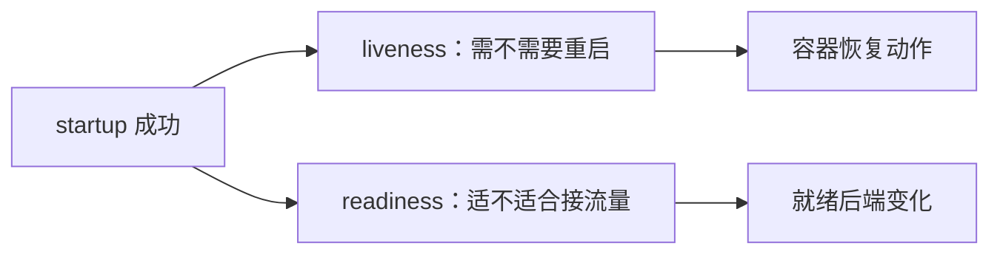
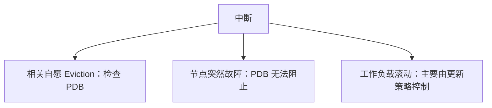
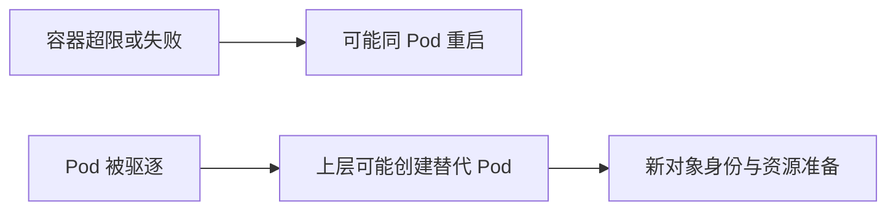
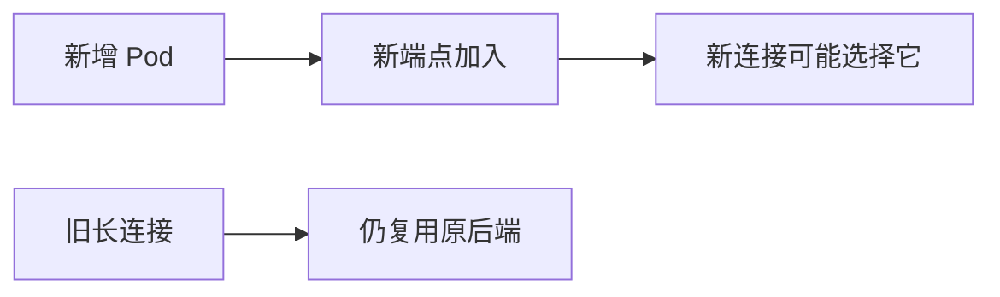
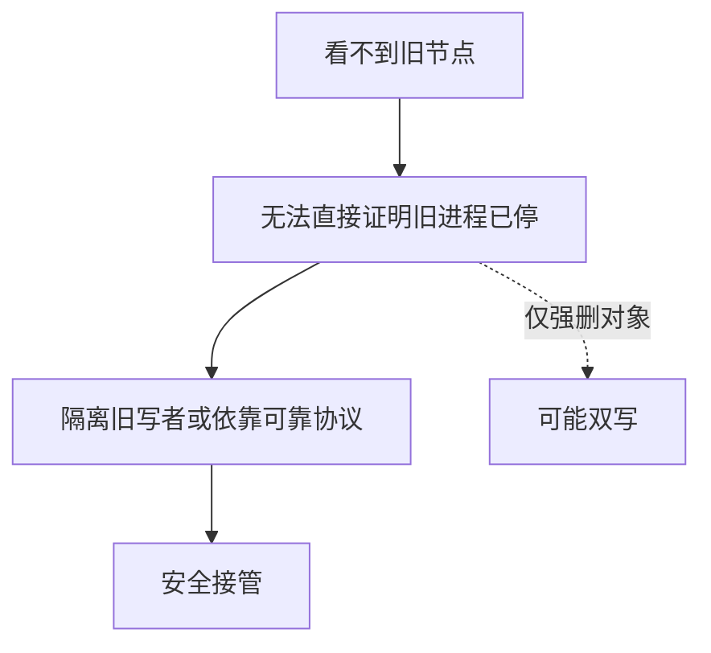

# Kubernetes 面试：从组件职责到故障与恢复推演

> **建议用法**：先给一句话结论，再按“前提 → 机制 → 取舍 → 失败证据”展开。版本与插件条件不可省略；机制详见 [原理篇](Kubernetes原理.md)，版本见 [第 20 章](Kubernetes原理.md#k-20)。
>
> **重点路线**：Q1—Q9 控制模型；Q10—Q15 Pod 与生命周期；Q16—Q22 工作负载与发布；Q23—Q30 调度资源；Q31—Q38 网络入口；Q39—Q47 存储、配置和安全；Q48—Q55 伸缩与平台；Q56—Q64 排障、版本与综合推演。

## 一、架构、API 与控制循环

### Q1：Kubernetes 相比单机容器多解决了什么？

> **一句话结论**：它把集群内实例放置、期望维护、入口与资源协调组织为控制系统，业务一致性仍由应用负责。

**机制展开**：容器擅长打包与隔离进程，节点增多后还要决定放哪里、坏了补几个、如何接流量与挂存储。Kubernetes 通过资源对象和控制循环协作，不是简单远程运行一组 Docker 命令。虚拟机和容器也可以叠加使用。

**⚖️ 方案对比与代价**：统一编排减少人工协调，同时增加控制面和插件复杂度；小规模固定负载未必需要全部能力，选择应有组织与业务收益。

**🔎 追问演练**：平台自愈就不需要业务幂等了吗？

**推演要点**：仍需要。进程可能提交业务后未返回结果，重建和重试会触发重复副作用，平台无法自动判断付款是否完成。

**原理展开**：[对应章节](Kubernetes原理.md#k-01)。

---

### Q2：控制面组件怎样分工？

> **一句话结论**：API Server 管对象入口，etcd 存控制状态，控制器协调，调度器选节点，kubelet 管节点执行。

**机制展开**：API（Application Programming Interface，应用程序编程接口）是组件协作契约，核心组件通常经 API 观察和更新对象。调度器绑定节点后，由 kubelet、运行时和插件继续启动；业务流量一般不由 API Server 逐包转发。

**⚖️ 方案对比与代价**：把职责拆开有利于扩展与独立恢复，也意味着创建到就绪是多步异步过程，不能用一个组件健康代表全链路成功。

**🔎 追问演练**：调度器会直接登录节点启动容器吗？

**推演要点**：常规架构不是这样。它处理位置绑定，节点代理按分配协调运行，也不应直接绕过 API 随意写 etcd。

**原理展开**：[对应章节](Kubernetes原理.md#k-02)。

---

### Q3：控制面失联后应用会马上停止吗？

> **一句话结论**：已有数据面可能继续工作，但变更、发现更新和恢复能力会逐步受损。

**机制展开**：已有容器进程和下发规则不一定依赖每包访问控制面；新调度、扩缩、端点变更和控制器补建可能受阻，业务若直接依赖 API 也会受影响。失联越久，状态偏差越大。

**⚖️ 方案对比与代价**：控制/数据面分离提高短期容忍，不是控制面可长期停机的承诺；要分别观察现有请求和状态变更。

**🔎 追问演练**：API 正常而业务不通可能吗？

**推演要点**：完全可能，网络、存储、应用监听和下游故障都不由 API 健康直接证明。

**原理展开**：[对应章节](Kubernetes原理.md#k-02)。

---

### Q4：etcd 为什么常用三或五个投票成员？

> **一句话结论**：多数派决定故障容忍，三成员可容忍一个，五成员可容忍两个。

**机制展开**：N 个投票成员通常需超过一半达成 quorum，两个成员也需两个，因此失去一个就无法正常维持多数。更多成员增加复制确认成本，跨故障域还会引入延迟，不能无限加成员追求高可用。

**⚖️ 方案对比与代价**：成员分布、磁盘延迟、备份恢复和 API 入口都需设计；三副本不证明同时跨三个故障域。

**🔎 追问演练**：etcd 快照能恢复所有业务数据吗？

**推演要点**：它主要保存集群控制状态，应用数据库和卷内容、密钥等需额外备份与恢复方案。

**原理展开**：[对应章节](Kubernetes原理.md#k-02)。

---

### Q5：kubectl apply 成功到 Pod 接流量经历什么？

> **一句话结论**：对象写入后，控制器、调度器、节点与端点数据面分别推进。

**机制展开**：Deployment 控制器管理 ReplicaSet，后者维护 Pod；调度器绑定节点，kubelet 协调镜像、网络、卷与进程，探针影响就绪，端点与规则再传播。任一环节可失败，成功写入只是起点。

**读图**：每一段都可能独立失败，不能用第一段完成证明最后一段完成。

**⚖️ 方案对比与代价**：异步流程便于解耦和重试，也要求检查 status、conditions 和事件，不应只看命令退出码。

**🔎 追问演练**：apply 成功却没 Pod，先看哪里？

**推演要点**：先确认对象和控制器状态、选择器/模板及事件，再区分尚未创建、创建被拒与创建后准备失败。

**原理展开**：[对应章节](Kubernetes原理.md#k-03)。

---

### Q6：resourceVersion、generation 和 UID 如何区分？

> **一句话结论**：分别关注并发/观察令牌、期望变更代际与对象实例身份。

**机制展开**：UID（Unique Identifier，唯一标识符）让同名重建对象与旧对象区分；resourceVersion 用于观察与竞争控制，应作为不透明令牌使用；generation/observedGeneration 依资源语义关联最新 spec 与已观察版本。

**⚖️ 方案对比与代价**：只看 Ready 为真可能遗漏该条件对应旧代际，应结合控制器状态与时间线；不能拿 resourceVersion 当业务时间戳。

**🔎 追问演练**：更新遇到资源版本冲突怎么办？

**推演要点**：重新读取并计算修改，保留其他管理者状态，不能无条件覆盖后重复发送旧内容。

**原理展开**：[对应章节](Kubernetes原理.md#k-03)。

---

### Q7：控制器为什么需要幂等 Reconcile？

> **一句话结论**：事件可能重复或断流，正确目标是依据当前状态补差，而非每条事件执行一次副作用。

**机制展开**：List 建视图，Watch 观察变化，缓存与队列减少重复读取；断开、压缩和恢复可能导致重新观察。协调创建外部资源成功后若未写回就退出，下次应识别已有结果，而非重复创建。

**⚖️ 方案对比与代价**：控制模型降低对完整事件历史的依赖，却要求处理部分成功、冲突、重试与外部标识。

**🔎 追问演练**：Watch 能当作恰好一次消息队列吗？

**推演要点**：不能直接等同。它服务于对象变化观察，不替代业务持久化、确认、去重和消费恢复协议。

**原理展开**：[对应章节](Kubernetes原理.md#k-03)。

---

### Q8：对象为何一直 Terminating，Finalizer 有什么作用？

> **一句话结论**：删除可先标记意图，终结器让控制器完成外部清理后再最终删除。

**机制展开**：API 设置 deletionTimestamp 后对象仍可存在，负责清理的控制器应移除自己的 Finalizer。OwnerReference 表达所有者关系，垃圾收集与外部资源清理则有不同机制，需看谁负责什么。

**⚖️ 方案对比与代价**：强删终结器能绕过等待，却可能遗留云盘或入口；先定位权限、控制器和外部资源状态。

**🔎 追问演练**：移除 Finalizer 是不是等于外部资源已删？

**推演要点**：不是，它只是取消相应删除阻塞，无法证明现实世界里的对象已经清理。

**原理展开**：[对应章节](Kubernetes原理.md#k-03)。

---

### Q9：Server-Side Apply 比普通覆盖更新多了什么？

> **一句话结论**：SSA 管理字段归属和冲突，让多个管理者更明确地协作。

**机制展开**：SSA（Server-Side Apply，服务端应用）记录字段管理信息，遇到其他管理者拥有的变更可报告冲突。它不是跨对象事务，也不判断两个字段合并后的业务逻辑一定正确，强制接管可能覆盖其他控制者意图。

**⚖️ 方案对比与代价**：协作更可追踪，同时需要明确字段责任；GitOps 与 HPA 同管 replicas 时尤其不能互相强制覆盖。

**🔎 追问演练**：强制解决冲突就说明配置正确了吗？

**推演要点**：只说明接管规则允许写入，实际逻辑、其他控制器回写与业务状态仍要验证。

**原理展开**：[对应章节](Kubernetes原理.md#k-03)。

---

## 二、Pod、运行时与生命周期

### Q10：Pod 为什么不是简单的一个容器？

> **一句话结论**：Pod 是共同调度和管理的单元，可包含共享网络与声明卷的多个容器。

**机制展开**：同 Pod 容器通常可通过 localhost 通信，端口空间共享，但不默认共享全部文件系统或进程空间。紧耦合辅助进程放一起有利于共置；独立业务放一起会失去独立扩缩和发布能力。

**⚖️ 方案对比与代价**：更强共同生命周期减少通信成本，也扩大一起重建的范围，应按依赖紧密度选择。

**🔎 追问演练**：两个容器都监听同一个端口会怎样？

**推演要点**：共享网络空间下会有端口冲突可能，不能按每容器拥有独立主机网络来设计。

**原理展开**：[对应章节](Kubernetes原理.md#k-04)。

---

### Q11：容器重启、Pod 重建和迁移有什么区别？

> **一句话结论**：重启可发生在同 Pod，重建产生新对象，Pod 不会原身份整体搬到另一节点。

**机制展开**：kubelet 按策略处理容器退出；ReplicaSet 等控制器在需要时创建替代 Pod，其 UID 与进程不同，网络地址也可能改变。emptyDir 能跨同 Pod 容器重启保留，但不跨 Pod 替换保留。

**⚖️ 方案对比与代价**：短暂实例更易替换，身份和数据需由上层抽象提供；有状态应用不能只依赖重启计数判断恢复。

**🔎 追问演练**：Running 一定代表业务健康吗？

**推演要点**：不代表，它是 Pod phase 的一部分，应继续看容器状态、Ready、探针和真实请求。

**原理展开**：[对应章节](Kubernetes原理.md#k-04)。

---

### Q12：CRI、OCI、Docker 和 containerd 怎样区分？

> **一句话结论**：CRI 是 kubelet 接入运行时的接口，OCI 是标准体系，构建工具和节点运行时分别选择。

**机制展开**：CRI（Container Runtime Interface，容器运行时接口）连接节点代理与运行时，OCI（Open Container Initiative，开放容器倡议）定义镜像/运行等标准。1.24 移除内置 dockershim，不意味着兼容镜像不能继续运行。

**⚖️ 方案对比与代价**：运行时替换需验证日志、代理与工具依赖，不能把 Docker 命令可用性当容器能否运行的唯一标准。

**🔎 追问演练**：Docker 构建的镜像必须在 Docker Engine 上跑？

**推演要点**：不必。兼容格式、平台架构与镜像内容满足时，可由其他相应运行时执行。

**原理展开**：[对应章节](Kubernetes原理.md#k-04)。

---

### Q13：普通 init、原生 Sidecar 和常规多容器怎么选？

> **一句话结论**：按是否必须先完成、是否持续辅助及启动停止顺序选择。

**机制展开**：普通 init 通常顺序完成才进入应用启动；原生 Sidecar 可作为可重启 init 持续运行，并有特定生命周期，1.33 稳定。传统普通容器里的代理不等于享受全部原生 Sidecar 语义，Job 完成也需区分。

**⚖️ 方案对比与代价**：同 Pod 简化共置但共同资源与生命周期，辅助任务无限循环不该误放普通 init 阻止启动。

**🔎 追问演练**：把日志进程放普通 init 一直跑会怎样？

**推演要点**：它不完成就可能阻塞后续应用启动，需要选择匹配持续运行语义的方式。

**原理展开**：[对应章节](Kubernetes原理.md#k-04)。

---

### Q14：startup、liveness、readiness 分别保护什么？

> **一句话结论**：启动窗口、需重启的失活状态、是否适合接流量。

**机制展开**：有 startup 时，其成功前抑制另外两类探针；liveness 达阈值会结束容器并按重启策略处理；readiness 影响就绪后端选择而不直接重启。探针访问成功也只验证其设计覆盖的能力。

**⚖️ 方案对比与代价**：依赖故障全放 liveness 可能制造重启风暴，readiness 也应考虑部分功能与全体摘流的后果。

**🔎 追问演练**：readiness 失败，所有请求立即停止吗？

**推演要点**：不是。传播延迟、已有连接、直连和特殊端点配置仍可能把请求送到实例。

**原理展开**：[对应章节](Kubernetes原理.md#k-05)。

---

### Q15：preStop、终止信号和宽限期如何配合？

> **一句话结论**：在预算内协调摘流和在途处理，不能把停止过程当全局瞬时操作。

**机制展开**：节点停止与端点更新异步推进，preStop 通常占同一宽限预算，随后主进程要处理终止信号，超时可被强制结束。启动脚本若不转发信号，应用可能没有机会正常清理。

**⚖️ 方案对比与代价**：固定等待能争取时间却不证明摘流完成，长连接与消息确认还需要自身协议。

**🔎 追问演练**：preStop 睡三十秒，宽限也是三十秒会怎样？

**推演要点**：可能几乎用尽应用自行退出预算；需为完整流程估算时间，不能把两段预算简单叠加。

**原理展开**：[对应章节](Kubernetes原理.md#k-05)。

---

## 三、工作负载、发布与中断

### Q16：Deployment 为什么还需要 ReplicaSet？

> **一句话结论**：前者管理模板版本与更新策略，后者维护对应副本集合。

**机制展开**：模板更新通常创建新的 ReplicaSet，再逐步增加新副本、减少旧副本。手工删 Pod 后重建，是控制器仍观察到副本缺口；要改变长期数量，应修改对应期望而非反复删实例。

**⚖️ 方案对比与代价**：分层使版本与数量职责清晰，也要求排障跟踪所有者链；只查 Pod 不足以理解谁在恢复它。

**🔎 追问演练**：手改某个 Pod 镜像就完成发布了吗？

**推演要点**：不代表控制器模板已改，后续替换可能恢复旧版本，应修改正确的受管期望。

**原理展开**：[对应章节](Kubernetes原理.md#k-06)。

---

### Q17：maxSurge、maxUnavailable 能保证零停机吗？

> **一句话结论**：它们控制替换节奏，不保证应用和数据层的业务无损。

**机制展开**：新副本要先有节点、拉镜像、预热并通过就绪，才能按策略推进；终止中的 Pod 还可能占资源。百分比有取整，进度失败会报告状态，不代表原生自动回滚所有变更。

**⚖️ 方案对比与代价**：降低不可用额度需要额外容量，错误探针、连接和数据库不兼容仍能造成中断。

**🔎 追问演练**：maxUnavailable 为零却卡住正常吗？

**推演要点**：可能没有额外资源启动新副本，也可能一直不就绪；应看调度、探针和当前新旧集合。

**原理展开**：[对应章节](Kubernetes原理.md#k-07)。

---

### Q18：PDB 能防止哪些中断，防不了哪些？

> **一句话结论**：它约束相关自愿驱逐路径，不防节点宕机，也不统一控制所有删除与滚动更新。

**机制展开**：PDB（Pod Disruption Budget，Pod 中断预算）供 Eviction API 等判断。节点压力、直接删除与 Deployment/StatefulSet 自身滚动不能一概视作同样受它拦截；不可用仍可能计入预算，影响后续自愿中断。

**⚖️ 方案对比与代价**：设置预算有助维护，却可能在容量不足时阻塞 drain；还需要副本分布和可替换容量。

**🔎 追问演练**：有 PDB 三副本就能保证一个节点故障无损吗？

**推演要点**：不保证。三份可能同节点，依赖也可能单点，业务还需处理在途请求和故障恢复时间。

**原理展开**：[对应章节](Kubernetes原理.md#k-07)。

---

### Q19：滚动、蓝绿、金丝雀与回滚怎么取舍？

> **一句话结论**：比较容量、流量控制、观测和数据兼容，回滚镜像不等于回滚业务状态。

**机制展开**：滚动增量替换，蓝绿维护两组再切，金丝雀控制小范围真实请求并根据反馈推进。Service 副本比例不是精确请求比例，长连接、路由策略和用户粘性影响结果，数据结构还要兼容新旧版本。

**⚖️ 方案对比与代价**：蓝绿成本高，金丝雀需要治理与指标，滚动也不是自动无损；先明确失败停止与恢复标准。

**🔎 追问演练**：数据库已做破坏性变更，镜像回退就恢复？

**推演要点**：不一定。旧版本可能无法理解新数据，应设计兼容迁移、备份与必要补偿。

**原理展开**：[对应章节](Kubernetes原理.md#k-07)。

---

### Q20：StatefulSet 到底提供了什么？

> **一句话结论**：稳定成员身份与卷关联等管理语义，不自动提供数据库复制和选主。

**机制展开**：序号与网络名称可稳定，Pod UID、进程、IP（Internet Protocol，网际协议）地址和节点仍会变化；默认 OrderedReady 与其他策略要区分。PVC 保留还受版本、策略和存储回收共同影响，不能把有状态简单理解为 Pod 永不消失。

**⚖️ 方案对比与代价**：它适合需要身份的成员，但数据库协议、故障隔离、备份和恢复需应用或 Operator 处理。

**🔎 追问演练**：运行三份 MySQL 就是高可用复制集吗？

**推演要点**：不是。需要明确数据复制、主角色、故障检测、隔离旧主和客户端发现。

**原理展开**：[对应章节](Kubernetes原理.md#k-06)。

---

### Q21：Job 和 CronJob 能保证任务恰好一次吗？

> **一句话结论**：不能，重试、观察与计划边界可能造成重复或遗漏，业务必须可恢复。

**机制展开**：Job 追求完成目标，CronJob 近似按计划创建 Job；节点失联后可能不知道副作用是否已发生。concurrencyPolicy 控制特定范围并发，不提供所有系统的业务互斥。应按业务时间窗或唯一键幂等执行。

**⚖️ 方案对比与代价**：自动重试提高完成概率，也增加重复风险；发券结算不能仅凭 Pod 成功状态判断全业务正确。

**🔎 追问演练**：任务已写库但报告完成前退出怎么处理？

**推演要点**：后续执行先识别业务完成状态，必要时查询和补偿，不能无条件再做同一副作用。

**原理展开**：[对应章节](Kubernetes原理.md#k-06)。

---

### Q22：DaemonSet 与静态 Pod 适合什么场景？

> **一句话结论**：前者由控制器在符合条件节点维持实例，后者由节点本地配置等方式直接管理。

**机制展开**：DaemonSet 适合网络、日志和节点代理，节点选择、污点与系统限制仍影响覆盖；静态 Pod 常用于部分集群控制面引导，kubelet 可在 API 未完全可用时管理，本地配置才是其来源。

**⚖️ 方案对比与代价**：局部可启动降低引导依赖，也使删除镜像对象不等于删除本地静态配置；不要按普通 Deployment 方式理解所有 Pod。

**🔎 追问演练**：DaemonSet 一定每台机器各一份？

**推演要点**：符合其条件的节点才是目标，不应忽略选择器、容忍、操作系统和资源约束。

**原理展开**：[对应章节](Kubernetes原理.md#k-06)。

---

## 四、调度、资源与故障

### Q23：调度器如何为 Pod 选择节点？

> **一句话结论**：先满足硬约束过滤，再在可行节点评分并完成相应绑定流程。

**机制展开**：请求量、标签、污点、亲和、拓扑与存储等都参与可行性，评分不只是当前最低 CPU。调度成功后节点启动还可能失败，默认调度也不会因后来负载变化自动搬移全部现有 Pod。

**⚖️ 方案对比与代价**：硬约束维护隔离与分布，也可能导致宁可 Pending；偏好更灵活却不能承诺绝对位置。

**🔎 追问演练**：Pod 已有 nodeName 但没启动还先查调度？

**推演要点**：应看是否进入镜像、sandbox 或卷等节点阶段，不能把所有 Pending 都归为调度器失败。

**原理展开**：[对应章节](Kubernetes原理.md#k-08)。

---

### Q24：节点 CPU 很空为什么还报资源不足？

> **一句话结论**：调度主要按请求与约束规划，不直接按瞬时利用率承诺容量。

**机制展开**：CPU（Central Processing Unit，中央处理器）当前使用低，不代表已有实例未来不用请求额度；Pod 数、内存、设备和卷也可能先不足。requests 过高浪费可调度容量，过低又会造成竞争与 HPA 指标偏差。

**⚖️ 方案对比与代价**：请求应根据测量与目标设定，不应为消除 Pending 盲目降到很小；也可能需要节点或约束调整。

**🔎 追问演练**：把 limit 调高就能通过调度吗？

**推演要点**：不一定。调度关键量和其他硬约束未变，运行限制增加也不等于实际容量增加。

**原理展开**：[对应章节](Kubernetes原理.md#k-08)。

---

### Q25：Taint/Toleration 与亲和怎么配合？

> **一句话结论**：污点表达排斥，容忍允许参与，亲和再表达选择与偏好。

**机制展开**：NoSchedule 阻止不容忍的新放置，不自动移除已运行实例；NoExecute 可影响已有实例并看容忍期限。容忍专用节点污点不等于只能去该类节点，还需标签和必需亲和等选择条件。

**⚖️ 方案对比与代价**：同时设太多硬约束可能无法调度，软偏好则允许退让，应按隔离要求取舍。

**🔎 追问演练**：容忍 GPU（Graphics Processing Unit，图形处理器）节点就一定会调度到该节点？

**推演要点**：不会，且还需相应设备请求与可用资源；容忍不是目标绑定和设备分配。

**原理展开**：[对应章节](Kubernetes原理.md#k-08)。

---

### Q26：拓扑分布和抢占为什么不是万能恢复？

> **一句话结论**：它们分别约束分布和优先让位，不增加总容量或修复全部约束。

**机制展开**：分布可按节点/区域限制偏差，硬规则在故障后可能使剩余节点无法接纳；抢占低优先级 Pod 也无法改变错误卷区域或不可满足亲和。优先级还影响哪些负载先得到有限资源。

**⚖️ 方案对比与代价**：强故障域隔离和故障时尽量运行可能存在取舍，要用可容忍失败模型选择硬软规则。

**🔎 追问演练**：多副本默认就跨区域吗？

**推演要点**：不能由副本数推导，需节点故障域、调度规则、容量和存储共同验证实际落点。

**原理展开**：[对应章节](Kubernetes原理.md#k-08)。

---

### Q27：requests 与 limits 的差别怎么讲？

> **一句话结论**：前者主要用于规划与资源保障依据，后者约束运行，不是两套完全相同的硬预留。

**机制展开**：CPU 超限常被节流，内存超限可能触发 OOM；没有 CPU limit 时有空闲可用更多，但下游和节点仍有限。临时存储、日志和内存 emptyDir 也有资源代价，不能只看主进程堆。

**⚖️ 方案对比与代价**：限制能防邻居干扰，也可能使自身尾延迟或探针失败；应结合峰值、竞争、成本与延迟目标。

**🔎 追问演练**：内存超过 request 就一定立刻被杀？

**推演要点**：不是，request 不是容器硬内存上限，但会影响压力处置与规划。

**原理展开**：[对应章节](Kubernetes原理.md#k-09)。

---

### Q28：OOMKilled、Evicted、CrashLoopBackOff 是一回事吗？

> **一句话结论**：分别描述不同原因或状态，必须结合层次与证据。

**机制展开**：OOM（Out of Memory，内存不足）可能导致容器被结束；Evicted 常反映 Pod 被节点压力等路径驱逐；CrashLoopBackOff 是反复失败后的退避显示。容器重启与控制器替换 Pod 的资源结果不同。

**⚖️ 方案对比与代价**：只看一个退出码易误诊，137 可与强制结束有关，需看最后状态、节点压力、探针与内核证据。

**🔎 追问演练**：Evicted 的 Pod 会原样迁到别处吗？

**推演要点**：不会原样迁移，原对象结束，上层可能创建新 UID 的替代实例，数据是否保留看存储。

**原理展开**：[对应章节](Kubernetes原理.md#k-09)。

---

### Q29：QoS 能保证 Guaranteed 永不被驱逐吗？

> **一句话结论**：不能，它提供资源服务类别，不是节点和应用绝不失败的承诺。

**机制展开**：QoS（Quality of Service，服务质量）传统分类取决于 CPU/内存请求限制。节点压力还会考虑超请求、优先级与相对使用等，不能永远机械按三个名称排序；新 Pod 级资源机制需按版本检查。

**⚖️ 方案对比与代价**：资源更充分通常更有保障，也提高成本，仍需要故障恢复与多副本。

**🔎 追问演练**：BestEffort 会被任何情况下优先杀吗？

**推演要点**：不能无条件这样推断，驱逐原因、资源类型、优先级和具体策略都需确认。

**原理展开**：[对应章节](Kubernetes原理.md#k-09)。

---

### Q30：Java 应用堆没满，容器为什么还 OOM？

> **一句话结论**：容器统计不只 Java 堆，堆外、线程栈、运行时和其他进程开销都占预算。

**机制展开**：将最大堆接近 limit，会给直接内存、代码缓存和线程等留不足余量；memory-backed emptyDir 也占内存。CPU 节流还可能拖慢处理与回收，增加请求堆积。需核对实际运行时的容器感知和配置。

**⚖️ 方案对比与代价**：调大 limit 可缓解但增加节点压力，减少不必要并发、缓存和泄漏更可能修复根因。

**🔎 追问演练**：只看 kubectl top 一次就能下结论？

**推演要点**：不能。需要峰值、重启前证据、内存组成、节流与应用日志，当前值可能已因重启归零。

**原理展开**：[对应章节](Kubernetes原理.md#k-09)。

---

## 五、网络、发现与入口

### Q31：Pod 跨节点通信靠什么，Overlay 与路由怎么比较？

> **一句话结论**：平台定义模型，网络插件和底层网络实现地址与路径，封装与原生路由各有代价。

**机制展开**：CNI（Container Network Interface，容器网络接口）相关实现可通过不同机制接入节点网络。Overlay 便于独立地址与通用底层，增加包头和 MTU 复杂度；直接路由减少封装却需要路由或云集成支持。

**⚖️ 方案对比与代价**：不能仅按插件名字判断性能，应看内核、路径、加密、策略、地址配额和实际负载。

**🔎 追问演练**：小请求通，大请求卡住可能查什么？

**推演要点**：检查 MTU（Maximum Transmission Unit，最大传输单元）、封装、分片/路径发现，再结合重传和实际路由。

**原理展开**：[对应章节](Kubernetes原理.md#k-10)。

---

### Q32：NetworkPolicy 如何组合，Namespace 默认隔离网络吗？

> **一句话结论**：Namespace 不自动隔离，策略按方向选择与允许集合组合，还需网络实现支持。

**机制展开**：同方向策略通常是允许集合并集，源的 egress 与目标 ingress 都要允许。标准策略主要覆盖网络/传输层，不自然提供完整 HTTP（Hypertext Transfer Protocol，超文本传输协议）授权和加密；默认拒绝出站也需考虑 DNS（Domain Name System，域名系统）等必要能力。

**⚖️ 方案对比与代价**：对象创建成功不能证明数据面已执行，应从选中对象、规则和真实连接验证，不按文档顺序理解优先级。

**🔎 追问演练**：一条允许加另一条拒绝，谁覆盖谁？

**推演要点**：标准模型不是一般的有序 deny/allow 防火墙列表，应按隔离与允许并集解释，扩展策略另看实现。

**原理展开**：[对应章节](Kubernetes原理.md#k-10)。

---

### Q33：Service、EndpointSlice 与 Pod 什么关系？

> **一句话结论**：Service 描述稳定服务，EndpointSlice 保存后端视图，实际网络实现负责转发。

**机制展开**：选择器和 Pod 标签/就绪等推动后端更新，数据面订阅相关对象生成规则。ClusterIP 常是虚拟入口，不是某个应用容器绑定的真实地址；无选择器 Service 也可有外部维护的后端。

**⚖️ 方案对比与代价**：稳定入口降低客户端跟踪成本，也引入状态传播延迟；旧 Endpoints 自 1.33 弃用，应关注 EndpointSlice。

**🔎 追问演练**：Service 有地址就能证明有健康后端？

**推演要点**：不能。需检查 EndpointSlice、端口、应用监听、就绪和实际网络路径。

**原理展开**：[对应章节](Kubernetes原理.md#k-11)。

---

### Q34：ClusterIP、NodePort、LoadBalancer、Headless 怎样比较？

> **一句话结论**：它们解决不同层的访问与发现，不是从低级到高级的性能排名。

**机制展开**：ClusterIP 提供集群内虚拟入口，NodePort 使用节点端口，LoadBalancer 依赖外部实现；Headless 不分配普通 ClusterIP，可给客户端后端发现。ExternalName 是 DNS 别名，不是通用转发代理。

**⚖️ 方案对比与代价**：外部暴露还要考虑实现、地址与防火墙；Headless 把更多实例选择与故障处理交给客户端。

**🔎 追问演练**：创建 LoadBalancer 后 external IP 一直没有一定是配置错？

**推演要点**：可能没有相应控制器或平台能力，也可能配额/授权失败，需要看集成和事件，不能期待裸机凭空出现云负载均衡。

**原理展开**：[对应章节](Kubernetes原理.md#k-11)。

---

### Q35：kube-proxy 是否亲自转发每个请求？

> **一句话结论**：常见模式维护内核转发规则，实际数据包不逐个由它的用户态循环处理。

**机制展开**：iptables、IPVS 和 nftables 使用不同机制，IPVS（IP Virtual Server，IP 虚拟服务器）模式当前已自 1.35 弃用，nftables 有内核与行为条件。部分网络实现能替代 kube-proxy，也不代表没有 Service 转发功能。

**⚖️ 方案对比与代价**：规则规模、同步成本和功能语义比简单快慢排名重要，迁移需验证 NodePort、源地址与长连接。

**🔎 追问演练**：没部署 kube-proxy，Service 必定不可用？

**推演要点**：不必然，要看网络实现是否承接数据面，不能只按组件进程是否存在推断能力。

**原理展开**：[对应章节](Kubernetes原理.md#k-11)。

---

### Q36：扩容后流量不均、DNS 能解却不通，怎么解释？

> **一句话结论**：服务发现、连接选择和请求分布是不同层次，已有连接常不立即重分配。

**机制展开**：连接跟踪、客户端连接池、会话亲和与 HTTP/2 长连接会保留路径；DNS 成功只给记录，后端监听、路由与策略仍需验证。外部流量 Local 策略还影响节点端点选择和源地址处理。

**读图**：实例增多与请求立刻均分之间，还有连接层和业务流量模式。

**⚖️ 方案对比与代价**：更精细路由可能改善分布也增加代理成本，先判断是连接不均还是业务实际热点。

**🔎 追问演练**：副本数翻倍就能承诺每 Pod 请求减半？

**推演要点**：不能，需看连接、负载分布、业务键与下游瓶颈，并以真实指标验证。

**原理展开**：[对应章节](Kubernetes原理.md#k-11)。

---

### Q37：Ingress 与 Gateway API 的核心区别是什么？

> **一句话结论**：前者以成熟常见入口规则为中心，后者更明确拆分角色、路由和实现能力。

**机制展开**：Ingress/Gateway 资源都需要控制器实现。GatewayClass、Gateway、HTTPRoute 区分平台入口与应用路由，跨 Namespace 引用也有许可边界；通常需安装相应资源与实现，不是写一个对象就有代理。

**⚖️ 方案对比与代价**：Gateway 模型更丰富但实现能力和资源版本需匹配，Ingress 存量多但扩展常靠特有注解。

**🔎 追问演练**：Gateway API 与 Spring Cloud Gateway 是一个产品吗？

**推演要点**：不是。一个是 Kubernetes 入口 API 生态，另一个是应用网关项目，可以处于同链路不同层并需要协调策略。

**原理展开**：[对应章节](Kubernetes原理.md#k-12)。

---

### Q38：ingress-nginx 退役是不是 Ingress API 消失？

> **一句话结论**：不是，具体控制器的维护状态与 API 模型、其他实现必须区分。

**机制展开**：社区 ingress-nginx 官方公告的尽力维护截止为 2026 年 3 月，之后不再发布修复，已有实例仍可能运行。它也不代表所有名字含 NGINX 的产品；旧教程安装成功不能证明仍受维护。

**⚖️ 方案对比与代价**：评估受维护实现或 Gateway 路线时，应验证注解、路由、证书与行为差异，不能机械替换组件名。

**🔎 追问演练**：学习旧示例还有价值吗？

**推演要点**：有助理解历史机制，但要明确其版本和维护边界，新系统选择按当前兼容与需求决定。

**原理展开**：[对应章节](Kubernetes原理.md#k-12)。

---

## 六、存储、配置与安全

### Q39：PV、PVC、StorageClass、CSI 分别是什么？

> **一句话结论**：分别表达存储资源、需求、供应策略和驱动接入，底层系统才真正存数据。

**机制展开**：PV（PersistentVolume，持久卷）可与 PVC（PersistentVolumeClaim，持久卷声明）匹配，StorageClass 引导动态供应，CSI（Container Storage Interface，容器存储接口）驱动完成后端与节点动作。绑定、附加、挂载、应用打开不是同一阶段。

**⚖️ 方案对比与代价**：抽象解耦应用和供应，但故障定位更需分阶段，创建 PVC 不保证后端容量与权限都满足。

**🔎 追问演练**：PVC Bound 就能证明数据库可写吗？

**推演要点**：不能。还需挂载、文件系统权限、只读状态、应用格式和数据库恢复验证。

**原理展开**：[对应章节](Kubernetes原理.md#k-13)。

---

### Q40：RWO 为什么不等于单 Pod 独占？

> **一句话结论**：RWO（ReadWriteOnce，单节点读写）不等于单 Pod 独占，同节点多个 Pod 仍可能使用。

**机制展开**：RWOP（ReadWriteOncePod，单 Pod 使用）在支持的 CSI 和版本条件下提供另一种约束，1.29 稳定。RWX（ReadWriteMany，多节点读写）允许相应并发访问，也不自带应用事务与并发协议；访问模式不能替代底层权限和一致性分析。

**⚖️ 方案对比与代价**：更强排他可能限制调度与接管，选择要看应用和后端能力，不只是是否能挂上。

**🔎 追问演练**：RWO 能当防数据库双主的业务锁吗？

**推演要点**：不能仅靠它，节点分区、挂载实现与旧写者状态仍需存储或数据库协议保障。

**原理展开**：[对应章节](Kubernetes原理.md#k-13)。

---

### Q41：WaitForFirstConsumer 为什么让 PVC 暂时 Pending？

> **一句话结论**：它让消费者调度需求参与卷绑定/供应，减少计算位置与存储拓扑冲突。

**机制展开**：若先绑定某区卷，再选节点，可能无法同时满足 Pod 亲和、资源和卷区域。延迟绑定可等待实际消费者信息，没有消费者时 Pending 不必立即视为故障；仍要检查是否一直无法找到可行组合。

**⚖️ 方案对比与代价**：联动决策改善放置，却增加跨调度/存储控制器的依赖，需要看事件和双方约束。

**🔎 追问演练**：先随便找块盘绑定再说更快吗？

**推演要点**：可能制造无法调度的组合，表面完成一步却让整体卡住。

**原理展开**：[对应章节](Kubernetes原理.md#k-13)。

---

### Q42：删 Pod、删 PVC 与数据丢失如何关联？

> **一句话结论**：生命周期和回收策略共同决定，不能只看删除了哪个显示对象。

**机制展开**：emptyDir 随 Pod 结束而消失，外部持久卷可跨 Pod；PVC/PV 的 Delete 或 Retain 与 StatefulSet 保留设置等影响后端。hostPath 又依赖原节点，换节点同路径未必是原数据。

**⚖️ 方案对比与代价**：保留有利恢复也可能积累成本，删除节省资源却可能不可逆，应明确数据所有者和恢复策略。

**🔎 追问演练**：卷快照就是数据库一致备份吗？

**推演要点**：不必然，可能只是崩溃一致，应用配合、密钥和恢复演练还需单独设计。

**原理展开**：[对应章节](Kubernetes原理.md#k-13)。

---

### Q43：ConfigMap 改了为什么应用没生效？

> **一句话结论**：对象变更、容器内容更新和进程采用是三层不同动作。

**机制展开**：环境变量通常不会运行中自动改值；普通投射卷内容通常最终更新但有延迟，subPath 不具备同样更新行为。进程还可能只启动时读一次，或持有旧文件，需正确重读和校验。

**读图**：每段都有条件；环境变量、subPath 等路径不能套用同样自动更新承诺。

**⚖️ 方案对比与代价**：热更新降低重启成本但有版本并存和关联参数一致性问题；版本化配置配滚动更可追踪。

**🔎 追问演练**：无需重建镜像是不是等于无需重启？

**推演要点**：不是。配置与制品解耦不自动给应用实现热加载。

**原理展开**：[对应章节](Kubernetes原理.md#k-14)。

---

### Q44：Secret 的 Base64 算加密吗？

> **一句话结论**：不算，它是编码，保密性需要存储、权限和使用路径共同保障。

**机制展开**：默认静态持久化是否加密需检查集群；有权创建工作负载的主体也可能借挂载取得同 Namespace Secret。日志、环境展示和镜像可能形成旁路，不能只禁止 get secrets 就判断安全。

**⚖️ 方案对比与代价**：专用 Secret 对象便于管理不等于万能保险箱，密钥轮转和审计也需完整协议。

**🔎 追问演练**：用户不能读 Secret，但可创建任意 Pod 就安全吗？

**推演要点**：不能直接这样认为，应评估挂载、服务账号与运行权限带来的间接访问。

**原理展开**：[对应章节](Kubernetes原理.md#k-14)。

---

### Q45：RBAC 的 Role、ClusterRole、Binding 怎么理解？

> **一句话结论**：角色定义规则，绑定授予主体，命名空间和集群范围要结合绑定方式分析。

**机制展开**：RBAC（Role-Based Access Control，基于角色的访问控制）按资源、动词和范围授权。ClusterRole 可描述可复用规则，但经 RoleBinding 可授予对应命名空间权限，不能一概说任何引用 ClusterRole 都是全局授权。

**⚖️ 方案对比与代价**：最小权限不仅看读取，还需考虑创建高权限 Pod、exec、绑定和使用服务账号产生的间接能力。

**🔎 追问演练**：ServiceAccount 就是业务用户账户吗？

**推演要点**：不是，它是工作负载访问相关系统的身份；应用最终用户授权仍由自己的协议实现。

**原理展开**：[对应章节](Kubernetes原理.md#k-15)。

---

### Q46：认证、授权和准入分别在回答什么？

> **一句话结论**：确认身份、判断操作权限、约束对象内容，是不同层次。

**机制展开**：Webhook 可修改或校验资源，但会引入证书、网络、服务延迟和失败策略；范围过宽可能阻塞大量发布。ValidatingAdmissionPolicy 对适合规则可用 CEL（Common Expression Language，通用表达式语言）进程内表达，不覆盖所有外部逻辑。

**⚖️ 方案对比与代价**：强校验提升约束，也增加失败依赖，需明确 fail-open/closed 的后果并控制匹配范围。

**🔎 追问演练**：有 create 权限就必定创建成功吗？

**推演要点**：不一定，准入、配额、校验和其他条件都可能拒绝，请求成功后运行阶段还有后续限制。

**原理展开**：[对应章节](Kubernetes原理.md#k-15)。

---

### Q47：Namespace、Quota、Pod 安全策略分别限制什么？

> **一句话结论**：命名与策略范围、资源额度、运行能力属于不同边界，不可互相替代。

**机制展开**：Namespace 不自动给网络或内核强隔离，ResourceQuota 管总体额度，LimitRange 等约束默认与范围。PSP（PodSecurityPolicy，Pod 安全策略）已在 1.25 移除，现代 PSA（Pod Security Admission，Pod 安全准入）/PSS（Pod Security Standards，Pod 安全标准）机制也不是应用权限模型，需要结合宿主挂载、能力和账号权限。

**⚖️ 方案对比与代价**：共享集群更节约，强多租户要求则可能需要更严格的网络、运行时甚至集群隔离，不能只分命名空间。

**🔎 追问演练**：禁止 root 就没有宿主风险吗？

**推演要点**：不能仅据此保证，宿主卷、设备、内核与其他权限仍需分析。

**原理展开**：[对应章节](Kubernetes原理.md#k-15)。

---

## 七、伸缩、高可用与平台扩展

### Q48：HPA 怎么算副本，CPU 利用率相对谁？

> **一句话结论**：最简按当前与目标指标比例计算，CPU 利用率通常相对 requests。

**机制展开**：HPA（Horizontal Pod Autoscaler，水平 Pod 自动伸缩器）还处理容差、缺样本、未就绪实例、稳定窗口和变化速率；4 份当前 80%、目标 50% 的简化建议为向上取整到 7。指标管线和请求设置不正确会影响结果。

**⚖️ 方案对比与代价**：周期伸缩无法瞬间应对尖峰，指标要与瓶颈相关；增加副本还可能扩大数据库连接压力。

**🔎 追问演练**：CPU limit 加倍就让利用率目标变一半？

**推演要点**：一般不能这样推断，CPU utilization 目标通常以 request 为分母，且需看实际指标类型。

**原理展开**：[对应章节](Kubernetes原理.md#k-16)。

---

### Q49：VPA 与原地资源调整是什么关系？

> **一句话结论**：前者是分析/更新资源的自动化组件，后者是平台应用部分资源变更的能力。

**机制展开**：VPA（Vertical Pod Autoscaler，垂直 Pod 自动伸缩器）需相应部署和更新模式；容器 CPU/内存原地调整自 1.35 稳定，也仍可能待定或按策略重启。改资源不保证应用动态调整堆与线程。

**⚖️ 方案对比与代价**：VPA 改 request 会影响同指标 HPA 的利用率分母，应拆维度或控制模式，不能任意叠加两个反馈环。

**🔎 追问演练**：开启新能力后任何资源都能不重启改吗？

**推演要点**：不能，字段、运行时、节点容量、策略与应用都有条件，要观察实际生效状态。

**原理展开**：[对应章节](Kubernetes原理.md#k-16)。

---

### Q50：Pod 自动扩容与节点自动扩容为什么不同？

> **一句话结论**：前者增加实例需求，后者提供承载位置，真正容量还要等启动预热。

**机制展开**：节点伸缩通常结合不可调度需求与基础设施能力；Pod 因错误标签或无匹配卷而 Pending，不保证加普通节点能解决。镜像下载、节点启动、网络和预热都有延迟，不能只看副本期望数字。

**⚖️ 方案对比与代价**：预留容量成本高却响应快，完全按需省资源但可能跟不上突发，应按目标取舍。

**🔎 追问演练**：数据库已饱和，应用越扩越好？

**推演要点**：可能更坏，连接和并发进一步放大，需保护真正瓶颈并设计准入与排队。

**原理展开**：[对应章节](Kubernetes原理.md#k-16)。

---

### Q51：怎样判断集群真的高可用？

> **一句话结论**：分别验证控制面、数据面和业务数据在指定故障范围内的表现。

**机制展开**：API 多副本仍可能共享单点入口，etcd 多成员需保持多数；应用副本要分散，存储与依赖也要跨故障域。严格拓扑可能牺牲故障时可调度性，副本总数并不解释分布与恢复时间。

**⚖️ 方案对比与代价**：高可用增加冗余、网络和协调成本，应根据故障模型而非一份标准模板设计。

**🔎 追问演练**：三个 Pod、三个 etcd 就足够了吗？

**推演要点**：不够，还要看物理位置、共享依赖、容量、网络分区与业务恢复能力。

**原理展开**：[对应章节](Kubernetes原理.md#k-17)。

---

### Q52：节点失联后强删 StatefulSet Pod 为什么有风险？

> **一句话结论**：控制面看不到不等于旧写者已停止，新旧进程可能同时操作同一业务状态。

**机制展开**：强删主要改变对象记录，旧节点可能只是网络分区。安全接管需存储排他、节点隔离或数据库 fencing 等协议，确认旧写者不能继续写，而不是只看到新对象唯一。

**⚖️ 方案对比与代价**：等待降低双写风险却延长恢复，自动隔离提升速度也需要可靠能力和权限。

**🔎 追问演练**：稳定 Pod 名称能当单主证明吗？

**推演要点**：不能，它是 API 身份管理的一部分，不是对外部世界进程状态的可靠断言。

**原理展开**：[对应章节](Kubernetes原理.md#k-17)。

---

### Q53：etcd 备份、YAML 和卷快照各能恢复什么？

> **一句话结论**：分别覆盖控制状态、部分声明与存储时点，组合后还需应用一致性和密钥。

**机制展开**：YAML 不保存数据库当前内容，etcd 不自动囊括所有卷，快照也不一定应用一致；恢复还需镜像来源、证书与外部系统。RPO（Recovery Point Objective，恢复点目标）和 RTO（Recovery Time Objective，恢复时间目标）需演练验证。

**⚖️ 方案对比与代价**：备份频率、异地副本和恢复速度有成本，但没有恢复验证的备份不能支撑可靠承诺。

**🔎 追问演练**：备份成功日志能证明恢复成功？

**推演要点**：不能，需在受控范围实际恢复并检查数据、权限、依赖与业务不变量。

**原理展开**：[对应章节](Kubernetes原理.md#k-17)。

---

### Q54：CRD 和 Operator 分别增加什么？

> **一句话结论**：CRD 定义对象结构，控制器提供持续协调，Operator 编码领域运维。

**机制展开**：CRD（CustomResourceDefinition，自定义资源定义）让 API 保存校验新类型，不会自己创建数据库。Operator 需要管理底层资源、部分成功、升级、备份、终结器与状态条件，并保持操作幂等。

**⚖️ 方案对比与代价**：统一声明便于平台化，同时把领域恢复复杂度放进控制器，质量取决于实现而不是名称。

**🔎 追问演练**：安装 CRD 后创建对象就会自动工作吗？

**推演要点**：不一定，没有相应控制器或其权限/依赖失败，对象可能只是被保存而没有实际行为。

**原理展开**：[对应章节](Kubernetes原理.md#k-18)。

---

### Q55：Helm、GitOps 和控制器会不会冲突？

> **一句话结论**：模板、交付与持续协调职责不同，共管字段时可能互相覆盖。

**机制展开**：Helm 常负责参数化资源与发布记录，GitOps 由具体机制持续协调版本化期望。HPA 也管理副本数，若交付系统反复回写固定 replicas，就会产生拉扯；应明确字段归属与漂移规则。

**⚖️ 方案对比与代价**：自动恢复漂移减少手工差异，也可能撤销临时处置，需要可审查的操作和回退路径。

**🔎 追问演练**：仓库里记录了 YAML（YAML Ain't Markup Language，数据序列化语言）就已经是完整 GitOps？

**推演要点**：不够，还要看变更、协调、状态反馈与权限等实际机制，不是文件存储位置决定一切。

**原理展开**：[对应章节](Kubernetes原理.md#k-18)。

---

## 八、排障、版本与综合推演

### Q56：Pod 一直 Pending 怎么分层排查？

> **一句话结论**：先判断是否已分配节点，再区分调度、准入和节点准备。

**机制展开**：看调度条件与事件，核对资源请求、污点、亲和、拓扑和卷；已绑定则继续查镜像、sandbox、网络和挂载。配额拒绝还可能使期望 Pod 根本没创建，需回到上层控制器事件。

**⚖️ 方案对比与代价**：先保留证据避免盲目降 requests 或强绑节点，那些操作可能只移动故障位置。

**🔎 追问演练**：所有 Pending 都扩节点能解决吗？

**推演要点**：不能，错误标签、存储拓扑、权限与镜像问题需要不同修复。

**原理展开**：[对应章节](Kubernetes原理.md#k-19)。

---

### Q57：CrashLoopBackOff 应该先看什么？

> **一句话结论**：先看上次容器为何退出，再看退避和上层替换，不能把状态名当根因。

**机制展开**：检查前一次日志、退出状态、探针、配置和资源证据；OOM、启动命令错误、依赖等待与误判存活会产生不同路径。当前日志可能只包含新一轮启动，Pod 替换后旧现场还可能丢失。

**⚖️ 方案对比与代价**：重启能临时恢复却可能清掉证据，聚合日志与指标有助跨生命周期分析。

**🔎 追问演练**：把探针去掉后不重启就说明已修好？

**推演要点**：可能只是取消了故障检测，仍需验证业务、资源和探针设计，不能以不重启替代正确性。

**原理展开**：[对应章节](Kubernetes原理.md#k-19)。

---

### Q58：Service 或入口返回 503 怎样查？

> **一句话结论**：先确认是谁返回，再沿路由、端点、网络、监听和下游追踪。

**机制展开**：DNS 可解不代表后端可达，Service 有对象不代表 Ready 实例存在。比较直接 Pod、服务地址与入口行为，核对 targetPort、选择器、策略和应用绑定地址，再关联发布与资源时间线。

**⚖️ 方案对比与代价**：分层比反复重启网关更快定位，状态码与日志计时都要有产生位置。

**🔎 追问演练**：所有 Pod Running 为什么仍可能没有可用端点？

**推演要点**：Running 不等于 Ready，标签、端口与端点条件也可能不匹配。

**原理展开**：[对应章节](Kubernetes原理.md#k-19)。

---

### Q59：PVC Pending、Attach 与 Mount 错误怎么区分？

> **一句话结论**：供应、绑定、附加、挂载和应用权限是连续但独立的阶段。

**机制展开**：WaitForFirstConsumer 可有意等待消费者，配额或拓扑会阻碍供应/绑定；已有卷可能因旧节点占用而无法附加；挂载成功后文件权限和数据库恢复仍能失败。应读相应对象与节点事件。

**⚖️ 方案对比与代价**：删卷重建可能破坏数据，应先定位阶段与实际后端，恢复动作要知道数据归属。

**🔎 追问演练**：改目录权限能修所有存储问题吗？

**推演要点**：不能，它不解决区域、驱动、附加冲突或底层不可用，也可能引入新的权限问题。

**原理展开**：[对应章节](Kubernetes原理.md#k-13)。

---

### Q60：指标、事件、日志和追踪该如何配合？

> **一句话结论**：指标看趋势，事件看资源动作，日志看进程细节，追踪看请求路径。

**机制展开**：事件可能聚合过期，不是完整审计账本；Metrics Server 也不是长期全量监控。P99（99th Percentile，第 99 百分位）和节流等比瞬时平均 CPU 更能说明尾部问题，业务成功仍需自己的指标与记录。

**⚖️ 方案对比与代价**：保留越多成本越高，需要关联标识和采样，但不能只靠抽样链路估算所有业务错误。

**🔎 追问演练**：Pod 变绿就可宣布故障结束？

**推演要点**：还需看入口成功率、尾延迟、消息积压、数据正确性和恢复后的副本分布。

**原理展开**：[对应章节](Kubernetes原理.md#k-19)。

---

### Q61：学习旧版 Kubernetes 哪些结论要更新？

> **一句话结论**：区分 API、运行时、功能状态和插件维护，不把旧实验默认值外推。

**机制展开**：1.24 移除内置 dockershim，1.25 移除 PSP，1.33 Sidecar 稳定且旧 Endpoints 弃用，1.35 原地资源调整稳定和 IPVS 模式弃用；官方当前维护线还要实时核对。Ingress API 与社区 ingress-nginx 的生命周期也不同。

**⚖️ 方案对比与代价**：认识稳定机制便于迁移，仍需按版本、功能门控、内核和插件组合验证，不只看是否能 apply。

**🔎 追问演练**：最新文档里有字段，旧 kubelet 就支持吗？

**推演要点**：不必然，控制面、节点与实现都需支持，Alpha/Beta/Stable 和默认开启状态不能省略。

**原理展开**：[对应章节](Kubernetes原理.md#k-20)。

---

### Q62：组件版本能否随便混装、跨很多版本升级？

> **一句话结论**：不能，版本偏差策略和工具/插件约束共同限制组合与顺序。

**机制展开**：API Server 多实例间当前最多差一个次版本，kubelet 不能比连接的 API 更新，kubectl 一般允许正负一个；混合控制面需取共同允许范围。运行时、网络、存储和 Webhook 还可能收紧条件。

**⚖️ 方案对比与代价**：兼容偏差用于受控过渡，不是鼓励长期混用或任意跳升级，先控制面后节点也要分阶段验证。

**🔎 追问演练**：版本偏差允许就代表第三方插件都兼容？

**推演要点**：不是，需单独核对插件、API 移除和发行版支持，并保留可验证的恢复路径。

**原理展开**：[对应章节](Kubernetes原理.md#k-20)。

---

### Q63：Spring Boot 服务在 Kubernetes 发布，怎样串起两套生命周期？

> **一句话结论**：把应用预热、就绪、摘流、在途工作和资源关闭放进同一预算模型。

**机制展开**：端口监听早于真正就绪，Boot 探针语义应与 Kubernetes 配合；删除时端点传播和节点停止异步，应用处理终止信号并协调线程池与消息确认。数据库和远程业务仍靠幂等与状态协议恢复。

**⚖️ 方案对比与代价**：平台和应用各自正常也可能组合错误，需用真实请求和发布窗口验证，而非只看 Pod Ready。

**🔎 追问演练**：preStop 很长能替代应用优雅关闭吗？

**推演要点**：不能，它只是占用/等待，应用仍要停止接单并处理在途，且总宽限预算有限。

**原理展开**：[对应章节](Kubernetes原理.md#k-05)。

---

### Q64：怎样设计真正有价值的 Kubernetes 故障演练？

> **一句话结论**：用明确故障模型验证用户结果、资源恢复和数据不变量，不只验证能补一个 Pod。

**机制展开**：覆盖节点失联、控制面不可写、网络延迟、坏配置、存储失败和下游变慢；观察调度、探针、端点、伸缩与业务恢复的时间线。检查副作用重复、旧写者、队列积压和备份可恢复性。

**⚖️ 方案对比与代价**：演练应有边界与停止条件，但结果必须能解释哪段保证失效、如何恢复，不能只保留最后全绿截图。

**🔎 追问演练**：最重要的成功标准是什么？

**推演要点**：指定故障下用户影响有界、业务状态可解释可恢复、实际 RPO/RTO 达标，并能定位策略之间的冲突。

**原理展开**：[对应章节](Kubernetes原理.md#k-17)。

---

## 参考与版本核对

- [原理篇资料入口](Kubernetes原理.md#k-references)：按组件、网络、存储、伸缩和安全查证。
- [版本偏差策略](https://kubernetes.io/releases/version-skew-policy/)、[发布状态](https://kubernetes.io/releases/)：组件组合与维护状态。
- [Service 数据面](https://kubernetes.io/docs/reference/networking/virtual-ips/)、[PDB 与中断](https://kubernetes.io/docs/concepts/workloads/pods/disruptions/)、[持久卷](https://kubernetes.io/docs/concepts/storage/persistent-volumes/)：核对容易被绝对化的边界。
- [原生 Sidecar](https://kubernetes.io/docs/concepts/workloads/pods/sidecar-containers/)、[原地资源调整](https://kubernetes.io/docs/tasks/configure-pod-container/resize-container-resources/)、[社区 ingress-nginx 退役公告](https://kubernetes.io/blog/2025/11/11/ingress-nginx-retirement/)：区分旧教程与当前机制。

默认行为按项目实际版本、功能门控、平台和插件实现解释；面试中的一句话结论必须保留这些前提。

## 附录：术语与缩写

| 术语 | 英文全称 | 中文含义 / 边界 |
|---|---|---|
| K8s | Kubernetes，首尾字母间省略 8 个字母 | Kubernetes 的常见简称 |
| API | Application Programming Interface | 应用程序编程接口 |
| YAML | YAML Ain't Markup Language | 数据序列化语言，常用于资源声明 |
| UID | Unique Identifier | 区分对象实例的唯一标识符 |
| SSA | Server-Side Apply | 服务端应用，管理字段归属与冲突 |
| CRI | Container Runtime Interface | 容器运行时接口 |
| OCI | Open Container Initiative | 开放容器倡议，定义镜像/运行等标准 |
| CNI | Container Network Interface | 容器网络接口 |
| CSI | Container Storage Interface | 容器存储接口 |
| CPU | Central Processing Unit | 中央处理器 |
| GPU | Graphics Processing Unit | 图形处理器 |
| OOM | Out of Memory | 内存不足 |
| QoS | Quality of Service | 服务质量类别 |
| PID | Process Identifier | 进程标识符 |
| PDB | Pod Disruption Budget | Pod 中断预算 |
| DNS | Domain Name System | 域名系统 |
| IP | Internet Protocol | 网际协议，文中常指网络地址 |
| NAT | Network Address Translation | 网络地址转换 |
| MTU | Maximum Transmission Unit | 最大传输单元 |
| VPC | Virtual Private Cloud | 虚拟私有云 |
| HTTP | Hypertext Transfer Protocol | 超文本传输协议 |
| IPVS | IP Virtual Server | Linux IP 虚拟服务器机制 |
| eBPF | extended Berkeley Packet Filter | 扩展伯克利包过滤器 |
| PV | PersistentVolume | 持久卷资源 |
| PVC | PersistentVolumeClaim | 持久卷声明 |
| RWO | ReadWriteOnce | 单节点读写访问模式 |
| RWX | ReadWriteMany | 多节点读写访问模式 |
| ROX | ReadOnlyMany | 多节点只读访问模式 |
| RWOP | ReadWriteOncePod | 支持条件下的单 Pod 使用模式 |
| RBAC | Role-Based Access Control | 基于角色的访问控制 |
| CEL | Common Expression Language | 通用表达式语言 |
| PSP | PodSecurityPolicy | 已移除的 Pod 安全策略机制 |
| PSA | Pod Security Admission | Pod 安全准入 |
| PSS | Pod Security Standards | Pod 安全标准 |
| HPA | Horizontal Pod Autoscaler | 水平 Pod 自动伸缩器 |
| VPA | Vertical Pod Autoscaler | 垂直 Pod 自动伸缩器 |
| DRA | Dynamic Resource Allocation | 动态资源分配 |
| HA | High Availability | 高可用 |
| RPO | Recovery Point Objective | 恢复点目标 |
| RTO | Recovery Time Objective | 恢复时间目标 |
| CRD | CustomResourceDefinition | 自定义资源定义 |
| GC | Garbage Collection | 垃圾回收；本文需区分应用 GC 与资源回收 |
| P95/P99 | 95th/99th Percentile | 第 95/99 百分位 |
| Reconcile | Reconciliation Loop | 协调循环，观察并补足期望差异 |
| Quorum | Quorum | 法定多数 |
| Finalizer | Finalizer | 最终删除前的清理协调标记 |
| Fencing | Fencing | 隔离旧写者，防止故障接管后的并发写入 |
