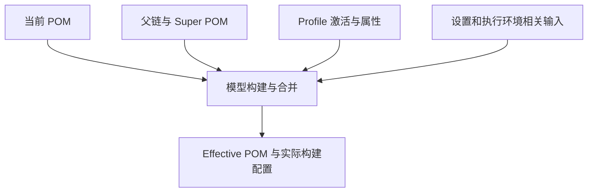
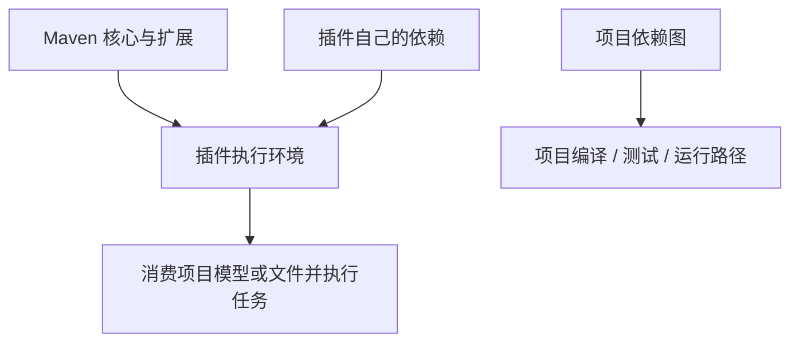
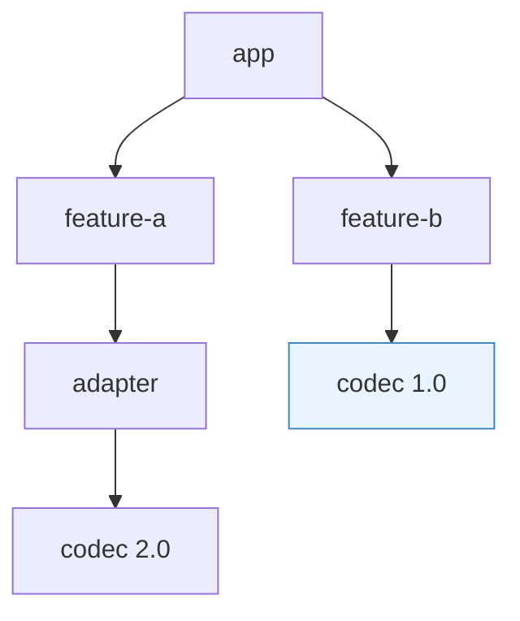
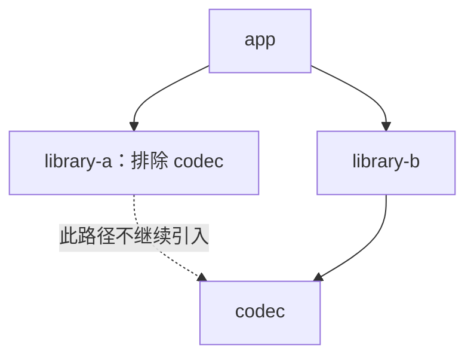
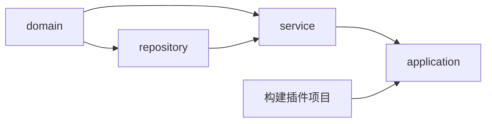
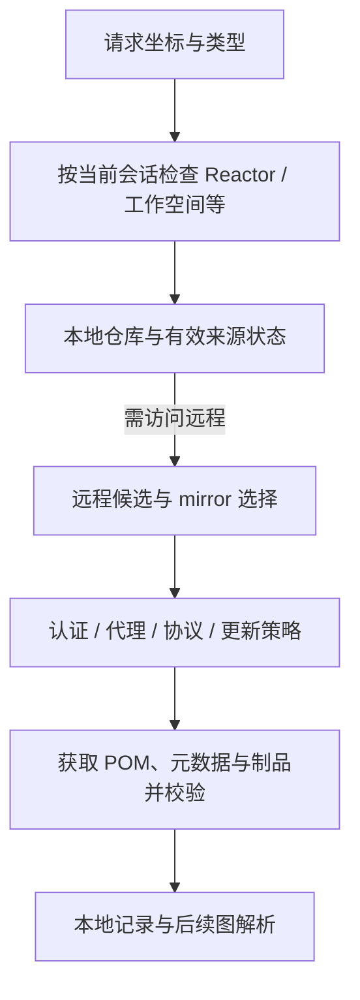
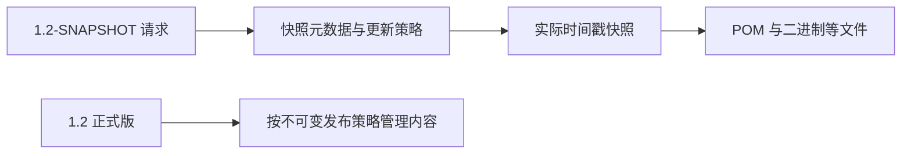
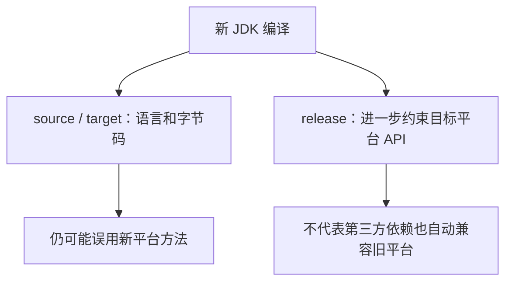
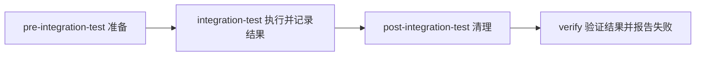
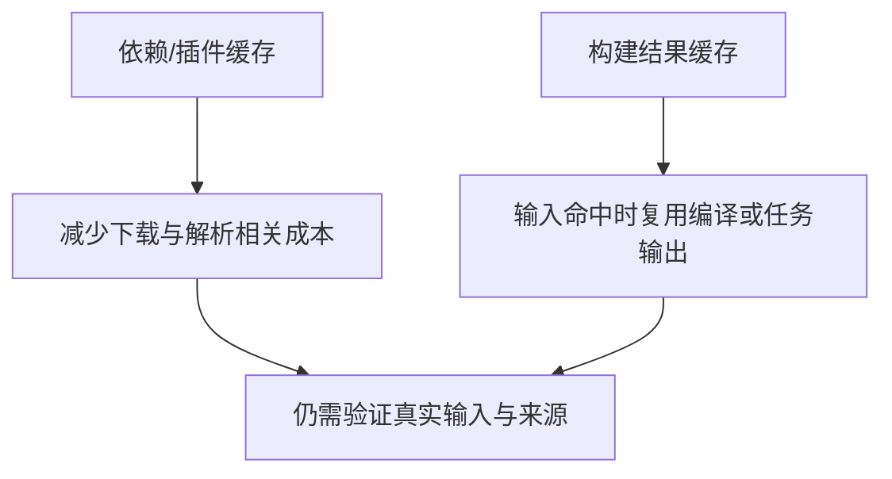

# Maven 原理：从项目模型到依赖图、执行计划与制品交付

> **阅读目标**：能解释一次构建用了哪些输入、为什么选中某个依赖、由谁执行每一步，以及产物为什么在另一台机器上能或不能使用。
>
> **主线**：项目模型 → 生命周期与插件 → 依赖图与仓库解析 → 多模块执行 → 测试、打包和发布。搭配 [Maven 面试](Maven面试.md) 进行复述和故障推演。
>
> **版本口径**：以 Maven 3.9 的成熟机制建立基础，对照 3.10 与 Maven 4 预览演进。版本状态按 **2026-11-09** 查阅的官方资料说明；核心、项目模型、Resolver 和插件版本必须分别判断。示例用于解释知识，未在项目中执行构建或发布。

## 阅读导航

| 主线 | 章节 | 要能回答 |
|---|---|---|
| 模型与执行 | [定位](#m-01) → [坐标](#m-02) → [有效模型](#m-03) → [生命周期](#m-04) → [插件](#m-05) | POM 写了什么，实际执行又是什么？ |
| 依赖治理 | [仲裁](#m-06) → [管理与 BOM](#m-07) → [Scope 与排除](#m-08) | 为什么选到旧版？什么会传给消费者？ |
| 项目与仓库 | [Reactor](#m-09) → [解析与镜像](#m-10) → [版本和快照](#m-11) | 当前模块、缓存和远程仓库如何协作？ |
| 构建正确性 | [JDK](#m-12) → [测试](#m-13) → [打包](#m-14) | 编译、测试、运行兼容为什么不同？ |
| 工程交付 | [可复现与 CI](#m-15) → [性能](#m-16) → [发布](#m-17) → [排障](#m-18) → [版本](#m-19) | 什么被缓存、发布了什么、哪些证据可信？ |

重要机制按 **动机 → 实现 → 方案比较 → 成本与失败边界**展开。不要用“自动下载依赖”“统一版本”“clean install 万能”替代完整模型。

<a id="m-01"></a>
## 1. 从手写构建脚本到项目模型：Maven 解决什么

> 🎯 **核心结论**：Maven 用标准项目模型、约定目录和生命周期组织构建，把重复流程交给插件，同时通过坐标和元数据组织依赖交换。

### 1.1 为什么不只写几个 javac 和 jar 命令

单次编译可以手工完成；项目变大后，要统一源码路径、资源、测试、依赖版本、打包格式和发布信息。若每个仓库各写一套脚本，工具难以理解项目，团队也容易在环境与顺序上产生差异。

POM（Project Object Model，项目对象模型）描述项目与构建约定。Maven 核心负责构建模型和调度，具体编译、测试、打包等通常由插件执行；**Maven 不是内置全部功能的编译器，也不只是下载器**。


**读图**：同一份 pom.xml 不代表输入完全相同，父模型、Profile、settings、插件和工具链都可能改变结果。

### 1.2 与其他构建方式比较

| 方式 | 主要优势 | 主要代价 |
|---|---|---|
| 手写脚本 / Make 等 | 流程直接、自由度高 | 自行维护约定、依赖元数据与跨环境行为 |
| Ant | 任务式组合灵活 | 生命周期、依赖交换等常需额外约定或组件 |
| Maven | 模型与生命周期统一，生态与工具识别成熟 | 非标准流程表达较间接，继承和插件合并需理解 |
| Gradle | 灵活任务图与依赖/增量能力 | 需理解构建脚本、任务输入和插件模型，复杂项目同样要治理 |

这不是简单性能排名。项目规模、任务类型、插件、缓存和团队维护能力都影响选择；任何工具都不能从没有声明的输入自动推导正确构建。

### 1.3 约定优于配置，不等于无法配置

`src/main/java`、`src/main/resources`、`src/test/java` 与 `target` 等约定减少重复。修改目录是能力，不是默认推荐；偏离越多，就越需要确认插件、IDE（Integrated Development Environment，集成开发环境）和其他工具看到的是同一个模型。

<a id="m-02"></a>
## 2. 坐标、类型与制品：一个依赖究竟指向什么

> 🎯 **核心结论**：坐标是可解析身份，POM 是交换依赖与构建信息的元数据；文件名相同或本地有一个 JAR，不代表能被正确消费。

### 2.1 坐标的几个维度

| 字段 | 含义 | 容易误解 |
|---|---|---|
| groupId | 组织或项目族标识 | 不必等于所有 Java 包名 |
| artifactId | 具体制品标识 | 不一定等于当前目录名 |
| version | 发布或开发版本 | 不能简单按字符串字典序理解版本大小 |
| type | 制品类型/处理映射 | 不总等于文件扩展名 |
| classifier | 同项目版本的附属变体 | sources、javadoc、tests 等不是另一个版本 |

GAV（GroupId, ArtifactId, Version，组、制品、版本）是常见核心坐标简称。JAR（Java Archive，Java 归档）通常是二进制库，POM 制品也可单独发布为父模型或版本平台。

### 2.2 type 与 classifier 为什么不能省略理解

`type=test-jar` 常映射到 jar 扩展名与 tests classifier；不能把任何 type 都当作独立扩展名。源代码附属包通常供工具查看，不应误放业务运行路径。

依赖声明/管理匹配不只看 G:A，常需看 **groupId、artifactId、type、classifier**；解析器内部还会使用映射后的扩展等身份。示例只讨论普通 jar 时才可以简化成“同组、同制品的版本冲突”。

### 2.3 packaging 与 dependency type

packaging 决定项目产物和默认生命周期绑定，例如 jar、war、pom；dependency 的 type 描述要消费什么，二者相关但不是同一字段。

普通 jar 通常不自动包含全部运行依赖；war、测试附属包、源码包和 Boot 可执行归档又有不同布局。**坐标解析成功只证明取得文件，不证明该文件符合调用方类加载或运行协议**。

<a id="m-03"></a>
## 3. 有效 POM、继承、聚合与 Profile：文件到模型经历什么

> 🎯 **核心结论**：实际构建使用合并与激活后的模型，不能只盯当前文件；继承管理配置，聚合收集项目，二者可以分开。

### 3.1 模型建立的概念过程

父模型和 Super POM 提供基础，Profile、属性与项目声明参与模型处理，最终形成可供后续构建使用的有效模型。过程包含多个阶段，**不应把它理解为把几份 XML（Extensible Markup Language，可扩展标记语言）文本顺序拼接**。



**读图**：模型和仓库/凭据会话有相互作用，但并非 settings 的每个字段都成为 POM 字段。`help:effective-pom`、`help:effective-settings` 与激活 Profile 报告需要一起看。

### 3.2 继承与聚合的独立性

| 机制 | 声明方式 | 主要作用 |
|---|---|---|
| 继承 | 子项目指向 parent | 继承属性、依赖管理、构建配置等 |
| 聚合 | 聚合项目列出 modules | 让 Reactor 一次收集多个项目 |

把项目列入 modules 不会让它自动继承聚合者；父项目也不必列出所有消费者。Maven 3 中通常只有一个直接 parent，但可形成父链并导入多个 BOM（Bill of Materials，物料清单）。

### 3.3 parent 的 relativePath

Maven 3 常见默认相对查找是 `../pom.xml`，还需匹配所声明父坐标；找不到/不匹配时进入相应解析路径。`<relativePath/>` 可关闭默认相对文件查找，**不是关闭父继承**。

子目录在开发机能构建，CI（Continuous Integration，持续集成）找不到父模型，可能是相对文件、远程发布、仓库访问或坐标不一致；不是所有失败都靠先安装父项目解决。

### 3.4 Profile 的收益与隐藏输入

Profile 可由命令、属性、环境、JDK（Java Development Kit，Java 开发工具包）或文件条件等激活，适合有界构建差异。activeByDefault 不是永久开启：同一 POM 中其他 Profile 激活可能关闭默认 Profile。

隐式激活影响可移植性，同名 Profile 在不同模块也不应被想当然视为同一对象。构建环境差异要显式记录；运行期地址与密钥通常更适合外部配置，不宜为每个环境重新造一个难追踪制品。[Profile 官方说明](https://maven.apache.org/guides/introduction/introduction-to-profiles.html)

<a id="m-04"></a>
## 4. 生命周期、Phase 与 Goal：执行顺序从哪里来

> 🎯 **核心结论**：生命周期组织阶段顺序，插件目标完成具体工作；调用某阶段通常推进同一生命周期之前的阶段，但不会自动运行其他生命周期。

### 4.1 三个常见生命周期

| 生命周期 | 典型用途 | 代表阶段 |
|---|---|---|
| clean | 清理构建输出 | pre-clean、clean、post-clean |
| default | 构建、验证与交付 | validate → compile → test → package → verify → install → deploy |
| site | 项目站点与报告 | pre-site、site、post-site、site-deploy |

表中的 default 只列主干，实际还有 process-resources、test-compile、集成测试前后等阶段。`mvn package` 不会自动 clean；`mvn clean verify` 是显式请求清理与验证，不是一个名叫 clean-verify 的生命周期。


**读图**：每个阶段可执行零个或多个已绑定目标。走到某阶段，并不代表项目已配置该阶段想要的全部质量检查。

### 4.2 Goal 为什么不是 Phase 的同义词

`compiler:compile` 是插件目标，`compile` 是阶段。直接调用目标不等于完整执行到同名阶段，是否额外 fork 生命周期还看插件描述。插件的默认 phase 也不代表只在 pluginManagement 声明后就一定参与每次构建。

### 4.3 同阶段多个目标的顺序

packaging 带来默认绑定，POM 还可绑定其他目标。Maven 3 的常见流程中，默认绑定与显式执行有其顺序，POM 声明顺序、执行 ID 和继承合并影响最终计划；不要只看插件名字排序。

代码生成应在编译需要它之前完成，质量校验应绑定在实际调用的终点之前。仅执行 package 可能没有跑 verify 才检查的规则；只执行 integration-test 也可能遗漏后续清理与结果验证。[生命周期官方说明](https://maven.apache.org/guides/introduction/introduction-to-the-lifecycle.html)

### 4.4 package、install、deploy 的边界

package 产出构建制品，install 写入本地仓库供其他构建解析，deploy 发布到配置的远程仓库。**Maven deploy 通常不表示把服务部署到 Kubernetes 或生产机器**。

同一 Reactor 构建可使用当前项目结果，不需要为了每个模块互相依赖就反复 install。日常到 verify 通常足以完成已绑定验证；是否需要 clean/install/deploy，应来自具体目标。

<a id="m-05"></a>
## 5. 插件、管理与类加载：项目依赖不是插件依赖

> 🎯 **核心结论**：插件有自己的版本、参数、执行绑定与依赖环境；项目 dependencyManagement 不会统一控制所有插件内部依赖。

### 5.1 配置与执行是两个问题

| 元素 | 主要作用 | 不会自动完成 |
|---|---|---|
| build/plugins | 声明使用插件及其配置/执行 | 没有绑定或直接调用的额外目标不一定运行 |
| pluginManagement | 集中提供版本与配置模板 | 不独立把任意插件目标加入生命周期 |
| executions | 将目标与阶段等关联 | 不保证参数、先后和目标实现都正确 |
| plugin/dependencies | 配置插件自身依赖 | 不自动变成业务项目运行依赖 |

某插件本来就由 packaging 的默认绑定使用时，pluginManagement 可影响它；因此“写在管理里永远不起作用”和“写在管理里自动执行”都不完整。

### 5.2 为什么要锁定插件版本

即使业务库都固定，编译器插件、测试插件或打包插件变化也会改变输出和测试发现。显式管理常用插件及关键扩展版本，有助复现与升级验证；项目默认值还受 Maven 核心与父模型影响。

### 5.3 三种依赖空间



**读图**：这是职责区分，不代表所有实现都只有三个简单 ClassLoader。插件可能显式读取项目类路径，但项目加一个库并不保证修复插件自身的缺类。

插件本身由运行 Maven 的 JVM（Java Virtual Machine，Java 虚拟机）等环境加载；Toolchain 选一个旧 JDK 编译项目，也不能使要求新 Java 的插件在旧 JVM 上运行。错误应区分核心、插件、构建工具与应用路径。[类加载说明](https://maven.apache.org/guides/mini/guide-maven-classloading.html)

### 5.4 自定义插件和扩展的取舍

Mojo（Maven Plain Old Java Object，Maven 插件目标实现的常见称呼）封装可绑定任务；扩展可深入模型、传输或核心行为。越深入越依赖版本与兼容契约，不应为一个简单代码生成步骤随意改核心。

共享插件要声明输入输出、线程安全和失败语义，避免写共享目录、依赖未声明环境或吞掉异常；否则并行与缓存会放大问题。

<a id="m-06"></a>
## 6. 传递依赖与版本仲裁：为什么不默认选择最高版本

> 🎯 **核心结论**：依赖先形成图，再按管理、仲裁、Scope 等规则得到有效路径；最近优先是机制，不是兼容性证明。

### 6.1 冲突示例



**读图**：在未被显式管理等规则改变的普通示例中，1.0 所在路径更短，会被选中，即使另一路要求 2.0。相同深度通常按依赖声明先后等遍历规则选择，不是版本最高者胜。

### 6.2 为什么不能只说“直接依赖一定赢”

直接声明可明确所用版本，dependencyManagement 还可影响项目直接/传递依赖的选择；Scope、optional、exclusion 和类型/分类也改变候选。应先得到有效模型，再解释图，不能用一条口令覆盖全部规则。

### 6.3 选择成功为何仍可能运行失败

某库按新版方法编译，应用最终只装入旧版，可能出现 NoSuchMethodError；类被排除或运行路径缺少，还可能出现 ClassNotFoundException/NoClassDefFoundError。反过来升级到最高版本也可能有破坏性变更。

**正确流程**：看完整路径与 omitted 原因 → 确认调用契约 → 选择兼容组合 → 编译、测试并验证真实包。调依赖顺序可以改变结果，却通常不是最清晰的长期治理方法。

### 6.4 Enforcer 两条规则并不相同

dependencyConvergence 检查相关路径版本是否收敛；requireUpperBoundDeps 检查最终选择是否至少不低于各路径所要求的上界意义版本。后者不等于要求图上每条路径完全同版，前者也不证明语义兼容。

规则是尽早暴露冲突的工具，仍需考虑排除范围与有意覆盖，不能把绿色检查当作第三方 API（Application Programming Interface，应用程序编程接口）兼容认证。[依赖机制](https://maven.apache.org/guides/introduction/introduction-to-dependency-mechanism.html)、[收敛规则](https://maven.apache.org/enforcer/enforcer-rules/dependencyConvergence.html)、[上界规则](https://maven.apache.org/enforcer/enforcer-rules/requireUpperBoundDeps.html)

<a id="m-07"></a>
## 7. dependencyManagement、BOM 与 Parent：管理不会凭空引入

> 🎯 **核心结论**：dependencies 表达使用，dependencyManagement 提供约束，BOM 复用一组管理条目，parent 还可以传递构建配置。

### 7.1 四者如何比较

| 方式 | 主要影响 | 是否自动添加普通依赖 |
|---|---|---|
| dependencies | 项目所用依赖及范围等 | 是，按具体声明与规则进入相应路径 |
| dependencyManagement | 对匹配依赖提供版本、Scope 等管理 | 不因单独管理就全部加入 |
| BOM import | 导入其他 POM 的依赖管理条目 | 不会把 BOM 所有库都引入 |
| parent | 继承项目模型中的可继承配置 | 取决于父实际声明，不只是版本管理 |

BOM（Bill of Materials，物料清单）适合跨项目共享兼容版本集合，通常作为 POM 类型在 dependencyManagement 中以 import Scope 引入。import 不是常规编译或运行路径。[官方 BOM 机制](https://maven.apache.org/guides/introduction/introduction-to-dependency-mechanism.html)

```xml
<!-- 示意坐标，不表示一个实际发布的公共 BOM。 -->
<dependencyManagement>
  <dependencies>
    <dependency>
      <groupId>org.example.platform</groupId>
      <artifactId>platform-bom</artifactId>
      <version>1.0.0</version>
      <type>pom</type>
      <scope>import</scope>
    </dependency>
  </dependencies>
</dependencyManagement>
```

**读代码**：使用某库仍要在 dependencies 等正确位置声明；单独这段不会产生一套所有库都齐全的运行环境。

### 7.2 多 BOM 重复管理怎么判断

Maven 3 的常见规则中，当前模型显式管理的匹配条目可优先于导入条目，多个导入 BOM 冲突又受导入/合并顺序等影响。管理层次和直接声明优先关系应结合有效模型看，不要只背“最后一个永远覆盖”。

导入 BOM 不等于导入其全部 properties 与 build。覆盖导入 BOM 内的属性也不能照搬继承 parent 的方式：消费方同名属性不保证重算 BOM 里已经展开的管理值，明确管理具体依赖通常更可控。

### 7.3 Spring Boot 的 parent、BOM 与 Starter

Boot parent 通常提供依赖和构建约定；仅导入 Boot BOM 不继承 parent 的全部插件配置；Starter 是依赖入口。三者与自动配置还有不同职责，可对照 [Boot 依赖与打包原理](../../02/开发框架/chapter_01_Spring/chapter_02_SpringBoot/SpringBoot原理.md#sb-02)。

项目 dependencyManagement 主要治理项目依赖，不统一覆盖插件自身依赖图。需要更换插件内部组件时，应按插件支持方式配置并验证，而不是认为 BOM 能管所有 ClassLoader。

<a id="m-08"></a>
## 8. Scope、Optional 与 Exclusion：依赖如何进入不同路径

> 🎯 **核心结论**：Scope 不只是“打不打包”，它影响编译、测试、运行及传递；Optional 和排除分别表达消费者可选与路径裁剪。

### 8.1 常见 Scope

| Scope | 当前项目常见可见范围 | 对消费者的重要含义 |
|---|---|---|
| compile | 主编译、测试与运行 | 通常可传递，受后续路径规则影响 |
| provided | 主编译与测试，常规运行不自动提供 | 预期外部环境提供，通常不作为普通传递运行依赖 |
| runtime | 运行与测试，不在主编译路径 | 适合运行实现，按路径规则传递 |
| test | 测试编译与执行 | 通常不传给下游普通依赖 |
| system | 类似 provided 的特殊路径模式 | 依赖本机 systemPath，降低可移植性，不宜作为常规交换方式 |
| import | dependencyManagement 内的 BOM 展开 | 不代表把一个 POM 放进运行类路径 |

实际打包是否含某 Scope，还由打包方式和插件策略决定。不能由普通 jar 不包含某库，反推该库编译时没用；Boot/war 等有自己的布局与处理。

### 8.2 传递 Scope 要按路径组合

假设 app 以 compile 依赖 library，而 library 以 runtime 依赖 driver，则 driver 可作为 app 的运行相关依赖；library 的 test 库通常不会因此传给 app。provided 也不会自动变成消费者普通运行库。

因此“test 与 provided 永远在任何上下文都不可见”也不准确，应分清当前项目路径、下游传递和打包器。直接使用某库 API 的项目，宜显式声明直接依赖，避免长期依赖偶然传来的类。

### 8.3 Optional 为谁可选

library 依赖 optional 的 adapter，library 自己仍可用它；app 只依赖 library 时，通常不会自动得到这个可选 adapter，若选择该能力需显式添加。optional 不是“缺了这个 JAR 就一定能正常运行”，代码仍可能直接引用它。

### 8.4 Exclusion 是路径局部裁剪



**读图**：从 a 路径排除不自动阻止 b 路径再次引入，排除也不证明 a 的字节码不需要 codec。应检查完整图和实际能力，而不是看到 exclusions 就宣布依赖已完全消失。

<a id="m-09"></a>
## 9. Reactor 与多模块：构建图不是目录清单

> 🎯 **核心结论**：Reactor 收集项目、按真实引用排序并构建选定集合；当前构建可使用其工作空间结果，不等同每个步骤都去远程下载。

### 9.1 排序依据与边界

项目依赖、同 Reactor 的插件、插件依赖、构建扩展以及父项目等关系会影响顺序；没有更强关系时，modules 声明顺序才发挥作用。单独 dependencyManagement/pluginManagement 条目不构成同样的实例化依赖边。



**读图**：箭头表示构建先后依赖，不表示源码目录必须按此顺序排列。循环依赖不是换个 modules 顺序就能解决，要重新设计职责或拆出共同契约。

### 9.2 常用选择参数表达什么

| 参数 | 主要语义 | 不应假设 |
|---|---|---|
| `-pl` | 选择项目 | 自动把所有上下游都选中 |
| `-am` | 同时构建选定项目需要的上游 | 发现不在当前 Reactor 中的任意源码 |
| `-amd` | 包含受选定项目影响的 Reactor 下游 | 覆盖外部仓库全部消费者 |
| `-rf` | 从指定位置恢复相应构建 | 自动重建所有已跳过上游、恢复原进程内状态 |
| `-N` | 非递归等当前项目构建 | 下级项目仍照常全部执行 |

`mvn -pl application -am verify` 是表达局部验证的一种方式，具体项目名/路径按仓库决定。命令属于知识示例，本次没有对项目执行。

### 9.3 为什么 package 后单独恢复可能缺上游

上次会话的 Reactor 结果不等于已安装进本地仓库；新会话仅从失败模块开始，上游可能未在选择集合，也未有可解析的发布物。Maven 3 的恢复还存在具体限制，不能把日志提示看成对所有构建终点都通用。

比无条件全量 install 更清楚的做法，是选中需要验证的项目并带上真实上游，或在确需跨独立构建共享时显式 install/publish。不要用本地残留的同坐标旧包证明源码依赖已验证。

### 9.4 多模块不等于 JPMS

JPMS（Java Platform Module System，Java 平台模块系统）是 Java 的模块路径与封装机制；Maven 多模块是项目组织与构建机制。可以一起使用，也可以只有其中一个，不能把 module-info.java 和 modules 当作同一套依赖图。[Reactor 官方说明](https://maven.apache.org/guides/mini/guide-multiple-modules.html)

<a id="m-10"></a>
## 10. 仓库、镜像、代理与凭据：坐标怎样解析成文件

> 🎯 **核心结论**：解析涉及当前构建工作空间、本地仓库、远程候选和镜像选择；仓库管理器的聚合与 Maven 客户端的 mirror 不是同一机制。

### 10.1 解析的概念路径



**读图**：这是概念分工，不是所有解析请求的固定串行伪代码；模型、插件、父 POM 与依赖解析都可能产生文件请求。

### 10.2 本地仓库为什么不只是几个 jar 文件

它既包含本机 install 的制品，也缓存远程下载；增强本地仓库还记录来源与上下文。物理文件已存在，但当前构建没有其有效来源，可能仍被视作需要重新解析。

`_remote.repositories`、元数据和失败记录等是实现线索，不宜随便手改。相同坐标的本地安装物覆盖了原内容，也可能让开发机通过而干净环境失败；应追踪文件来源与校验，而不是只看路径存在。[Resolver 本地仓库](https://maven.apache.org/resolver/local-repository.html)

### 10.3 repository、mirror、proxy、distributionManagement

| 配置 | 解决的问题 | 易错点 |
|---|---|---|
| repositories | 项目依赖等远程来源声明 | 不自动等同插件仓库或发布目的地 |
| pluginRepositories | 插件解析来源 | 项目库可下载不代表插件也能解析 |
| mirrors | 将匹配仓库请求映射到替代来源 | 不是多个镜像依次尝试的自动聚合组 |
| proxies | 访问网络的代理 | 不同于 Maven 仓库内容镜像 |
| distributionManagement | 标准发布插件使用的目标信息 | 不是给依赖下载增加一个来源 |
| settings/servers | 按 ID 提供认证等设置 | ID 与实际访问的仓库/镜像需匹配，版本还有额外来源约束 |

项目可共享应如何构建，机器或组织环境适合在 settings 管理网络与凭据；凭据不应写进公共 POM 或制品。有效 settings 与具体访问 URL/ID 是认证排障证据。

### 10.4 镜像匹配的规则与代价

一个仓库请求最多选一个 mirror，不会把所有同 mirrorOf 的配置自动并为故障转移集合。精确 ID 匹配与通配规则存在选择次序；`*`、`external:*`、`external:http:*` 和 `!repoId` 也有不同语义。

镜像指向公共仓库却覆盖了内部私有仓库，可能让私有包永久找不到。需要合并私有与公共来源时，可使用正确组织的仓库管理器组，并明确排除和来源策略；不是不断追加同样的 mirror。

**取舍**：集中缓存与治理减少重复下载、统一策略，也增加一个共享依赖；必须把下载、插件与发布权限分别说明。[Mirror 官方说明](https://maven.apache.org/guides/mini/guide-mirror-settings.html)、[Settings](https://maven.apache.org/settings.html)

<a id="m-11"></a>
## 11. Release、SNAPSHOT 与更新：版本名字和实际内容的关系

> 🎯 **核心结论**：Release 应作为不可变交付身份，SNAPSHOT 是可变开发坐标；缓存和更新策略决定何时看到新内容，不是每次构建都下载最新文件。

### 11.1 快照为何需要元数据

远程快照通常使用时间戳与构建号区分实际文件，元数据把 `1.2-SNAPSHOT` 这样的基准版本映射到具体快照。相同源码项目版本下，今天和明天可能解析到不同实际内容。



**读图**：不可变是可靠交付应遵守并由仓库策略保护的约束，不是所有自建仓库都天然禁止覆盖。覆盖同一 Release 会破坏缓存和复现假设。

### 11.2 -U、离线与失败缓存

Maven 3.9 的 `-U` 用于强制检查缺失 Release 和更新 SNAPSHOT 等情形，不等于重新下载所有已经存在的正式版。`-o` 离线依赖本地可用内容，也不保证离线插件所需文件都已备齐。

找不到制品或传输错误可能留下相应失败/更新记录，后续重试受策略影响；但根因可能是坐标、权限、镜像或仓库确实缺内容。正确修复后再针对性更新或清理，优于反复删除整个本地仓库。

### 11.3 动态版本的收益与不确定性

版本范围可表达约束，却可能让相同源码随仓库内容变化得到不同结果；SNAPSHOT 便于并行开发，也降低复现确定性。发布与可审计构建应记录实际解析结果并限制移动输入，而不只记录一个范围字符串。

Maven 比较版本有自己的规则，不能把 `1.10` 当作字典序小于 `1.9`，也不能假设所有项目完全遵守语义版本兼容。选择可解析不等于选择可运行。

<a id="m-12"></a>
## 12. Maven JVM、编译 JDK、目标平台：三个版本为什么会不一样

> 🎯 **核心结论**：运行构建工具的 Java、执行编译/测试的工具链、产物目标平台分别配置；设置 target 不等于验证旧平台 API 兼容。

### 12.1 三层 Java 版本

| 层次 | 作用 | 典型证据 |
|---|---|---|
| 运行 Maven 的 JDK | 加载核心、插件与部分任务 | `mvn -v`、JAVA_HOME、Wrapper/IDE 运行设置 |
| 编译/测试使用的工具链 | 按插件能力选择具体工具 | Toolchains 与插件日志、测试 fork 配置 |
| 产物目标平台 | 语言、字节码与平台 API 约束 | release/source/target、真实运行测试 |

JDK（Java Development Kit，Java 开发工具包）版本同时影响默认编译行为和插件可用性。Toolchains 可把部分工具选择与 Maven JVM 分离，但需要插件支持，不会自动让所有外部命令都用同一 JDK。

### 12.2 source、target 与 release

source 主要控制语言级别，target 主要控制字节码目标；在新 JDK 上只把两者设成旧版本，仍可能编译引用旧平台不存在的方法。`--release` 还约束相应平台 API（Application Programming Interface，应用程序编程接口），适合支持的跨版本编译场景。



**读图**：release 不能把一个只支持 Java 17 的第三方依赖改造成 Java 8 兼容，也不能替代旧环境真实测试。测试 fork 的 Java 也要检查。[工具链](https://maven.apache.org/guides/mini/guide-using-toolchains.html)、[目标平台指南](https://maven.apache.org/guides/mini/guide-java-target.html)

### 12.3 注解处理器为何在升级 JDK 后失效

Lombok、MapStruct 等处理器参与编译并生成/改造代码，它们不是普通运行时依赖的同义词。JDK 23 起默认处理器发现/启用行为变化，应显式声明需要的处理器和相应路径，不靠类路径碰巧出现某个库。

Maven 3 的 Compiler Plugin 3.x 与 Maven 4 的插件新类型配置不同，处理器版本也需支持实际编译 JDK。IDE 自行运行处理器和命令行模型不同，可能导致“本地没问题、CI 缺方法”。[Compiler Plugin 处理器说明](https://maven.apache.org/plugins/maven-compiler-plugin-4.x/examples/annotation-processor.html)

<a id="m-13"></a>
## 13. Surefire、Failsafe 与质量门禁：走到某阶段不等于测试充分

> 🎯 **核心结论**：单元测试、集成测试运行与结果验证有不同阶段；测试发现、跳过参数与插件绑定共同决定真正执行了什么。

### 13.1 为什么需要 Failsafe 的分段处理

Surefire 通常在 test 运行单元测试；Failsafe 常用于 integration-test 与 verify。集成测试前后可以准备与释放环境，如果断言失败立刻停止在中间阶段，后续清理可能没有机会运行。



**读图**：这是配置正确时的典型设计，不保证进程被杀、机器故障或任意插件异常时所有清理都必定执行。只调用 integration-test 会遗漏后面的阶段，应使用适当验证终点。[Failsafe 官方说明](https://maven.apache.org/surefire/maven-failsafe-plugin/)

### 13.2 -DskipTests 与 maven.test.skip

常见配置下，`-DskipTests` 跳过测试执行但仍编译测试；`-Dmaven.test.skip=true` 被 Compiler、Surefire、Failsafe 等识别，可同时跳过相应测试编译/运行。具体插件配置、版本和自定义属性仍会影响行为。

“打包成功”可能只是测试没执行。应检查发现的测试数、提供者、包含/排除规则、报告和跳过状态，不应仅用 BUILD SUCCESS 当作验证证据。[跳过测试的官方语义](https://maven.apache.org/surefire/maven-surefire-plugin/examples/skipping-tests.html)

### 13.3 两种并发不要混为一谈

Reactor `-T` 并发构建项目，Surefire/Failsafe 的 forkCount、线程配置等控制测试进程与任务并发。两者叠加会增加数据库连接、内存和端口争用；固定端口、共享文件与同一个测试库也可能造成不稳定。

质量检查要绑定到实际执行的阶段，并明确失败是否阻止交付。覆盖率阈值是反馈，不等于覆盖了正确业务边界；外部资源清理还应具备可恢复与超时机制。

<a id="m-14"></a>
## 14. 普通 JAR、Shade、Assembly 与 Boot 归档：文件能运行不等于适合做库

> 🎯 **核心结论**：打包格式与发布元数据共同定义消费者如何使用产物；把依赖塞进包只是其中一种方式。

### 14.1 几种交付模型

| 方式 | 核心特点 | 主要代价 |
|---|---|---|
| 普通 jar + 依赖元数据 | 业务类独立，消费者解析依赖 | 运行环境需正确组织依赖 |
| Assembly 等分发归档 | 组织文件、依赖与脚本 | 布局、启动和重复资源需管理 |
| Shade | 合并内容并可重定位部分包 | 反射、资源、签名与元数据可能受影响 |
| Boot 可执行归档 | 嵌套依赖并配启动器 | 不能按普通库包类路径随意消费 |
| war | 面向相应 Web 容器布局 | 容器提供能力与打包范围要匹配 |

### 14.2 Shade 为什么不是解压再压缩这么简单

合并多个依赖后，重名资源、ServiceLoader 注册、签名文件和类名引用都可能需要协调。relocation 能降低一部分包名冲突，但反射字符串、配置和序列化契约不保证全部被正确重写。


**读图**：如果二进制已经包含某些库，但发布 POM 仍让下游再引入相同内容，可能产生重复和不一致；反过来删掉必要依赖也会让普通消费者缺类。应验证实际发布模型，而不只测试当前工程能运行。[Shade 官方介绍](https://maven.apache.org/plugins/maven-shade-plugin/)

### 14.3 Boot 重打包的边界

Boot 可执行包依赖特定启动器与嵌套布局；标准类路径不会自动递归读取所有内部 jar。需要同时提供可执行应用和可复用库时，应明确独立模块或附属制品方案，避免下游把可执行布局当普通库。

**排障抓手**：比较编译依赖图、测试路径、最终归档内容与启动时加载位置，四者可能不同。测试跑在 target/classes 成功，不证明发布包包含同样资源与类。

<a id="m-15"></a>
## 15. 可复现构建、Wrapper 与 CI 缓存：固定了什么，仍然没固定什么

> 🎯 **核心结论**：可复现要求输入与生成过程受控，同一 POM 和成功缓存不是充分条件；Wrapper、版本锁定、环境约束各只解决一部分问题。

### 15.1 什么会让产物变化

| 输入或行为 | 典型不确定性 | 控制方向 |
|---|---|---|
| 源码与生成器 | 分支、未提交文件、随机生成内容 | 固定源码与生成器输入 |
| 依赖与插件 | SNAPSHOT、范围、未固定版本 | 管理版本与实际解析结果 |
| 工具与环境 | Maven、JDK、编码、时区、操作系统 | Wrapper、Toolchains、明确属性和环境 |
| 归档行为 | 文件时间戳、顺序、绝对路径 | 支持复现的插件与确定性配置 |
| 外部服务 | 构建时下载未记录数据 | 固定来源、校验与受控输入 |

`project.build.outputTimestamp` 可为支持的归档插件提供确定时间戳；Maven 3.10 与部分 Maven 4 预览版本已有相关默认。但它不会消除随机内容、未固定依赖和生成器嵌入的路径，因此**默认开启复现模式不等于每个项目已经字节级可复现**。[官方可复现构建指南](https://maven.apache.org/guides/mini/guide-reproducible-builds.html)

### 15.2 Wrapper 不等于封装整个运行环境

Wrapper 脚本与配置帮助固定/获取 Maven 分发版本，减少机器上 `mvn` 不一致；它不会自动固定 JDK、网络凭据、系统库、插件与全部远程输入。分发来源和校验也应是受管配置的一部分。

CI（Continuous Integration，持续集成）应记录使用的 Wrapper、Java、Profile 和关键参数，再在已定义的环境里执行实际验证。[Wrapper 官方说明](https://maven.apache.org/tools/wrapper/)

### 15.3 本地仓库缓存与构建结果缓存



**读图**：缓存 `.m2` 不会自动省去所有编译，也不会验证仓库里同坐标制品与当前源码一致。构建缓存则必须准确刻画输入，漏掉环境或生成器会制造错误命中。

CI 共享缓存应按工具、平台、分支/坐标策略与信任边界管理。本地 install 的同坐标旧包可能混入后续构建；定期在隔离环境验证可以暴露对偶然缓存的依赖，但不意味着每次都删除全部缓存。

### 15.4 一个制品跨环境推进

同一测试通过制品晋升到不同运行环境，更容易追踪来源；每个环境重新构建并过滤不同资源，可能造成“测试验证的包不是生产运行的包”。这不是完全禁止构建差异，而是要求差异有明确输入、版本与验证。

<a id="m-16"></a>
## 16. 并行、增量、Daemon 与构建缓存：优化的是不同成本

> 🎯 **核心结论**：先分解耗时，再选择优化层；线程更多、跳过测试和不 clean 都不是通用性能答案。

### 16.1 时间花在哪

模型构建、网络解析、插件准备、编译、测试、打包和发布都可能占用时间。应看模块和目标级耗时、下载、测试分布与瓶颈资源，再决定是否调整工程图或任务配置。

| 方式 | 主要优化 | 代价与边界 |
|---|---|---|
| Reactor `-T` | 独立项目并行 | 受依赖图关键路径、插件线程安全与资源限制 |
| 插件增量能力 | 减少无需重复的局部工作 | 输入、删除检测、生成代码和插件行为不同 |
| 构建结果缓存扩展 | 跨执行复用输出 | 需要正确输入键、实现支持与命中可信性 |
| Maven Daemon（mvnd） | 复用运行进程等减少启动/预热成本 | 进程资源与兼容行为需验证，不等于自动解决全部增量 |
| 仓库缓存/管理器 | 减少重复下载 | 不处理源码编译关键路径和测试本身耗时 |

### 16.2 为什么 -T 不保证线性加速

如果 domain → service → application 构成主要关键路径，可并发部分很少。并行项目还可能各开多个测试 JVM，耗尽内存、CPU（Central Processing Unit，中央处理器）、连接或端口，反而更慢。

插件的线程安全标记是线索，不代表项目脚本、共享生成目录、测试数据也安全。对比应保持相同验证范围，观察耗时、峰值和不稳定率，而不是把跳过测试后的数字当工具优化。

### 16.3 clean 的收益与损失

clean 清除相应构建输出，帮助发现陈旧文件问题，但破坏部分增量基础；不 clean 可复用输出，也可能掩盖删除源码后的残留。clean 通常不会清理本地仓库，所以不能治疗远程缓存或镜像错误。

可以在日常迭代保留合理增量，同时在关键验证中使用明确的干净环境；是否 clean 是验证策略，不是每个命令都必须添加的前缀。

### 16.4 Maven 原生能力与扩展能力分开

不是所有 Maven 3 构建都默认具备可跨机器复用的完整构建缓存，也不能把 mvnd、插件增量和某种缓存扩展统称为 Maven 核心一个开关。实际项目应记录组件和版本，并验证未声明输入、缓存失效与并发访问。

<a id="m-17"></a>
## 17. 制品发布与版本管理：构建成功到可被消费之间还有什么

> 🎯 **核心结论**：发布要同时交付正确二进制与元数据；多个模块全部构建成功，也不代表远程发布具备原子提交。

### 17.1 发布内容不只有一个 jar

主制品、POM、必要附属制品、校验与仓库元数据共同决定消费者如何解析。内部构建用了父 POM、BOM 和属性，消费者却拿不到或无法展开，就会出现“发布成功但别人依赖失败”。


**读图**：这是交付设计，不声称每个仓库都支持相同暂存/晋升协议。本次文档没有执行发布。

### 17.2 仓库下载与发布权限为什么要分开

distributionManagement 等配置描述标准发布目标，server ID 与凭据要匹配实际目标；读取镜像和上传仓库可能是不同地址、策略和角色。mirrorOf 不应被当成自动重定向所有上传的万能开关。

Release 不可变、SNAPSHOT 更新、保留策略和签名/校验都有不同责任。校验和主要验证文件完整性，不独自证明发布者身份、构建来源或内容没有漏洞；具体信任链需要明确。

### 17.3 deployAtEnd 与远程原子性

延后到 Reactor 构建完成再集中部署，可以减少因后续模块构建失败而留下半套发布的情况；但上传途中网络断开仍可能只发布一部分。仓库暂存和晋升可进一步控制消费者可见性，具体保证取决于实现。

Maven 4 预览相应默认和 Reactor 行为有演进，不能直接套回所有 Maven 3/Deploy Plugin 组合。**“最后发布”不等于数据库式全量回滚事务**。[Deploy Plugin](https://maven.apache.org/plugins/maven-deploy-plugin/deploy-mojo.html)

### 17.4 CI-friendly 版本与消费者 POM

Maven 3 对 `${revision}`、`${sha1}`、`${changelist}` 等提供专门支持，不能由此推导任意变量都能放在任何坐标位置。跨模块引用和发布后消费者解析，要按官方模式验证；某些 Maven 3 场景需要恰当的 flatten 处理。

Flatten 的目标是生成合适消费者模型，不是无脑删除所有父、管理和属性。父 POM、BOM、普通库的消费语义不同，选错模式可能破坏依赖管理。Maven 4 的内置消费者模型与相关选项也要按具体版本区分。[CI-friendly 版本指南](https://maven.apache.org/guides/mini/guide-maven-ci-friendly.html)

### 17.5 最有价值的发布验证

用独立、干净的消费者模型依赖暂存制品，确认父/BOM 可解析、运行依赖完整、目标 Java 兼容和启动资源正常。当前 Reactor 成功可能掩盖未发布父模型、本地同坐标旧包或只在源码目录存在的资源。

<a id="m-18"></a>
## 18. 排障：区分模型、解析、执行与运行四类问题

> 🎯 **核心结论**：先收集实际模型、依赖路径、工具版本和文件来源，再有针对性地修复；缓存删除和调整声明顺序不能替代因果分析。

### 18.1 症状到证据

| 症状 | 第一组证据 | 继续追查 |
|---|---|---|
| Non-resolvable parent | 父坐标、relativePath、仓库与认证 | 相对文件匹配、发布和有效 settings |
| Could not resolve artifact | 坐标、类型/分类、实际 URL/ID | mirror、仓库开关、更新策略、失败记录 |
| 插件无法解析 | 插件坐标与插件仓库 | 不能只查项目依赖 repositories |
| 401 / 403 | 实际目标 ID/URL、server 与角色 | 凭据来源、读取/上传权限、版本来源校验 |
| NoSuchMethodError | 谁调用、谁被加载、版本路径 | 依赖仲裁、打包重复、容器外部库 |
| UnsupportedClassVersionError | 出错类与运行 Java | 区分插件运行、测试 fork 与应用启动 |
| 无测试但成功 | 测试发现数、插件/提供者与报告 | 名称规则、绑定阶段、skip 和 Profile |
| IDE 成功 CI 失败 | Maven/JDK、激活条件、生成代码 | Workspace、本地 install 缓存与资源路径 |
| 部分模块找不到上游 | 选择集合与 Reactor/仓库内容 | 恢复会话、未发布制品、循环或错版本 |
| 换仓库后本地明明有包仍失败 | 来源记录和有效仓库上下文 | 不只检查 jar 是否在目录里 |

### 18.2 几个命令各自能证明什么

| 观察命令 | 主要用途 | 不能单独证明 |
|---|---|---|
| `mvn -v` | 运行 Maven 的版本与 Java 等 | 所有工具链和测试进程都相同 |
| `mvn help:effective-pom` | 当前有效项目模型 | 最终运行包和外部容器路径 |
| `mvn help:active-profiles` | 当前激活 Profile | 其他机器也同样激活 |
| `mvn help:effective-settings` | 实际网络与会话相关设置 | 目标服务器授权正确、所有信息都可公开 |
| `mvn dependency:tree` | 项目依赖路径与选择 | 插件内部全部依赖、最终制品实际加载来源 |
| `mvn -X ...` | 更多执行与解析上下文 | 不意味着日志可以无审查公开 |

这些是诊断示例，没有在本仓库执行；诊断插件本身也可能需要解析下载。日志和设置应按实际敏感字段处理，排障不必默认向所有人展示完整凭据上下文。

### 18.3 clean、-U、重新导入分别解决什么

clean 针对相应输出，-U 针对更新检查，IDE 重新导入针对工具模型，三者不能互换。先判断是旧输出、旧模型、解析策略还是远程内容确实不存在，再使用适合的动作。

### 18.4 一个运行时缺方法的推演

编译成功 → 某库按新版契约编译 → 应用选择到旧版本或打包了重复类 → 运行时加载错误来源。应先确认出错类的实际加载位置，再回看依赖路径与归档；单独升级 POM 但没有更新真实运行包，也可能毫无效果。

**验证终点**：修复后在干净消费者和真实启动方式检查，不能只让 IDE 报红消失。[Maven 3.9 CLI 语义](https://maven.apache.org/ref/3.9.16/maven-embedder/cli.html)

<a id="m-19"></a>
## 19. Maven 3.9、3.10 与 Maven 4：核心版本不是 POM 模型版本

> 🎯 **核心结论**：先看发布状态和运行要求，再看模型、解析器与插件变化；新主版本能力不能无条件写进旧版 POM。

### 19.1 当前版本坐标

| 版本线 | 本文口径与代表变化 | 不能误推 |
|---|---|---|
| Maven 3.8.1 节点 | 外部 HTTP（Hypertext Transfer Protocol，超文本传输协议）仓库默认阻断相关演进 | 下载失败不一定是中央仓库缺包 |
| Maven 3.9.x | 主要机制学习基线，运行要求 Java 8+ | 插件可能要求更高 Java，目标应用也另有要求 |
| Maven 3.10.0 | 官方下载页当前稳定线；Resolver 2.x、可复现默认与若干配置/更新控制演进 | 并非只换显示版本，解析与默认值需回归 |
| Maven 4.0.0-rc-7 | 查阅时官方仍列为 Preview，运行要求 Java 17+ | RC（Release Candidate，发布候选版本）不是正式稳定发布，也不是目标字节码必须 17 |
| POM modelVersion 4.0.0 / 4.1.0 | 模型格式版本 | 不能由 4.0.0 判断正在用 Maven 4 核心 |

状态以查阅日期为限，后续选择请查官方当前信息。[下载与发布状态](https://maven.apache.org/download.cgi)、[3.10.0 发布说明](https://maven.apache.org/docs/3.10.0/release-notes.html)、[3.8.1 变化](https://maven.apache.org/docs/3.8.1/release-notes.html)

### 19.2 3.10 不只是“3.9 的另一个补丁号”

其 Resolver 2.x 引入解析、管理与校验相关演进；Super POM 也调整默认值，包括编码和归档时间戳相关支持。项目若依赖旧默认、旧扩展 API 或特定传递管理行为，应比较实际依赖图、执行计划与输出。

下载更新还增加制品/元数据等细粒度控制选项，因此本文 `-U` 基础语义明确以 3.9 为参照，不能把任何新选项反推为老版本都支持。凭据来源限制等也需要按具体版本检查。

### 19.3 Maven 4 的模型与消费者视角

Maven 4 可继续处理传统 4.0.0 模型，也引入 4.1.0 构建模型、子项目等表达与推断能力。构建模型保存维护项目所需信息，消费者 POM 面向仓库使用者；**消费者 POM 不等于必然完全 flatten，也不等于所有 RC 默认删除 parent/properties**。

应检查具体 RC、模型版本与 flatten 选项的实际输出，不照搬一张抽象对比表。新核心还涉及 Reactor 恢复、插件兼容与更严格模型检查等，重复插件声明等旧警告可能需要修正。[Maven 4 官方变化说明](https://maven.apache.org/whatsnewinmaven4.html)

### 19.4 插件版本与核心升级的关系

Compiler/Surefire/Deploy 等插件各自发布，插件主版本不与 Maven 核心数字同步。Compiler Plugin 4.x 的特定新配置，不代表可以原样塞进任意 Maven 3 项目；旧插件使用内部 API 也可能阻碍核心升级。

迁移先固定工具输入与验证样本，清理告警，再比较模型、图、测试发现、归档、发布 POM 与独立消费者。**构建过程能结束，不代表产物协议没有变化**。

<a id="m-references"></a>
## 参考资料

| 主线 | 官方入口 |
|---|---|
| 定位与模型 | [Maven 定位](https://maven.apache.org/what-is-maven.html)、[POM](https://maven.apache.org/pom.html)、[Profile](https://maven.apache.org/guides/introduction/introduction-to-profiles.html) |
| 生命周期与插件 | [生命周期](https://maven.apache.org/guides/introduction/introduction-to-the-lifecycle.html)、[插件配置](https://maven.apache.org/guides/mini/guide-configuring-plugins.html)、[类加载](https://maven.apache.org/guides/mini/guide-maven-classloading.html) |
| 依赖与治理 | [依赖机制](https://maven.apache.org/guides/introduction/introduction-to-dependency-mechanism.html)、[收敛规则](https://maven.apache.org/enforcer/enforcer-rules/dependencyConvergence.html)、[上界规则](https://maven.apache.org/enforcer/enforcer-rules/requireUpperBoundDeps.html) |
| 多项目与仓库 | [Reactor](https://maven.apache.org/guides/mini/guide-multiple-modules.html)、[本地仓库](https://maven.apache.org/resolver/local-repository.html)、[镜像](https://maven.apache.org/guides/mini/guide-mirror-settings.html)、[Settings](https://maven.apache.org/settings.html) |
| Java 与测试 | [Toolchains](https://maven.apache.org/guides/mini/guide-using-toolchains.html)、[目标 Java](https://maven.apache.org/guides/mini/guide-java-target.html)、[注解处理](https://maven.apache.org/plugins/maven-compiler-plugin-4.x/examples/annotation-processor.html)、[Failsafe](https://maven.apache.org/surefire/maven-failsafe-plugin/)、[跳过测试](https://maven.apache.org/surefire/maven-surefire-plugin/examples/skipping-tests.html) |
| 交付 | [Shade](https://maven.apache.org/plugins/maven-shade-plugin/)、[复现构建](https://maven.apache.org/guides/mini/guide-reproducible-builds.html)、[Wrapper](https://maven.apache.org/tools/wrapper/)、[CI-friendly](https://maven.apache.org/guides/mini/guide-maven-ci-friendly.html)、[Deploy](https://maven.apache.org/plugins/maven-deploy-plugin/deploy-mojo.html) |
| 版本 | [下载状态](https://maven.apache.org/download.cgi)、[3.10.0](https://maven.apache.org/docs/3.10.0/release-notes.html)、[Maven 4](https://maven.apache.org/whatsnewinmaven4.html) |

官方页面持续更新，精确问题应对照核心、Resolver、插件与目标环境的具体版本验证，尤其不要把预览能力写成所有正式项目的默认前提。

<a id="m-glossary"></a>
## 附录：术语与缩写

| 术语 | 英文全称 | 中文含义 / 边界 |
|---|---|---|
| POM | Project Object Model | 项目对象模型 |
| GAV | GroupId, ArtifactId, Version | 常用组、制品与版本坐标 |
| GA | GroupId, ArtifactId | 常用于简化普通制品身份 |
| BOM | Bill of Materials | 物料清单，复用依赖管理条目 |
| XML | Extensible Markup Language | 可扩展标记语言 |
| JAR | Java Archive | Java 归档 |
| WAR | Web Application Archive | Web 应用归档 |
| JDK | Java Development Kit | Java 开发工具包 |
| JVM | Java Virtual Machine | Java 虚拟机 |
| JPMS | Java Platform Module System | Java 平台模块系统 |
| API | Application Programming Interface | 应用程序编程接口 |
| SPI | Service Provider Interface | 服务提供者接口 |
| CI | Continuous Integration | 持续集成 |
| IDE | Integrated Development Environment | 集成开发环境 |
| CLI | Command-Line Interface | 命令行接口 |
| CPU | Central Processing Unit | 中央处理器 |
| HTTP | Hypertext Transfer Protocol | 超文本传输协议 |
| HTTPS | HTTP over TLS | 经 TLS 保护的 HTTP |
| TLS | Transport Layer Security | 传输层安全协议 |
| RC | Release Candidate | 发布候选版本，不等于正式稳定版 |
| Mojo | Maven Plain Old Java Object | 插件目标实现的常见称呼 |
| Reactor | Reactor Build Mechanism | 多项目收集、排序与构建机制 |
| Phase | Lifecycle Phase | 生命周期阶段 |
| Goal | Plugin Goal | 插件目标，具体执行能力 |
| Scope | Dependency Scope | 依赖范围，影响类路径与传递 |
| Classifier | Artifact Classifier | 同项目版本制品的附属分类 |
| SNAPSHOT | Snapshot Version | 可变开发版本，通过元数据解析具体内容 |
| Release | Release Version | 正式发布身份，通常应不可变 |
| Resolver | Maven Artifact Resolver | 制品与依赖图解析组件 |
| Toolchain | Toolchain | 为支持的插件选择构建工具链 |
| Effective POM | Effective Project Object Model | 合并、激活等处理后的有效项目模型 |
| Consumer POM | Consumer Project Object Model | 面向制品消费者的项目元数据 |
| Relocation | Package Relocation | Shade 等场景的包重定位，另需区分仓库坐标迁移 |
