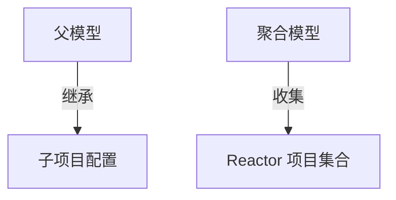
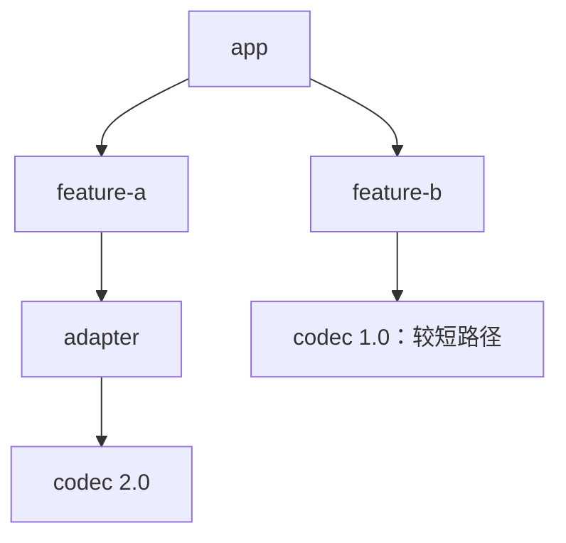
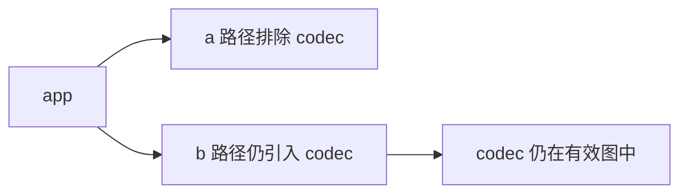
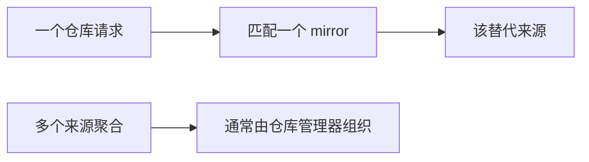
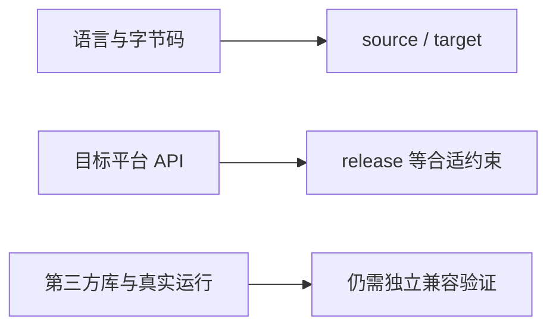
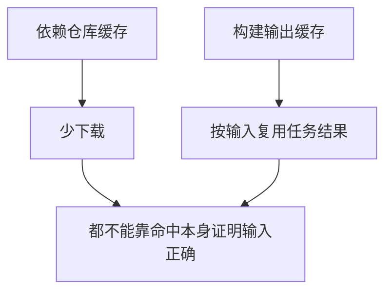
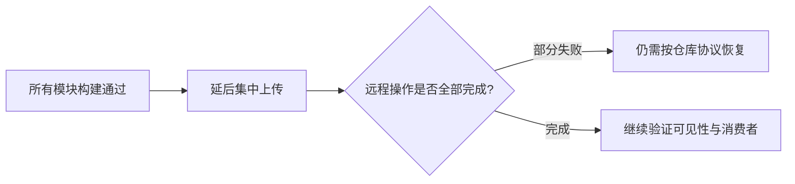

# Maven 面试：从一句话到模型、依赖和交付推演

> **建议用法**：结论开场，再按“输入与前提 → 机制 → 取舍 → 证据”展开。涉及默认值时说明核心、插件和 JDK 版本；配套详解见 [Maven 原理](Maven原理.md)。
>
> **重点路线**：Q1—Q10 模型；Q11—Q16 执行与插件；Q17—Q27 依赖治理；Q28—Q39 Reactor 与仓库；Q40—Q47 Java、测试与打包；Q48—Q55 CI 和交付；Q56—Q60 排障与版本。

## 一、定位、坐标与项目模型

### Q1：Maven 到底是什么，为什么不只是依赖下载器？

> **一句话结论**：它用项目模型和生命周期组织构建，并通过插件和制品元数据完成执行与交换。

**机制展开**：POM（Project Object Model，项目对象模型）描述项目，核心建立有效模型与计划，插件完成编译、测试、打包等。依赖解析只是其中一部分，构建还受父链、Profile、工具和环境影响，不能只看本地仓库有没有 jar。

**⚖️ 方案对比与代价**：统一约定降低重复和工具接入成本，也让非标准流程更间接；需要能从声明追踪到实际执行。

**🔎 追问演练**：Maven 自己实现全部 Java 编译吗？

**推演要点**：通常调用相应编译插件和工具，不能把核心、插件与 JDK（Java Development Kit，Java 开发工具包）的职责混为一谈。

**原理展开**：[对应章节](Maven原理.md#m-01)。

---

### Q2：Maven、Ant、Gradle 怎样做有意义的比较？

> **一句话结论**：比较模型、任务组织、生态和维护成本，不给出脱离项目的绝对性能排名。

**机制展开**：Maven 强调约定与生命周期，Ant 偏任务式组合，Gradle 具有灵活任务图与增量等能力。实际速度受插件、图结构、缓存、测试与网络影响，构建脚本短也不等于长期行为简单。

**⚖️ 方案对比与代价**：复杂定制可从灵活模型受益，标准 Java 工程也可能更重视约定与工具识别；选择要结合团队能力。

**🔎 追问演练**：换工具就一定修复依赖冲突吗？

**推演要点**：不会自动修复二进制兼容和业务契约，仲裁策略变化也可能只是选中了另一个不兼容版本。

**原理展开**：[对应章节](Maven原理.md#m-01)。

---

### Q3：坐标为什么不只有 groupId、artifactId、version？

> **一句话结论**：GAV 是常用核心身份，类型与分类也决定具体制品及匹配。

**机制展开**：GAV（GroupId, ArtifactId, Version，组、制品、版本）可以定位常见版本，type 与 classifier 还能区分附属物和处理方式。test-jar 可能映射到 jar 扩展与 tests 分类，管理匹配不能把所有情况都压成同 GA（GroupId, ArtifactId，组与制品）。

**⚖️ 方案对比与代价**：简单 jar 示例可省略部分字段，但分析多变体冲突必须还原完整身份与解析映射。

**🔎 追问演练**：同坐标版本的 sources 是另一个正式版本吗？

**推演要点**：通常是 classifier 区分的附属制品，不应当作运行时二进制库误用。

**原理展开**：[对应章节](Maven原理.md#m-02)。

---

### Q4：packaging 与 dependency type 一回事吗？

> **一句话结论**：前者描述当前项目产物与默认绑定，后者描述消费的制品类型。

**机制展开**：jar、war、pom 等 packaging 改变生命周期默认工作，依赖 type 还可能映射扩展与分类。普通 jar 通常只装项目内容，运行依赖由元数据和运行环境组织；不是 package 之后自然获得所有依赖。

**⚖️ 方案对比与代价**：打包模型选择要看应用还是可复用库，不能只因文件能启动就把它当普通依赖交给下游。

**🔎 追问演练**：type=pom 的 BOM 会进入运行类路径吗？

**推演要点**：在正确的 dependencyManagement/import 用法中展开管理信息，不是作为普通类文件加载。

**原理展开**：[对应章节](Maven原理.md#m-02)。

---

### Q5：modelVersion 4.0.0 表示用了 Maven 4 吗？

> **一句话结论**：不表示，模型格式、核心程序和插件各有版本线。

**机制展开**：大量 Maven 3 项目使用 POM modelVersion 4.0.0；Maven 4 也兼容传统模型并有新模型能力。查看实际程序要看运行版本，插件 4.x 同样不自动意味着 Maven 核心是 4。

**⚖️ 方案对比与代价**：只为升级核心就机械替换模型号，可能引入不必要的新语法和消费者兼容变化。

**🔎 追问演练**：所有插件版本都该与 Maven 核心相同吗？

**推演要点**：不是。它们独立发布，需看最低核心/Java要求与实际配置支持。

**原理展开**：[对应章节](Maven原理.md#m-19)。

---

### Q6：为什么有效 POM 比当前文件更接近真实构建？

> **一句话结论**：实际模型经过父链、Profile、属性和合并处理，当前文件只是一份输入。

**机制展开**：Super POM、父模型与激活配置共同决定版本、插件和属性。effective-pom 可帮助看到来源与合并结果，仓库凭据等又需结合 effective-settings，不能以为 settings 每个字段都变成项目字段。

**⚖️ 方案对比与代价**：模型越集中维护越省重复，也越需要可追踪；应避免层层继承却无人知道最终默认。

**🔎 追问演练**：同 POM 在两台机器会完全一样吗？

**推演要点**：可能因 JDK、Profile、settings、工具版本和外部输入不同而改变，需要记录实际输入。

**原理展开**：[对应章节](Maven原理.md#m-03)。

---

### Q7：继承与聚合到底如何区分？

> **一句话结论**：继承传递模型配置，聚合把项目纳入一次 Reactor 构建，两者可以独立。

**机制展开**：子项目通过 parent 获得可继承配置，modules 表达聚合集合。列入聚合不会自动继承它，某个父模型也不必收集全部消费者；Maven 3 通常一个直接 parent，但可形成父链和导入多个 BOM（Bill of Materials，物料清单）。

**读图**：同一个 POM 可以兼任两者，但两条关系不是自动绑定。

**⚖️ 方案对比与代价**：把两种角色合在根 POM 常方便，却应理解拆开后的发布和引用边界。

**🔎 追问演练**：把模块移进目录就自动继承父依赖管理吗？

**推演要点**：不会仅凭目录结构完成继承，需看父声明与有效模型。

**原理展开**：[对应章节](Maven原理.md#m-03)。

---

### Q8：parent relativePath 有什么用？

> **一句话结论**：辅助查找匹配父模型的相对文件，不是决定是否继承的总开关。

**机制展开**：Maven 3 常见默认是上级 pom.xml，还要匹配声明坐标；空 relativePath 可禁用默认相对文件查找，仍需按相应机制解析父。开发环境有相对父文件，独立消费者却可能需要已发布父模型。

**⚖️ 方案对比与代价**：相对查找便于源码协作，也可能掩盖未发布父；应以干净消费者验证，而不是只在整个源码树测试。

**🔎 追问演练**：空 relativePath 为什么还报找不到父？

**推演要点**：它没有取消 parent，只是不走默认相对文件路径，还要检查仓库、坐标、来源与认证。

**原理展开**：[对应章节](Maven原理.md#m-03)。

---

### Q9：Profile 的 activeByDefault 是永久开启吗？

> **一句话结论**：不是，同一 POM 其他 Profile 激活等条件会改变默认激活结果。

**机制展开**：Profile 可按命令、属性、环境、文件和运行 JDK 等激活，不同模块同名 Profile 也有自己的容器与条件。隐式条件会变成隐藏输入，使 CI（Continuous Integration，持续集成）与本地选择不同配置或依赖。

**⚖️ 方案对比与代价**：方便支持有界构建差异，但运行地址和密钥通常宜外部化，避免每环境重构一个难追踪包。

**🔎 追问演练**：加了一个新 Profile 后依赖少了，先看什么？

**推演要点**：查看实际激活集合、默认 Profile 是否退场和有效模型，而不是先删除缓存。

**原理展开**：[对应章节](Maven原理.md#m-03)。

---

### Q10：pom.xml 与 settings.xml 应各放什么？

> **一句话结论**：共享项目契约放模型，机器或组织环境放设置，并明确两者交互。

**机制展开**：POM 描述坐标、依赖、构建与发布目标等，settings 常管理镜像、代理、凭据和本地仓库等。实际构建受全局/用户设置和命令等影响，认证还要匹配真正访问的仓库 ID。

**⚖️ 方案对比与代价**：把凭据写进公共 POM 容易泄漏，把所有版本只放个人 settings 又难复现，应区分项目事实与环境输入。

**🔎 追问演练**：effective-pom 能替代所有设置排查吗？

**推演要点**：不能，还要看 effective-settings、激活配置和实际 URL/ID，输出也需注意敏感字段。

**原理展开**：[对应章节](Maven原理.md#m-10)。

---

## 二、生命周期与插件

### Q11：生命周期、Phase、Goal 怎么串起来？

> **一句话结论**：生命周期规定阶段顺序，阶段绑定插件目标，目标实现实际动作。

**机制展开**：clean、default、site 是不同生命周期，default 主干含编译、测试、打包、验证、安装和发布。目标可绑定阶段，也可直接调用；一个阶段可能没有工作或运行多个目标，具体由 packaging 和有效配置决定。

**⚖️ 方案对比与代价**：标准阶段利于统一工具，但每个质量检查仍要真实绑定，不能因为执行 verify 就假定某安全/覆盖检查已存在。

**🔎 追问演练**：mvn package 会先执行 clean 吗？

**推演要点**：不会自动运行另一个 clean 生命周期，只有明确请求或特殊配置等才相关。

**原理展开**：[对应章节](Maven原理.md#m-04)。

---

### Q12：直接执行 compiler:compile 等于 mvn compile 吗？

> **一句话结论**：不等价，一个是目标调用，一个是生命周期阶段请求。

**机制展开**：执行阶段通常包含同生命周期前置阶段与绑定工作；直接执行插件目标可能不先处理所有资源、生成代码和验证。目标也可能按描述 fork 特定生命周期，需要检查实现而非只看同名。

**⚖️ 方案对比与代价**：直接目标适合工具任务或特定调试，常规构建应选择体现所需前置与后置工作的终点。

**🔎 追问演练**：插件声明 defaultPhase 就一定自动运行吗？

**推演要点**：还需看它是否实际被调用/绑定及配置路径，不能只放管理模板就认定执行。

**原理展开**：[对应章节](Maven原理.md#m-04)。

---

### Q13：package、install、deploy 的区别？

> **一句话结论**：分别组织产物、写本地仓库、发布远程仓库，不是三个打包同义词。

**机制展开**：default 请求到后续阶段会经过前面的相关工作。install 方便独立构建解析本地制品，Reactor 内则常可使用当前结果；deploy 通常发布制品，不直接把 Spring 服务部署到生产运行环境。

**⚖️ 方案对比与代价**：无条件 clean install 增加工作并可能污染同坐标缓存，应按验证和交付目的选择。

**🔎 追问演练**：日常验证为什么常可到 verify？

**推演要点**：它可完成已绑定的验证而不强行写仓库，但实际检查范围仍看项目绑定。

**原理展开**：[对应章节](Maven原理.md#m-04)。

---

### Q14：同一阶段多个插件谁先执行？

> **一句话结论**：看默认绑定、有效模型和执行合并，不能按插件名字猜。

**机制展开**：packaging 提供一组默认目标，POM executions 继续参与，同阶段声明顺序、执行 ID 和父子配置会影响最终计划。代码生成若晚于编译，配置存在也没用；重复插件声明还可能在新核心被更严格处理。

**⚖️ 方案对比与代价**：依赖隐蔽顺序降低组合能力，明确阶段和输入输出更可维护；看当前文件顺序不足以证明继承后顺序。

**🔎 追问演练**：父子相同 execution ID 是简单追加吗？

**推演要点**：可能按模型合并规则组合或覆盖，需要看有效执行，不要把 XML（Extensible Markup Language，可扩展标记语言）文本拼接当算法。

**原理展开**：[对应章节](Maven原理.md#m-04)。

---

### Q15：pluginManagement 会自动执行插件吗？

> **一句话结论**：它提供可被实际使用插件采用的版本配置，不独立添加任意目标。

**机制展开**：若插件由 packaging 默认绑定或在 plugins 中实际使用，管理可生效；若只是给一个额外工具写了管理段，没有调用或绑定，该目标通常不会运行。plugins 本身也要区分单纯配置与 execution。

**⚖️ 方案对比与代价**：集中管理减少重复，但必须能证明使用点与执行点，避免构建看似有检查实则从未运行。

**🔎 追问演练**：为什么 compiler 没写进 plugins 仍可能受管理影响？

**推演要点**：它可能本就属于当前 packaging 的默认绑定，所以模板会影响已存在的使用，而非管理块凭空触发任务。

**原理展开**：[对应章节](Maven原理.md#m-05)。

---

### Q16：项目 dependencyManagement 能修插件依赖冲突吗？

> **一句话结论**：它主要管理项目依赖，不统一控制插件内部依赖图。

**机制展开**：核心/扩展、插件环境和项目类路径有不同职责。插件可通过自身 dependencies 或支持的定制使用组件，项目加入一个库不保证插件 ClassLoader 看见；Toolchain 也不改变插件所在 JVM（Java Virtual Machine，Java 虚拟机）的最低版本。

**⚖️ 方案对比与代价**：隔离减少工具与项目互相污染，也让排障需确认缺类发生在哪个空间。

**🔎 追问演练**：业务编译成功，插件却缺类合理吗？

**推演要点**：可能合理，应查插件版本与依赖、运行 Java 和扩展，而非只改业务 dependencies。

**原理展开**：[对应章节](Maven原理.md#m-05)。

---

## 三、依赖仲裁、管理和传播

### Q17：Maven 为什么可能选中较低依赖版本？

> **一句话结论**：普通仲裁常按路径最近，同深度按先声明等规则，不默认最高版本。

**机制展开**：例如一条两层路径引入 1.0，另一条三层引入 2.0，在未受管理改变时可能选择 1.0。Scope、排除与有效管理又会改变候选，应该从完整路径推演，而不是只比较数字。

**读图**：这是未被管理等规则改变的普通示例，版本较高并不自动胜出。

**⚖️ 方案对比与代价**：可预测的仲裁不证明兼容，升级最高也可能破坏契约，必须验证调用方所需能力。

**🔎 追问演练**：把依赖顺序换一下就算修复了吗？

**推演要点**：可能只改变偶然选择，长期更适合明确兼容版本与治理理由。

**原理展开**：[对应章节](Maven原理.md#m-06)。

---

### Q18：相同深度、依赖收敛与上界检查怎样区分？

> **一句话结论**：选择规则决定结果，治理规则判断特定条件，均不提供自动兼容证明。

**机制展开**：同深度通常先声明者胜；dependencyConvergence 关注相关路径版本一致，requireUpperBoundDeps 关注所选版本不低于路径需求等约束。图不收敛但满足上界是可能的，规则也有范围和配置。

**⚖️ 方案对比与代价**：规则可把问题提前暴露，但需管理有意覆盖与排除，不能让绿色报告代替运行契约。

**🔎 追问演练**：只要通过上界规则就不会缺方法吗？

**推演要点**：不保证，版本不低不等于兼容，打包、反射和外部容器还可能改变实际加载。

**原理展开**：[对应章节](Maven原理.md#m-06)。

---

### Q19：依赖管理与真实依赖声明有何区别？

> **一句话结论**：管理提供匹配约束，dependencies 表达项目实际使用。

**机制展开**：单独在 dependencyManagement 中列一百个库，不会自动把它们都加进编译和运行。匹配管理可影响直接或传递选择，但当前显式版本、父链和导入顺序等需结合有效模型分析。

**⚖️ 方案对比与代价**：平台管理有助一致，滥用强制覆盖也可能让某组件落在未验证组合上，应保留原因与回归。

**🔎 追问演练**：管理里某库版本升了，依赖树仍没出现该库正常吗？

**推演要点**：正常，若项目没有相应使用或传递路径，管理不负责凭空引入。

**原理展开**：[对应章节](Maven原理.md#m-07)。

---

### Q20：BOM import 到底导入了什么？

> **一句话结论**：主要导入依赖管理条目，不是全部 jar、属性和插件配置。

**机制展开**：BOM（Bill of Materials，物料清单）通常以 type=pom、scope=import 位于 dependencyManagement，供实际依赖采用受管理版本。它有自己的模型处理，不能视为任意完整 POM 内容都继承到消费者。

**⚖️ 方案对比与代价**：多个平台组合方便，也要治理冲突和兼容；一个项目单 parent 限制不妨碍导入多个 BOM。

**🔎 追问演练**：引入 BOM 后为何还是找不到类？

**推演要点**：还需声明实际依赖、检查 Scope、解析和打包；版本平台不会替你选择全部功能。

**原理展开**：[对应章节](Maven原理.md#m-07)。

---

### Q21：多个 BOM 冲突，或改同名属性为何没生效？

> **一句话结论**：导入合并和属性求值不同于父继承，必须检查最终管理结果。

**机制展开**：当前显式管理条目、父管理与多个导入存在优先关系，不能背最后一个永远覆盖。消费方改一个与 BOM 内同名属性，不保证重新计算 BOM 已展开的值；显式管理具体依赖更易解释。

**⚖️ 方案对比与代价**：覆盖减少冲突不代表验证了整个平台，改一个组件可能破坏整组兼容，需有具体回归。

**🔎 追问演练**：怎么证明确实用了预期版本？

**推演要点**：看有效管理和完整依赖树，再核对产物及运行加载位置，三者可能不同。

**原理展开**：[对应章节](Maven原理.md#m-07)。

---

### Q22：Boot parent、Boot BOM、Starter 分别有什么用？

> **一句话结论**：parent 提供可继承约定，BOM 管版本，Starter 聚合能力依赖。

**机制展开**：仅导入 BOM 不继承 parent 全部插件配置，Starter 不保证所有自动配置条件成立。Maven 决定模型和依赖，Boot 自动配置再根据运行输入装配对象，不能把几层都称为自动引入。

**⚖️ 方案对比与代价**：已有企业 parent 时可导 BOM，但需显式补必要构建配置与插件，而不是盲目同时复制整套父定义。

**🔎 追问演练**：有 Starter 就能保证数据库已经可连？

**推演要点**：不能，类路径、属性、Bean 条件、资源和远程可用性是不同事实。

**原理展开**：[对应章节](Maven原理.md#m-07)。

---

### Q23：六种 Scope 怎么准确回答？

> **一句话结论**：按当前编译、测试、运行及向下游传递分别解释，不能只说是否打包。

**机制展开**：compile 覆盖常见主路径，runtime 不进主编译但进入运行/测试，provided 常用于外部提供，test 用测试，system 指向本地特殊路径，import 用于管理展开。传递 Scope 还需按依赖路径组合。

**⚖️ 方案对比与代价**：选错会造成编译依赖偶然可见或运行缺失，实际归档还受插件与格式影响。

**🔎 追问演练**：runtime 库主编译时能直接用其类型吗？

**推演要点**：通常不在主编译路径，若直接使用应重新设计声明，不能依赖 IDE（Integrated Development Environment，集成开发环境）偶然补全。

**原理展开**：[对应章节](Maven原理.md#m-08)。

---

### Q24：provided 就一定不会进任何包吗？

> **一句话结论**：不能绝对化，它定义常见类路径与传递语义，打包插件可能有自己的处理。

**机制展开**：普通场景预期外部环境提供，但可执行应用、war 或重打包规则可能不同。必须明确最终运行环境到底提供什么、打包器包含什么，不能把同一声明机械用于所有部署方式。

**⚖️ 方案对比与代价**：减少重复库能避免容器冲突，也可能让独立运行缺类，选择应围绕交付契约。

**🔎 追问演练**：把编译错误库改 provided 就是优化包体？

**推演要点**：可能只是隐藏运行依赖，需验证真实启动方式和外部平台兼容。

**原理展开**：[对应章节](Maven原理.md#m-08)。

---

### Q25：optional 为谁可选，当前项目还会用它吗？

> **一句话结论**：通常让下游不自动继承该能力，声明它的项目自身仍可使用。

**机制展开**：library 用 optional adapter 实现某可选集成，consumer 若选择该能力需显式添加。optional 不会自动改写字节码或让缺类调用安全，直接触发该路径仍可能失败。

**⚖️ 方案对比与代价**：减少消费者无用依赖，同时要求文档、条件与错误说明清楚，不能把可选当作任意删除许可。

**🔎 追问演练**：optional 等于 test Scope 吗？

**推演要点**：不是。可见范围与向下游传播是不同维度，当前项目仍可能编译运行该依赖。

**原理展开**：[对应章节](Maven原理.md#m-08)。

---

### Q26：exclusions 为什么排除了还存在？

> **一句话结论**：排除通常作用于声明的依赖路径，其他路径仍可能引入。

**机制展开**：app 经 a 排除 codec，但经 b 仍可得到 codec；应看全图而非一段 POM。排除也不证明 a 不再需要它，必须判断替代实现或确实不使用相关能力。

**⚖️ 方案对比与代价**：全局粗暴删除容易变成运行时缺类，版本冲突往往更适合明确兼容选择。

**🔎 追问演练**：排除后编译通过就说明安全？

**推演要点**：不一定，反射、运行实现、服务发现和未覆盖功能可能到启动或请求时才失败。

**原理展开**：[对应章节](Maven原理.md#m-08)。

---

### Q27：为什么建议直接用的库显式声明？

> **一句话结论**：明确真实契约，避免依赖某个上游偶然传来的类。

**机制展开**：library 当前传入某 API（Application Programming Interface，应用程序编程接口），下一版内部调整后可能不再传递，app 若直接引用却没声明，会因无关升级突然编译失败。显式依赖仍需与平台版本管理配合，避免重复写死版本。

**⚖️ 方案对比与代价**：声明更清楚但需要治理，不能为了显式把所有传递库都手工枚举成直接依赖。

**🔎 追问演练**：dependency:tree 里出现就等于应该全部直接声明？

**推演要点**：不是，应按自己的实际使用与运行能力确定边界。

**原理展开**：[对应章节](Maven原理.md#m-08)。

---

## 四、Reactor、仓库和版本解析

### Q28：Reactor 排序只看 modules 顺序吗？

> **一句话结论**：先看真实项目引用，清单顺序通常只是没有更强关系时的依据。

**机制展开**：项目依赖、同构建插件、插件依赖、扩展和父关系等会影响排序，管理模板不等于实例化依赖边。Reactor 收集、排序并构建选择集合，可利用当前工作空间结果，不需每步都 install。

**⚖️ 方案对比与代价**：正确图利于并行与局部验证，循环依赖应重构，不是排列目录解决。

**🔎 追问演练**：只有 dependencyManagement 引用就会先构建该模块吗？

**推演要点**：不能这样推断，管理条目不自动形成同样的实际构建边。

**原理展开**：[对应章节](Maven原理.md#m-09)。

---

### Q29：-pl、-am、-amd 分别选择什么？

> **一句话结论**：选择项目、补上游、补当前 Reactor 下游，范围必须明确。

**机制展开**：-pl 不默认构建全部依赖源码，-am 只在当前收集模型内补需要的上游，-amd 不覆盖世界上所有消费者。局部验证可组合选择与实际终点，项目名或路径要按仓库解析。

**⚖️ 方案对比与代价**：更小范围更快，也可能漏掉外部兼容验证，应结合共享契约与发布流程安排检查。

**🔎 追问演练**：用了 -am 就完全不依赖仓库了？

**推演要点**：外部依赖、插件、父/BOM 等仍需解析，Reactor 不是完整外部世界镜像。

**原理展开**：[对应章节](Maven原理.md#m-09)。

---

### Q30：-rf 恢复为什么还找不到刚构建的上游？

> **一句话结论**：新会话选择集合与可解析制品不必保留上一会话的全部状态。

**机制展开**：上次 package/verify 不等于 install，跳过的上游可能既不在本次 Reactor 又未发布到仓库。Maven 3 的恢复还受具体限制，可重新选择失败项目并带上真实上游，或按跨构建共享需求安装/发布。

**⚖️ 方案对比与代价**：无条件全量 install 能掩盖缺口也会污染缓存，应该明确需要的图与产物来源；Maven 4 另有恢复改进。

**🔎 追问演练**：日志给恢复命令就保证所有场景都可用吗？

**推演要点**：不保证，还要看前次终点、项目选择、当前文件与版本行为。

**原理展开**：[对应章节](Maven原理.md#m-09)。

---

### Q31：模块循环依赖为什么不是调整顺序就能修复？

> **一句话结论**：依赖图没有合法拓扑顺序，目录重排无法创造先构建条件。

**机制展开**：A 需要 B 的产物，B 又需要 A，会同时缺少必要上游。可以提取共同契约、分离实现与接口或重新划职责；先装一个旧包让构建通过可能只是掩盖源码与二进制不一致。

**⚖️ 方案对比与代价**：拆模块增加边界维护，但比长期依赖同坐标残留可靠；父继承环与依赖环也应分别诊断。

**🔎 追问演练**：本地 install 过一次就不报错，能说明设计合理？

**推演要点**：不能，它可能借用了另一版本或另一分支内容，干净 Reactor 与消费者仍需验证。

**原理展开**：[对应章节](Maven原理.md#m-09)。

---

### Q32：本地仓库明明有 jar，为什么还可能解析失败？

> **一句话结论**：解析看元数据、来源和上下文，不仅检查一个物理文件是否存在。

**机制展开**：增强本地仓库区分缓存与安装内容，并可记录远程来源；当前构建没有有效来源时，缓存内容可能被视为不可用。还可能缺 POM、附属物或元数据，手工拷文件不构成完整发布。

**⚖️ 方案对比与代价**：来源追踪改善治理，也让换仓库后的行为不同；应核对坐标与来源而非直接改内部记录。

**🔎 追问演练**：删除全部仓库是标准第一步吗？

**推演要点**：不是，先保留证据并定位具体路径、镜像、权限和内容，针对性处理。

**原理展开**：[对应章节](Maven原理.md#m-10)。

---

### Q33：多个 mirror 会自动轮询或失败切换吗？

> **一句话结论**：不会为同一仓库自动聚合成故障转移组，通常选一个匹配镜像。

**机制展开**：精确 ID 与通配匹配有选择规则，多个同 mirrorOf 不代表一起使用。真正聚合公共和私有仓库通常由仓库管理器实现，客户端 mirror 是请求重定向层。

**⚖️ 方案对比与代价**：集中入口减少下载与策略分散，也增加共享依赖；高可用应在明确实现层设计。

**🔎 追问演练**：第一个镜像没有包，Maven 必然继续试其他同配置镜像？

**推演要点**：不能这样承诺，应看实际有效仓库与匹配结果，而非把列表当候选轮询池。

**原理展开**：[对应章节](Maven原理.md#m-10)。

---

### Q34：mirrorOf 星号为什么可能导致内部依赖找不到？

> **一句话结论**：它可能把内部仓库请求也转向只含公共内容的替代来源。

**机制展开**：星号、external 范围与排除 ID 有不同匹配语义，精确匹配和通配声明次序也影响选择。应让中央入口能提供所有必需内容，或合理排除私有来源；额外空格也可能改变高级表达式。

**⚖️ 方案对比与代价**：统一治理方便，但错误镜像范围会系统性影响所有项目，不能只在某项目再堆一个仓库期待绕过。

**🔎 追问演练**：HTTP（Hypertext Transfer Protocol，超文本传输协议）被阻断就是网络坏了吗？

**推演要点**：不一定，新版默认阻断外部不安全 HTTP 等策略可能生效，需检查实际来源和错误原因。

**原理展开**：[对应章节](Maven原理.md#m-10)。

---

### Q35：repositories、pluginRepositories、distributionManagement 有何区别？

> **一句话结论**：分别主要提供项目解析、插件解析和标准发布目标信息。

**机制展开**：项目库能下载不证明构建插件来源也正确；声明上传目标不自动把它加入下载候选。mirror 和 proxy 又分属内容替代与网络访问，settings/servers 提供 ID 关联认证，不能用一个 URL 解释全部机制。

**⚖️ 方案对比与代价**：分开便于权限与生命周期管理，也需要看真正失败的请求类型。

**🔎 追问演练**：Maven deploy 会自动部署业务服务吗？

**推演要点**：常规是上传制品，生产运行部署属于其他插件或交付系统职责，不能只因命令名相同混淆。

**原理展开**：[对应章节](Maven原理.md#m-10)。

---

### Q36：401、403 应先核对什么？

> **一句话结论**：核对实际 URL、仓库/镜像 ID、凭据来源与读写角色。

**机制展开**：mirror 后实际访问 ID 可能与原仓库不同，servers 配置必须匹配对应目标，版本还可能有凭据来源约束。401/403 的具体原因由服务端与链路决定，日志需结合认证、授权和仓库策略分析。

**⚖️ 方案对比与代价**：反复切版本或清缓存不修权限，凭据应留在受控设置与运行环境，不能塞进公共 POM。

**🔎 追问演练**：下载成功就证明发布也有权限？

**推演要点**：不能，目标、角色和策略可能完全不同，尤其 Release 与 Snapshot 上传。

**原理展开**：[对应章节](Maven原理.md#m-17)。

---

### Q37：SNAPSHOT 为什么同一个版本会拿到不同内容？

> **一句话结论**：它是可变开发坐标，元数据可能映射到不同时间戳快照。

**机制展开**：远程实际文件常有时间戳与构建号，基准 SNAPSHOT 通过更新策略发现新内容；解析缓存可能暂时保留旧映射。Release 则应配仓库不可变策略，任意覆盖会破坏缓存与追踪假设。

**⚖️ 方案对比与代价**：开发协作更灵活，同时降低复现确定性，关键交付需记录具体输入和来源。

**🔎 追问演练**：正式版仓库允许覆盖，构建就会始终得到新内容吗？

**推演要点**：不保证，已有缓存和策略可能继续使用旧文件，因此覆盖同坐标会制造机器差异。

**原理展开**：[对应章节](Maven原理.md#m-11)。

---

### Q38：-U、离线与 lastUpdated 分别说明什么？

> **一句话结论**：更新检查、禁止远程访问和失败/更新记录是不同机制，不是万能修复组合。

**机制展开**：以 Maven 3.9 为参照，-U 检查缺失 Release 和更新 Snapshot 等，不重下全部已有正式版；离线依赖本地完整可用内容，插件也需要已解析。失败可能缓存，先修根因再针对性重试。

**⚖️ 方案对比与代价**：删除缓存能触发重取却不能制造不存在的包、权限或正确镜像；还可能失去排查线索。

**🔎 追问演练**：本地有业务 jar，-o 就一定能构建？

**推演要点**：不一定，父/BOM、插件、元数据和工具相关依赖也可能缺失。

**原理展开**：[对应章节](Maven原理.md#m-11)。

---

### Q39：版本范围和最高版本能解决升级治理吗？

> **一句话结论**：范围表达可接受候选，不证明候选语义兼容，也增加移动输入。

**机制展开**：仓库增加版本后相同源码可能解析不同结果；Maven 有自身版本比较规则，不能按字符串字典序或简单语义版本直觉推断。Snapshot、范围与固定 Release 的可复现性也不同。

**⚖️ 方案对比与代价**：自动获得变化省操作，风险是未经验证升级；平台约束与定期受控升级更易追踪。

**🔎 追问演练**：1.10 是否按字符串小于 1.9 来选？

**推演要点**：不能用这种比较解释 Maven 版本顺序，应按实际版本规则与解析结果验证。

**原理展开**：[对应章节](Maven原理.md#m-11)。

---

## 五、Java、测试与归档

### Q40：运行 Maven 的 Java、编译 Java、目标 Java 怎么区分？

> **一句话结论**：它们是不同层的输入，工具链可分离部分任务而不包办全部进程。

**机制展开**：Maven JVM 加载核心与插件，Compiler 或测试插件按支持能力选择工具链/进程，产物目标再由编译配置约束。mvn -v 只给主要运行环境证据，不代表所有 fork 和外部命令都一致。

**⚖️ 方案对比与代价**：分离便于兼容多平台，也增加验证维度，应记录每层真实版本。

**🔎 追问演练**：Maven 用 Java 17 就只能产 Java 17 字节码？

**推演要点**：不是，可以按工具和依赖支持编译目标旧平台，但需正确配置并真实测试。

**原理展开**：[对应章节](Maven原理.md#m-12)。

---

### Q41：source、target、release 为什么不是一回事？

> **一句话结论**：前两者主要管语言与字节码，release 进一步限制相应平台 API。

**机制展开**：在新 JDK 只设旧 source/target，仍可能引用旧平台没有的方法，运行时报错。release 能减少这类错误，但不能降低第三方依赖字节码要求，也不替代旧运行环境测试。

**⚖️ 方案对比与代价**：选择目标要兼顾编译器、依赖和测试 Java，而非看到 class 版本号满足就结束。

**🔎 追问演练**：release=8 能把 Java 17 第三方库变成 Java 8 可用？

**推演要点**：不能，它约束你的相应编译，不会重写所有依赖实现与平台需求。

**原理展开**：[对应章节](Maven原理.md#m-12)。

---

### Q42：JDK 升级后 Lombok 或 MapStruct 不工作怎么查？

> **一句话结论**：区分处理器声明、编译器行为、工具链和 IDE 自己的配置。

**机制展开**：注解处理器参与编译，不等于普通运行库；JDK 23 起默认发现/启用行为变化，应显式配置所需处理器。Maven 3 Compiler 3.x 与 Maven 4 的新类型配置不同，处理器自身也需支持编译 JDK。

**⚖️ 方案对比与代价**：显式输入更可追踪，靠类路径碰巧扫描则容易在升级后失效；不能只在 IDE 开开关掩盖命令行问题。

**🔎 追问演练**：把处理器改成 runtime Scope 就能生成代码？

**推演要点**：不是，运行路径不能替代正确编译处理器配置。

**原理展开**：[对应章节](Maven原理.md#m-12)。

---

### Q43：Surefire 与 Failsafe 为什么分两类？

> **一句话结论**：它们组织不同测试阶段，Failsafe 将结果检查延到后续以支持清理。

**机制展开**：常见 Surefire 跑 test，正确绑定的 Failsafe 在 integration-test 记录执行结果，post-integration-test 可清理，verify 再检查失败。只调用中间阶段会遗漏后续工作，配置、提供者和测试发现也要确认。

**读图**：这是正确绑定的正常流程，进程强杀等故障仍需额外清理与恢复。

**⚖️ 方案对比与代价**：分段降低断言失败阻断清理的概率，不保证机器被杀或任意任务异常时一定清理，外部资源仍需恢复机制。

**🔎 追问演练**：运行 integration-test 返回了就代表全部通过？

**推演要点**：不能，还要经过结果验证与报告，合适终点通常是 verify。

**原理展开**：[对应章节](Maven原理.md#m-13)。

---

### Q44：skipTests、maven.test.skip 与没有发现测试怎么区分？

> **一句话结论**：一个常见为跳运行，一个可跳编译与运行，未发现则是另一种可能的验证缺口。

**机制展开**：常见插件识别 -DskipTests 后仍编译测试，maven.test.skip 可被 Compiler、Surefire、Failsafe 等识别。BUILD SUCCESS 不能证明测试执行过，应看发现数、包含规则、Profile、提供者和报告。

**⚖️ 方案对比与代价**：跳过有特定临时用途，却不能拿被跳过的结果支撑交付正确性；也不应把测试编译错误一律靠跳编译处理。

**🔎 追问演练**：改测试类名后突然全部成功合理吗？

**推演要点**：可能没有被发现，应核对规则和运行数，而非直接视为修复。

**原理展开**：[对应章节](Maven原理.md#m-13)。

---

### Q45：-T 和测试并行为什么会互相放大资源？

> **一句话结论**：Reactor 并行项目与测试 fork/线程属于两层并发，叠加后可能超过机器或外部资源容量。

**机制展开**：若同时构建多个项目，每个再开测试进程，内存、CPU、端口与数据库连接共同增长。插件线程安全标记不代表测试数据、脚本和共享目录安全，模块关键路径也限制加速。

**⚖️ 方案对比与代价**：适当并发减少总时长，过量造成抖动和失败，需同验证范围测量峰值与稳定性。

**🔎 追问演练**：核心数八个就设置八倍所有并发好吗？

**推演要点**：不能这样机械配置，计算、I/O、测试进程与外部容量都要估算。

**原理展开**：[对应章节](Maven原理.md#m-16)。

---

### Q46：普通 jar、Shade 和 Boot 包怎么选择？

> **一句话结论**：按库消费与独立启动契约选择，不能只看文件后缀。

**机制展开**：普通 jar 常不含依赖，Shade 合并并可重定位，Boot 包用启动器加载嵌套依赖。当前源码测试路径可能与归档完全不同；把可执行包当普通库，消费者未必能按标准类路径找到类。

**⚖️ 方案对比与代价**：自包含分发方便但重复、升级和元数据更复杂，库应优先有清晰可消费形态。

**🔎 追问演练**：package 成功就说明 java -jar 可运行？

**推演要点**：不一定，还要入口、布局、依赖和资源满足运行协议。

**原理展开**：[对应章节](Maven原理.md#m-14)。

---

### Q47：Shade 为什么还要处理资源和发布 POM？

> **一句话结论**：类合并只是部分工作，服务发现、反射、签名与消费者依赖都可能变化。

**机制展开**：重复资源可能覆盖，ServiceLoader 描述需恰当合并，重定位不保证反射字符串全部有效，原签名也不能自然证明新包。已内嵌依赖但 POM 仍让下游重复引入，可能再次冲突。

**⚖️ 方案对比与代价**：减少冲突与独立分发有收益，同时增加兼容和审计成本，应验证真实消费者而非只本地运行。

**🔎 追问演练**：重定位能解决所有同名类问题？

**推演要点**：不能，动态加载、配置、序列化和原生接口等可能保留其他契约。

**原理展开**：[对应章节](Maven原理.md#m-14)。

---

## 六、可复现、性能与交付

### Q48：Wrapper 固定了什么，没固定什么？

> **一句话结论**：主要固定/获取 Maven 分发，不自动固定整个 Java 与网络构建环境。

**机制展开**：脚本和分发配置减少个人安装版本差异，JDK、Toolchains、依赖/插件、Profile、settings 和外部生成输入仍需管理。来源与校验也要明确，不能把提交脚本当作完整复现证明。

**⚖️ 方案对比与代价**：统一入口降低环境漂移，离线与CI仍要准备相应工具和内容。

**🔎 追问演练**：使用同一 mvnw，两台机器一定同产物？

**推演要点**：不一定，仍需比较工具链、有效模型和全部生成输入。

**原理展开**：[对应章节](Maven原理.md#m-15)。

---

### Q49：可复现构建只要固定时间戳吗？

> **一句话结论**：不够，时间戳只是一个输入，依赖、工具、环境与生成器都可能变化。

**机制展开**：project.build.outputTimestamp 对支持的归档插件有帮助，Maven 3.10 和部分 Maven 4 预览已有默认。随机内容、绝对路径、不同 JDK、Snapshot 和未固定插件仍会破坏字节级一致。

**⚖️ 方案对比与代价**：复现能提高追踪和缓存可信性，却需要真实对比与失配定位，不能只添加一个属性宣布完成。

**🔎 追问演练**：同源码同 POM 就是同全部输入？

**推演要点**：不是，父/BOM、Profile、远程元数据、环境和外部服务都是可能差异。

**原理展开**：[对应章节](Maven原理.md#m-15)。

---

### Q50：缓存 .m2 为什么既提速又能掩盖问题？

> **一句话结论**：它减少重复解析下载，也可能带入同坐标旧安装物、来源差异与未声明状态。

**机制展开**：依赖缓存不等于编译输出缓存，不会自动省全部任务。开发分支同坐标 install 可能覆盖内容，CI 缓存恢复也要结合工具、平台和信任边界；独立干净消费者能暴露偶然依赖。

**⚖️ 方案对比与代价**：全清每次重下成本高，也不修根因；更合适的是可追踪缓存与关键隔离验证。

**🔎 追问演练**：缓存命中说明当前源码已构建通过？

**推演要点**：不能，需知道缓存类型、输入键和实际内容，而不只看目录存在。

**原理展开**：[对应章节](Maven原理.md#m-15)。

---

### Q51：clean、增量编译和构建缓存是什么关系？

> **一句话结论**：清理移除输出，增量减少局部重复，结果缓存按输入复用产物，职责不同。

**机制展开**：clean 会破坏部分增量基础，却通常不清本地仓库；不 clean 可能保留陈旧生成物或删除源码残留。插件增量与跨机器构建缓存支持各不相同，输入漏记会产生错误命中。

**⚖️ 方案对比与代价**：迭代速度与关键验证清洁度可以分策略，不必每步都 clean，也不能永远只依赖脏工作区。

**🔎 追问演练**：运行缺旧类残留时，-U 能替代 clean？

**推演要点**：不能，它控制另一层更新检查，需要先确定问题位于输出还是解析来源。

**原理展开**：[对应章节](Maven原理.md#m-16)。

---

### Q52：Maven Daemon 和更多线程一定让构建更快吗？

> **一句话结论**：Daemon、并行与缓存各优化不同成本，瓶颈未命中就未必加速。

**机制展开**：mvnd 可复用进程降低启动/预热相关成本，-T 受项目图并行度限制，测试和网络又可能占主导。共享目录或外部容量不足会让并发更不稳定，不能靠工具名字承诺线性加速。

**⚖️ 方案对比与代价**：优化先有分目标、模块和资源证据，再在相同验证范围比较，避免把跳测试误称加速。

**🔎 追问演练**：单条长依赖链怎样加速？

**推演要点**：单靠多模块线程受限，应定位链上任务、测试与输入重复，再评估拆分、增量或适合的缓存。

**原理展开**：[对应章节](Maven原理.md#m-16)。

---

### Q53：发布为什么不只上传一个 jar？

> **一句话结论**：消费者还依赖正确 POM、父/BOM、附属物和元数据来理解如何使用它。

**机制展开**：当前 Reactor 可见的信息到独立消费者不一定还存在。变量未正确展开、父模型未发布、错误 Scope 或打包依赖不匹配，都会造成上传成功后使用失败。应验证仓库里的实际消费模型。

**⚖️ 方案对比与代价**：独立验证增加交付工作，但比让每个下游自行猜配置可靠；不应让本地 install 掩盖发布缺口。

**🔎 追问演练**：当前项目依赖自己正常就算验证了发布？

**推演要点**：不够，工作空间和本地缓存可能绕过远程消费者真正会走的路径。

**原理展开**：[对应章节](Maven原理.md#m-17)。

---

### Q54：deployAtEnd 能保证多模块发布原子性吗？

> **一句话结论**：它可延后上传降低构建失败留下半套的风险，不保证远程操作全成或全回滚。

**机制展开**：即使所有模块构建通过，上传途中断网仍可能部分可见。仓库暂存和晋升可提供更合适可见性控制，保证取决于实现；Maven 4 预览默认变化不能套用所有 Maven 3 插件组合。

**⚖️ 方案对比与代价**：延后和暂存有管理收益，也需恢复、清理与重复发布策略，不是普通数据库事务。

**🔎 追问演练**：发布一个模块失败，前面上传会自动撤销？

**推演要点**：不能通用承诺，应按插件与仓库协议检查实际状态，保持 Release 不可变与可追踪。

**原理展开**：[对应章节](Maven原理.md#m-17)。

---

### Q55：CI-friendly 版本和 flatten 为什么要看消费者模型？

> **一句话结论**：源码便于维护的变量不一定能被独立消费，flatten 也不能无脑删光模型。

**机制展开**：Maven 3 为 revision/sha1/changelist 等提供专门支持，其他位置和变量有规则；一些发布场景需要合适 flatten。普通库、parent、BOM 有不同保留语义，Maven 4 内置消费者 POM 也不表示每个 RC（Release Candidate，发布候选版本）默认完全展开。

**⚖️ 方案对比与代价**：消除消费者环境依赖有收益，选错模式却会破坏依赖管理和构建继承；应看实际发布文件。

**🔎 追问演练**：Maven 4 的 consumer POM 一定没 parent 和 properties？

**推演要点**：不能这样概括，要按具体 RC 与 flatten 选项验证，官方行为还在演进。

**原理展开**：[对应章节](Maven原理.md#m-17)。

---

## 七、排障、版本与综合推演

### Q56：IDE 成功、命令行或 CI 失败先比什么？

> **一句话结论**：先比工具、有效模型和真实输入，再看缓存与文件来源。

**机制展开**：IDE 可能使用不同 Maven/JDK、Workspace 模块、处理器设置和已生成文件；CI 还可能缺父/BOM、插件源和本地安装物。有效 POM、激活 Profile、settings 与实际构建日志是起点，不只重新导入。

**⚖️ 方案对比与代价**：统一入口减少差异，但Wrapper不自动固定全部环境，关键路径需独立验证。

**🔎 追问演练**：删 .m2 后本地也失败说明什么？

**推演要点**：可能暴露了未发布依赖或来源问题，应定位缺失契约，不是得出每次都该清缓存。

**原理展开**：[对应章节](Maven原理.md#m-18)。

---

### Q57：NoSuchMethodError 与缺类如何沿依赖图排查？

> **一句话结论**：先定位谁实际被加载，再比较编译期、归档和运行环境。

**机制展开**：最近优先可能选到旧库，容器或可执行包又可能带另一份，修改 POM 未更新真实包也会继续失败。dependency:tree 只说明项目解析的一部分，不展示所有插件内部或外部加载路径。

**⚖️ 方案对比与代价**：明确兼容组合比简单最高版本可靠，修复后用真实启动方式回归。

**🔎 追问演练**：编译通过为何还会没有方法？

**推演要点**：调用方可能按新契约编译，运行加载的实现却更旧或不同来源，二进制契约并未得到保证。

**原理展开**：[对应章节](Maven原理.md#m-06)。

---

### Q58：Maven 3.9、3.10 与 Maven 4 重点怎样讲？

> **一句话结论**：区分稳定/预览状态、Java 基线、Resolver 和模型，而不是只背数字。

**机制展开**：本文查阅时 3.10.0 是官方当前稳定线，3.9 为基础学习参照；3.10 引入 Resolver 2.x 与复现等默认演进。4.0.0-rc-7 仍列 Preview，运行 Java 17 起步，不表示目标应用必须 Java 17，模型号也独立。

**⚖️ 方案对比与代价**：默认、扩展和插件兼容可能变化，应看依赖图与产物，不把新选项和预览模型复制进所有旧项目。

**🔎 追问演练**：3.10 只是 3.9 的一个无行为变化补丁？

**推演要点**：不能这样判断，它是次版本演进，解析、配置与默认值都需回归。

**原理展开**：[对应章节](Maven原理.md#m-19)。

---

### Q59：升级 Maven 怎样做有效验证？

> **一句话结论**：固定输入基线，比较模型、图、执行、测试和消费者，而不只看命令成功。

**机制展开**：清理已有告警，核对插件 Java/API 要求，比较有效 POM、依赖选择、测试发现、归档资源与发布 POM；再用独立消费者确认父/BOM与运行契约。预览版本还要明确未稳定能力。

**⚖️ 方案对比与代价**：小步升级更易定位，长期压住告警或同时换太多组件会扩大不确定性。

**🔎 追问演练**：同样 BUILD SUCCESS 就说明兼容？

**推演要点**：不说明，可能测试没发现、Profile变了或产物布局改变，应检查实际验证内容与消费者行为。

**原理展开**：[对应章节](Maven原理.md#m-19)。

---

### Q60：如何推演干净 CI 构建失败、生产却运行旧包的问题？

> **一句话结论**：按模型、图、缓存、打包和发布来源分别确认事实。

**机制展开**：核对源码提交、Wrapper/JDK、激活输入、上游是否只在本地 install，再看最终制品摘要、归档和运行加载位置。生产部署系统可能拿了另一个同名包；重新构建不同环境也可能生成不同内容。

**⚖️ 方案对比与代价**：一个制品按受控路径晋升更便于追踪，但仍需记录外部配置与运行条件，不应靠文件名判断身份。

**🔎 追问演练**：最有价值的几项证据是什么？

**推演要点**：源码与工具标识、实际依赖/插件版本、构建报告、制品校验和与消费者/运行来源，合起来才能解释因果。

**原理展开**：[对应章节](Maven原理.md#m-18)。

---

## 参考与版本核对

- [原理篇资料入口](Maven原理.md#m-references)：模型、依赖、仓库、测试与交付的官方资料。
- [生命周期](https://maven.apache.org/guides/introduction/introduction-to-the-lifecycle.html)、[依赖机制](https://maven.apache.org/guides/introduction/introduction-to-dependency-mechanism.html)、[Reactor](https://maven.apache.org/guides/mini/guide-multiple-modules.html)：理解规则的适用前提。
- [下载状态](https://maven.apache.org/download.cgi)、[3.10.0 发布说明](https://maven.apache.org/docs/3.10.0/release-notes.html)、[Maven 4 说明](https://maven.apache.org/whatsnewinmaven4.html)：核对稳定/预览、核心与模型差异。
- [Failsafe](https://maven.apache.org/surefire/maven-failsafe-plugin/)、[复现构建](https://maven.apache.org/guides/mini/guide-reproducible-builds.html)、[CI-friendly](https://maven.apache.org/guides/mini/guide-maven-ci-friendly.html)：核对测试完成点与消费者协议。

题目以 Maven 3.9 常见机制为基础，涉及新版时单独说明；实际项目还需核对插件、Resolver、settings 和运行环境。

## 附录：术语与缩写

| 术语 | 英文全称 | 中文含义 / 边界 |
|---|---|---|
| POM | Project Object Model | 项目对象模型 |
| GAV | GroupId, ArtifactId, Version | 常用组、制品与版本坐标 |
| GA | GroupId, ArtifactId | 常用于简化普通制品身份 |
| BOM | Bill of Materials | 物料清单，复用依赖管理条目 |
| XML | Extensible Markup Language | 可扩展标记语言 |
| JAR | Java Archive | Java 归档 |
| WAR | Web Application Archive | Web 应用归档 |
| JDK | Java Development Kit | Java 开发工具包 |
| JVM | Java Virtual Machine | Java 虚拟机 |
| JPMS | Java Platform Module System | Java 平台模块系统 |
| API | Application Programming Interface | 应用程序编程接口 |
| SPI | Service Provider Interface | 服务提供者接口 |
| CI | Continuous Integration | 持续集成 |
| IDE | Integrated Development Environment | 集成开发环境 |
| CLI | Command-Line Interface | 命令行接口 |
| CPU | Central Processing Unit | 中央处理器 |
| HTTP | Hypertext Transfer Protocol | 超文本传输协议 |
| HTTPS | HTTP over TLS | 经 TLS 保护的 HTTP |
| TLS | Transport Layer Security | 传输层安全协议 |
| RC | Release Candidate | 发布候选版本，不等于正式稳定版 |
| Mojo | Maven Plain Old Java Object | 插件目标实现的常见称呼 |
| Reactor | Reactor Build Mechanism | 多项目收集、排序与构建机制 |
| Phase | Lifecycle Phase | 生命周期阶段 |
| Goal | Plugin Goal | 插件目标，具体执行能力 |
| Scope | Dependency Scope | 依赖范围，影响类路径与传递 |
| Classifier | Artifact Classifier | 同项目版本制品的附属分类 |
| SNAPSHOT | Snapshot Version | 可变开发版本，通过元数据解析具体内容 |
| Release | Release Version | 正式发布身份，通常应不可变 |
| Resolver | Maven Artifact Resolver | 制品与依赖图解析组件 |
| Toolchain | Toolchain | 为支持的插件选择构建工具链 |
| Effective POM | Effective Project Object Model | 合并、激活等处理后的有效项目模型 |
| Consumer POM | Consumer Project Object Model | 面向制品消费者的项目元数据 |
| Relocation | Package Relocation | Shade 等场景的包重定位，另需区分仓库坐标迁移 |
