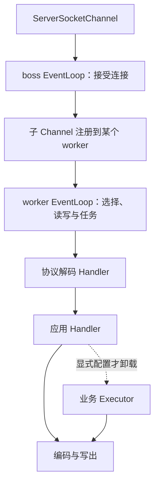
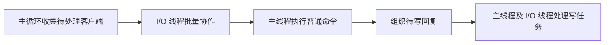
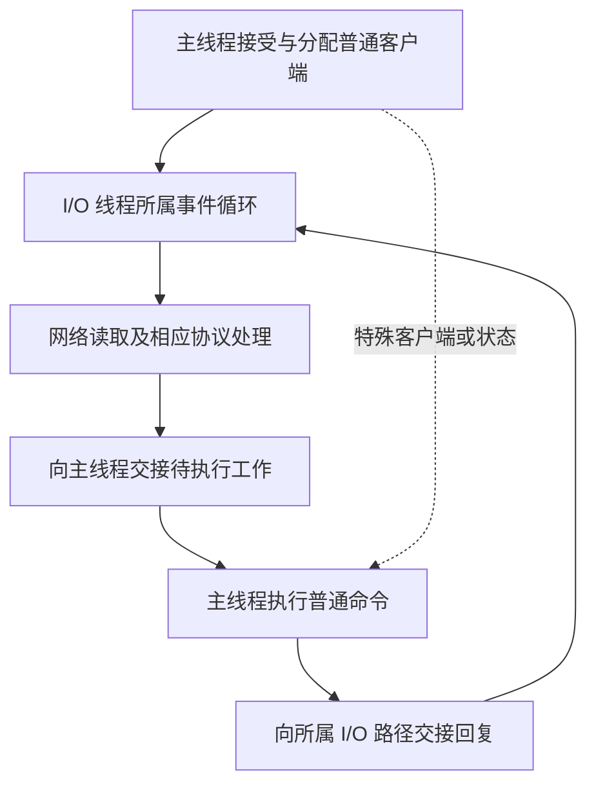
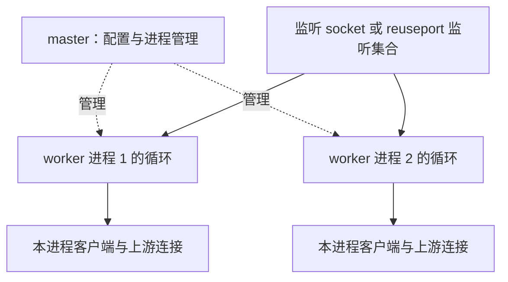
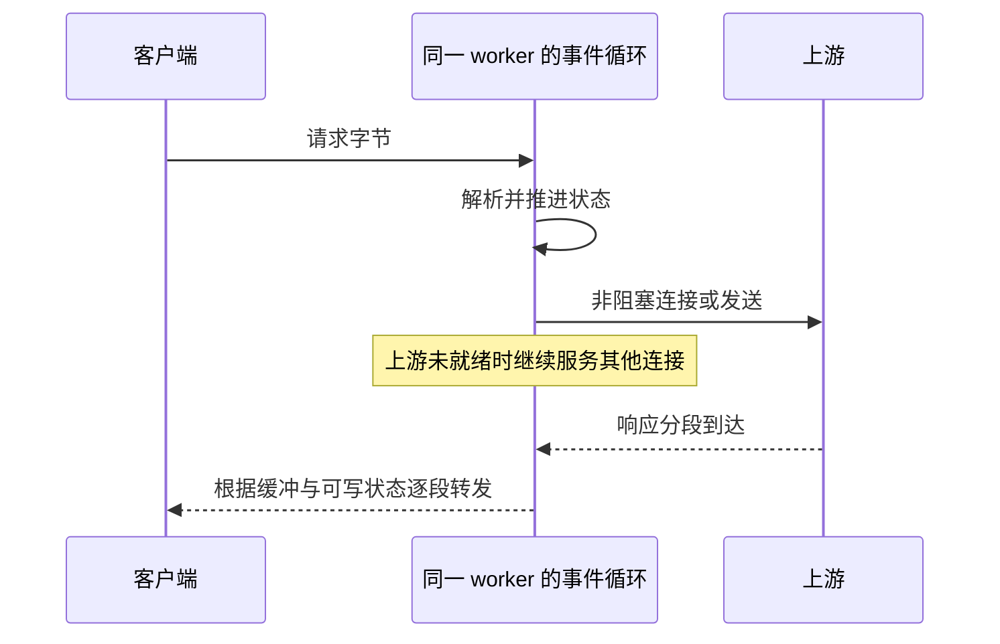
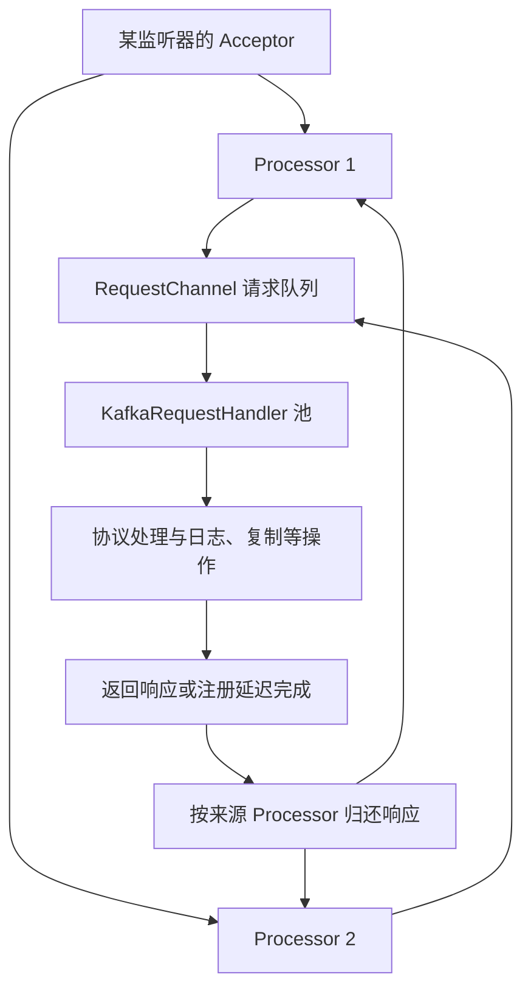
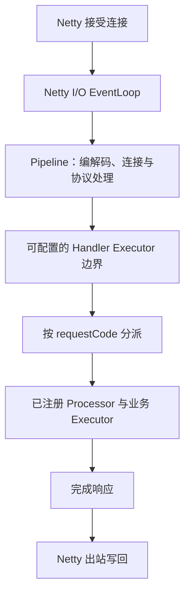
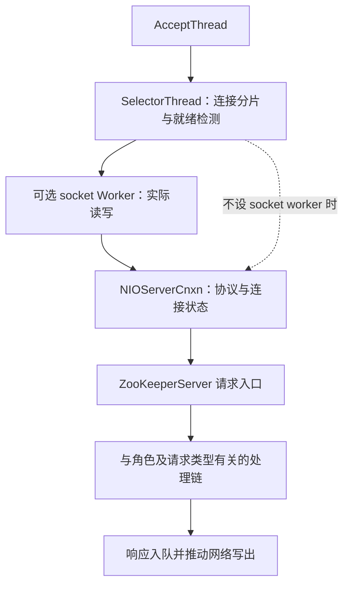
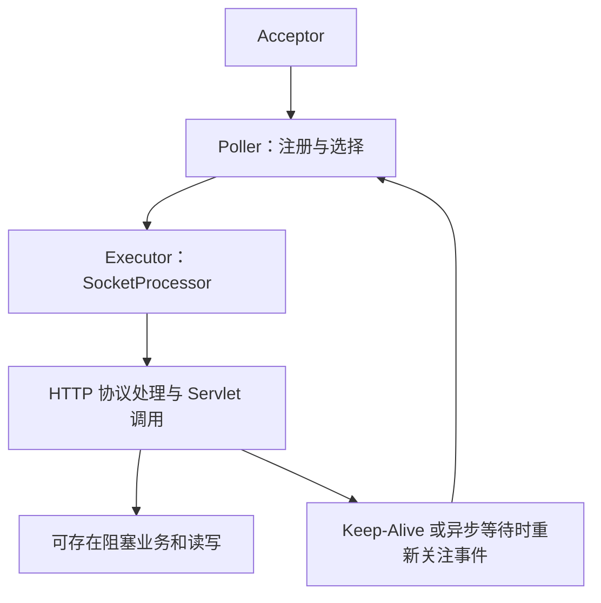

# Reactor 中间件实践：沿请求追踪 Netty、Redis、Nginx 与消息服务

> **阅读目标**：不要只记“某某用了主从 Reactor”。每个项目都回答：谁接连接、谁等事件、谁实际读写、谁执行业务、结果怎样回来、队列满了怎样反向约束。
>
> **版本口径**：核对时间为 2026-11-14。示例固定使用 Netty 4.1 并对照 4.2 API（Application Programming Interface，应用程序接口）、Redis 7.4.0 与 8.0.0、Kafka 4.0.0、RocketMQ 5.3.0、ZooKeeper 3.9.3、Tomcat 10.1.34 源码；这些是解释基线，**不是最新版本或全部分支实现相同的声明**。操作系统、传输实现、扩展模块与配置都可能改变路径。
>
> 先读 [Reactor 原理](Reactor模型原理.md)，再用本文比对真实产品。图是职责与数据流示意，省略认证、超时及部分异常分支，不作为精确堆栈图。

## 阅读路线与总览

| 项目 | 接受与就绪 | 读写与业务关系 | 最关键的纠偏 |
|---|---|---|---|
| Netty | 常见 boss 接受，多个 worker 循环 | handler 默认可在 I/O 循环，亦可指定 executor | worker 不自动等于业务池 |
| Redis 7.4 / 8.0 | 主循环及不同代际的 I/O 线程协作 | 普通命令核心执行仍主要串行 | 多线程 I/O 不等于普通命令任意并行 |
| Nginx | 多个 worker 进程各自事件循环 | 网络状态机在 worker，部分文件任务可卸载 | master 不承担每连接主 Reactor 的职责 |
| Kafka broker | Acceptor 与多个 Processor | 网络与请求处理池隔离 | num.io.threads 不是 socket 循环数 |
| RocketMQ Remoting | Netty 传输 | pipeline executor 与请求处理 executor 可分层 | 不能省掉中间派发层就讲线程数 |
| ZooKeeper NIO | acceptor、selector、socket worker | 读写与请求处理链又是两层 | socket worker 不等于一致性提交线程 |
| Tomcat NIO | Acceptor、Poller、Executor | 就绪检测非阻塞，Servlet 可以阻塞 | NIO Connector 不等于业务完全非阻塞 |
| Reactor Netty / WebFlux | 网络通常由 Netty 管理 | 响应式链如何执行还取决于调度与依赖 | Mono 不会自动迁移阻塞调用 |
| Node.js / libuv | 循环与平台后端 | 网络与文件等任务可能使用不同机制 | 异步 API 不代表全是 epoll |
| MySQL 8.4 默认连接模型 | 默认每连接线程 | 不应强贴成 Netty 式结构 | 并非所有高性能服务都采用同一 Reactor 模型 |

### 按项目直达

- [1. Netty：从 boss/worker 名字走进一条 Channel](#m-01)
- [2. Redis：单线程命令与多线程 I/O 为什么能同时成立](#m-02)
- [3. Nginx：多进程事件循环，master 不是连接分派主 Reactor](#m-03)
- [4. Kafka broker：Processor 管网络，RequestHandler 管请求](#m-04)
- [5. RocketMQ：Netty 之上还有协议派发和请求执行器](#m-05)
- [6. ZooKeeper：socket worker 与一致性处理器不是同一批工作](#m-06)
- [7. Tomcat NIO：Poller 解决空闲连接等待，Servlet 仍可能阻塞](#m-07)
- [8. Reactor Netty 与 WebFlux：把三种 Reactor 名称拆开](#m-08)
- [9. libuv 与 MySQL：两个重要的对照，避免把所有服务塞进一张图](#m-09)
- [10. 统一排障与源码阅读：每个项目都画一份自己的线程地图](#m-10)

<a id="m-01"></a>
## 1. Netty：从 boss/worker 名字走进一条 Channel

### 1.1 连接归属与执行器是两条线

常见 Netty 4.1 服务端示例使用两个 EventLoopGroup：父组处理监听 Channel 的接受事件，子组处理已接受的连接。一个 EventLoop 可管理多条 Channel；同一连接注册后，其传输 I/O 由所属循环推进。[EventLoop 契约](https://netty.io/4.1/api/io/netty/channel/EventLoop.html)、[4.x 官方示例](https://github.com/netty/netty/wiki/User-guide-for-4.x)给出对应关系。



**第一条线是网络归属**：一个 worker 不会为自己每条连接再生一个线程。**第二条线是 handler 的执行位置**：没有额外 executor 时，入站处理通常沿 I/O 线程继续执行；给 pipeline 中某个处理器指定 EventExecutorGroup 后，那个处理器的调度边界可以改变。[ChannelPipeline 文档](https://netty.io/4.1/api/io/netty/channel/ChannelPipeline.html)说明了入站、出站与执行器行为。

### 1.2 一次查询为何可能拖住一批连接

教学场景：worker-1 管理 A、B、C；A 的 handler 直接查 JDBC（Java Database Connectivity，Java 数据库连接接口），等了 200ms。若该调用没有卸载，worker-1 就无法及时调度 B、C。worker-2 空闲也不代表 A 会自动迁过去。

可选方案有三种：业务非常短就留在循环内，减少切换；阻塞依赖放有界执行器，并定义超时与拒绝；使用真正支持异步的客户端，并限制在途请求。不能把 `writeAndFlush` 是异步提交，推导成前面的任意 Java 代码都异步。

### 1.3 顺序、引用计数与写水位

把请求交给普通共享池后，同一 Channel 的请求可能乱序完成。框架维护事件调用的顺序，并不保证自行创建的并发任务按业务顺序完成。应定义是否串行、按序号重排或使用请求 ID。

传递 ByteBuf 时还需要明确谁持有、谁释放；异步期间仍被使用的引用不能提前归还。跨线程写能被转交到网络线程，不意味着任意共享可变缓冲都安全。

Netty 的写缓冲水位反映排队字节，超过高水位可使 `isWritable()` 为 false；它是容量信号，不是替应用自动禁止继续写。应用仍须响应可写性变化，并把压力传给生产者。[写缓冲水位 API](https://netty.io/4.1/api/io/netty/channel/WriteBufferWaterMark.html)。

### 1.4 4.1 与 4.2 不要混用代码名字

4.1 教学常见 `NioEventLoopGroup`。4.2 提供围绕 `MultiThreadIoEventLoopGroup` 与 `IoHandlerFactory` 组织 I/O 处理的 API，因此阅读新旧源码时不能只搜索旧构造方法。底层使用 NIO、epoll、kqueue 等也需要对应传输支持。[4.2 API](https://netty.io/4.2/api/io/netty/channel/MultiThreadIoEventLoopGroup.html)。

这里的稳定理解是：关注连接归属、I/O 调度与 handler 执行器分工；某版默认线程数和具体实现类名属于版本细节，不能当架构定义。

<a id="m-02"></a>
## 2. Redis：单线程命令与多线程 I/O 为什么能同时成立

### 2.1 先拆普通请求的工作

普通命令路径包括 socket 读、协议解析、操作数据结构、生成回复和 socket 写。核心命令在主线程执行，有助于避免普通命令之间共享键空间的复杂并发；网络收发却可能由辅助线程承担。持久化、后台释放等又有其他路径，所以“整个 Redis 只有一线程”不成立。

[Redis 延迟文档](https://redis.io/docs/latest/management/optimization/latency/)解释串行执行和慢命令影响。模块、后台作业和特殊命令不可不加区分地归入普通命令模型。

### 2.2 6.x / 7.4：批量 I/O 协作，不要画成普通业务池

Redis 6 引入的 I/O 多线程路径延续到 7.x，是否启用以及是否参与读侧，要看配置与负载条件。以 7.4.0 为基线，网络代码中有待处理读写列表、线程工作分配与同步协调；核心命令执行仍回到主线程。[7.4.0 networking.c](https://github.com/redis/redis/blob/7.4.0/src/networking.c)。



**读图**：这是职责概括，不表示每个客户端每轮都走所有线程。它区别于“任意连接交给一个 worker，worker 自己长期执行全部业务”的模型。

### 2.3 8.0：I/O 线程实现发生了重要变化

8.0.0 的 `iothread.c` 中，I/O 线程具备各自事件循环与客户端交接逻辑；代码显式处理连接归属、向主线程转交、暂停与恢复，以及必须留在主线程的特殊客户端。不能继续用 7.x 的一张批量协作图解释全部细节。[8.0.0 iothread.c](https://github.com/redis/redis/blob/8.0.0/src/iothread.c)。



[Redis 8 发布说明](https://redis.io/blog/redis-8-ga/)明确介绍了新的 I/O threading 实现。这里的架构结论是**网络处理可扩展，普通命令核心执行仍不是随意多线程并行**；不是“8.0 所有命令都在工作线程里执行”。

### 2.4 从瓶颈推导收益

若大响应和网络解析占主要成本，多线程 I/O 可能有收益；若慢脚本或大集合命令占用主线程，增加 I/O 线程无法直接缩短那段执行。额外协调还有成本，因此“线程越多越快”不成立。

教学排障：请求量不变而尾延迟升高，应分别观察主线程慢命令、网络字节量、回复缓冲、系统调度与持久化干扰。若瓶颈是共享键空间的计算，考虑优化命令、拆分任务或分片，而不是只调整网络线程。

延伸：[Redis 原理中的执行模型](../../3-中间件/3-1-Redis/Redis原理.md#execution)。

<a id="m-03"></a>
## 3. Nginx：多进程事件循环，master 不是连接分派主 Reactor

### 3.1 先分控制面与数据面

master 管理 worker 生命周期、配置重载等；worker 进程实际处理连接。每个 worker 通常以事件循环组织网络工作。多个 worker 如何接受监听连接，受共享监听、accept_mutex、reuseport、平台能力等影响。



Nginx 可根据平台选择 epoll、kqueue 等机制，不能写成所有系统都使用 epoll。[连接处理方式](https://nginx.org/en/docs/events.html)、[核心配置说明](https://nginx.org/en/docs/ngx_core_module.html)分别说明机制与进程相关选项。

### 3.2 一个代理请求实际上关联两段网络状态

收到客户端部分 HTTP（Hypertext Transfer Protocol，超文本传输协议）请求后，worker 推进解析，选择或建立上游连接，发送上游请求，再逐步接收响应并转发。等待上游 socket 时可以服务其他连接，不需要给每个等待单独占一个平台线程。



慢客户端使下游写不动时，worker 必须结合缓冲、临时文件与上游读取控制处理压力；并不是“请求已经到上游，就只能无限存响应”。上游一条连接和下游一条连接都会占资源，所以连接数上限不能简单等价为客户请求数。

### 3.3 文件、TLS 与扩展模块是边界

网络非阻塞不代表所有磁盘访问都非阻塞。Nginx 提供与平台和构建有关的异步文件路径、线程池卸载及 sendfile 等选择；不同选项处理不同操作，不等于整个 worker 自动变成 Proactor。[HTTP 核心模块对 aio 与相关文件路径的说明](https://nginx.org/en/docs/http/ngx_http_core_module.html#aio)。

教学判断：若自定义模块在回调里执行耗时计算或阻塞调用，会占用该 worker 的事件循环。提高 worker 数可能分散负载，却不修复每个请求的阻塞设计，也不是无限扩容手段。

<a id="m-04"></a>
## 4. Kafka broker：Processor 管网络，RequestHandler 管请求

### 4.1 把三个角色从源码名中拆开

Kafka 4.0.0 的 broker 数据面网络入口中，Acceptor 接受连接，将连接交给 Processor；Processor 使用 Selector 管理网络，完整请求进入 RequestChannel，再由请求处理线程处理。响应需交回相应 Processor 完成网络发送。[SocketServer 源码](https://raw.githubusercontent.com/apache/kafka/4.0.0/core/src/main/scala/kafka/network/SocketServer.scala)。



**这是 broker 客户端请求路径的概括**，不是把 controller、broker 间复制、客户端网络线程都算进一张图。每个 listener 的网络线程组织也需要结合版本与角色核对。

### 4.2 配置名字为什么容易误导

`num.network.threads` 关注网络收发线程；`num.io.threads` 关联请求处理线程池，不能因为名字中有 I/O 就把后者理解成 socket read/write 的循环。`KafkaRequestHandler` 从请求通道获取工作，并支持相应异步回调调度。[请求处理器源码](https://raw.githubusercontent.com/apache/kafka/4.0.0/core/src/main/scala/kafka/server/KafkaRequestHandler.scala)。

若请求需要等待复制确认或满足 Fetch 条件，可以采用延迟完成机制，而不是让某个请求线程永远睡着。**事件循环解决网络等待，延迟操作机制解决业务条件等待，是两层解耦。**具体 API 与请求类型的路径并不完全相同。

### 4.3 请求为什么还要 mute、限额和排队

Processor 不应无限向业务侧塞请求。连接静默/恢复、请求内存池、队列与配额控制共同约束在途工作；其中 mute 也有协议顺序和节流等用途，不能全归因为“业务池满”。

教学场景：网络线程比较空闲，但 RequestQueueTimeMs 增长，应该调查请求处理容量、存储、复制与排队，而不是先加 Processor。反过来，大量小请求解析或 TLS 成本使网络线程繁忙，单加请求处理池未必有效。

[Kafka 4.0 监控说明](https://kafka.apache.org/40/operations/monitoring/)区分请求队列、处理、远端等待、响应排队与发送时间，也提供网络/请求线程空闲比例。应结合分阶段时间判断，不能只看 TotalTimeMs 后给出线程数建议。

### 4.4 把一次 Produce 的等待拆开看

以需要副本确认的普通生产请求为例，可以这样检查时间线：

| 阶段 | 发生什么 | 若慢了，先检查什么 |
|---|---|---|
| 网络接收 | Processor 接收完整请求并交到请求通道 | 网络循环、TLS、请求大小与内存预算 |
| 请求排队 | 等处理线程取得请求 | 请求处理池、请求量和排队时间 |
| 本地处理 | 校验请求并执行相应日志操作 | 分区负载、存储路径与锁/调度 |
| 条件等待 | 需要时等待副本确认等条件 | 副本追赶、确认策略与超时 |
| 响应排队及发送 | 完成结果回到网络侧，写给客户端 | 来源 Processor、客户端读速与发送缓冲 |

这是一条用于理解阶段的典型业务路径，不保证每个请求都包含全部阶段。**确认条件尚未满足，不等于网络线程一直等在那里；响应对象已生成，也不等于客户端已经收到。**理解这一点，才能把 Reactor 的网络等待与 Kafka 的可靠性确认连起来。

### 4.5 3.x 与 4.x 的边界

3.x 到 4.x 的重大集群元数据演进不能直接当成“网络 Reactor 全换了”。本文固定 4.0.0 网络源码描述核心分工；迁移时仍需核对具体发行版、监听器角色与实现改动。学习 Reactor 时把控制面协议与网络线程模型分开。

延伸：[Kafka 原理](../../3-中间件/3-6-MQ/Kafka原理.md)。

<a id="m-05"></a>
## 5. RocketMQ：Netty 之上还有协议派发和请求执行器

### 5.1 先限定入口：这里讲传统 Remoting

本文以 RocketMQ 5.3.0 的 Netty Remoting 入口为例。5.x 的 Proxy、gRPC（gRPC Remote Procedure Calls，gRPC 远程过程调用框架）等入口有各自路径，不能把所有接入都套成同一个线程图。

`NettyRemotingServer` 构建网络服务与 pipeline，并使用相应事件执行器安排 handler；`NettyRemotingAbstract` 按请求类型查找 processor 与 executor，提交处理任务。[服务端源码](https://github.com/apache/rocketmq/blob/rocketmq-all-5.3.0/remoting/src/main/java/org/apache/rocketmq/remoting/netty/NettyRemotingServer.java)、[派发源码](https://github.com/apache/rocketmq/blob/rocketmq-all-5.3.0/remoting/src/main/java/org/apache/rocketmq/remoting/netty/NettyRemotingAbstract.java)。



图中 pipeline 的具体 handler 在哪个 executor，须逐个检查注册方式；不能看见 `defaultEventExecutorGroup` 就断言所有编码、TLS 与业务一定在同一层线程执行。

### 5.2 多一层 executor 解决什么，又增加什么

它可以把协议处理与网络循环、不同业务类型相互隔离。但从网络收到字节，到任务真正执行之间会有多个排队点。某个发送请求 executor 满载，不一定意味着 Netty worker 满载；线程数相同也不说明吞吐能力相同。

教学推导：生产者发送超时，应分别看接入、解码、派发、业务排队、存储及复制确认、响应发送。直接翻倍 Netty 线程可能只加快把工作送入已经拥堵的业务池。

拒绝处理、忙响应、超时与关闭后的迟到回调同样属于设计。业务请求执行器满了时，应按实际协议处理，不要把耗时存储逻辑回退到网络循环里。

### 5.3 长轮询不是让一个线程一直睡

长轮询思想是保留待满足的请求状态，在新数据或超时满足后再触发响应，减少无效查询；它与 Netty 收发线程模型相配合，但不是因为用了 Reactor 就自动具备。保留的等待请求仍占元数据与连接资源，必须有限额和清理路径。此处说明机制边界，不把所有 RocketMQ 拉取模式当成同一个实现。

<a id="m-06"></a>
## 6. ZooKeeper：socket worker 与一致性处理器不是同一批工作

### 6.1 NIO 工厂比“三类线程”的口号更具体

ZooKeeper 3.9.3 的 `NIOServerCnxnFactory` 使用接受线程、一个或多个 selector 线程、可配置的 socket I/O worker，以及连接过期处理。worker 为 0 时，selector 可直接做读写；否则读写可交由 worker 执行。[固定版本源码](https://github.com/apache/zookeeper/blob/release-3.9.3/zookeeper-server/src/main/java/org/apache/zookeeper/server/NIOServerCnxnFactory.java)在类说明及实现中展示了分工。



这里不能直接说“所有 selector 都亲自 read”，也不能说“socket worker 就负责全部数据提交”。事件通知到实际读写之间也可能跨线程，必须有关注事件、任务所有权与完成后的恢复协调。

### 6.2 同一个写请求为什么还有另一套链

网络层接收完整请求后，权限、预处理、事务记录、复制确认、应用状态与响应属于服务端处理链。读请求与写请求、leader 与 follower 的路径不同。网络 I/O 并行不代表写入事务能绕过顺序与一致性要求。

教学排障：如果网络层很空闲，但请求处理链被日志落盘或 quorum 条件拖住，增加 selector 线程不会消除确认等待。反之，连接量与网络事件很多时，扩展网络处理能力才可能有意义。

### 6.3 NIO 与 Netty 工厂不是同一配置

ZooKeeper 还提供 `NettyServerCnxnFactory` 等路径，选择不同工厂会改变网络组织。源码阅读和故障分析必须先确认当前使用哪一种，不能拿 NIO 工厂的默认线程公式解释 Netty 工厂。

延伸：[ZooKeeper 原理](../../3-中间件/3-2-Zookeeper/ZooKeeper原理.md)。

<a id="m-07"></a>
## 7. Tomcat NIO：Poller 解决空闲连接等待，Servlet 仍可能阻塞

### 7.1 接受、检测、执行分三层

以 Tomcat 10.1.34 的 `NioEndpoint` 为参考，Acceptor 接受连接，Poller 管理就绪检测与相关注册，socket 事件交给执行器驱动协议和应用处理。部分后续读写由正在运行的处理器推进，不要画成“Poller 先读完整个 HTTP 请求，再交给 Servlet”。[NioEndpoint 源码](https://raw.githubusercontent.com/apache/tomcat/10.1.34/java/org/apache/tomcat/util/net/NioEndpoint.java)。



NIO 的重要收益是空闲 keep-alive 连接不必始终占一条请求执行线程。但进入同步 Servlet 后，数据库查询或远程调用可以占住执行线程。**非阻塞连接管理与阻塞业务代码可以同时存在。**

### 7.2 配置的限制对象不同

`maxConnections`、`acceptCount`、`maxThreads` 等分别涉及连接接纳、监听积压与请求执行容量；若使用共享 Executor，部分 Connector 线程设置不按独立池方式生效。不能只看配置文本出现一个数字就认定运行中有对应线程数。[10.1 Connector 文档](https://tomcat.apache.org/tomcat-10.1-doc/config/http.html)。

教学场景：一万条大部分空闲的 keep-alive 连接，与一千条同时执行 2 秒 SQL 的请求，是不同问题。前者主要考连接资源和事件检测，后者考执行器、下游容量与排队。

### 7.3 Servlet 异步与全链路非阻塞并不等价

异步请求可以释放原请求线程，稍后再完成；若后台另开线程同步等待 SQL，只是改变等待位置。非阻塞读写 API、异步请求生命周期和业务依赖是否非阻塞，需要分别分析。

因此不能用“Tomcat 是 BIO、Netty 才是 NIO”解释现代服务端，也不能因为使用 Tomcat NIO 就认为所有业务与 WebFlux 具有相同执行模型。

<a id="m-08"></a>
## 8. Reactor Netty 与 WebFlux：把三种 Reactor 名称拆开

### 8.1 分清模式、库和运行时

| 名称 | 层次 | 核心责任 |
|---|---|---|
| Reactor 模式 | 架构模式 | 就绪事件与处理器分派 |
| Project Reactor / Reactor Core | 响应式编程库 | Mono、Flux、信号与调度组合 |
| Reactor Netty | 网络运行时适配 | 在 Netty 上提供相关客户端/服务端接口 |
| Spring WebFlux | Web 框架 | Web 请求处理、编程模型与适配 |

WebFlux 可以运行在不同非阻塞服务器上，不能把它的名字等价为“固定使用 Netty”。[Spring 官方概述](https://docs.spring.io/spring-framework/reference/web/webflux/new-framework.html)解释非阻塞与背压的设计动机及运行时选择。

### 8.2 最常见的错误：包装并不代表迁移线程

```java
// 示意：调用发生在构造 Mono 之前，不能保护 I/O 事件循环
Mono.just(blockingQuery());

// 延迟执行，并指定适合阻塞任务的调度器
Mono.fromCallable(() -> blockingQuery())
    .subscribeOn(Schedulers.boundedElastic());
```

第二段只是把阻塞等待放到指定调度器，不会把 JDBC 改造成异步驱动，也不会自动把数据库连接数限制到合理值。还需要请求截止时间、并发限额、队列与取消策略。[Reactor 官方参考中的阻塞包装模式](https://projectreactor.io/docs/core/3.6.17/reference/#faq.wrap-blocking)给出该使用思路；具体调度器容量应按使用版本核对。

`subscribeOn` 与 `publishOn` 改变的执行边界不同；不能机械地在链尾加任意调度操作就保证前面的阻塞源被隔离。应检查订阅、源执行、信号传递与网络写出的实际线程。

### 8.3 响应式需求与 socket 背压不是同一个开关

上游流的请求数量、算子的预取、待执行任务、Netty 出站缓冲和 TCP 发送窗口是不同层容量。`request(n)` 不能自动证明堆外缓冲有限，TCP 窗口也不能撤销已产生的业务响应。

教学判断：全链路是否“非阻塞且有界”，要逐段检查客户端、驱动、调度器和缓冲。只要关键路径上还有未隔离的同步阻塞，少量网络循环就可能一起被拖慢。

<a id="m-09"></a>
## 9. libuv 与 MySQL：两个重要的对照，避免把所有服务塞进一张图

### 9.1 libuv：同一异步接口下面可能有不同机制

libuv 的设计文档区分事件循环、平台 I/O 后端和线程池工作。网络在不同系统上可能使用 epoll、kqueue 或 IOCP 等机制，文件操作等可能通过线程池执行。Node.js 使用 libuv，但还包括 JavaScript 运行时调度，不能把它全部缩成一个循环函数。[libuv 设计说明](https://docs.libuv.org/en/v1.x/design.html)。

教学推导：调用者不等待，不代表没有任何线程等待；网络非阻塞与文件系统调用被卸载可以在同一进程共存。JavaScript 主线程长时间执行 CPU 计算，也不会被“异步网络”自动抢走成多个并行任务。

### 9.2 MySQL 8.4：默认每连接线程是需要知道的反例

MySQL 8.4 文档中，`thread_handling` 的默认值是 `one-thread-per-connection`；企业线程池等不同路径不可混为默认行为。[系统变量说明](https://dev.mysql.com/doc/refman/8.4/en/server-system-variables.html#sysvar_thread_handling)、[企业线程池说明](https://dev.mysql.com/doc/refman/8.4/en/thread-pool.html)。

这不意味着 MySQL “不会高并发”，而是其连接与 SQL 执行模型、事务、锁与存储开销需要独立分析。应用连接池复用数据库连接，和数据库服务端是否采用线程池也不是同一件事。

**反例的意义**：选型应比较工作负载、语义、实现与资源；不能反过来认为“性能好的中间件必定是多 Reactor”。

<a id="m-10"></a>
## 10. 统一排障与源码阅读：每个项目都画一份自己的线程地图

### 10.1 先按症状找阶段

| 现象 | Netty / WebFlux | Redis | Kafka | Nginx / Tomcat |
|---|---|---|---|---|
| 网络循环延迟 | 阻塞 handler、长解码或 TLS | 网络线程与主循环分别看 | Processor 占用与网络事件 | worker / Poller 和执行器分别看 |
| 业务排队 | 自定义 executor 或调度器 | 主线程待执行命令与慢命令 | 请求处理队列与复制等待 | 上游等待或 Servlet 线程池 |
| 出站积压 | pending bytes、可写水位 | 客户端输出缓冲 | 响应排队及发送时间 | 下游慢读、缓冲与上游控制 |
| 资源持续上涨 | 在途任务、引用计数与队列 | 大回复与客户端分布 | 内存池、排队请求与负载 | 连接数、缓冲及临时文件 |

这些是排查起点，不是仅凭一项指标就定位的结论。线程栈中看到 select 或 epoll_wait 本身通常说明在等待事件，不足以判定卡死；要结合是否有工作应被及时处理。

### 10.2 按七个动作走读源码

1. 找监听 socket 与 accept 调用，确认监听器数量和接受线程。
2. 找注册与选择调用，确认连接归属、重新关注和唤醒路径。
3. 找实际 read/write，不要用 Selector 的线程名猜执行位置。
4. 找解码边界及累计缓冲，确认大帧与半帧的资源限制。
5. 找请求入队与 executor，记录谁可能阻塞、怎样拒绝。
6. 找结果入队及写回，检查顺序、引用生命周期和关闭后回调。
7. 找限流、mute、暂停读和水位，检查压力能否传到上游。

### 10.3 源码入口清单：从名字进入实际调用

| 项目与版本 | 先读的入口 | 接着验证的动作 |
|---|---|---|
| Netty 4.1 | ServerBootstrap、EventLoop、ChannelPipeline | 父子组注册关系、Handler executor、跨线程写与缓冲 |
| Redis 7.4.0 | networking.c | pending 读写、I/O 线程协作和主线程命令执行 |
| Redis 8.0.0 | iothread.c | 独立循环、客户端归属与主线程交接 |
| Kafka 4.0.0 | SocketServer、KafkaRequestHandler | Processor 的 sendRequest、连接 mute、处理器 receiveRequest 与响应归还 |
| RocketMQ 5.3.0 | NettyRemotingServer、NettyRemotingAbstract | pipeline 的 executor 参数、requestCode 的 processor/executor 注册 |
| ZooKeeper 3.9.3 | NIOServerCnxnFactory | selector 与 worker 的读写所有权、关注事件恢复 |
| Tomcat 10.1.34 | NioEndpoint | Poller 检测、processSocket 派发、协议处理及重新注册 |

这些入口对应各节链接的基线版本。用线程名做线索，再回到具体调用与队列；不要把类名里的 Processor 或 Worker 当统一语义。

### 10.4 同一问题在各产品中的不同答案

**“增加线程为何没变快？”** Redis 可能卡在普通命令执行；Kafka 可能卡在复制或磁盘；Netty 可能卡在单个热连接或下游；Tomcat 可能卡在数据库连接池；Nginx 可能卡在上游服务。只有确定了瓶颈阶段，线程数调整才有因果依据。

本文的产品事实来自各节固定版本源码和官方文档，故障场景是用于理解架构的推演，未声称已在本机运行这些中间件或测得性能数字。

## 附录：术语与缩写

| 术语 | 英文全称 | 中文与区别 |
|---|---|---|
| I/O | Input/Output | 输入/输出 |
| NIO | New I/O | Java 新输入/输出 |
| API | Application Programming Interface | 应用程序接口 |
| CPU | Central Processing Unit | 中央处理器 |
| FD | File Descriptor | 文件描述符 |
| TLS | Transport Layer Security | 传输层安全 |
| HTTP | Hypertext Transfer Protocol | 超文本传输协议 |
| JDBC | Java Database Connectivity | Java 数据库连接接口 |
| TCP | Transmission Control Protocol | 传输控制协议 |
| IOCP | I/O Completion Port | 输入/输出完成端口 |
| gRPC | gRPC Remote Procedure Calls | gRPC 远程调用框架，递归命名 |
| EventLoop | Event Loop | 网络、任务和计时调度循环 |
| Executor | Executor | 任务执行器，不必然负责网络 |
| Processor | Processor | 项目内具体处理角色，须看实际动作 |
| Pipeline | Channel Pipeline | Channel 的入站出站处理链，不是 Redis 流水线批量请求 |
| RESP | Redis Serialization Protocol | Redis 序列化协议 |
| Keep-Alive | Persistent Connection | 连接复用；不等于 TCP 保活探测 |
| Request ID | Request Identifier | 请求标识，可用于响应关联 |
| Quorum | Quorum | 按协议定义的法定集合/确认条件 |
