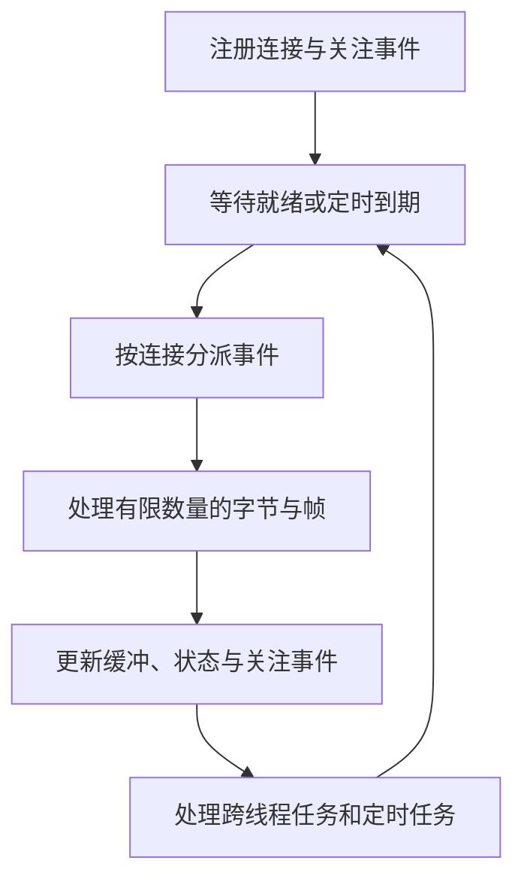
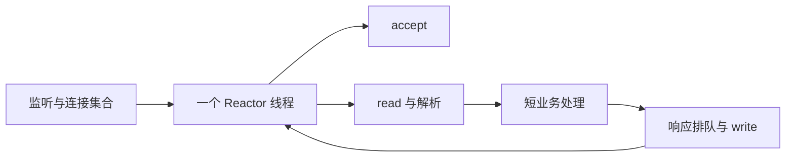
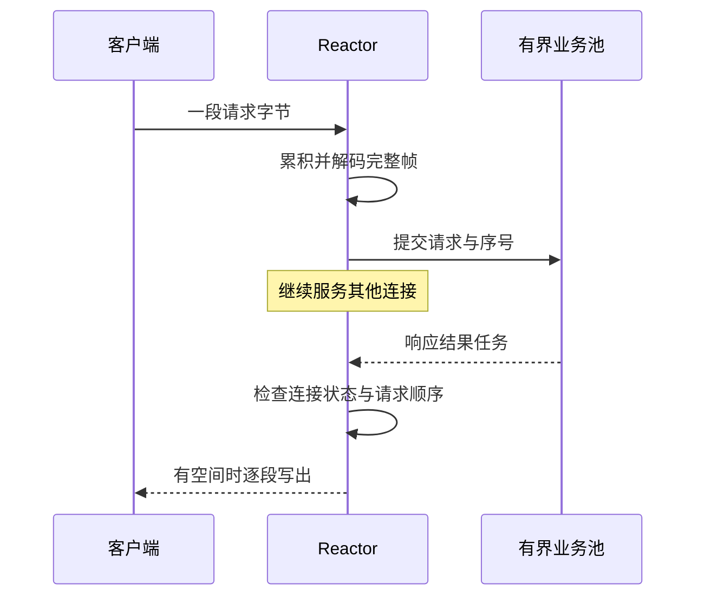
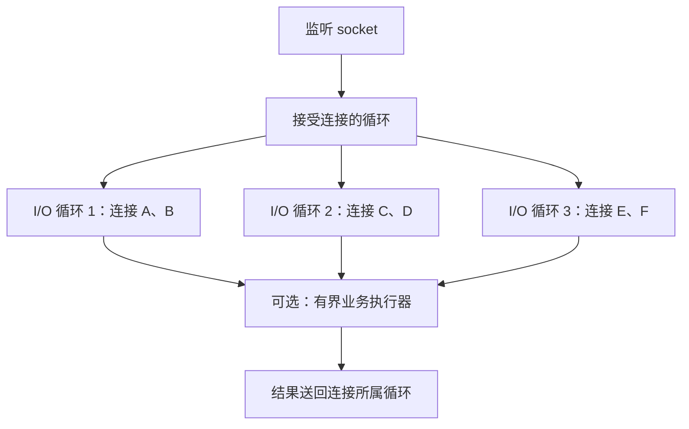
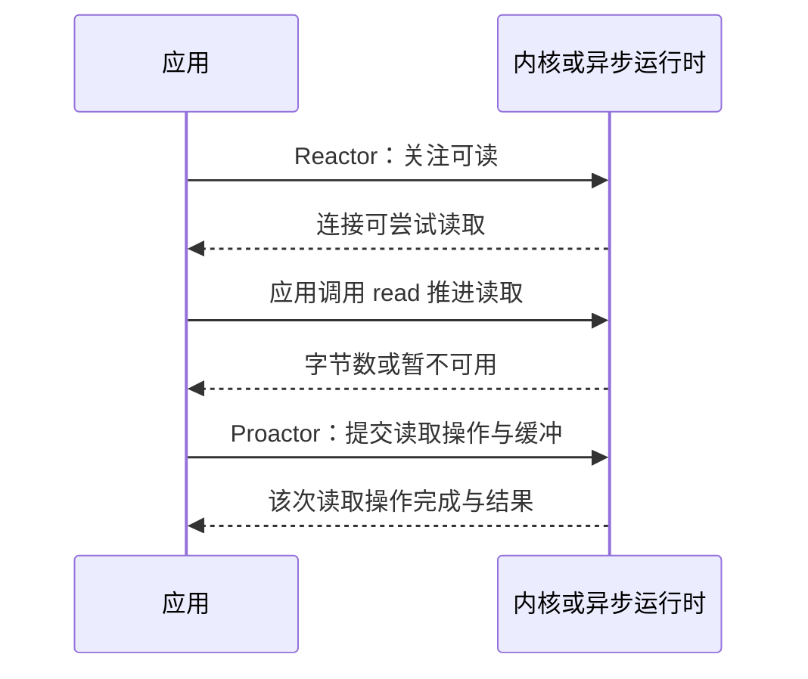
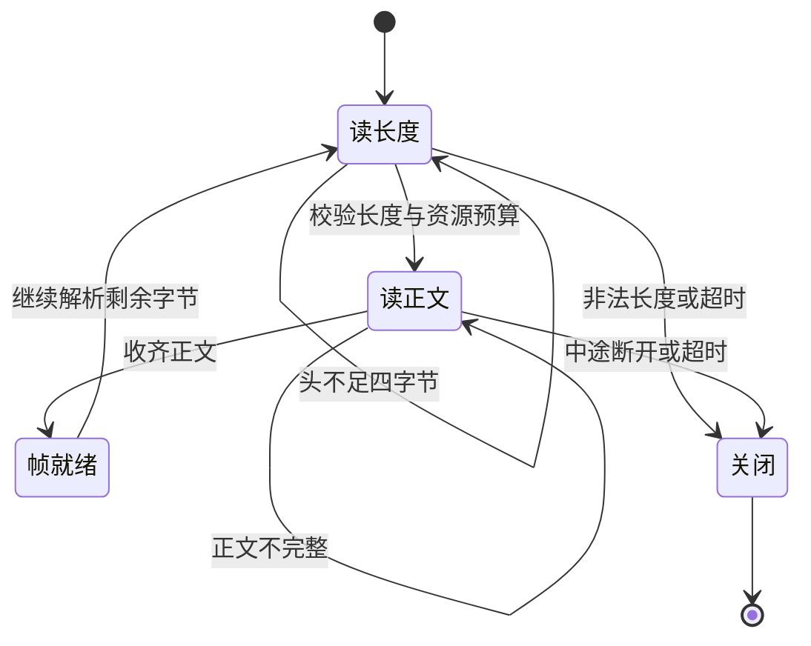
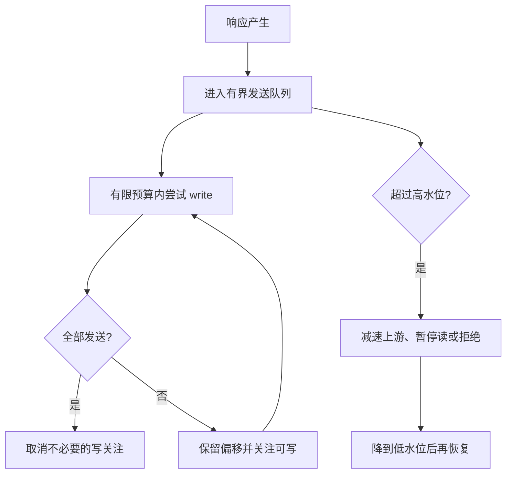

# Reactor 模型原理：从等待连接到事件循环、线程分工与背压

> **主线**：先看一次请求在哪些地方等待，再逐步比较一连接一线程、忙轮询、多路复用、Reactor、Proactor。最后回答：线程少了以后，协议状态、顺序、内存和过载由谁负责？
>
> **一句话结论**：Reactor 是一种围绕**事件就绪通知、事件分派和处理器**组织程序的架构。它让少量事件循环管理许多连接，但并不会把耗时工作自动变快，也不会让同步数据库访问自动变成非阻塞。
>
> 配套：[中间件实践](Reactor中间件实践.md) · [面试与推演](Reactor模型面试.md)。已有 [Java I/O 原理](../../1-编程语言/1-1-java/1-1-13-IO/IO原理.md)讲接口与缓冲，本专题聚焦架构与请求流转。缩写随文展开，文末集中查阅。

## 阅读路线

| 阶段 | 章节 | 要能解释什么 |
|---|---|---|
| 先建立坐标 | 1–3 | 等待什么、就绪是什么、Reactor 的组成 |
| 比较线程模型 | 4–7 | 为什么演进，瓶颈移到了哪里 |
| 落到操作系统 | 8–9 | select/poll/epoll、触发方式、就绪与完成 |
| 做对一个连接 | 10–12 | 半包、写不完、跨线程、顺序与背压 |
| 理解性能边界 | 13–15 | 公平性、定位、虚拟线程与模型选型 |
| 串起全过程 | 16 | 用具体字节与线程交错验证设计 |

### 章节直达

- [1. 为什么会需要 Reactor：问题首先是等待，而不是线程数量](#p-01)
- [2. 先区分四组概念：非阻塞、多路复用、异步与事件驱动](#p-02)
- [3. Reactor 的组成：事件循环不是一个只会 select 的 while](#p-03)
- [4. 单 Reactor 单线程：先把所有连接都收进一个循环](#p-04)
- [5. 单 Reactor 加工作线程池：把慢业务移走，也把问题变成交接](#p-05)
- [6. 多 Reactor：拆分连接接受与已建立连接的 I/O](#p-06)
- [7. 横向对比：到底是谁检测、谁读取、谁执行业务](#p-07)
- [8. select、poll、epoll：内核机制怎样支持大量连接](#p-08)
- [9. LT、ET 与 Proactor：两组不同层面的对比](#p-09)
- [10. 连接状态机：为什么半包不是重试一次 read 就好](#p-10)
- [11. 写侧状态机与背压：最容易遗漏的半条链路](#p-11)
- [12. 跨线程提交、唤醒与顺序：把所有权规则写出来](#p-12)
- [13. 性能推导：事件循环能省什么，不能省什么](#p-13)
- [14. 公平性、定时与故障诊断：为什么心跳也会误判](#p-14)
- [15. 虚拟线程、响应式与 Reactor：名字相似也不是同一层](#p-15)
- [16. 完整推演：一个请求怎样穿过事件、业务与发送](#p-16)

<a id="p-01"></a>
## 1. 为什么会需要 Reactor：问题首先是等待，而不是线程数量

假设有一万条 TCP（Transmission Control Protocol，传输控制协议）连接，其中大多数客户几秒钟才发一次请求。若为每条连接分配一个平台线程，许多线程只是等待 socket 变为可读；栈、调度对象、连接缓冲仍占资源。

但不能据此得出“一万线程必然崩溃”。平台、栈大小、负载和运行时都会影响结果；真正要比较的是：**如何表达大量等待，唤醒后由谁处理，有多少真实计算。**

一次请求可以拆为：


**读图**：等待字节与执行 CPU（Central Processing Unit，中央处理器）计算不是同一件事。Reactor 主要优化大量连接的等待与调度表达；若每次请求都要做昂贵压缩、同步 SQL（Structured Query Language，结构化查询语言）查询，瓶颈不会凭空消失。

| 方案 | 怎样等数据 | 长处 | 代价 |
|---|---|---|---|
| 一连接一平台线程 | 各自阻塞读 | 控制流直观，线程间故障相对隔离 | 大量空闲连接也有线程资源成本 |
| 非阻塞 socket 逐个循环检查 | 不断尝试 read | 接口简单，单次不等待 | 大量无效检查，容易耗 CPU |
| 多路复用 | 等一组连接的就绪事件 | 能批量表达大量等待 | 仍需组织分派、缓冲和业务 |
| Reactor | 多路复用加事件循环与处理器 | 把等待与连接状态组织成可扩展结构 | 状态机、阻塞隔离和背压责任增加 |

**演进的收益不是“永远不阻塞”**：事件循环可以在没有任务时睡在等待就绪的系统调用里。它应避免的是卡在某一条连接的无数据读，或卡在某个耗时业务里而不能服务其他连接。

<a id="p-02"></a>
## 2. 先区分四组概念：非阻塞、多路复用、异步与事件驱动

I/O（Input/Output，输入/输出）至少有四个独立维度：

| 概念 | 问的是什么 | 例子 |
|---|---|---|
| 阻塞/非阻塞 | 当前调用在不能立即推进时是否等待 | 阻塞 read；非阻塞 read 返回暂不可用 |
| 就绪/完成通知 | 被通知的是“可以尝试”，还是“某次操作已结束” | epoll 就绪；异步读取完成回调 |
| 并发/并行 | 是否同时管理多件事；是否同时在多核执行 | 单线程管理多连接也可并发 |
| 事件驱动 | 控制流是否围绕事件分派组织 | 可读事件调用连接处理器 |

**可读不等于收到一条完整请求**：缓冲里可能只有半个长度头，也可能一次读出三条请求；还可能读到流结束。可写通常表示可以尝试把一些字节交给内核，不代表本次大响应一定能写完，更不代表对端应用已处理。

Java 非阻塞 `SocketChannel.read` 返回正数表示读到字节，0 表示这次没有推进，-1 表示到达流结束；写调用可能只写部分甚至返回 0。C 的非阻塞 socket 常用 EAGAIN/EWOULDBLOCK 表达暂不能推进。不要把不同语言的返回约定直接混写。

**异步 API 不足以判定底层模型**：库可能通过就绪循环加状态机，也可能通过工作线程模拟异步完成。看到回调或 Future，不能直接认定底层采用操作系统完成型 I/O。

<a id="p-03"></a>
## 3. Reactor 的组成：事件循环不是一个只会 select 的 while

经典角色包括：资源句柄、事件多路分离器、事件分派器、具体处理器。Reactor 可以把某些角色合在同一个对象或线程中。

| 角色 | 做什么 | Java NIO 中的近似映射 |
|---|---|---|
| Handle 资源句柄 | 标识监听或已连接资源 | ServerSocketChannel / SocketChannel |
| Demultiplexer 事件多路分离器 | 等待并返回就绪集合 | Selector |
| Dispatcher 分派器 | 按类型和连接选择处理器 | 对 SelectionKey 分派 |
| Handler 处理器 | 推进接受、读、写、协议状态 | Acceptor / Connection 回调 |
| Event Loop 事件循环 | 循环调度事件、任务与计时 | 持有 Selector 的线程 |



真实事件循环还要处理：新连接注册、跨线程任务、超时、关闭、缓冲回收、公平性和退出。只写 `select → read → callback`，尚不足以形成可用的服务端。

**Selector 是机制，Reactor 是组织方式。** 使用 epoll 不保证所有业务采用同一种线程模型；一个进程也可能有多个事件循环、阻塞工作池与异步存储组件。Java NIO（New I/O，新输入/输出库）中的 Selector 是就绪选择接口，具体提供者与操作系统实现相关。[接口契约](https://docs.oracle.com/en/java/javase/21/docs/api/java.base/java/nio/channels/Selector.html)定义了键集合、选择与唤醒行为。

<a id="p-04"></a>
## 4. 单 Reactor 单线程：先把所有连接都收进一个循环

同一线程负责 accept、read、协议解析、业务、write。这里 accept 指从监听 socket 接受一个已经建立或可接受的连接，不是应用自己执行整个 TCP 握手。



这条路径的好处是：连接和应用状态可以由同一线程顺序访问，减少锁和跨线程交接，局部性也可能更好。它适合短处理、少等待、状态共享很强的工作负载。

**问题是执行权被独占。** A 客户的处理器做了 80ms 同步查询，这 80ms 里 B 客户的读事件、C 客户的写事件和心跳计时都无法在该循环及时执行。其他连接即使已有数据，也不是“不就绪”，而是没有线程回到分派点。

不要把“单线程”理解成整个产品只有一个线程：后台持久化、内存回收、复制辅助等可以另有线程或进程。应明确是在讨论**网络收发、普通命令执行，还是整个进程**。

粗略容量例：每次请求占用该线程 20 微秒纯执行时间，忽略其他成本，理论计算上限约为每秒 5 万次；若一次请求偶尔占 50ms，会直接挤占其他任务的调度机会。该算例不是产品基准。

<a id="p-05"></a>
## 5. 单 Reactor 加工作线程池：把慢业务移走，也把问题变成交接

事件循环管理网络和连接，完整请求被交给工作池，工作池完成业务后把响应任务交回事件循环。教材常称“单 Reactor 多线程”，但不同资料可能把解码也放进工作线程，所以必须画清边界。



优势是网络循环不必等待耗时业务。但事件检测、读取与解码仍集中于一个线程，网络本身很忙时会成为瓶颈；新增线程也带来队列、上下文切换、内存可见性与生命周期管理。

**线程池满时怎么办，必须提前定义。** 如果使用 CallerRunsPolicy 把慢任务退回提交者执行，提交者恰好是 Reactor，就会把阻塞重新带回来。可选手段是拒绝、限流、暂停读取或按协议快速返回过载；不是无限加队列。

如果同一连接请求 A、B 并发执行，B 可能先完成。TCP 只保证实际发送字节有序，不会替应用把 B 排回 A 后面。应按协议选择串行执行、序号重排，或通过请求 ID 允许乱序响应。

<a id="p-06"></a>
## 6. 多 Reactor：拆分连接接受与已建立连接的 I/O

常见结构是一个或少数 acceptor 将新连接交给多个 I/O 事件循环，每条连接由一个循环负责。业务可就地做，也可再交给独立工作池。



**主从 Reactor 中的“主从”是网络角色分工，不是数据库主从复制。** 多循环之间一般不是每个请求都重新选择线程：连接归属可以降低对同一缓冲、协议状态和发送队列的竞争。

为什么不能有十个线程都同时读同一连接？字节会被竞争取走，拆帧状态和业务顺序很难维护，还需要同步协调。可通过一次性事件、任务所有权转交等设计共享处理，但那是明确的并发协议，不能靠“线程安全队列”自动获得。

为何加循环仍有热点？按连接数均匀不等于按负载均匀：一个连接可能承载上万请求，其余连接空闲。线程更多不会自动把这条连接的状态机拆开。应结合协议多路复用、业务卸载、连接分散或更细粒度架构判断。

多 Reactor 有两种常见形态：**一个接受者加多个读写循环**，以及**多个工作进程各自拥有事件循环并参与接受连接**。Nginx 更适合用后者解释，不能强行套成 Netty 的 boss/worker 图。

<a id="p-07"></a>
## 7. 横向对比：到底是谁检测、谁读取、谁执行业务

| 结构 | 就绪检测 | socket 读写 | 业务执行 | 主要风险 |
|---|---|---|---|---|
| 单 Reactor 单线程 | 一个循环 | 同一循环 | 同一循环 | 一个慢任务拖住全部连接 |
| 单 Reactor 加业务池 | 一个循环 | 常在该循环，具体实现可变 | 独立池 | 单循环网络瓶颈、交接队列 |
| 接受者加多 I/O 循环 | 多循环分担 | 连接所属循环 | 循环或独立池 | 循环负载不均、业务误阻塞 |
| 多进程事件循环 | 各进程循环 | 各进程处理自己连接 | 本进程或辅助池 | 跨进程状态、连接分配和资源重复 |

**“worker”只是一种命名**：Netty worker 主要是 I/O 循环；Kafka 请求处理池做协议业务；ZooKeeper 的 NIO socket worker 可以负责实际 read/write；Nginx worker 是进程。对比时先问实际动作，再贴模型标签。

一个可靠的源码阅读表应记录：谁调用 accept；谁等待事件；谁调用 read/write；谁修改业务状态；跨线程用什么队列；响应由谁排队；哪里暂停读取；如何处理关闭与超时。后面的 [实践篇](Reactor中间件实践.md)对每个项目都沿这些问题展开。

<a id="p-08"></a>
## 8. select、poll、epoll：内核机制怎样支持大量连接

select 与 poll 允许一次等待一组描述符，Linux 上通常需要提交、检查相应集合；epoll 把关注集合维护在内核中，用控制接口更新，再获取就绪事件。FD（File Descriptor，文件描述符）是内核资源的进程内标识，不能与业务连接 ID 永久等同，因为关闭后号码可能复用。

| 机制 | 关注集合与等待 | 常见适用性与边界 |
|---|---|---|
| select | 传入描述符集合，返回后检查 | 传统 C 接口受 fd_set 等限制，不能把某个常见上限当所有平台保证 |
| poll | 传入描述符数组，检查返回状态 | 不受 fd_set 位图同一限制，但扫描成本仍在 |
| epoll | 注册关注项，再收取就绪项 | Linux 上大量连接且活跃占比较低时常有优势，仍有注册、唤醒与事件处理成本 |
| kqueue | 维护事件过滤器并返回事件 | BSD/macOS 等平台，接口与语义不能直接当 epoll 的别名 |

**不要背“epoll 一切 O(1)”**：实际成本受活跃连接、批量、注册修改、竞争、缓存与应用处理影响。若所有连接都很活跃，应用仍要处理大量事件与字节。

同样，epoll 不等于零拷贝，也不等于数据已读到用户缓冲。事件就绪后应用仍通常调用 read/recv；是否采用 sendfile、内存映射等是另一个路径选择。参见 [Linux epoll 手册](https://man7.org/linux/man-pages/man7/epoll.7.html)。

<a id="p-09"></a>
## 9. LT、ET 与 Proactor：两组不同层面的对比

LT（Level-Triggered，水平触发）与 ET（Edge-Triggered，边缘触发）是在讨论**何时重复通知就绪**。Reactor 与 Proactor 则是在讨论**应用接收就绪还是操作完成**，不能放成四个并列模型。

### 9.1 用“内核里还有 8KB，但只读了 1KB”推导 LT 与 ET

LT 下，只要仍满足可读条件，后续等待可继续报告可读。ET 下，不能依赖未读的旧数据自动产生下一次通知；常见做法是非阻塞读取直到 EAGAIN。若为了公平性提前停止，需要保存可继续处理状态并主动安排后续执行，不能仅回去等新边沿。

| 关注点 | LT | ET |
|---|---|---|
| 状态持续就绪时 | 可以继续通知 | 不应依赖再次收到旧状态通知 |
| 编程难点 | 避免反复空转与无意义关注 | 避免漏推进、正确 drain 与重新武装 |
| 公平性 | 可以分批处理 | 分批必须有可靠继续调度机制 |
| 是否自动更快 | 否 | 否，取决于事件量、批量与实现 |

EPOLLONESHOT 是一次通知后需重新武装的额外选项，不能把它与 ET 当同一个概念。Java Selector 也没有跨平台承诺“直接就是原生 ET 编程接口”。

### 9.2 Reactor 与 Proactor 的差异，放在一次读取中看



Proactor 路径也可能返回短读取、错误或流结束，**一次操作完成仍不等于一条业务请求完整**。完成之后的业务回调照样可以阻塞或造成队列过载。

Windows IOCP（I/O Completion Port，I/O 完成端口）是完成通知的重要机制；Linux io_uring 围绕提交与完成队列提供接口，但具体操作、内核和库的实现路径需要分别核对。不要把“Linux 只有 Reactor，Windows 只有 Proactor”写成平台定律。

<a id="p-10"></a>
## 10. 连接状态机：为什么半包不是重试一次 read 就好

TCP 提供字节流，没有应用消息边界。采用“4 字节大端长度 + 正文”的协议时，一条连接至少保存：长度头已收多少、正文预计多长、正文已收多少、待执行业务、待发送队列与关闭状态。



必须先校验长度与总资源预算，再分配缓冲。否则攻击者只发一个巨大的长度值便可诱导分配；另一个攻击是合法长度但永远不发完，长期占住连接和内存。

处理器应允许一次 read 含多个帧，也允许一个帧横跨多次 read。业务执行器只能收到完整、校验过的消息，除非协议明确支持流式正文并对其生命周期建模。

TLS（Transport Layer Security，传输层安全）还增加加密记录、握手与解密状态，HTTPS 请求不是直接从一个普通 socket read 中“天然完整”出现。压缩、解码和巨大帧都可能消耗 CPU，应限定单次字节量、帧数与累计缓冲。

**同一连接顺序访问不等于全系统无需同步**：连接归属解决的是特定状态所有权，跨连接缓存、全局限流器和共享业务数据仍需自己的并发策略。

<a id="p-11"></a>
## 11. 写侧状态机与背压：最容易遗漏的半条链路

一次非阻塞 write 可能只把响应前一部分放入内核发送缓冲。未写完的部分必须保留位置，等待后续可写事件再继续；不能丢掉、从头重复发送，或 while 循环原地重试到写完。

正确的基本规则：**有待发送字节时尝试写；暂不能推进时关注可写；发送队列清空后取消不必要的可写关注。** 很多 socket 大部分时间可写，永久关注 OP_WRITE 可能造成事件循环不断被唤醒。



高水位与低水位分开是为了避免频繁开关。背压应从慢客户端反向传递到业务生产端，而不仅是“多留一些内存”：停止读取不能撤销已经提交的任务，在途任务还会继续产生响应，因此入站帧、任务数与出站字节都需要预算。

容量算例：若 1 万连接各积压 1MiB，单是内容就接近 9.77GiB，尚未算对象、池化余量、内核缓冲和 TLS 开销。限“1000 个响应”也不足够，因为每个响应大小可能差异很大。

断开与半关闭也须建模：对端关闭发送方向，服务端可能仍有响应要发；业务完成时连接可能早已超时关闭。关闭后应取消关注、清理队列、回收缓冲，并让迟到任务知道结果不再可交付。

<a id="p-12"></a>
## 12. 跨线程提交、唤醒与顺序：把所有权规则写出来

一个实用约定是：只有连接所属事件循环修改该连接的关注事件、解码状态与发送队列；其他线程仅投递任务。该约定减少争用，但不能取消安全发布与队列容量限制。

```text
业务线程：
    生成不再被本线程修改的响应对象
    尝试放入所属循环的有界任务队列
    投递成功后按循环协议唤醒
    投递失败则按协议拒绝并释放自己持有的资源

事件循环：
    处理队列任务（有预算）
    更新关注事件
    若仍有立即可运行任务，不进入无限期等待
    否则等就绪、唤醒或最近超时
    分派有限事件，再处理定时与任务
```

“先入队、后唤醒”用来避免线程先被唤醒却看不到任务；实际实现还要协调正准备睡眠的状态、唤醒合并以及队列可见性。不能只靠一个普通布尔变量自己拼一套唤醒协议。

同一连接 A、B 响应可能按 B、A 完成。若协议规定顺序响应，可在连接循环中按序号缓存重排，或限制该连接只有一个在途请求；代价是重排缓冲或吞吐受限。若协议允许带 ID 的乱序响应，则双方必须都实现对应匹配。

**调用 write 的线程与实际调用底层 socket write 的线程可能不同**。成熟框架可以把跨线程写转交 I/O 循环，但你传入的可变对象、引用计数与业务顺序不会因此自动安全。

<a id="p-13"></a>
## 13. 性能推导：事件循环能省什么，不能省什么

设每秒到达 λ 个请求，每请求占事件循环的平均执行时间为 S。一个循环的粗略利用率为 `ρ ≈ λ × S`，S 必须包含该循环承担的读写、解析、回调和调度开销；不能把业务池里的等待也全算到循环 CPU 上。

平均值还掩盖长尾：一个 100ms 回调可能让许多连接的响应、心跳与定时器一起延后。即使总 CPU 只有 25%，也可能是一颗核对应的循环满载，其余核空闲。

| 瓶颈 | 加什么通常不能直接解决 | 应观察什么 |
|---|---|---|
| 接受连接慢 | 盲目加业务线程 | accept 速率、积压、握手与分配 |
| I/O 循环忙 | 只加请求处理池 | 单循环 CPU、每轮字节、解码和 TLS |
| 下游查询慢 | 只加 Reactor | 连接池等待、超时、在途数、隔离 |
| 客户端不读取 | 只加发送缓冲 | 待发送字节、写停顿、慢连接分布 |
| 线程间交接过多 | 把每个 handler 都异步化 | 队列等待、任务数、切换与缓存局部性 |

Little 定律在稳定边界下给出 `L = λ × W`，其中 W 是该边界里的平均逗留时间。例如每秒 2 万请求、平均在系统停留 50ms，平均约有 1000 请求在途；若每个请求持有 64KiB，主要内容约占 62.5MiB。过载持续增长时不能拿这个稳定关系证明系统能撑住。

**连接数、活跃连接、请求吞吐、带宽和尾延迟要一起比较**。一百万空闲连接与一百万活跃连接不是同一负载，Reactor 的标签不能代替资源账本。

<a id="p-14"></a>
## 14. 公平性、定时与故障诊断：为什么心跳也会误判

一个连接始终有数据时，若每轮无限读、无限解析，其他连接可能饥饿。若任务队列一直非空而总先执行任务，I/O 与计时也可能饥饿。循环需要对字节、帧、任务数或执行时间设置预算，并保存可继续处理的状态。

测量事件循环延迟可以使用周期任务：记下计划执行时间与实际开始时间之差；它反映调度延迟，不等于网络往返延迟。探针自身也受负载影响，必须结合线程栈、CPU 分布与队列观察。

| 现象 | 优先验证的因果链 | 不能直接下的结论 |
|---|---|---|
| CPU 低但超时多 | 同步阻塞、锁等待、下游耗时、队列积压 | 一定缺 CPU |
| 单个循环 CPU 高 | 热连接、长回调、错误写关注、忙等 | 一定是 epoll bug |
| 网络可达却心跳超时 | 心跳回调是否被长任务延后 | 对端进程一定已死 |
| 吞吐没涨而线程数暴增 | 排队是否被挪到工作池 | 多线程方案已成功扩容 |
| 内存上涨、写吞吐低 | 慢连接发送队列与在途任务 | 只增加堆就会恢复 |

还要区别内核监听积压、网络读缓冲、解码缓冲、业务队列、业务执行、结果队列和应用发送缓冲。这些地方都可排队，统一说“请求阻塞”无法定位。

<a id="p-15"></a>
## 15. 虚拟线程、响应式与 Reactor：名字相似也不是同一层

Reactor 模式与 Project Reactor 是不同概念。后者是 Java 响应式编程库，围绕 Publisher/Subscriber 等流处理协议组织数据和信号；Reactor Netty 则把相应编程接口建立在 Netty 网络运行时上。一个响应式链里调用阻塞 JDBC，仍需要正确隔离，不能只加 `Mono` 就让数据库驱动变非阻塞。

虚拟线程给开发者保留“一请求一条顺序控制流”的写法，许多支持的阻塞等待可让承载平台线程运行别的任务。它减少的是大量等待任务的平台线程占用，并不让 CPU 任务无限并行，也不替你限制数据库连接或内存。[JDK（Java Development Kit，Java 开发工具包）21 官方说明](https://docs.oracle.com/en/java/javase/21/core/virtual-threads.html)强调虚拟线程适合大量等待型并发，具体阻塞与固定承载线程行为应按 JDK 版本分析。

| 选择 | 适合重点 | 仍要处理 |
|---|---|---|
| 平台线程池 | 并发有限、既有阻塞生态 | 线程、连接池与排队容量 |
| 虚拟线程 | 大量独立等待、希望顺序代码 | 在途上限、取消、下游容量与版本行为 |
| 显式 Reactor | 高连接密度、协议状态控制、网络框架 | 状态机、循环公平性、业务隔离 |
| 完成型异步接口 | 操作提交与完成驱动的结构 | 缓冲生命周期、短操作与完成队列 |

模型可能在不同层组合。选择时比较工作负载和端到端资源，不能说某个新模型让其他模型永久失去意义。

<a id="p-16"></a>
## 16. 完整推演：一个请求怎样穿过事件、业务与发送

以下是教学设计，非任何中间件源码的逐行复制。协议是 4 字节大端长度 + 正文，最大正文 1MiB；每连接请求与发送队列有额外总预算，且协议要求顺序响应。

### 16.1 收到两次就绪，才拼出一条请求

| 时刻 | 内核/业务发生什么 | 连接保留什么 |
|---|---|---|
| t0 | 只有长度头的前 2 字节可读 | 头偏移为 2，不提交业务 |
| t1 | 其余 2 字节和正文前 3 字节到达，长度为 5 | 校验长度后，正文偏移为 3 |
| t2 | 正文余下 2 字节和下一帧部分字节到达 | 完成请求 1，并保留下一帧状态 |
| t3 | 请求 1 交业务池 | 保存序号、截止时间与在途计数 |
| t4 | 业务池投递结果 | 所属循环验证连接仍活着，再入发送队列 |
| t5 | 响应只写出部分 | 保存位置，后续可写继续 |
| t6 | 队列清空 | 取消不必要的写关注，释放已发送缓冲 |

### 16.2 可执行思路的伪代码：重要的是没有隐藏的无限队列

```text
onReadable(connection):
    在本轮字节与帧预算内尝试读
    暂不可读则返回；流结束则推进关闭状态
    按连接解码状态累积字节
    验证帧长度、总缓冲与在途预算
    收到完整帧后，尝试提交到有界业务执行器
    提交失败则暂停读或按协议拒绝
    需要继续推进时，根据触发模型安排后续调度

onBusinessCompleted(id, sequence, result):
    向连接所属循环提交结果任务
    在所属循环检查连接代次、关闭状态与截止时间
    根据协议决定顺序重排或允许按 ID 乱序
    检查发送字节预算；不能接收则释放结果并执行过载策略
    能接收则入发送队列，尝试 write

onWritable(connection):
    在发送预算内从当前偏移继续写
    返回 0 则保留可写关注并结束本次回调
    队列清空则去掉写关注
    低于恢复水位且有处理容量时恢复读取
```

连接代次用来防止旧异步结果误投给复用的连接标识，不能只看 FD 数值。延迟响应超时后，底层写入成功也不等于业务可以再次提交；取消语义、重试幂等与“操作是否已经完成”仍需应用协议定义。

### 16.3 用反例验证，而不是只做一次成功回显

验证场景应覆盖：拆成 1 字节多次发送、一批包含多帧、超大或负长度、半帧后断开、客户停止读、业务池满、结果乱序完成、结果迟到、关闭后资源回收，以及持续热连接下其他连接是否仍有调度机会。

本篇给出的是推演与伪代码，未声称已运行完整服务端或产品压测。可结合已有 [长度前缀解码器](../../1-编程语言/1-1-java/1-1-13-IO/IO原理.md#p-13)与 [写侧背压](../../1-编程语言/1-1-java/1-1-13-IO/IO原理.md#p-14)继续验证。

## 标准与继续阅读

- [Linux epoll 手册](https://man7.org/linux/man-pages/man7/epoll.7.html)：就绪、ET、一次性通知与饥饿问题。
- [Java Selector](https://docs.oracle.com/en/java/javase/21/docs/api/java.base/java/nio/channels/Selector.html)：选择集合、关注事件和 wakeup。
- [Netty EventLoop](https://netty.io/4.1/api/io/netty/channel/EventLoop.html)：连接注册后的 I/O 事件归属。
- [libuv 设计](https://docs.libuv.org/en/v1.x/design.html)：事件循环、平台差异及线程池任务。
- [JDK 21 虚拟线程](https://docs.oracle.com/en/java/javase/21/core/virtual-threads.html)：等待型并发与顺序控制流。

## 附录：术语与缩写

| 术语 | 英文全称 | 中文与用途 |
|---|---|---|
| Reactor | Reactor Pattern | 就绪驱动的事件分派架构模式 |
| Proactor | Proactor Pattern | 按异步操作完成组织处理的模式 |
| I/O | Input/Output | 输入/输出 |
| NIO | New I/O | Java 新输入/输出库，不保证每个接口都非阻塞 |
| TCP | Transmission Control Protocol | 传输控制协议，提供字节流 |
| FD | File Descriptor | 文件描述符 |
| CPU | Central Processing Unit | 中央处理器 |
| LT | Level-Triggered | 水平触发 |
| ET | Edge-Triggered | 边缘触发 |
| IOCP | I/O Completion Port | 输入/输出完成端口 |
| TLS | Transport Layer Security | 传输层安全 |
| JDBC | Java Database Connectivity | Java 数据库连接接口 |
| JDK | Java Development Kit | Java 开发工具包 |
| EAGAIN | Symbolic errno name: Try again | 此处表示非阻塞操作暂不能推进，不是 EOF |
| EOF | End of File | 流结束，不是暂时无数据 |
| Backpressure | Backpressure | 背压，下游容量不足时反向约束上游 |
| Event Loop | Event Loop | 事件循环，调度事件、任务与计时 |
| Acceptor | Acceptor | 接受新连接的组件或线程角色 |
| Handler | Event Handler | 推进某种事件状态的处理器 |
| Demultiplexer | Synchronous Event Demultiplexer | 同步事件多路分离器 |
| HOL | Head-of-Line Blocking | 队头阻塞，队首工作拖延后续推进 |
