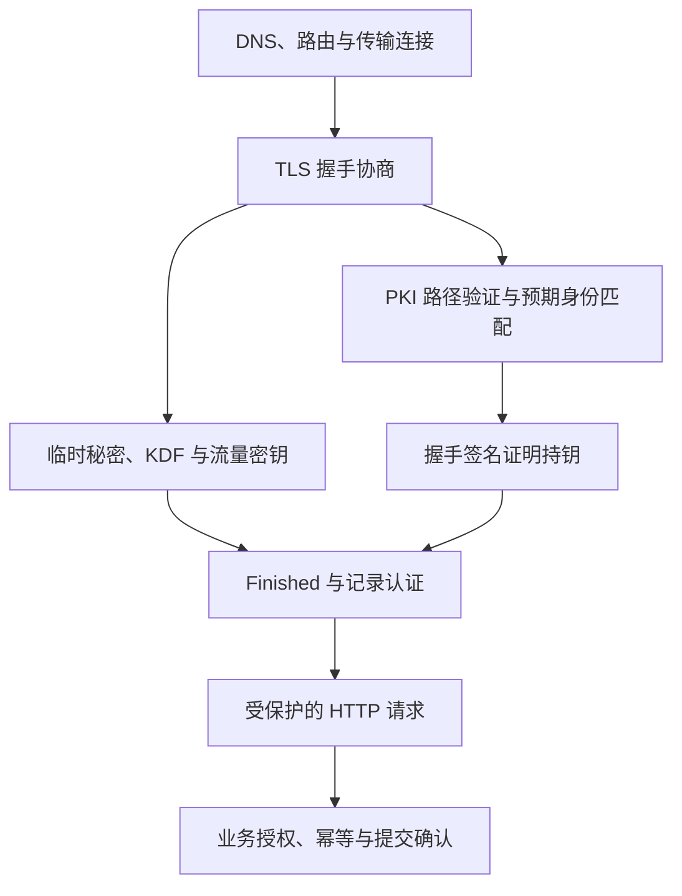

# 计算机网络、PKI 与密码学学习路线

这三组文档分别回答：**数据怎样交付、公钥为什么可信、秘密与完整性怎样保护**。每组分原理篇和面试篇，避免把 TLS、证书和加密混成一套术语。

| 主线 | 原理 | 面试 | 最终应能回答 |
|---|---|---|---|
| 计算机网络 | [原理](计算机网络原理.md) | [面试](计算机网络面试.md) | 从名称到路由、传输、应用响应，失败究竟发生在哪层？ |
| 密码学 | [原理](../../6-计算机安全/6-1-密码学/密码学原理.md) | [面试](../../6-计算机安全/6-1-密码学/密码学面试.md) | 保密、认证、签名、密钥协商和派生各依赖什么前提？ |
| PKI | [原理](../../6-计算机安全/6-3-PKI/PKI原理.md) | [面试](../../6-计算机安全/6-3-PKI/PKI面试.md) | 证书链、服务身份、私钥持有与授权为何要分开判断？ |

## 推荐顺序

1. 网络第 1–9 章：先建立交付、状态与 HTTP 语义，再读 HTTPS。
2. 密码学先读[分类地图](../../6-计算机安全/6-1-密码学/密码学原理.md#p-00)，分清单向与可逆、对称与非对称，再读第 2–8 章，理解安全目标、数学基础、对称保护、摘要与口令、协商及签名。
3. PKI 按正文顺序阅读前七步：从公钥被替换开始，经过申请、担保链、名称验证，再到本次持钥证明。
4. 阅读 PKI 第八步，把证书、握手签名、临时协商和密码套件放进同一次连接，再回看网络 TLS 章节。
5. 最后读吊销、轮换、后量子演进、故障恢复和实验，把单次成功扩展到完整生命周期。

## 把一次 HTTPS 请求串起来

**读图**：图表示职责关系，不是消息严格发送顺序。根信任来自本地策略，密钥协商不凭空认证身份，传输确认也不证明业务成功。

## 密码学先按能力分类

- [完整分类图与能力对照](../../6-计算机安全/6-1-密码学/密码学原理.md#p-00)：区分编码、校验、哈希、加密、MAC、签名、协商与派生。
- [从需求选择机制](../../6-计算机安全/6-1-密码学/密码学原理.md#p-14)：口令、可读取的敏感字段、文件发布和 HTTPS 各需要什么。

## 密码套件与 PKI 体系专题

- [TLS 1.2/1.3 密码套件逐项拆解](../../6-计算机安全/6-1-密码学/密码学原理.md#p-12)：区分协商、认证、记录 AEAD 与哈希角色。
- [算法协商与握手失败推演](../../6-计算机安全/6-1-密码学/密码学原理.md#p-13)：共同套件、组、份额、签名和身份约束如何一起成立。
- [PKI 与密码套件怎样连起来](../../6-计算机安全/6-3-PKI/PKI原理.md#p-13)：以同一次握手理解证书、持钥签名、临时协商和记录加密的分工。
- [为什么根与中间要分层](../../6-计算机安全/6-3-PKI/PKI原理.md#p-14)：从根暴露和风险隔离解释分层，再理解交叉签名与轮换取舍。

## 三个典型反例

**链可信但名字错**：不能关闭名称验证；定位参考身份与 SAN。**密文标签正确但重复扣款**：认证不防重放，业务需唯一标识与结果记录。**TCP 已确认却客户端超时**：确认发生在传输层，应用可能仍等待或已经提交后丢响应。

## 版本与实验边界

本轮按 2026-11-13 可获取标准资料核对，区分 RFC 的更新关系、协议版本和实现支持。TLS 1.3 原始 RFC 8446 已有修订 RFC 9846；后量子算法标准化、证书有效期政策与客户端落地不是同一个时间线。

密码学 Java 示例在本机 JDK 21 验证正常往返与四类篡改拒绝；教学 DH 算例验证代数一致。证书矩阵使用 cryptography 46.0.7 在内存生成本地测试链，验证正常路径和错名称、缺中间、过期、用途错误、未知根、非 CA 颁发者六种拒绝。该路径验证实验不等于真实浏览器的吊销、透明度和根库策略验证，也不替代完整 TLS 握手持钥实验。

图采用 Mermaid 文本，可由支持的 Markdown 阅读器渲染。网络章节的抓包推演不是声称已在当前网络复现全部协议行为。
