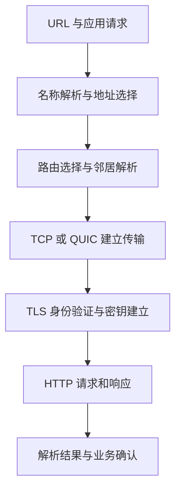
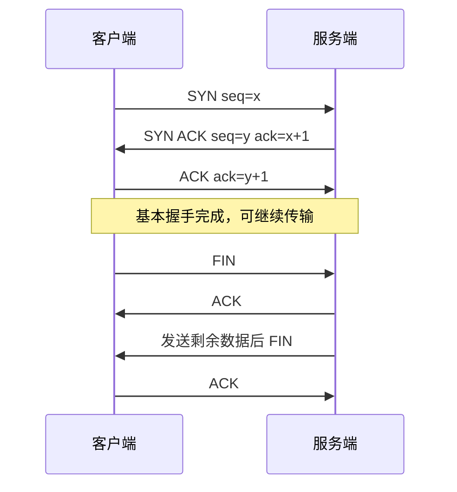
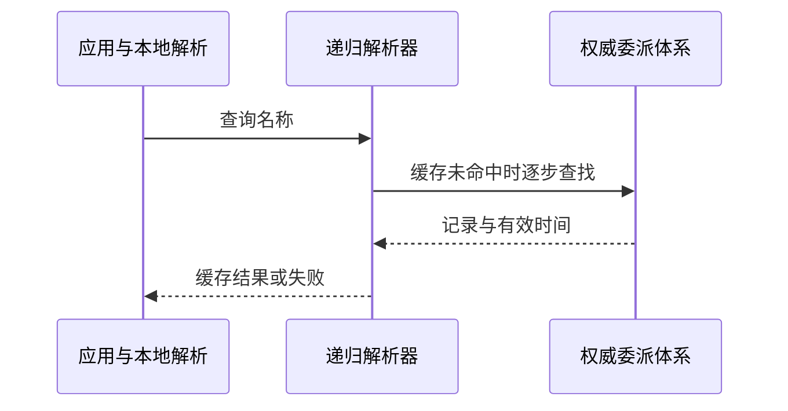
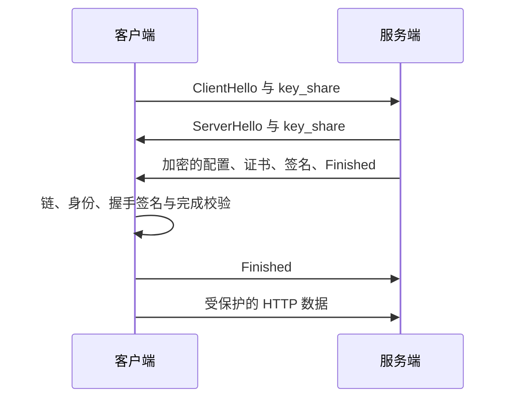

# 计算机网络原理

> **主线**：从一次跨网段 HTTPS 请求出发，解释寻址、路由、可靠传输、拥塞控制、应用语义和安全握手。网络提供的交付保证与业务“只执行一次”必须分开。
>
> **版本口径**：TCP 以 RFC 9293、HTTP 语义以 RFC 9110、QUIC 以 RFC 9000 为基础；TLS 1.3 同时对照原始 RFC 8446 与其修订 RFC 9846。规范修订不等于 TLS 版本号变成 1.4，平台和实现支持也不能由 RFC 发布直接推断。

> **阅读方式**：沿“问题 → 状态与数据 → 正常过程 → 失败分支 → 方案取舍”阅读。示意图用于解释协议，不把理想路径当作所有实现的完整抓包。术语与缩写在文末。

配套 [计算机网络面试](计算机网络面试.md)。

## 阅读路线

| 章节 | 主题 |
|---|---|
| 1 | [分层与一次请求的完整路径](#p-01) |
| 2 | [地址、子网、路由与下一跳](#p-02) |
| 3 | [MTU、分片与路径探测](#p-03) |
| 4 | [TCP 连接建立、序号与关闭状态](#p-04) |
| 5 | [可靠传输、重传与字节流封帧](#p-05) |
| 6 | [流量控制、拥塞控制与排队延迟](#p-06) |
| 7 | [UDP、QUIC 与多路复用](#p-07) |
| 8 | [DNS、缓存与服务发现](#p-08) |
| 9 | [HTTP 语义、缓存与连接复用](#p-09) |
| 10 | [TLS、HTTPS 与跨层故障推演](#p-10) |
| 11 | [路由收敛、负载均衡与超时：连接之外的系统行为](#p-11) |

## 1. 分层与一次请求的完整路径

> 🎯 **核心结论**：分层把故障域和职责分开，封装并不意味着每层都保证可靠或每台设备都处理全部层。

应用构造 HTTP（Hypertext Transfer Protocol，超文本传输协议）消息，安全层建立保密与认证，传输层组织字节或流，IP（Internet Protocol，网际协议）层选择跨网路径，链路层把帧交给下一跳。OSI 七层可作概念模型，实际互联网实现通常按 TCP/IP 分层理解；不要为凑七层把每个库硬放进一格。

**读图**：这是职责依赖图，不是所有步骤每次串行重新执行。缓存、连接复用、代理、并发地址探测和恢复握手会改变实际时序。QUIC 的传输与 TLS 握手集成，也不能把图机械展开为先完整 QUIC 再完整 TLS 两轮。

| 层次 | 主要标识 | 解决的问题 | 不解决的事 |
|---|---|---|---|
| 应用 | 名称、资源、请求标识 | 消息语义与业务行为 | 自动可靠路由 |
| 传输 | 端口、连接、流 | 进程间传输与协调 | 数据库事务恰好一次 |
| 网络 | IP 地址与前缀 | 跨网寻址和转发 | 相邻介质具体寻址 |
| 链路 | MAC 等链路标识 | 当前链路下一跳交付 | 全球端到端路径 |

代理终止一个连接并新建另一个，重试、身份和超时边界由此改变；不是“代理只是多一个透明网线”。负载均衡器的四层转发与七层终止，应看它是否理解并重建应用连接，而非只看端口号。

## 2. 地址、子网、路由与下一跳

> 🎯 **核心结论**：IP 地址选择目的网络，链路地址定位当前下一跳；跨网请求不是直接 ARP 查询远端服务器。

主机用路由表按最长前缀匹配选择出口和下一跳。目的在直连网段时可解析目的邻居；跨网时通常解析网关邻居。IPv4 常用 ARP（Address Resolution Protocol，地址解析协议）在链路内获取地址映射，IPv6 使用 NDP（Neighbor Discovery Protocol，邻居发现协议）及其相关机制；后者还涉及路由器发现等，不能仅叫“IPv6 的 ARP”便结束。

例如主机 192.0.2.10/24 访问 198.51.100.20，假设路由经 192.0.2.1：帧目的链路地址通常为网关，IP 目的仍是远端。路由器解封装当前链路帧，递减跳数限制并查路由，再封装下一条链路帧。隧道和地址转换会增加外层或修改部分字段，需要另分析。

**读图**：链路封装逐跳变化，不代表传输连接也逐跳重新建立。交换机按链路转发表转发，路由器按网络前缀转发；实际设备可集成多种能力，不能用设备外形分类。

NAT（Network Address Translation，网络地址转换）可转换地址，端口转换还维护映射状态。它缓解某些地址分配问题，却影响入站可达性、连接跟踪、空闲超时和排障；**NAT 不等同防火墙，更不提供密码学身份认证**。IPv6 改变地址空间，不使访问控制失去必要性。

故障先问：有没有合适路由、邻居解析能否完成、回程路由是否存在、策略是否放行。ping 不通不能直接证明服务宕机，ICMP（Internet Control Message Protocol，网际控制报文协议）可能被策略限制；ping 通也不证明目标端口和应用正常。

## 3. MTU、分片与路径探测

> 🎯 **核心结论**：链路能承载的包大小限制端到端发送，TCP 的应用写入大小不能直接当作线上一个包的大小。

MTU（Maximum Transmission Unit，最大传输单元）限制相应链路网络层包大小；MSS（Maximum Segment Size，最大段数据大小）是 TCP 段数据部分的上限协商信息，二者差别包含网络和传输首部，还会受选项、隧道和路径变化影响。不要把 1500 与 1460 当作所有网络常量。

IPv4 路由器在允许条件下可能分片；IPv6 路由器不替源主机分片。分片增加状态与丢失放大：一个片段丢失可使整份上层数据无法完成重组。避免依赖大型 UDP 报文被任意网络透明分片，应用应有大小策略。

路径 MTU 发现借助错误反馈或探测建立合适大小；相关 ICMP 被过滤时，可能出现小请求能通、大响应卡住的黑洞。TLS 握手中证书链较大，也可能比简单连通测试更早暴露问题。

| 现象 | 可检验假设 |
|---|---|
| 小包正常，大包超时 | MTU、隧道额外首部、探测反馈丢失 |
| 抓到超大 TCP 包 | 抓包位置是否受分段/聚合卸载影响 |
| 服务端发出，客户端未见 | 中间链路、回程、分片与策略 |

网卡卸载使主机抓包不总等价于线缆上的报文形态。排障同时注明抓包点、方向和卸载条件，避免仅凭本机“大包”判断违反 MTU。

## 4. TCP 连接建立、序号与关闭状态

> 🎯 **核心结论**：三次握手同步双方序号空间及接收能力，FIN 表达单方向结束；连接建立不认证业务身份。

TCP（Transmission Control Protocol，传输控制协议）提供可靠、有序字节流。序号给字节及部分控制事件编号，SYN 和 FIN 各占一个序号。确认号通常表达下一期待序号，不是“确认了几次应用消息”。

**读图**：基本场景中第三次握手让服务端确认自己的序号被对方收到。数据可与部分控制报文组合，关闭双方也可同时发生，不必永远抓到四个独立报文。

历史延迟报文、重传、序号同步和状态资源决定握手设计；仅背“第三次防止无效连接”不能解释全部。半连接资源压力需结合握手队列、监听队列及系统缓解机制，但不能把某系统的 backlog 数字当协议契约。

FIN 后接收方向未必结束，半关闭适合某些“请求结束但仍接收响应”协议。TIME_WAIT 常由主动完成关闭一侧出现，用于处理最后确认重传与旧连接报文寿命；并非“服务器总没有”。CLOSE_WAIT 通常提示对方已结束该方向而本地尚未完成关闭，应检查应用持有与释放。

RST 终止连接不等于业务回滚。客户端收到复位可能发生在请求已被服务端执行之后，是否可重试需由应用幂等标识与结果确认解决。

## 5. 可靠传输、重传与字节流封帧

> 🎯 **核心结论**：TCP 通过序号、确认和重传处理网络丢失与重排，但 send 成功和 ACK 到达均不表示业务已提交。

发送方保留尚未确认数据并管理重传计时；接收方处理乱序并按序交付。累计确认之外，SACK（Selective Acknowledgment，选择确认）可报告已接收的额外区间，使发送方更有针对性地重传。重复确认可提供丢失线索，但重排也能产生类似现象，实际恢复算法要综合证据。

RTO（Retransmission Timeout，重传超时）根据 RTT（Round-Trip Time，往返时间）估计与变化等因素计算，超时退避降低持续重试压力。不能把“一定三个重复 ACK 就解决全部丢包”当所有实现恢复策略；现代栈还可能采用时间维度检测等。

| 成功层级 | 能说明什么 | 不能说明什么 |
|---|---|---|
| 应用 write 返回 | 数据被相应本地接口接纳 | 已发到线缆、对端已收 |
| TCP 确认 | 对端传输层接收相应字节 | 对端应用已读取 |
| HTTP 响应 | 应用协议给出结果 | 结果语义一定等于数据库最终事实 |
| 业务确认记录 | 符合该业务协议的完成 | 免除持久化与幂等设计 |

一次 write 可拆成多个段，多次 write 也可合并，接收端 read 边界不保留原写入边界。长度前缀、分隔符或固定长度解决应用封帧；长度须有上限并处理半头、半体、EOF 截断。Nagle 与延迟确认影响小报文时延，但不是所谓“粘包根本原因”，禁用它们也不恢复消息边界。

## 6. 流量控制、拥塞控制与排队延迟

> 🎯 **核心结论**：流量控制保护接收方，拥塞控制保护网络路径，增加缓冲不能创造带宽。

接收窗口 rwnd 反映接收能力；拥塞窗口 cwnd 由发送方根据网络反馈调整。可发新数据受窗口、已在途数据与其他条件限制，常用 min(rwnd,cwnd) 理解核心上限，但不能遗漏实际在途量、发送缓冲和 pacing。

经典慢启动较快增加探测速率，拥塞避免更谨慎；丢包或 ECN（Explicit Congestion Notification，显式拥塞通知）等反馈可导致调整。CUBIC 与 BBR 等策略使用不同模型，不能把经典 Reno 曲线当所有 TCP 的统一运行轨迹。算法可用性与部署版本另核对。

BDP（Bandwidth-Delay Product，带宽时延积）估算充分利用路径所需的在途量。例如 100Mbit/s、50ms 往返，对应约 625000 字节；窗口明显更小会限制吞吐。这个估计不包含额外排队与竞争，不能由此盲目调大所有缓存。

**读图**：缓冲膨胀和无界应用重试会形成反馈环。有限队列、合适拥塞反馈和应用背压要共同工作。接收窗口为零时需相应探测避免窗口更新丢失造成停滞；TCP keepalive、应用心跳和业务期限不是同一机制。

## 7. UDP、QUIC 与多路复用

> 🎯 **核心结论**：UDP 的最小传输语义不限制上层构建可靠协议；QUIC 把可靠流、安全握手与拥塞协调放到其自身协议中。

UDP（User Datagram Protocol，用户数据报协议）保留数据报边界，不保证交付、有序、去重或拥塞协调由接口自动完成。实时语音可能宁愿跳过过期数据；DNS 查询可以自行管理期限和重试。不同负载需要不同语义，不是 UDP 永远更快。

QUIC 使用 UDP 承载，但定义连接、包号、确认、丢失恢复、流量与拥塞控制，并集成 TLS。流内仍有顺序依赖，一个流丢失不必阻塞其他独立流按其接收状态交付；共享拥塞窗口与链路资源仍使各流互相影响。

| 比较 | TCP 上的 HTTP/2 | QUIC 上的 HTTP/3 |
|---|---|---|
| 多路复用 | HTTP 帧组织多个流，底层一个有序字节流 | 传输直接支持多个流 |
| 丢失影响 | 底层字节缺口可能阻塞后续各流字节交付 | 避免同类跨流传输队首阻塞 |
| 路径改变 | 传统连接依赖地址端口组合 | 连接标识与路径验证支持迁移 |
| 实现代价 | 成熟内核栈 | 用户态、UDP 策略、加密和调度成本 |

QUIC 迁移不等于任意路径立即可信，需验证和抗放大机制。重传的是丢失信息所需数据，不简单照搬旧包号；恢复、密钥与流处理需结合 RFC 9001/9002。HTTP/3 也还有应用依赖和头压缩阻塞，不是“彻底没有队首阻塞”。

## 8. DNS、缓存与服务发现

> 🎯 **核心结论**：DNS（Domain Name System，域名系统）是分布式委派与缓存系统，不是固定的一次 UDP 请求返回最终 IP。

应用可能先查本地缓存、系统解析器，再到递归解析器；递归端按缓存与委派访问根、顶级域与权威服务器。递归与迭代是查询责任的区别，根不必每次从头参与。CNAME 指向别名目标，A/AAAA 分别描述相应地址类型，记录与缓存范围应分开。

TTL（Time to Live，存活时间）在此表示缓存时间，不是 IP 的逐跳寿命。负缓存也会影响新服务上线；已有缓存不会因权威修改就全球立即消失。解析器还可能有过期服务策略和本地限制，不能按一个 TTL 值承诺全部客户端切换时刻。

**读图**：结果可能多地址，客户端可并发或分阶段探测以降低某地址族失败的等待。CDN（Content Delivery Network，内容分发网络）还可能据查询位置和策略返回不同结果，不是“同名就全球同 IP”。

DNSSEC（Domain Name System Security Extensions，DNS 安全扩展）验证记录来源与完整性，不自动加密查询；加密 DNS 保护特定传输路径，不自动证明权威数据正确，也不使业务证书验证多余。UDP 截断、TCP 回退与较大响应需考虑；只放通 UDP/53 会制造部分解析失败。

## 9. HTTP 语义、缓存与连接复用

> 🎯 **核心结论**：HTTP 版本改变传输组织，方法、状态码、缓存与幂等语义不能混同为一个“短连接/长连接”概念。

GET 的安全语义指客户端请求不要求改变服务器状态，不保证实现没有日志或计数；幂等指重复相同请求的预期效应与一次相同，不要求响应字节相同。PUT/DELETE 的协议语义可幂等，POST 也可通过业务幂等键实现受控重放，但不能未经约定自动重试。

HTTP/1.1 默认可持久连接；消息长度由规范规则界定，Content-Length、传输编码、无正文状态和关闭界定各有条件。前后代理对长度解释不同可能出现请求走私，因此不能随意允许冲突首部。HTTP/2 使用二进制帧与流，HTTP/3 使用 QUIC，均不改变全部应用语义。

| 缓存阶段 | 机制 | 关键问题 |
|---|---|---|
| 新鲜度 | Cache-Control 等 | 可缓存多久、私有还是共享 |
| 验证 | ETag/If-None-Match 等 | 资源版本是否仍匹配 |
| 变体 | Vary 等 | 哪些请求首部影响表示 |
| 安全边界 | 授权与共享缓存规则 | 避免跨用户错误复用 |

304 表示验证响应，不是重新发送完整表示。no-cache 通常要求重用前验证，不等于禁止存储；no-store 才表达不存储的相应指令。ETag 的强弱和时间验证精度也影响范围与并发修改语义。

连接池限制并发与复用成本，但 DNS、证书、服务端最大流数、空闲关闭和总期限共同决定实际表现。HTTP/2 一个连接多流不代表一个连接拥有无限吞吐和业务资源。

## 10. TLS、HTTPS 与跨层故障推演

> 🎯 **核心结论**：HTTPS 是有身份验证与加密保护的 HTTP 连接语境，握手要同时建立秘密、验证对端并绑定协商过程。

TLS（Transport Layer Security，传输层安全）1.3 的典型证书握手中，ClientHello 提供版本、算法、密钥份额等；ServerHello 选择参数并建立共享秘密。随后握手加密保护下发送配置、证书、CertificateVerify 与 Finished，客户端验证链与服务身份，确认后续密钥并发送自己的完成信息。恢复握手和重试请求会改变流程，客户端证书不是所有握手都有。

**读图**：证书私钥通常用于认证签名，临时密钥协商用于建立秘密；不是用证书公钥逐条加密全部 HTTP 内容。详见[PKI](../../6-计算机安全/6-3-PKI/PKI原理.md)与[密码学](../../6-计算机安全/6-1-密码学/密码学原理.md)。

ALPN（Application-Layer Protocol Negotiation，应用层协议协商）选择应用协议，SNI（Server Name Indication，服务器名称指示）帮助选择名称对应配置，但不取代客户端主机名验证。TLS 1.3 并不默认隐藏所有 ClientHello 元信息，不能宣称 HTTPS 隐藏访问的全部元数据。

0-RTT 恢复数据可能被重放，不应默认用于不可重复副作用。前向安全的条件与密钥模式相关，不能将所有 PSK（Pre-Shared Key，预共享密钥）恢复都无条件等同临时 DH 的保证。

| 症状 | 逐层证据 |
|---|---|
| 建连超时 | 解析耗时、路由、SYN 重传、入口策略 |
| TCP 通但 TLS 失败 | 协议版本、算法、时间、链、身份与 SNI |
| 首字节慢 | 排队、握手、服务端处理、远端依赖 |
| 大响应卡住 | MTU、丢失、窗口、慢消费者 |
| 请求失败但订单存在 | 业务提交与响应传输的时间边界 |

抓包、双方日志和时钟关联比单个错误码有力。建立总期限并拆分 DNS、建连、握手、排队与响应耗时；重试必须结合业务幂等、退避和剩余预算，不能让网络故障变成重试风暴。

## 11. 路由收敛、负载均衡与超时：连接之外的系统行为

> 🎯 **核心结论**：数据平面按现有规则转发，控制平面分发可达信息；路由或实例变化不会自动迁移所有应用状态。

最长前缀匹配处理“已有表怎样选路”，不解释路由怎样学到。静态路由由配置给出，内部动态协议传播本域拓扑或距离，BGP（Border Gateway Protocol，边界网关协议）在自治系统等范围传播路径与策略。BGP 不是简单选择物理距离最短的全球导航，策略、可达性与传播共同决定路径。

收敛需要时间，短暂环路、黑洞或路径不对称会影响在途包。IP 的跳数限制防止包永远环转，但不能保证一次请求在预算内完成。路由切换后的 RTT 与 MTU 变化还可能影响既有传输连接。

负载均衡也有不同层次：DNS 返回地址是一种选择，四层转发按连接关联后端，七层代理可按请求路径、首部或业务信息路由。某些连接使用同一后端久，并不代表整体分配算法错误；连接池和 HTTP 多路复用会影响请求分布。

| 变化 | 不能自动做到 |
|---|---|
| DNS 移走旧地址 | 让所有已建连接立即重连 |
| 实例从发现列表摘除 | 使在途请求自动无损转移 |
| 代理重试另一个后端 | 撤销原后端可能已完成的写入 |
| QUIC 验证新路径 | 修复服务端丢失的业务会话状态 |

**总期限推演**：用户预算 2 秒，DNS 已用 300ms，连接和握手又用 700ms，真正请求剩约 1 秒而不是重新得到 2 秒。代理与客户端若都独立重试三次，尝试量可能乘法放大；每层应知道自身预算、可重试错误与幂等边界。

排障用分阶段指标：解析、连接、握手、请求排队、远端处理、首字节、完整传输。仅看到“读超时”不等于服务器没执行，也不说明根因在网络带宽。为每个请求与尝试分别建关联标识，结合双端日志与抓包核对时间线。

参考：[BGP 基础：RFC 4271](https://www.rfc-editor.org/rfc/rfc4271)、[HTTP 语义与重试](https://www.rfc-editor.org/rfc/rfc9110)。

## 标准与参考资料

- [TCP：RFC 9293](https://www.rfc-editor.org/rfc/rfc9293)、[QUIC：RFC 9000](https://www.rfc-editor.org/rfc/rfc9000)
- [HTTP 语义：RFC 9110](https://www.rfc-editor.org/rfc/rfc9110)、[HTTP 缓存：RFC 9111](https://www.rfc-editor.org/rfc/rfc9111)、[HTTP/2：RFC 9113](https://www.rfc-editor.org/rfc/rfc9113)、[HTTP/3：RFC 9114](https://www.rfc-editor.org/rfc/rfc9114)
- [DNS：RFC 1034](https://www.rfc-editor.org/rfc/rfc1034)、[IPv6：RFC 8200](https://www.rfc-editor.org/rfc/rfc8200)
- [TLS 1.3 原始规范：RFC 8446](https://www.rfc-editor.org/rfc/rfc8446)、[修订：RFC 9846](https://www.rfc-editor.org/rfc/rfc9846)
- RFC 有更新与勘误链，本文解释基础机制，不把某系统参数、浏览器策略或实现默认值当协议永久要求。

## 附录：术语与缩写

| 缩写或术语 | 英文全称 | 中文含义 |
|---|---|---|
| IP | Internet Protocol | 网际协议 |
| MAC | Media Access Control | 链路介质访问控制；与密码学消息认证码同缩写不同义 |
| ARP | Address Resolution Protocol | 地址解析协议 |
| NDP | Neighbor Discovery Protocol | IPv6 邻居发现协议 |
| ICMP | Internet Control Message Protocol | 网际控制报文协议 |
| MTU | Maximum Transmission Unit | 最大传输单元 |
| MSS | Maximum Segment Size | TCP 最大段数据大小 |
| TCP | Transmission Control Protocol | 传输控制协议 |
| UDP | User Datagram Protocol | 用户数据报协议 |
| RTT | Round-Trip Time | 往返时间 |
| RTO | Retransmission Timeout | 重传超时 |
| SACK | Selective Acknowledgment | 选择确认 |
| DNS | Domain Name System | 域名系统 |
| HTTP | Hypertext Transfer Protocol | 超文本传输协议 |
| TLS | Transport Layer Security | 传输层安全 |
| QUIC | QUIC | 规范使用协议名，不能简单理解成不可靠 UDP |
| NAT | Network Address Translation | 网络地址转换 |
| BDP | Bandwidth-Delay Product | 带宽时延积 |
| ALPN | Application-Layer Protocol Negotiation | 应用层协议协商 |
| SNI | Server Name Indication | 服务器名称指示 |
| HOL | Head-of-Line Blocking | 队首阻塞 |
| ECN | Explicit Congestion Notification | 显式拥塞通知 |
| CDN | Content Delivery Network | 内容分发网络 |
| TTL | Time to Live | 存活时间，IP 跳数限制与 DNS 缓存时间语境不同 |
| BGP | Border Gateway Protocol | 边界网关协议 |
| PSK | Pre-Shared Key | 预共享密钥 |
| DNSSEC | Domain Name System Security Extensions | DNS 安全扩展 |
