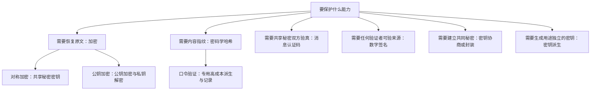
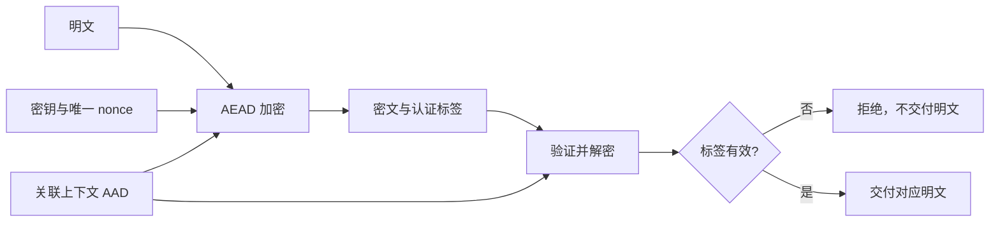
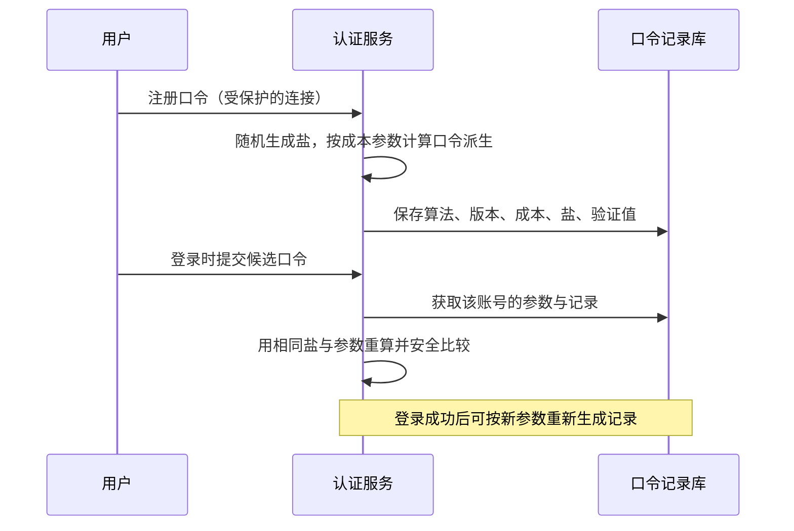
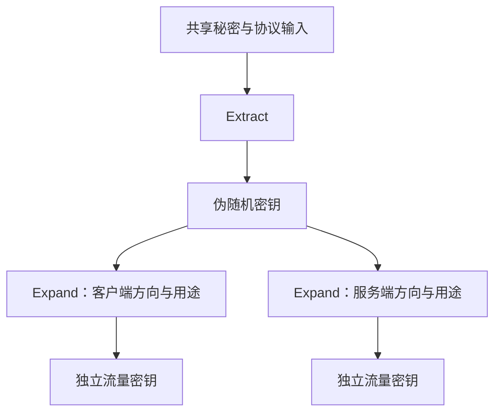
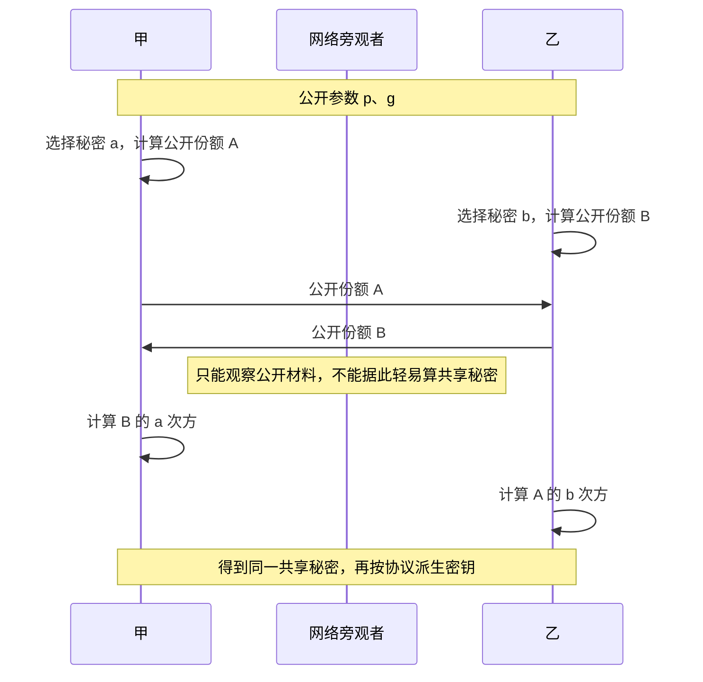
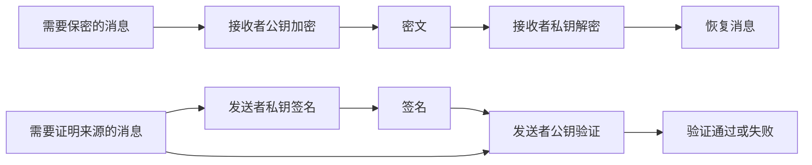
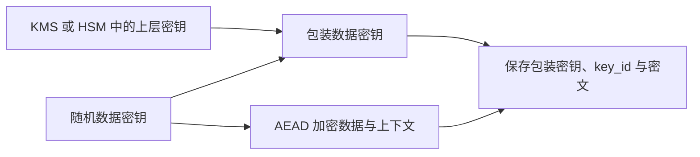
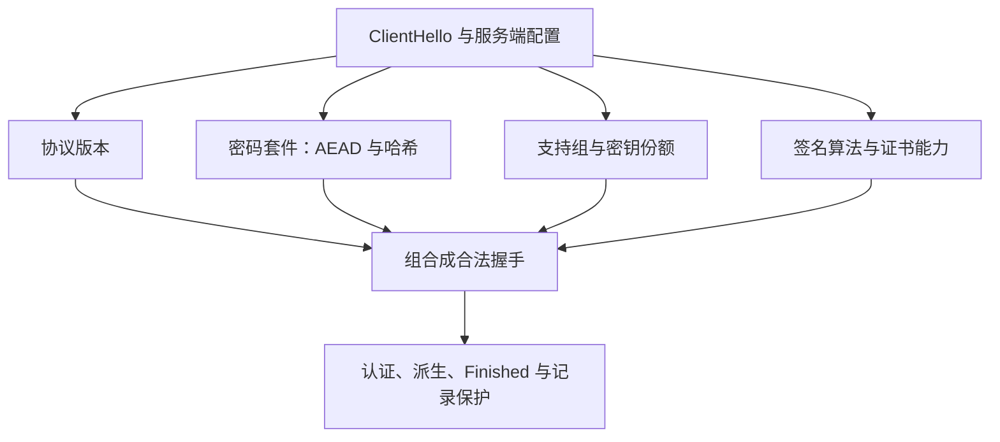
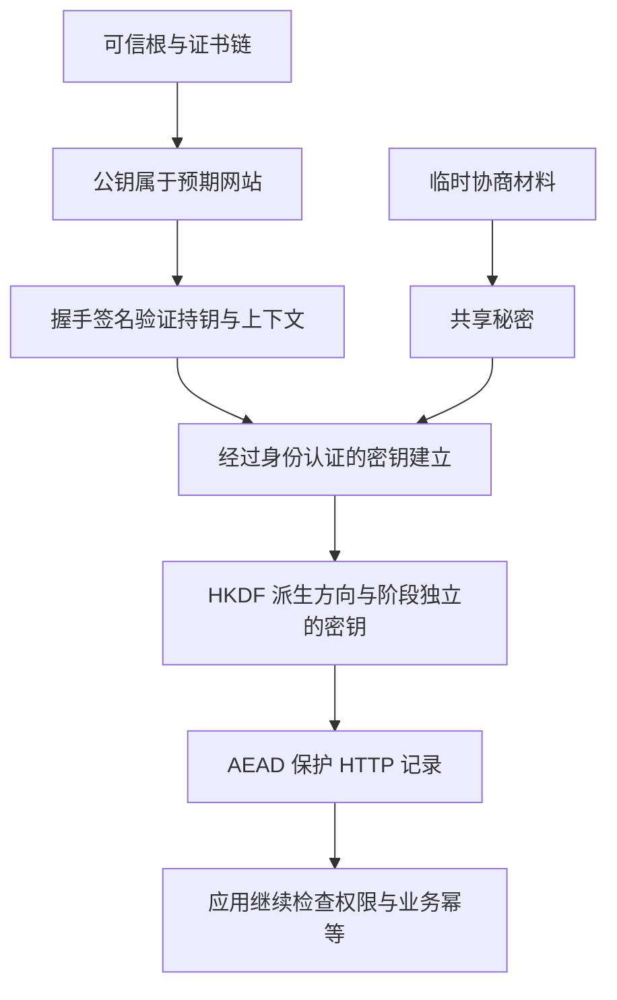

# 密码学原理：从算法分类到证书与安全连接

> **主线**：先按能力与密钥关系建立分类，再逐类解释原理、攻击与方案取舍，最后组合成证书、密码套件和安全连接。这里是理解与工程判断材料，不建议自行设计密码算法或把教学算例用于真实密钥。
>
> **与另外两篇的关系**：网络讲数据如何交付；本篇讲如何保护数据并证明密钥持有；[PKI](../6-3-PKI/PKI原理.md)讲可信公钥如何与身份绑定。算法名称相同，不代表模式、参数、编码与协议组合都兼容。

> **阅读方式**：沿“问题 → 状态与数据 → 正常过程 → 失败分支 → 方案取舍”阅读。示意图用于解释协议，不把理想路径当作所有实现的完整抓包。术语与缩写在文末。

配套 [密码学面试](密码学面试.md)。

## 阅读路线

| 分类主线 | 先解决什么问题 | 深入章节 |
|---|---|---|
| 分类与基础 | 可逆、单向、密钥关系和安全目标 | 1–3 |
| 对称保护 | 大量数据怎样保密并检测篡改 | 4–5 |
| 摘要、认证、口令 | 无密钥指纹、共享秘密验真、离线猜测有何不同 | 6 |
| 非对称与密钥建立 | 如何协商共同秘密、公开验证、保护接收者 | 7–8 |
| 系统与演进 | 密钥生命周期、协议组合、后量子与代码验证 | 9–12 |
| 回到完整连接 | 套件如何协商、怎样按业务需求组合 | 13–15 |


| 章节 | 主题 |
|---|---|
| 1 | [先建立分类：可逆、单向、对称、非对称分别在说什么](#p-00) |
| 2 | [威胁模型与安全目标：先说明要防什么](#p-01) |
| 3 | [模运算、群与困难问题：理解非对称算法的前提](#p-02) |
| 4 | [对称加密与工作模式：为什么 AES 不等于完整方案](#p-03) |
| 5 | [AEAD、nonce 与认证失败的处理](#p-04) |
| 6 | [摘要、HMAC 与口令存储](#p-05) |
| 7 | [密钥协商、KDF 与前向安全](#p-06) |
| 8 | [RSA、椭圆曲线签名与编码边界](#p-07) |
| 9 | [随机数、密钥生命周期与信封加密](#p-08) |
| 10 | [协议组合、重放与侧信道](#p-09) |
| 11 | [后量子演进与算法敏捷性](#p-10) |
| 12 | [Java AEAD 完整实验：往返、篡改与上下文绑定](#p-11) |
| 13 | [密码套件到底是什么：逐项拆解 TLS 1.2 与 1.3](#p-12) |
| 14 | [套件协商与握手失败：从候选集合到完整约束求解](#p-13) |
| 15 | [用业务需求选机制：把分类变成判断过程](#p-14) |

<a id="p-00"></a>
## 1. 先建立分类：可逆、单向、对称、非对称分别在说什么

> 🎯 **先记住两条分类轴**：**“可逆还是单向”描述操作目标，“对称还是非对称”描述密钥关系。** 它们不是同一层的三个并列选项。完整密码学还包括认证、签名、协商、派生，不能用“加密算法”包办所有名称。

### 1.1 从三个业务问题理解分类，而不是先背算法表

**问题一：数据库保存收货地址，发货时还要读出地址。** 这里必须能恢复原文，因此需要可逆的加密。拿到密文的人不能恢复，拥有正确解密密钥的应用可以恢复。

**问题二：保存登录口令，登录时只判断用户输入是否正确。** 业务无需恢复原口令，应保存专用口令验证记录。登录时按记录中的参数重新计算并比较。用户忘记时重置口令；不是从记录里“解密找回”。

**问题三：客户下载软件，要确认安装包确实来自开发者。** 即使安装包公开，也需要验证发布者。这里需要数字签名；把包加密并不能自动证明发布者。

三件事的差别首先是**需要什么能力**，之后才选择 AES、Argon2id、签名算法等具体实现。



**读图**：这是按用途组织的地图，分支并非互斥。一条 TLS 连接会同时使用其中多类机制。口令方案也不等于把某个通用哈希直接调用一次。

### 1.2 “可逆”是有条件恢复，“单向”是缺少高效求逆方法

可逆加密的正确性可以写成 `Decrypt(K, Encrypt(K, P)) = P`；这里省略随机量、标签等附加输入。P 是明文，K 是密钥。**可逆不等于任何人都能逆，解密能力被密钥控制。** 非对称场景中，式子的加密密钥与解密密钥属于同一密钥对，而不是同一个值。

哈希写成 `h = H(P)`，没有对应的“用解密密钥恢复 P”接口。任意长输入被映射到有限输出空间，必然可能发生多个输入对应同一个输出，因此它不是无损压缩。安全目标是让攻击者难以完成特定搜索，并非从数学上不存在任何相同摘要的消息。

**“不可逆”也不等于不可猜。** 若原文只可能是六位数字，即使 H 本身没有可行的求逆算法，攻击者也能枚举一百万个候选并计算摘要。强哈希无法补充输入本来没有的熵。这是口令需要高成本派生、并仍需足够强口令的原因。

> ⚠️ 常见资料把摘要称为“单向加密”。可以借这个词建立直觉，但工程文档应写**密码学哈希或摘要**：没有解密过程，不能用于需要恢复原文的字段保护。

### 1.3 对称与非对称：解决的是谁拥有哪把钥匙

| 比较项 | 对称加密 | 非对称的公钥加密 |
|---|---|---|
| 密钥关系 | 加密与解密依赖同一秘密密钥 | 接收者有公钥与私钥，职责不同 |
| 谁能加密 | 拥有秘密密钥者 | 拿到真实公钥的任何人 |
| 谁能解密 | 拥有秘密密钥者 | 对应私钥持有者 |
| 主要优势 | 适合保护大量数据，开销通常较低 | 加密方不需要预先拿到接收者的解密秘密 |
| 主要困难 | 如何安全共享和管理秘密密钥 | 如何确认公钥归属，以及计算与格式开销 |
| 示例 | AES、ChaCha20 及其正确构造 | RSA-OAEP 等标准公钥加密方案 |

非对称密码学还包括签名、密钥协商等，**不能把所有公钥算法都套进“公钥加密、私钥解密”这句话**。例如 ECDSA 用于签名，X25519 用于密钥协商；它们不提供任意文件公钥加密接口。ECC（Elliptic Curve Cryptography，椭圆曲线密码学）是使用椭圆曲线数学结构的一类方案，也不是单个加密算法名。

### 1.4 把常见名称放回各自的抽屉

| 类别 | 输入与输出 | 是否有保密密钥 | 核心能力与代表 | 明确不能替代什么 |
|---|---|---|---|---|
| 编码 | 字节 → 另一种表示 | 无 | Base64、十六进制方便传输展示 | 不隐藏内容 |
| 普通校验 | 数据 → 校验值 | 通常无 | CRC 检测偶发传输错误 | 不抵抗主动伪造 |
| 密码学哈希 | 数据 → 摘要 | 无 | SHA-256、SHA-3 内容指纹 | 单独不能证明发布者 |
| 对称加密 | 明文与密钥 → 密文 | 共享秘密 | AES 等构造保护内容 | 裸加密不自动认证 |
| 认证加密 | 明文、密钥、上下文 → 密文与标签 | 共享秘密 | AES-GCM、ChaCha20-Poly1305 | 不自动防重放 |
| MAC 消息认证码 | 消息与密钥 → 标签 | 共享秘密 | HMAC、CMAC 证明持共享密钥方生成 | 不区分同样持钥的双方责任 |
| 数字签名 | 消息与私钥 → 签名；公钥验证 | 私钥保密 | RSA-PSS、ECDSA、Ed25519 可公开验证 | 不自动隐藏消息或信任公钥身份 |
| 密钥协商/封装 | 公共交换材料与本地秘密 → 共享秘密 | 本地秘密保密 | DH、X25519、ML-KEM | 不天然证明对端身份 |
| 密钥派生 | 秘密与上下文 → 一组密钥 | 输入秘密保密 | HKDF 等分离用途 | 不自动增加弱口令熵 |
| 口令派生/验证 | 口令、盐、成本参数 → 验证记录 | 口令秘密，盐通常公开 | Argon2id、scrypt、PBKDF2 等提高猜测成本 | 不能阻止所有离线猜测 |

MAC（Message Authentication Code，消息认证码）与网卡 MAC 地址只是缩写相同。CMAC（Cipher-based Message Authentication Code，基于分组密码的消息认证码）说明认证码也可以基于分组密码构造，并非都等于哈希。CRC（Cyclic Redundancy Check，循环冗余校验）适合偶发错误模型，攻击者通常可以同步重算它。

### 1.5 哪些性质可以直接得到：不要把“安全”当一个开关

| 机制 | 内容保密 | 检测主动篡改 | 验证者自己能否伪造 | 身份还需要外部绑定吗 |
|---|---|---|---|---|
| 单独 SHA-256 | 否 | 若期望摘要来自可信渠道，可比较内容 | 任何人都能算新摘要 | 是 |
| 裸 AES-CBC / AES-CTR | 是，且须满足模式条件 | 没有完整认证保证 | 持密钥者可生成密文 | 是 |
| HMAC | 否 | 是，须满足构造与密钥条件 | 能，验证者也持共享密钥 | 是 |
| AES-GCM | 是 | 是，须满足 nonce 等约束 | 能，持钥者可生成有效记录 | 是 |
| 数字签名 | 否 | 是，须验证正确的消息与公钥 | 单持公钥不能生成新签名 | 是，公钥仍须可信 |

例如“标签有效”最多说明对应持钥方能够生成此记录；“这是公司财务主管同意的转账”还涉及密钥归属、交互意图、授权与审计。**数学验证、身份验证、业务授权应逐层成立。**

### 1.6 先给一个组合预告：为什么 HTTPS 不只选一种算法

网站需要让浏览器认出自己，使用证书与握手签名；双方需要共同秘密，使用经过认证的协商；网页数据很多，使用对称认证加密；不同方向和阶段需要不同密钥，使用派生函数。每类机制解决一个缺口。

继续阅读时，先掌握分类，再读安全目标与数学基础，然后按对称保护、摘要与口令、协商与签名逐类展开。最后回到密码套件与 [PKI 的完整握手](../6-3-PKI/PKI原理.md#p-13)，检查这些部件怎样接在一起。

<a id="p-01"></a>
## 2. 威胁模型与安全目标：先说明要防什么

> 🎯 **核心结论**：加密解决特定保密问题，完整性、身份、重放、授权与可用性需要各自协议。

被动攻击者观察密文，主动攻击者可修改、删包、插入、重放并诱导错误响应。只在“别人看不到明文”的模型里安全，不代表能抵抗主动选择密文。安全证明总有假设，例如密钥未泄露、随机数正确、实现没有侧信道、端点未失陷。

| 目标 | 典型机制 | 不能自动获得 |
|---|---|---|
| 保密性 | 正确使用的加密 | 对端真实身份、不可重放 |
| 完整性与认证 | MAC、AEAD、签名 | 授权、保密或新鲜性 |
| 来源认证 | 对应密钥证明和信任绑定 | 使用者一定被允许操作 |
| 新鲜性 | 序号、挑战、期限和状态 | 单靠摘要实现 |
| 可用性 | 容量控制、抗滥用、恢复 | 加密本身防全部拒绝服务 |

Base64 是编码，不是保密；压缩、校验和和密码学摘要各有目标。加密磁盘能保护关机后部分介质泄漏场景，不阻止已经获得应用读取权限的攻击者访问解密数据。

应写清攻击者能看到什么、能控制什么、密钥在哪个边界、失败如何被观察。错误类型、耗时和缓存行为本身也可能泄漏秘密，密码协议不能只审查数学公式。

<a id="p-02"></a>
## 3. 模运算、群与困难问题：理解非对称算法的前提

> 🎯 **核心结论**：数学等式解释双方怎样得到一致结果，困难假设解释攻击者为何不易恢复秘密，两者不是一件事。

模 n 运算把整数按余数分类；若 gcd(a,n)=1，a 才有模 n 的乘法逆元。素数模数中的非零元素可形成乘法群，选定子群的生成元可把指数映射到群元素。椭圆曲线则以点加法形成相关群，标量乘法不是普通坐标逐项相乘。

离散对数问题是从 g 与 g^a 恢复 a；计算型 DH 问题是从 g^a、g^b 得到 g^(ab)。相关困难性不能只靠“数字很大”解释，群结构、子群阶、参数和已知攻击都重要。椭圆曲线有不同安全性质，不能随意自选曲线或接受未验证点。

RSA 通常依赖大整数相关困难问题与具体方案安全论证；不能直接把“尚不知道高效分解”当作任意裸 RSA 用法都安全。参数位数也不可跨算法直接比较，256 位椭圆曲线与 256 位 RSA 不是相近安全等级。

```text
玩具 DH：p=23，g=5，a=6，b=15
A = 5^6 mod 23 = 8
B = 5^15 mod 23 = 19
B^6 mod 23 = A^15 mod 23 = 2
```

这个小群可被轻易穷举，只验证代数一致，不体现真实安全性。工程上使用经过审查的标准群、算法库与参数检查，不从该算例扩展手写生产密码。

<a id="p-03"></a>
## 4. 对称加密与工作模式：为什么 AES 不等于完整方案

> 🎯 **核心结论**：AES（Advanced Encryption Standard，高级加密标准）是分组密码原语，模式决定多分组如何加密和是否认证。

AES 固定处理 128 位分组，可选密钥长度不改变分组大小。ECB（Electronic Codebook，电子密码本）逐块独立，重复明文块暴露模式；CBC（Cipher Block Chaining，密码分组链接）通过前块密文参与链接，需要相应不可预测初始化向量和填充处理，但本身不认证；CTR（Counter Mode，计数器模式）生成密钥流再异或，需要避免同密钥下计数输入重复，本身也不认证。

流加密可写为 C=P xor KS。若相同密钥流用于两条消息，C1 xor C2=P1 xor P2，明文关系被直接暴露。这解释了为何 nonce/计数器重复不是“略降安全性”的普通配置问题。

| 方案 | 主要风险 | 工程含义 |
|---|---|---|
| 裸 ECB | 相等块可见 | 不用于一般结构化数据保护 |
| CBC 无认证 | 可修改、填充错误泄漏 | 不能只看解密成功与否 |
| CTR 无认证 | 可翻转明文位 | 需要正确认证组合 |
| AEAD | 统一认证与加密 | 仍须满足 nonce、长度和使用次数限制 |

即使同一个模式，IV（Initialization Vector，初始化向量）或 nonce 的要求也不同：不可预测、唯一、可公开不能互相替代。不要把“每次随机生成”当所有模式完整证明，多实例随机碰撞与重启恢复还需考虑。

### 4.1 AES 的“可逆”究竟来自哪里

AES 把 16 字节视为一个状态，经密钥扩展得到各轮子密钥，再多轮进行字节替换、行移位、列混合与轮密钥异或。AES-128、AES-192、AES-256 分别进行 10、12、14 轮，最后一轮省略列混合。**增加轮数和变换是在制造复杂的密钥相关映射，解密则用对应逆变换还原状态。**

| 变换 | 做什么 | 为什么需要 |
|---|---|---|
| SubBytes 字节替换 | 对每字节做可逆的非线性替换 | 避免整个变换退化为容易处理的线性关系 |
| ShiftRows 行移位 | 改变状态中字节位置 | 让相邻轮中的字节关系发生扩散 |
| MixColumns 列混合 | 在有限域中混合一列字节 | 让一个输入变化影响多个输出字节 |
| AddRoundKey 轮密钥加 | 与子密钥逐位异或 | 让变换依赖秘密密钥，异或同一子密钥可还原 |

这解释了**合法解密为何存在**；抵抗密码分析还依赖整体设计、轮数与长期分析，不能仅凭“每步可逆且复杂”就证明安全。分组大小始终为 128 位，密钥位数决定密钥空间；明文长度由模式与封装决定。这三种长度要分开。

参考：[AES 算法规格 FIPS 197](https://csrc.nist.gov/pubs/fips/197/final)。

### 4.2 为什么分组密码还需要工作模式：用一份订单看差异

假设订单有重复固定字段。AES 对固定密钥是分组上的确定性置换：同一个 16 字节输入，得到同一个 16 字节输出。文件很长、字段重复、最后一块不足长度时，单次 AES 接口没有回答如何处理这些问题，工作模式才负责组合。

```text
ECB：Ci = AES(K, Pi)
CBC：Ci = AES(K, Pi xor C(i-1))，C0 = IV
CTR：Ci = Pi xor AES(K, counter_i)
```

这些是解释结构的式子，省略分组编号、编码与边界处理。ECB 中相同块密文相同，会泄漏结构；CBC 让前块密文参与下一块，使重复块不再独立暴露，但需要合适 IV 和填充；CTR 把 AES 用来生成密钥流，不足整块可截取密钥流处理，无需分组填充。

| 维度 | ECB | CBC | CTR | GCM |
|---|---|---|---|---|
| 相同块是否直接暴露 | 是 | 正确使用时避免该问题 | 正确使用时避免该问题 | 正确使用时避免该问题 |
| 加密能否按块并行 | 能 | 有前块依赖 | 能 | 可有效并行，具体看实现 |
| 是否需要块填充 | 一般需要 | 一般需要 | 不需要 | 不需要 |
| 单独是否认证 | 否 | 否 | 否 | 是，包含认证标签 |
| 关键输入约束 | 模式泄漏无法靠随机 IV 补救 | IV 应不可预测，且应纳入认证 | 同密钥下计数输入不得重复 | 同密钥下 nonce 不得重复，遵守使用限额 |

**CBC 解密可并行计算块密码逆变换，加密却有串行依赖**，所以“CBC 不能并行”过于笼统。解密只需读到前一密文块，并不必等前一明文块计算完成。

### 4.3 填充为什么会引出攻击，而不只是格式问题

PKCS#7（Public-Key Cryptography Standards #7，此处指其常用分组填充规则）在缺 r 字节时追加 r 个值为 r 的字节；即使明文恰好整块，通常也追加一整块填充以消除歧义。AES 的 16 字节块在缺 3 字节时添加 `03 03 03`。

CBC 解密关系是 `Pi = AES逆变换(K, Ci) xor C(i-1)`。攻击者改前一个密文块，就能有控制地影响后一个明文块。如果服务端把“填充错误”和其他错误通过状态、内容或耗时暴露，攻击者可反复试探，逐步获得信息；这就是填充预言机的核心。

因此解决方案不能停在“换一个错误文本”。要使用经过审查的认证加密或协议规定的正确认证组合，并控制可观察错误与实现侧信道。已有协议的 CBC 处理必须遵守该协议，不能私自在两端临时拼接 MAC 后就宣称解决。

### 4.4 流密码、一次一密和分组模式怎样关联

流密码生成密钥流，再与明文异或。ChaCha20 使用加法、旋转、异或操作混合状态，并结合计数器生成不同块；它与 AES-CTR 都呈现“生成密钥流后异或”的使用形态，但内部原语不同。

一次一密要求密钥真正均匀随机、与消息等长、只用一次并保密，满足前提时具有信息论保密性；它的分发和存储成本很高。工程流密码用短密钥扩展伪随机密钥流，安全依赖计算困难与具体构造，不能直接套用一次一密的信息论结论。

ChaCha20 本身不提供消息完整性，配套 Poly1305 才构成常见认证加密。选择 AES-GCM 还是 ChaCha20-Poly1305，还需看硬件加速、实现质量、平台与协议支持，不能用“一个算法名更长”比较。[ChaCha20-Poly1305 的构造见 RFC 8439](https://www.rfc-editor.org/rfc/rfc8439)。

<a id="p-04"></a>
## 5. AEAD、nonce 与认证失败的处理

> 🎯 **核心结论**：AEAD（Authenticated Encryption with Associated Data，带关联数据的认证加密）同时保护密文和关联上下文，但不隐式防重放。

AES-GCM（Galois/Counter Mode，伽罗瓦/计数器模式）与 ChaCha20-Poly1305 都是常见认证加密构造。输入包含密钥、nonce、明文与 AAD（Additional Authenticated Data，附加认证数据），输出密文与标签。AAD 不保密却参与认证，可绑定版本、记录类型、租户或对象标识，防止合法密文被挪到另一个上下文解释。



**读图**：不要先把未认证明文输出给业务，再在最后发现标签失败。某些底层流式接口可能暂时产出数据，调用方必须隔离到认证完成。

同密钥下 GCM nonce 重复会破坏保密与认证性质，可能泄漏明文关系并帮助伪造。随机 96 位 nonce 常见但仍有碰撞预算，集中计数则需持久化、实例分区、回滚和重启策略。轮换密钥也要按协议记录 key_id，不能只重置计数器继续用旧密钥。

认证通过仅证明“该密钥与上下文下构造有效”，不证明消息是第一次出现。接收端需要序号窗口、唯一请求标识或其他防重放状态；时间戳也要处理时钟偏差和窗口内重复。

### 5.1 GCM 怎样把“加密”和“认证”放在一起

GCM 的保密部分采用计数器思路，由密钥与 nonce 确定初始计数状态，再生成密钥流与明文异或。认证部分使用 GHASH 对 AAD、密文及长度信息进行有限域运算，并结合密钥相关的掩码形成标签。**标签认证了密文与上下文，但 AAD 本身仍是公开的。**

接收者用相同上下文重算标签并验证；修改密文、AAD 或 nonce，都应在满足安全前提时使伪造难以通过。不能把某个固定公开哈希附在密文后面代替标签，因为攻击者也能同步改掉公开哈希。

重复 nonce 会重复使用相关密钥流，泄漏明文异或关系；认证的代数关系也会遭到破坏，可能促进伪造。这比“相同原文暴露相等性”严重得多。标签有长度与伪造概率预算，截短也不能任意进行；具体上限必须按标准、协议和实现约束计算。

### 5.2 nonce、IV、salt、每次签名秘密量为何不能统一成“随机数”

| 值 | 是否公开 | 真正需要满足什么 | 典型错误 |
|---|---|---|---|
| GCM nonce | 可以 | 同密钥唯一，且满足使用预算 | 重启回滚、实例间计数冲突 |
| CBC IV | 可以 | 满足不可预测性并正确认证 | 固定 IV 或简单可预测计数 |
| 口令 salt | 可以 | 足够空间与独立生成，减少跨记录复用 | 全站固定盐 |
| ECDSA 每消息秘密量 | 不可以 | 按签名标准安全生成，不能泄漏或错误复用 | 伪随机生成失败导致私钥暴露 |
| 数据加密密钥 | 不可以 | 不可预测、足够强且限制用途 | 用可猜口令字节直接充当密钥 |

**“随机”是一种生成方法，“唯一”“不可预测”“保密”是不同性质。** 标准允许的随机 nonce 方案需要碰撞预算；计数 nonce 需要保证分配和状态不回退。96 位随机值使用量大时，碰撞风险也会增长，不能只看每次调用了随机函数。

<a id="p-05"></a>
## 6. 单向摘要、消息认证与口令存储：分清三种不同需求

> 🎯 **核心结论**：摘要用于无密钥指纹，HMAC 用共享密钥认证，口令派生刻意增加离线猜测成本，不能互相替代。

密码学哈希把任意长度消息映射到固定长度摘要，需要关注原像、第二原像与碰撞等不同性质。n 位理想哈希的通用碰撞搜索量级约为 2^(n/2)，原像约为 2^n，不能只说“有 256 位所以任何攻击都要 2^256”。MD5/SHA-1 的碰撞问题使它们不适合依赖抗碰撞的现代安全设计，旧数据指纹迁移也应明确威胁模型。

文件和摘要同时被攻击者替换时，无密钥哈希无法证明来源。HMAC（Hash-based Message Authentication Code，基于哈希的消息认证码）把密钥按标准嵌入内外层哈希构造，不等于随意 hash(key||message)。某些哈希的长度扩展使朴素前缀组合不可靠，标准 HMAC 有不同的论证。

口令熵通常远低于随机密钥。加盐让同口令不对应统一摘要并阻止通用预计算复用，不能阻止对单个口令逐个猜测。Argon2id 等口令方案使用时间、内存与并行参数提高每次猜测成本，参数要依据服务容量和攻击模型评估并保留升级能力；不是单次 SHA-256 加 salt 就完成。

| 值 | 是否保密 | 用途 |
|---|---|---|
| salt | 通常不需 | 区分口令记录、防通用预计算 |
| pepper | 需，独立管理 | 额外秘密，轮换与故障复杂 |
| nonce | 通常可公开 | 满足具体加密/协议唯一性要求 |
| HMAC key | 必须保密 | 共享密钥消息认证 |

比较标签应使用库提供的合适常量时间比较方式，避免泄漏逐字节匹配进度。调用方仍需统一错误、速率限制、口令重置和认证流程，算法不负责账户安全全部层面。

### 6.1 摘要如何逐步计算：为什么能处理大文件

以 SHA-256 为例，算法对消息填充并编码长度，按 512 位块依次更新内部状态，每块经过压缩函数处理，最后输出 256 位摘要。这里的“压缩函数”指把固定长度状态与数据块映射到固定长度状态，不是压缩文件。流式 API 可以分多次 `update`，但各次输入必须拼出同一串原始字节。

SHA（Secure Hash Algorithm，安全哈希算法）是一族算法。SHA-2 中有 SHA-256、SHA-512 等；SHA-3 基于不同的海绵结构。**名字中的数字不是通用加密密钥长度**，两族也不是在同一内部实现上简单加轮数。SHA-256 输出 32 字节，常写成 64 个十六进制字符；字符长度变化不代表安全强度翻倍。

### 6.2 三种安全性质要用三个攻击问题来记

| 性质 | 攻击者已知什么 | 想找到什么 | 典型场景 |
|---|---|---|---|
| 原像抗性 | 一个摘要 h | 任意满足 H(m)=h 的 m | 从验证值找一个可接受输入 |
| 第二原像抗性 | 一份固定消息 m1 | 不同 m2，但 H(m1)=H(m2) | 替换指定的已发布文件 |
| 抗碰撞性 | 可自由构造消息 | 任意两份不同消息有同一摘要 | 先构造一对文件，再诱使对其中之一签名 |

生日效应解释为何找任意碰撞比命中特定摘要容易：在理想 n 位输出空间抽取约 `2^(n/2)` 个值就进入显著碰撞概率范围，而不是要等空间装满。这是通用攻击量级，具体算法缺陷与特定目标会改变结果。[NIST 对哈希安全性质的说明](https://csrc.nist.gov/Projects/hash-functions)区分了这些概念。

**摘要相同只能在算法安全与场景假设下提供很强的内容一致性证据，不能证明输入在数学上必然相同。** 反过来，任意不同字节通常导致不同摘要，但“雪崩效应明显”也不构成抗碰撞安全证明。

### 6.3 HMAC：先解决“攻击者也能重算摘要”这个缺口

客户端发 `amount=100`，再发它的 SHA-256。攻击者改成 `amount=900` 并重新计算摘要，服务端照样比较成功。双方若共享一个攻击者不知道的 K，使用 `tag = HMAC(K, message)`，攻击者就不能仅靠重算公开哈希获得有效标签。

标准 HMAC 的结构可概括为：

```text
HMAC(K, m) = H((K0 xor opad) || H((K0 xor ipad) || m))
```

K0 是按算法分组长度规范化后的密钥，ipad/opad 是不同的固定内外填充值，`||` 表示字节拼接。规范化、内外两层与输入边界都是构造的一部分。SHA-256 等迭代哈希存在长度扩展特性，攻击者在特定条件下可由旧摘要延长计算；这使 `H(K || m)` 不能被当成标准 HMAC 的简化替代。[结构定义见 RFC 2104](https://www.rfc-editor.org/rfc/rfc2104)。

**认证的对象还要足够完整**：只认证金额，不认证收款人，攻击者可以换收款人；只认证正文，不认证请求路径，合法正文可能被挪到另一操作。应按成熟协议明确方法、路径、正文、时间或序号的编码及认证范围。HMAC-SHA256 不代表它会自动知道哪些字段重要。

### 6.4 登录口令记录：注册、泄漏、验证、升级四个阶段



- **注册时**：每条记录使用独立随机盐。盐与验证值同库保存，不要求解密密钥；记录必须包含足够参数以便未来验证。
- **数据库泄漏时**：盐没有隐藏口令，却迫使攻击者按每条记录计算，减少跨用户复用预计算结果。常见弱口令仍容易被逐个猜中。
- **登录时**：服务器计算一次；攻击者要对大量候选反复计算。口令方案刻意消耗时间与内存，通用快速哈希的高速优势在这里反成缺点。
- **参数升级时**：验证旧记录成功后，用用户本次输入按新方案生成记录；尚未登录者可以走强制重置流程。不能从旧验证值直接恢复原口令再重算。

| 方案 | 增加猜测成本的方式 | 理解重点 |
|---|---|---|
| 单次 SHA-256 | 计算很快 | 不足以作为通常的口令存储方案 |
| PBKDF2（Password-Based Key Derivation Function 2，基于口令的密钥派生函数 2） | 迭代伪随机函数 | 关注迭代成本、实现和适用约束 |
| bcrypt | 可调计算成本 | 传统实现常有 72 字节输入边界，应核对库行为与编码 |
| scrypt | 引入内存与计算成本 | 内存参数和并发容量需要一起评估 |
| Argon2id | 可调内存、时间与并行度 | 兼顾相关攻击与实现考虑，需测量资源预算 |

[RFC 9106](https://www.rfc-editor.org/rfc/rfc9106)给出 Argon2 设计与参数背景。不能抄一个“越大越安全”的成本值直接上线：一次验证若使用 M 内存，C 个并发至少需要考虑约 `M × C` 的主要工作内存预算，还要防登录接口被资源耗尽。

pepper 是与记录分开保存的额外秘密，可以提高仅数据库泄漏场景下的门槛，但服务端与 pepper 同时泄漏时收益有限；更换 pepper 可能涉及用户重新验证或重置。它不替代独立盐和正确的口令派生。

<a id="p-06"></a>
## 7. 密钥协商、KDF 与前向安全

> 🎯 **核心结论**：DH 建立共享秘密，认证阻止中间人，KDF 把秘密与上下文派生成用途分离的密钥。

DH（Diffie–Hellman，迪菲–赫尔曼）中双方交换公开份额，再各自用秘密算得相同结果；旁观者难以计算并不意味着能确认对面是谁。未认证交换可被主动中间人分成两条独立安全链。签名、PSK 或其他认证机制必须绑定参与者、份额与协商上下文。

ECDHE（Elliptic Curve Diffie–Hellman Ephemeral，临时椭圆曲线 DH）强调临时秘密。握手后适当销毁临时秘密，可使之后长期签名私钥泄露不直接恢复先前会话秘密，前提还包括具体模式、实现和端点未在当时泄露。它不保证当前会话被控制后仍安全。

HKDF（HMAC-based Extract-and-Expand Key Derivation Function，基于 HMAC 的提取扩展密钥派生函数）先提取较均匀的伪随机密钥，再按 info 等上下文扩展。收发方向、握手与应用、加密与其他用途需分域，不能从共享秘密直接截取同一串位给全部用途。



**读图**：上下文标签防止同一秘密被错误复用到不同协议角色，info 不是让弱口令自动变强的魔法。口令派生与通用 KDF 的输入假设不同。

### 7.1 从交换顺序看 DH：秘密没有在网络上直接传输

沿用第 3 章的小数字算例，双方先共享公开参数 p、g，再各自选择本地秘密 a、b。甲只发 `A=g^a mod p`，乙只发 `B=g^b mod p`。甲算 `B^a`，乙算 `A^b`；指数相乘顺序不同却得到同一个 `g^(ab)`。**双方没有发送 a、b，也没有发送最终共享值。**



旁观者不能轻易计算共享值，依赖选定群中的困难假设与正确输入验证；本章小数值没有这种实际强度。而主动攻击者可把 A 换成自己的份额交给乙，再把另一份额交给甲，分别获得两边的秘密。甲乙各自计算完全正确，仍没有安全地连到对方。

所以认证应绑定本次交换材料与协商记录。仅在消息旁边放一张可公开复制的证书，却不验证对方对本次交换的签名或协议认证证明，不能阻止这种替换。

### 7.2 协商、封装、派生：三个接口各少不了什么

| 步骤 | 解决的问题 | 不负责的部分 |
|---|---|---|
| 密钥协商，例如 ECDHE | 双方用交换材料与本地秘密得到共同秘密 | 裸协商不认证身份 |
| KEM（Key-Encapsulation Mechanism，密钥封装机制） | 封装方输出封装密文与共享秘密，私钥方解封装获得对应秘密 | 不是传任意业务明文的接口，也不自动证明发送者身份 |
| KDF（Key Derivation Function，密钥派生函数） | 把秘密与上下文变成符合用途要求的密钥 | 不能凭空修复被攻击者知道的秘密 |

HKDF 的 `salt`、`info` 与口令记录的盐有不同协议角色。对于本来具有足够熵的协商输入，HKDF 侧重提取与按上下文扩展；低熵口令面对离线枚举，需要具有专门成本设计的口令方案，不能因为两个名字都有“派生”就互换。

前向安全依赖临时秘密正确生成、协议绑定、及时擦除等条件。它保护的是“未来长期认证私钥泄漏，不直接解开过去会话”，不保护当时端点已经失陷后读取的明文，也不意味着任何 PSK 恢复模式都具有相同性质。

<a id="p-07"></a>
## 8. 非对称密码：公钥加密、数字签名与椭圆曲线家族

> 🎯 **核心结论**：公钥加密、签名和协商是不同接口，不能把签名笼统解释为“私钥加密”。

RSA（Rivest–Shamir–Adleman）基础运算涉及模指数，真实加密需采用标准编码如 OAEP（Optimal Asymmetric Encryption Padding，最优非对称加密填充），签名可采用 PSS（Probabilistic Signature Scheme，概率签名方案）。两者处理、输入限制和安全目标不同；裸 RSA 的确定性与代数结构使其不能直接保护任意消息。

RSA-OAEP 单次可编码的明文长度受模数、摘要长度等限制，不能直接加密任意大文件。常见混合加密以随机数据密钥加密内容，再以公钥方案封装该密钥，仍须把算法、对象身份和元数据正确认证绑定。

ECDSA（Elliptic Curve Digital Signature Algorithm，椭圆曲线数字签名算法）涉及每消息秘密标量，随机数复用或偏差可能泄漏私钥；确定性生成方法也需严格按标准实现。EdDSA（Edwards-curve Digital Signature Algorithm，爱德华曲线数字签名算法）有自己的编码、域分离和验证规则，不能把它当“换一条曲线的 ECDSA”。

签名者对规范化字节签名，验证者必须验同一字节语义。JSON 字段顺序、空白、Unicode、数字编码不同都可能导致不一致；若自行拼接多个字段，需消除分隔歧义并绑定算法与用途。使用成熟的协议编码与签名格式，别自行发明跨系统规范化。

数字签名提供可公开验证的来源证据，但“不可否认”还依赖私钥控制、时间、审计和制度证据。共享密钥 MAC 的接收者同样可生成标签，不适合需要区分双方责任的公开证据模型。

### 8.1 公钥与私钥为何不对称：先看使用方向

**公钥加密保护接收者**：发送方拿接收者的真实公钥加密，只有接收者私钥能够解密。任何人都可以向接收者发密文，所以收到一份可解密内容不证明发送者身份。

**数字签名证明签名能力**：发送方用自己的私钥对指定字节签名，任何持有真实公钥的人可以验证。验证者拿到的是通过或失败，不是靠签名“解密得到原文”。消息一般需要另行提供，具体签名格式可能包含消息或相关摘要字段。



**读图**：两条路径的目标、密钥归属和输出都不同。“公钥加密、私钥解密”与“私钥签名、公钥验证”可以帮助记住职责；**不能把后者改写为私钥加密、公钥解密**。即使某些底层数学运算有关，标准方案也有不同的编码、随机化与安全目标。

### 8.2 RSA 的教学算例：先验证正确性，再说明为何不能直接用

选小素数 `p=61, q=53`，有 `n=3233`、`φ(n)=3120`；取 `e=17`，求满足 `e×d mod 3120=1` 的 `d=2753`。公钥包含 n、e；私钥包含解密或签名所需的秘密参数。

```text
明文整数 m = 65
c = m^e mod n = 2790
m = c^d mod n = 65
```

私钥使相应模幂运算可逆，这来自参数的代数关系。安全直觉是：攻击者知道 n、e 仍难以取得秘密，但本例的 n 太小，可轻易分解。**大整数分解困难与 RSA 求逆问题也不能未经论证视为完全等价。**

裸 RSA 还具有确定性与可利用的代数结构：同一消息每次得到相同结果，低熵消息可以被枚举加密后比较。因此“我把位数调大了”并不能修好整个方案。RSA-OAEP 与 RSA-PSS 分别为加密和签名规定不同的编码及随机化。[RFC 8017](https://www.rfc-editor.org/rfc/rfc8017)分别定义这些方案。

OAEP 的明文长度上限为 `k - 2×hLen - 2` 字节，其中 k 是 RSA 模数的字节长度、hLen 是选定摘要输出字节数。例如 2048 位模数、SHA-256 时上限为 `256 - 64 - 2 = 190` 字节。这解释了为什么不能把任意文件直接塞进 RSA 接口；它不是通用大文件加密器。

### 8.3 数字签名的完整过程：哈希只是其中一环

1. **先确定究竟签什么**：消息的规范化编码、用途、版本和必要上下文。例如“同意转账给谁、多少钱、哪次请求”，不能只签一个金额。
2. **按签名方案编码并签名**：很多签名方案会在内部计算摘要或使用规定的预哈希变体。调用高层 API 时应确认它接收原文还是摘要，避免无意重复哈希或改用不兼容变体。
3. **验证者取得可信公钥**：公钥可通过证书、预置固定公钥或其他可信分发方式绑定身份；攻击者自带的“消息、公钥、签名”三件套只能证明内部一致。
4. **对相同字节与上下文验签**：检查方案、参数、编码及签名有效性，最后再检查授权与防重放策略。

| 签名方案 | 主要结构与接口特点 | 关键工程约束 |
|---|---|---|
| RSA-PSS | RSA 上采用概率签名编码 | 摘要、掩码生成函数和盐长度等参数需兼容 |
| ECDSA | 在椭圆曲线群中构造签名 | 每消息秘密标量泄漏、复用或偏差可危及私钥；编码需一致 |
| Ed25519 | EdDSA 的具体方案之一 | 有固定曲线与编码规则；原始消息、预哈希与上下文变体不可随意混用 |

“先哈希再私钥加密”省掉了关键结构，无法解释这些方案的差异。对于 ECDSA，签名中的秘密随机量若被复用，两次签名的代数关系可消去该秘密并暴露长期私钥；按标准采用确定性生成也不意味着实现可以忽略侧信道。

### 8.4 椭圆曲线家族中，哪些名字不能互换

| 名称 | 属于哪一层 | 能做什么 |
|---|---|---|
| ECC | 数学与方案家族 | 泛指使用椭圆曲线结构的密码方案 |
| P-256 | 曲线参数集合 | 可作为相应签名或协商方案的基础，仍需指定具体方案 |
| ECDSA | 签名方案 | 私钥签名、公钥验证 |
| ECDH（Elliptic Curve Diffie–Hellman，椭圆曲线 DH） | 密钥协商方案 | 双方计算共享秘密 |
| ECDHE | 使用临时密钥的椭圆曲线 DH | 在正确协议中支持前向安全 |
| X25519 | 具体密钥协商函数 | 从本地秘密与对端公开材料计算共享值 |
| Ed25519 | 具体签名方案 | 生成和验证数字签名 |

X25519 与 Ed25519 名称相近，不代表密钥可以直接通用，字节格式和使用约束也不一样。比较算法强度时还要比较攻击复杂度，不能拿 RSA 的模数位数和 ECC 的参数位数直接排序。

### 8.5 混合加密怎样解决“公钥好分发、对称适合大数据”

发送方随机生成一次数据密钥，用认证加密保护文件；再通过公钥加密或标准封装方案保护数据密钥。接收方用私钥恢复或解封装出密钥，再验证并解密文件。封装算法、密钥标识、nonce、上下文与密文格式需要采用一致的受审查封装协议。

**这里仍有两个独立问题**：接收者公钥是否可信；发送者是谁。任何人都有公钥时都能制作新信封，如果业务需要证明发送者，应使用经过定义的认证协议或签名组合。不要自己凭感觉决定“先签再加密”或“先加密再签名”的字段和身份绑定。

TLS 1.3 的常见证书握手走的是经过签名认证的临时密钥协商，不是把随机数据密钥用证书 RSA 公钥加密再发送。**混合加密是组合思想，具体协议必须按自己的密钥建立方式解释。**

<a id="p-08"></a>
## 9. 随机数、密钥生命周期与信封加密

> 🎯 **核心结论**：算法安全常被密钥生成、分发、轮换、权限和销毁中的实现错误破坏。

CSPRNG（Cryptographically Secure Pseudorandom Number Generator，密码学安全伪随机数生成器）必须有合适熵源和状态保护，时间戳、普通随机函数和可预测种子不能替代。虚拟机快照恢复、多实例共享计数、测试随机源误入生产，都可能制造秘密或 nonce 重复。

信封加密把数据密钥与封装密钥分层：数据密钥加密数据，KMS（Key Management Service，密钥管理服务）中的上层密钥包装它。重新包装数据密钥可以支持某些上层轮换，但不等于用泄露数据密钥加密的内容无需重新保护。



**读图**：HSM（Hardware Security Module，硬件安全模块）可加强密钥不可导出及操作控制，但被授权的失陷应用仍可能请求签名或解密。模块边界不是业务授权的替代。

密钥状态应包括生成、启用、停用写入、保留读取、撤销/销毁等。轮换时新数据用新密钥，旧数据根据保留策略可读；失效 key_id、备份恢复、审计和灾难恢复都要定义。真正销毁需分析副本、备份、缓存与内存残留，而不是数据库删掉一行元数据。

<a id="p-09"></a>
## 10. 协议组合、重放与侧信道

> 🎯 **核心结论**：安全原语的随意组合可能不安全；需要绑定参与者、用途、参数、顺序和新鲜性。

正确认证密文不等于正确认证业务意义。若租户或记录 ID 未纳入 AAD，攻击者可能把一条合法密文搬到另一记录；若签名只覆盖正文而忽略请求路径、方法或用途，同一签名可能被错误复用。域分离要求同一密钥材料在不同用途有可识别边界。

加密后压缩与压缩后加密有不同代价；攻击者可控制部分输入并观察压缩后密文长度时，长度可能泄漏相邻秘密。加密不隐藏所有长度和时序，填充和批处理也有成本，需看威胁模型。

填充 oracle 的核心是主动修改密文并通过不同错误或耗时获得解密信息。统一异常字符串只解决表面一部分，底层时间、连接行为及认证顺序仍可能泄漏。优先标准 AEAD 与成熟实现，认证失败不产生业务副作用，不输出部分明文。

重放防护需要状态：在窗口内记住序号/请求 ID，处理重启、分片部署与持久化。仅加随机数但接收者不检查重复，仍可重放；仅加时间戳在有效窗口内也可能重复。幂等能减少副作用，却不等价于认证或防重放。

<a id="p-10"></a>
## 11. 后量子演进与算法敏捷性

> 🎯 **核心结论**：后量子迁移不是把 AES 换成另一个名字，而是重新审查公钥协商、签名、证书与协议兼容。

足够能力的量子计算对经典分解和离散对数类公钥机制构成威胁；对称和摘要的影响不同，不能一概说“量子机让所有加密失效”。目前风险管理还包含先收集密文、未来解密的长期保密需求。

NIST FIPS 203 标准化 ML-KEM（Module-Lattice-Based Key-Encapsulation Mechanism，模格密钥封装机制），FIPS 204 标准化 ML-DSA 模格签名。KEM 用封装/解封装建立共享秘密，不是直接把大文件作为输入的加密接口；它与签名也不能互换。

混合协商把经典与后量子材料按规范组合，以满足迁移目标，但拼接不是自动安全证明。更大的份额、密文与证书影响握手大小、MTU、CPU、存储和中间设备兼容。算法标准已发布不等于所有浏览器、TLS 库与公有 CA 已统一支持同一组合。

算法敏捷性应记录版本、参数、key_id、编码和用途，支持受控迁移并防降级，而非允许调用者任意选择弱算法。本文以明确标准解释机制，实际选择要核对实现、协议配置与组织要求，不给“所有场景唯一最优算法”结论。

### 一份能验证理解的实验清单
- AEAD 正常往返；修改密文、AAD、nonce 或标签都应验证失败。
- 使用同一密钥流的玩具异或例子验证 C1 xor C2=P1 xor P2，不生成真实敏感数据。
- 签名后修改任一被签字节应失败；重新编码需重新解释签名语义。
- 模拟轮换后的旧数据读取，检查错误 key_id 和撤销密钥路径。

这些实验检验接线和失败分支，不证明密码算法安全；安全依据来自标准、研究、实现审查与使用条件共同成立。

<a id="p-11"></a>
## 12. Java AEAD 完整实验：往返、篡改与上下文绑定

> 🎯 **实验目标**：通过标准库验证认证失败边界，不实现 AES 算法，也不在磁盘保存密钥。

以下代码保存为 AeadDemo.java，适用提供相应 AES-GCM 实现的现代 JDK。一次进程生成一把临时随机密钥，并只执行一次加密；重复解密相同记录用于测试，不等于重复用 nonce 加密多条消息。

```java
import javax.crypto.*;
import javax.crypto.spec.GCMParameterSpec;
import java.nio.charset.StandardCharsets;
import java.security.SecureRandom;
import java.util.Arrays;
public class AeadDemo {
    static byte[] decrypt(SecretKey key, byte[] nonce, byte[] aad,
                          byte[] ciphertext) throws Exception {
        Cipher c = Cipher.getInstance("AES/GCM/NoPadding");
        c.init(Cipher.DECRYPT_MODE, key, new GCMParameterSpec(128, nonce));
        c.updateAAD(aad);
        return c.doFinal(ciphertext);
    }
    static void mustReject(SecretKey key, byte[] nonce, byte[] aad,
                           byte[] ciphertext) throws Exception {
        try {
            decrypt(key, nonce, aad, ciphertext);
            throw new AssertionError("tampering accepted");
        } catch (AEADBadTagException expected) {
            // 验证失败，不向业务交付任何明文。
        }
    }
    public static void main(String[] args) throws Exception {
        KeyGenerator generator = KeyGenerator.getInstance("AES");
        generator.init(256);
        SecretKey key = generator.generateKey();
        byte[] nonce = new byte[12];
        new SecureRandom().nextBytes(nonce);
        byte[] aad = "version=1;tenant=demo;record=7"
                .getBytes(StandardCharsets.UTF_8);
        byte[] plain = "message".getBytes(StandardCharsets.UTF_8);
        Cipher c = Cipher.getInstance("AES/GCM/NoPadding");
        c.init(Cipher.ENCRYPT_MODE, key, new GCMParameterSpec(128, nonce));
        c.updateAAD(aad);
        byte[] ciphertext = c.doFinal(plain);
        if (!Arrays.equals(plain, decrypt(key, nonce, aad, ciphertext)))
            throw new AssertionError("round trip failed");
        byte[] badCipher = ciphertext.clone(); badCipher[0] ^= 1;
        mustReject(key, nonce, aad, badCipher);
        byte[] badAad = aad.clone(); badAad[0] ^= 1;
        mustReject(key, nonce, badAad, ciphertext);
        byte[] badNonce = nonce.clone(); badNonce[0] ^= 1;
        mustReject(key, badNonce, aad, ciphertext);
        byte[] badTag = ciphertext.clone(); badTag[badTag.length - 1] ^= 1;
        mustReject(key, nonce, aad, badTag);
        System.out.println("PASS: round trip and four tampering cases");
    }
}
```

**逐步解释**：变换名显式选算法、模式和填充，避免只传 AES 落入提供者默认模式；GCM 标签长度参数以位计；AAD 在处理密文前设置；本例 doFinal 完成后才交付明文。Java 接口返回值中附带标签，跨语言协议需明确如何拆分及记录 nonce、key_id 与版本。

**不能从实验推出的事**：随机 nonce 的长期碰撞预算、密钥跨节点分发、防重放、存储格式迁移和多租户权限不由这段代码解决。真实格式还需无歧义编码、大小上限、密钥状态、统一错误映射与审计。不要在日志输出密钥来方便排查。

参考：[Cipher AEAD 接口](https://docs.oracle.com/en/java/javase/25/docs/api/java.base/javax/crypto/Cipher.html)。

<a id="p-12"></a>
## 13. 密码套件到底是什么：逐项拆解 TLS 1.2 与 1.3

> 🎯 **核心结论**：Cipher Suite（密码套件）是协议定义的算法组合标识，不是一个单独加密算法；组合范围随 TLS 版本变化。

### 13.1 先把五个角色分开
一次经过证书认证的安全连接至少要回答：如何建立共享秘密、如何认证对端、如何派生不同用途的密钥、如何加密记录、如何验证记录未被修改。协议还需版本、随机数、序号和编码，套件并不独自定义完整握手。

| 角色 | 示例 | 容易混淆的事 |
|---|---|---|
| 密钥交换/协商 | ECDHE | 不自动认证交换对象 |
| 对端认证 | RSA-PSS、ECDSA、EdDSA 签名及证书验证 | 不直接加密应用全部数据 |
| 密钥派生 | PRF、HKDF | 不等于口令哈希，也不等于签名 |
| 记录保密 | AES-GCM、ChaCha20-Poly1305 的加密部分 | 仍受 nonce 和使用次数限制 |
| 记录完整性 | AEAD 标签；历史模式的独立 MAC | 不自动防业务重放 |

### 13.2 TLS 1.2 名称拆解
以 `TLS_ECDHE_RSA_WITH_AES_128_GCM_SHA256` 为例：

- ECDHE：使用临时椭圆曲线 DH 建立秘密，不说明具体是哪个协商组。
- RSA：这里描述认证所需的 RSA 签名角色，**不是静态 RSA 密钥传输**。
- AES_128_GCM：使用 128 位 AES 密钥与 GCM 认证加密；128 不表示 RSA 模数大小或标签大小。
- SHA256：该套件定义中关联 TLS 1.2 PRF（Pseudorandom Function，伪随机函数）的哈希，不表示再为每个 GCM 记录额外计算一份 HMAC-SHA256。

换成 `TLS_ECDHE_ECDSA_WITH_AES_128_GCM_SHA256`，主要变的是相应认证角色，不是把 AES 换成椭圆曲线加密。具体签名哈希、曲线及证书链算法还需结合扩展与证书能力。

历史名称 `TLS_RSA_WITH_AES_128_CBC_SHA` 中，RSA 是不同的密钥交换路径，CBC 与 SHA 又有不同记录保护含义，末尾 SHA 常表示相应 HMAC-SHA1，而 TLS 1.2 的 PRF 规则不能直接按该后缀猜。**这类名称用于解释历史差异，不作为新系统配置建议。**

因此不能用一条固定“最后一个词永远是签名哈希”的口诀解析所有版本和模式。先定位该套件的规范定义，再区分 AEAD 与旧 MAC 模式。

### 13.3 TLS 1.3 拆开了更多选择维度
`TLS_AES_128_GCM_SHA256` 指定记录 AEAD 和用于相关 HKDF/握手摘要的哈希。它没有编码证书类型、签名算法或协商组。`TLS_AES_256_GCM_SHA384` 与 `TLS_CHACHA20_POLY1305_SHA256` 也要按各自 AEAD 和哈希理解。



**读图**：四个选择有约束关系，不能任意笛卡尔积组合。恢复握手使用 PSK 时的认证与密钥模式又不同，不能把“TLS 1.3 套件名没有 RSA”误读成“TLS 1.3 不支持 RSA 证书”。

### 13.4 一张对照表定位证据
| 想知道什么 | TLS 1.2 常见证书握手 | TLS 1.3 |
|---|---|---|
| 记录算法 | 套件定义 | 套件定义 |
| 协商方式 | 套件家族及扩展 | 独立密钥模式、组与 key_share 等 |
| 证书与握手签名 | 套件认证约束、签名扩展与证书 | 签名扩展、证书与 CertificateVerify |
| 证书是谁签的 | 证书链本身 | 证书链本身 |
| 主机名可信否 | 路径与身份策略 | 路径与身份策略 |

TLS 1.3 移除了静态 RSA 密钥传输和旧式 CBC 等套件路径，减少复杂组合；这不意味着兼容 TLS 1.2 的服务可以不审查其旧配置。RFC 9846 是 TLS 1.3 修订，RFC 9325 及其更新给出使用指导；不能把历史原始 RFC 的全部选项都当作现代推荐。

参考：[RFC 5289 套件定义](https://www.rfc-editor.org/rfc/rfc5289)、[TLS 1.2 原始规范](https://www.rfc-editor.org/rfc/rfc5246)、[TLS 1.3 修订](https://www.rfc-editor.org/rfc/rfc9846)。

<a id="p-13"></a>
## 14. 套件协商与握手失败：从候选集合到完整约束求解

> 🎯 **核心结论**：有共同套件是必要线索，不能证明整个握手一定可成立；服务端选出的参数必须同时满足协议、密钥、身份和策略约束。

### 14.1 典型证书握手的选择过程
客户端声明允许版本、套件、组、签名能力及相应 key_share。服务端结合本地策略、目标名称配置和证书私钥能力选择合法方案，再通过握手记录认证该选择。具体实现可采用服务端偏好或其他策略，不能写成所有服务永远选择客户端列表第一项。

若支持组有交集，但客户端未预先发送服务端所选组的合适份额，TLS 1.3 可在满足规则时通过 HelloRetryRequest 要求重试。它不是普通“证书验证失败后再试一下”，重试消息及第二次 ClientHello 受协议限制，也有额外往返成本。

```text
允许版本是否交集？
该版本下的套件是否交集？
密钥协商模式与组是否可用？
对应密钥份额是否齐全，是否允许协议内重试？
目标配置是否有可用证书、私钥和签名方案？
客户端能否完成链、用途、名称与握手验证？
```

这个顺序用于诊断，不冒充所有实现内部逐行算法。SNI（Server Name Indication，服务器名称指示）可能影响证书或站点配置，ALPN（Application-Layer Protocol Negotiation，应用层协议协商）选择应用协议，它们也不是密码套件中的一个字段。

### 14.2 四个不同的失败实例
| 场景 | 即使什么成立 | 仍失败在哪里 |
|---|---|---|
| 客户端只支持旧协议版本 | 两边文本配置都出现 AES | 不同版本不是同一可协商空间 |
| 有共同 TLS 1.3 套件，无共同签名能力 | AEAD 与哈希一致 | 证书认证不能完成 |
| 有共同组但缺适当份额 | 算法支持列表重叠 | 可能需要协议内重试或失败 |
| 全部算法握手可算，SAN 错误 | 数学签名正确 | 应用服务身份验证拒绝 |

旧模式、弱密钥、被禁算法或链内签名策略也会使“支持算法”和“允许使用”不同。提供者列出支持项，不代表当前默认启用或组织允许。

### 14.3 恢复与 0-RTT 再加约束
PSK（Pre-Shared Key，预共享密钥）恢复还涉及票据有效性、绑定哈希、密钥交换模式和验证器。TLS 1.3 恢复不一定要求与原会话完全同名套件，但需满足相应哈希和协议兼容规则，不能随意拿旧票据匹配新配置。

0-RTT 的早期数据与完整握手数据密钥阶段不同。服务器接受票据不等于早期数据都可执行；协议重放风险、应用允许方法、幂等与部署拓扑都影响决策。禁用 0-RTT 不意味着禁用所有恢复。

### 14.4 “更强的名字”不是唯一选型依据
AES-GCM 与 ChaCha20-Poly1305 的性能取决于硬件加速、平台与实现；AES-256 不能自动补救错误的根信任或重复 nonce。启用列表也不是越长越兼容越好，需要减少不必要旧路径、观察实际客户端、明确最低策略和回滚范围。

**握手证据记录**：协议版本、套件、协商组、签名方案、是否恢复、SNI/ALPN、实际证书链及失败阶段。记录这些元数据时仍应遵守隐私边界，不输出流量秘密或私钥。

参考：[RFC 9846](https://www.rfc-editor.org/rfc/rfc9846)、[RFC 9325 及其更新](https://www.rfc-editor.org/rfc/rfc9325)、[RFC 9852 新协议要求](https://www.rfc-editor.org/rfc/rfc9852)。

<a id="p-14"></a>
## 15. 用业务需求选机制：把分类变成判断过程

> 🎯 **选型顺序**：先问是否需要恢复原文，再问谁能生成、谁能验证、谁能解密，最后问身份、重放和密钥失效怎样处理。只给出一个算法名不能成为完整方案。

### 15.1 六种常见需求，为什么各选不同部件

| 需求 | 应使用的机制 | 为什么其他常见替代不够 |
|---|---|---|
| 用户登录口令存储 | 独立盐与高成本口令验证记录 | 可逆保存扩大解密密钥泄漏影响；快速摘要便于离线猜测 |
| 数据库敏感字段，业务需读取原文 | 认证加密与受控密钥管理 | 哈希无法恢复；Base64 随时可还原 |
| 内部两服务请求完整性 | 成熟的认证通道或协议中的 MAC | 无密钥摘要可重算；MAC 还需明确覆盖范围和重放策略 |
| 公共软件发布 | 数字签名与可信公钥分发 | 发布页上的裸摘要若一起被替换便不能证明来源 |
| 给某接收者发送大文件 | 标准混合加密封装 | 非对称直接加密受长度和开销限制；仍需确认接收者公钥 |
| 浏览器访问网站 | PKI 身份验证、认证协商、派生、记录认证加密 | 单一算法无法同时解决公钥归属、秘密建立和数据保护 |

### 15.2 同时需要查询与保密的手机号，为什么不能只“哈希一下”

手机号空间结构化、熵低，公开摘要可被候选枚举。如果业务要读出原号码，应认证加密保存。若还要等值检索，可以在明确泄漏模型下设计独立的带密钥索引，例如用专门密钥对规范化号码计算 HMAC，并把它视为额外泄漏面：索引相同会暴露重复关系，索引密钥失窃会扩大枚举能力。

这不是通用“可搜索加密”解决方案，也不能让范围查询或模糊查询自动成立。要定义租户隔离、用途分离、索引重建与访问权限，不能为方便查询而复用数据加密密钥、固定 nonce 或使用裸 ECB。

### 15.3 把算法放回一次 TLS 1.3 连接



**读图**：图表达依赖关系，不冒充精确消息时序。证书上的 CA 签名、网站的握手签名、临时协商算法和记录加密套件可以各用不同算法；TLS 1.3 套件名只覆盖其中的部分选择。到这里再读 [密码套件](#p-12)与 [PKI 第八步](../6-3-PKI/PKI原理.md#p-13)，应能把每个名字安放到具体职责。

### 15.4 自查：能否说出方案缺的那一环

- “文件配一个 SHA-256 就能证明是官网发布”：期望摘要或签名公钥从哪里可信取得？
- “用了 AES，所以字段被换到别的用户也安全”：标签是否绑定用户、对象、版本等上下文？
- “公钥任何人都知道，为什么消息还能保密”：公开的是加密能力，解密仍依赖秘密私钥；但公钥归属需要确认。
- “签名验证成功，立即处理付款”：请求是否过期或重复，签名主体是否有权操作该账户？
- “数据库只有加盐口令值，泄漏没有影响”：离线猜测仍可发生，成本参数和用户口令强度是什么？

<a id="references"></a>
## 标准与参考资料

- [AES 基础：FIPS 197](https://csrc.nist.gov/pubs/fips/197/final)、[哈希性质：NIST](https://csrc.nist.gov/Projects/hash-functions)、[HMAC：RFC 2104](https://www.rfc-editor.org/rfc/rfc2104)
- [AES-GCM：NIST SP 800-38D](https://csrc.nist.gov/pubs/sp/800/38/d/final)、[ChaCha20-Poly1305：RFC 8439](https://www.rfc-editor.org/rfc/rfc8439)
- [RSA 编码与方案：RFC 8017](https://www.rfc-editor.org/rfc/rfc8017)、[EdDSA：RFC 8032](https://www.rfc-editor.org/rfc/rfc8032)
- [HKDF：RFC 5869](https://www.rfc-editor.org/rfc/rfc5869)、[Argon2：RFC 9106](https://www.rfc-editor.org/rfc/rfc9106)
- [ML-KEM：FIPS 203](https://csrc.nist.gov/pubs/fips/203/final)、[ML-DSA：FIPS 204](https://csrc.nist.gov/pubs/fips/204/final)
- 参考标准的更新与勘误需要持续核对；教学算例不提供生产参数推荐。

## 附录：术语与缩写

| 缩写或术语 | 英文全称 | 中文含义 |
|---|---|---|
| AES | Advanced Encryption Standard | 高级加密标准 |
| AEAD | Authenticated Encryption with Associated Data | 带关联数据的认证加密 |
| AAD | Additional Authenticated Data | 附加认证数据 |
| GCM | Galois/Counter Mode | 伽罗瓦/计数器模式 |
| CBC | Cipher Block Chaining | 密码分组链接模式 |
| CTR | Counter Mode | 计数器模式 |
| ECB | Electronic Codebook | 电子密码本模式 |
| MAC | Message Authentication Code | 消息认证码，非网络链路地址 |
| HMAC | Hash-based Message Authentication Code | 基于哈希的消息认证码 |
| KDF | Key Derivation Function | 密钥派生函数 |
| HKDF | HMAC-based Extract-and-Expand Key Derivation Function | 基于 HMAC 的提取扩展派生 |
| DH | Diffie–Hellman | 迪菲–赫尔曼密钥协商 |
| ECDHE | Elliptic Curve Diffie–Hellman Ephemeral | 临时椭圆曲线 DH |
| RSA | Rivest–Shamir–Adleman | 公钥算法名称 |
| OAEP | Optimal Asymmetric Encryption Padding | 最优非对称加密填充 |
| PSS | Probabilistic Signature Scheme | 概率签名方案 |
| ECDSA | Elliptic Curve Digital Signature Algorithm | 椭圆曲线数字签名算法 |
| EdDSA | Edwards-curve Digital Signature Algorithm | 爱德华曲线数字签名算法 |
| CSPRNG | Cryptographically Secure Pseudorandom Number Generator | 密码学安全伪随机数生成器 |
| KEM | Key-Encapsulation Mechanism | 密钥封装机制 |
| ML-KEM | Module-Lattice-Based Key-Encapsulation Mechanism | 模格密钥封装机制 |
| PQC | Post-Quantum Cryptography | 后量子密码学 |
| HSM | Hardware Security Module | 硬件安全模块 |
| KMS | Key Management Service | 密钥管理服务 |
| TLS | Transport Layer Security | 传输层安全 |
| PKI | Public Key Infrastructure | 公钥基础设施 |
| IV | Initialization Vector | 初始化向量 |
| ML-DSA | Module-Lattice-Based Digital Signature Algorithm | 模格数字签名算法 |
| SHA | Secure Hash Algorithm | 安全哈希算法族 |
| PSK | Pre-Shared Key | 预共享密钥 |
| PRF | Pseudorandom Function | 伪随机函数 |
| Cipher Suite | Cipher Suite | 密码套件，组合范围取决于协议版本 |
| SNI | Server Name Indication | 服务器名称指示 |
| ALPN | Application-Layer Protocol Negotiation | 应用层协议协商 |
| ECC | Elliptic Curve Cryptography | 椭圆曲线密码学家族 |
| ECDH | Elliptic Curve Diffie–Hellman | 椭圆曲线密钥协商 |
| CMAC | Cipher-based Message Authentication Code | 基于分组密码的消息认证码 |
| CRC | Cyclic Redundancy Check | 循环冗余校验，不是密码学认证 |
| PBKDF2 | Password-Based Key Derivation Function 2 | 基于口令的密钥派生函数 2 |
| PKCS | Public-Key Cryptography Standards | 公钥密码标准系列 |
| Hash / Digest | Cryptographic Hash / Message Digest | 密码学哈希／消息摘要 |
| Symmetric Encryption | Symmetric Encryption | 对称加密，依赖共享秘密密钥 |
| Asymmetric Cryptography | Asymmetric Cryptography | 非对称密码学，使用公钥私钥关系 |
| Nonce | Number Used Once | 满足具体方案要求的一次性使用值 |
