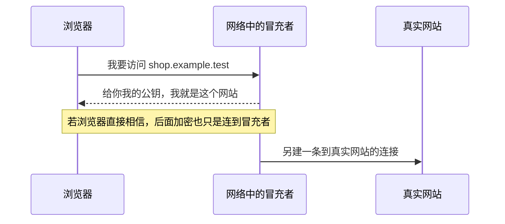
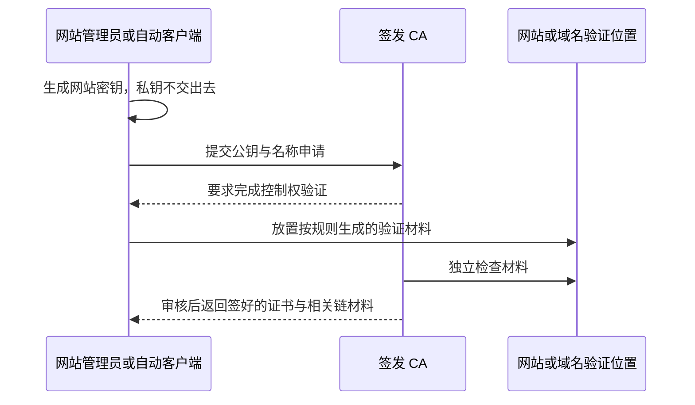
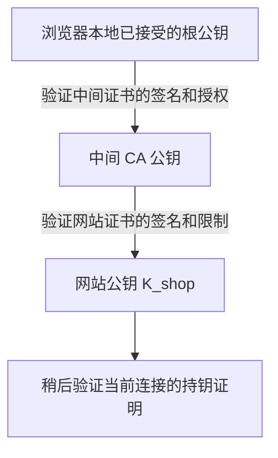
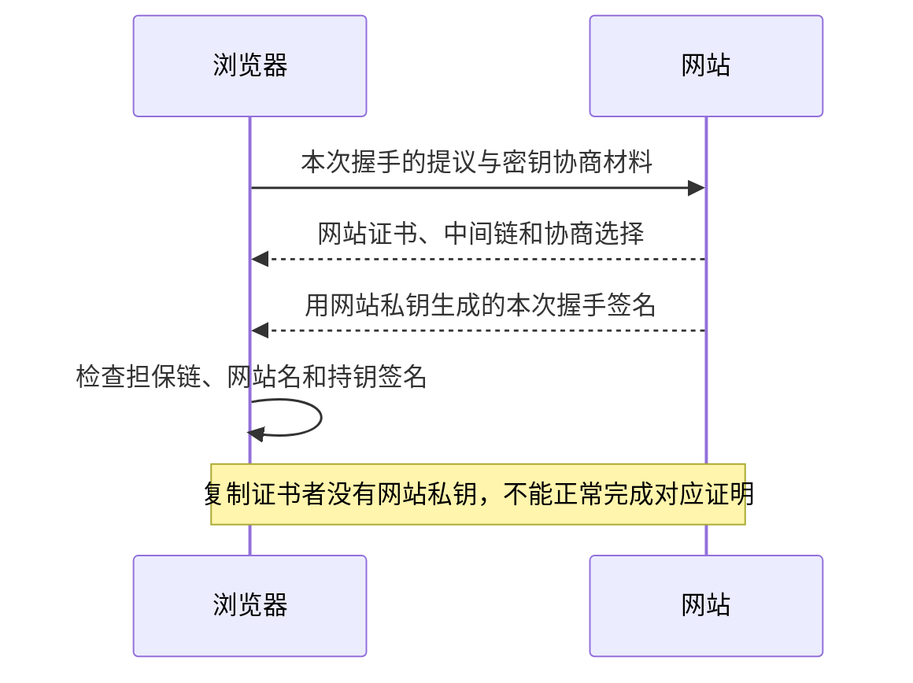
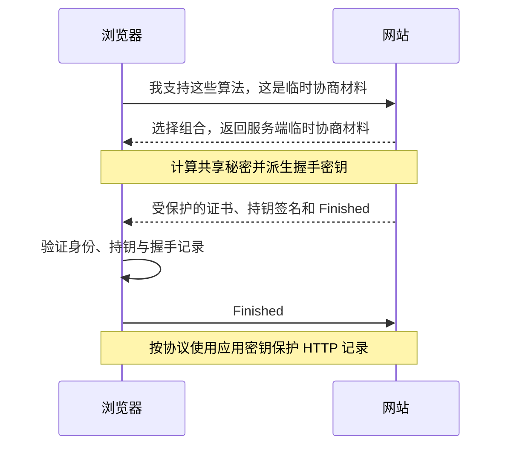
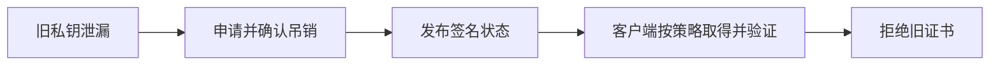
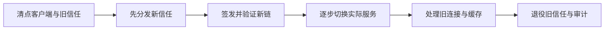
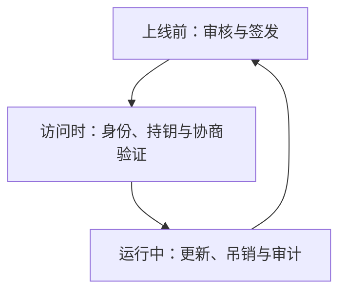

# PKI 原理：浏览器怎样认出真正的网站，再把密码套件接起来

> **先别背缩写。** 本篇只沿一个例子走：浏览器访问 `https://shop.example.test`。我们先遇到问题，再引入解决这个问题的证书和角色，最后把它们接到同一次 TLS 握手里。
>
> 第一遍只需跟住四个问题：**谁给网站公钥担保？我为什么信担保者？对面是否真的持有网站私钥？双方随后用什么算法保护数据？**

这里的 HTTPS 是受安全协议保护的 HTTP；握手协议叫 TLS（Transport Layer Security，传输层安全）。本篇以 TLS 1.3 的常见证书认证连接解释主线，恢复握手等分支随后再读。完整算法细节放在[密码学](../6-1-密码学/密码学原理.md)，配套复述见[PKI 面试](PKI面试.md)。

## 先看路线

1. [第一步：明明已经加密，为什么还可能连到假网站？](#p-01)
2. [第二步：证书是什么，担保者又怎样留下不可伪造的证明？](#p-02)
3. [第三步：网站上线之前，怎样得到这张证书？](#p-06)
4. [第四步：担保者也可能是假的，信任追到哪里停止？](#p-03)
5. [第五步：浏览器收到证书后，到底按什么过程检查？](#p-04)
6. [第六步：它有合法证书，但真的是我想访问的网站吗？](#p-05)
7. [第七步：证书人人都能下载，冒充者复制一份不就行了吗？](#p-10)
8. [第八步：把证书和密码套件连进同一次握手](#p-13)
9. [第九步：为什么还要分根、中间和网站三层？](#p-14)
10. [第十步：证书还没到期，但私钥被偷了怎么办？](#p-07)
11. [第十一步：如果担保者签错了，谁能发现？](#p-08)
12. [第十二步：网站也要认出客户端时，过程怎样改变？](#p-09)
13. [第十三步：到期换证、换钥和换根，分别怎样做？](#p-11)
14. [最后把全过程复述一遍：从上线到访问，再到失效](#p-12)

## 1. 第一步：明明已经加密，为什么还可能连到假网站？

> 🎯 **先记住一个问题**：浏览器拿到公钥后，必须知道“这是谁的公钥”。加密强，不代表连接对象就是真的。

我们只用一个例子：你在浏览器输入 `https://shop.example.test`，准备查看订单。这个域名是教学用名称。先忽略其他网站、邮件和代码签名，把这次连接讲完整。

网站有一对钥匙：**私钥自己保管，公钥可以公开**。这里先把公钥理解为“验证网站签名所用的材料”，私钥是“只有网站应该掌握、能够产生相应签名的秘密”。不要先把它们记成一对能随意互换的加密钥匙。

假设网站直接告诉浏览器：“这是我的公钥。”会发生什么？

**读图**：攻击者不一定破解任何加密。他只要让浏览器把“攻击者的公钥”错认成“网站的公钥”，就能在两条连接之间转发内容。这叫中间人问题，但先理解过程，比记名称更重要。

所以第一次访问一个陌生网站时，我们缺的不是另一个更复杂的加密算法，而是**一份可验证的证明：网站名与公钥确实属于同一个申请者所控制的身份范围**。

最简单的办法是你提前通过可信渠道记住每个网站公钥。这在少数固定服务中可行，但互联网网站多、密钥会换，不可能靠每个人手工交换。接下来引入“浏览器已经接受的担保者”。

## 2. 第二步：证书是什么，担保者又怎样留下不可伪造的证明？

> 🎯 **证书的核心内容可以先读成一句话**：“在这些期限和用途限制下，这个网站名可以使用这把公钥；我为这份声明签名。”

这个担保者叫 **CA（Certification Authority，证书颁发机构）**。CA 不是一个神秘网络协议，它是承担审核与签发职责的机构或受控服务。

先把一张网站证书想成下面这张表，暂时不背字段缩写：

| 证书告诉你的事 | 本例中的含义 |
|---|---|
| 给谁使用 | shop.example.test 等经过核准的名称 |
| 哪把公钥 | 网站公钥 K_shop |
| 什么时候可以用 | 开始时间与到期时间 |
| 允许做什么 | 例如服务器身份认证，而非任意签发其他证书 |
| 谁签发 | 某个签发 CA |
| 签发者的签名 | 对上面这些声明内容作出的可验证签名 |

**签名怎样防修改？** CA 用自己的私钥对规范编码的证书声明执行签名方案。浏览器用 CA 公钥验证。如果有人把网站名或公钥换掉，却没有 CA 私钥，就不能为修改后的声明生成有效签名。实际签名包含摘要和具体编码规则，不是给文件贴一张能随意复制的图片章。

这里出现了**两对不同的钥匙**：

| 谁的钥匙 | 私钥做什么 | 公钥做什么 |
|---|---|---|
| CA 的钥匙 | 签署网站证书 | 供浏览器验证证书签名 |
| 网站的钥匙 | 在握手中证明自己持有对应秘密 | 放进证书，供浏览器验证网站的证明 |

**关键区别**：CA 签证书，不代表 CA 知道网站私钥；网站也不需要拿到 CA 私钥。证书可以公开，CA 和网站的私钥都不应公开。

证书公钥也不一定用于加密请求正文。先把身份这件事讲完，后面再把密码套件接上。

## 3. 第三步：网站上线之前，怎样得到这张证书？

> 🎯 **这一步发生在网站准备阶段，不是在每个用户访问时重新做一次。**

以网站自己生成密钥的常见流程为例：

1. 网站在自己的受控环境生成公钥 K_shop 和私钥 k_shop。私钥留在服务端、密钥服务或受控硬件中。
2. 网站准备一份申请，写明公钥、想申请的名称及相应信息，再用网站私钥签署这份请求。
3. CA 检查申请格式和签名，但还不能只凭申请者自己写的名称签发。
4. CA 要求申请者完成域名控制验证。例如按规则在特定网页位置放置验证材料，或者在域名解析中添加指定记录。
5. CA 自己检查验证材料，确认申请者在该审核规则下控制了所申请名称。
6. CA 按策略决定允许的名称、用途和期限，签出证书。网站拿到证书和必要的中间证书，配置到实际提供连接的服务上。

**为什么申请已经签名，还要验证域名？** 申请签名证明“申请者控制着这份申请对应的私钥”，不证明“申请者控制 shop.example.test”。攻击者也可以生成自己的密钥，再在申请上写别人的域名。

这份标准申请叫 **CSR（Certificate Signing Request，证书签名请求）**。有的体系把审核职责单独交给注册审核机构，称为 RA；自动化系统如 ACME 则把订单、挑战、审核和取证书串成协议。它们是对上面过程的组织与自动化，不改变“持钥证明不能代替域名审核”的原因。

**审核的保证有范围**：域名控制验证不是网站信誉评审。一个真正控制某恶意网站域名的人，也可能依法取得该域名的有效证书；浏览器的安全连接标志不代表商品或内容一定可信。

## 4. 第四步：担保者也可能是假的，信任追到哪里停止？

> 🎯 **信任不能从服务器发来的材料里凭空产生，必须有一个事先接受的起点。**

你可能马上问：“冒充者也可以自己建一个 CA，再给自己签证书啊？”完全正确。签名只能证明“对应私钥签过它”，不能自己证明“签名者值得信任”。

浏览器、操作系统或应用通过各自的受控分发与审核机制，预先接受一批信任起点。这些起点通常用根证书表达，对应**根 CA**。你不是因为根在网络上自称可靠而相信它，而是因为本地信任配置事先接受了它。

日常签发通常再分一层：根 CA 授权一个中间 CA，中间 CA 给网站签证书。这样根的高权限私钥不必每天在线为大量网站签发。

**把图读成两句担保**：

- 根说：“这个中间机构可以在规定范围内签发证书。”
- 中间机构说：“这张证书中的网站名与网站公钥是我审核签发的声明。”

浏览器从本地已接受的起点，把这两段签名及限制验证连起来，就得到一条**证书链**。最下面的网站证书常叫叶证书，名称来自树的末端，并没有新算法含义。

服务器通常发送网站证书及所需中间证书。它即使额外发一张根，浏览器也不会因此自动信任；否则攻击者发送自己的根就绕过全部设计。根证书常见自签名形式，但“自签名正确”不是它获信的原因。

**这又引入什么代价？** 如果一个根被错误信任或私钥失陷，影响可能很广。所以根的审核、密钥保护、客户端更新和撤信通道本身就是体系的一部分。后面再讲如何隔离和恢复。

## 5. 第五步：浏览器收到证书后，到底按什么过程检查？

> 🎯 **现在把材料放到桌上**：服务器给了“网站证书 + 中间证书”；浏览器已有“本地信任起点 + 想访问的网站名 + 当前时间”。

以下是便于理解的检查顺序，真实验证器可能穿插处理、尝试多条候选路径，不一定逐行照这个顺序实现。

### 5.1 先找一条能追到本地信任起点的路
网站证书写了签发者信息，浏览器从服务器给的中间证书、可用缓存及实现允许的来源中寻找候选签发者。名字相同只是线索，不能直接接受；还必须验证签名和相关身份关联。

如果缺一个中间证书，浏览器可能无法把网站连到已接受的根。某些浏览器已有缓存而另一个客户端没有，因此会出现“我的浏览器能开，同事的程序失败”。不能推导成程序必然验证错误。

### 5.2 顺着路验证每一段担保
浏览器使用签发者公钥验证被签证书，确认签名对相应声明成立。再检查签发者是否被授权当 CA、是否允许继续签发、下级名称或用途是否越界。

**为什么不能只验签？** 一个普通网站也有私钥，可以给攻击者的假证书签名。如果任何有效签名都算担保，那么“有一张网站证书”就等于“可以给全世界签证书”。证书中的授权限制正是为了阻止这一点。

### 5.3 检查时间、用途及其他约束
证书是否已经生效、是否过期；允许用作服务器认证还是其他用途；是否有必须理解却无法处理的约束；采用的算法与密钥是否满足本地策略。证书的数学签名不会因为过期自动变坏，但依赖方应按时间条件拒绝继续使用。

### 5.4 再检查网站名和当前连接的证明
链验证后，还要检查这张证书是不是给 shop.example.test 的，以及当前连接对面是否真的掌握网站私钥。这两个过程分别放到后两章讲，避免一口气混在“验证证书”四个字里。

| 检查结果 | 已经知道什么 | 还不知道什么 |
|---|---|---|
| 找到可信路径 | 有可接受的担保来源 | 当前访问名是否匹配 |
| 签名、时间和约束通过 | 证书声明在策略下可接受 | 对面是否持有私钥 |
| 名称匹配 | 声明确实对应预期服务 | 证书是否被别人抄来冒用 |
| 握手持钥证明通过 | 当前对端控制相应私钥 | 网站是否有权做某笔业务操作 |

任何必需条件失败，都不能靠“其他几项是对的”补齐。比如缺链不是换个更强加密套件就能解决。

## 6. 第六步：它有合法证书，但真的是我想访问的网站吗？

> 🎯 **合法身份不等于目标身份。浏览器必须拿自己想访问的名字去比，而不是让对方替自己选目标。**

设攻击者确实拥有 evil.example.test，并拿到了该名称的合法证书。它把这张证书交给访问 shop.example.test 的浏览器：签名、期限和根都可能正确，但网站名不匹配，连接必须拒绝。

网站证书有专门的“允许身份列表”，常称 **SAN（Subject Alternative Name，主体备用名称）**。现代服务身份规则按相应列表项验证，不能随便回退去读证书标题中的另一个名字。

| 浏览器原本要访问 | 证书允许的身份 | 能否仅据此匹配 |
|---|---|---|
| shop.example.test | shop.example.test | 该名称条件可通过 |
| shop.example.test | evil.example.test | 不通过 |
| api.example.test | *.example.test | 按适用单层通配规则可匹配 |
| a.b.example.test | *.example.test | 不自动匹配两层 |
| 192.0.2.10 | 只有 shop.example.test 的 DNS 名 | 不能当作该 IP 身份证明 |

即便两个名称暂时解析到同一个 IP，也不表示证书可以互用。同一台服务器可承载很多互不相关的网站，网络位置不代替服务身份。

浏览器在握手中还能告诉服务器“我要的是哪个名字”，便于服务器选择正确证书。这叫 **SNI（Server Name Indication，服务器名称指示）**。它负责帮助选证书；浏览器拿到证书后仍要自己做名称匹配。

**到这里分清两件事**：服务器选了什么证书，是选择过程；客户端信不信这张证书对应自己目标，是验证过程。配置了 SNI 不等于验证自然通过，关闭名称检查更不是修复方法。

## 7. 第七步：证书人人都能下载，冒充者复制一份不就行了吗？

> 🎯 **证书不是密码，复制证书不等于得到私钥。握手要让当前对端证明它真正持钥。**

现在浏览器相信证书里写的：“K_shop 是 shop.example.test 可用的公钥。”但当前网络连接可能仍由冒充者应答，所以还差一个动作：让对端用对应私钥为**这次握手的特定内容**作证明。

以 TLS 1.3 的典型证书认证握手为例，网站用自己的私钥对协议规定的上下文和握手摘要签名。浏览器用证书里的公钥验证。那条证明消息的正式名字是 CertificateVerify，先把它记成“本次连接的持钥签名”就够了。

**为什么签本次握手，而不是发一个永远相同的签名？** 如果永远相同，攻击者录下后就能重放。协议把新鲜握手内容、参与角色和协商信息按规则绑定，旧证明不能直接拿来冒充任意新连接。不要自行把这一步简化成随便签一个字符串，它依赖完整握手设计。

**注意图的范围**：这是身份验证的逻辑图，不是完整抓包顺序。TLS 1.3 部分握手内容本身已被握手密钥加密；这里只画出谁证明什么。

现在可以给 PKI 下一个朴素定义：**用可信担保、受控审核和可验证证书，让通信方知道公钥对应什么身份，并管理这份信任什么时候有效、什么时候收回。** 英文叫 Public Key Infrastructure，缩写 PKI（公钥基础设施）。

但 PKI 还没有独自把应用数据加密。下一章把你关心的密码套件接到这条线上。

## 8. 第八步：把证书和密码套件连进同一次握手

> 🎯 **本章最重要的区分**：CA 给网站公钥作担保；网站用私钥认证本次握手；双方协商会话秘密；对称算法保护业务数据。它们协作，但用的不是同一把钥匙、同一个算法。

### 8.1 先列出本次连接里四个不同问题
| 问题 | 谁来解决 | 本例可采用的选择 |
|---|---|---|
| 证书是不是可信 CA 签的 | 证书签发签名与可信路径 | CA 使用某种签名方案 |
| 当前对端是否控制网站私钥 | 本次握手的持钥签名 | 网站使用 RSA-PSS 签名 |
| 双方怎样得到别人不知道的共享秘密 | 临时密钥协商 | X25519 临时协商 |
| 大量 HTTP 数据怎样保密并防修改 | 对称认证加密与派生密钥 | AES-128-GCM |

RSA-PSS 是一种 RSA 签名方案；X25519 是一种椭圆曲线密钥协商方法。第一次读时只需记住**签名与协商是两个岗位**，算法细节可去密码学篇再看。

证书上还可能出现“颁发者使用 ECDSA 签名，而网站公钥是 RSA”。这并不矛盾：**CA 用自己的钥匙签证书，网站用网站的钥匙签握手**，两种钥匙不必采用同一算法。

### 8.2 为什么不拿证书公钥直接加密所有网页
非对称算法承担认证或建立秘密等任务；对大量记录使用对称认证加密更合适。临时协商还可在适当条件下保护历史会话：即使长期签名私钥日后泄漏，也不应直接恢复此前已销毁临时秘密的会话。

所以 TLS 1.3 的常见路径不是“浏览器生成密码，用证书 RSA 公钥加密后发给服务器”。那是容易与历史 RSA 密钥传输混淆的旧直觉，不能用来解释本例。

### 8.3 一次典型 TLS 1.3 握手，按原因读过程
1. **浏览器先提议。** 告诉服务器支持的版本、记录保护组合、签名能力、协商方法，并发送相应临时协商材料。
2. **服务器选择可用组合并给出自己的临时材料。** 双方据此算出共享秘密，再按协议派生握手密钥。选择必须与双方能力及服务器证书私钥兼容。
3. **服务器发送证书与本次持钥签名。** 浏览器验证担保路径、网站名及签名，把“算出秘密的对面”与“可信网站身份”联系起来。
4. **双方完成握手记录校验。** 协议中的 Finished 消息使用派生秘密确认握手记录与密钥，不是再做一次 CA 签名。
5. **按协议规定的阶段使用应用流量密钥。** 浏览器和服务器用选定的对称认证加密保护后续 HTTP 数据。不同方向、阶段的密钥应分开派生，不是一个共享值到处直接复用。

**读图**：这是不含客户端证书的普通证书握手主线。恢复握手、早期数据和要求重新提供协商材料会有分支；不要把本图当所有连接固定包数。

### 8.4 密码套件的名字现在就有位置了
TLS 1.3 中 `TLS_AES_128_GCM_SHA256` 可以先读成：“这次连接用 AES-128-GCM 保护记录，相关密钥派生与握手摘要使用 SHA-256。”**它没有说网站证书必须是 RSA，也没有说协商必须用哪条曲线。** 这些选择在别处协商和验证。

TLS 1.2 的 `TLS_ECDHE_RSA_WITH_AES_128_GCM_SHA256` 则把更多角色编码进套件名：ECDHE 负责临时协商，RSA 表示相应认证角色，AES-GCM 保护记录，该套件中的 SHA256 关联相应派生哈希。不能因为名字都带 RSA，就与历史 `TLS_RSA_WITH_...` 密钥传输混为一谈。

**因此，“证书的各种密码套件”最好拆成两个提问**：

- 这张证书里是什么公钥、是谁用什么算法签发的？
- 这次 TLS 连接最终用什么签名、协商方法与记录保护套件？

完整拆解在[密码套件专题](../6-1-密码学/密码学原理.md#p-12)，协商失败在[后续章节](../6-1-密码学/密码学原理.md#p-13)。先读完本章，再看那里就有了各算法的位置。

## 9. 第九步：为什么还要分根、中间和网站三层？

> 🎯 **分层为了控制风险与委派职责，不是链越长就越安全。**

假如根 CA 每天在线给所有网站签证书，它的高权限私钥就要频繁参与网络服务和日常操作。一旦泄漏，影响可能覆盖整个信任范围。把根的操作减少为“受控授权中间 CA”，让中间承担在线签发，可以降低根暴露，并按组织或用途拆分管理。

例如：根授权“服务端签发机构”和“内部客户端签发机构”。服务端中间只在允许范围内签网站身份，客户端中间签内部调用者身份。**名字上分开还不够**，签发策略、证书限制及客户端验证必须真正执行这些边界。

| 做法 | 获得什么 | 多付出什么 |
|---|---|---|
| 根直接签网站 | 路径简单 | 根参与高频操作、隔离差 |
| 根授权中间再签网站 | 减少根暴露、便于分范围处置 | 多一级链材料与轮换 |
| 再增加中间层 | 更细组织和政策委派 | 更复杂的验证、管理和握手材料 |

有时为了兼容旧客户端，同一个 CA 公钥会被不同根签出不同证书，这叫交叉签名。你可理解成“同一个担保者，持有两份来自不同上级的介绍材料”。不同浏览器接受的上级不同，最终能走通的路径也可能不同。

这不表示可以任意拼链。每条路径的签名、期限、授权和本地信任都要成立；发送更多证书也不一定有帮助。根轮换与交叉签名应有明确过渡和退役计划。

## 10. 第十步：证书还没到期，但私钥被偷了怎么办？

> 🎯 **有效期解决“最多信多久”，提前撤销解决“现在已知不该再信”。**

如果攻击者偷到了网站私钥，它不仅能复制证书，还能完成相应持钥签名。仅靠握手就无法分清“真网站”与“同样拿到私钥的攻击者”。需要撤回旧凭据、换新钥，并让依赖方有办法知道旧证书已不应使用。

过程分为五件事：发现并控制泄漏 → 生成替代钥与证书 → 按策略请求吊销旧证书 → 发布可验证的状态 → 依赖方获取并执行状态策略。不是网站在自己电脑上删掉文件，全球浏览器就自然不再信任旧副本。

状态发布有两种容易理解的方式：发布一份“已吊销名单”，或者按证书查询状态。前者叫 **CRL（Certificate Revocation List，证书吊销列表）**，后者常用 **OCSP（Online Certificate Status Protocol，在线证书状态协议）**。返回的状态也要验证来源与时间，不能相信攻击者随便说一句“没吊销”。

**为什么不是即时全球生效？** 状态有发布周期、缓存和网络可用性；客户端的强制检查策略也不同。状态查询断网与明确查到已吊销，不是同一个结果。允许查询失败时继续，偏向可用性；强制失败则更依赖状态服务稳定，二者都有成本。

服务器可以附带一份有效签名状态，减少浏览器另行查询，这叫 stapling。证书有效期更短也能缩小旧凭据的时间窗口，但窗口内仍有风险，自动续签失败还会影响可用性。

已有长连接和恢复凭据也要考虑。拒绝新的完整握手，不代表此前连接和所有业务会话立即失效。泄漏响应必须追踪真实使用路径。

## 11. 第十一步：如果担保者签错了，谁能发现？

> 🎯 **体系不能只假设 CA 永远正确，还要让异常签发可被发现、追责与处理。**

前面的链解决“按谁的授权验证”，没有证明审核永不出错。CA 可能误签、系统被侵入，域名验证渠道也可能被攻击。

公有网站证书体系可通过公开的透明日志提高可观察性：把相应签发材料提交给日志，域名所有者和监测者能检查“有没有给我的域名签出不认识的证书”。这叫 **CT（Certificate Transparency，证书透明度）**。

它更像“公开可核对的签发记录”，不是另一个代替 CA 的审核机构。误签证书也可能被正常记入日志；发现后仍需调查、吊销、通知和治理处置。日志承诺与后续验证也有具体协议，不能看到一个日志时间戳就当作已完成全部审计。

根库维护者还会规定哪些 CA 可以继续被信任、需要怎样审计、允许什么算法与证书规则。数学签名正确却被客户端策略拒绝，不一定是客户端算错，可能是该签发者或算法不再获准。

**这一层的原因**：密码学证明“谁用某把钥匙签了什么”，但“机构如何审核、怎样保护钥匙、违规后谁撤信”是组织治理问题。PKI 必须把二者连接起来，不能让一份算法说明代替完整责任链。

## 12. 第十二步：网站也要认出客户端时，过程怎样改变？

> 🎯 **普通 HTTPS 主要让客户端验证网站；双向认证再让网站按自己的信任策略验证客户端凭据。**

仍用订单系统：浏览器普通用户可以登录账号；内部结算服务也可能用证书证明自己是受管理的服务，而非依赖人工输入密码。

双向证书认证的概念过程是：网站要求客户端出示证书 → 客户端提供证书与相应持钥证明 → 网站验证客户端的担保链、用途及身份 → 将身份映射为服务账号 → 再判断这个账号是否有权执行本次操作。它叫 **mTLS（Mutual Transport Layer Security，双向 TLS 认证）**。

| 判断 | 对应问题 |
|---|---|
| 证书认证 | 你是否控制受信任身份的私钥？ |
| 身份映射 | 这个证书身份对应哪个服务账号？ |
| 业务授权 | 这个服务账号能否查询或结算该订单？ |

同一个根给仓储和结算两个服务签了证书，不能因此让仓储获得结算权限。**认证回答“你是谁”，授权回答“你能做什么”。**

组织内部可以自行维护 CA，不必让全互联网浏览器都信它。但每个依赖方要通过可信方式得到相应信任配置，还要有人负责审核、吊销、轮换和审计。内部并不等于自动可信。

若 TLS 在网关结束，网关到后端是另一条安全边界。后端不能信任外部用户随便填写的“客户端证书身份”首部；只有在经过明确保护、过滤与授权的转发机制下，才能按策略使用网关提供的身份。

## 13. 第十三步：到期换证、换钥和换根，分别怎样做？

> 🎯 **更换的对象不同，影响范围和正确顺序就不同。**

**只到期续证**：重新审核并取得合适新证书，确认服务真正加载了新证书、链与配套私钥。文件复制成功不代表全部进程、区域和网关都已切换；应看真实握手发送的内容。

**网站私钥泄漏**：必须分析旧钥暴露，不能仅用同一把失窃钥续一张新证书。通常需替换钥、签新证书、吊销旧凭据，并按事件范围处理连接、恢复票据和应用身份。

**根将退役**：先让依赖方可信地接受新根，再切换到新根可验证的链，观察真实客户端，最后按计划移除旧信任。先切服务后才更新客户端，会造成“新链没人认识”的中断。

**图是正常迁移顺序**。如果根已失陷，不能为了兼容无限期保留旧信任，可能需要接受部分客户端中断。根失陷后的恢复还依赖外部可信分发机制，不能仅让已经被盗的根钥再签一个“相信我已修好”的声明。

| 用户看到的问题 | 优先问什么 |
|---|---|
| 找不到签发者 | 服务器是否漏发中间证书？本地有没有正确根？ |
| 名称不匹配 | 原本访问谁？证书允许哪些名称？是否选错站点证书？ |
| 过期或尚未生效 | 哪一级过期？客户端时钟对不对？服务是否真的更新？ |
| 配置证书后握手签名失败 | 私钥是否配对？签名算法与提供者是否兼容？ |
| 浏览器能开，程序失败 | 双方信任库、缓存、路径和策略有何差别？ |

修复应对应原因。关闭验证会同时移除前面辛苦建立的担保、身份或持钥检查，不能作为正式的通用解决方法。

## 14. 最后把全过程复述一遍：从上线到访问，再到失效

> 🎯 **用下面三段过程检查理解，不要先背缩写。**

### A. 网站上线前：建立身份声明
网站生成密钥，私钥自己保管；向签发机构申请证书；机构审核名称控制与申请权限；机构用自己的私钥给合规声明签名；网站配置证书和中间链。与此同时，浏览器通过自己的可信分发渠道预先拥有可接受的根。

### B. 用户访问时：验证身份并建立加密连接
浏览器声明支持能力并开始临时密钥协商；服务器选定合法组合并返回所需材料；服务器提供证书与本次持钥签名；浏览器找到可信路径，验证授权、签名、时间、用途和预期网站名，再验证对端持钥；双方按协议校验握手并使用派生密钥保护应用数据。

### C. 后续运行中：让信任能更新和撤回
正常到期前续证并确认热更新；密钥泄漏时替换凭据、发布吊销并处理已有会话；签发异常由日志、审核与治理发现；根迁移时先更新依赖方信任，再切链并退役旧锚。

### 四个反例，比背定义更能看出边界
| 反例 | 浏览器应该卡在哪里 | 为什么 |
|---|---|---|
| 攻击者换成自己的公钥和自签证书 | 信任路径 | 没有本地接受的担保起点 |
| 攻击者拿自己的合法域名证书冒充商店 | 网站名匹配 | 真身份不等于目标身份 |
| 攻击者只复制商店证书，没有私钥 | 本次握手持钥证明 | 公开证书不能生成网站签名 |
| 商店私钥真被盗 | 单次握手未必能分辨 | 需要吊销、换钥和状态执行 |

**再问三个问题**：更强密码套件能修复错域名吗？不能。可信证书能让 0-RTT 扣款自然不可重放吗？不能。客户端证书通过后就能结算全部订单吗？也不能。它们分别属于身份、协议新鲜性与业务权限，必须各有处理。

### 读完主线后，再查术语
证书里的具体字段、文件编码和策略名放在下面的查阅表中。它们是上述步骤的正式表达，不是学习起点。

| 已经理解的含义 | 正式名称 | 出现在哪一步 |
|---|---|---|
| 允许使用的服务名称 | SAN | 网站名匹配 |
| 该证书是否获准签下级 | Basic Constraints、KU | 证书链授权检查 |
| 允许服务器还是客户端等用途 | EKU | 使用目的检查 |
| 找候选签发者的辅助信息 | AKI、SKI | 构建候选链，仍须验证签名 |
| 可公开传输的标准证书结构 | X.509 | 签发、发送与验证 |
| 二进制编码 / 常见文本封装 | DER / PEM | 保存与传递材料 |
| 保存自己私钥和链的容器 | 例如 PKCS#12 | 本端身份凭据管理 |
| 决定自己相信谁的集合 | 信任库 | 依赖方信任起点 |

本地测试可按前面的反例构造证书。离线路径验证成功不等于做完真实 TLS 持钥测试；真实浏览器还可能有吊销、透明度与根治理策略。前一轮内存证书矩阵的测试结论保持为限定范围，不扩大成已测所有握手分支。

## 标准与进阶查阅

- [RFC 5280：证书、授权约束与路径验证](https://www.rfc-editor.org/rfc/rfc5280)。
- [RFC 9525：怎样匹配预期服务身份](https://www.rfc-editor.org/rfc/rfc9525)。
- [RFC 9846：TLS 1.3 握手与算法角色](https://www.rfc-editor.org/rfc/rfc9846)，对照[原始 RFC 8446](https://www.rfc-editor.org/rfc/rfc8446)。
- [RFC 8555：自动申请与审核流程](https://www.rfc-editor.org/rfc/rfc8555)、[RFC 6960：证书状态](https://www.rfc-editor.org/rfc/rfc6960)。
- [RFC 3647：签发机构的策略和实践](https://www.rfc-editor.org/rfc/rfc3647)、[RFC 9162：证书透明度机制](https://www.rfc-editor.org/rfc/rfc9162)。

规范的更新、客户端根库、有效期和算法策略需按实际版本查阅。上面的故事解释职责与原因，不把某浏览器策略当成所有私有体系规则。

## 附录：术语与缩写

| 缩写或术语 | 英文全称 | 中文含义 |
|---|---|---|
| PKI | Public Key Infrastructure | 公钥基础设施 |
| CA | Certification Authority | 证书颁发机构 |
| RA | Registration Authority | 注册审核机构 |
| CSR | Certificate Signing Request | 证书签名请求 |
| SAN | Subject Alternative Name | 主体备用名称 |
| CN | Common Name | 通用名称，非现代服务身份验证通用兜底 |
| KU | Key Usage | 密钥用途 |
| EKU | Extended Key Usage | 扩展密钥用途 |
| SPKI | Subject Public Key Info | 主体公钥信息 |
| AKI | Authority Key Identifier | 颁发者密钥标识 |
| SKI | Subject Key Identifier | 主体密钥标识 |
| CRL | Certificate Revocation List | 证书吊销列表 |
| OCSP | Online Certificate Status Protocol | 在线证书状态协议 |
| CT | Certificate Transparency | 证书透明度 |
| SCT | Signed Certificate Timestamp | 签名证书时间戳 |
| ACME | Automatic Certificate Management Environment | 自动证书管理环境 |
| CAA | Certification Authority Authorization | 证书颁发机构授权 DNS 记录 |
| DER | Distinguished Encoding Rules | ASN.1 区分编码规则 |
| PEM | Privacy-Enhanced Mail | 常用 Base64 文本封装名称来源 |
| mTLS | Mutual Transport Layer Security | 双向 TLS 认证 |
| HSM | Hardware Security Module | 硬件安全模块 |
| TLS | Transport Layer Security | 传输层安全 |
| DNS | Domain Name System | 域名系统 |
| AIA | Authority Information Access | 颁发机构信息访问扩展 |
| ASN.1 | Abstract Syntax Notation One | 抽象语法记法一 |
| PKCS | Public-Key Cryptography Standards | 公钥密码标准系列 |
| PSK | Pre-Shared Key | 预共享密钥 |
| CP | Certificate Policy | 证书策略 |
| CPS | Certification Practice Statement | 认证实践声明 |
| OID | Object Identifier | 对象标识符 |
| UI | User Interface | 用户界面 |
| RSA-PSS | RSA Probabilistic Signature Scheme | RSA 概率签名方案 |
| ECDHE | Elliptic Curve Diffie–Hellman Ephemeral | 临时椭圆曲线密钥协商 |
| AEAD | Authenticated Encryption with Associated Data | 带关联数据的认证加密 |
| SNI | Server Name Indication | 服务器名称指示 |
