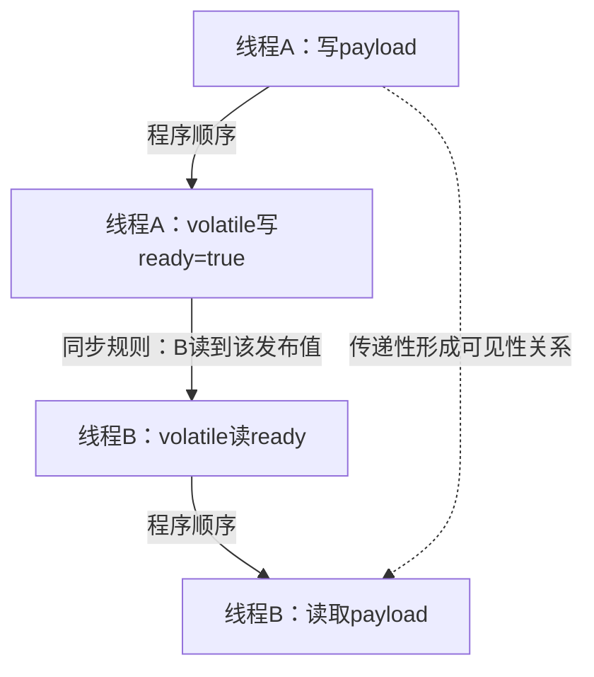
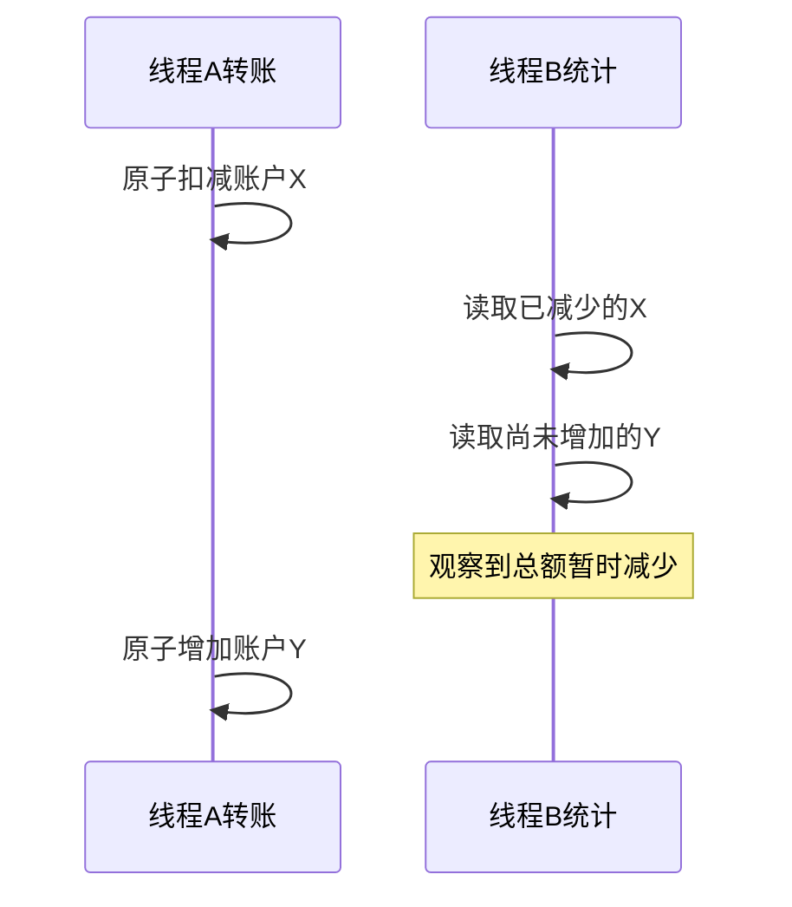

# Java 后端工程设计与并发边界

> 基线：Java 17/21。与集合、泛型、反射、代理、JUC、线程池及 JVM 系列配合阅读。本章把单个语言知识点串成工程决策，面向需要负责模块设计、生产质量和面试深入表达的工程师。

**阅读主线**：类型与不变量 → happens-before → 组合原子性 → 资源预算。

**快速入口**：[面试题与参考答案](#reference-answers)。

## 阅读目录

- [1. 类型与对象设计：先消除非法状态](#section-1)
- [2. 泛型、擦除与 API 演进](#section-2)
- [3. 异常设计：错误语义决定重试和回滚](#section-3)
- [4. JMM：可见性、原子性与有序性](#section-4)
- [5. 锁、CAS 和并发集合的业务约束](#section-5)
- [6. 线程池：容量不是 CPU 公式](#section-6)
- [7. CompletableFuture 的组合与资源隔离](#section-7)
- [8. 反射、代理与可扩展边界](#section-8)
- [9. 日期、金额与空值：常见业务事故来源](#section-9)
- [10. 测试策略与工程决策](#section-10)
- [11. 面试题与参考答案](#section-11)
- [12. 阅读与练习路线](#section-12)
- [13. 官方资料](#section-13)

<a id="section-1"></a>

## 1. 类型与对象设计：先消除非法状态

把订单状态设计为多个 boolean，容易出现 paid=true、cancelled=true、refundFinished=false 等无法解释的组合。枚举/封闭类型能表达有限状态，状态转换由领域方法约束，而不是让外部随意 setStatus。

不可变对象便于共享与推理，但要区分字段 final、容器只读与深不可变。record 持有 List<MutableItem> 时仍可能被内部元素修改；需要复制容器并限制元素可变性。创建成本与复制成本通过实际规模评估，不把不可变当零成本口号。

### 1.1 equals/hashCode 的边界

放入 HashMap/HashSet 后改变参与 hashCode 的字段，会让查找行为与预期不同。ORM 实体使用数据库 ID 做相等判断还要考虑尚未分配 ID、代理类型和跨会话对象；不要自动生成所有字段比较却没分析身份语义。

领域 ID 可以封装为类型避免把 userId/orderId 都当 Long 混用，但要考虑序列化、数据库映射和大量对象的成本。不是所有简单参数都要包装，边界越重要越值得显式建模。

<a id="section-2"></a>

## 2. 泛型、擦除与 API 演进

泛型主要提供编译期约束，擦除意味着运行时不能直接 `new T()` 或可靠区分所有参数化类型。反射可读取声明层泛型元信息，但不表示任意对象携带完整实际类型参数。

### 2.1 PECS 从“读写能力”理解

`? extends T` 表达某个 T 的子类型集合，可以安全读成 T，但通常不能向其中添加任意 T；`? super T` 可以接收 T，读取时只能保证较宽类型。API 是否需要通配符，取决于输入/输出角色，不应为了“泛型高级”给每个参数叠通配符。

### 2.2 二进制兼容与序列化兼容不同

一个 Java 方法签名升级是否二进制兼容，与 JSON 字段、消息 schema 和数据库列的兼容是不同层次。共享 jar 并不能代替版本化协议，滚动部署期间旧消费者仍需能理解新消息或忽略未知字段。

<a id="section-3"></a>

## 3. 异常设计：错误语义决定重试和回滚

异常至少分为调用者可修正的业务拒绝、可恢复的依赖故障、结果不明确的超时及程序缺陷。不要用一个 RuntimeException 包住全部错误后丢掉 cause，否则上层无法决定返回码、重试或告警。

| 情况 | 上层行为 | 例子 |
| --- | --- | --- |
| 参数/状态不合法 | 明确拒绝，不自动重试 | 已关闭订单再支付 |
| 暂时依赖不可用 | 有限退避和总预算 | 短暂连接失败 |
| 写入结果不明确 | 用稳定操作 ID 查询 | 支付确认超时 |
| 程序缺陷 | 失败并告警，保留上下文 | 不应发生的状态 |

checked/unchecked 是 Java 类型层面的选择，不直接等于业务可恢复/不可恢复。Spring 默认回滚规则与异常选择有关，需要显式测试。finally 中抛出新异常还可能覆盖原始错误，try-with-resources 的 suppressed 异常也要保留。

<a id="section-4"></a>

## 4. JMM：可见性、原子性与有序性

多个线程共享状态时，必须建立 happens-before 关系。锁释放/随后加锁、volatile 写/后续读、线程 start/join 等提供特定关系；不是“sleep 一会儿就能看见”，也不是只要代码先写在前面，其他线程就以相同顺序观察。

### 4.1 volatile 能做什么

volatile 适合发布状态和某些单变量协议，但 `count++` 是读改写组合，不因字段 volatile 自动原子。两个字段之间的业务不变量也不能仅靠各自 volatile 维护。

```java
final class StopFlag {
    private volatile boolean stopped;
    void stop() { stopped = true; }
    void runLoop() {
        while (!stopped) {
            // 每轮工作应有界，阻塞调用还需独立超时/取消。
            doOneStep();
        }
    }
    private void doOneStep() { /* 教学占位，不用空自旋模拟业务 */ }
}
```

示例只展示可见性，不是推荐忙等实现。真实等待通常使用阻塞队列、条件变量或其他协作机制。

### 4.2 安全发布

### 4.3 happens-before 怎样建立跨线程推理

**图 1｜happens-before 怎样建立跨线程推理**



**图解**：volatile 不是给某个字段额外分配一份“最新副本”，而是建立特定跨线程同步关系。在线程 B 读到相应发布值的前提下，可以通过程序顺序及传递性推理 payload 的初始化写入；如果发布后 A 继续无同步修改 payload，图中关系并不自动保护所有未来变更。

在实现层，JIT 和 CPU 会按目标平台使用相应排序及可见性机制，但语言规范表达的是允许的可观察结果，不强制所有架构使用同一条屏障指令。把 JMM 只画成“工作内存复制回主内存”，容易误以为刷新某个字段就自动形成多字段事务。

```java
final class PublishedValue {
    private int payload;
    private volatile boolean ready;
    void publish() { payload = 42; ready = true; }
    int readOrDefault() { return ready ? payload : -1; }
}
```

这是单次发布示例，不支持随意复位 ready 后反复并发覆盖 payload。若要求多次更新的一致快照，可用一个 volatile/AtomicReference 发布完整不可变对象，让“版本与内容”共享一次原子引用替换。

### 4.4 原子单变量为什么不能维护两个字段不变量

**图 2｜原子单变量为什么不能维护两个字段不变量**



**图解**：两个 AtomicLong 各自正确，不等于它们的组合转换原子。若要求任何观察者都看到转账前或转账后总额，需要同一锁/事务或不可变快照协议；所有读写方都要遵守。CAS 和并发集合提供的是特定操作保证，不能直接拼成任意业务事务。

对象构造完成前把 this 注册到外部监听器，可能让其他线程看到未初始化状态。final 字段语义有价值，但不能补救构造期间逸出或内部可变对象的无同步访问。通过正确的容器/并发结构发布完整对象。

<a id="section-5"></a>

## 5. 锁、CAS 和并发集合的业务约束

锁保护的是约定的共享不变量，所有读写路径都要遵守；只在写方法加锁而读取绕过协议可能仍不安全。临界区避免外部网络等待，锁顺序稳定，超时与中断有明确处理。

CAS 可以避免部分阻塞，但存在竞争重试、ABA 和内存分配成本。高竞争下无界重试也会消耗 CPU；LongAdder 适合高并发统计，但 sum 不是多变量事务式快照，不适合直接承担余额扣减。

ConcurrentHashMap 保证某些操作的线程安全，不保证 `if (!containsKey) put` 组合原子。用 putIfAbsent/compute 等合适 API，映射函数要短小，避免递归更新或执行不可控外部副作用。

<a id="section-6"></a>

## 6. 线程池：容量不是 CPU 公式

CPU 核数公式只能做起点。实际线程数由等待比、下游连接、请求 deadline、内存与拒绝策略共同决定。线程池存在核心数、队列和最大数的执行顺序，无界队列会使 maximumPoolSize 很难发挥预期作用。

### 6.1 队列预算

假设业务处理 200 请求/秒，队列积压 1,000 个，粗略排队时间已经约 5 秒；接口总预算 1 秒时，这些任务很可能在开始前就过期。队列越长不代表服务越稳，而是允许更多必然超时的工作占内存。

拒绝策略必须符合调用链：CallerRunsPolicy 可能把工作压回请求线程甚至事件循环；DiscardPolicy 会静默丢任务；AbortPolicy 需要上层转换为可识别过载响应。没有一种策略适用于所有场景。

### 6.2 submit 与异常观察

submit 将异常封装到 Future，若从不读取也不注册监控，失败可能看起来“消失”。任务入口统一追踪开始/完成/失败，保留业务 ID 和技术 trace，finally 清理 ThreadLocal。

<a id="section-7"></a>

## 7. CompletableFuture 的组合与资源隔离

非 async 的后续阶段可能在完成前一阶段的线程上运行；async 默认执行器选择依 API 而定，常见公共池不适合无分析地承载阻塞 I/O。明确传入受控执行器，区分 CPU 与外部等待资源。

allOf 等待全部结果的组合不自动取消其他任务，也不提供多下游事务。一个请求失败后是否继续其他调用，由业务语义决定：并行读可以取消，已发送支付不能靠 cancel 认为撤销。

超时包装只改变结果可见性时，底层工作可能继续。需要把截止时间传播到连接、HTTP 和 SQL 等实际资源，并设计晚结果的处理。

<a id="section-8"></a>

## 8. 反射、代理与可扩展边界

反射和注解适合框架元数据处理，但运行时访问受模块封装、权限和版本影响。缓存反射结果能减少部分开销，却要避免静态缓存保留可卸载类加载器。

动态代理为接口调用增加拦截，类代理通过增强/继承等机制工作。代理只控制经过它的入口，自调用、final/private 方法和手工 new 对象是常见边界。性能讨论应区分代理调用本身和切面实际工作，不用一个微基准概括事务框架成本。

<a id="section-9"></a>

## 9. 日期、金额与空值：常见业务事故来源

Instant 表示时间线上的时刻，LocalDateTime 不含时区，LocalDate 表示日期。用户预约、账期和审计时间有不同语义；数据库、序列化和展示需要明确时区及精度。夏令时会让某些本地时间不存在或重复。

BigDecimal 从十进制字符串构造更符合显式十进制语义，舍入位置与规则必须约定。equals 关注 scale 等差异，compareTo 的数值比较语义不同；做 Map key 前尤其要清楚。

Optional 适合表达某些返回值可能缺失，不宜无分析地放进所有实体字段。空集合、不存在、无权限和依赖失败含义不同，不能一律用 null/empty 抹平。

<a id="section-10"></a>

## 10. 测试策略与工程决策

纯计算和状态转换用快速测试，代理/事务用容器集成，数据库锁用真实引擎双会话，消息重投用故障注入。并发测试以不变量验收，不依赖固定 sleep 排出想象的线程顺序；用屏障/锁存器构造确定性交错更可靠。

设计记录包含背景、约束、候选方案、选择、代价及验证。资深工程师的价值不只是知道更多 API，而是能让团队理解为什么这样做，何时需要改变，以及出了问题如何恢复。

<a id="reference-answers"></a>

<a id="section-11"></a>

## 11. 面试题与参考答案

1. 定义：这个机制解决什么问题。
2. 原理：内部状态和执行路径是什么。
3. 边界：哪些线程、资源和故障不在保证范围。
4. 实践：一个具体流量/数据规模下如何选择。
5. 证据：实验、指标或事故复盘如何证明。

例如回答线程池，不只列七个参数，而是描述流量、连接池预算、队列等待、拒绝、取消和关闭；回答事务，不只列传播级别，而是画出提交和消息投递的失败窗口。

### Q1：volatile、synchronized 与 Atomic 类如何选择？

**参考答案**：volatile 适合可由单次读写表达的状态发布与可见性协议，不保证 count++ 等复合操作原子。Atomic 类提供特定单变量原子操作或引用替换，适合计数、竞争更新等，但不自然保护多个变量不变量。synchronized 等锁可以覆盖一段由多步组成的临界区，代价是竞争和持锁范围管理。应先列出共享不变量及所有访问者，再选最简单正确的协议，而不是按“无锁一定更快”排序。

### Q2：ConcurrentHashMap 为什么不能保证先检查再插入安全？

**参考答案**：containsKey 和 put 分别线程安全，两次调用之间仍可插入其他线程的操作。需要“只在不存在时创建”时用 putIfAbsent 或适当 compute API，但映射函数应短小，避免递归更新和不可重复外部副作用。若还要同时更新其他表、发消息或扣钱，Map 的原子性不覆盖这些资源，仍要设计业务事务和幂等。

### Q3：线程池队列越大是否越稳定？

**参考答案**：不一定。队列吸收短时突发，但持续到达超过处理能力时，排队时间和内存会不断增加。若处理200个/秒、排队1000个，粗略等待已到5秒，超过1秒请求预算后继续接收只会积累注定超时任务。我会按 deadline、下游并发和可接受突发设有界队列，定义可观察拒绝和取消，并监测最老排队任务年龄。

### Q4：CompletableFuture 超时后，底层 HTTP 是否就停止了？

**参考答案**：结果超时与底层资源取消是不同机制。Future 可能已异常完成，网络请求仍在执行，远端写入甚至已提交。需将剩余截止时间传到实际客户端，按库能力取消并清理资源；对于支付等写操作，使用稳定幂等身份查询结果，不能把 cancel 或超时当作远端回滚证明。

<a id="section-12"></a>

## 12. 阅读与练习路线

- 集合与并发：现有集合、JUC、线程池、锁机制笔记，补充组合原子性与队列预算实验。
- 元编程：现有泛型、注解、反射和动态代理，接着读 Spring 容器/代理章节。
- 运行时：自动内存管理、收集器和 JVM 生产诊断，完成一次 CPU、等待及内存问题归因。
- 现代 Java：11/17 迁移导读、21 虚拟线程深入章，明确正式与预览特性。

<a id="section-13"></a>

## 13. 官方资料

- [JLS 17：线程与锁](https://docs.oracle.com/javase/specs/jls/se21/html/jls-17.html)
- [Java 并发包](https://docs.oracle.com/en/java/javase/21/docs/api/java.base/java/util/concurrent/package-summary.html)
- [ConcurrentHashMap](https://docs.oracle.com/en/java/javase/21/docs/api/java.base/java/util/concurrent/ConcurrentHashMap.html)
- [CompletableFuture](https://docs.oracle.com/en/java/javase/21/docs/api/java.base/java/util/concurrent/CompletableFuture.html)
