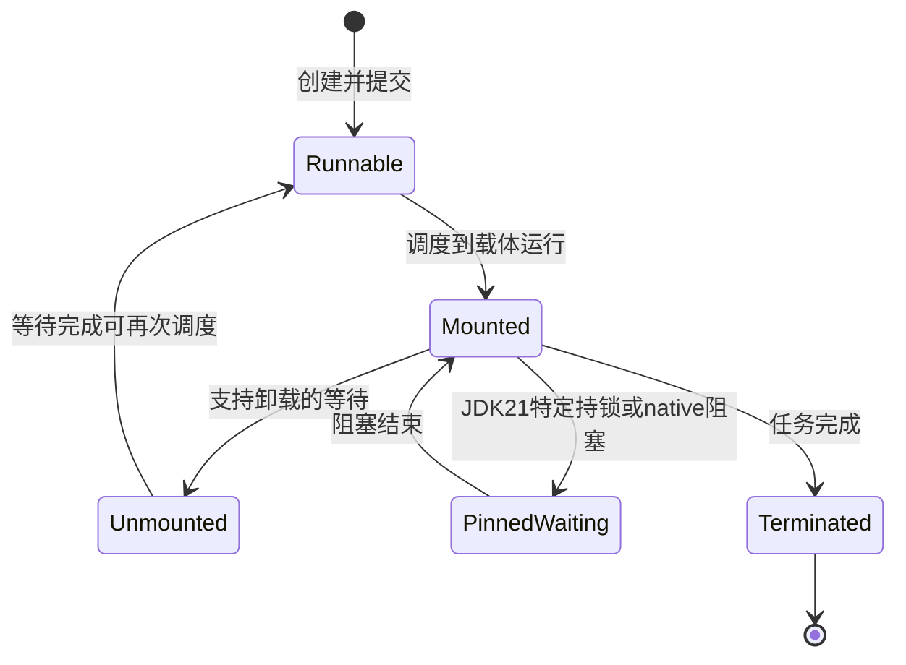
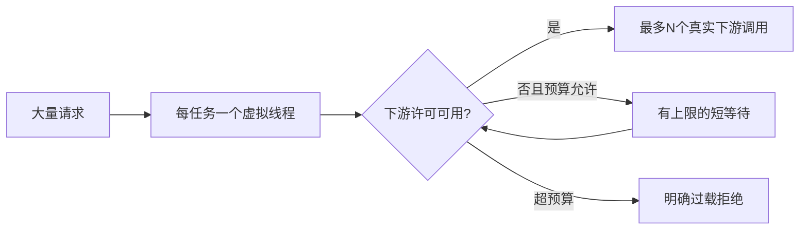

# 虚拟线程调度、资源隔离与迁移深入解析

> 严格基线：JDK 21。JDK 后续版本可能改变 synchronized pinning 等行为，不能不注明版本沿用本章结论。结构化并发与 Scoped Values 在 21 属于预览，不进入这里的稳定代码示例。

**阅读主线**：挂载与卸载 → pinning → 下游准入 → 超时和迁移。

**快速入口**：[面试题与参考答案](#reference-answers)。

## 阅读目录

- [1. 虚拟线程的目标不是让计算更快](#section-1)
- [2. Mount/Unmount 与 pinning](#section-2)
- [3. Little 定律与容量迁移](#section-3)
- [4. 为什么不池化虚拟线程](#section-4)
- [5. 可运行示例：独立限制下游并发](#section-5)
- [6. 超时、取消与 executor 关闭](#section-6)
- [7. Spring 服务迁移时检查什么](#section-7)
- [8. 虚拟线程与 CompletableFuture、响应式模型](#section-8)
- [9. 压测与失败测试](#section-9)
- [10. 面试题与参考答案](#section-10)
- [11. 官方资料](#section-11)

<a id="section-1"></a>

## 1. 虚拟线程的目标不是让计算更快

平台线程由操作系统调度并携带相应资源；虚拟线程由 JVM 调度到载体线程执行，等待受支持的阻塞操作时可卸载，让载体处理其他任务。改善的是高并发 I/O 等待下的线程成本，不是单个 CPU 密集算法速度。

把一个需要 2 秒 CPU 的循环改放虚拟线程，它仍需要相应 CPU 时间。若无限创建计算任务，调度、内存和排队仍会恶化；CPU 并发应围绕可用核数及其他工作预算限制。

<a id="section-2"></a>

## 2. Mount/Unmount 与 pinning

**图 1｜Mount/Unmount 与 pinning**



**图解**：这是调度机制的概念图，不是 `Thread.State` 枚举一一对应。卸载后载体可以执行其他任务；pinning 等待时载体仍被占住。只有等待路径和运行库支持相应卸载，才能获得这种收益，不是把线程设为 virtual 就让任意 native 函数都变成可挂起调用。

虚拟线程需要保存恢复执行所需的栈状态，内存随实际栈深和活对象增长。线程便宜是相对成本下降，不是零开销；百万级线程各持有较大的请求体或 ThreadLocal，仍会消耗大量堆。

虚拟线程运行时挂载到载体，某些等待可以卸载。JDK 21 中，部分 synchronized/native 路径的阻塞会让虚拟线程 pin 住载体，从而减少可用调度资源。

### 2.1 不要见 synchronized 就全改

短小、不阻塞的同步区未必构成瓶颈。先用 JFR 等观察真实 pinning 事件和持续时间，再缩短锁区或在确有必要时换用支持相应挂起语义的锁。盲目替换会引入公平性、可重入、异常释放和维护成本。

### 2.2 载体数量不是业务容量

调大调度并行度可能掩盖部分阻塞，却不能替代定位问题。数据库连接和远端限流是独立资源，应在入口用许可/配额限制，不通过限制虚拟线程总数偶然保护。

<a id="section-3"></a>

## 3. Little 定律与容量迁移

稳定态平均在途数约为吞吐乘平均在系统时间。每秒 3,000 请求、平均 0.2 秒，平均约 600 在途。若下游从 0.2 秒变成 5 秒，相同到达率可能积累到约 15,000 在途，内存和下游压力会急剧增加。

虚拟线程使 15,000 个等待线程更容易创建，但每个请求的参数、响应、上下文和连接仍消耗资源。因此需要 deadline、并发上限、队列/等待上限以及过载拒绝。

<a id="section-4"></a>

## 4. 为什么不池化虚拟线程

**图 2｜为什么不池化虚拟线程**



**图解**：线程生命周期与稀缺资源预算分开。许可应覆盖真实下游占用区间，并在 finally 归还；等待也必须受总 deadline 和准入上限控制。图中的循环不表示无限等待，超预算请求应退出，避免把网络拥塞改成百万个廉价但仍占内存的等待者。

线程池的传统价值包括减少平台线程创建与限制并发；虚拟线程适合每任务一线程，其创建成本较低。资源限制应使用更明确的 semaphore、连接池或准入控制，而不是给所有类型任务套一个任意大小虚拟线程池。

每个虚拟线程保留大型 ThreadLocal 缓存，会将过去“每个池线程一份”的成本放大成“每个任务一份”。连接等对象应使用真正资源池，不通过 ThreadLocal 绑定到一次性线程来复用。

<a id="section-5"></a>

## 5. 可运行示例：独立限制下游并发

以下程序仅使用本地 sleep 模拟 I/O，展示资源隔离和拒绝，不证明某个真实网络库已经支持卸载。保存为 `VirtualThreadBulkhead.java`，使用 JDK 21 编译运行。

```java
import java.util.ArrayList;
import java.util.List;
import java.util.concurrent.*;
import java.util.concurrent.atomic.AtomicInteger;

public class VirtualThreadBulkhead {
    private static final Semaphore PERMITS = new Semaphore(4);
    private static final AtomicInteger ACTIVE = new AtomicInteger();
    private static final AtomicInteger PEAK = new AtomicInteger();

    static String call(int id) throws InterruptedException {
        if (!PERMITS.tryAcquire(20, TimeUnit.MILLISECONDS)) {
            return "rejected:" + id;
        }
        int active = ACTIVE.incrementAndGet();
        PEAK.accumulateAndGet(active, Math::max);
        try {
            Thread.sleep(100); // 模拟支持挂起的等待
            return "ok:" + id;
        } finally {
            ACTIVE.decrementAndGet();
            PERMITS.release();
        }
    }

    public static void main(String[] args) throws Exception {
        List<Future<String>> futures = new ArrayList<>();
        int accepted = 0;
        try (var executor = Executors.newVirtualThreadPerTaskExecutor()) {
            for (int i = 0; i < 40; i++) {
                final int id = i;
                futures.add(executor.submit(() -> call(id)));
            }
            for (Future<String> future : futures) {
                String result = future.get();
                if (result.startsWith("ok:")) accepted++;
            }
        }
        if (PEAK.get() > 4 || ACTIVE.get() != 0 || PERMITS.availablePermits() != 4) {
            throw new AssertionError("resource isolation failed");
        }
        System.out.printf("accepted=%d rejected=%d peak=%d%n",
            accepted, 40 - accepted, PEAK.get());
    }
}
```

accepted 的精确数量受调度影响，不把它写死成测试断言。核心不变量是活跃下游调用不超过 4，结束后许可全部归还。真实请求还需传播剩余 deadline，避免仅许可等待就耗尽整个请求预算。

<a id="section-6"></a>

## 6. 超时、取消与 executor 关闭

`future.get(timeout)` 超时只限制调用者这次等待，不自动终止任务。需要按语义调用 cancel(true)，任务及底层库还要协作处理中断。某些 native/阻塞路径不响应中断，不能承诺立即停止。

try-with-resources 关闭 ExecutorService 时会等待相应任务完成。若任务无限阻塞，即使前面 get 超时，离开作用域仍可能等很久。总 deadline 必须覆盖作用域清理，并确保外部调用自身有超时。

中断不是错误状态可以随便吞掉。无法继续时传播 InterruptedException，或恢复中断标志后结束当前操作，finally 释放许可和其他资源；不能捕获后继续无限循环。

<a id="section-7"></a>

## 7. Spring 服务迁移时检查什么

框架支持开关只是起点。检查 Servlet 容器、HTTP 客户端、JDBC 驱动、连接池、监控 agent、MDC/ThreadLocal 和库内 synchronized 路径。逐项确认调用是否阻塞、能否取消、上下文是否正确及是否持有连接等待远端。

从一个等待占比较高、边界清楚的接口试点，保持数据库预算和业务逻辑不变。若同时扩大连接池、升级数据库和更换 JDK，就难以归因收益与风险。

<a id="section-8"></a>

## 8. 虚拟线程与 CompletableFuture、响应式模型

CompletableFuture 表达异步结果与组合，不限定执行线程；默认 async 方法常使用公共池，阻塞 I/O 不应未经分析就占用 CPU 共享池。虚拟线程更适合用顺序代码表达阻塞式流程。

响应式流还表达数据流、背压及操作符组合，不只解决线程创建成本。已有成熟流式系统不必为了虚拟线程全面改写；迁移应比较调试、取消、背压和库生态，而非只看代码行数。

<a id="section-9"></a>

## 9. 压测与失败测试

对照固定平台线程池和虚拟线程方案，记录吞吐、P99、CPU、RSS、活跃连接、下游在途数及拒绝率。保证负载生成器不是瓶颈，且错误请求不被遗漏到统计之外。

故障注入包括：下游变慢、连接池耗尽、任务取消、服务关闭、持锁等待及上下文泄漏。优化成功意味着正常负载更有效率、过载仍可控，不是只在下游永远快时 QPS 更高。

<a id="reference-answers"></a>

<a id="section-10"></a>

## 10. 面试题与参考答案

### Q1：虚拟线程为什么适合高并发 I/O，却不加快 CPU 计算？

**参考答案**：JVM 将虚拟线程调度到载体执行，支持的等待可卸载，让少量平台线程服务更多在途任务，减少传统每连接一平台线程的资源成本。执行 Java 计算时仍占载体和 CPU，计算总量不会消失；因此 CPU 密集并发仍要围绕核数和配额限制。收益主要是扩展等待并发，不是让每条指令更快。

### Q2：既然可以创建很多虚拟线程，为什么仍需准入控制？

**参考答案**：数据库连接、远端配额、请求对象和响应缓冲仍有限。按 Little 定律，3000请求/秒的平均时长由0.2秒增至5秒，在途量可由约600增至15000；线程更便宜会让过载更容易继续积累。应独立限制下游并发、等待和总 deadline，超预算拒绝，而非把线程数当唯一资源指标。

### Q3：JDK 21 中是否应把所有 synchronized 换成 ReentrantLock？

**参考答案**：不应机械替换。21 中某些 synchronized/native 阻塞路径会 pin 住载体，影响扩展；短小不阻塞临界区未必是瓶颈。先用 JFR 等确定频率和时长，再缩小持锁范围或针对性换锁，验证异常释放、取消及公平性。后续 JDK 的相关行为可能改变，因此结论必须绑定版本。

### Q4：Future 超时且取消后，为何作用域退出仍可能等待？

**参考答案**：get(timeout) 只限制这次等待，cancel(true) 也需要任务和底层库响应中断；外部写可能已完成。ExecutorService 的关闭有等待任务终止的语义，底层无限阻塞会拖住清理。真正端到端截止时间必须传播到实际 I/O 并管理关闭路径，业务结果不明确时通过稳定操作身份查询，不能靠取消推断未执行。

<a id="section-11"></a>

## 11. 官方资料

- [JDK 21 虚拟线程指南](https://docs.oracle.com/en/java/javase/21/core/virtual-threads.html)
- [JEP 444](https://openjdk.org/jeps/444)
- [JDK 21 ExecutorService](https://docs.oracle.com/en/java/javase/21/docs/api/java.base/java/util/concurrent/ExecutorService.html)
