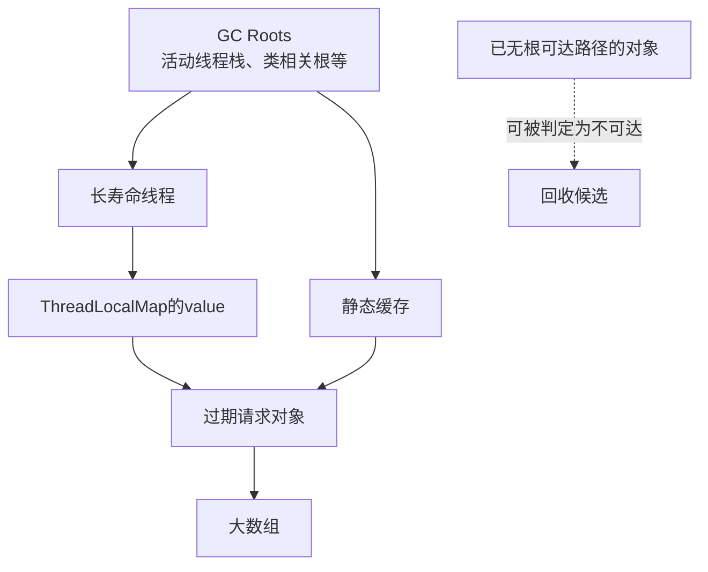
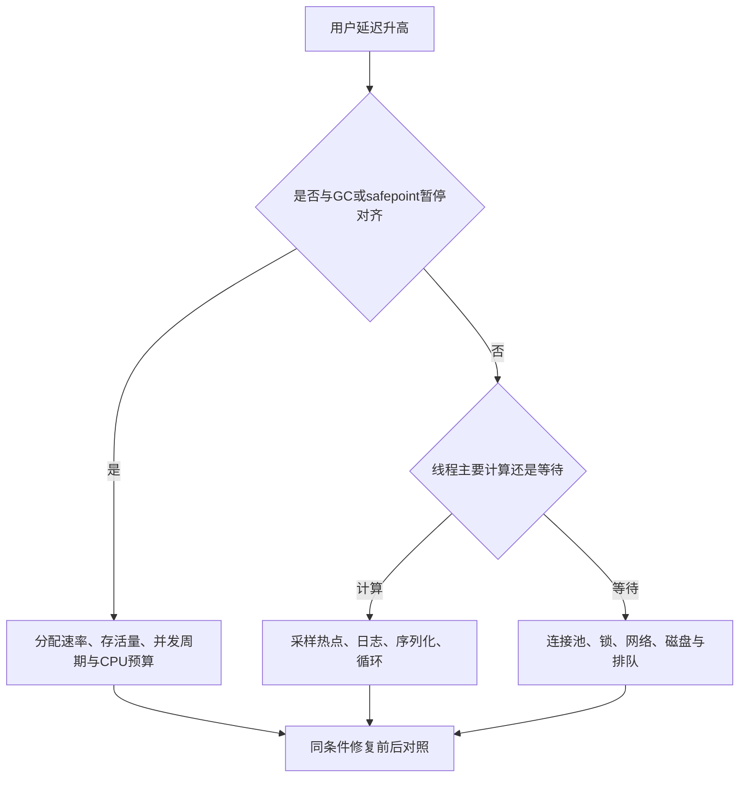

# JVM 性能分析与生产故障诊断

> 基线：HotSpot JDK 17/21、Linux 容器。配合已有自动内存管理、垃圾收集器文档阅读。JVM 参数、日志格式与工具权限按实际 JDK 核对，不把某个版本默认值当成永久规则。

**阅读主线**：内存归属 → 根引用与回收 → 计算或等待诊断 → 证据验证。

**快速入口**：[面试题与参考答案](#reference-answers)。

## 阅读目录

- [1. 性能诊断从问题定义开始](#section-1)
- [2. 内存布局：堆只是 RSS 的一部分](#section-2)
- [3. 可达性、泄漏与类加载器](#section-3)
- [4. GC 分析：看分配与存活，不只看暂停](#section-4)
- [5. CPU 高的诊断路径](#section-5)
- [6. CPU 不高但延迟很高](#section-6)
- [7. OOM 的分类](#section-7)
- [8. 工具选择与现场影响](#section-8)
- [9. 一个完整案例：导出导致内存飙升](#section-9)
- [10. 基准与 JIT 陷阱](#section-10)
- [11. 现场手册](#section-11)
- [12. 面试题与参考答案](#section-12)
- [13. 官方资料](#section-13)

<a id="section-1"></a>

## 1. 性能诊断从问题定义开始

“系统慢”至少可能是吞吐不足、P99 升高、启动慢、CPU 成本高、内存超预算或长时间不可用。不同目标对应不同证据，不能一上来就换 GC 或调大堆。

先记录：受影响路由/任务、开始时间、变更、负载、机器/容器配额、JDK 和 GC、用户错误。建立一条从用户耗时到线程、数据库和系统资源的时间线，避免把 GC 暂停与业务慢的偶然同现当作因果。

<a id="section-2"></a>

## 2. 内存布局：堆只是 RSS 的一部分

| 区域 | 典型内容 | 诊断入口 |
| --- | --- | --- |
| Java heap | 对象实例和数组 | GC 日志、heap dump、分配分析 |
| Metaspace | 类元数据 | 类加载数量、类加载器保留 |
| 线程栈 | 方法帧、本地调用相关空间 | 线程数、栈大小、线程 dump |
| Direct/native | NIO 缓冲、JNI、库分配 | NMT、库指标、系统映射 |
| Code cache | JIT 编译代码 | 编译与 code cache 指标 |
| JVM/系统额外内存 | GC 结构、库、映射等 | NMT 与进程/容器数据对照 |

容器 limits=2GiB 且 Xmx=2GiB 很容易越界，因为还有堆外和栈。设置 Xmx 或 MaxRAMPercentage 只是预算的一部分，需按线程数、直接内存和峰值额外开销验证。

### 2.1 RSS 不降是否一定泄漏

GC 后活对象下降，但 JVM/分配器未立即把所有物理内存还给系统，RSS 可能仍高。反之 heap 平稳而 RSS 增长，可能是 direct buffer、native 库或线程增长。不能只用一个曲线证明“GC 没回收”。

<a id="section-3"></a>

## 3. 可达性、泄漏与类加载器

Java 泄漏常指对象仍可达但已无业务用途，例如无上限缓存、未清理 ThreadLocal、监听器注册、队列积压和静态引用。垃圾收集器不能知道这些对象对业务已经无用。

### 3.1 ThreadLocal 的具体路径

长寿命线程持有 ThreadLocalMap，value 可能保留请求对象。key 的弱引用不意味着 value 自动随时清除；线程池复用让保留时间变长。请求结束在 finally 中 remove，跨线程传播要显式管理，不能认为 InheritableThreadLocal 适合所有线程池。

### 3.2 Metaspace 增长

热部署、脚本、动态代理或字节码生成可能创建大量类/类加载器。如果旧类加载器被静态注册、线程上下文类加载器或缓存引用保留，其类也无法整体卸载。调查从类加载器数量及保留路径开始，而不是只增大 MaxMetaspaceSize。

<a id="section-4"></a>

## 4. GC 分析：看分配与存活，不只看暂停

GC 行为由分配速率、存活对象、堆大小、收集器和 CPU 决定。高频 Young GC 可能只是高分配，未必泄漏；Full GC 后基线持续上升更值得调查长期保留，但也可能是正常缓存增长。

### 4.1 建立观察面

```bash
# 启动参数示例；路径及日志轮转按环境配置。
-Xlog:gc*,safepoint:file=/logs/gc.log:time,uptime,level,tags:filecount=5,filesize=20M
```

这是一段 JVM 参数，不是独立 Shell 命令。日志需要磁盘预算，读取时结合 uptime/墙钟时间与应用请求对齐。

重点看暂停总占比、分配速率、收集前后占用、晋升、并发阶段和 safepoint 原因。不是所有 Stop-The-World 都来自同一种 GC；也不是所有延迟都能从 GC 日志解释。

### 4.2 收集器选择

### 4.3 从 GC Roots 推导“为什么这些垃圾没被回收”

**图 1｜从 GC Roots 推导“为什么这些垃圾没被回收”**



**图解**：业务认为“请求结束”并不会删除引用。只要根到对象仍有应保留的可达路径，收集器就不能把它当作垃圾。heap dump 中的 dominator/retained size 用于理解某条引用路径一旦切断可释放多少内容，不等于该对象自身的 shallow size。

对并发标记收集器，应用在标记期间仍修改引用，必须通过相应屏障与算法维持正确性。例如 G1 的 SATB 相关机制处理标记期间引用变化，remembered set/card 相关机制帮助跟踪跨区域引用；二者解决的问题不同。不能从“并发标记”推出“完全没有暂停”，也不能把所有写屏障都当作 JMM volatile 屏障。

### 4.4 根据证据逐层排除，而不是先换 GC

**图 2｜根据证据逐层排除，而不是先换 GC**



**图解**：同一时刻出现 GC 和慢请求不能自动证明因果，必须对齐暂停长度和受影响窗口。分配导致的 GC CPU、锁等待与容器 throttling 也可能并存；先明确主瓶颈，再按相同负载验证干预效果。

G1 提供成熟的停顿目标和分区管理，目标不是硬实时承诺。低延迟收集器可减少某些暂停，但可能增加 CPU、内存和吞吐成本。根据尾延迟、堆规模、对象生命周期和运行环境压测，不按“新的一定更好”选。

<a id="section-5"></a>

## 5. CPU 高的诊断路径

先区分 Java 计算、GC、JIT、本地库和系统时间。采样 profiler/JFR 获得热点栈，避免只用一次线程 dump 断言热点；线程 dump 显示瞬间状态，采样时间分布更适合持续 CPU 归因。

### 5.1 常见根因

- 大量临时对象导致 GC CPU 上升：检查序列化、字符串拼接和集合复制。
- 自旋或错误重试：状态条件永不满足，异常后立即循环。
- 复杂正则或解析：特定输入触发超线性代价。
- 热点锁竞争：大量线程在短临界区争用，CPU 和调度开销增大。
- 日志过量：格式化、堆栈生成和同步输出共同耗时。

临时止血要降低问题负载或关闭昂贵路径，保留可复现输入；不要在尚未采样时直接重启清掉证据，除非恢复服务的优先级要求如此，并记录取证缺口。

<a id="section-6"></a>

## 6. CPU 不高但延迟很高

线程可能阻塞在连接池、锁、外部 I/O、队列或磁盘。连续获取数次线程快照，观察相同等待是否持续；结合连接池 pending、数据库锁和远程调用延迟定位。

| 线程表现 | 可能含义 | 下一步 |
| --- | --- | --- |
| 大量 WAITING 在连接获取 | 池满或连接泄漏/慢事务 | 查活跃连接和持有时间 |
| BLOCKED 同一监视器 | 锁竞争或持锁操作过慢 | 找持有者及临界区 |
| 网络 read 长等待 | 远端慢、超时缺失 | 对齐 trace 与 socket 超时 |
| executor 队列增长 | 生产超过服务能力 | 限流、有界排队、拒绝策略 |
| 容器 CPU throttling | 配额不足或突发受限 | 比较实际 CPU 与节流时间 |

线程数多并不自动提高吞吐，数据库饱和时只会让更多请求排队。先画资源等待图，再决定线程池参数。

<a id="section-7"></a>

## 7. OOM 的分类

### 7.1 Java heap space

对象存活量或分配峰值超过堆预算。确认是长期泄漏、无界集合还是一次性大查询/导出；增大堆可能暂缓但也延长某些回收与恢复时间。

### 7.2 Direct buffer memory

检查直接缓冲分配、池化、引用释放和积压。Netty 的 ByteBuf 泄漏与 JVM 普通对象保留有关联但责任不同，要同时看引用计数及保留路径。

### 7.3 unable to create native thread

线程数量、栈内存、进程/系统限制都可能触发。线程泄漏和无界 new Thread 是常见原因，不是把 Xmx 增大就能解决，反而可能挤占本地内存。

### 7.4 容器 OOMKilled

进程可能被 cgroup 杀死，没有 Java OOM 异常和 heap dump。查看容器事件、内存峰值、内核/平台证据；退出码 137 只说明强杀相关结果，不能独立证明全部根因。

<a id="section-8"></a>

## 8. 工具选择与现场影响

| 工具/证据 | 用途 | 风险或限制 |
| --- | --- | --- |
| jcmd Thread.print | 线程快照 | 瞬时样本，工具权限需匹配 |
| JFR | 低开销事件及持续诊断 | 配置影响开销与可见范围 |
| heap dump | 保留路径与对象分布 | 暂停、磁盘、敏感数据及额外内存 |
| NMT | JVM 跟踪的本地内存分类 | 需适当启动配置，不覆盖所有 native 分配 |
| 采样 profiler | CPU/分配热点 | 依赖平台权限与采样模型 |
| GC 日志 | 收集与 safepoint | 不覆盖全部 I/O 和应用排队 |

堆转储可能包含令牌、个人数据和业务内容，需要受控存储与访问。先在可摘流副本取证，预估磁盘大小，不把诊断动作变成第二次事故。

<a id="section-9"></a>

## 9. 一个完整案例：导出导致内存飙升

接口一次查 100 万订单，ORM 全量映射，随后构造第二份 DTO，再生成一整个 Excel 字节数组。即使最终响应只有几百 MB，内存可能同时持有数据库结果、DTO、字符串和输出缓冲多份数据。

修复采用分页/游标读取、有界转换和流式输出或异步文件任务。慢客户端需要背压，取消时关闭数据源和临时资源；并发导出设独立配额，防止多个“单次可承受”任务叠加 OOM。

验证固定数据规模、最大行宽和并发数，观测活对象、RSS、GC、数据库连接占用及用户取消。仅在本机小数据运行成功不能证明生产安全。

<a id="section-10"></a>

## 10. 基准与 JIT 陷阱

微基准需要处理预热、死代码消除、常量折叠、逃逸分析和测量噪声，通常使用 JMH 而不是一个 for 循环套 nanoTime。微基准回答局部操作成本，不能代替网络服务负载测试。

服务压测报告固定版本、CPU 配额、堆、GC、依赖、请求分布和错误率。平均延迟不能代表尾延迟，压测端也可能成为瓶颈；排队测试需注意生成器模型及遗漏等待样本的问题。

<a id="section-11"></a>

## 11. 现场手册

1. 先保服务目标并记录时间线、变更及受影响范围。
2. 采集最小必要指标与轻量样本，确定计算、等待还是内存方向。
3. 在受控副本做更重取证，保护敏感数据和磁盘。
4. 提出可证伪假设，例如“连接池排队由事务内远程调用导致”。
5. 小范围修复/限流后验证同样负载与故障条件。
6. 记录根因、触发条件、恢复动作和监控缺口，形成回归场景。

<a id="reference-answers"></a>

<a id="section-12"></a>

## 12. 面试题与参考答案

### Q1：内存泄漏与 OOM 怎样区分？

**参考答案**：泄漏是无业务用途的对象仍被引用，OOM 是某类分配超出可用能力；一次合法超大导出也会 OOM，泄漏在耗尽前又未必报错。我会先确定 heap、metaspace、direct、线程或容器哪一类预算失败，再看长期基线、分配峰值和保留路径。只调大堆可能掩盖增长，甚至挤占 native 内存。

### Q2：堆使用平稳，为什么容器仍 OOMKilled？

**参考答案**：进程 RSS 包括堆、类元数据、代码缓存、线程栈、直接内存和本地库等，cgroup 不只约束 Java heap。结合容器事件、宿主证据、线程数、direct 指标和 NMT 分析，注意 NMT 也不覆盖所有 native 分配。退出137本身不是完整根因，Java 没产生 heap dump 也不代表没有内存压力。

### Q3：怎样判断内存增长是泄漏而非正常缓存？

**参考答案**：固定负载和预热后观察完整回收/相应周期后的活对象基线是否持续上升，并比较对象类型和根保留路径。缓存应有可解释的上限、命中收益和淘汰策略，超出业务生命周期的线程本地值、监听器和无界 Map 更可疑。RSS 不下降不等于活对象未回收，还要区分分配器保留和 native 内存。

### Q4：CPU 高怎样形成根因证据？

**参考答案**：多次采样区分业务计算、GC、JIT 和 native，与流量、发布及用户耗时对齐。确认热点确实占用主要 CPU 后，在固定输入和配额下小范围修复，比较吞吐、P99、错误率和资源。一次线程快照只是瞬间，优化前后更换机器或降低流量又不能证明代码改动有效。

<a id="section-13"></a>

## 13. 官方资料

- [JDK 21 故障诊断指南](https://docs.oracle.com/en/java/javase/21/troubleshoot/)
- [JDK 21 G1 的标记、分区与内部机制](https://docs.oracle.com/en/java/javase/21/gctuning/garbage-first-g1-garbage-collector1.html)
- [jcmd](https://docs.oracle.com/en/java/javase/21/docs/specs/man/jcmd.html)
- [JFR](https://docs.oracle.com/en/java/javase/21/jfapi/)
- [JMH](https://github.com/openjdk/jmh)
