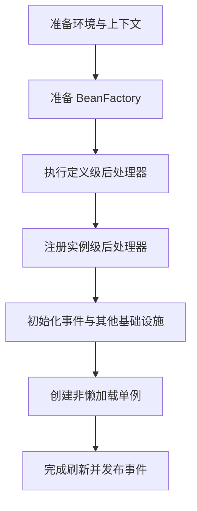
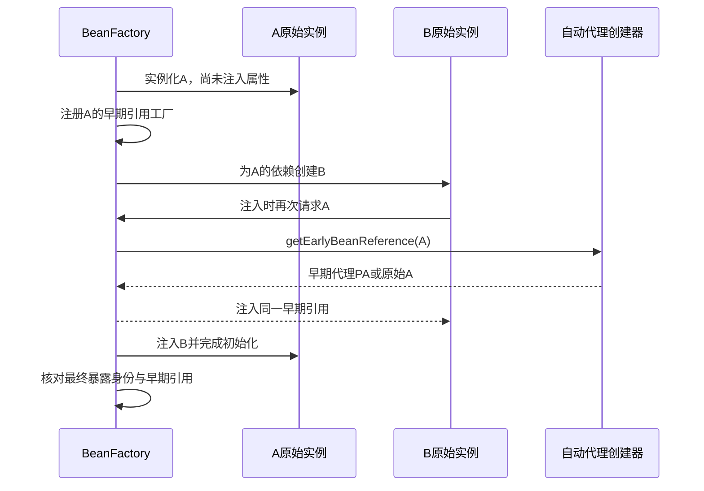
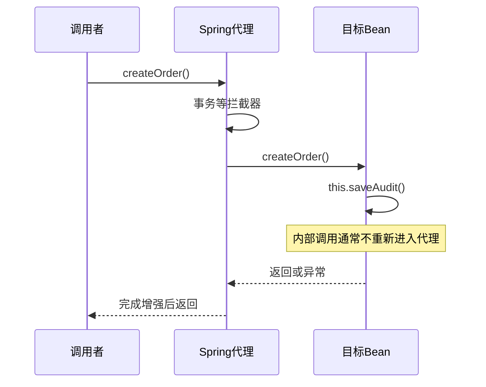

# IoC 容器与 Bean 生命周期深入解析

> 基线：Spring Framework 6.x。本文按“容器启动—定义解析—对象创建—代理生成—依赖注入—关闭销毁”展开。类名和调用链用于定位源码，省略的分支会明确说明，不能把教学流程视作逐行源码。

**阅读主线**：定义元信息 → 创建与初始化 → 早期引用 → 代理与作用域。

**快速入口**：[面试题与参考答案](#reference-answers)。

## 阅读目录

- [1. 为什么需要容器：从 new 到对象图管理](#section-1)
- [2. BeanDefinition：容器先管理元信息，再创建实例](#section-2)
- [3. refresh：一次上下文启动的阶段划分](#section-3)
- [4. getBean 到完整实例：沿源码观察](#section-4)
- [5. 依赖候选解析：不是“按名字优先”一句话](#section-5)
- [6. 三级缓存与循环依赖：为什么需要早期引用工厂](#section-6)
- [7. AOP：代理对象如何改变调用路径](#section-7)
- [8. 作用域、线程安全与关闭](#section-8)
- [9. 生产案例：部分 Bean 没有事务代理](#section-9)
- [10. 源码阅读与实验路线](#section-10)
- [11. 面试题与参考答案](#section-11)
- [12. 参考与延伸](#section-12)

<a id="section-1"></a>

## 1. 为什么需要容器：从 new 到对象图管理

假设订单服务依赖库存、支付和事件发布。直接 new 并不困难，困难在于整个对象图的创建顺序、配置选择、复用范围和生命周期。当测试需要替换支付实现、生产需要增加事务代理、关闭时要停止后台任务，分散在业务代码里的构造过程会变成隐式框架。

IoC 将“谁创建并组装对象”的控制权移到容器；DI 是实现这一目标的主要方式之一。业务类仍然应该尽量是普通 Java 类，而不是在每个方法里通过 ApplicationContext 查找依赖。

```java
public final class OrderService {
    private final InventoryPort inventory;
    private final PaymentPort payment;

    public OrderService(InventoryPort inventory, PaymentPort payment) {
        this.inventory = inventory;
        this.payment = payment;
    }
}
```

构造器让依赖成为对象有效性的前置条件。字段注入允许对象先处于依赖为空的状态，也使不启动容器的测试更麻烦；setter 注入适合真正可选、可重新配置的依赖，但不应成为绕过领域循环的默认做法。

### 1.1 BeanFactory 与 ApplicationContext

| 层次 | 职责 | 工程含义 |
| --- | --- | --- |
| BeanFactory | Bean 获取、类型查找、作用域等基础能力 | 讨论对象创建与依赖解析的核心入口 |
| DefaultListableBeanFactory | 定义注册、候选解析和常见工厂实现 | Boot 中经常要跟进的实际实现 |
| ApplicationContext | 在工厂之上组合资源、事件、环境等能力 | 常规应用使用的容器门面 |
| WebApplicationContext | 增加 Web 环境及作用域协作 | request/session 作用域依赖相应上下文 |

容器层次也会影响可见性：子容器可以查找父容器，父容器不能反向自然发现子容器。扩展处理器并不会自动跨容器作用于所有对象。复杂 Web 项目出现“同名 Bean 两份、切面只对一份有效”，要检查是否存在父子上下文及重复扫描。

<a id="section-2"></a>

## 2. BeanDefinition：容器先管理元信息，再创建实例

BeanDefinition 是对象蓝图，包含类型、作用域、懒加载、构造参数、属性、初始化/销毁方法及依赖关系。组件扫描、XML、@Bean 等入口最终都要转成容器能理解的定义，但 FactoryBean 等机制会让“定义类型”与“最终产品类型”不完全一致。

### 2.1 定义与实例的区别

修改 BeanDefinition 的属性，影响的是以后怎样创建对象；修改已经创建实例的字段，是运行期对象修改。两者的时间点、可见性和线程安全不同。

BeanFactoryPostProcessor 在常规 Bean 创建前调整定义；BeanPostProcessor 则围绕实例创建和初始化参与处理。若在前者中随意调用 getBean，可能提前实例化对象，使后续后处理器不能完整作用于它，最终出现“这个 Bean 为什么没有代理”的隐蔽问题。

### 2.2 @Configuration 和 @Bean 的代理语义

完整配置类模式可通过增强配置类让 @Bean 方法间调用回到容器，保持相应 Bean 的管理语义；`proxyBeanMethods=false` 不做这种拦截。此时直接调用另一个 @Bean 方法，可能就是普通 Java 调用并创建新对象。

```java
@Configuration(proxyBeanMethods = false)
class OrderConfiguration {
    @Bean
    InventoryPort inventoryPort() { return new RemoteInventory(); }

    @Bean
    OrderService orderService(InventoryPort inventory, PaymentPort payment) {
        // 通过参数注入，避免依赖配置类方法代理。
        return new OrderService(inventory, payment);
    }
}
```

这种写法把依赖交给容器解析，也更适合减少不必要的配置类增强。不能机械地给所有配置加或删 proxyBeanMethods；先确认内部调用是否依赖容器拦截。

<a id="section-3"></a>

## 3. refresh：一次上下文启动的阶段划分

简化的 refresh 主线如下：

**图 1｜refresh：一次上下文启动的阶段划分**



**图解**：启动先准备定义和扩展点，再创建常规单例；前一阶段会改变后一阶段的输入，不能把所有步骤并成一次扫描与new。

### 3.1 为什么处理器分阶段注册

定义级处理器可能新增更多定义，例如解析配置类；实例级处理器必须在普通 Bean 创建前准备好，才能统一实施依赖注入、生命周期回调和 AOP。启动不是“扫描完就挨个 new”，而是存在多轮扩展与基础设施初始化。

### 3.2 懒加载不等于没有代价

懒加载把错误和成本推迟到第一次使用，可能改善启动时间，也可能让首个用户请求承担类加载、连接创建及初始化失败。核心路径可以在接流前主动预热，但预热要有成功标准，不能只调用一个不触发真实依赖的空方法。

Boot 应用的启动钩子还涉及 runner、应用事件和 Web server 生命周期。不要把 ContextRefreshedEvent、ApplicationReadyEvent 和 readiness 完全当成同一个时间点；实际接流策略要结合部署平台。

<a id="section-4"></a>

## 4. getBean 到完整实例：沿源码观察

常见定位入口包括 `AbstractBeanFactory#doGetBean`、`AbstractAutowireCapableBeanFactory#createBean/doCreateBean`。下列是概念化伪代码，省略父容器、FactoryBean、作用域和特殊提前返回分支：

```text
getBean(name)
  -> 从已完成单例缓存查找
  -> 找到并合并 BeanDefinition
  -> 处理 dependsOn
  -> 创建实例 createBeanInstance
  -> 视条件注册早期引用工厂
  -> 注入属性 populateBean
  -> 初始化 initializeBean
  -> 处理早期引用与最终暴露对象的一致性
  -> 注册销毁适配器
  -> 保存并返回最终 Bean
```

### 4.1 实例化不等于初始化

实例化是执行构造器或工厂方法，得到对象；初始化包括依赖填充后的生命周期协作。构造器执行时不能假定字段注入已完成，@PostConstruct 时也不应假定所有外部系统已就绪。

### 4.2 初始化回调顺序

对于常见普通 Bean，主要关系是：部分 Aware 回调、初始化前后处理器、InitializingBean、自定义 init-method 和初始化后处理器等。@PostConstruct 通常通过相关 BeanPostProcessor 执行，不是一个完全独立于处理器体系的神秘阶段。

在常见配置下，@PostConstruct 先于 afterPropertiesSet，自定义 init-method 随后执行；某些处理器允许替换实例或提前终止处理，所以不能把一张静态顺序图推广到所有扩展实现。

初始化方法不应执行无界网络等待；否则一个下游故障就可能卡住整个启动。需要依赖准备时给出超时、可诊断错误和有限恢复策略。

<a id="section-5"></a>

## 5. 依赖候选解析：不是“按名字优先”一句话

候选通常先满足类型，再结合泛型、限定符、primary、候选名以及版本相关规则筛选。注入 `List<Port>`、`Map<String, Port>` 会获取一组候选，排序还可能受 Order/Priority 等规则影响。

### 5.1 常见设计方式

| 需求 | 选择 | 注意事项 |
| --- | --- | --- |
| 默认实现 | @Primary | 多个 primary 仍可能歧义 |
| 明确业务角色 | @Qualifier | 名字应体现领域语义 |
| 插件集合 | 注入 List/Map | 校验重复业务 key 与排序 |
| 按需获取 | ObjectProvider | 不要让循环依赖变成运行时惊喜 |
| 请求级依赖进入单例 | 作用域代理等 | 没有请求上下文时可能失败 |

让业务在运行时选择策略，比在十几个地方判断 Bean 名更容易维护。容器负责组装，领域层负责业务选择，二者边界应清楚。

<a id="section-6"></a>

## 6. 三级缓存与循环依赖：为什么需要早期引用工厂

以 singleton A 的属性依赖 B、B 的属性依赖 A 为例：A 已完成实例化但尚未填充属性时，创建 B 会再次请求 A。容器可以在符合条件时返回 A 的早期引用，使对象图继续组装。

| 缓存 | 代表内容 | 主要用途 |
| --- | --- | --- |
| singletonObjects | 已完成的单例对象 | 正常复用最终 Bean |
| earlySingletonObjects | 已生成的早期引用 | 循环创建中复用同一早期暴露对象 |
| singletonFactories | 按需生成早期引用的工厂 | 允许处理器在需要时提供代理等早期引用 |

核心不是“Map 越多越高级”，而是**延迟决定是否需要早期暴露，并给代理生成一个参与点**。若 B 注入原始 A，而其他消费者拿到代理 A，就可能形成两种身份与两种行为，框架需要协调早期引用和最终对象的一致性。

### 6.1 从 A/B 的创建交错推导早期代理

**图 2｜从 A/B 的创建交错推导早期代理**



**图解**：关键交错发生在“实例化 A”之后、“A 初始化完成”之前。工厂不是第二份 A，而是一个按需获取早期引用的能力；只有实际形成循环时才需要调用。自动代理创建器可以在这个位置暴露代理，防止 B 持有原始对象、其他消费者却持有代理所导致的行为分裂。

下面的伪代码突出缓存不变量，省略并发保护、异常清理和 FactoryBean 等分支：

```text
getSingleton(name, allowEarlyReference):
    if 已完成缓存中存在name: return 最终对象
    if name正在创建:
        if 早期缓存存在name: return 早期对象
        if allowEarlyReference且存在工厂:
            early = 工厂生成早期引用
            将early放入早期缓存，并移除对应工厂
            return early
    return 未找到
```

需要维持的是同一单例在允许早期暴露的调用链中具有一致身份，而不是“有三级缓存就能解决所有循环”。如果某处理器仅在很晚阶段生成不兼容的包装，早期依赖和最终对象仍可能不一致，框架会有检测/限制。源码定位可沿 `getSingleton`、`addSingletonFactory`、`getEarlyBeanReference` 和 `doCreateBean`，逐个观察实际返回的对象。

### 6.2 为什么构造器循环不能按相同方法解决

创建 A 的构造器必须先拿到 B，创建 B 的构造器又必须先拿到 A，此时连可早期暴露的 A 实例都没有。属性循环至少先存在实例，构造器循环没有这个前提。

### 6.3 为什么不应该主动依赖循环支持

Boot 的循环引用默认策略、代理组合、作用域及具体处理器都会影响结果。即使容器启动成功，初始化期间使用未完成的依赖也可能得到错误状态。更好的方式是提取共享领域能力、通过事件解耦后置动作，或合并本就强耦合的职责。

<a id="section-7"></a>

## 7. AOP：代理对象如何改变调用路径

Bean 的消费者拿到的可能是代理，而不是原始实例。代理维护目标和拦截器链，在调用入口执行事务、权限、缓存等增强；目标内部的 `this.otherMethod()` 通常没有再次经过代理。

**图 3｜AOP：代理对象如何改变调用路径**



**图解**：外部调用经过代理，目标内部的this调用留在目标对象中，通常不再次进入拦截链。这是自调用与外部调用行为不同的关键。

### 7.1 JDK 代理与类代理

JDK 代理围绕接口构建；类代理通过子类增强，受 final 类、final 方法、private 方法等可覆盖性限制。不要只记“有接口就一定 JDK 代理”：Boot 配置及自动代理设置可能选择类代理。

`getClass()`、强转、equals/hashCode、序列化及反射都可能受代理影响。依赖接口可以降低实现耦合，但不意味着类代理就一定错误；选择要结合框架能力和实际需求。

<a id="section-8"></a>

## 8. 作用域、线程安全与关闭

singleton 是每个容器、每个定义的一份共享实例，不是全 JVM 只存在一个对象，更不是线程安全声明。把 currentUser 或请求临时集合存进单例字段，会造成串请求及串租户问题。

prototype 每次创建提供新实例，但注入 singleton 的一个 prototype 字段通常只在该 singleton 创建时解析一次。希望每次操作得到新实例，需要 provider、lookup 或重新设计作用域。

关闭时处理销毁回调和生命周期组件。后台执行器应停止接收任务，再按限时等待在途任务完成。若关闭依赖顺序错误，日志、事件或数据库可能已经关闭，而后台任务仍尝试使用它们。

<a id="section-9"></a>

## 9. 生产案例：部分 Bean 没有事务代理

**现象**：同一 Service 在一个接口正常回滚，在另一个启动任务中不回滚。

**假设一**：调用者持有的不是容器实例，而是手工 new 出来的对象。用 bean 名、对象身份、代理类型和构造位置验证。

**假设二**：Service 被某个 BeanPostProcessor 的依赖提前实例化，完整自动代理尚未可用。检查启动日志中“不适合所有后处理器”的提示，并沿早期 getBean 路径追踪。

**假设三**：存在多个 ApplicationContext，事务处理器只作用于其中一份定义。输出上下文 ID、父上下文和 BeanDefinition 来源。

修复后不仅验证“对象是代理”，还需通过异常后的真实数据库状态证明事务生效。代理存在不保证方法、切点、事务管理器和调用路径都正确。

<a id="section-10"></a>

## 10. 源码阅读与实验路线

1. 创建只有两个 Bean 的最小上下文，记录构造器与初始化回调顺序。
2. 注册一个只观察名称和类型的静态 BeanPostProcessor，避免在日志中输出敏感对象内容。
3. 给一个接口方法添加切面，比较容器获取对象和手工 new 对象。
4. 分别构造构造器循环、属性循环和带代理的属性循环，记录固定版本及相关配置。
5. 在 getBean、doCreateBean、getEarlyBeanReference 和代理调用入口下断点，画出实际路径。

验收应能区分“定义存在”“原始实例存在”“依赖已填充”“代理已暴露”“已可以接流”这五种状态，而不只是背出若干方法名。

<a id="reference-answers"></a>

<a id="section-11"></a>

## 11. 面试题与参考答案

### Q1：IoC、DI 和依赖查找是什么关系？

**参考答案**：IoC 描述对象创建和组装的控制权由外部设施负责，DI 通过构造器、方法等把依赖传入，是实现方式之一；依赖查找由对象主动向容器获取依赖。普通业务对象优先构造器注入，使依赖和有效状态显式化，也方便不启动容器的测试。只有真正动态、可选的获取需求，才考虑 provider 等机制，避免业务代码到处调用 getBean。

### Q2：BeanFactoryPostProcessor 与 BeanPostProcessor 有何区别？

**参考答案**：前者主要操作定义元信息，决定对象以后怎样被创建；后者在实例生命周期中处理对象，例如注入、初始化回调和自动代理。定义级处理时主动获取普通 Bean，可能使它在完整处理器链注册前被创建，因此出现缺少代理等行为。排障时要同时检查“定义来自哪里”和“实例在何时被谁创建”，不能只看注解存在。

### Q3：三级缓存的第三层为什么是工厂？

**参考答案**：它延迟决定是否生成早期引用，并为自动代理等扩展提供参与点。发生属性循环时，容器已有原始实例，可以通过工厂得到与最终暴露身份协调的早期代理；没有循环则不必提前生成。二级缓存复用已经生成的早期引用，一级缓存保存完成对象。这是当前框架设计中的分工，不应宣称理论上任何容器都必须恰好三个 Map，也不能推广到构造器循环和任意作用域。

### Q4：singleton Bean 是否线程安全？

**参考答案**：不是。singleton 约束容器中的实例复用，不约束实例内部的可变状态。保存 currentUser、请求参数或共享 ArrayList 都可能串请求。通常让服务无状态、使用不可变数据，把请求上下文放在适当作用域；确需共享更新则明确同步和资源边界。容器安全发布对象与业务方法并发安全是两个不同层次。

### Q5：怎样确认事务问题来自代理创建？

**参考答案**：先确认调用对象是否来自正确上下文、实际类型是否代理、调用是否经过可拦截方法，并定位 BeanDefinition 来源和提前实例化日志；再看事务拦截器、管理器和数据库最终结果。如果代理和拦截链正常，就继续排查回滚规则、数据源和外部副作用。证明依赖连续证据，不能以 `AopUtils.isAopProxy=true` 单独下结论。

<a id="section-12"></a>

## 12. 参考与延伸

- [Spring 6.2 IoC 文档](https://docs.spring.io/spring-framework/reference/6.2/core/beans.html)
- [Spring 6.2 Bean 生命周期](https://docs.spring.io/spring-framework/reference/6.2/core/beans/factory-nature.html)
- [Spring 源码仓库：阅读时选择 v6.x 固定 tag](https://github.com/spring-projects/spring-framework)
- 下一章：[事务传播、隔离与一致性](02_事务传播隔离与一致性实战.md)
