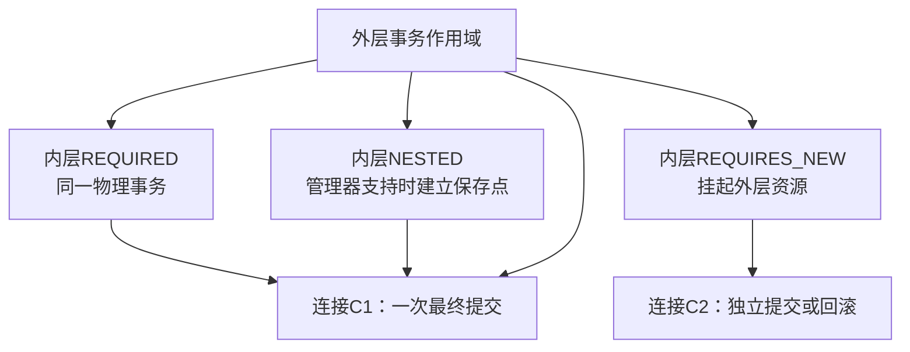
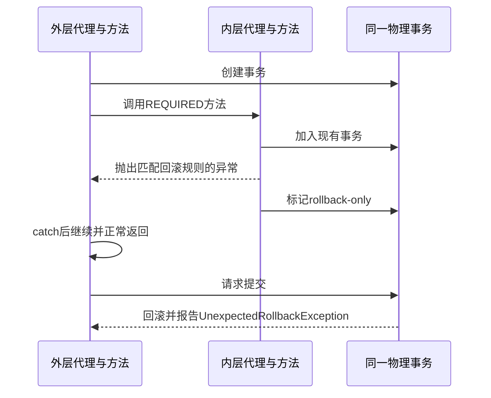

# 事务传播、隔离与一致性实战

> 基线：Spring Framework 6.x、Spring Boot 3.x、单个关系数据库；默认讨论基于线程绑定的 imperative 事务。响应式事务依赖 Reactor 上下文，不能直接套用线程变量模型。

**阅读主线**：业务不变量 → 物理事务 → 回滚状态 → 跨资源恢复。

**快速入口**：[面试题与参考答案](#reference-answers)。

## 阅读目录

- [1. 从业务不变量决定事务](#section-1)
- [2. TransactionInterceptor 的工作链](#section-2)
- [3. 七种传播级别按物理事务理解](#section-3)
- [4. 回滚规则：异常类型、捕获与返回值](#section-4)
- [5. 隔离与锁：事务不是自动串行化](#section-5)
- [6. 事务与异步、事件、缓存](#section-6)
- [7. 完整一致性案例：订单、outbox 和消费者](#section-7)
- [8. 排障证据链](#section-8)
- [9. 测试不能只依赖自动回滚](#section-9)
- [10. 面试题与参考答案](#section-10)
- [11. 官方资料](#section-11)

<a id="section-1"></a>

## 1. 从业务不变量决定事务

事务边界先由业务不变量决定，再映射为技术配置。创建订单时，如果库存预占和订单记录位于同库，通常希望二者同成同败；发送短信则不一定要在相同本地事务里，更不能假设数据库回滚会撤回已经发出的短信。

需要依次问：哪些事实必须一起提交？哪些步骤可延迟？哪些副作用不可撤销？失败后怎样判断原结果？事务注解只有在这些问题明确后才有意义。

### 1.1 ACID 在应用中的实际含义

| 性质 | 需要理解的边界 | 常见误解 |
| --- | --- | --- |
| 原子性 | 参与同一事务的资源变更整体处理 | 任意 HTTP、缓存和消息都自动回滚 |
| 一致性 | 约束与正确业务逻辑共同维护不变量 | 数据库能理解所有业务规则 |
| 隔离性 | 并发结果受隔离级别及执行方式约束 | 开事务就没有并发竞争 |
| 持久性 | 取决于数据库提交和持久化配置 | 客户端收到超时就一定没提交 |

<a id="section-2"></a>

## 2. TransactionInterceptor 的工作链

声明式事务把事务属性解析和资源管理放在代理拦截器中，业务方法不需要手写 begin/commit。核心过程可概括为：

```text
代理入口
  -> 找到目标方法的事务属性
  -> 选择 TransactionManager
  -> 根据传播规则获取/创建事务状态
  -> 调用业务方法
     -> 正常返回：按状态提交
     -> 抛出异常：按回滚规则处理
  -> 清理/恢复线程绑定的资源与上下文
```

事务属性可能来自接口、类或方法，解析及代理能力有版本和具体配置差异。工程上将关键事务边界放在外部可代理调用的明确 Service 方法，并用集成测试证明行为。

### 2.1 资源怎么共享

在常见 JDBC 事务中，管理器获取 Connection、设置事务属性并将资源关联到当前线程。遵循 Spring 资源获取机制的数据访问代码才能复用正确连接；自己另建数据源或直接绕过相关工具，可能得到另一条非事务连接。

日志中“事务已开始”不证明所有 SQL 都在同一事务。多数据源排障要记录连接、数据源及管理器身份，不能只看一个 @Transactional。

<a id="section-3"></a>

## 3. 七种传播级别按物理事务理解

| 传播 | 已存在事务时 | 无事务时 | 适用点 |
| --- | --- | --- | --- |
| REQUIRED | 加入 | 创建 | 大多数聚合内操作 |
| REQUIRES_NEW | 挂起外层，创建独立事务 | 创建 | 必须独立提交的有限场景 |
| NESTED | 在支持时使用保存点 | 通常创建 | 可局部回滚且资源管理器支持 |
| SUPPORTS | 加入 | 非事务 | 能接受两种运行方式的查询 |
| NOT_SUPPORTED | 挂起后非事务执行 | 非事务 | 明确不参与事务的动作 |
| MANDATORY | 加入 | 报错 | 强制要求上层提供事务 |
| NEVER | 报错 | 非事务 | 明确禁止事务的入口 |

传播定义逻辑调用如何参与事务，物理事务数量决定连接、锁和提交边界。自调用绕过代理时，内层注解可能完全没有参与这张表的决策。

### 3.1 逻辑事务如何映射到物理连接

**图 1｜逻辑事务如何映射到物理连接**



**图解**：逻辑作用域是方法级别的事务参与关系，物理事务才对应真正的连接提交边界。REQUIRED 的两个方法可能只有一条连接；REQUIRES_NEW 通常需要另一个资源事务；NESTED 的局部回滚依赖保存点，不产生能独立持久化的第二次提交。

以外层 O 和内层 I 都为 REQUIRED 为例，I 的回滚规则触发后，共享事务可能进入 rollback-only。O 捕获异常只是让 Java 控制流继续，无法撤销事务状态。这个状态不是“异常对象还在不在”，而是“事务是否仍可提交”。

**图 2｜逻辑事务如何映射到物理连接**



**图解**：必须经过两个事务代理作用域，才有图中“内层拦截器标记”的路径。若是同对象自调用，内层注解可能根本没被解析，不能拿这张图直接预测结果。实验要把调用关系、传播级别和异常类型一起固定。

### 3.2 REQUIRED 与 UnexpectedRollbackException

场景：外层 createOrder 调内层 reserveStock，二者 REQUIRED。内层发生运行时异常，事务拦截器把参与事务标记回滚。外层 catch 后继续返回“创建成功”，提交时可能抛 UnexpectedRollbackException。

catch 只能改变 Java 控制流，不能把已标记不可提交的事务重新洗白。应该根据业务选择整个操作失败，或者把允许独立失败的职责放到独立边界；不要为了消除异常无脑改成 REQUIRES_NEW。

### 3.3 REQUIRES_NEW 的连接池陷阱

假设 20 个请求都持有外层事务连接，然后同时调用 REQUIRES_NEW 审计。若池只有 20 个连接，每个请求都等待第二条连接，而外层连接无法释放，就可能集体等待到超时。

解决不只是扩大连接池，还包括减少独立事务嵌套、缩短外层事务、审计异步化与容量规划。独立提交还意味着外层失败后审计仍存在，这必须是业务希望的结果。

### 3.4 NESTED 不等于 REQUIRES_NEW

保存点回滚只回退同一物理事务的一部分，外层最终回滚时仍会撤销全部提交前变更；独立事务则可以先行持久化。是否支持 NESTED 取决于管理器和资源，不能把 JDBC 保存点经验推广到 JPA 或任意分布式资源。

<a id="section-4"></a>

## 4. 回滚规则：异常类型、捕获与返回值

默认 RuntimeException/Error 通常回滚，checked exception 默认不回滚。业务若用 checked exception 表示必须撤销的失败，需要显式规则。规则存在继承匹配和多个配置的优先关系，尽量使用类型而非模糊名字匹配。

```java
@Service
public class OrderApplicationService {
    private final OrderRepository orders;
    private final StockRepository stock;

    public OrderApplicationService(OrderRepository orders, StockRepository stock) {
        this.orders = orders;
        this.stock = stock;
    }

    @Transactional(rollbackFor = StockUnavailableException.class)
    public long create(CreateOrder command) throws StockUnavailableException {
        long id = orders.insert(command);
        if (stock.reserve(command.skuId(), command.quantity()) != 1) {
            throw new StockUnavailableException(command.skuId());
        }
        return id;
    }
}
```

片段中的两个仓库必须使用同一受管数据源，异常类和命令由工程定义。测试应从其他 Bean 或容器获取服务后调用，不能用手工 new 的对象验证代理事务。

返回 `Result.failure()` 不自动代表回滚。若设计要求返回失败对象同时回滚，需要显式事务状态或统一异常转换，但应避免让基础设施控制散落在整个领域层。

<a id="section-5"></a>

## 5. 隔离与锁：事务不是自动串行化

隔离级别控制数据库并发可见性。Spring 的隔离声明通常只在新建事务时生效；加入现有事务不一定重新建立不同隔离级别，可以按配置验证不兼容属性。

### 5.1 丢失更新与条件写入

两个事务读取余额 100，各扣 30 后都写回 70，会丢失一次扣减。使用原子 SQL、悲观锁或乐观版本约束，而不是只给方法加 @Transactional。

```sql
UPDATE account
SET balance_cent = balance_cent - :amount,
    version = version + 1
WHERE id = :id
  AND version = :expected_version
  AND balance_cent >= :amount;
```

影响行数为 0 要区分版本冲突、余额不足和记录不存在。重试前重新读取并重做业务判断，不能无限重复旧参数。乐观锁适合冲突较低的场景，高冲突下重试会放大负载。

### 5.2 锁顺序与事务长度

转账同时更新两个账户时按稳定顺序获取锁，降低死锁概率；死锁仍可能来自其他索引及访问路径，应视为需要处理的并发结果。把外部 HTTP 等待放进持锁事务，会把网络延迟转化为锁等待和连接池占用。

readOnly 常作为优化提示，不应当作禁止所有写入的安全边界。真正只读权限应由数据库权限、路由及架构约束保证。

<a id="section-6"></a>

## 6. 事务与异步、事件、缓存

### 6.1 @Async 和线程边界

基于线程绑定的事务不会因为提交一个线程任务自然跨线程传播。父线程未提交时，子线程可能读不到记录；父线程后来回滚时，子线程已经产生副作用。给子线程方法加事务只会创建它自己的边界，不会把两个线程变成一个原子操作。

### 6.2 @TransactionalEventListener 的价值和局限

提交后监听可以避免使用尚未提交的数据，但进程可能在提交之后、事件执行之前退出。因此适合允许丢失或有其他恢复机制的后置动作，不应单独承诺关键业务事件可靠投递。

### 6.3 缓存更新与事务顺序

事务内先删缓存，其他请求可能从尚未提交的旧数据库回填；事务提交后删缓存又存在提交成功、删除失败的窗口。对关键读模型，可采用 outbox/CDC 驱动失效，按版本避免旧数据覆盖，并建立对账修复。

<a id="section-7"></a>

## 7. 完整一致性案例：订单、outbox 和消费者

### 7.1 表结构的职责

```sql
CREATE TABLE request_guard (
  tenant_id BIGINT NOT NULL,
  request_id VARCHAR(64) NOT NULL,
  payload_hash CHAR(64) NOT NULL,
  order_id BIGINT NULL,
  PRIMARY KEY (tenant_id, request_id)
);
CREATE TABLE event_outbox (
  event_id VARCHAR(64) PRIMARY KEY,
  aggregate_id BIGINT NOT NULL,
  event_type VARCHAR(64) NOT NULL,
  payload JSON NOT NULL,
  status VARCHAR(16) NOT NULL,
  next_attempt_at DATETIME(6) NOT NULL,
  attempts INT NOT NULL DEFAULT 0,
  INDEX idx_dispatch (status, next_attempt_at)
);
```

这是教学结构，实际还需创建时间、版本、租约、错误摘要及清理策略。request_guard 把幂等键绑定到租户及请求摘要；同键不同参数不能被当作正常重试。

### 7.2 提交流程

同一本地事务中创建幂等记录、扣减/预占库存、创建订单、写 outbox、保存返回结果。失败整体回滚；成功后客户端重试可以返回同一业务结果。

若并发插入幂等键冲突，按数据库及框架事务语义结束当前失败事务，再用独立查询获取已提交结果；不要在已失败的事务里假定还能继续正常查询所有资源。

### 7.3 投递器与消费者

投递器分批领取待发事件，避免在持有数据库锁时无限等待 broker；使用可恢复租约或短事务领取状态。发送成功后标记，若发送成功但标记失败，事件会重复，消费者必须去重。

消费者将 inbox 唯一键记录与业务更新放在同一事务，提交后才确认消息。外部支付不在消费者本地事务内，需要使用支付方支持的幂等请求号及结果查询；“去重表 + HTTP”仍有失败窗口。

### 7.4 故障矩阵

| 崩溃位置 | 可见状态 | 恢复动作 |
| --- | --- | --- |
| 本地事务提交前 | 订单/outbox 一起回滚 | 同幂等键重试 |
| 提交后、投递前 | 订单存在、事件待发 | 投递器扫描恢复 |
| broker 接收后、标记前 | 可能已发，数据库仍待发 | 允许重复投递 |
| 消费数据库提交后、确认前 | 业务已生效，消息可能重投 | inbox 识别重复 |
| 外部支付成功、响应丢失 | 结果不明确 | 同请求号查询，禁止盲目新建支付 |

<a id="section-8"></a>

## 8. 排障证据链

“事务不生效”先拆成：根本没经过拦截器、经过但选错管理器、SQL 没用同一资源、异常未匹配回滚、加入外层边界、业务效果来自外部副作用。

短时开启相关事务日志，记录方法、线程、管理器和连接信息，避免打印敏感 SQL 参数。结合数据库 transaction/lock 等观测数据，找到真正持锁者。不要在生产用无限 debug 日志覆盖故障。

<a id="section-9"></a>

## 9. 测试不能只依赖自动回滚

测试方法自身有事务时，业务方法可能加入测试事务，掩盖真实入口没有事务的问题；测试末尾回滚也不会验证 afterCommit 和投递路径。

至少设计：真实代理入口、checked/unchecked 异常、外层 catch、REQUIRES_NEW 独立提交、并发条件更新、提交后事件、事务超时和连接池压力。测试基础设施应尽量使用与生产相同数据库引擎，内存数据库不能证明 InnoDB 锁行为。

<a id="reference-answers"></a>

<a id="section-10"></a>

## 10. 面试题与参考答案

### Q1：为什么自调用上的事务注解可能失效？

**参考答案**：默认代理模式只拦截经过代理的调用，目标方法内 `this.otherMethod()` 直接进入同一对象，不重新经过事务拦截器。因此内层声明的传播、隔离和回滚规则可能没有参与决策；外层已有事务时，内部 SQL 仍可能因为共享线程资源而在外层事务内，这不等于内层注解生效。优先通过应用服务职责拆分让调用跨越明确代理边界，或在适当位置用 TransactionTemplate 显式定义事务。

### Q2：catch 后为什么仍可能抛 UnexpectedRollbackException？

**参考答案**：内层 REQUIRED 与外层共享物理事务，内层拦截器可能已经将其标为 rollback-only。外层捕获异常只能改变代码分支，不能把该事务恢复为可提交。外层正常返回时，框架不能假装提交成功，因此回滚并告知调用方。应按业务决定整体失败，或把确实需要独立结果的职责拆成独立事务/异步流程，而不是单纯为消除异常换成 REQUIRES_NEW。

### Q3：REQUIRES_NEW 与 NESTED 怎样选择？

**参考答案**：需要独立提交、外层失败也保留结果时，REQUIRES_NEW 符合该语义，但要预算额外连接和相互锁等待。允许某部分回到保存点、最终仍与外层同成同败时，支持保存点的 NESTED 更接近需求。两者不是性能开关，必须先说明业务期望；数据库和事务管理器是否支持保存点也要验证。

### Q4：本地提交成功后怎样可靠发消息？

**参考答案**：本地事务同时写业务表和 outbox，保证事实与待发事件一起存在或一起回滚。投递器按可恢复领取协议发送，允许发送成功但标记失败后的重复；消费者把 inbox 与业务变更同事务，提交后确认。外部支付不在这个本地原子范围，必须使用支付方幂等请求号、查询和对账。afterCommit 只控制执行时机，单独使用仍有提交后进程崩溃窗口。

### Q5：如何验证“不会丢处理，也不会重复产生业务效果”？

**参考答案**：分别在本地提交前后、broker 接收后确认前、消费数据库提交后消息确认前停止进程，重启后核对订单、outbox、inbox 和业务流水。消息允许重复，但同一业务身份的合法副作用只能生效一次；所有未完成状态都有恢复者、重试上限和告警。验证的是持久事实和故障恢复，不只是一次正常请求返回 200。

<a id="section-11"></a>

## 11. 官方资料

- [Spring 6.2 事务传播](https://docs.spring.io/spring-framework/reference/6.2/data-access/transaction/declarative/tx-propagation.html)
- [Spring 6.2 声明式事务](https://docs.spring.io/spring-framework/reference/6.2/data-access/transaction/declarative.html)
- [Spring 6.2 事务事件](https://docs.spring.io/spring-framework/reference/6.2/data-access/transaction/event.html)
