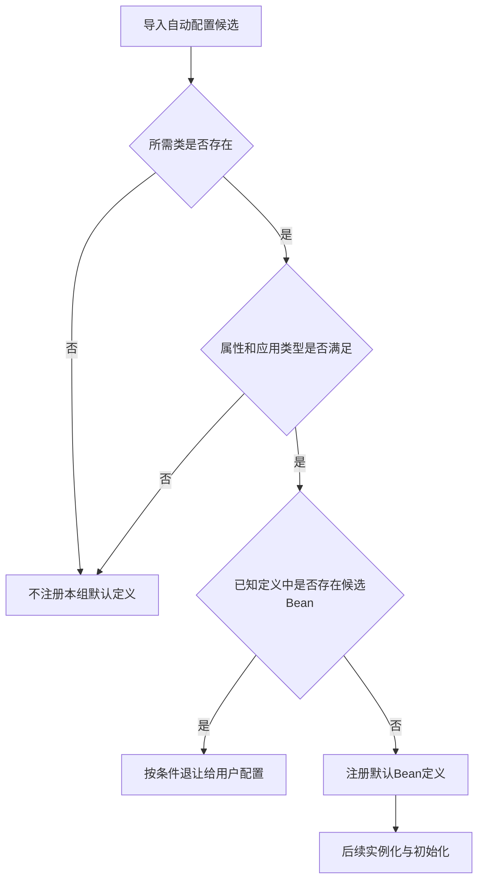
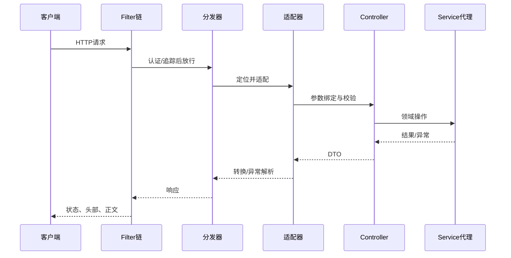

# Boot 自动配置、Web 链路与生产诊断

> 基线：Spring Boot 3.x、Spring MVC 6.x。WebFlux、Boot 4 和其他主版本需要独立核对。目标是能解释启动结果、定位请求耗时，并把服务安全地发布到生产。

**阅读主线**：自动配置条件 → Web请求阶段 → 超时与容量 → 上线诊断。

**快速入口**：[面试题与参考答案](#reference-answers)。

## 阅读目录

- [1. SpringApplication 不只是启动 Tomcat](#section-1)
- [2. 自动配置的工作方式](#section-2)
- [3. 外部化配置：值从哪里来](#section-3)
- [4. 一次 MVC 请求经过哪些层](#section-4)
- [5. 参数绑定、错误契约与幂等](#section-5)
- [6. MVC 与 WebFlux：从整条链路选模型](#section-6)
- [7. 连接池、超时与容量](#section-7)
- [8. 指标、追踪与健康检查](#section-8)
- [9. 测试与发布的证据](#section-9)
- [10. 生产案例：CPU 不高但请求大量超时](#section-10)
- [11. 面试题与参考答案](#section-11)
- [12. 官方资料](#section-12)

<a id="section-1"></a>

## 1. SpringApplication 不只是启动 Tomcat

启动包括环境准备、配置加载、ApplicationContext 创建、定义解析、自动配置、Web server 协作及启动事件。Web 容器只是应用生命周期中的一部分；非 Web 服务也能使用 Boot。

排查启动首先分清失败阶段：配置尚未绑定、定义条件不满足、对象创建异常、端口冲突，还是启动后 runner 执行失败。最外层“启动失败”日志通常不足以定位，沿 cause 找最早的业务/配置异常，同时保留被抑制异常。

<a id="section-2"></a>

## 2. 自动配置的工作方式

### 2.1 从导入候选到条件匹配

Boot 3 自动配置候选常通过 `META-INF/spring/org.springframework.boot.autoconfigure.AutoConfiguration.imports` 声明。不要把旧版所有扩展入口都简单概括为 spring.factories；不同能力有不同发现机制。

候选定义再按 classpath、属性、Web 类型、已有 Bean 等条件筛选。自动配置不是根据项目名称猜测，也不是无条件帮你创建全部基础设施。

```java
@AutoConfiguration
@ConditionalOnClass(RemoteClient.class)
@EnableConfigurationProperties(RemoteProperties.class)
public class RemoteClientAutoConfiguration {
    @Bean
    @ConditionalOnMissingBean
    RemoteClient remoteClient(RemoteProperties properties) {
        return new RemoteClient(properties.endpoint(), properties.timeout());
    }
}
```

这是 starter 结构片段，RemoteClient 与属性类需由实际工程提供。还要做属性校验、超时范围和默认值设计，并为用户覆盖 Bean 的场景写验证。是否能检测到某个 Bean 与配置处理顺序和条件使用位置有关，不应滥用复杂条件制造启动谜题。

### 2.2 自动配置为何会“退让”，以及退让的时间边界

**图 1｜自动配置为何会“退让”，以及退让的时间边界**



**图解**：条件多数在定义处理阶段决定，不是每次请求临时判断。条件能看到哪些定义受处理顺序影响，因此自动配置排序、用户配置来源和 `@ConditionalOnMissingBean` 的位置都很重要；不能在普通业务配置里随意依赖复杂条件就期待所有顺序天然稳定。

定义注册后，实例化还可能因无效属性、构造器异常或外部连接失败而失败。条件报告显示 match 只证明满足对应条件，不证明实例创建和服务就绪。排查应按“候选未导入、条件未匹配、定义被覆盖、实例创建失败”四层分开。

### 2.3 starter 设计与滥用

starter 应提供稳定入口、明确默认值和可关闭机制，尽量在缺少外部配置时给出清晰错误。不要自动执行 schema 变更、扫描整个业务包或默默注册高权限管理端点。

把“自动化接入”与“隐藏副作用”分开。成熟 starter 需要兼容矩阵、条件测试、配置元数据、观察指标和升级说明，而不仅是一组自动 new 的 Bean。

<a id="section-3"></a>

## 3. 外部化配置：值从哪里来

配置可能来自文件、profile、环境变量、系统属性、命令行及配置系统，优先级规则以固定 Boot 版本为准。排查时看最终值及其来源，而不是只打开仓库 application.yml。

### 3.1 绑定与校验

`@ConfigurationProperties` 适合一组结构化配置，使用 Duration、DataSize 等明确单位的类型。关键参数在启动时校验：超时不能为负，并发上限不能为零，外部地址必须符合允许协议与域名策略。

环境变量的宽松绑定便利但可能造成名字歧义；配置文档要写标准名称、单位、默认值、是否可热更新，以及修改后是否需要重启。

### 3.2 不能盲目热更新

修改连接池大小、客户端超时、鉴权密钥或队列容量，可能要求重新创建资源或进行平滑切换。仅字段值更新并不意味着所有引用都使用新配置；还要处理旧资源关闭、在途请求和配置回滚。

<a id="section-4"></a>

## 4. 一次 MVC 请求经过哪些层

**图 2｜一次 MVC 请求经过哪些层**



**图解**：从传输边界逐步进入MVC和业务代理，再沿响应路径返回。不同阶段的异常和耗时属于不同处理层，排障需要先确定停在哪一层。

图只呈现主要职责，拦截器、异常解析和异步 dispatch 有更多分支。知道哪个层处理什么，有助于判断“异常为何没被 ControllerAdvice 捕获”。Filter 中抛出的异常通常不在同一 MVC 异常处理路径里。

### 4.1 Filter、Interceptor 与 AOP 的选择

| 机制 | 更合适的职责 | 注意事项 |
| --- | --- | --- |
| Filter | Servlet 层请求包装、追踪、安全链协作 | 处理重复 dispatch、清理上下文 |
| Interceptor | 与 MVC handler 相关的前后逻辑 | 不是所有请求都映射到业务 Controller |
| AOP | 服务方法的横切行为 | 代理调用及切点边界 |
| ControllerAdvice | MVC 异常/绑定等统一响应 | 不兜底整个进程所有异常 |

安全实现优先采用统一的安全框架链，业务层仍做对象及租户权限校验。接口地址有权限不代表该用户能操作任意订单 ID。

<a id="section-5"></a>

## 5. 参数绑定、错误契约与幂等

校验分层：语法和格式在边界验证，业务不变量由领域操作验证，唯一性和并发约束由数据库兜底。把“用户名存在”只作为 Controller 前置检查，不能防止并发插入冲突。

错误响应至少区分认证失败、授权失败、参数错误、业务冲突、限流、依赖失败及未知错误。给出稳定错误码和追踪 ID，不能把内部堆栈、SQL 或密钥返回给客户端。

写接口提供幂等请求身份，幂等键应绑定租户、操作类型和参数摘要。用户双击、网络重发、网关重试都可能制造重复；禁用按钮只是前端体验措施。

<a id="section-6"></a>

## 6. MVC 与 WebFlux：从整条链路选模型

MVC 的阻塞式调用模型简单，成熟 JDBC 库易于集成；线程成本和下游连接成为容量因素。WebFlux 用非阻塞流模型处理并发等待，前提是客户端、数据库及业务过程遵循相应约束。

把阻塞调用放到另一个 scheduler 能减少事件循环阻塞，但新增队列、线程及上下文切换，不等于自动获得无限吞吐。虚拟线程改善阻塞模型线程成本，也不能消除数据库瓶颈或为流式场景自动提供背压。

选型要比较真实并发等待、CPU 占比、库兼容、团队诊断能力及迁移成本。不要用一份 Hello World QPS 证明整个架构优劣。

<a id="section-7"></a>

## 7. 连接池、超时与容量

假设每秒 1,000 请求，平均占用数据库连接 20ms，稳定态平均约 20 条连接正在工作；尾延迟、事务嵌套和流量突发需要余量。连接池上限应结合数据库可承载并发，而不是给每个副本机械设置 200。

当副本由 5 扩到 20，每池 50 条连接，总上限从 250 变 1,000。应用扩容可能反而拖垮数据库，因此要做全局容量预算、池等待超时和过载拒绝。

请求超时不是一个数字：入口总 deadline、连接获取、TCP 建连、读响应、SQL 执行和事务超时各有语义。内部每次重试分配剩余时间，超时后清理任务和连接；下游写入结果不明时通过业务 ID 查询。

<a id="section-8"></a>

## 8. 指标、追踪与健康检查

Micrometer 等工具统一指标，但标签必须低基数。路由模板适合标签，真实用户 ID、订单 ID 和异常消息通常不适合；否则时序数量随业务数据无限增长。

日志包含 trace/span 或 request ID，跨消息边界也传递关联身份。业务事件 ID 与技术 trace ID 职责不同：trace 可以采样，幂等身份不能因采样被省略。

liveness 判断是否需重启，readiness 判断是否能接流。共享依赖故障时让所有实例重启可能放大压力；readiness 是否受数据库影响，要结合替代路径和故障传播分析。

管理端点按需暴露并认证，配置环境和堆转储端点可能包含敏感数据。观测能力的权限边界也是产品的一部分。

<a id="section-9"></a>

## 9. 测试与发布的证据

纯领域规则用不启动 Spring 的测试，Web 切片验证绑定和错误映射，数据库集成测试验证事务和真实 SQL。端到端测试覆盖少量关键用户路径，不要让所有规则都依赖最慢层。

发布先验证 schema 的向前/向后兼容，再做小流量，比较错误率、P99、数据库等待和业务转化。回滚镜像不能撤回已发消息、已扣款或已破坏的 schema；采用 expand-contract 降低不可逆风险。

<a id="section-10"></a>

## 10. 生产案例：CPU 不高但请求大量超时

1. 入口指标显示 P99 上升，CPU 仍低，不能直接判断“机器没压力”。
2. 线程栈大批等待连接，连接池 pending 增加，活跃连接达到上限。
3. 数据库显示少数长事务持锁，其他连接等待；根因是事务内调用了不稳定的外部接口。
4. 临时措施为限制问题入口、缩短外部等待并控制重试，不直接扩大池。
5. 结构修复把外部副作用移出持锁事务，用状态和事件协调，补充慢依赖演练。
6. 验证正常与故障负载下的连接占用、P99 和拒绝率，确保恢复后没有积压风暴。

这个案例说明“CPU 低、扩副本、扩池”不是完整诊断。排队系统常在资源等待时耗尽容量。

<a id="reference-answers"></a>

<a id="section-11"></a>

## 11. 面试题与参考答案

### Q1：为什么引入 starter 后没有得到预期的 Bean？

**参考答案**：先确认兼容依赖和自动配置导入文件是否存在，再看条件报告判断类路径、属性、应用类型和已有 Bean 条件。若条件匹配，再检查定义来源、覆盖/退让以及实例化异常。配置值要看最终来源，而非只看仓库 yml。这样能区分“没导入”“没匹配”“被用户定义替代”“创建失败”，避免重复加扫描注解引入第二份 Bean。

### Q2：MVC、WebFlux 和虚拟线程怎样选？

**参考答案**：先看负载是否以 I/O 等待为主、现有库是否非阻塞、是否需要流式背压及团队诊断能力。MVC 与 JDBC 的阻塞模型直观，虚拟线程可降低大量等待时的线程成本；WebFlux 对端到端非阻塞流有价值，但阻塞库需要隔离并承担额外队列管理。三者都不增加数据库连接和 CPU 容量，应以相同业务及故障负载对照，而不是用 Hello World QPS 决策。

### Q3：CPU 很低但接口超时，怎么排查？

**参考答案**：低 CPU 可能表示请求在等待。先对齐入口排队、线程栈、连接池 pending、SQL 锁、远程调用和响应传输。如果线程集中等连接，再追踪连接持有者和长事务；若等远程响应，检查总 deadline 与重试放大。先限制故障入口、保住下游预算，再修复持锁调用等根因，不能直接扩大线程池和数据库池。

### Q4：如何为上线与回滚提供可审查证据？

**参考答案**：把提交、制品摘要、配置和 schema 版本关联，测试关键契约及新旧版本共存，灰度比较错误率、P99、池等待和业务指标。回滚计划需覆盖数据库兼容、消息版本和不可逆副作用；只回退镜像并不恢复已经扣款或破坏的数据。通过 expand-contract、幂等和补偿降低风险，并保留明确停止条件。

<a id="section-12"></a>

## 12. 官方资料

- [Boot 3.5 参考](https://docs.spring.io/spring-boot/3.5/reference/)
- [Boot 3.5 自动配置开发](https://docs.spring.io/spring-boot/3.5/reference/features/developing-auto-configuration.html)
- [Spring 6.2 MVC](https://docs.spring.io/spring-framework/reference/6.2/web/webmvc.html)
