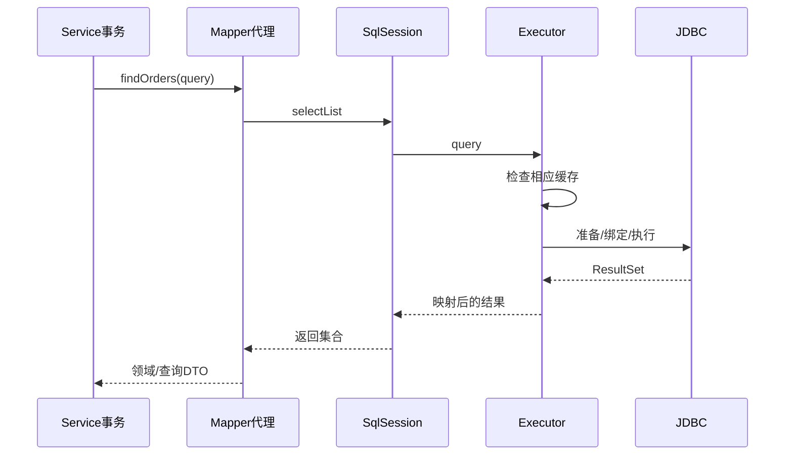
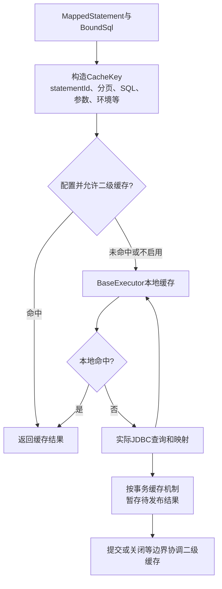
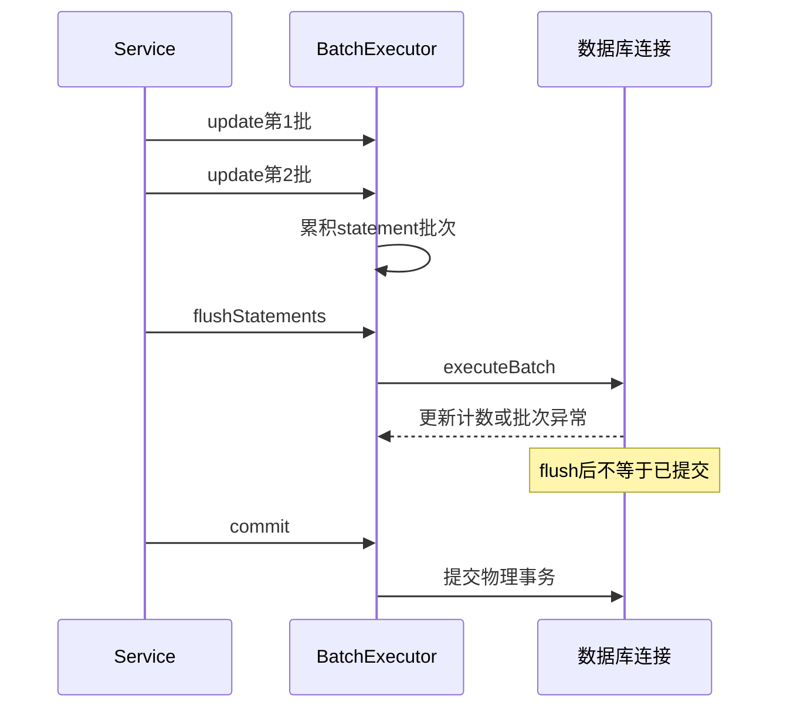

# MyBatis 代理、执行器、缓存与 SQL 治理深入解析

> 基线：MyBatis 3.5.x、MyBatis-Spring 3.x、MySQL 8.x。本文将 Java 调用、SQL 生成、连接事务和结果映射串为一条链，而不是把框架当作 XML 标签集合。

**阅读主线**：Mapper代理 → 执行器与缓存 → JDBC映射 → 提交和SQL治理。

**快速入口**：[面试题与参考答案](#reference-answers)。

## 阅读目录

- [1. Mapper 为什么没有实现类也能调用](#section-1)
- [2. 查询执行链的分解](#section-2)
- [3. #{}、${} 与动态标识符](#section-3)
- [4. resultMap：关联不只是把列名改成属性](#section-4)
- [5. SqlSession 与 Spring 事务](#section-5)
- [6. 一级与二级缓存](#section-6)
- [7. 执行器、批处理与主键](#section-7)
- [8. 分页：offset、游标与一致视图](#section-8)
- [9. 插件与 SQL 治理](#section-9)
- [10. 生产案例：接口升级后慢了十倍](#section-10)
- [11. 实验清单](#section-11)
- [12. 面试题与参考答案](#section-12)
- [13. 官方资料](#section-13)

<a id="section-1"></a>

## 1. Mapper 为什么没有实现类也能调用

Mapper 接口由代理接收调用，根据 namespace、方法名及映射元信息定位 MappedStatement，再通过 SqlSession 执行。它不是在编译时替你生成一份普通 DAO 源文件，也不是每次都靠反射重新解析整个 XML。

接口方法重载不能简单假定按 Java 完整签名映射到不同 SQL：XML statement ID 以 namespace 和 id 标识，工程上避免用重载表达多个独立 SQL。启动时尽早验证映射存在，减少请求时才暴露的错误。

### 1.1 核心组件职责

| 组件 | 负责什么 | 排障时关注什么 |
| --- | --- | --- |
| Configuration | 全局设置和映射元信息 | 插件、类型别名、环境和映射来源 |
| MappedStatement | 一条映射操作的定义 | SQL 来源、返回映射、缓存和超时 |
| BoundSql | 动态 SQL 后的实际语句与参数描述 | 最终 SQL 是否符合预期 |
| Executor | 查询/更新、缓存及批处理策略 | 缓存命中、延迟执行和提交 |
| StatementHandler | JDBC statement 准备和执行协作 | 分页改写及驱动设置 |
| ParameterHandler | 参数绑定 | JDBC 类型、null 及 TypeHandler |
| ResultSetHandler | 结果映射 | 重复行、关联和内存占用 |

<a id="section-2"></a>

## 2. 查询执行链的分解

**图 1｜查询执行链的分解**



**图解**：一次接口调用经代理、会话和执行器到达JDBC；返回路径才把结果集变成对象。缓存命中可能绕过真实SQL，因此查到结果不等于本次访问了数据库。

源代码阅读可从 MapperProxy、MapperMethod、DefaultSqlSession、BaseExecutor、SimpleExecutor 和 DefaultResultSetHandler 入手，随后观察 CachingExecutor 与插件包装。Spring 中的入口还有 SqlSessionTemplate，它改变会话与事务协作，不应直接把裸 SqlSession 示例当作 Spring 的全部行为。

<a id="section-3"></a>

## 3. #{}、${} 与动态标识符

`#{}` 产生值参数绑定，能避免将值当作 SQL 语法解释；`${}` 将文本直接放入语句。表名、列名、排序方向不是普通值，无法用一个 `?` 代替全部 SQL 语法，因此需要静态映射或服务端白名单。

```xml
<select id="listOrders" resultMap="orderRowMap">
  SELECT id, tenant_id, created_at, status, amount_cent
  FROM orders
  WHERE tenant_id = #{tenantId}
  <if test="status != null">
    AND status = #{status}
  </if>
  ORDER BY
  <choose>
    <when test="sort == 'createdAsc'">created_at ASC, id ASC</when>
    <otherwise>created_at DESC, id DESC</otherwise>
  </choose>
  LIMIT #{limit}
</select>
```

sort 只决定选择哪个固定片段，不被直接拼进 SQL。tenantId 来自可信认证上下文，limit 在服务层限制。预编译防值注入不代表自动有租户隔离或对象授权。

### 3.1 foreach 与空集合

动态 IN 列表先定义空集合语义：返回空、拒绝请求，还是不加过滤。不能让空集合导致过滤条件消失后查询全部租户数据；大 IN 还要考虑 SQL 长度、参数数量及优化器成本。

### 3.2 null 与类型处理

nullable 字段需要明确 jdbcType/TypeHandler，尤其是枚举、JSON、时区和金额。枚举按序号持久化可能因重排改变含义，业务代码应使用稳定代码值。TypeHandler 只转换表示，不能替代业务合法性校验。

<a id="section-4"></a>

## 4. resultMap：关联不只是把列名改成属性

别名和显式映射避免多表同名列覆盖。嵌套结果使用 id 标识帮助识别父子对象；映射不当可能生成重复父对象、子集合遗漏或把不同实体合并。

一对多 JOIN 放大结果行数：100 个订单每个 10 个明细，数据库返回 1,000 行，应用再合并为 100 个对象。LIMIT 100 行不等于 100 个订单；分页应先取父 ID 再查明细，或采用经验证的查询方案。

### 4.1 N+1 的定量判断

主查询一次，再为 N 个父对象各查一次关联，即 1+N 次往返。假设平均一次数据库往返 2ms，100 条记录仅额外往返就可能到数百毫秒，还增加连接池和数据库压力。

用批量关联查询通常可以把次数降为固定少数；JOIN 能减少往返但可能复制大量父字段。需要在 SQL 条数、返回字节、数据库计划和对象组装成本之间权衡。

<a id="section-5"></a>

## 5. SqlSession 与 Spring 事务

DefaultSqlSession 不应被多个线程共享，它包含执行状态与本地缓存。SqlSessionTemplate 是 Spring 集成的线程安全入口，按当前事务获取适当会话；并不意味着底层任意对象都变成了线程安全。

同一事务中共享连接要求事务管理器和 SqlSessionFactory 使用匹配的数据源。多数据源路由、读写分离及自定义获取连接最容易让“有事务注解却不同连接”。

### 5.1 为什么不能在 Mapper 内解决全部事务

一个业务操作通常涉及多次 Mapper 调用，边界应在应用服务，而不是每条 SQL 各自提交。否则库存成功、订单失败可能留下半完成状态。批处理及提交后的事件也要纳入同一业务设计。

<a id="section-6"></a>

## 6. 一级与二级缓存

### 6.1 缓存包装层和缓存键如何决定真实查询

**图 2｜缓存包装层和缓存键如何决定真实查询**



**图解**：二级缓存是执行器包装的一层，一级缓存属于会话执行状态；二者并非一个“大缓存”的两个别名。图示省略 flushCache、useCache、缓存配置和回滚等分支。缓存键包含最终 SQL 和参数等维度，所以同一个 Mapper 方法不同参数通常不会命中同一结果；插件改 SQL 却不正确协调缓存键，会破坏这个前提。

二级结果需要通过事务缓存机制协调发布，不能把尚未提交的数据随意提前共享。缓存键也不能发现“其他应用改了数据库”，这解释了为何跨写入来源的一致性无法只靠 namespace 缓存解决。

### 6.2 一级缓存的可见性

本地缓存与 SqlSession、事务以及 localCacheScope 等配置相关。相同语句和参数命中时可能复用结果对象，调用方直接修改返回对象可能影响同会话后续观察。缓存命中和数据库 MVCC 都可能造成“为什么读值没变”，要分开验证。

更新、提交等操作会按规则清理相应缓存；不能把当前实现的失效点当成跨应用一致性保证。Spring 的事务边界改变会话复用范围，因此裸 MyBatis 和 Spring 测试可能表现不同。

### 6.3 二级缓存的失效范围

二级缓存通常按 namespace 组织，可被不同会话共享，但其他 namespace、其他应用或直接 SQL 修改同表时不天然通知所有关联缓存。多表关联与跨模块写入使失效关系复杂。

使用二级缓存前说明数据更新源、namespace 关系、事务可见性和对象复制/序列化语义。对于高更新、跨服务共享数据，默认不启用往往更容易保证可解释性。

<a id="section-7"></a>

## 7. 执行器、批处理与主键

SIMPLE、REUSE、BATCH 分别体现不同 statement 使用和延迟执行策略。BATCH 可减少往返，但执行错误可能到 flush/commit 才暴露，更新计数也不能总是当作每次 mapper 调用立即可用的真实行数。

### 7.1 批处理的执行与提交是两道边界

**图 3｜批处理的执行与提交是两道边界**



**图解**：flush 把缓存在客户端的执行任务送往数据库，commit 决定持久化事务边界。事务内已执行的 SQL 可能已经占锁，即使尚未提交；每千条 flush 并不能保证锁只持有千条时间。需要分批释放锁就意味着分批提交，也意味着承认部分成功并设计检查点。

### 7.2 批处理的正确边界

分批大小由参数数量、包大小、锁时长、回滚成本和内存决定。单个大事务每 1,000 条 flush 不等于每 1,000 条提交；flush 和 commit 是不同操作。

如果每批提交，就接受部分成功并设计检查点与续跑；若要求全量原子提交，就不能为了节省内存随意分成多个物理事务。大规模导入常采用暂存表、校验及最后切换，而不是无限放大一次在线事务。

### 7.3 主键回填

useGeneratedKeys、selectKey 和驱动批量返回能力共同影响回填。多行插入返回的 ID 顺序及完整性必须按实际驱动验证，不能把某个数据库客户端的行为当所有 JDBC 的保证。

<a id="section-8"></a>

## 8. 分页：offset、游标与一致视图

深 offset 通常需要跳过大量候选行，延迟关联减少某些回表成本，但不消除所有跳过成本。游标分页使用稳定排序及上次边界更适合连续浏览。

```sql
SELECT id, created_at, amount_cent
FROM orders
WHERE tenant_id = :tenant
  AND (created_at < :last_time
       OR (created_at = :last_time AND id < :last_id))
ORDER BY created_at DESC, id DESC
LIMIT :page_size;
```

索引候选为 `(tenant_id, created_at, id)`，是否覆盖及方向能力按实际版本和计划验证。排序字段可能变化时仍可能重复/遗漏；需要严格快照导出则另设快照/截止条件，不能用普通翻页承诺稳定全量遍历。

count 查询可能比取一页更贵，对“下一页”场景可以 pageSize+1 判断是否还有数据，而不是每次精确 count 全部结果。

<a id="section-9"></a>

## 9. 插件与 SQL 治理

插件常用于分页、审计、租户过滤和观测，但字符串替换 SQL 很容易在别名、子查询、UNION 和动态片段下失效。涉及权限的改写要覆盖复杂 SQL，并由数据库及服务授权形成多层约束。

插件顺序会影响最终 SQL 和缓存键，改写后语句与参数不一致可能造成错误缓存或绑定。排查时记录进入和离开各层的语句结构，不在生产无界输出原始参数。

<a id="section-10"></a>

## 10. 生产案例：接口升级后慢了十倍

**变更**：订单列表加了明细和优惠数据，开发环境数据很少，功能验证通过。

**取证**：一次接口 SQL 从 2 条增加到 202 条；有些关联还是懒加载，在 JSON 序列化阶段触发。数据库单条 SQL 都不算慢，但总往返和连接等待累积明显。

**修复**：先取一页父记录，再批量取明细和优惠，按 ID 组装；明确查询 DTO，避免向 Controller 返回带隐式加载行为的持久对象。

**验证**：检查 SQL 数量上界、响应体大小、P99、连接池等待和最大明细数量；同时测试空结果、大订单和租户条件。优化后不是只看平均耗时，而是证明随页大小增长仍有可控成本。

<a id="section-11"></a>

## 11. 实验清单

1. 开启受控 SQL 计数，比较嵌套 select、JOIN、批量两段查询。
2. 同会话和跨会话读取同一记录，分别修改结果对象和数据库，观察缓存边界。
3. BATCH 中途制造唯一键冲突，记录错误发生时机、持久化结果和回填主键。
4. 对深分页与游标分页执行计划及真实耗时做对照，固定数据量和缓存预热条件。
5. 对空 IN、未知排序字段、跨租户 ID 和超大 pageSize 做边界验证。

验收需回答每次业务操作多少条 SQL、什么事务、最多返回多少行、失败如何回滚/续跑、权限约束由谁保证。

<a id="reference-answers"></a>

<a id="section-12"></a>

## 12. 面试题与参考答案

### Q1：Mapper 接口为什么可以直接调用？

**参考答案**：容器提供 Mapper 代理，代理将方法映射到 namespace 下的 MappedStatement，通过 SqlSession 进入 Executor。动态 SQL 生成 BoundSql，StatementHandler 准备 JDBC 语句，ParameterHandler 绑定值，ResultSetHandler 映射结果。Spring 环境由 SqlSessionTemplate 协调会话与事务，所以线程安全入口和底层非线程安全会话不能混为一谈。

### Q2：读到旧数据时，如何区分缓存与 MVCC？

**参考答案**：首先观察该调用是否真正发出 SQL；未发出时检查一级/二级缓存及缓存键。确认发出后，再看连接是否仍在旧事务、隔离级别及 read view。用受控实验改变会话/缓存配置而保持数据库时序不变，再改变事务边界作对照。简单重新 new 一个 Mapper 不一定改变 Spring 绑定的会话，不能据此排除缓存。

### Q3：为何 JOIN 分页可能返回不足一页订单？

**参考答案**：SQL LIMIT 限制的是 JOIN 后行数，不是映射合并后的父对象数。一单多明细会占多行，100 行可能只合并为几十个订单。可先分页获取父记录或父 ID，再批量取明细并按 ID 组装；同时用稳定排序、页大小上限和索引控制成本。分页插件只改写 SQL，不能自动证明父子映射语义正确。

### Q4：批处理怎样兼顾吞吐和可靠性？

**参考答案**：先定全量原子还是允许分批成功，再决定提交边界。flush 只执行积累语句，不自动释放整个事务锁；每批提交则要保存检查点、稳定业务唯一键和错误批次，重启可续跑。验证包括中途约束冲突、主键回填、更新计数及最终总量，而不能只测最快批大小。

<a id="section-13"></a>

## 13. 官方资料

- [Mapper XML](https://mybatis.org/mybatis-3/sqlmap-xml.html)
- [配置和执行器](https://mybatis.org/mybatis-3/configuration.html)
- [MyBatis-Spring 会话](https://mybatis.org/spring/sqlsession.html)
- [MyBatis-Spring 事务](https://mybatis.org/spring/transactions.html)
