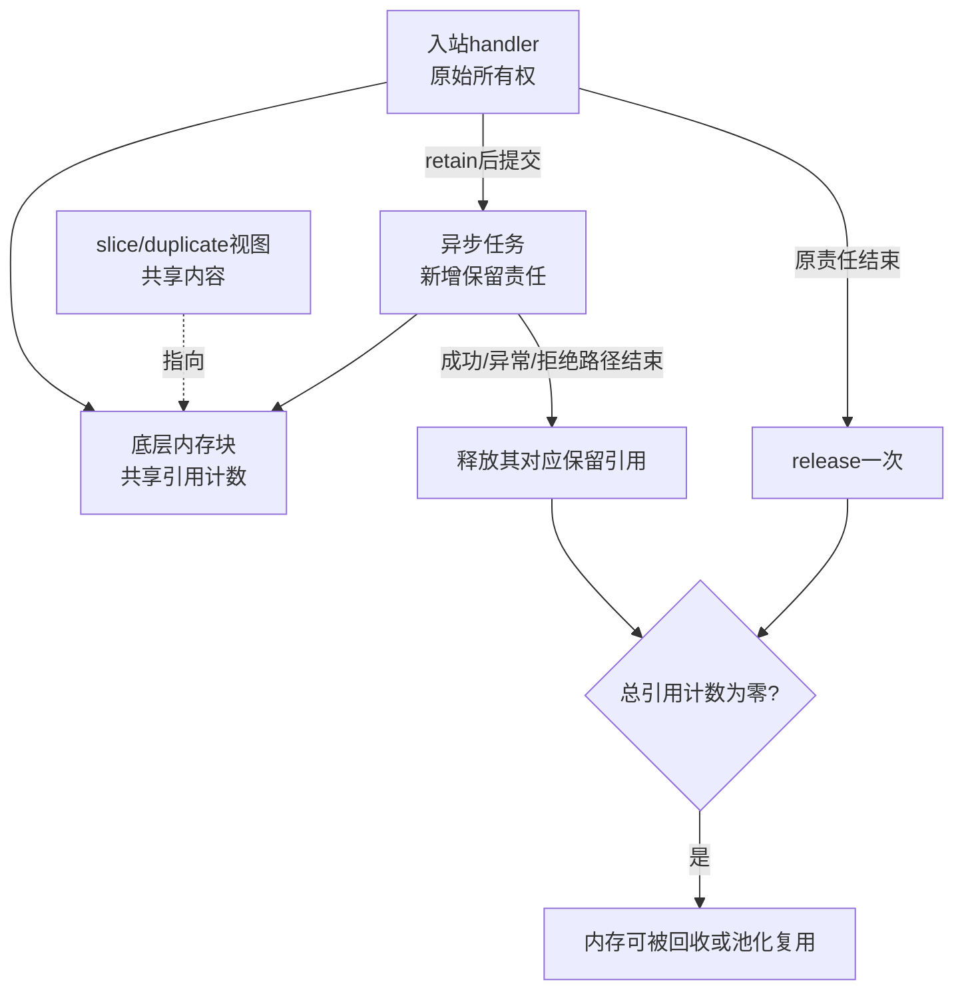
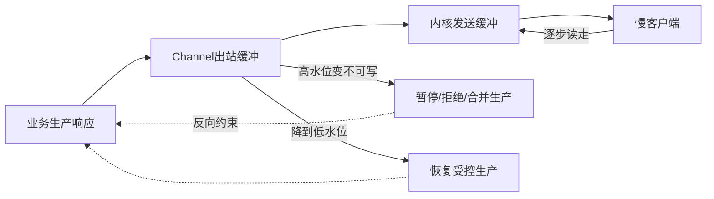

# Netty Reactor、协议编解码与内存背压深入解析

> 基线：Netty 4.1、Java 17+、TCP。示例标明“片段”的需要放入完整工程；线程和所有权规则比记住 API 名称更重要。

**阅读主线**：事件循环 → 消息边界 → 缓冲所有权 → 背压与恢复。

**快速入口**：[面试题与参考答案](#reference-answers)。

## 阅读目录

- [1. 从阻塞 Socket 到 Reactor](#section-1)
- [2. 线程模型：按顺序不代表业务自动安全](#section-2)
- [3. Pipeline 的方向与调用起点](#section-3)
- [4. 协议设计：长度、类型、身份与上限](#section-4)
- [5. ByteBuf 所有权：一份引用由谁释放](#section-5)
- [6. 背压：写不动时停止生产](#section-6)
- [7. 请求响应关联、超时和取消](#section-7)
- [8. 心跳、重连与半开连接](#section-8)
- [9. TLS、零拷贝和安全边界](#section-9)
- [10. 一次事故的排查过程](#section-10)
- [11. 测试矩阵](#section-11)
- [12. 面试题与参考答案](#section-12)
- [13. 官方资料](#section-13)

<a id="section-1"></a>

## 1. 从阻塞 Socket 到 Reactor

传统“一连接一平台线程”容易理解，但大量连接主要等待网络时，线程栈、调度和上下文切换成为成本。NIO 通过就绪事件让一个线程服务多个连接，Reactor 再将事件分发给相应处理逻辑。

就绪不是业务完成：可读只说明现在可以读取部分字节，不保证一整条消息已经到齐。应用仍需维护累计缓冲和协议状态。虚拟线程改变阻塞模型的线程成本，也不会让 TCP 自动出现消息边界。

### 1.1 Netty 的对象关系

| 对象 | 主要职责 | 容易误解的地方 |
| --- | --- | --- |
| EventLoopGroup | 管理事件循环集合 | 不等于每个连接独占一个线程 |
| EventLoop | 执行 I/O 和任务 | 阻塞会连累绑定的多个 Channel |
| Channel | 连接及 I/O 抽象 | write 成功不等于对端业务处理成功 |
| Pipeline | 组织 Handler 链 | 入站/出站方向与起点不同 |
| ChannelFuture/Promise | 表达异步操作结果 | 等待 Future 可能反过来阻塞事件循环 |
| ByteBuf | 字节访问和内存管理 | Java GC 不替代引用计数责任 |

<a id="section-2"></a>

## 2. 线程模型：按顺序不代表业务自动安全

常见服务端用 acceptor group 接受新连接，再将连接注册到 worker group。具体线程数量和传输实现依配置而定，不能把“两组线程、每组固定多少”当框架唯一架构。

同一 Channel 的主要 I/O 事件通常由其 EventLoop 处理，有助于避免多线程同时改连接状态。但 Handler 若被多个 Channel 共享，其字段仍可能由不同线程并发访问。

### 2.1 为什么不能在 handler 里查 JDBC

假设一个 EventLoop 服务 1,000 个连接，某个 handler 阻塞 500ms。即使其他 999 个连接都只有很轻的逻辑，也可能被迫等待这个线程恢复。CPU 不一定高，尾延迟却会明显恶化。

把阻塞操作交给业务线程池时还要解决：队列有界、拒绝响应、同连接顺序、取消、结果返回到合适执行上下文，以及 ByteBuf 的生命周期。

### 2.2 用并发分层管理资源

连接数、在途请求数、业务线程数和数据库连接数是不同维度。允许 10 万空闲连接不代表能同时执行 10 万次数据库操作；应分别设置上限并定义过载时如何拒绝。

<a id="section-3"></a>

## 3. Pipeline 的方向与调用起点

入站事件从前向后，出站事件向前传播。`ctx.fireChannelRead` 继续向后，`ctx.write` 从当前 context 向前找出站处理器，`channel.write` 通常从尾端开始。因此同一个编码器放在不同位置，是否能被经过可能不同。

```text
head -> frameDecoder -> messageDecoder -> messageEncoder -> business -> tail
入站：字节 -> 拆帧 -> 消息对象 -> 业务
出站：业务消息 -> 编码器 -> 传输
```

不要只根据 addLast 的书写顺序判断调用路径；先确定事件方向和发起位置。异常传播也应有统一处理，避免记录后不关闭损坏连接，或者重复记录同一错误造成日志风暴。

<a id="section-4"></a>

## 4. 协议设计：长度、类型、身份与上限

一个可演进二进制协议通常包含 magic、version、type、flags、requestId、bodyLength 和 body。不是字段越多越专业，而是每个字段解决明确问题：识别协议、兼容升级、关联响应、限制内存和校验结构。

### 4.1 长度字段必须讲清楚

长度是否包含 header、自身字节数、压缩前还是压缩后长度？接收端若理解不同，会读错帧或等待永远不会到齐的数据。协议文档需要字节布局和示例，不只画一个模糊方框。

```text
offset  size  meaning
0       4     bodyLength，unsigned 语义但实现必须校验范围
4       N     body bytes，UTF-8 JSON，仅用于教学协议
最大帧：1 MiB，包含 4 字节长度头
```

```java
// Pipeline 片段：去掉 4 字节头，将 body 交给后续 handler。
pipeline.addLast(new LengthFieldBasedFrameDecoder(
    1024 * 1024, 0, 4, 0, 4));
pipeline.addLast(new LengthFieldPrepender(4));
```

发送端 body 长度也要限制在总帧限制之内。解压缩还需要限制解压后大小及压缩比，否则一个小帧也可能制造巨大内存分配。

### 4.2 自定义解码的关键检查

读取 header 前先检查 readableBytes；数据不足不推进不可恢复的状态。读取长度后校验非负/溢出及最大值，再判断完整 body 是否到齐。ByteToMessageDecoder 应通过其约定管理累计缓冲，避免在输入不足时丢失 readerIndex。

不要为每个不足一帧的 read 创建巨大数组，也不要相信客户端声明的长度直接 allocate。协议错误应返回有限错误或关闭连接，禁止无限尝试重新同步消耗 CPU。

<a id="section-5"></a>

## 5. ByteBuf 所有权：一份引用由谁释放

池化和堆外内存降低某些分配/复制成本，但要求明确 retain/release。引用计数归零后相关内存可以被复用，继续访问会报错或造成错误行为；持有一个 Java 引用不代表仍有合法使用权。

### 5.1 三种典型处理模式

| 模式 | 所有权动作 | 常见错误 |
| --- | --- | --- |
| 消费入站消息，不向后转交 | 处理后 release，或交由自动释放 handler | 忘记释放 |
| 原样向后转交 | 按框架约定转移所有权 | 转交后又 release 导致重复释放 |
| 异步保留到其他线程 | 为保留引用 retain，最终消费者 release | 原线程提前释放或异步失败路径遗漏 |

SimpleChannelInboundHandler 常见默认行为是处理结束自动释放，因此异步使用必须额外保留；ChannelInboundHandlerAdapter 不会替你自动完成所有释放。

### 5.2 共享视图不等于独立内存

### 5.2.1 用引用图核算一次异步转交

**图 1｜用引用图核算一次异步转交**



**图解**：引用计数保护的是底层存储生命周期，持有 Java 变量、创建视图不必然增加一份存活责任。普通 slice 和 retainedSlice 的区别正是是否额外保留。对于池化派生缓冲，具体引用计数委托可能更复杂，但所有权核算原则不变。

假设 SimpleChannelInboundHandler 收到 refCnt=1 的消息，回调结束自动释放一次。异步任务必须先 retain，使其使用期间仍有合法责任；如果提交被拒绝，必须立即撤销这次 retain，不能等不存在的任务 finally。若选择先解码复制成独立 DTO，则可结束原缓冲生命周期，通常更容易审查。

| 路径 | 原handler责任 | 异步保留责任 |
| --- | --- | --- |
| 提交成功且任务成功 | 自动/显式按约定释放 | finally释放 |
| 提交成功但任务抛异常 | 同上 | finally释放 |
| 提交被拒绝 | 同上 | 拒绝处理立即释放 |
| 连接关闭但任务还在运行 | 不额外重复释放 | 任务取消/结束路径释放 |

slice/duplicate 通常共享底层存储，retainedSlice 等带保留语义的 API 会改变引用计数。业务若只需长期保存小字段，复制成独立不可变对象可能比持有一整个大缓冲更省内存、更易维护。

### 5.3 跨线程伪代码

```text
收到 ByteBuf
  -> 校验帧和长度
  -> 可选：解码成独立业务对象，再交业务池（最易管理）
  -> 若必须保留 ByteBuf：retain
  -> 提交失败：立即释放保留的引用并返回过载
  -> 异步任务 finally：释放其持有的引用
  -> 原入站 handler 按自身约定处理原始所有权
```

这段流程需要和具体 handler 的自动释放行为一起核算，不能机械到处 retain 一次、release 一次。代码审查应逐条路径检查：成功、异常、拒绝、取消、超时及连接关闭。

<a id="section-6"></a>

## 6. 背压：写不动时停止生产

**图 2｜背压：写不动时停止生产**



**图解**：慢客户端限制出口速度，若入口生产率长期高于出口，积压随时间增长。高低水位提供反馈及滞回，避免在同一阈值附近频繁开关；它不是自动替业务决定丢弃规则的机制。write 的 Future 反映对应 I/O 操作结果，也不表示对端业务已经处理。

网络发送受对端读速率和链路限制。持续 write 即使暂时返回成功，也可能只是在进程中积压。水位使 Channel 变为不可写时，业务应暂停产生或采取定义好的丢弃/断开策略。

### 6.1 三层背压

1. 网络层：感知 Channel 可写状态与待写字节。
2. 应用层：限制每连接、每租户和全局在途请求。
3. 下游层：数据库、远程调用和任务队列各自有界。

仅关闭 autoRead 可能减少继续读入，但协议、缓冲、正在执行任务和对端超时都要协作。盲目扩大高水位只会允许更多积压，可能让故障发生得更晚且更严重。

### 6.2 容量估算

假设 50,000 连接，每连接平均缓冲 16KiB，仅缓冲就约 781MiB，还未计 Channel、pipeline、请求映射、线程和 JVM。平均值也不够，慢连接可能占大部分内存，需按高分位和单连接硬上限控制。

<a id="section-7"></a>

## 7. 请求响应关联、超时和取消

RPC 客户端通常以 requestId 映射 Promise/Future，收到响应时完成并删除。超时也要删除映射，晚到响应需安全丢弃；连接关闭时批量失败所有在途请求，不能让 Future 永久悬挂。

requestId 需要在实际作用域内唯一，重连后是否复用取决于连接及协议设计。技术请求 ID 与业务幂等 ID 不同：重试可以生成新技术请求 ID，但应保留原业务操作身份。

客户端超时不代表服务端取消成功，更不代表写入未发生。取消协议应明确“尽力停止”还是“已保证未执行”，对不明确状态提供查询接口。

<a id="section-8"></a>

## 8. 心跳、重连与半开连接

空闲检测可以触发 ping/pong 或关闭连接，但网络半开、调度暂停和业务忙碌都会影响观测。存活心跳只证明某条路径有响应，不证明数据库或业务服务健康。

重连使用指数退避、抖动及并发上限，避免 broker/服务恢复时所有客户端同时重连。连接重建后恢复订阅和认证需要状态机，不能一连上 TCP 就开始重放所有请求。

<a id="section-9"></a>

## 9. TLS、零拷贝和安全边界

TLS 握手消耗 CPU 和时间，需要限制未认证连接和握手等待。证书校验、主机名、信任链及轮换不能因内网而全部关闭。

零拷贝需要说明具体路径：组合缓冲减少应用拼接，sendfile 等减少某些用户/内核复制，direct buffer 减少特定 JNI 中间复制；TLS、平台和文件系统会改变路径。不能用一个词承诺“没有任何复制”。

反序列化不信任的 Java 原生对象具有风险，协议选择可约束 schema 的格式，限制递归深度、集合长度及字符串大小。业务权限仍需逐请求校验。

<a id="section-10"></a>

## 10. 一次事故的排查过程

**现象**：连接数稳定但延迟周期性尖峰，direct memory 持续增长，重启后缓解。

**证据一**：EventLoop 栈里有阻塞数据库查询，其他连接共享该线程。

**证据二**：慢客户端的待写字节增长，无上限响应队列；应用一直生成推送数据。

**证据三**：异步异常路径遗漏 release，泄漏报告指向业务线程池拒绝时的分支。

修复拆为阻塞业务隔离、有界队列与可写状态联动、所有权路径审查。分别验证，不把一次扩大 direct memory 上限当根因解决。

<a id="section-11"></a>

## 11. 测试矩阵

| 测试 | 注入方式 | 验收 |
| --- | --- | --- |
| 半包 | 每次输入 1 字节 | 只在完整消息时输出一次 |
| 合包 | 一次输入多个完整帧 | 输出顺序及数量正确 |
| 恶意长度 | 超大、负数/溢出语义 | 分配前拒绝，连接行为明确 |
| 业务池满 | 降低队列并阻塞任务 | 有限拒绝，无引用泄漏 |
| 慢客户端 | 限制读取速率 | 待写字节有界，其他连接不被拖垮 |
| 超时晚响应 | 延后回包 | Future 已释放，晚响应不串请求 |
| 断连重连 | 中断网络 | 在途请求终结，恢复受控 |

EmbeddedChannel 适合验证编解码和部分 handler 行为，不能代替真实网络、TLS 和慢客户端压测。基准记录消息大小、连接数、并发、CPU、RSS 和 direct memory，不只报告 QPS。

<a id="reference-answers"></a>

<a id="section-12"></a>

## 12. 面试题与参考答案

### Q1：为什么 EventLoop 中不能执行阻塞业务？

**参考答案**：一个 EventLoop 通常服务多个连接，阻塞一个 handler 会阻塞该线程继续处理其他连接的读写和任务，形成排队放大，即使 CPU 不高也会严重增加 P99。阻塞调用需要转交有界业务执行器，并处理拒绝、顺序、超时和缓冲生命周期；仅换成异步提交而使用无界队列，仍会在过载时耗尽内存。

### Q2：怎样正确处理 TCP 的消息边界？

**参考答案**：TCP 提供有序字节流，应用每次 write 的边界不保留。协议可采用固定长度、分隔符或长度字段；长度协议必须定义端序、是否含头、最大长度及压缩后上限。解码器在数据不足时保留可恢复读位置，完整后才输出消息；超长或非法长度在分配大内存前拒绝。用半包、合包和恶意长度分别验证。

### Q3：retain/release 为什么不能依赖 GC？

**参考答案**：ByteBuf 可能引用池化或堆外存储，引用计数决定是否可复用，而不是 Java 变量是否还存在。跨异步边界必须显式保留并在成功、异常、拒绝和取消路径释放；自动释放 handler 只管理其原始责任。GC 可能最终处理某些外层对象，但不能作为及时且正确归还池化资源的协议。

### Q4：如何防止慢客户端拖垮服务？

**参考答案**：同时限制每连接待写字节、全局在途响应和业务队列，监听可写状态暂停生产。允许丢弃的推送可合并或丢旧值，不可丢业务则限时等待或断开并支持恢复。测量慢客户端下 RSS、direct memory、其他连接 P99 和拒绝率，不能仅扩大出站缓冲，因为出口长期慢时任何有限缓冲最终都会满。

<a id="section-13"></a>

## 13. 官方资料

- [Netty 4.1 API](https://netty.io/4.1/api/index.html)
- [引用计数对象](https://netty.io/wiki/reference-counted-objects.html)
- [用户指南](https://netty.io/wiki/user-guide-for-4.x.html)
- [Netty 4.1 源码](https://github.com/netty/netty/tree/4.1)
