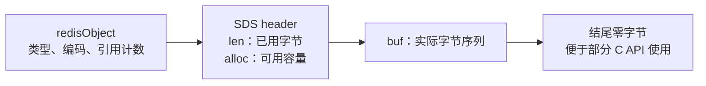
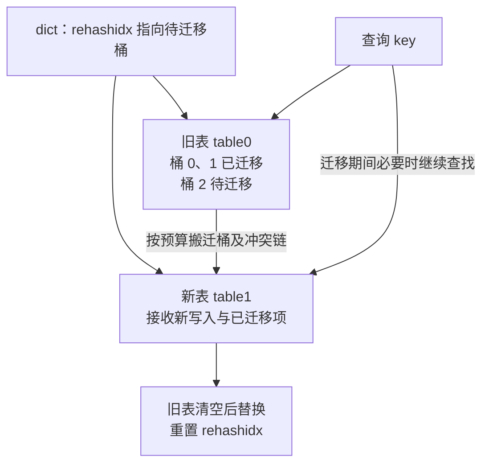
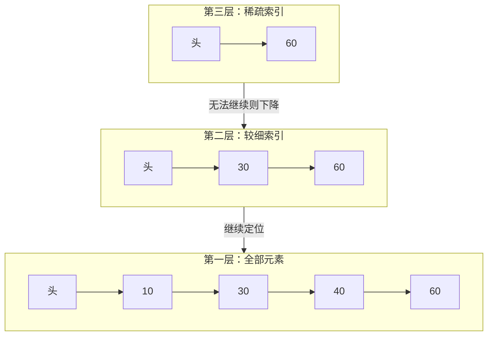

# Redis 数据结构、内存编码与命令执行

> 基线：Redis 7.x。逻辑数据类型、底层编码和业务用途是三个不同层次。阈值及源码符号随小版本可能变化，阅读时固定部署 tag，并通过 OBJECT ENCODING 验证当前实例。

**阅读主线**：对象布局 → 编码取舍 → rehash与跳表 → 命令与内存成本。

**快速入口**：[面试题与参考答案](#reference-answers)。

## 阅读目录

- [1. 从业务操作选择结构](#section-1)
- [2. String：SDS、整数与二进制安全](#section-2)
- [3. Hash、Set：紧凑布局与哈希结构](#section-3)
- [4. List：quicklist 与访问代价](#section-4)
- [5. Sorted Set：跳表、字典与排序语义](#section-5)
- [6. Stream：条目、消费组与 Pending](#section-6)
- [7. 命令执行：单线程模型的正确边界](#section-7)
- [8. 过期与淘汰：两套机制](#section-8)
- [9. Big Key 与 Hot Key：两种不同故障](#section-9)
- [10. 容量计算示例](#section-10)
- [11. 可复现实验与验收](#section-11)
- [12. 面试题与参考答案](#section-12)
- [13. 参考](#section-13)

<a id="section-1"></a>

## 1. 从业务操作选择结构

“用 Redis 存一个对象”不是完整设计，需要先列出访问模式：是否整体读写、是否局部更新、是否排序、是否去重、是否需要过期、单 key 最大规模是多少。相同数据用 JSON String 或 Hash，在网络、内存和并发更新方面的成本不同。

| 类型 | 核心抽象 | 常见命令 | 适合场景 | 规模风险 |
| --- | --- | --- | --- | --- |
| String | 字节串或整数值 | GET/SET/INCR | 缓存、计数 | 大值传输阻塞与网络放大 |
| Hash | 字段映射 | HGET/HSET/HSCAN | 属性集合 | 字段太多、整体读取过重 |
| List | 双端序列 | LPUSH/LRANGE | 有界列表 | 大范围读取、可靠消费额外复杂 |
| Set | 无序去重集合 | SADD/SISMEMBER | 标签、集合关系 | 大集合运算阻塞 |
| Sorted Set | 成员与分数 | ZADD/ZRANGE | 排行榜、时间有序任务 | 热点写、巨大成员数 |
| Stream | 有序条目及消费组 | XADD/XREADGROUP | 事件、轻量流处理 | pending、保留和恢复管理 |

位图是 String 上的位操作，不是独立底层对象；HyperLogLog 是概率基数统计，不能返回所有原始成员，也不适合要求精确财务计数的用途。

<a id="section-2"></a>

## 2. String：SDS、整数与二进制安全

Redis 字符串可以保存零字节等任意字节序列，不依赖 C 字符串终止符表达内容长度。SDS 维护长度和空间信息，避免每次求长度扫描全部内容，也便于安全扩容。

### 2.1 编码不是业务类型

某些可解析整数可使用紧凑整数编码；短字符串可能采用紧凑分配方式；长字符串使用不同布局。编码选择由实现和阈值决定，不能根据 Java 中字段是 String 就推断 Redis 一定使用某种编码。

```text
SET demo:count 10
OBJECT ENCODING demo:count
INCR demo:count
GET demo:count
MEMORY USAGE demo:count
```

实验在隔离实例进行。记录命令返回、Redis 版本和内存分配器，不应把单个 key 的测量值直接推广为所有实例的准确容量。

### 2.2 String 的编码布局与更新取舍

#### 2.2.1 从内存布局推导 SDS 的行为

**图 1｜从内存布局推导 SDS 的行为**



**图解**：对象元信息回答“这是哪种 Redis 对象”，SDS 的长度回答“实际数据到哪里结束”。结尾零字节便于与部分 C 函数协作，但不是有效载荷边界，因此中间存在 `0x00` 也不截断数据。不同 SDS header 会压缩长度字段，上图省略具体位布局，并不代表所有字符串都额外分配相同大小的 header。

读取长度由 len 提供，复杂度是 O(1)；追加字符串仍要复制新增字节，容量不足还要重新分配并迁移旧内容。因此“获取长度 O(1)”不能被扩大为“所有 String 操作 O(1)”。扩容预留空间减少连续追加的分配次数，也意味着 alloc 可能大于 len，MEMORY USAGE 不会等于业务字节数。

| 编码 | 核心布局 | 优势 | 操作后的变化 |
| --- | --- | --- | --- |
| int | 使用可容纳的整数表示 | 减少字符串存储及解析成本 | 改为非整数内容可能转成字符串编码 |
| embstr | 小对象元信息与 SDS 紧凑分配 | 分配次数少、局部性较好 | 修改通常转换成 raw 路径处理 |
| raw | 对象与字符串内容采用相应独立布局 | 适合较大或可变内容 | 扩容可能重新分配 SDS |

不要把 embstr 的某个字节阈值背成语言规范；在固定版本上用 OBJECT ENCODING 观察整数、短字符串及 APPEND 后的转换，比只记一个数字更可靠。

#### 2.2.2 整体对象与字段更新的取舍

JSON String 读写简单、结构自包含，但局部字段更新通常需要整体序列化，且并发“读—改—写”可能覆盖别人的更新。Hash 能独立更新字段，但多字段不变量仍需原子脚本或事务协议；Redis 7.x 的普通 key 过期不能直接视作每个 Hash 字段独立过期能力。

如果对象始终整体读取且数百字节，String 可能更简单；如果一个大对象只有少数字段高频变化，Hash 可能节省传输。最终用真实数据分布比较内存、带宽、延迟和更新正确性。

<a id="section-3"></a>

## 3. Hash、Set：紧凑布局与哈希结构

### 3.1 为什么小集合需要紧凑编码

哈希表的桶、指针和分配开销，对只有几个短字段的对象可能比数据本身更贵。紧凑布局通过连续存储减少指针和碎片，代价是部分查找需要线性扫描。因此只适合元素数和元素长度受控的情况。

Redis 7 的小 Hash 等结构可能使用 listpack，达到阈值后转成其他编码。不能笼统说“所有集合永远 O(1)”：命令复杂度与底层实现、元素数和返回数量有关。

### 3.2 哈希表扩容与渐进式 rehash

一次搬迁整个大字典会造成明显暂停。渐进式 rehash 将搬迁分散到后续操作及后台周期中，在迁移期需要协调新旧表查询与更新。它降低单次搬迁成本，但不意味着扩容完全没有 CPU、内存和尾延迟影响。

#### 3.2.1 两张哈希表如何让迁移持续可用

**图 2｜两张哈希表如何让迁移持续可用**



**图解**：迁移期间不是把服务停住一次搬完，也不是新旧数据双写两遍。新表接收新插入项；查询和删除根据迁移状态协调两张表；旧桶搬空后逐步推进游标，最后释放旧表的桶数组。旧表和新表同时存在，所以迁移期内存峰值会高于稳态。

下面是为解释读写不变量编写的伪代码，**不是 Redis 源码复制**：

```text
lookup(key):
    做一小步允许的迁移
    在旧表对应桶查找
    若正在 rehash 且旧表未找到，再查新表

insert(key, value):
    先确认 key 不存在
    若正在 rehash，插入新表；否则插入当前表

rehashStep(budget):
    限制空桶扫描量
    把选中旧桶的冲突链重新散列到新表
    清空旧桶并推进游标
    旧表元素为零时完成替换
```

这里限制的迁移步通常与桶相关，一个桶可能包含多个冲突元素，因此不能说“每步严格只移动一个 key”。Redis 7.2 的 `dictRehash` 还限制空桶访问预算，避免极稀疏字典单步扫描过久。其设计目标是摊平工作，而不是给任意一次命令提供硬实时上限。

listpack 与哈希表的差别也由此可推导：前者连续、少指针、局部性好，但查找和插入移动成本可能随集合增长；后者平均查找更快，但桶、条目和分配器成本更大。小对象优先空间效率，大对象转换结构以控制查找成本，是“空间换时间”的具体实例。

### 3.3 Set 的表示选择

纯整数、小规模集合可以采用紧凑表示，其他场景使用哈希结构等实现。具体小版本可能引入更多紧凑编码路径，所以实验应观察实际编码，避免把某一版源码的两种编码当作永久规则。

大集合求交并差可能遍历大量成员，返回结果还占用网络和客户端内存。业务需要高频大集合分析时，应评估位图、离线计算或专用分析引擎，不能只因为“Redis 在内存里”就忽略复杂度。

<a id="section-4"></a>

## 4. List：quicklist 与访问代价

List 适合两端插入与读取，底层 quicklist 将多个紧凑节点连接起来，在局部性与大对象搬迁之间折中。它不是一个可以把任意位置操作都视为常数时间的 Java ArrayList。

新闻最新 100 条可通过 LPUSH 配合 LTRIM 维护有界列表，但两条独立命令之间存在窗口。需要把“加入并裁剪”作为不可交错的操作时，可使用短 Lua 脚本或事务命令组合，并处理失败语义。

用 List 当可靠任务队列时，简单 pop 后进程崩溃会丢处理；需要可靠移动到处理中列表、确认和超时回收，或者直接使用具有消费组与 pending 管理的 Stream/专用 MQ。

<a id="section-5"></a>

## 5. Sorted Set：跳表、字典与排序语义

Sorted Set 维护成员到分数的访问及有序遍历，较大结构通常结合字典与跳表满足不同查询。跳表通过多层随机索引降低查找期望复杂度，结构比平衡树更便于某些范围遍历与实现，但不是所有有序场景都天然更优。

### 5.1 排行榜设计

```text
ZADD ranking:season:2026 1050 user:42
ZINCRBY ranking:season:2026 20 user:42
ZRANGE ranking:season:2026 0 9 REV WITHSCORES
ZREVRANK ranking:season:2026 user:42
```

同分时需要理解成员字节序的排序规则；业务若要求“先达到分数者靠前”，必须额外设计可证明的排序键。把时间戳强行塞到浮点 score 的低位可能遇到精度边界，应分析可表示范围，不能随意乘一个大常数。

### 5.2 跳表怎样定位范围与排名

**图 3｜跳表怎样定位范围与排名**



**图解**：查找 40 时，先在高层跳过一段较小元素，在无法继续前进时下降到更细层级。图中同分数的成员排序细节被省略，真实排序还要比较成员。随机层高使结构在期望上保持较短查找路径，不等于任何输入都严格保证平衡树式最坏 O(log N)。

Redis 跳表的层级链接还记录 span，用于表示跨越的底层节点数。求排名时沿路径累计 span，不必从头数到目标；范围查询先定位边界，再沿底层顺序访问结果，所以常见复杂度是 O(log N + M)，M 是实际返回元素数。字典则负责按 member 定位 score，二者回答不同查询。

这解释了为什么大范围 ZRANGE 仍可能慢：定位快不意味着返回十万条记录免费，结果构造、内存和网络都至少随返回量增长。

### 5.3 延迟任务不是只做一次 ZPOPMIN

按到期时间作为 score，消费者取出小于当前时间的任务。多个消费者竞争时，“查询到期项—删除”需要原子化；取出后进程崩溃又需要处理中状态与超时恢复。系统时间偏差、持久化丢失和主从切换都可能影响任务，严格业务截止判断仍以事实存储为准。

<a id="section-6"></a>

## 6. Stream：条目、消费组与 Pending

消费者组让多个消费者协作处理条目，已投递未确认的消息进入 pending 跟踪。XACK 表示消费确认，不会自动删除流中条目；保留策略与消费状态是不同维度。

故障恢复需要识别长时间未确认条目并按相应命令领取，执行前仍做业务幂等。裁剪可能删掉业务仍希望恢复的内容，保留窗口必须覆盖最长故障及重放周期。

Stream 可以承担部分事件处理需求，但跨区域复制、长期保留、复杂消费生态和大规模运维时，要对比 Kafka/RocketMQ，而不是仅根据已有 Redis 就默认选它。

<a id="section-7"></a>

## 7. 命令执行：单线程模型的正确边界

主要命令串行执行使一些原子读改写容易实现，但服务端仍有网络、后台释放、持久化与复制等工作。慢命令占用主执行路径时，其他客户端会排队；一次几毫秒的大集合操作，在高 QPS 下就可能影响大量请求。

### 7.1 Pipeline 减少往返，不减少总工作

如果一条命令 RTT 约 1ms，串行执行 100 条仅网络等待就可能约 100ms。Pipeline 将命令批量发送可以显著降低往返，但服务器仍需执行所有操作，返回值也要缓冲。批次过大可能增加服务端/客户端内存及其他请求等待。

### 7.2 MULTI/EXEC 不等于数据库事务

命令队列和执行具有相应隔离特征，但执行期某条命令错误不会自动回滚先前成功命令。WATCH 提供乐观并发检测，EXEC 被放弃后调用方需要重试并处理竞争，不能把它当作无冲突锁。

### 7.3 Lua 的“原子”要拆开解释

Lua 执行期间其他命令通常不会插入这段逻辑，适合短小条件更新；但脚本错误不保证撤销已完成写入。先完成参数、类型和前置条件检查，再执行变更，避免在写一半后调用容易出错的分支。

Cluster 中脚本访问多 key 需要满足相应槽位限制；脚本 key 应通过 KEYS 明确传入，不能在脚本里随意拼出未知跨槽 key。

<a id="section-8"></a>

## 8. 过期与淘汰：两套机制

过期表达 key 的逻辑有效期，Redis 通过访问检查及周期性扫描等方式处理，不能保证到期瞬间内存即回收。淘汰则在内存压力下按策略选择数据，即使 TTL 尚未到期也可能移除。

| 机制 | 触发因素 | 设计问题 |
| --- | --- | --- |
| TTL 过期 | 时间条件 | 能接受多长陈旧窗口？ |
| maxmemory 淘汰 | 内存压力 | 哪些数据可以丢？ |
| 显式失效 | 业务变更 | 失败如何重试、对账？ |
| 客户端本地缓存失效 | 订阅/追踪或版本变化 | 断连后怎样重建可信状态？ |

allkeys 与 volatile 策略的候选集合不同；noeviction 下写操作可能因内存不足失败。近似 LRU/LFU 不等于精确全局排序，算法采样与额外内存都涉及取舍。

<a id="section-9"></a>

## 9. Big Key 与 Hot Key：两种不同故障

Big Key 是体积或成员数过大；Hot Key 是访问集中。一个很小的计数器也可能成为热点，一个冷门大集合也可能在删除或备份时造成成本。两者指标和解决方向不同。

Big Key 先测大小、成员数量和命令成本，再分片或限制增长；UNLINK 等延迟释放能力可以减少部分同步释放开销，但并不让大规模内存释放完全无成本。Hot Key 可以做只读本地缓存、请求合并或业务分桶，写热点拆分还需定义汇总一致性。

<a id="section-10"></a>

## 10. 容量计算示例

假设 1,000 万条缓存，平均 payload 300 字节，裸数据约 3GB。实际还包括 key、对象头、字典、分配器对齐、过期元数据、复制缓冲、客户端缓冲和碎片。不能用裸数据除机器内存得到安全容量。

从生产分布抽样小中大三类对象，用 MEMORY USAGE 和批量装载记录增量，比较 used_memory 与 RSS。再为复制、AOF 重写/快照时的写时复制及故障迁移保留余量。压缩会减少存储但增加应用 CPU，且单 key 更新可能需要整体重压缩。

<a id="section-11"></a>

## 11. 可复现实验与验收

1. 用不同字段数/长度创建 Hash，观察编码转换和内存变化，不修改全局阈值来“证明”预设结论。
2. 对相同数据分别用 JSON String 与 Hash，测整体读、局部更新、序列化和网络字节。
3. 对 1/100/1,000 条 Pipeline 批次比较吞吐和 P99，同时记录其他客户端延迟。
4. 设计 Lua 脚本先写再故意产生类型错误，验证先前写入是否保留，纠正“原子=回滚”的直觉。
5. 模拟热点访问与大范围 LRANGE，区分 CPU、服务端命令耗时和网络等待。

验收不是“能跑命令”，而是能说明每个结构的增长上限、失败行为、内存预算和恢复途径。

<a id="reference-answers"></a>

<a id="section-12"></a>

## 12. 面试题与参考答案

### Q1：Redis 为什么快，为什么也会突然变慢？

**参考答案**：Redis 的常见请求路径较短，数据主要位于内存，紧凑编码减少小对象开销，事件驱动和批量交互减少线程与网络成本。主要命令执行路径串行化又降低了共享数据上的同步复杂度。但命令复杂度仍存在，大集合遍历、长 Lua、大值返回和同步释放都可能占住执行路径；fork、持久化 I/O、网络和客户端排队也会增加尾延迟。因此排障要把客户端总耗时与服务端命令耗时分开，不能仅用“内存数据库”推断延迟稳定。

**追问：单线程为什么还能利用多核？参考答案**：主命令执行、网络 I/O、后台释放以及持久化/复制中的工作分工不同；部署分片也可利用多核。讨论时必须指明是命令执行线程、整个进程，还是整个集群。

### Q2：为什么 ZSet 同时需要字典和跳表？

**参考答案**：按成员查分数和按分数找范围是两种访问模式。字典提供按 member 的平均快速查找，跳表提供有序定位和范围遍历，span 使排名可以沿搜索路径累计。只用字典无法高效提供顺序范围，只用跳表则不能把按成员查找自然变成字典式访问。小规模对象可能使用更紧凑编码，达到转换条件后才使用相应大型结构。

### Q3：渐进式 rehash 是否让扩容完全没有停顿？

**参考答案**：不是。它用两张表和迁移游标把工作分摊到多次执行中，降低一次搬完整表的风险，但申请新桶数组、迁移冲突链、额外内存和缓存失效仍有成本。一次迁移步也不等于一个元素。应通过真实数据分布观察 P99、内存峰值和 fork 期间行为，而不是把“渐进”理解为零成本。

### Q4：Pipeline、MULTI/EXEC、Lua 应如何选择？

**参考答案**：相互独立的批量命令优先考虑 Pipeline，它减少 RTT，不保证整批执行隔离。需要队列化命令的事务执行机制可使用 MULTI/EXEC，但执行错误不提供数据库式回滚。需要“读取—判断—更新”在服务端不可交错地执行时，短 Lua 更直接；脚本必须先校验后写入、限制耗时，并满足 Cluster 槽位规则。三者都不替代持久化和业务幂等。

<a id="section-13"></a>

## 13. 参考

- [Redis 7.2 源码](https://github.com/redis/redis/tree/7.2)
- [dict.c：字典扩容与渐进迁移](https://github.com/redis/redis/blob/7.2/src/dict.c)
- [t_zset.c：跳表插入、span 与排名](https://github.com/redis/redis/blob/7.2/src/t_zset.c)
- [Redis 数据类型](https://redis.io/docs/latest/develop/data-types/)
- [Redis 命令参考：复杂度与版本](https://redis.io/docs/latest/commands/)
- 下一章：[缓存一致性与热点治理](02_缓存一致性与热点治理实战.md)
