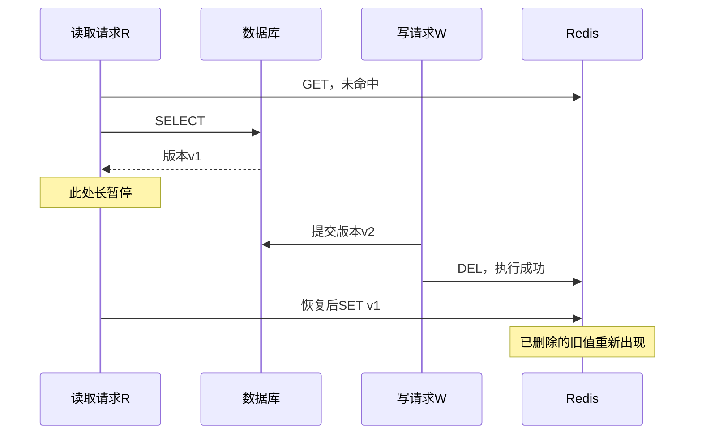
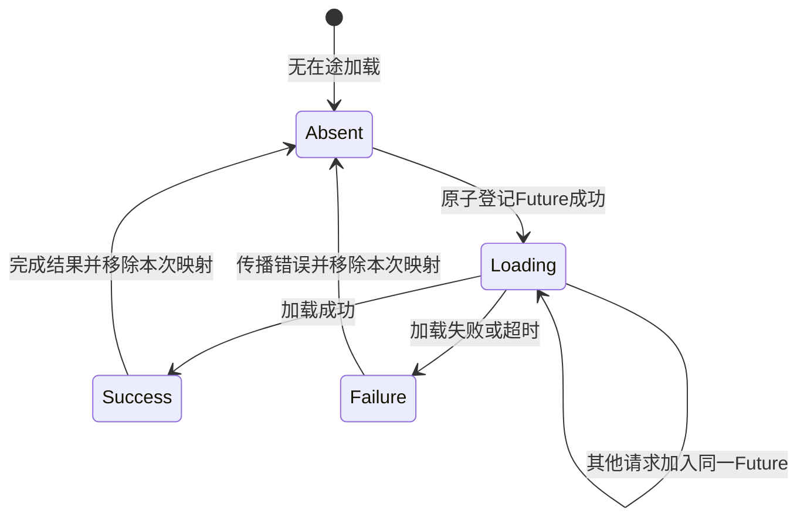
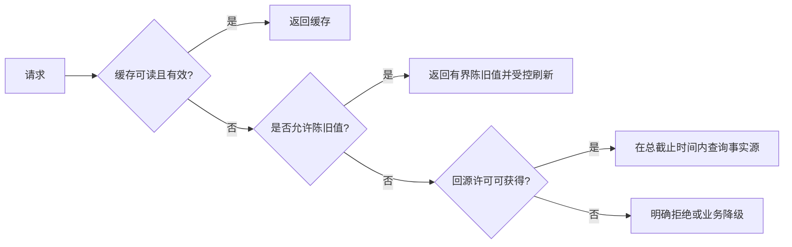

# 缓存一致性与热点治理实战

> 本章假设数据库保存业务事实，Redis 是允许丢失、可重建的派生缓存。若 Redis 本身承载事实状态，持久化、复制和恢复要求必须重新设计，不能直接沿用本章降级方法。

**阅读主线**：陈旧窗口 → 并发交错 → 单飞与失效协议 → 故障容量。

**快速入口**：[面试题与参考答案](#reference-answers)。

## 阅读目录

- [1. 先定义一致性目标，再挑方案](#section-1)
- [2. Cache Aside 的三条路径](#section-2)
- [3. 两条时间线看清不一致](#section-3)
- [4. 方案比较：每种方法解决哪个窗口](#section-4)
- [5. 击穿治理：单飞、逻辑过期与锁](#section-5)
- [6. 穿透治理：不存在、非法和无权限要分开](#section-6)
- [7. 雪崩与 Redis 故障：限流比重试更关键](#section-7)
- [8. 端到端预算与容量示例](#section-8)
- [9. 一份可落地的缓存接口契约](#section-9)
- [10. 故障演练](#section-10)
- [11. 面试题与参考答案](#section-11)
- [12. 参考](#section-12)

<a id="section-1"></a>

## 1. 先定义一致性目标，再挑方案

商品描述允许数十秒陈旧、库存展示允许短暂延迟、支付结果不能显示错误终态，这些不是同一个需求。“最终一致”必须说清多久收敛、失败如何被发现、谁负责修复、哪些读必须绕过缓存。

缓存设计记录六项：事实源、key 组成、写入者、有效期、失效机制、恢复机制。缺任意一项，系统可能在正常流量时看起来工作，在消息丢失或权限变更后长期错误。

### 1.1 key 设计不是命名小事

`order:{id}` 若没有租户、授权视角或数据版本，可能导致跨租户复用。不是所有 key 都要机械包含用户 ID，但凡返回内容受权限影响，要么缓存公共数据后鉴权组装，要么将适当隔离维度纳入 key。

大版本结构变化使用 namespace/version，避免新旧应用互相反序列化失败。key 的 TTL、大小与数量应有可统计约束，不要用随机无限 key 隐藏淘汰和增长问题。

<a id="section-2"></a>

## 2. Cache Aside 的三条路径

### 2.1 读命中

从缓存得到值后还要检查结构版本和业务语义；负缓存、逻辑过期和正常值不能只靠空字符串混在一起。日志记录命中结果类型，不打印完整个人信息。

### 2.2 读未命中

回源数据库，再按既定 TTL 缓存。缺失与依赖错误要分开：数据库查询失败不能当作“不存在”写进负缓存，否则短暂故障会被放大成长期业务不可见。

### 2.3 写入

通常先更新数据库再删除缓存，避免“删后库还没更新，旧值被回填”的明显窗口。但它并非严格一致，仍有并发回填和删除失败两类关键问题。

<a id="section-3"></a>

## 3. 两条时间线看清不一致

### 3.1 先删缓存、后更新数据库

```text
t1 写线程 W：删除缓存
t2 读线程 R：缓存未命中，读库得到旧值 v1
t3 R：把 v1 写回缓存
t4 W：数据库提交 v2
结果：缓存持续返回 v1，直到过期或再次失效
```

### 3.2 先更新数据库、后删缓存仍可能旧值回填

```text
t1 R：缓存未命中，读库拿到 v1，随后暂停
t2 W：数据库提交 v2
t3 W：删除缓存
t4 R：恢复，将手里的 v1 写入缓存
结果：v1 再次覆盖缓存，删除已经发生过
```

第二种窗口需要特定时序，但长尾查询、GC、线程调度都会让它真实发生。“概率低”是风险评估，不是正确性证明。

<a id="section-4"></a>

## 4. 方案比较：每种方法解决哪个窗口

### 4.1 旧值回填如何越过一次成功失效

**图 1｜旧值回填如何越过一次成功失效**



**图解**：错误不在 DEL 没执行，而在旧读取结果的生命周期超出了失效动作。删除操作只改变当时缓存状态，不能撤销其他线程已经拿到的旧数据。因此仅提高删除成功率，仍不能阻止这种交错。

把不变量写成“缓存版本永不低于已知提交水位”，才能推导解决方法：加载结果必须带版本，写入时比较可信水位；水位不能随着 payload 删除而立即消失。若水位来自异步通知，在通知尚未到达的窗口仍可能陈旧，强一致读需绕过这个模型。

| 方案 | 能改善的点 | 仍需处理 |
| --- | --- | --- |
| TTL | 限制部分陈旧持续时间 | 到期风暴、持续旧回填、时间窗口 |
| 延迟双删 | 缩小某些旧读回填窗口 | 延迟无法覆盖任意暂停，删除也会失败 |
| 消息/CDC 失效 | 提高删除可重试及可恢复性 | 延迟、重复、乱序、积压 |
| 缓存版本检查 | 阻止已知旧版本覆盖新版本 | 缓存空缺时的最低可信版本 |
| 同 key 串行化 | 简化部分竞争 | 热点吞吐、分布式串行化成本 |
| 强一致路径直接读事实源 | 避免该路径的缓存陈旧 | 数据库容量及事务隔离 |

### 4.2 为什么“带版本”也不是万能口号

假设缓存 v2 被删除后，旧请求 v1 向空 key 写入；如果脚本只比较“当前 key 版本”，空 key 没有 v2 信息，旧值仍会被接受。需要保留独立版本水位/墓碑、在持久事实源校验或调整协议，且水位保留时间必须覆盖旧请求最长生命周期。

不同业务可选择不同成本：订单结果读主库、商品详情允许短陈旧并定期对账、搜索读模型使用单调业务版本覆盖。不要全站统一套最复杂方案。

<a id="section-5"></a>

## 5. 击穿治理：单飞、逻辑过期与锁

### 5.1 单飞的状态机与清理责任

**图 2｜单飞的状态机与清理责任**



**图解**：single-flight 的 Map 保存的是“正在发生的加载”，不是永久结果缓存。成功和失败都必须释放这一身份，否则失败 Future 会被后续请求反复复用。清理采用 `remove(key, thisFuture)`，防止旧任务完成时误删后来登记的新加载。

等待者超时只退出该等待者，不宜默认取消所有人共享的加载；真正加载者的截止时间由统一策略控制。Map 中不同 key 的数量同样要限制，否则穿透攻击可制造海量不同 key，即使每个 key 都只加载一次，系统仍会耗尽资源。

热点 key 到期时，1 万个并发请求可能同时回源。只给 TTL 加随机值能减少多 key 同时过期，不能解决单个热 key 的突发。

### 5.2 进程内 single-flight

相同 key 的在途加载合并成一个任务，其他请求等待结果。实现需处理失败时清理、等待超时、异常传播、加载者取消和最大 key 数；不能把失败 Future 永久留在 Map。

多副本各自单飞仍可能同时回源，最坏约为副本数份。根据数据库容量判断是否还需要跨副本协调，而不是默认加分布式锁。

### 5.3 逻辑过期

缓存记录 payload、loadedAt、freshUntil 等元信息。过了 freshUntil 可以短暂返回旧值，并只触发一个刷新任务；超过可容忍的 staleUntil 则必须回源、拒绝或降级。

适合允许陈旧的公共读，不适合把过期权限、支付状态或安全策略继续当作有效。刷新线程池有界，防止热点变化导致无限后台任务堆积。

### 5.4 分布式互斥重建

获得租约者回源，其他请求有限等待或返回允许的旧值。租约必须覆盖合理加载时间并处理到期竞争，但无论如何不能证明任意暂停下只有一个加载者；回源保护的核心目标是限并发，不一定需要把“缓存构建者唯一”当成业务正确性基础。

<a id="section-6"></a>

## 6. 穿透治理：不存在、非法和无权限要分开

输入校验拒绝明显无效 ID；不存在的数据可用短 TTL 负缓存。没有权限的数据不能简单缓存为“全局不存在”，否则可能影响其他合法用户；更不能让一个租户探测另一个租户的实体存在性。

布隆过滤器可以快速判定“一定不在集合”，但可能误判存在。错误加入流程、历史导入和过滤器重建可能产生业务上的漏判，因此新增数据必须考虑过滤器同步顺序，查询也要有受控兜底。

过滤器容量及误判率影响位数与哈希次数，实际规模超出设计会让误判率恶化。删除通常不能直接清位，否则影响其他元素；需要计数结构或重建等协议。

<a id="section-7"></a>

## 7. 雪崩与 Redis 故障：限流比重试更关键

缓存故障时如果所有请求无上限回源，数据库会被突发压垮。系统应对不同接口设置回源并发、排队上限、可接受旧值及拒绝策略；降级内容需保持业务正确，不能伪造成功支付或可用库存。

**图 3｜雪崩与 Redis 故障：限流比重试更关键**



**图解**：缓存失败后仍先经过陈旧策略和回源许可，而不是所有请求直接冲数据库。拒绝是保护系统的明确结果，不能伪装为业务成功。

恢复阶段同样危险：批量预热和积压刷新会造成第二波压力。按业务热度分批恢复，监测数据库连接等待、缓存填充速率和错误率，不要一次全量重建。

<a id="section-8"></a>

## 8. 端到端预算与容量示例

假设入口 20,000 QPS，正常命中率 99%，数据库约承接 200 QPS；缓存完全失效后可能突然变为 20,000 QPS，即 100 倍。即使命中率只从 99% 降到 95%，回源也从 200 到 1,000 QPS，放大 5 倍。

若数据库安全回源预算 500 QPS，限额要在缓存失效路径实施，并考虑多应用副本的总量。本地每副本 500 并不等于全局 500。请求截止时间包含缓存等待、锁等待、数据库和序列化，不应给每段分别配完整的 2 秒后又声称总请求 2 秒。

<a id="section-9"></a>

## 9. 一份可落地的缓存接口契约

缓存层应区分 Hit(value, version)、Miss、NegativeHit、Unavailable，而不是一律返回 null。调用层据业务语义决定回源与降级；观察指标也按这些状态分组。

加载结果的写入不应该延长旧数据寿命到无界。给每次加载记录开始时刻、业务版本和截止时间，超过最大生命周期的旧请求结果禁止回填；若要求更强保证，再结合持久版本水位。

缓存序列化明确 schemaVersion；升级期间兼容旧版本或使用新 namespace。反序列化失败只应影响相应缓存条目，不能让请求无限重试读取同一坏值。

<a id="section-10"></a>

## 10. 故障演练

| 注入故障 | 需要验证的不变量 | 关键观测 |
| --- | --- | --- |
| 热 key 同时到期 | 回源数不随请求数无限增长 | single-flight 合并率、DB 并发 |
| Redis 超时 | 请求不被无限悬挂 | 总 deadline、拒绝率、重试数 |
| 删除缓存失败 | 能最终失效且有积压告警 | outbox/CDC 延迟、失败事件 |
| 旧读暂停后恢复 | 不超出定义的陈旧窗口 | 版本、加载时间线 |
| 全量恢复预热 | 不造成第二次数据库过载 | 预热速率、池等待、P99 |
| 权限变更 | 无越权缓存复用 | 租户/用户维度抽样审计 |

演练在可控环境进行，先定义停止条件。只测平均延迟会掩盖大量排队，至少记录吞吐、P95/P99、错误率和最老刷新任务年龄。

<a id="reference-answers"></a>

<a id="section-11"></a>

## 11. 面试题与参考答案

### Q1：你如何设计缓存与数据库的一致性？

**参考答案**：我先按业务区分必须读最新和允许有界陈旧两类路径。数据库作为事实源时，一般采用 Cache Aside，并在数据库提交后可靠失效；关键事件通过 outbox/CDC 持久化重试，避免提交后进程崩溃导致永久漏删。读结果携带版本，防止旧加载覆盖新值；缓存为空时还需独立水位或其他协议，不能只比较当前 payload。允许陈旧的路径设置 TTL、对账和告警，必须最新的交易确认则读取符合新鲜度要求的事实源。

### Q2：延迟双删为什么不能证明严格一致？

**参考答案**：它假设旧读在第二次删除前已经完成，但线程暂停、数据库长尾和网络等待没有统一固定上界；第二次删除本身也可能失败。它能降低部分交错出现的概率，却不能排除旧结果更晚回填。若采用，应说明延迟依据、失败重试和允许陈旧窗口；需要严格保证时必须改变协议或读取路径。

### Q3：single-flight 与分布式锁有什么不同？

**参考答案**：进程内 single-flight 合并同 key 的并发加载，共享一个 Future，易实现且没有跨机器租约问题，但多副本仍可能各自回源。分布式锁进一步协调副本，成本是网络、租约、失效与恢复复杂度。对缓存构建，通常先按副本数估算剩余回源能否承受，结合全局准入保护；不应为了“唯一加载者”把业务正确性建立在会过期的锁上。

### Q4：缓存全部不可用时，如何保证数据库不被拖垮？

**参考答案**：先算放大倍数，例如 99% 命中时回源仅 1%，全失效后可能放大 100 倍。按数据库安全预算限制回源并发和速率，等待有上限；可陈旧的公共读返回有界旧值，交易读超预算则明确拒绝或进入业务降级。恢复时分批预热和放开流量，监控数据库等待、P99、拒绝率及最老刷新任务年龄，避免恢复风暴。

<a id="section-12"></a>

## 12. 参考

- [Redis 客户端缓存及失效模型](https://redis.io/docs/latest/develop/reference/client-side-caching/)
- [Redis 分布式锁安全边界](https://redis.io/docs/latest/develop/clients/patterns/distributed-locks/)
- [Redis 延迟诊断](https://redis.io/docs/latest/operate/oss_and_stack/management/optimization/latency/)
- 下一章：[持久化、复制、集群与故障恢复](03_持久化复制集群与故障恢复.md)
