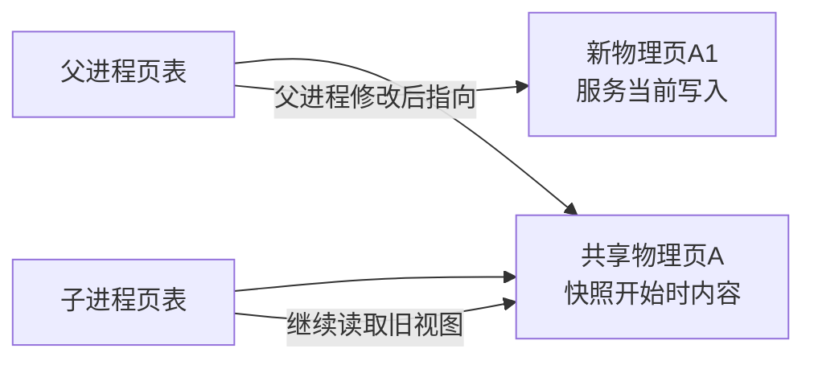
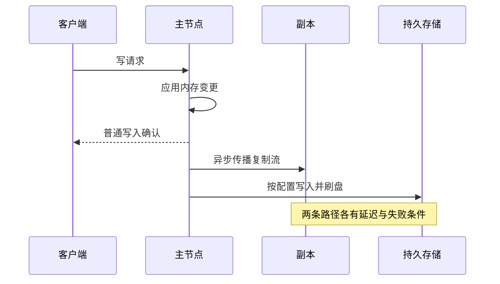

# Redis 持久化、复制、集群与故障恢复

> 基线：Redis 7.x 开源部署模型。持久化提高重启恢复能力，复制提高副本冗余，故障切换改善可用性，分片扩展容量；这四者不是同一个功能，也不能相互完全替代。

**阅读主线**：快照与刷盘 → 复制确认 → 切换与分片 → 所有权与恢复。

**快速入口**：[面试题与参考答案](#reference-answers)。

## 阅读目录

- [1. 用 RPO/RTO 组织设计](#section-1)
- [2. RDB：快照与写时复制](#section-2)
- [3. AOF：记录、刷盘与重写](#section-3)
- [4. 主从复制：确认不等于副本已持久化](#section-4)
- [5. Sentinel：检测、协商与切换](#section-5)
- [6. Cluster：槽位、路由与多 key 限制](#section-6)
- [7. 分布式锁：复制模型如何影响安全](#section-7)
- [8. 观测：从应用延迟到系统根因](#section-8)
- [9. 恢复演练的完整步骤](#section-9)
- [10. 面试题与参考答案](#section-10)
- [11. 参考](#section-11)

<a id="section-1"></a>

## 1. 用 RPO/RTO 组织设计

RPO 讨论最多可丢多少数据，RTO 讨论多快恢复服务。对可重建缓存，部分数据丢失可以接受，但恢复时数据库承压仍需预算；对无法重建的事实状态，不能直接使用“缓存可丢”的假设。

多副本不等于备份：误删除和错误业务写入也可能复制到所有副本。备份需要独立保留与可恢复版本，恢复演练要验证数据以及接流后的业务行为。

<a id="section-2"></a>

## 2. RDB：快照与写时复制

后台快照通常通过 fork 子进程持久化某个时间点的数据视图，父进程继续处理请求。写时复制让父子最初共享物理页，父进程修改数据时产生额外页副本，因此高写入期间峰值内存会明显增加。

### 2.1 RDB 的写时复制不是复制整个堆

**图 1｜RDB 的写时复制不是复制整个堆**



**图解**：fork 后最初共享物理页，后续写入触发对应页的复制，不是每次修改都复制整个 Redis 数据集。额外内存与修改页覆盖率、快照时长和负载有关；高写入与慢磁盘叠加，会延长子进程存活并增加被复制页。因此内存预算需要包含快照期间峰值，不能只给稳态数据留空间。

### 2.2 成本不只在生成文件

fork 本身、页表、内存压力、磁盘吞吐及大页设置都可能影响延迟。大数据集不能只看 RDB 文件大小，还要测生成时长、写入峰值和故障恢复时间。

RDB 适合紧凑快照和较快加载，但快照后尚未纳入文件的写入可能丢失。快照周期不是精确的 RPO 保证，生成失败和备份失败也要计入。

<a id="section-3"></a>

## 3. AOF：记录、刷盘与重写

AOF 将写操作相关记录持久化，常见策略包括每次、每秒或由系统控制刷盘。每秒策略常被简化为“最多丢一秒”，实际还受到磁盘、系统和故障时序影响，应把它视为策略目标而非对所有事故的硬保证。

### 3.1 write 与 fsync 的区别

写入操作系统缓存不等于数据已稳定落到存储。刷盘策略影响丢失窗口，也影响延迟；存储设备、虚拟化和文件系统同样影响真实语义。

### 3.2 为什么需要重写

同一个计数器累计 INCR 一百万次，恢复并不一定需要重放所有历史操作，可以用更紧凑的当前状态重建文件。AOF 重写减少冗余，不等于停止写入做全量复制；重写期间的新写入仍需要被正确纳入后续可恢复状态。

Redis 7 引入的多部件 AOF 组织涉及基础文件、增量文件及 manifest。备份/恢复不能想当然只复制一个旧名字 appendonly.aof，必须按部署版本理解完整文件集合。

### 3.3 RDB 与 AOF 对比

| 维度 | RDB | AOF |
| --- | --- | --- |
| 表达 | 时间点快照 | 基础状态与后续写记录 |
| 文件与恢复 | 通常紧凑、加载较直接 | 大小和重放成本受重写策略影响 |
| 丢失窗口 | 快照间隔及失败情况 | 刷盘策略和故障条件 |
| 运行成本 | fork、写时复制、快照 I/O | 持续写、fsync、重写 I/O |
| 适用 | 可重建缓存、备份 | 需要更小丢失窗口的恢复 |

<a id="section-4"></a>

## 4. 主从复制：确认不等于副本已持久化

### 4.1 写成功、复制与持久化的三个时间点

**图 2｜写成功、复制与持久化的三个时间点**



**图解**：这是普通异步模型的示意，图中顺序不代表所有配置都按同一物理时序完成。收到成功、某副本收到数据、数据稳定落盘，分别回答不同问题。WAIT 类机制增加副本确认条件，但仍需要分析被提升副本的选择与持久化条件。

主节点接受写入，再将变更传播给副本，普通异步复制下存在复制延迟。客户端收到主节点成功，主节点随后故障，而新主尚未拥有该写入，数据就可能丢失。

WAIT 可以等待一定数量副本确认相关复制进度，提高某些条件下的数据安全性，但不能把系统变成任意故障下的强一致数据库；副本持久化、后续切换及网络分区仍要分析。

### 4.2 全量同步与部分同步

副本首次连接或无法补齐缺口时需要全量同步，通常涉及快照和后续增量；短暂断连若复制身份和 backlog 范围满足条件，可以进行部分重同步。

backlog 大小应覆盖可接受断连期间的写入字节量，粗估为峰值复制流量乘恢复时间并加余量。过小会频繁全量同步，过大增加内存，不能仅复制网上统一数值。

### 4.3 慢副本的放大效应

慢副本让复制缓冲增大，达到限制可能断连，随后全量同步又增加网络、CPU 和 fork 压力。根因可能是磁盘、网络或副本自身长暂停，不应只增大缓冲掩盖。

<a id="section-5"></a>

## 5. Sentinel：检测、协商与切换

Sentinel 监视主从状态，先形成主观下线判断，再在满足条件时形成客观下线及后续故障转移决策。检测仲裁和执行切换需要的多数授权是相关但不同的概念，不能把 quorum 简化成所有流程唯一的票数。

### 5.1 切换为何有窗口

故障检测需要时间，选举和副本提升需要时间，客户端发现新主并重建连接也需要时间。SLA 应包括完整窗口，而不是只看 Sentinel 内部某一阶段。

旧主在网络分区时可能继续被部分客户端访问，恢复后要重新加入拓扑。通过最小副本及延迟相关写约束可以减少某些风险，但会牺牲可用性，不能宣称完全消除双主写入或丢失。

### 5.2 客户端也是系统一部分

客户端应支持 Sentinel 地址发现、认证、连接重建和有限重试。写超时后结果不明确，重试 INCR 等非幂等操作可能重复执行。应用需设计稳定操作身份，而不是在底层连接库里盲目重试一切。

<a id="section-6"></a>

## 6. Cluster：槽位、路由与多 key 限制

Cluster 使用 16,384 个槽分配 key，节点管理槽位及复制关系。客户端计算槽位并路由请求，拓扑变化时处理 MOVED 等响应；迁移中 ASK 等临时重定向也有不同含义。

hash tag 让特定 key 共槽，可以支持相关多 key 操作。但把整个租户全部放一个 tag 可能让大租户成为单分片热点；共槽便利和分布均衡需要权衡。

### 6.1 迁移不是无成本

迁移占用网络和节点资源，大 key 可能显著增加搬迁时延。扩容前确认客户端支持重定向，脚本不跨槽，批量命令的分组策略正确；扩容后观察分片倾斜而不是只看集群总内存。

### 6.2 分片不自动拆热 key

一个 key 仍属于一个槽/分片，增加节点不能让单个热计数器自然分散。读热点用本地缓存或复制读取要考虑陈旧，写热点分桶要定义如何聚合和限额。

<a id="section-7"></a>

## 7. 分布式锁：复制模型如何影响安全

单主 SET NX 成功后尚未复制，主节点故障，副本提升后没有锁，新客户端可以获得同名锁。旧客户端仍在执行，就存在两个执行者。

即便没有切主，租约过期也能出现旧持有者继续执行。token 比较解锁只防止旧持有者误删新锁，不能阻止旧持有者写业务资源。需要资源端 fencing 或数据库条件约束来拒绝过期身份。

```text
旧持有者 token=101，长暂停
租约过期，新持有者 token=102 获得锁并写入资源
旧持有者恢复，尝试 token=101 写入
资源服务记录最高已接受 token=102，拒绝 101
```

fencing 需要可靠的单调令牌源和资源端校验。仅生成随机 UUID 不能表达新旧顺序；也不能在会回滚/重置的计数器上未经分析就承诺全局单调。

<a id="section-8"></a>

## 8. 观测：从应用延迟到系统根因

| 层次 | 观察内容 | 能回答的问题 |
| --- | --- | --- |
| 应用 | 命令总时延、连接等待、超时、重试 | 用户时间花在哪 |
| 命令 | SLOWLOG、操作分布、返回量 | 是否慢命令或大结果 |
| 内存 | used_memory、RSS、碎片、缓冲 | 是数据增长还是额外分配 |
| 复制 | offset、链路、全量同步、延迟 | 切换与数据风险 |
| 持久化 | fork、重写、fsync、错误状态 | 后台工作是否影响尾延迟 |
| 系统 | CPU、磁盘、网络、宿主内存 | 是否外部资源瓶颈 |

SLOWLOG 不包含所有客户端网络和排队时间；应用很慢但 SLOWLOG 很短，仍可能是连接池、网络、大响应或客户端调度。

<a id="section-9"></a>

## 9. 恢复演练的完整步骤

1. 记录拓扑、配置、版本、认证和数据源，明确哪些数据能重建。
2. 从独立备份恢复到隔离实例，检查文件完整性和启动日志。
3. 比较 key 数量、类型、TTL 分布和业务抽样，不只检查 PING。
4. 验证客户端发现、连接恢复和读写路由，观察超时后的重试行为。
5. 控制预热与回源速度，再逐步接流，避免空缓存压垮数据库。
6. 对事实状态进行对账，记录实际数据缺口和恢复耗时。

验收用实际测量的 RPO/RTO、业务不变量和告警时间，不用“主从都起来了”代替恢复成功。

<a id="reference-answers"></a>

<a id="section-10"></a>

## 10. 面试题与参考答案

### Q1：RDB、AOF、复制与备份如何配合？

**参考答案**：RDB 提供时间点快照，AOF 缩小某些配置下的重启恢复缺口，复制提供在线冗余及切换基础，独立备份应对误操作和历史恢复。它们不能互相替代：误删会复制，快照后写入可能未持久化，副本也可能落后。我会按可重建性、RPO/RTO、数据量和写入峰值选择组合，并在隔离实例恢复验证，而不只检查备份文件存在。

### Q2：acks 类比到 Redis，WAIT 能否让写入绝不丢失？

**参考答案**：不能。WAIT 增加特定副本复制确认要求，提高部分故障条件下的安全性，但复制确认不自动等价于所有副本稳定落盘，也不改变所有切换与分区条件。需要明确节点故障模型、持久化策略、切主对象和客户端重试。对无法接受数据缺口的业务事实，应选择满足相应事务和一致性要求的存储方案，不能仅靠一句 WAIT 承诺。

### Q3：Sentinel 与 Cluster 分别解决什么问题？

**参考答案**：Sentinel 围绕主从组进行监测、故障判断和转移；Cluster 还将 key 空间划为槽并提供分片路由与相应副本切换。Sentinel 不自动拆数据，Cluster 不会把一个热 key 拆到多台。两者都要求客户端理解拓扑变化，并在结果不明确时按业务身份重试；部署选型需同时考虑容量、热点和恢复目标。

### Q4：为什么随机锁 token 还不能防止旧持有者写资源？

**参考答案**：随机 token 的比较删除只能证明“我删除的是自己的锁”，无法让已经失去租约的旧进程停止执行。fencing 使用可验证的新旧顺序，资源端记录最高已接受令牌并拒绝旧令牌写入。令牌必须单调且资源端真正校验；若计数器可能回退，或资源根本不检查，方案仍不成立。数据库条件更新和唯一约束也可直接保护相应业务不变量。

<a id="section-11"></a>

## 11. 参考

- [持久化](https://redis.io/docs/latest/operate/oss_and_stack/management/persistence/)
- [复制](https://redis.io/docs/latest/operate/oss_and_stack/management/replication/)
- [Sentinel](https://redis.io/docs/latest/operate/oss_and_stack/management/sentinel/)
- [Cluster 规范](https://redis.io/docs/latest/operate/oss_and_stack/reference/cluster-spec/)
