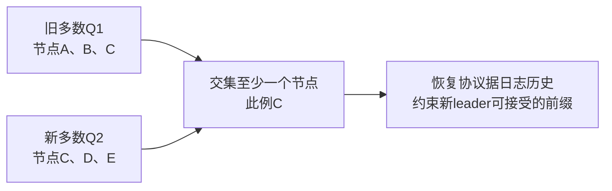
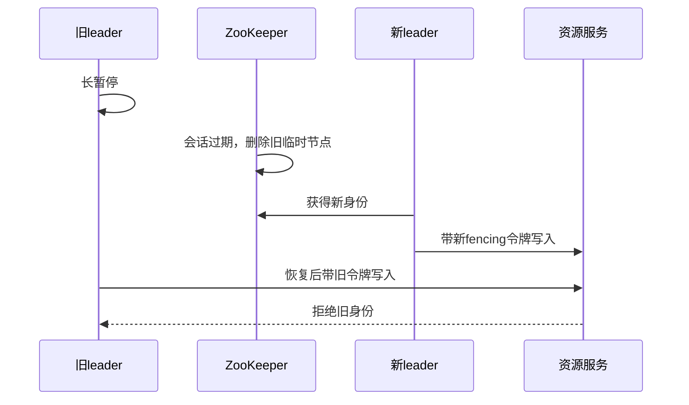

# ZooKeeper ZAB、会话、监听与分布式协调深入解析

> 基线：ZooKeeper 3.9.x。ZooKeeper 维护协调状态，不是用来保存大量业务内容的数据库；理解它的价值要同时理解它不提供哪些应用保证。

**阅读主线**：状态与会话 → 多数及历史 → watch恢复 → 锁与fencing。

**快速入口**：[面试题与参考答案](#reference-answers)。

## 阅读目录

- [1. 协调服务究竟协调什么](#section-1)
- [2. znode、版本与会话](#section-2)
- [3. ZAB：为什么写入有序、为什么需要多数](#section-3)
- [4. 读一致性：不要套“强一致所以任意读最新”](#section-4)
- [5. Watch：通知不是完整事件日志](#section-5)
- [6. 分布式锁的完整竞争流程](#section-6)
- [7. 服务发现与配置发布](#section-7)
- [8. ACL、认证与运维边界](#section-8)
- [9. 线上问题的诊断顺序](#section-9)
- [10. 故障演练与验收](#section-10)
- [11. 面试题与参考答案](#section-11)
- [12. 官方资料](#section-12)

<a id="section-1"></a>

## 1. 协调服务究竟协调什么

服务发现、配置发布、领导者选举、分布式锁都需要多个进程对某些小状态达成一致观察。与把所有数据丢进 ZooKeeper 不同，合理做法是将大内容存储在数据库/对象存储，只在 znode 保存地址、版本或协调身份。

协调状态一旦成为业务写入的前置条件，其可用性就影响整条业务链。选择 ZooKeeper 要评估法定多数、故障域、磁盘和客户端恢复能力，而不是认为“集群部署了就永远可靠”。

<a id="section-2"></a>

## 2. znode、版本与会话

znode 记录数据和 stat 元信息，包括数据版本、子节点变化及事务相关身份。setData 等操作可携带期望版本，实现 compare-and-set：读取后按版本写，冲突则重新读取和判断。

### 2.1 持久、临时与顺序

| 属性 | 行为 | 约束 |
| --- | --- | --- |
| 持久节点 | 不随客户端会话结束自动消失 | 需要显式清理 |
| 临时节点 | 随所属会话过期删除 | 暂时断连不等于立即过期 |
| 顺序节点 | 创建时附加序号 | 序号作用域及溢出需按实现理解 |
| 带容器/TTL 等类型 | 服务特定清理模式 | 按版本和启用条件使用 |

临时节点与会话绑定，不是与某个应用线程、一个 TCP 包或某次业务锁定方法绑定。会话过期后客户端再连上，不会自然恢复旧锁身份。

### 2.2 连接状态与业务状态分开

Connected、Disconnected、Expired 等状态表示客户端与服务端的不同关系。短暂 Disconnected 时无法证明自己仍是唯一领导者；业务应按风险选择暂停写入。Expired 后必须重新建会话并重新竞争，旧任务要被资源端拒绝。

<a id="section-3"></a>

## 3. ZAB：为什么写入有序、为什么需要多数

ZAB 协议围绕 leader 建立及有序广播协调写入。leader 组织事务顺序，法定多数参与使后续领导者恢复能够基于共同历史推进。它与应用层“所有读都最新”不是同一个命题。

### 3.1 zxid 的用途

zxid 标识事务顺序，通常包含领导纪元及计数等信息。它可以帮助理解更新历史，但不应未经设计就直接替代所有业务版本、全局时间或长期无限单调 ID。

### 3.2 三节点与五节点

### 3.3 多数集合相交为什么是安全性的基础之一

**图 1｜多数集合相交为什么是安全性的基础之一**



**图解**：五节点的两个大小为3的集合不可能完全分离，这是多数设计的重要数学基础。但“有交集”本身还不是完整一致性协议：仍需要领导纪元、历史同步、消息顺序和提交规则，使新 leader 不会随意丢弃已提交历史。

可以把 ZAB 分成领导建立/恢复与正常广播两段理解：先建立被接受的领导身份并同步合适历史，再对后续提案进行有序确认和提交。只说“选 zxid 最大的节点”省略了选举、纪元及同步条件；只说“过半写入就直接本地读最新”又混淆了写协议与读路径。

| 阶段 | 核心任务 | 防止的问题 |
| --- | --- | --- |
| 领导建立与恢复 | 确认领导身份、处理历史并同步 | 旧领导身份和分叉历史直接继续服务 |
| 正常广播 | 对事务建立顺序并协调提交 | 副本以不同次序应用写入 |
| 客户端状态恢复 | 重读状态、重建监听和身份 | 将旧会话能力误当仍有效 |

### 3.4 从会话失效推导 fencing 的必要性

**图 2｜从会话失效推导 fencing 的必要性**



**图解**：临时节点消失不可能远程撤销旧进程已经执行到一半的代码。真正产生副作用的资源服务必须能辨别新旧，才把协调身份失效转化为业务写入失效。若资源不验证令牌，图中最后一步就不会成立。

三节点需要多数存活，可容忍一个节点故障；五节点可容忍两个，但写入协作、网络和运维成本也增加。跨可用区部署要保证常见故障后仍有多数，跨区域高延迟会直接影响写路径。

增加 follower 可以提高某些读承载，却不能简单线性提升写吞吐。慢磁盘和频繁 GC 会影响协商及客户端会话，不应只以节点数论可靠性。

<a id="section-4"></a>

## 4. 读一致性：不要套“强一致所以任意读最新”

客户端可从连接的服务器读取，服务器可能尚未处理最新事务。ZooKeeper 提供有序等保证，但某个客户端看到的状态和另一个刚完成写入的客户端之间仍需协议分析。

需要某种更新可见性时，结合 sync、版本和应用请求顺序；sync 也要按官方语义理解，不应当成万能线性化按钮。若业务需要从协调节点读取后立即授权不可逆写入，仍应在资源服务维护版本/令牌约束。

<a id="section-5"></a>

## 5. Watch：通知不是完整事件日志

传统 watch 通常一次触发后解除，客户端需重新注册；持久 watch 是另外的版本能力。即便使用持久 watch，也要处理断连、状态恢复和事件合并，不能替代可靠业务事件总线。

### 5.1 正确的“读取并监听”循环

```text
读取当前状态并设置 watch
  -> 根据当前状态更新本地视图
收到通知
  -> 重新读取完整需要的状态并再次设置 watch
连接恢复/会话变化
  -> 重新同步，丢弃无法证明仍有效的旧身份
```

重点是通知促使重新读取，业务不应仅在本地累加“收到三次变化，所以版本加三”。漏过中间多次变化时，最终状态仍可以重建；需要每条事件审计则用专门日志系统。

### 5.2 回调线程不要干重活

客户端事件回调中进行长数据库操作会拖延后续通知与状态处理。回调快速投递到有界业务执行器，状态更新要处理顺序与取消；不能为了异步又引入无界排队。

<a id="section-6"></a>

## 6. 分布式锁的完整竞争流程

1. 在约定路径创建临时顺序节点，节点带可识别的本次竞争标记。
2. 获取子节点并排序，若自己的节点最小则成为候选持有者。
3. 否则仅监听前驱，前驱变化后重新读取并判断。
4. 读取到前驱与设置监听之间可能发生删除，需要使用正确 API 及循环处理竞态。
5. 释放时删除自己的节点；会话过期时身份无效。

监听前驱减少惊群：一个节点释放时通常只唤醒相邻等待者，而非全体竞争者。实际生产优先使用成熟配方库，仍需理解该库在 SUSPENDED/LOST 等状态下的业务约定。

### 6.1 创建成功但响应丢失

客户端收到连接异常不能确认节点未创建。直接再建一个会产生多个候选节点，需要利用本次竞争标记查询已有节点，或者使用库提供的保护机制。重试必须处理“结果不明”，不是简单重新执行 create。

### 6.2 锁释放了，旧进程为何还能执行

旧客户端长暂停，会话过期，临时节点被删除，新客户端获得锁；旧客户端恢复后仍可能继续执行之前的代码。ZooKeeper 不能远程让旧 CPU 停止，资源端需要 fencing token 或业务条件约束拒绝旧身份。

锁配方解决竞争次序，不自动证明外部副作用互斥。领导者选举、调度器和分片拥有者同样存在这个问题。

<a id="section-7"></a>

## 7. 服务发现与配置发布

服务注册保存地址、实例身份和必要元数据，消费者通过父节点 watch 等维护本地视图。实例存在不代表业务已就绪，健康与接流还需独立机制；临时节点删除有会话窗口，路由必须允许实例暂时不可达。

配置发布采用版本化内容和指针切换更易回滚：先写新版本并校验，再更新当前版本指针。消费者重新读取后验证 schema/签名和范围，加载失败时保留明确的旧配置策略，而不是半更新本地对象。

大量客户端同时重载配置可能对数据库、连接池和下游造成冲击，要加抖动与分批应用；配置管理也有容量问题。

<a id="section-8"></a>

## 8. ACL、认证与运维边界

ACL 控制节点的读写/管理权限，认证方案与 TLS 等需要按部署启用。不能因为协调集群位于内网就允许任意应用修改选举和锁路径。

不同应用使用独立命名空间及最小权限，变更审计记录操作者和版本。备份要保留能共同恢复的快照及事务日志，日志清理按官方工具和保留策略，不随意删除正在使用的文件。

<a id="section-9"></a>

## 9. 线上问题的诊断顺序

### 9.1 会话频繁过期

先对齐客户端 GC/暂停、网络、服务端延迟和磁盘 fsync。增大 session timeout 可能减少误判，但也延长故障身份的保留时间，影响接管速度；必须结合业务容错目标。

### 9.2 选主频繁

检查网络分区、节点资源、磁盘和多数是否稳定。应用大量重连可能是后果，也可能继续放大压力；保留 leader 变化及 client reconnect 时间线。

### 9.3 Watch 和节点爆炸

检查每实例注册数量、重试是否泄漏节点、是否把订单等高频实体存进集群。协调元数据应有上限和清理机制，不能把“内存里还能放”当容量规划。

<a id="section-10"></a>

## 10. 故障演练与验收

| 场景 | 预期 | 验收证据 |
| --- | --- | --- |
| follower 短暂故障 | 法定多数下继续服务 | 写延迟、会话和恢复日志 |
| leader 故障 | 在目标窗口完成接管 | 选举时间线与客户端恢复 |
| 旧领导者暂停 | 新领导者接管，旧令牌被拒绝 | 资源端最高令牌记录 |
| 创建确认丢失 | 不生成无法识别的重复竞争身份 | 节点标记与重试记录 |
| 客户端断连重连 | 重建当前状态 | 不依赖所有中间 watch 事件 |
| 备份恢复 | 数据/ACL/配置可用 | 隔离集群验证与 RTO |

<a id="reference-answers"></a>

<a id="section-11"></a>

## 11. 面试题与参考答案

### Q1：ZooKeeper 锁能否保证外部业务绝对互斥？

**参考答案**：锁配方能协调有效会话下的竞争顺序，但旧持有者暂停、会话过期后仍可能恢复执行。新持有者已经取得身份时，旧进程不会被 ZooKeeper 远程停止，因此外部资源必须校验 fencing 或使用数据库条件更新保证不变量。与 Redis 比较要分析会话、复制和租约语义，不能仅把组件称为“强一致”就省略资源端保护。

### Q2：Watch 为什么不能当可靠事件日志？

**参考答案**：传统 watch 通常触发一次后需要重新注册，通知表示状态变化，不保证提供业务需要的全部中间事件；持久 watch 也不能免除断连和会话恢复。正确客户端收到通知后重新读取当前状态，恢复连接时重建本地视图。需要每条事件审计和重放时，应另用持久日志系统。

### Q3：为什么通常用三或五个投票节点？

**参考答案**：多数提交要求超过半数，三节点丢一台仍有两票，五节点丢两台仍有三票；两节点丢一台就没有多数。奇数常能以较少资源获得相同容错级别，但可用区布置同样重要。增加节点还增加写协作成本，不能把节点数当吞吐线性扩容按钮。

### Q4：临时注册节点已删除，为什么请求仍到旧实例？

**参考答案**：消费者有本地视图和路由缓存，通知及更新有传播延迟，已有 TCP 连接也可能继续复用。实例退出要先停止接新业务、等待摘流传播并按截止时间处理在途请求；调用方具备连接失败和重试治理。注册中心只是发现链路的一环，删除节点不等于全网瞬时撤流。

<a id="section-12"></a>

## 12. 官方资料

- [3.9.3 Programmer's Guide](https://zookeeper.apache.org/doc/r3.9.3/zookeeperProgrammers.html)
- [3.9.3 Recipes](https://zookeeper.apache.org/doc/r3.9.3/recipes.html)
- [3.9.3 Administrator's Guide](https://zookeeper.apache.org/doc/r3.9.3/zookeeperAdmin.html)
